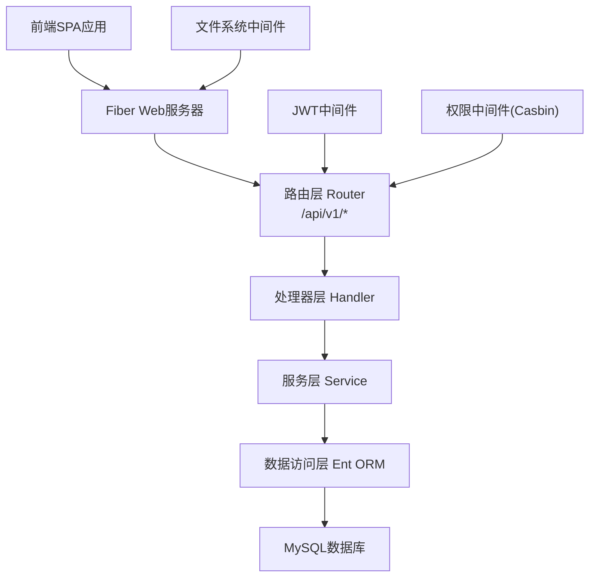
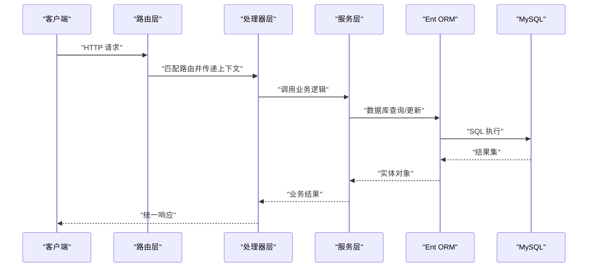
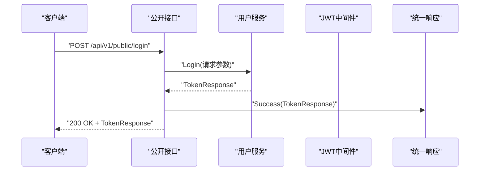
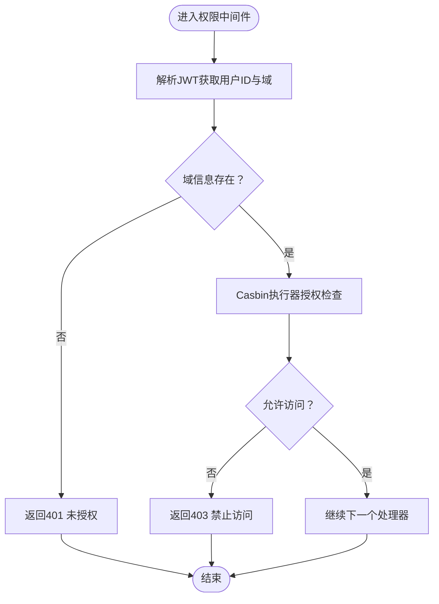
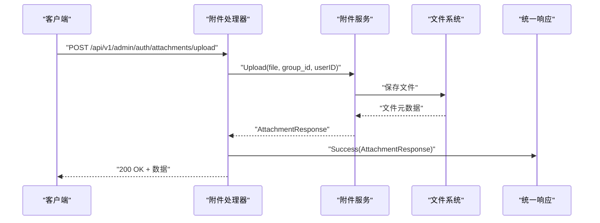
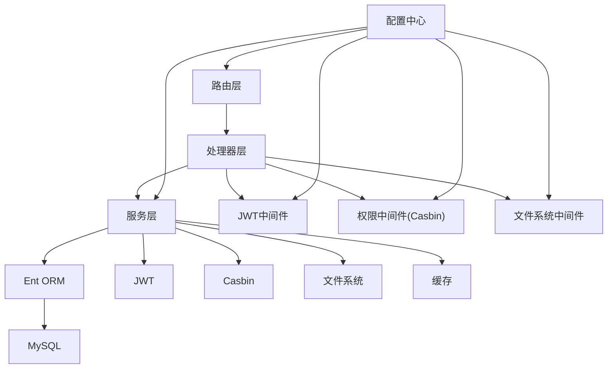

# API 接口文档

<cite>
**本文引用的文件**
- [main.go](file://main.go)
- [router.go](file://internal/router.go)
- [public.go](file://internal/handler/public.go)
- [permission.go](file://internal/handler/permission.go)
- [role.go](file://internal/handler/role.go)
- [attachment.go](file://internal/handler/attachment.go)
- [config.go](file://internal/handler/config.go)
- [permission.go](file://internal/middleware/permission.go)
- [user.go](file://internal/service/user.go)
- [response.go](file://internal/utils/response.go)
- [config.yml](file://config/config.yml)
- [swagger.yaml](file://docs/swagger.yaml)
- [README.md](file://README.md)
</cite>

## 目录
1. [简介](#简介)
2. [项目结构](#项目结构)
3. [核心组件](#核心组件)
4. [架构总览](#架构总览)
5. [详细组件分析](#详细组件分析)
6. [依赖分析](#依赖分析)
7. [性能考虑](#性能考虑)
8. [故障排除指南](#故障排除指南)
9. [结论](#结论)
10. [附录](#附录)

## 简介
本文件为 Go Admin 管理系统的完整 API 接口文档，基于 Swagger 规范生成，涵盖认证相关接口、用户管理接口、权限管理接口、文件管理接口、系统管理接口等。文档详细说明每个接口的 HTTP 方法、URL 路径、请求参数、响应格式与状态码，并提供请求/响应示例、错误处理说明、认证机制（Bearer Token）、参数验证规则、安全考虑、API 版本管理与兼容性策略、客户端集成指南与最佳实践，以及性能优化与限流策略。

## 项目结构
系统采用分层架构，主要分为路由层、处理器层、服务层与数据访问层，配合中间件实现认证与权限控制。API 基于 Fiber 框架，统一响应格式，Swagger 自动生成接口文档。

图表来源
- [router.go:16-190](file://internal/router.go#L16-L190)
- [main.go:47-108](file://main.go#L47-L108)

章节来源
- [README.md:231-258](file://README.md#L231-L258)
- [router.go:16-190](file://internal/router.go#L16-L190)
- [main.go:47-108](file://main.go#L47-L108)

## 核心组件
- 应用入口与中间件：负责初始化应用、注册路由、挂载中间件（文件系统、日志、JWT、权限）。
- 路由注册：按版本分组（/api/v1），划分公开接口与受保护接口，绑定处理器。
- 处理器层：解析请求、调用服务层、记录操作日志、返回统一响应。
- 服务层：实现业务逻辑（认证、权限、文件、配置等），调用 ORM 层。
- 统一响应：标准化响应结构，便于客户端处理。
- 配置中心：集中管理应用、数据库、缓存、文件系统、Casbin 等配置。

章节来源
- [main.go:47-108](file://main.go#L47-L108)
- [router.go:16-190](file://internal/router.go#L16-L190)
- [response.go:9-50](file://internal/utils/response.go#L9-L50)
- [config.yml:1-143](file://config/config.yml#L1-L143)

## 架构总览
系统通过路由层将请求分发至处理器，处理器调用服务层执行业务逻辑，服务层通过 Ent ORM 访问数据库；JWT 中间件负责认证，权限中间件基于 Casbin 进行细粒度授权；文件系统中间件提供静态资源与文件上传能力。

图表来源
- [router.go:16-190](file://internal/router.go#L16-L190)
- [user.go:139-218](file://internal/service/user.go#L139-L218)

## 详细组件分析

### 认证与用户管理接口
- 公开接口（无需认证）
  - GET /api/v1/public/public-key：获取 RSA 公钥，用于加密登录请求中的敏感字段。
  - POST /api/v1/public/login：用户登录，支持明文或加密字段登录。
  - POST /api/v1/admin/refresh-token：使用刷新令牌换取新的访问令牌。
- 受保护接口（需 Bearer Token）
  - GET /api/v1/admin/auth/user：获取当前用户信息。
  - PUT /api/v1/admin/auth/user：更新当前用户信息。
  - PUT /api/v1/admin/auth/password：修改当前用户密码。

章节来源
- [public.go:27-299](file://internal/handler/public.go#L27-L299)
- [router.go:48-61](file://internal/router.go#L48-L61)

#### 登录流程时序图

图表来源
- [public.go:78-145](file://internal/handler/public.go#L78-L145)
- [user.go:139-218](file://internal/service/user.go#L139-L218)

#### 参数验证与安全要点
- 登录请求支持明文与加密字段组合，加密字段需提供 key_id、nonce、timestamp，防重放攻击。
- 密码修改需提供旧密码，服务层验证旧密码正确后更新。
- JWT 中间件从请求头提取 Bearer Token，解析用户ID与域信息，后续权限中间件据此进行授权。

章节来源
- [public.go:88-127](file://internal/handler/public.go#L88-L127)
- [public.go:234-262](file://internal/handler/public.go#L234-L262)
- [permission.go:11-80](file://internal/middleware/permission.go#L11-L80)
- [user.go:307-389](file://internal/service/user.go#L307-L389)

### 角色与权限管理接口
- 角色管理
  - POST /api/v1/admin/auth/roles：创建角色。
  - GET /api/v1/admin/auth/roles：获取角色列表（分页、关键字、状态筛选）。
  - GET /api/v1/admin/auth/roles/{id}：获取角色详情。
  - PUT /api/v1/admin/auth/roles/{id}：更新角色。
  - DELETE /api/v1/admin/auth/roles/{id}：删除角色。
  - PUT /api/v1/admin/auth/roles/{id}/enable：启用角色。
  - PUT /api/v1/admin/auth/roles/{id}/disable：禁用角色。
- 角色权限管理
  - GET /api/v1/admin/auth/roles/permissions：获取角色权限列表。
  - POST /api/v1/admin/auth/roles/permissions/assign：为角色分配权限。
  - POST /api/v1/admin/auth/roles/permissions/remove：从角色移除权限。
- 用户权限查询
  - GET /api/v1/admin/auth/user/menu-permissions：获取用户菜单权限。
  - GET /api/v1/admin/auth/user/button-permissions：获取用户按钮权限。
  - GET /api/v1/admin/auth/user/api-permissions：获取用户API权限。
  - GET /api/v1/admin/auth/user/permissions：获取用户所有权限（菜单+按钮）。

章节来源
- [role.go:15-303](file://internal/handler/role.go#L15-L303)
- [permission.go:21-566](file://internal/handler/permission.go#L21-L566)
- [router.go:72-102](file://internal/router.go#L72-L102)

#### 权限检查流程图

图表来源
- [permission.go:11-80](file://internal/middleware/permission.go#L11-L80)

### 文件管理接口
- 附件分组
  - POST /api/v1/admin/auth/attachment-groups：创建分组。
  - GET /api/v1/admin/auth/attachment-groups：获取分组列表（分页、关键字）。
  - GET /api/v1/admin/auth/attachment-groups/{id}：获取分组详情。
  - PUT /api/v1/admin/auth/attachment-groups/{id}：更新分组。
  - DELETE /api/v1/admin/auth/attachment-groups/{id}：删除分组。
- 附件
  - POST /api/v1/admin/auth/attachments/upload：上传文件（支持指定分组）。
  - GET /api/v1/admin/auth/attachments：获取附件列表（分页、关键字、分组、MIME类型）。
  - GET /api/v1/admin/auth/attachments/{id}：获取附件详情。
  - GET /api/v1/admin/auth/attachments/{id}/preview：预览/下载附件。
  - DELETE /api/v1/admin/auth/attachments/{id}：删除附件。
  - DELETE /api/v1/admin/auth/attachments/batch：批量删除附件。
  - PUT /api/v1/admin/auth/attachments/{id}/move：移动附件到分组。

章节来源
- [attachment.go:16-301](file://internal/handler/attachment.go#L16-L301)
- [router.go:121-152](file://internal/router.go#L121-L152)

#### 上传流程时序图

图表来源
- [attachment.go:31-61](file://internal/handler/attachment.go#L31-L61)

### 动态配置接口
- POST /api/v1/admin/auth/configs：创建配置。
- GET /api/v1/admin/auth/configs：获取配置列表（分页、关键字、分组、状态）。
- GET /api/v1/admin/auth/configs/{id}：获取配置详情。
- GET /api/v1/admin/auth/configs/by-key/{key}：按键获取配置（带缓存）。
- GET /api/v1/admin/auth/configs/group/{group}：按分组获取配置（带缓存）。
- PUT /api/v1/admin/auth/configs/{id}：更新配置。
- DELETE /api/v1/admin/auth/configs/{id}：删除配置。

章节来源
- [config.go:15-283](file://internal/handler/config.go#L15-L283)
- [router.go:171-189](file://internal/router.go#L171-L189)

### 操作日志接口
- GET /api/v1/admin/auth/operation-logs：获取操作日志列表（分页、关键字）。
- GET /api/v1/admin/auth/operation-logs/{id}：获取操作日志详情。

章节来源
- [router.go:153-157](file://internal/router.go#L153-L157)

### 定时任务接口
- POST /api/v1/admin/auth/cron-jobs：创建定时任务。
- GET /api/v1/admin/auth/cron-jobs：获取定时任务列表。
- GET /api/v1/admin/auth/cron-jobs/{id}：获取定时任务详情。
- PUT /api/v1/admin/auth/cron-jobs/{id}：更新定时任务。
- DELETE /api/v1/admin/auth/cron-jobs/{id}：删除定时任务。
- POST /api/v1/admin/auth/cron-jobs/{id}/enable：启用定时任务。
- POST /api/v1/admin/auth/cron-jobs/{id}/disable：禁用定时任务。
- POST /api/v1/admin/auth/cron-jobs/{id}/run：立即执行定时任务。
- GET /api/v1/admin/auth/cron-jobs/{id}/logs：获取日志列表。
- GET /api/v1/admin/auth/cron-jobs/{id}/logs/tail：读取日志尾部。
- GET /api/v1/admin/auth/cron-jobs/{id}/logs/{filename}：获取日志内容。

章节来源
- [router.go:103-120](file://internal/router.go#L103-L120)

## 依赖分析
- 路由依赖：路由层依赖处理器层与中间件；处理器依赖服务层；服务层依赖 ORM 与外部组件（JWT、Casbin、文件系统、缓存）。
- 中间件依赖：JWT 中间件依赖配置中的密钥；权限中间件依赖 Casbin 执行器；文件系统中间件依赖配置中的磁盘驱动。
- 配置依赖：应用配置、数据库配置、缓存配置、文件系统配置、Casbin 配置共同决定系统行为。

图表来源
- [router.go:16-190](file://internal/router.go#L16-L190)
- [config.yml:1-143](file://config/config.yml#L1-L143)

章节来源
- [router.go:16-190](file://internal/router.go#L16-L190)
- [config.yml:1-143](file://config/config.yml#L1-L143)

## 性能考虑
- 响应统一：统一响应结构减少客户端解析成本，便于缓存与前端处理。
- 缓存策略：配置支持内存与 Redis 缓存，建议对高频读取的配置与权限数据启用缓存。
- 文件存储：支持本地与 S3 兼容存储，建议在高并发场景使用对象存储以提升扩展性。
- 中间件优化：JWT 与权限中间件在受保护路由生效，避免对公开接口重复校验。
- ORM 查询：使用 Ent ORM 的链式查询，避免 N+1 查询，必要时使用预加载与分页。

## 故障排除指南
- 认证失败
  - 401 未授权：检查 Authorization 头是否为 Bearer Token，Token 是否过期或签名错误。
  - 403 禁止访问：确认用户域与权限规则是否匹配，Casbin 策略是否正确。
- 参数错误
  - 400 错误：检查请求体与查询参数是否符合验证规则，字段长度、类型是否正确。
- 业务异常
  - 500 内部错误：查看服务层错误处理与日志，定位数据库或外部依赖问题。
- 常见问题
  - 密钥轮换：公钥接口提供轮换周期与过期时间，客户端需在轮换周期内重新获取公钥。
  - 防重放：加密登录需提供 nonce 与 timestamp，服务端会校验并去重。

章节来源
- [public.go:35-56](file://internal/handler/public.go#L35-L56)
- [permission.go:11-80](file://internal/middleware/permission.go#L11-L80)
- [response.go:9-50](file://internal/utils/response.go#L9-L50)

## 结论
本系统提供了完善的 RESTful API，覆盖认证、用户、权限、文件、配置与日志等核心管理场景。通过 JWT 与 Casbin 实现强认证与细粒度授权，结合统一响应与中间件体系，具备良好的安全性、可维护性与扩展性。建议在生产环境中启用缓存、对象存储与完善的监控告警体系，持续优化性能与稳定性。

## 附录

### API 版本管理与兼容性
- 版本前缀：/api/v1，未来升级可在 v2 中保持向后兼容或明确迁移路径。
- 兼容策略：新增字段采用可选，变更字段需在文档中标注“废弃”或“新增”，并提供迁移指引。

章节来源
- [router.go:22-27](file://internal/router.go#L22-L27)

### 安全考虑
- 认证机制：Bearer Token，建议 HTTPS 传输，短令牌过期时间，配合刷新令牌。
- 参数验证：请求体与查询参数均进行严格验证，避免注入与越权。
- 防重放：加密登录需提供 nonce 与 timestamp，服务端校验并去重。
- 权限控制：基于 Casbin 的 RBAC 模型，最小权限原则，域隔离。

章节来源
- [public.go:88-127](file://internal/handler/public.go#L88-L127)
- [permission.go:11-80](file://internal/middleware/permission.go#L11-L80)

### 客户端集成指南与最佳实践
- 集成步骤
  - 获取公钥：先调用 GET /api/v1/public/public-key，使用公钥加密敏感字段。
  - 登录：POST /api/v1/public/login，保存返回的 access_token。
  - 请求受保护接口：在 Authorization 头设置 Bearer {access_token}。
  - 刷新令牌：当 access_token 即将过期时，使用 POST /api/v1/admin/refresh-token 获取新令牌。
- 最佳实践
  - 本地安全存储令牌，避免明文日志与错误堆栈泄露。
  - 对高频接口使用缓存，降低后端压力。
  - 对大文件上传使用断点续传与分块上传策略（如前端实现）。
  - 监控与日志：记录请求耗时、错误码分布，及时发现异常。

章节来源
- [README.md:126-188](file://README.md#L126-L188)
- [public.go:265-299](file://internal/handler/public.go#L265-L299)

### Swagger 与统一响应
- Swagger：通过注解与 swagger.yaml 生成接口文档，包含请求/响应模型、参数与状态码。
- 统一响应：所有接口返回 { code, message, data }，便于前端统一处理与错误提示。

章节来源
- [swagger.yaml:690-787](file://docs/swagger.yaml#L690-L787)
- [response.go:9-50](file://internal/utils/response.go#L9-L50)