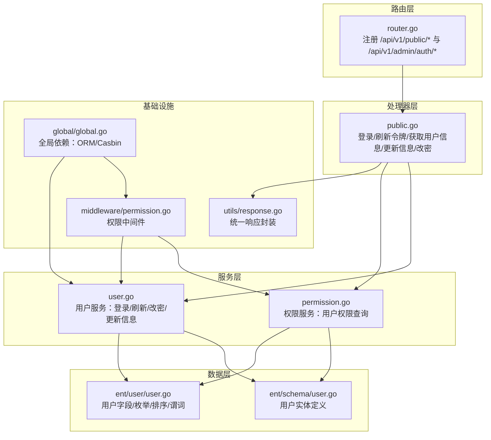
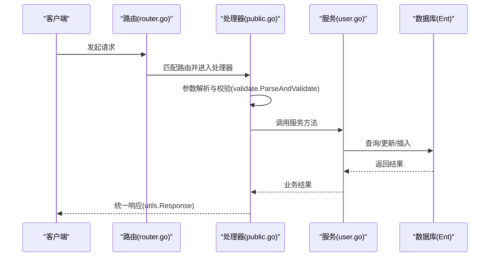
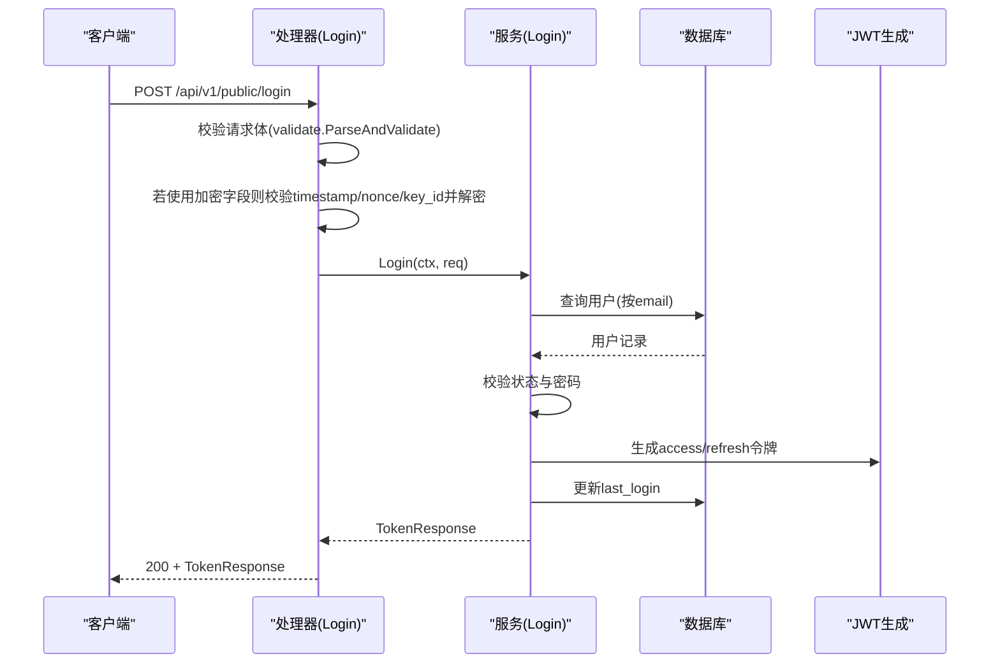
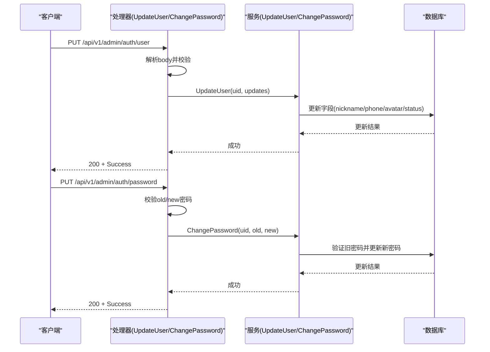
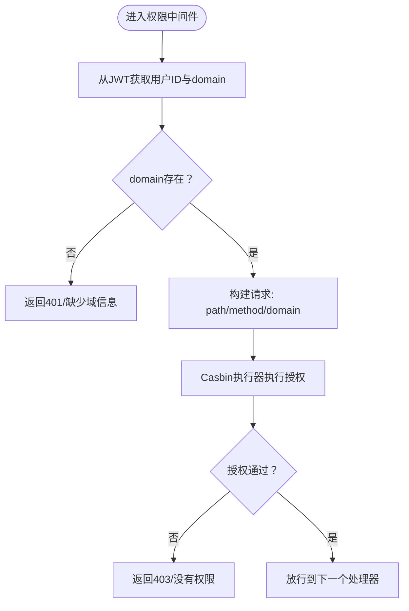
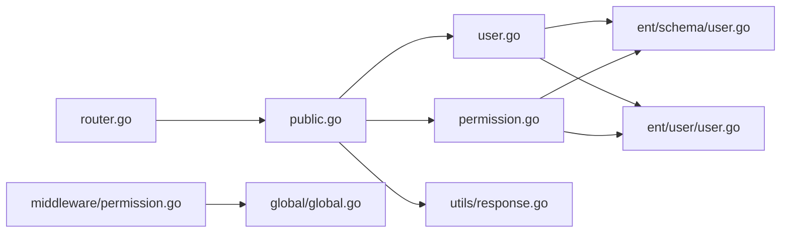

# 用户管理接口

<cite>
**本文引用的文件**
- [router.go](file://internal/router.go)
- [public.go](file://internal/handler/public.go)
- [user.go](file://internal/service/user.go)
- [user.go](file://internal/ent/schema/user.go)
- [user.go](file://internal/ent/user/user.go)
- [response.go](file://internal/utils/response.go)
- [permission.go](file://internal/middleware/permission.go)
- [global.go](file://internal/global/global.go)
- [permission.go](file://internal/service/permission.go)
</cite>

## 目录
1. [简介](#简介)
2. [项目结构](#项目结构)
3. [核心组件](#核心组件)
4. [架构总览](#架构总览)
5. [详细组件分析](#详细组件分析)
6. [依赖分析](#依赖分析)
7. [性能考虑](#性能考虑)
8. [故障排查指南](#故障排查指南)
9. [结论](#结论)
10. [附录](#附录)

## 简介
本文件为“用户管理接口”的完整 API 文档，覆盖用户 CRUD 操作、密码管理、个人信息更新、用户状态管理、权限继承与批量操作支持、查询过滤/排序/分页机制以及安全策略与数据保护措施。文档基于代码仓库的实际实现进行梳理，确保接口定义与实际行为一致，并提供可操作的请求/响应示例与错误处理说明。

## 项目结构
用户管理相关模块主要分布在以下位置：
- 路由注册：internal/router.go
- 处理器（Handler）：internal/handler/public.go
- 业务服务（Service）：internal/service/user.go
- 数据模型（Ent Schema/User）：internal/ent/schema/user.go、internal/ent/user/user.go
- 统一响应封装：internal/utils/response.go
- 权限中间件：internal/middleware/permission.go
- 全局依赖：internal/global/global.go
- 权限服务（含用户权限查询）：internal/service/permission.go

图表来源
- [router.go:16-190](file://internal/router.go#L16-L190)
- [public.go:17-299](file://internal/handler/public.go#L17-L299)
- [user.go:1-427](file://internal/service/user.go#L1-L427)
- [user.go:17-102](file://internal/ent/schema/user.go#L17-L102)
- [user.go:14-216](file://internal/ent/user/user.go#L14-L216)
- [permission.go:11-80](file://internal/middleware/permission.go#L11-L80)
- [global.go:11-17](file://internal/global/global.go#L11-L17)
- [response.go:9-50](file://internal/utils/response.go#L9-L50)

章节来源
- [router.go:16-190](file://internal/router.go#L16-L190)
- [public.go:17-299](file://internal/handler/public.go#L17-L299)
- [user.go:1-427](file://internal/service/user.go#L1-L427)
- [user.go:17-102](file://internal/ent/schema/user.go#L17-L102)
- [user.go:14-216](file://internal/ent/user/user.go#L14-L216)
- [permission.go:11-80](file://internal/middleware/permission.go#L11-L80)
- [global.go:11-17](file://internal/global/global.go#L11-L17)
- [response.go:9-50](file://internal/utils/response.go#L9-L50)

## 核心组件
- 路由注册：在 /api/v1 下划分公开接口与需要认证/权限校验的接口；公开接口位于 /public，认证接口位于 /admin/auth。
- 处理器：负责请求解析、参数校验、调用服务层并返回统一响应格式。
- 服务层：实现用户登录、刷新令牌、修改密码、更新个人信息等核心逻辑。
- 数据模型：定义用户字段、索引、枚举状态、排序选项与谓词，确保数据一致性与查询效率。
- 权限中间件：基于 Casbin 的 RBAC 权限控制，按域(domain)、路径(path)、方法(method)进行授权。
- 统一响应：封装标准的 code/message/data 结构，便于前端统一处理。

章节来源
- [router.go:16-190](file://internal/router.go#L16-L190)
- [public.go:17-299](file://internal/handler/public.go#L17-L299)
- [user.go:1-427](file://internal/service/user.go#L1-L427)
- [user.go:17-102](file://internal/ent/schema/user.go#L17-L102)
- [user.go:14-216](file://internal/ent/user/user.go#L14-L216)
- [permission.go:11-80](file://internal/middleware/permission.go#L11-L80)
- [response.go:9-50](file://internal/utils/response.go#L9-L50)

## 架构总览
用户管理接口采用典型的三层架构：路由层负责路径与中间件装配，处理器层负责业务编排，服务层负责领域逻辑，数据层通过 Ent ORM 提供强类型的数据访问。

图表来源
- [router.go:16-190](file://internal/router.go#L16-L190)
- [public.go:78-145](file://internal/handler/public.go#L78-L145)
- [user.go:139-218](file://internal/service/user.go#L139-L218)
- [response.go:9-50](file://internal/utils/response.go#L9-L50)

## 详细组件分析

### 用户模型与字段约束
- 字段定义与约束
  - email：唯一、最大长度 255、正则匹配邮箱格式、敏感字段
  - password：最大长度 255、敏感字段、非空
  - username/nickname/name：最大长度 255、可选
  - uid：最大长度 255、可选
  - password_salt：最大长度 255、敏感字段、可选
  - avatar：最大长度 1024、可选
  - phone：最大长度 20、可选、正则仅数字
  - status：枚举 active/inactive/suspended，默认 inactive
  - last_login/last_ip：可选
- 索引
  - email、phone、username
- 排序与谓词
  - 支持按 id/create_time/update_time/email/password/name/username/nickname/uid/password_salt/avatar/phone/status/last_login/last_ip 排序
  - 支持按 status 等谓词过滤

章节来源
- [user.go:17-102](file://internal/ent/schema/user.go#L17-L102)
- [user.go:14-216](file://internal/ent/user/user.go#L14-L216)

### 用户登录与令牌管理
- 登录接口
  - 方法：POST
  - 路径：/api/v1/public/login
  - 请求体：支持明文或加密字段（encrypted_email/encrypted_password），若使用加密字段需提供 timestamp、nonce、key_id 并进行防重放校验
  - 成功响应：access_token、token_type、expires_in、refresh_token
  - 错误码：400/401/403/404/500
- 刷新令牌接口
  - 方法：POST
  - 路径：/api/v1/admin/refresh-token
  - 请求体：refresh_token
  - 成功响应：新的 access_token、token_type、expires_in、refresh_token
  - 错误码：400/401/500
- 获取公钥接口（等保加密）
  - 方法：GET
  - 路径：/api/v1/public/public-key
  - 成功响应：key_id、public_key、algorithm、created_at、expires_at、rotate_cycle
  - 错误码：500

图表来源
- [public.go:64-145](file://internal/handler/public.go#L64-L145)
- [user.go:139-218](file://internal/service/user.go#L139-L218)

章节来源
- [public.go:64-145](file://internal/handler/public.go#L64-L145)
- [user.go:139-218](file://internal/service/user.go#L139-L218)

### 个人信息与密码管理
- 获取当前用户信息
  - 方法：GET
  - 路径：/api/v1/admin/auth/user
  - 需要 JWT 认证，无需额外权限
  - 成功响应：过滤后的用户信息（不包含敏感字段）
  - 错误码：401/404/500
- 更新当前用户信息
  - 方法：PUT
  - 路径：/api/v1/admin/auth/user
  - 需要 JWT 认证，无需额外权限
  - 请求体：允许更新 nickname、phone、avatar、status
  - 成功响应：空数据
  - 错误码：400/401/500
- 修改密码
  - 方法：PUT
  - 路径：/api/v1/admin/auth/password
  - 需要 JWT 认证，无需额外权限
  - 请求体：old_password、new_password（最小长度 6）
  - 成功响应：空数据
  - 错误码：400/401/404/500

图表来源
- [public.go:186-263](file://internal/handler/public.go#L186-L263)
- [user.go:263-426](file://internal/service/user.go#L263-L426)

章节来源
- [public.go:186-263](file://internal/handler/public.go#L186-L263)
- [user.go:263-426](file://internal/service/user.go#L263-L426)

### 用户状态管理与权限继承
- 用户状态
  - 枚举值：active、inactive、suspended
  - 默认值：inactive
  - 登录前会校验状态，非 active 将拒绝登录
- 权限继承
  - 基于 Casbin 的 RBAC 实现
  - 中间件根据 JWT 中的 domain、路径与方法进行授权
  - 用户权限查询通过角色与权限规则组合计算
- 域(domain)中间件
  - 从 JWT 中提取 domain 并注入到上下文，供权限中间件使用

图表来源
- [permission.go:11-80](file://internal/middleware/permission.go#L11-L80)
- [global.go:11-17](file://internal/global/global.go#L11-L17)

章节来源
- [user.go:118-137](file://internal/ent/user/user.go#L118-L137)
- [user.go:139-218](file://internal/service/user.go#L139-L218)
- [permission.go:11-80](file://internal/middleware/permission.go#L11-L80)
- [global.go:11-17](file://internal/global/global.go#L11-L17)

### 批量操作与查询能力
- 当前实现
  - 用户信息更新支持批量字段更新（nickname/phone/avatar/status）
  - 用户权限查询支持按角色、域、类型、关键字等条件过滤与分页
- 扩展建议
  - 如需批量用户操作（如批量启用/禁用），可在服务层新增批量更新方法并通过事务保证一致性
  - 对用户列表查询可增加分页参数（page/page_size）与排序字段（按 create_time/update_time/status 等）

章节来源
- [user.go:263-305](file://internal/service/user.go#L263-L305)
- [permission.go:358-426](file://internal/service/permission.go#L358-L426)

### 安全策略与数据保护
- 密码安全
  - 登录时对明文密码进行哈希校验，存储密码与盐值
  - 修改密码时先验证旧密码再更新新密码
- 传输安全
  - 支持 RSA 公钥加密登录凭据（等保要求），并进行时间戳与 nonce 防重放校验
  - JWT 使用对称签名，配置项中包含密钥与过期时间
- 敏感字段
  - password/password_salt 标记为敏感字段，避免在响应中泄露
- 权限控制
  - 通过 Casbin 实现细粒度的 API 权限控制，结合域(domain)隔离多租户场景

章节来源
- [user.go:118-137](file://internal/ent/user/user.go#L118-L137)
- [user.go:139-218](file://internal/service/user.go#L139-L218)
- [public.go:89-127](file://internal/handler/public.go#L89-L127)
- [permission.go:11-80](file://internal/middleware/permission.go#L11-L80)

## 依赖分析
- 路由到处理器：/api/v1/public/* 与 /api/v1/admin/auth/* 由处理器函数处理
- 处理器到服务：处理器通过本地服务实例调用业务逻辑
- 服务到数据层：服务通过 Ent ORM 访问数据库
- 权限中间件：依赖全局 Casbin 执行器与 JWT 中间件
- 统一响应：所有处理器均使用 utils.Response 输出

图表来源
- [router.go:16-190](file://internal/router.go#L16-L190)
- [public.go:17-299](file://internal/handler/public.go#L17-L299)
- [user.go:1-427](file://internal/service/user.go#L1-427)
- [user.go:17-102](file://internal/ent/schema/user.go#L17-L102)
- [user.go:14-216](file://internal/ent/user/user.go#L14-L216)
- [permission.go:11-80](file://internal/middleware/permission.go#L11-L80)
- [global.go:11-17](file://internal/global/global.go#L11-L17)
- [response.go:9-50](file://internal/utils/response.go#L9-L50)

章节来源
- [router.go:16-190](file://internal/router.go#L16-L190)
- [public.go:17-299](file://internal/handler/public.go#L17-L299)
- [user.go:1-427](file://internal/service/user.go#L1-427)
- [user.go:17-102](file://internal/ent/schema/user.go#L17-L102)
- [user.go:14-216](file://internal/ent/user/user.go#L14-L216)
- [permission.go:11-80](file://internal/middleware/permission.go#L11-L80)
- [global.go:11-17](file://internal/global/global.go#L11-L17)
- [response.go:9-50](file://internal/utils/response.go#L9-L50)

## 性能考虑
- 缓存策略：权限服务对用户权限查询使用缓存，减少重复查询开销
- 数据库索引：用户表对 email/phone/username 建有索引，提升查询效率
- 分页与过滤：权限列表支持分页与多条件过滤，建议合理设置 page_size 上限（如不超过 100）
- JWT 过期：登录与刷新令牌的过期时间由配置决定，建议根据业务场景调整

章节来源
- [permission.go:358-426](file://internal/service/permission.go#L358-L426)
- [user.go:297-305](file://internal/service/user.go#L297-L305)
- [user.go:297-305](file://internal/ent/schema/user.go#L29-L33)

## 故障排查指南
- 登录失败
  - 用户不存在：返回 404
  - 密码错误：返回 401
  - 用户状态非 active：返回 403
  - 服务器内部错误：返回 500
- 刷新令牌失败
  - 无效的刷新令牌：返回 401
- 更新用户信息失败
  - 请求体解析失败：返回 400
  - 服务器内部错误：返回 500
- 修改密码失败
  - 旧密码错误：返回 401
  - 用户不存在：返回 404
  - 服务器内部错误：返回 500
- 权限不足
  - 未授权访问：返回 401
  - 没有权限访问该资源：返回 403
  - JWT 中缺少域信息：返回 401

章节来源
- [public.go:131-144](file://internal/handler/public.go#L131-L144)
- [public.go:247-262](file://internal/handler/public.go#L247-L262)
- [permission.go:11-80](file://internal/middleware/permission.go#L11-L80)

## 结论
本用户管理接口围绕登录、个人信息维护、密码变更与权限控制构建，具备完善的参数校验、安全策略与统一响应格式。通过 Ent ORM 与 Casbin 的配合，实现了强类型的数据模型与细粒度的权限控制。建议在现有基础上扩展批量操作与用户列表查询能力，并持续优化缓存与分页策略以提升性能。

## 附录

### 接口清单与规范

- 登录
  - 方法：POST
  - 路径：/api/v1/public/login
  - 请求体字段：email、password、encrypted_email、encrypted_password、timestamp、nonce、key_id
  - 成功响应：access_token、token_type、expires_in、refresh_token
  - 错误码：400/401/403/404/500

- 刷新令牌
  - 方法：POST
  - 路径：/api/v1/admin/refresh-token
  - 请求体字段：refresh_token
  - 成功响应：access_token、token_type、expires_in、refresh_token
  - 错误码：400/401/500

- 获取公钥（等保加密）
  - 方法：GET
  - 路径：/api/v1/public/public-key
  - 成功响应：key_id、public_key、algorithm、created_at、expires_at、rotate_cycle
  - 错误码：500

- 获取当前用户信息
  - 方法：GET
  - 路径：/api/v1/admin/auth/user
  - 需要：JWT 认证
  - 成功响应：id、email、username、nickname、phone、avatar、status
  - 错误码：401/404/500

- 更新当前用户信息
  - 方法：PUT
  - 路径：/api/v1/admin/auth/user
  - 需要：JWT 认证
  - 请求体字段：nickname、phone、avatar、status
  - 成功响应：空数据
  - 错误码：400/401/500

- 修改密码
  - 方法：PUT
  - 路径：/api/v1/admin/auth/password
  - 需要：JWT 认证
  - 请求体字段：old_password、new_password
  - 成功响应：空数据
  - 错误码：400/401/404/500

### 用户模型字段定义与约束
- email：唯一、最大长度 255、正则匹配邮箱格式、敏感字段
- password：最大长度 255、敏感字段、非空
- username/nickname/name：最大长度 255、可选
- uid：最大长度 255、可选
- password_salt：最大长度 255、敏感字段、可选
- avatar：最大长度 1024、可选
- phone：最大长度 20、可选、仅数字
- status：枚举 active/inactive/suspended，默认 inactive
- last_login/last_ip：可选

章节来源
- [user.go:17-102](file://internal/ent/schema/user.go#L17-L102)
- [user.go:14-216](file://internal/ent/user/user.go#L14-L216)