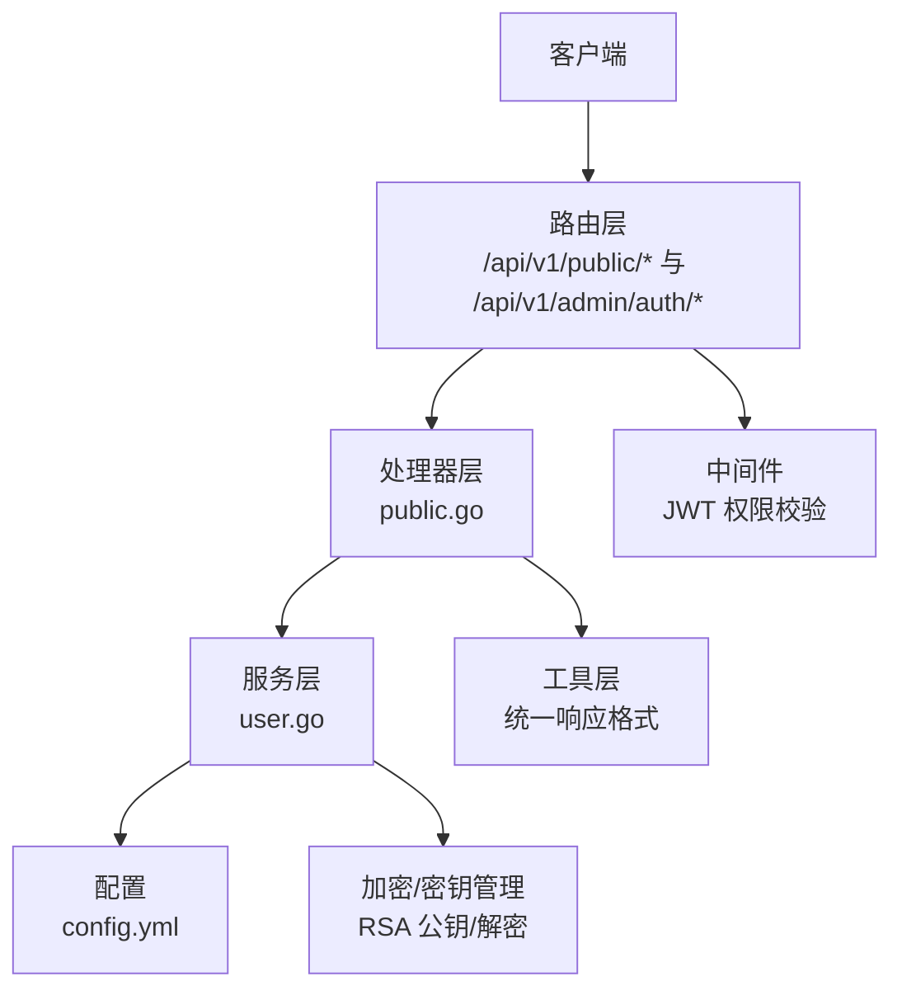
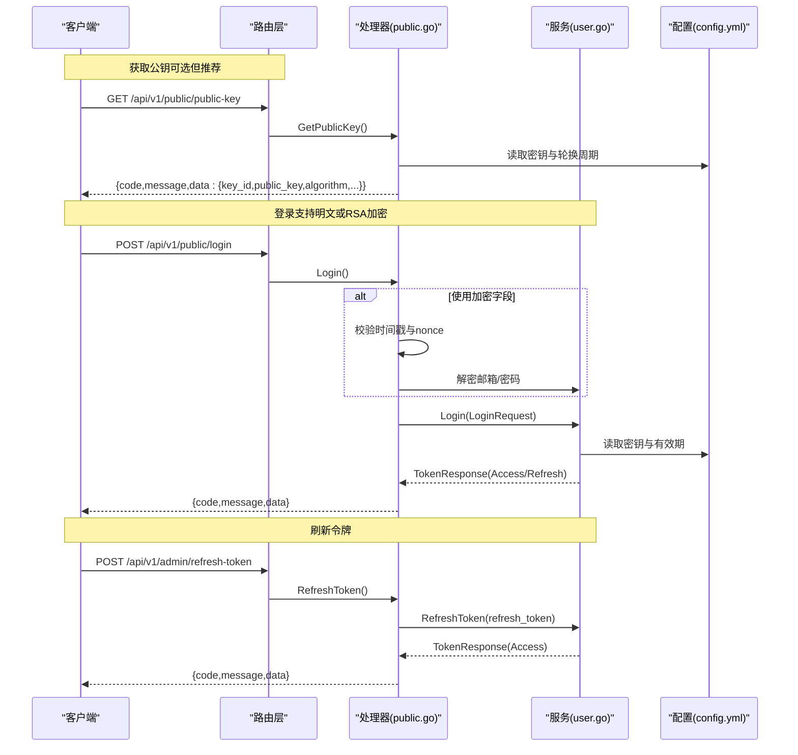
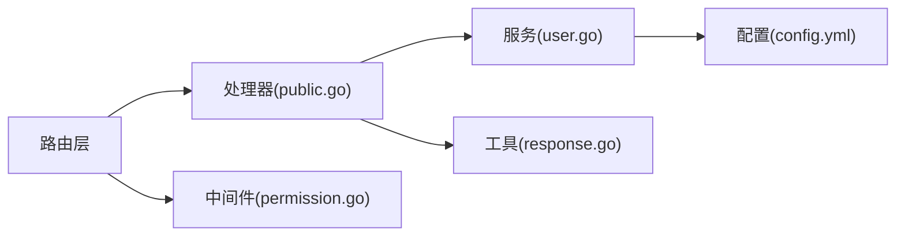

# 认证相关接口

<cite>
**本文引用的文件**
- [router.go](file://internal/router.go)
- [public.go](file://internal/handler/public.go)
- [user.go](file://internal/service/user.go)
- [config.yml](file://config/config.yml)
- [permission.go](file://internal/middleware/permission.go)
- [response.go](file://internal/utils/response.go)
- [docs.go](file://docs/docs.go)
- [swagger.json](file://docs/swagger.json)
</cite>

## 目录
1. [简介](#简介)
2. [项目结构](#项目结构)
3. [核心组件](#核心组件)
4. [架构总览](#架构总览)
5. [详细组件分析](#详细组件分析)
6. [依赖分析](#依赖分析)
7. [性能考虑](#性能考虑)
8. [故障排查指南](#故障排查指南)
9. [结论](#结论)
10. [附录](#附录)

## 简介
本文件面向客户端与集成开发者，提供系统内认证相关接口的权威 API 文档。涵盖用户登录、登出（通过刷新令牌撤销实现）、获取公钥、密码加密（前端 RSA 加密）、令牌刷新等能力，并明确：
- 接口的 HTTP 方法、URL 路径、请求参数与响应格式
- JWT 令牌结构、加密算法与安全要点
- 参数校验规则、错误处理与状态码
- 等保要求相关的加密传输与防重放攻击机制
- 客户端集成示例与最佳实践建议

## 项目结构
认证相关接口主要分布在以下模块：
- 路由层：定义公开与受保护的路由组及中间件链
- 处理器层：实现登录、刷新令牌、获取公钥等接口
- 服务层：封装业务逻辑，生成/解析 JWT、密码校验与刷新流程
- 中间件：基于 JWT 的权限校验与域解析
- 工具与配置：统一响应格式、应用配置与密钥管理

图表来源
- [router.go:16-70](file://internal/router.go#L16-L70)
- [public.go:27-145](file://internal/handler/public.go#L27-L145)
- [user.go:139-218](file://internal/service/user.go#L139-L218)
- [config.yml:1-10](file://config/config.yml#L1-L10)
- [permission.go:11-79](file://internal/middleware/permission.go#L11-L79)
- [response.go:9-49](file://internal/utils/response.go#L9-L49)

章节来源
- [router.go:16-70](file://internal/router.go#L16-L70)

## 核心组件
- 路由与中间件
  - 公开接口组：/api/v1/public，包含登录、刷新令牌、获取公钥
  - 受保护接口组：/api/v1/admin/auth，需携带 Bearer Token
  - 中间件链：JWT 校验、域解析、权限校验
- 处理器
  - 登录、刷新令牌、获取公钥、获取用户信息、修改密码
- 服务
  - 登录/刷新令牌、用户信息查询与更新、密码变更
- 配置
  - 应用密钥、登录与刷新令牌有效期、日志与数据库连接等

章节来源
- [router.go:29-70](file://internal/router.go#L29-L70)
- [public.go:27-145](file://internal/handler/public.go#L27-L145)
- [user.go:28-90](file://internal/service/user.go#L28-L90)
- [config.yml:1-10](file://config/config.yml#L1-L10)

## 架构总览
认证流程概览（登录、刷新、权限校验）：

图表来源
- [router.go:49-51](file://internal/router.go#L49-L51)
- [public.go:27-145](file://internal/handler/public.go#L27-L145)
- [user.go:139-218](file://internal/service/user.go#L139-L218)
- [config.yml:1-10](file://config/config.yml#L1-L10)

## 详细组件分析

### 接口清单与规范

- 获取公钥
  - 方法与路径
    - GET /api/v1/public/public-key
  - 安全与用途
    - 返回 RSA-2048 公钥，用于前端加密登录凭据，满足等保对传输加密的要求
  - 请求参数
    - 无
  - 响应格式
    - data.key_id：密钥ID
    - data.public_key：PEM 格式公钥
    - data.algorithm：算法标识（RSA-2048）
    - data.created_at：密钥创建时间（RFC3339）
    - data.expires_at：密钥过期时间（RFC3339，24小时）
    - data.rotate_cycle：密钥轮换周期（24h）
  - 状态码
    - 200：成功
    - 500：内部错误
  - 示例
    - 请求：GET /api/v1/public/public-key
    - 成功响应：data 包含上述字段
  - 等保与安全
    - 建议客户端缓存公钥（短周期内复用），避免频繁请求
    - 密钥每24小时轮换，客户端需在到期前重新拉取

- 用户登录
  - 方法与路径
    - POST /api/v1/public/login
  - 安全与用途
    - 支持明文或加密两种方式提交凭据；推荐加密方式以满足等保
  - 请求参数
    - 明文方式
      - email：字符串，必填
      - password：字符串，必填
    - 加密方式（推荐）
      - encrypted_email：字符串，使用公钥加密后的邮箱
      - encrypted_password：字符串，使用公钥加密后的密码
      - key_id：字符串，公钥ID
      - timestamp：整数，请求时间戳（UTC 秒）
      - nonce：字符串，随机数，防止重放
    - 参数校验
      - 加密方式必须同时提供 encrypted_email、encrypted_password、key_id
      - timestamp 必须在允许的时间窗口内（默认5分钟）
      - nonce 仅能使用一次
  - 响应格式
    - data.access_token：访问令牌
    - data.token_type：令牌类型（Bearer）
    - data.expires_in：访问令牌有效期（秒）
    - data.refresh_token：刷新令牌（可选）
  - 状态码
    - 200：成功
    - 400：请求参数错误/校验失败
    - 401：凭证无效（用户不存在/密码错误）
    - 403：用户状态异常（未激活）
    - 404：用户不存在
    - 500：内部错误
  - 示例
    - 请求：POST /api/v1/public/login
    - 成功响应：data 包含 access_token、token_type、expires_in、refresh_token
  - 错误处理
    - 用户不存在：404
    - 密码错误：401
    - 用户状态非激活：403
    - 参数校验失败：400
  - 等保与安全
    - 强制使用加密字段时，必须提供 key_id、timestamp、nonce
    - 服务端校验时间戳窗口与 nonce 唯一性，防止重放攻击
    - 建议客户端在每次登录前先获取公钥并缓存

- 刷新访问令牌
  - 方法与路径
    - POST /api/v1/admin/refresh-token
  - 安全与用途
    - 使用刷新令牌换取新的访问令牌，避免重复输入凭据
  - 请求参数
    - refresh_token：字符串，必填
  - 响应格式
    - data.access_token：新的访问令牌
    - data.token_type：令牌类型（Bearer）
    - data.expires_in：访问令牌有效期（秒）
    - data.refresh_token：原刷新令牌（可继续使用）
  - 状态码
    - 200：成功
    - 400：请求参数错误/校验失败
    - 401：刷新令牌无效
    - 500：内部错误
  - 示例
    - 请求：POST /api/v1/admin/refresh-token
    - 成功响应：返回新的 access_token
  - 错误处理
    - 刷新令牌无效：401
    - 参数校验失败：400
  - 等保与安全
    - 刷新令牌有效期较长，建议安全存储；服务端仍会校验用户状态与令牌类型

- 获取当前用户信息
  - 方法与路径
    - GET /api/v1/admin/auth/user
  - 安全与用途
    - 仅需 JWT 认证，无需额外权限检查
  - 请求参数
    - 无
  - 响应格式
    - data.id、data.email、data.username、data.nickname、data.phone、data.avatar、data.status
  - 状态码
    - 200：成功
    - 401：未授权
    - 404：用户不存在
    - 500：内部错误
  - 示例
    - 请求：Authorization: Bearer <access_token>
    - 成功响应：data 包含用户基本信息（过滤敏感字段）

- 修改密码
  - 方法与路径
    - PUT /api/v1/admin/auth/password
  - 安全与用途
    - 仅需 JWT 认证，无需额外权限检查
  - 请求参数
    - old_password：字符串，必填
    - new_password：字符串，必填，最小长度6
  - 响应格式
    - 无 data
  - 状态码
    - 200：成功
    - 400：请求参数错误/校验失败
    - 401：旧密码错误
    - 404：用户不存在
    - 500：内部错误
  - 示例
    - 请求：Authorization: Bearer <access_token>
    - 成功响应：空 data

章节来源
- [router.go:49-51](file://internal/router.go#L49-L51)
- [public.go:27-145](file://internal/handler/public.go#L27-L145)
- [public.go:265-298](file://internal/handler/public.go#L265-L298)
- [user.go:56-78](file://internal/service/user.go#L56-L78)
- [user.go:67-73](file://internal/service/user.go#L67-L73)
- [docs.go:4696-4819](file://docs/docs.go#L4696-L4819)
- [swagger.json:4696-4813](file://docs/swagger.json#L4696-L4813)

### JWT 令牌结构与安全
- 结构要点
  - 访问令牌（Access Token）
    - token_type：access
    - expires：过期时间（秒）
    - issued_at：签发时间（秒）
    - id：用户UID
    - subject：用户名
    - issuer：应用名
    - domain：域（多域支持）
  - 刷新令牌（Refresh Token）
    - token_type：refresh
    - 结构与访问令牌类似，有效期更长
- 安全要点
  - 传输：必须通过 HTTPS，禁止明文传输
  - 存储：客户端仅保存在内存或安全存储中，避免写入本地持久化
  - 使用：在请求头 Authorization: Bearer <access_token>
  - 有效期：登录有效期与刷新有效期由配置决定
- 配置项
  - app.secret：JWT 签名密钥
  - app.login_expires：登录有效期（秒）
  - app.refresh_expires：刷新令牌有效期（秒）

章节来源
- [user.go:172-202](file://internal/service/user.go#L172-L202)
- [user.go:368-388](file://internal/service/user.go#L368-L388)
- [config.yml:1-10](file://config/config.yml#L1-L10)

### 参数校验与错误处理
- 参数校验
  - 登录请求
    - 明文：email、password 必填
    - 加密：encrypted_email、encrypted_password、key_id 必填；timestamp 与 nonce 必填且有效
  - 刷新令牌：refresh_token 必填
  - 修改密码：old_password、new_password 必填，new_password 最小长度6
- 错误处理
  - 参数校验失败：400
  - 用户不存在：404
  - 凭证无效/旧密码错误：401
  - 用户状态异常：403
  - 内部错误：500
- 统一响应格式
  - code：状态码
  - message：消息
  - data：可选，承载业务数据

章节来源
- [public.go:81-144](file://internal/handler/public.go#L81-L144)
- [public.go:277-297](file://internal/handler/public.go#L277-L297)
- [response.go:9-49](file://internal/utils/response.go#L9-L49)

### 等保要求与防重放攻击
- 加密传输
  - 公钥采用 RSA-2048，客户端在提交登录凭据前进行加密
  - 建议强制使用加密字段，避免明文传输
- 防重放攻击
  - 时间戳校验：默认允许5分钟窗口
  - Nonce 校验：一次性使用，服务端维护去重存储
  - 密钥轮换：公钥每24小时轮换，降低长期暴露风险
- 客户端建议
  - 缓存公钥并在到期前刷新
  - 严格校验服务端返回的 expires_at 并及时刷新
  - 严格遵循 HTTPS 与安全存储策略

章节来源
- [public.go:89-127](file://internal/handler/public.go#L89-L127)
- [public.go:48-55](file://internal/handler/public.go#L48-L55)
- [config.yml:1-10](file://config/config.yml#L1-L10)

### 客户端集成示例与最佳实践
- 获取公钥
  - 步骤：GET /api/v1/public/public-key，缓存返回的 key_id 与 public_key
- 登录
  - 明文方式：直接提交 email 与 password
  - 加密方式：使用缓存的 public_key 对 email 与 password 进行 RSA 加密，得到 encrypted_email 与 encrypted_password，同时提供 key_id、timestamp、nonce
  - 成功后保存 access_token 与 refresh_token
- 刷新令牌
  - 当 access_token 即将过期时，使用 refresh_token 调用刷新接口获取新的 access_token
- 请求受保护接口
  - 在请求头添加 Authorization: Bearer <access_token>
- 最佳实践
  - 仅在 HTTPS 下运行
  - access_token 仅保存在内存，不写入持久化存储
  - 定期轮换与校验 nonce，避免重放
  - 监控与记录认证相关日志（操作日志服务已内置）

章节来源
- [router.go:49-51](file://internal/router.go#L49-L51)
- [public.go:27-145](file://internal/handler/public.go#L27-L145)
- [user.go:139-218](file://internal/service/user.go#L139-L218)

## 依赖分析
- 组件耦合
  - 路由层依赖处理器层；处理器层依赖服务层与工具层；服务层依赖配置与加密模块
  - 中间件依赖 JWT 提供的用户数据与域信息
- 关键依赖链
  - /api/v1/public/login → public.Login → service.UserService.Login
  - /api/v1/admin/refresh-token → public.RefreshToken → service.UserService.RefreshToken
  - /api/v1/admin/auth/* → JWT 中间件 → 权限中间件 → 具体处理器

图表来源
- [router.go:16-70](file://internal/router.go#L16-L70)
- [public.go:27-145](file://internal/handler/public.go#L27-L145)
- [user.go:139-218](file://internal/service/user.go#L139-L218)
- [permission.go:11-79](file://internal/middleware/permission.go#L11-L79)
- [response.go:9-49](file://internal/utils/response.go#L9-L49)

章节来源
- [router.go:16-70](file://internal/router.go#L16-L70)

## 性能考虑
- 公钥缓存：公钥24小时轮换，建议客户端缓存并在到期前刷新
- 密钥管理：使用密钥管理器进行加解密，避免在内存中常驻私钥
- 刷新令牌：合理设置 refresh_expires，平衡用户体验与安全
- 日志与监控：开启请求日志与操作日志，便于审计与问题定位

## 故障排查指南
- 常见错误与排查
  - 400 参数错误：检查请求体格式与必填字段，特别是加密登录时的 key_id、timestamp、nonce
  - 401 凭证无效：确认 email/password 或刷新令牌正确；检查 app.secret 是否一致
  - 403 用户状态异常：确认用户状态为激活
  - 404 用户不存在：确认用户已存在
  - 500 内部错误：查看服务端日志，检查数据库连接与密钥管理器状态
- 安全检查
  - 确认使用 HTTPS
  - 确认 access_token 未被持久化到不安全位置
  - 确认 nonce 未被重复使用
- 配置核对
  - app.secret、app.login_expires、app.refresh_expires
  - 数据库连接与表前缀

章节来源
- [public.go:81-144](file://internal/handler/public.go#L81-L144)
- [public.go:277-297](file://internal/handler/public.go#L277-L297)
- [config.yml:1-10](file://config/config.yml#L1-L10)

## 结论
本认证体系通过“公钥获取 + RSA 加密 + JWT 令牌 + 中间件权限校验”的组合，既满足日常认证需求，又符合等保对传输加密与防重放攻击的要求。建议客户端在生产环境强制使用加密登录、严格管理令牌生命周期，并结合日志与监控持续优化安全与性能。

## 附录
- Swagger 文档
  - 公钥接口定义与响应结构参考：[docs.go:4696-4819](file://docs/docs.go#L4696-L4819)、[swagger.json:4696-4813](file://docs/swagger.json#L4696-L4813)
- 相关实现参考
  - 登录与刷新逻辑：[user.go:139-218](file://internal/service/user.go#L139-L218)
  - 路由与中间件：[router.go:16-70](file://internal/router.go#L16-70)、[permission.go:11-79](file://internal/middleware/permission.go#L11-79)
  - 统一响应格式：[response.go:9-49](file://internal/utils/response.go#L9-L49)