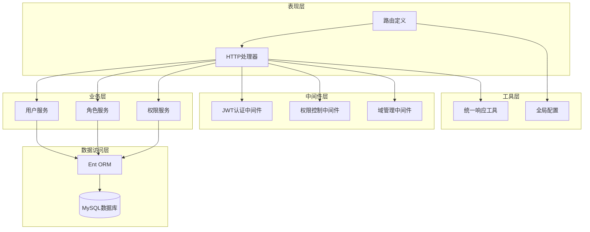
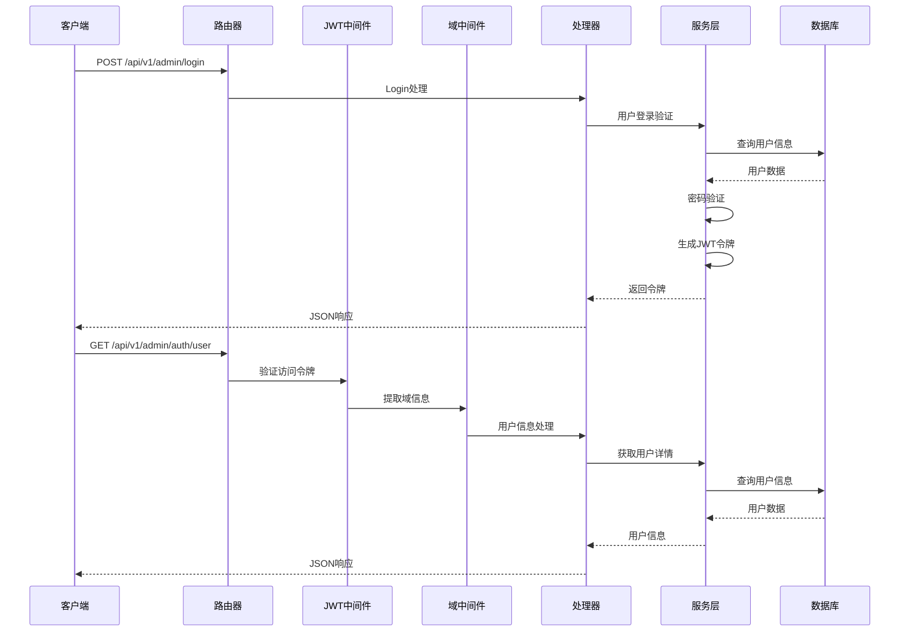
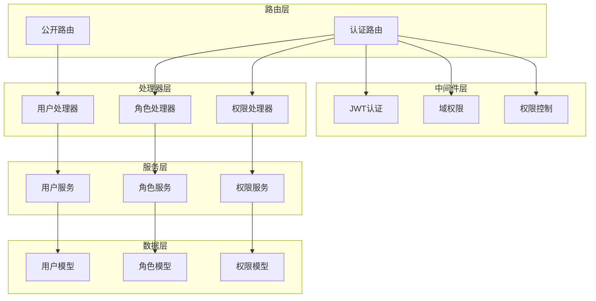

# API接口文档

<cite>
**本文档引用的文件**
- [main.go](file://main.go)
- [router.go](file://internal/router.go)
- [swagger.yaml](file://docs/swagger.yaml)
- [config.yml](file://config/config.yml)
- [permission.go](file://internal/middleware/permission.go)
- [public.go](file://internal/handler/public.go)
- [role.go](file://internal/handler/role.go)
- [permission.go](file://internal/handler/permission.go)
- [response.go](file://internal/utils/response.go)
- [msg.go](file://internal/global/msg.go)
- [user.go](file://internal/service/user.go)
- [role.go](file://internal/service/role.go)
- [permission.go](file://internal/service/permission.go)
- [user.go](file://internal/ent/schema/user.go)
- [role.go](file://internal/ent/schema/role.go)
- [casbinrule.go](file://internal/ent/schema/casbinrule.go)
</cite>

## 目录
1. [简介](#简介)
2. [项目结构](#项目结构)
3. [核心组件](#核心组件)
4. [架构概览](#架构概览)
5. [详细组件分析](#详细组件分析)
6. [依赖关系分析](#依赖关系分析)
7. [性能考虑](#性能考虑)
8. [故障排除指南](#故障排除指南)
9. [结论](#结论)
10. [附录](#附录)

## 简介
本文件为Go Admin管理系统的完整API接口文档，基于Swagger规范生成。系统采用Fiber框架构建，支持JWT认证、RBAC权限控制和多域权限管理。文档涵盖认证接口、用户管理接口、角色管理接口、权限管理接口等核心功能模块，并提供详细的HTTP方法、URL路径、请求参数、响应格式说明。

## 项目结构
系统采用分层架构设计，主要包含以下层次：
- 表现层：路由定义和HTTP处理器
- 业务层：服务接口和实现
- 数据访问层：Ent ORM模型和数据库操作
- 中间件层：认证、权限控制和域管理
- 工具层：统一响应格式和全局配置



**图表来源**
- [router.go:14-72](file://internal/router.go#L14-L72)
- [main.go:43-89](file://main.go#L43-L89)

**章节来源**
- [main.go:1-90](file://main.go#L1-L90)
- [router.go:1-73](file://internal/router.go#L1-L73)

## 核心组件

### 认证与安全
系统采用JWT Bearer Token认证机制，支持访问令牌和刷新令牌：
- 访问令牌：短期有效，用于API访问
- 刷新令牌：长期有效，用于获取新的访问令牌
- 支持多域权限管理，每个JWT令牌包含域信息

### 统一响应格式
所有API响应遵循统一格式：
```json
{
  "code": 1,
  "message": "成功",
  "data": {}
}
```

### 错误码体系
系统定义了完整的错误码体系，包括：
- 成功：1
- 失败：0  
- 未授权：401
- 拒绝访问：403
- 资源不存在：404
- 内部服务器错误：500
- 角色相关错误：2000-2099

**章节来源**
- [response.go:9-49](file://internal/utils/response.go#L9-L49)
- [msg.go:3-45](file://internal/global/msg.go#L3-L45)

## 架构概览



**图表来源**
- [public.go:22-44](file://internal/handler/public.go#L22-L44)
- [permission.go:12-52](file://internal/middleware/permission.go#L12-L52)

**章节来源**
- [permission.go:11-69](file://internal/middleware/permission.go#L11-L69)

## 详细组件分析

### 认证接口

#### 用户登录
- **HTTP方法**：POST
- **URL路径**：`/api/v1/admin/login`
- **认证方式**：无
- **请求参数**：
  - email: string (必需)
  - password: string (必需)
- **响应数据**：
  - access_token: string
  - token_type: string
  - expires_in: integer
  - refresh_token: string (可选)

**章节来源**
- [public.go:13-45](file://internal/handler/public.go#L13-L45)
- [swagger.yaml:111-137](file://docs/swagger.yaml#L111-L137)

#### 刷新访问令牌
- **HTTP方法**：POST  
- **URL路径**：`/api/v1/admin/refresh-token`
- **认证方式**：无
- **请求参数**：
  - refresh_token: string (必需)
- **响应数据**：同登录接口

**章节来源**
- [public.go:149-179](file://internal/handler/public.go#L149-L179)

### 用户管理接口

#### 获取当前用户信息
- **HTTP方法**：GET
- **URL路径**：`/api/v1/admin/auth/user`
- **认证方式**：Bearer Token
- **响应数据**：
  - id: string
  - email: string
  - username: string
  - nickname: string
  - phone: string
  - avatar: string
  - status: string

**章节来源**
- [public.go:47-81](file://internal/handler/public.go#L47-L81)

#### 更新用户信息
- **HTTP方法**：PUT
- **URL路径**：`/api/v1/admin/auth/user`
- **认证方式**：Bearer Token
- **请求参数**：动态字段（支持nickname、phone、avatar、status）

**章节来源**
- [public.go:83-109](file://internal/handler/public.go#L83-L109)

#### 修改密码
- **HTTP方法**：PUT
- **URL路径**：`/api/v1/admin/auth/password`
- **认证方式**：Bearer Token
- **请求参数**：
  - old_password: string (必需)
  - new_password: string (必需)

**章节来源**
- [public.go:111-147](file://internal/handler/public.go#L111-L147)

### 角色管理接口

#### 创建角色
- **HTTP方法**：POST
- **URL路径**：`/api/v1/admin/auth/roles`
- **认证方式**：Bearer Token
- **请求参数**：
  - name: string (必需，最大100字符)
  - display_name: string (必需，最大255字符)
  - description: string (可选，最大500字符)
  - created_by: string (可选)

**章节来源**
- [role.go:13-29](file://internal/handler/role.go#L13-L29)

#### 获取角色详情
- **HTTP方法**：GET
- **URL路径**：`/api/v1/admin/auth/roles/{id}`
- **认证方式**：Bearer Token
- **路径参数**：id: integer (角色ID)

**章节来源**
- [role.go:31-48](file://internal/handler/role.go#L31-L48)

#### 获取角色列表
- **HTTP方法**：GET
- **URL路径**：`/api/v1/admin/auth/roles`
- **认证方式**：Bearer Token
- **查询参数**：
  - page: integer (默认1，最小1)
  - page_size: integer (默认10，范围1-100)
  - keyword: string (可选，关键字搜索)
  - status: string (可选，状态筛选)

**章节来源**
- [role.go:50-74](file://internal/handler/role.go#L50-L74)

#### 更新角色
- **HTTP方法**：PUT
- **URL路径**：`/api/v1/admin/auth/roles/{id}`
- **认证方式**：Bearer Token
- **路径参数**：id: integer
- **请求参数**：同创建角色（部分字段可选）

**章节来源**
- [role.go:76-97](file://internal/handler/role.go#L76-L97)

#### 删除角色
- **HTTP方法**：DELETE
- **URL路径**：`/api/v1/admin/auth/roles/{id}`
- **认证方式**：Bearer Token
- **路径参数**：id: integer

**章节来源**
- [role.go:99-115](file://internal/handler/role.go#L99-L115)

#### 启用角色
- **HTTP方法**：PUT
- **URL路径**：`/api/v1/admin/auth/roles/{id}/enable`
- **认证方式**：Bearer Token
- **路径参数**：id: integer

**章节来源**
- [role.go:117-133](file://internal/handler/role.go#L117-L133)

#### 禁用角色
- **HTTP方法**：PUT
- **URL路径**：`/api/v1/admin/auth/roles/{id}/disable`
- **认证方式**：Bearer Token
- **路径参数**：id: integer

**章节来源**
- [role.go:135-151](file://internal/handler/role.go#L135-L151)

### 权限管理接口

#### 创建权限
- **HTTP方法**：POST
- **URL路径**：`/api/v1/admin/auth/permissions`
- **认证方式**：Bearer Token
- **请求参数**：
  - role_name: string (必需)
  - domain: string (必需)
  - type: string (必需，枚举：api/menu/button)
  - object: string (必需)
  - action: string (必需)
  - description: string (可选)

**章节来源**
- [permission.go:13-50](file://internal/handler/permission.go#L13-L50)

#### 更新权限
- **HTTP方法**：PUT
- **URL路径**：`/api/v1/admin/auth/permissions`
- **认证方式**：Bearer Token
- **请求参数**：同创建权限（支持部分字段更新）

**章节来源**
- [permission.go:52-89](file://internal/handler/permission.go#L52-L89)

#### 删除权限
- **HTTP方法**：DELETE
- **URL路径**：`/api/v1/admin/auth/permissions`
- **认证方式**：Bearer Token
- **查询参数**：
  - role_name: string (必需)
  - domain: string (必需)
  - object: string (必需)
  - action: string (必需)

**章节来源**
- [permission.go:91-133](file://internal/handler/permission.go#L91-L133)

#### 获取权限详情
- **HTTP方法**：GET
- **URL路径**：`/api/v1/admin/auth/permissions/detail`
- **认证方式**：Bearer Token
- **查询参数**：同删除权限

**章节来源**
- [permission.go:135-177](file://internal/handler/permission.go#L135-L177)

#### 获取权限列表
- **HTTP方法**：GET
- **URL路径**：`/api/v1/admin/auth/permissions`
- **认证方式**：Bearer Token
- **查询参数**：
  - page: integer (默认1)
  - page_size: integer (默认10，最大100)
  - keyword: string (可选)
  - type: string (可选)
  - domain: string (可选)
  - role_name: string (可选)

**章节来源**
- [permission.go:179-222](file://internal/handler/permission.go#L179-L222)

### 角色权限管理接口

#### 为角色分配权限
- **HTTP方法**：POST
- **URL路径**：`/api/v1/admin/auth/roles/permissions/assign`
- **认证方式**：Bearer Token
- **查询参数**：
  - role_name: string (必需)
  - domain: string (必需)
- **请求参数**：权限规则数组（object、action）

**章节来源**
- [permission.go:224-269](file://internal/handler/permission.go#L224-L269)

#### 从角色移除权限
- **HTTP方法**：POST
- **URL路径**：`/api/v1/admin/auth/roles/permissions/remove`
- **认证方式**：Bearer Token
- **查询参数**：同分配权限
- **请求参数**：权限规则数组

**章节来源**
- [permission.go:271-316](file://internal/handler/permission.go#L271-L316)

#### 获取角色权限
- **HTTP方法**：GET
- **URL路径**：`/api/v1/admin/auth/roles/permissions`
- **认证方式**：Bearer Token
- **查询参数**：
  - role_name: string (必需)
  - domain: string (必需)

**章节来源**
- [permission.go:318-356](file://internal/handler/permission.go#L318-L356)

### 用户权限接口

#### 获取用户菜单权限
- **HTTP方法**：GET
- **URL路径**：`/api/v1/admin/auth/user/menu-permissions`
- **认证方式**：Bearer Token
- **查询参数**：domain: string (默认"default")

**章节来源**
- [permission.go:358-388](file://internal/handler/permission.go#L358-L388)

#### 获取用户按钮权限
- **HTTP方法**：GET
- **URL路径**：`/api/v1/admin/auth/user/button-permissions`
- **认证方式**：Bearer Token
- **查询参数**：domain: string (默认"default")

**章节来源**
- [permission.go:390-420](file://internal/handler/permission.go#L390-L420)

#### 获取用户API权限
- **HTTP方法**：GET
- **URL路径**：`/api/v1/admin/auth/user/api-permissions`
- **认证方式**：Bearer Token
- **查询参数**：domain: string (默认"default")

**章节来源**
- [permission.go:422-452](file://internal/handler/permission.go#L422-L452)

#### 获取用户所有权限
- **HTTP方法**：GET
- **URL路径**：`/api/v1/admin/auth/user/permissions`
- **认证方式**：Bearer Token
- **查询参数**：domain: string (默认"default")
- **响应数据**：包含menu和button权限的对象

**章节来源**
- [permission.go:454-496](file://internal/handler/permission.go#L454-L496)

## 依赖关系分析



**图表来源**
- [router.go:14-72](file://internal/router.go#L14-L72)
- [permission.go:12-52](file://internal/middleware/permission.go#L12-L52)

**章节来源**
- [router.go:14-72](file://internal/router.go#L14-L72)

## 性能考虑

### 缓存策略
- Redis缓存：支持Redis作为缓存存储
- 内存缓存：默认内存缓存，适合开发环境
- TTL配置：默认3600秒

### 数据库优化
- 索引优化：用户表包含email、phone、username索引
- 查询优化：分页查询支持最大100条记录
- 连接池：支持连接池配置

### API性能建议
- 合理使用分页参数，避免一次性查询大量数据
- 对频繁访问的数据使用缓存
- 优化JWT令牌大小，减少不必要的声明
- 实施适当的超时机制

## 故障排除指南

### 常见错误码及处理
- **401 未授权**：检查JWT令牌是否有效、是否过期
- **403 拒绝访问**：检查用户权限和域配置
- **404 资源不存在**：确认请求的资源ID是否正确
- **500 内部服务器错误**：查看服务器日志获取详细信息

### 权限问题排查
1. 验证JWT令牌中的域信息是否正确
2. 检查Casbin权限规则是否配置正确
3. 确认用户角色分配是否正确
4. 验证权限类型和动作匹配

### 数据库连接问题
1. 检查数据库连接配置
2. 验证MySQL服务状态
3. 确认表前缀配置正确
4. 检查数据库用户权限

**章节来源**
- [msg.go:3-45](file://internal/global/msg.go#L3-L45)
- [permission.go:12-52](file://internal/middleware/permission.go#L12-L52)

## 结论
Go Admin管理系统提供了完整的API接口解决方案，具备以下特点：

1. **安全性**：采用JWT认证和RBAC权限控制
2. **可扩展性**：支持多域权限管理和灵活的权限模型
3. **易用性**：统一的响应格式和详细的API文档
4. **性能**：支持缓存和数据库优化

系统适用于需要精细权限控制的企业级应用，可通过配置文件轻松调整各项参数。

## 附录

### API版本管理
- 当前版本：v1
- 版本前缀：/api/v1
- 向后兼容性：保持现有接口不变，新增功能通过新版本提供

### 配置选项
- 应用配置：端口、调试模式、JWT密钥等
- 数据库配置：连接参数、表前缀等
- 缓存配置：内存和Redis缓存选项
- 日志配置：输出路径和级别

### 最佳实践
1. 始终使用HTTPS传输API请求
2. 合理设置JWT过期时间
3. 实施适当的速率限制
4. 定期备份数据库
5. 监控API性能指标

**章节来源**
- [config.yml:1-143](file://config/config.yml#L1-L143)