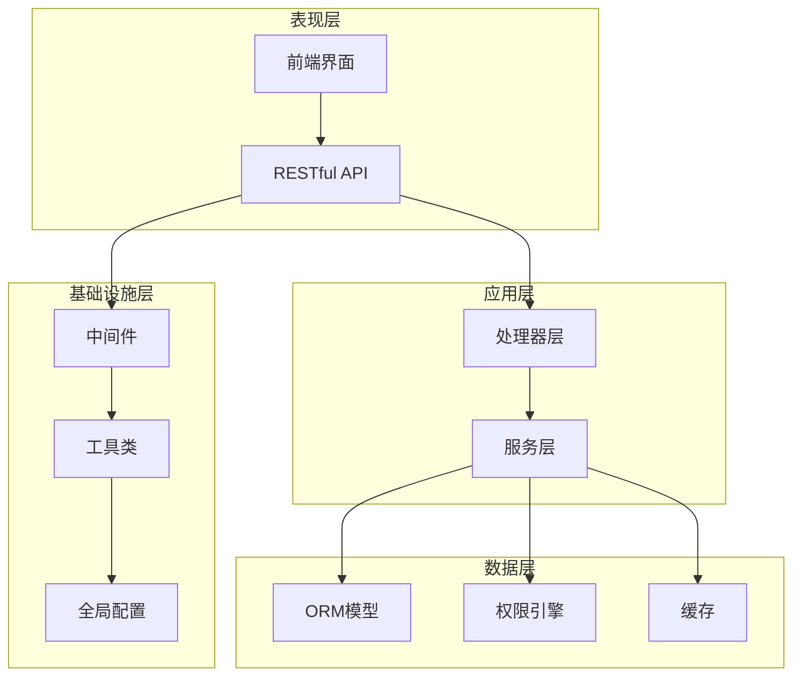
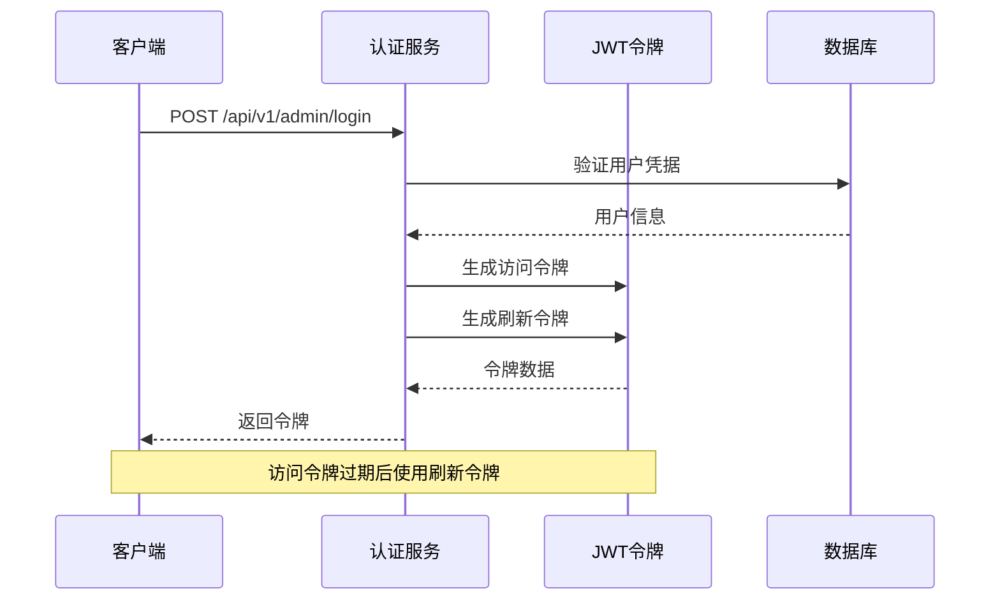
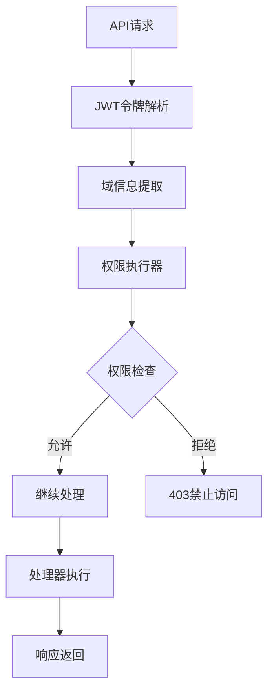
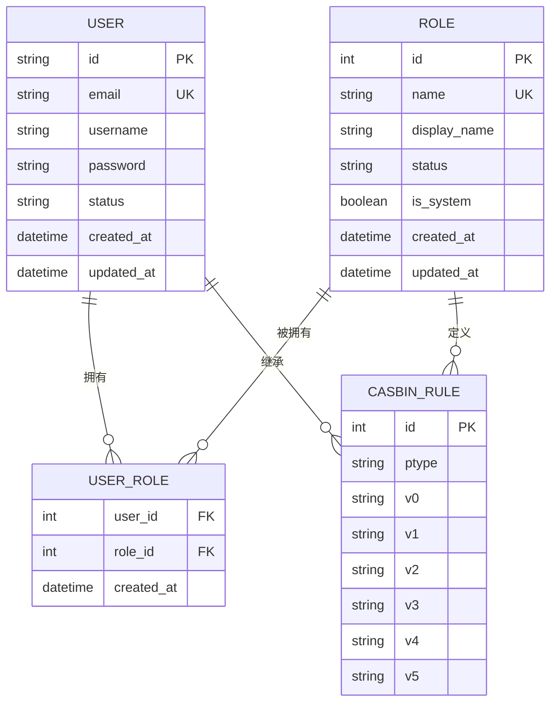
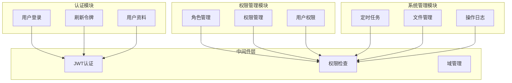
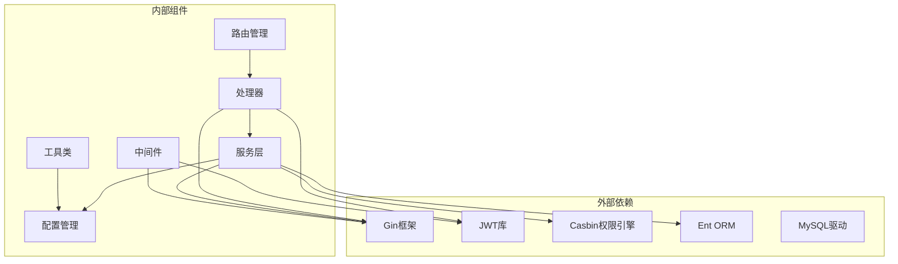

# API接口文档

<cite>
**本文档引用的文件**
- [main.go](file://main.go)
- [router.go](file://internal/router.go)
- [config.yml](file://config/config.yml)
- [swagger.yaml](file://docs/swagger.yaml)
- [response.go](file://internal/utils/response.go)
- [permission.go](file://internal/middleware/permission.go)
- [public.go](file://internal/handler/public.go)
- [role.go](file://internal/handler/role.go)
- [permission.go](file://internal/handler/permission.go)
- [attachment.go](file://internal/handler/attachment.go)
- [cron_job.go](file://internal/handler/cron_job.go)
- [user.go](file://internal/service/user.go)
- [role.go](file://internal/service/role.go)
- [permission.go](file://internal/service/permission.go)
- [msg.go](file://internal/global/msg.go)
</cite>

## 目录
1. [简介](#简介)
2. [项目结构](#项目结构)
3. [核心组件](#核心组件)
4. [架构概览](#架构概览)
5. [详细组件分析](#详细组件分析)
6. [依赖关系分析](#依赖关系分析)
7. [性能考虑](#性能考虑)
8. [故障排除指南](#故障排除指南)
9. [结论](#结论)
10. [附录](#附录)

## 简介

Go Admin管理系统是一个基于Gin框架构建的企业级管理平台，提供了完整的权限管理和API接口。系统采用JWT令牌认证机制，集成了RBAC权限控制、定时任务管理、文件附件管理等功能模块。

本系统的主要特点：
- RESTful API设计，遵循HTTP标准
- 基于JWT的令牌认证机制
- RBAC权限控制系统
- 多域权限管理支持
- 缓存优化的权限查询
- 完整的操作日志记录

## 项目结构

系统采用分层架构设计，主要包含以下层次：



**图表来源**
- [main.go:47-104](file://main.go#L47-L104)
- [router.go:16-150](file://internal/router.go#L16-L150)

**章节来源**
- [main.go:1-105](file://main.go#L1-L105)
- [router.go:1-150](file://internal/router.go#L1-L150)

## 核心组件

### JWT认证系统

系统使用JWT令牌进行身份认证，支持访问令牌和刷新令牌两种类型：



**图表来源**
- [user.go:132-213](file://internal/service/user.go#L132-L213)
- [public.go:19-60](file://internal/handler/public.go#L19-L60)

### 权限控制机制

系统采用基于Casbin的RBAC权限控制模型：



**图表来源**
- [permission.go:14-78](file://internal/middleware/permission.go#L14-L78)

### 数据模型关系



**图表来源**
- [role.go:119-167](file://internal/service/role.go#L119-L167)
- [permission.go:427-477](file://internal/service/permission.go#L427-L477)

**章节来源**
- [user.go:19-402](file://internal/service/user.go#L19-L402)
- [permission.go:19-800](file://internal/service/permission.go#L19-L800)

## 架构概览

系统采用模块化设计，各功能模块相对独立又相互协作：



**图表来源**
- [router.go:16-150](file://internal/router.go#L16-L150)

**章节来源**
- [router.go:16-150](file://internal/router.go#L16-L150)

## 详细组件分析

### 认证接口

#### 用户登录
- **HTTP方法**: POST
- **URL模式**: `/api/v1/admin/login`
- **认证要求**: 无需认证
- **请求参数**:
  - email: 用户邮箱 (必需)
  - password: 用户密码 (必需)

- **响应格式**:
```json
{
  "code": 1,
  "message": "成功",
  "data": {
    "access_token": "字符串",
    "token_type": "Bearer",
    "expires_in": 86400,
    "refresh_token": "字符串"
  }
}
```

- **错误码**:
  - 401: 用户不存在或密码错误
  - 403: 用户状态异常
  - 500: 服务器内部错误

#### 刷新访问令牌
- **HTTP方法**: POST
- **URL模式**: `/api/v1/admin/refresh-token`
- **认证要求**: 无需认证
- **请求参数**:
  - refresh_token: 刷新令牌 (必需)

- **响应格式**:
```json
{
  "code": 1,
  "message": "成功",
  "data": {
    "access_token": "字符串",
    "token_type": "Bearer",
    "expires_in": 86400,
    "refresh_token": "字符串"
  }
}
```

- **错误码**:
  - 401: 刷新令牌无效
  - 500: 服务器内部错误

#### 获取当前用户信息
- **HTTP方法**: GET
- **URL模式**: `/api/v1/admin/auth/user`
- **认证要求**: Bearer Token
- **请求参数**: 无
- **响应格式**:
```json
{
  "code": 1,
  "message": "成功",
  "data": {
    "id": "字符串",
    "email": "字符串",
    "username": "字符串",
    "nickname": "字符串",
    "phone": "字符串",
    "avatar": "字符串",
    "status": "字符串"
  }
}
```

- **错误码**:
  - 404: 用户不存在
  - 500: 服务器内部错误

#### 更新用户信息
- **HTTP方法**: PUT
- **URL模式**: `/api/v1/admin/auth/user`
- **认证要求**: Bearer Token
- **请求参数**:
  - nickname: 昵称
  - phone: 电话
  - avatar: 头像
  - status: 状态

- **响应格式**:
```json
{
  "code": 1,
  "message": "成功",
  "data": null
}
```

- **错误码**:
  - 500: 服务器内部错误

#### 修改密码
- **HTTP方法**: PUT
- **URL模式**: `/api/v1/admin/auth/password`
- **认证要求**: Bearer Token
- **请求参数**:
  - old_password: 旧密码 (必需)
  - new_password: 新密码 (必需，最少6位)

- **响应格式**:
```json
{
  "code": 1,
  "message": "成功",
  "data": null
}
```

- **错误码**:
  - 404: 用户不存在
  - 401: 旧密码错误
  - 500: 服务器内部错误

**章节来源**
- [public.go:19-214](file://internal/handler/public.go#L19-L214)
- [user.go:132-402](file://internal/service/user.go#L132-L402)

### 角色管理接口

#### 创建角色
- **HTTP方法**: POST
- **URL模式**: `/api/v1/admin/auth/roles`
- **认证要求**: Bearer Token
- **请求参数**:
  - name: 角色名称 (必需，最大100字符)
  - display_name: 显示名称 (必需，最大255字符)
  - description: 描述 (最大500字符)
  - created_by: 创建者

- **响应格式**:
```json
{
  "code": 1,
  "message": "角色创建成功",
  "data": {
    "id": 1,
    "name": "字符串",
    "display_name": "字符串",
    "description": "字符串",
    "is_system": false,
    "status": "active",
    "created_by": "字符串",
    "updated_by": "字符串",
    "created_at": "字符串",
    "updated_at": "字符串"
  }
}
```

- **错误码**:
  - 409: 角色名称已存在
  - 400: 角色名称无效
  - 500: 创建角色失败

#### 获取角色列表
- **HTTP方法**: GET
- **URL模式**: `/api/v1/admin/auth/roles`
- **认证要求**: Bearer Token
- **查询参数**:
  - page: 页码，默认1
  - page_size: 每页数量，默认10
  - keyword: 关键字
  - status: 状态

- **响应格式**:
```json
{
  "code": 1,
  "message": "获取角色列表成功",
  "data": {
    "total": 1,
    "page": 1,
    "data": [
      {
        "id": 1,
        "name": "字符串",
        "display_name": "字符串",
        "description": "字符串",
        "is_system": false,
        "status": "active",
        "created_by": "字符串",
        "updated_by": "字符串",
        "created_at": "字符串",
        "updated_at": "字符串"
      }
    ]
  }
}
```

- **错误码**:
  - 500: 获取角色列表失败

#### 更新角色
- **HTTP方法**: PUT
- **URL模式**: `/api/v1/admin/auth/roles/{id}`
- **认证要求**: Bearer Token
- **路径参数**:
  - id: 角色ID (必需)

- **请求参数**:
  - display_name: 显示名称
  - description: 描述
  - updated_by: 更新者

- **响应格式**:
```json
{
  "code": 1,
  "message": "角色更新成功",
  "data": null
}
```

- **错误码**:
  - 404: 角色不存在
  - 500: 更新角色失败

#### 删除角色
- **HTTP方法**: DELETE
- **URL模式**: `/api/v1/admin/auth/roles/{id}`
- **认证要求**: Bearer Token
- **路径参数**:
  - id: 角色ID (必需)

- **响应格式**:
```json
{
  "code": 1,
  "message": "角色删除成功",
  "data": null
}
```

- **错误码**:
  - 404: 角色不存在
  - 403: 系统内置角色不可删除
  - 409: 角色正在使用中，无法删除
  - 500: 删除角色失败

#### 启用/禁用角色
- **HTTP方法**: PUT
- **URL模式**: `/api/v1/admin/auth/roles/{id}/enable` 或 `/api/v1/admin/auth/roles/{id}/disable`
- **认证要求**: Bearer Token
- **路径参数**:
  - id: 角色ID (必需)

- **响应格式**:
```json
{
  "code": 1,
  "message": "角色启用成功",
  "data": null
}
```

- **错误码**:
  - 404: 角色不存在
  - 500: 启用/禁用角色失败

**章节来源**
- [role.go:15-303](file://internal/handler/role.go#L15-L303)
- [role.go:118-429](file://internal/service/role.go#L118-L429)

### 权限管理接口

#### 创建权限
- **HTTP方法**: POST
- **URL模式**: `/api/v1/admin/auth/permissions`
- **认证要求**: Bearer Token
- **请求参数**:
  - role_name: 角色名称 (必需)
  - domain: 域 (必需)
  - type: 权限类型 (必需，api/menu/button)
  - object: 对象 (必需)
  - action: 动作 (必需)
  - description: 描述

- **响应格式**:
```json
{
  "code": 1,
  "message": "权限创建成功",
  "data": "权限创建成功"
}
```

- **错误码**:
  - 400: 权限已存在或角色不存在
  - 500: 创建权限失败

#### 更新权限
- **HTTP方法**: PUT
- **URL模式**: `/api/v1/admin/auth/permissions`
- **认证要求**: Bearer Token
- **请求参数**:
  - role_name: 角色名称 (必需)
  - domain: 域 (必需)
  - type: 权限类型 (必需)
  - object: 对象 (必需)
  - action: 动作 (必需)
  - new_object: 新对象
  - new_action: 新动作
  - description: 描述

- **响应格式**:
```json
{
  "code": 1,
  "message": "权限更新成功",
  "data": "权限更新成功"
}
```

- **错误码**:
  - 404: 权限不存在或角色不存在
  - 500: 更新权限失败

#### 删除权限
- **HTTP方法**: DELETE
- **URL模式**: `/api/v1/admin/auth/permissions`
- **认证要求**: Bearer Token
- **查询参数**:
  - role_name: 角色名称 (必需)
  - domain: 域 (必需)
  - object: 对象 (必需)
  - action: 动作 (必需)

- **响应格式**:
```json
{
  "code": 1,
  "message": "权限删除成功",
  "data": "权限删除成功"
}
```

- **错误码**:
  - 404: 权限不存在
  - 500: 删除权限失败

#### 获取权限详情
- **HTTP方法**: GET
- **URL模式**: `/api/v1/admin/auth/permissions/detail`
- **认证要求**: Bearer Token
- **查询参数**:
  - role_name: 角色名称 (必需)
  - domain: 域 (必需)
  - object: 对象 (必需)
  - action: 动作 (必需)

- **响应格式**:
```json
{
  "code": 1,
  "message": "获取权限详情成功",
  "data": {
    "id": 1,
    "role_name": "字符串",
    "domain": "字符串",
    "type": "api",
    "object": "字符串",
    "action": "字符串",
    "description": "字符串"
  }
}
```

- **错误码**:
  - 404: 权限不存在
  - 500: 获取权限详情失败

#### 获取权限列表
- **HTTP方法**: GET
- **URL模式**: `/api/v1/admin/auth/permissions`
- **认证要求**: Bearer Token
- **查询参数**:
  - page: 页码，默认1
  - page_size: 每页数量，默认10
  - keyword: 关键字
  - type: 权限类型
  - domain: 域
  - role_name: 角色名称

- **响应格式**:
```json
{
  "code": 1,
  "message": "获取权限列表成功",
  "data": {
    "total": 1,
    "page": 1,
    "data": [
      {
        "id": 1,
        "role_name": "字符串",
        "domain": "字符串",
        "type": "api",
        "object": "字符串",
        "action": "字符串",
        "description": "字符串"
      }
    ]
  }
}
```

- **错误码**:
  - 500: 获取权限列表失败

#### 为角色分配权限
- **HTTP方法**: POST
- **URL模式**: `/api/v1/admin/auth/roles/permissions/assign`
- **认证要求**: Bearer Token
- **查询参数**:
  - role_name: 角色名称 (必需)
  - domain: 域 (必需)

- **请求参数**:
```json
[
  {
    "object": "字符串",
    "action": "字符串"
  }
]
```

- **响应格式**:
```json
{
  "code": 1,
  "message": "为角色分配权限成功",
  "data": "为角色分配权限成功"
}
```

- **错误码**:
  - 404: 角色不存在
  - 500: 为角色分配权限失败

#### 从角色移除权限
- **HTTP方法**: POST
- **URL模式**: `/api/v1/admin/auth/roles/permissions/remove`
- **认证要求**: Bearer Token
- **查询参数**:
  - role_name: 角色名称 (必需)
  - domain: 域 (必需)

- **请求参数**:
```json
[
  {
    "object": "字符串",
    "action": "字符串"
  }
]
```

- **响应格式**:
```json
{
  "code": 1,
  "message": "从角色移除权限成功",
  "data": "从角色移除权限成功"
}
```

- **错误码**:
  - 404: 角色不存在
  - 500: 从角色移除权限失败

#### 获取角色权限
- **HTTP方法**: GET
- **URL模式**: `/api/v1/admin/auth/roles/permissions`
- **认证要求**: Bearer Token
- **查询参数**:
  - role_name: 角色名称 (必需)
  - domain: 域 (必需)

- **响应格式**:
```json
{
  "code": 1,
  "message": "获取角色权限成功",
  "data": [
    {
      "id": 1,
      "role_name": "字符串",
      "domain": "字符串",
      "type": "api",
      "object": "字符串",
      "action": "字符串",
      "description": "字符串"
    }
  ]
}
```

- **错误码**:
  - 404: 角色不存在
  - 500: 获取角色权限失败

#### 获取用户菜单权限
- **HTTP方法**: GET
- **URL模式**: `/api/v1/admin/auth/user/menu-permissions`
- **认证要求**: Bearer Token
- **查询参数**:
  - domain: 域，默认"default"

- **响应格式**:
```json
{
  "code": 1,
  "message": "获取用户菜单权限成功",
  "data": [
    {
      "id": 1,
      "role_name": "字符串",
      "domain": "字符串",
      "type": "menu",
      "object": "字符串",
      "action": "menu",
      "description": "字符串"
    }
  ]
}
```

- **错误码**:
  - 500: 获取用户菜单权限失败

#### 获取用户按钮权限
- **HTTP方法**: GET
- **URL模式**: `/api/v1/admin/auth/user/button-permissions`
- **认证要求**: Bearer Token
- **查询参数**:
  - domain: 域，默认"default"

- **响应格式**:
```json
{
  "code": 1,
  "message": "获取用户按钮权限成功",
  "data": [
    {
      "id": 1,
      "role_name": "字符串",
      "domain": "字符串",
      "type": "button",
      "object": "字符串",
      "action": "button",
      "description": "字符串"
    }
  ]
}
```

- **错误码**:
  - 500: 获取用户按钮权限失败

#### 获取用户API权限
- **HTTP方法**: GET
- **URL模式**: `/api/v1/admin/auth/user/api-permissions`
- **认证要求**: Bearer Token
- **查询参数**:
  - domain: 域，默认"default"

- **响应格式**:
```json
{
  "code": 1,
  "message": "获取用户API权限成功",
  "data": [
    {
      "id": 1,
      "role_name": "字符串",
      "domain": "字符串",
      "type": "api",
      "object": "字符串",
      "action": "字符串",
      "description": "字符串"
    }
  ]
}
```

- **错误码**:
  - 500: 获取用户API权限失败

#### 获取用户所有权限
- **HTTP方法**: GET
- **URL模式**: `/api/v1/admin/auth/user/permissions`
- **认证要求**: Bearer Token
- **查询参数**:
  - domain: 域，默认"default"

- **响应格式**:
```json
{
  "code": 1,
  "message": "获取用户权限成功",
  "data": {
    "menu": [
      {
        "id": 1,
        "role_name": "字符串",
        "domain": "字符串",
        "type": "menu",
        "object": "字符串",
        "action": "menu",
        "description": "字符串"
      }
    ],
    "button": [
      {
        "id": 1,
        "role_name": "字符串",
        "domain": "字符串",
        "type": "button",
        "object": "字符串",
        "action": "button",
        "description": "字符串"
      }
    ]
  }
}
```

- **错误码**:
  - 500: 获取用户权限失败

**章节来源**
- [permission.go:14-571](file://internal/handler/permission.go#L14-L571)
- [permission.go:189-800](file://internal/service/permission.go#L189-L800)

### 文件管理接口

#### 上传附件
- **HTTP方法**: POST
- **URL模式**: `/api/v1/admin/auth/attachments/upload`
- **认证要求**: Bearer Token
- **表单参数**:
  - file: 上传文件 (必需)
  - group_id: 分组ID (可选)

- **响应格式**:
```json
{
  "code": 1,
  "message": "上传成功",
  "data": {
    "id": 1,
    "name": "字符串",
    "original_name": "字符串",
    "extension": "字符串",
    "mime_type": "字符串",
    "size": 1,
    "path": "字符串",
    "group_id": 1,
    "uploaded_by": 1,
    "created_at": "字符串",
    "updated_at": "字符串"
  }
}
```

- **错误码**:
  - 500: 上传失败

#### 获取附件列表
- **HTTP方法**: GET
- **URL模式**: `/api/v1/admin/auth/attachments`
- **认证要求**: Bearer Token
- **查询参数**:
  - page: 页码，默认1
  - page_size: 每页数量，默认10
  - keyword: 关键字
  - group_id: 分组ID
  - mime_type: MIME类型

- **响应格式**:
```json
{
  "code": 1,
  "message": "获取附件列表成功",
  "data": {
    "total": 1,
    "page": 1,
    "data": [
      {
        "id": 1,
        "name": "字符串",
        "original_name": "字符串",
        "extension": "字符串",
        "mime_type": "字符串",
        "size": 1,
        "path": "字符串",
        "group_id": 1,
        "uploaded_by": 1,
        "created_at": "字符串",
        "updated_at": "字符串"
      }
    ]
  }
}
```

- **错误码**:
  - 500: 获取附件列表失败

#### 获取附件详情
- **HTTP方法**: GET
- **URL模式**: `/api/v1/admin/auth/attachments/{id}`
- **认证要求**: Bearer Token
- **路径参数**:
  - id: 附件ID (必需)

- **响应格式**:
```json
{
  "code": 1,
  "message": "获取附件成功",
  "data": {
    "id": 1,
    "name": "字符串",
    "original_name": "字符串",
    "extension": "字符串",
    "mime_type": "字符串",
    "size": 1,
    "path": "字符串",
    "group_id": 1,
    "uploaded_by": 1,
    "created_at": "字符串",
    "updated_at": "字符串"
  }
}
```

- **错误码**:
  - 404: 附件不存在
  - 500: 获取附件失败

#### 预览/下载附件
- **HTTP方法**: GET
- **URL模式**: `/api/v1/admin/auth/attachments/{id}/preview`
- **认证要求**: Bearer Token
- **路径参数**:
  - id: 附件ID (必需)

- **响应格式**: 文件流
- **响应头**:
  - Content-Type: 根据文件类型设置
  - Content-Disposition: inline或attachment

- **错误码**:
  - 404: 附件不存在
  - 500: 获取文件失败

#### 删除附件
- **HTTP方法**: DELETE
- **URL模式**: `/api/v1/admin/auth/attachments/{id}`
- **认证要求**: Bearer Token
- **路径参数**:
  - id: 附件ID (必需)

- **响应格式**:
```json
{
  "code": 1,
  "message": "附件删除成功",
  "data": null
}
```

- **错误码**:
  - 404: 附件不存在
  - 500: 删除附件失败

#### 批量删除附件
- **HTTP方法**: DELETE
- **URL模式**: `/api/v1/admin/auth/attachments/batch`
- **认证要求**: Bearer Token
- **请求参数**:
```json
{
  "ids": [1, 2, 3]
}
```

- **响应格式**:
```json
{
  "code": 1,
  "message": "批量删除成功",
  "data": null
}
```

- **错误码**:
  - 500: 批量删除附件失败

#### 移动附件到分组
- **HTTP方法**: PUT
- **URL模式**: `/api/v1/admin/auth/attachments/{id}/move`
- **认证要求**: Bearer Token
- **路径参数**:
  - id: 附件ID (必需)

- **请求参数**:
```json
{
  "group_id": 1
}
```

- **响应格式**:
```json
{
  "code": 1,
  "message": "移动成功",
  "data": null
}
```

- **错误码**:
  - 404: 附件不存在
  - 500: 移动附件失败

**章节来源**
- [attachment.go:16-304](file://internal/handler/attachment.go#L16-L304)

### 定时任务管理接口

#### 创建定时任务
- **HTTP方法**: POST
- **URL模式**: `/api/v1/admin/auth/cron-jobs`
- **认证要求**: Bearer Token
- **请求参数**:
  - name: 任务名称 (必需，最大100字符)
  - description: 描述 (最大500字符)
  - type: 任务类型 (必需，shell/curl/task)
  - expression: Cron表达式 (必需)
  - command: 执行命令 (必需)
  - enabled: 是否启用，默认false

- **响应格式**:
```json
{
  "code": 1,
  "message": "定时任务创建成功",
  "data": {
    "id": 1,
    "name": "字符串",
    "description": "字符串",
    "type": "shell",
    "expression": "字符串",
    "command": "字符串",
    "enabled": true,
    "created_at": "字符串",
    "updated_at": "字符串",
    "last_run_at": "字符串",
    "next_run_at": "字符串"
  }
}
```

- **错误码**:
  - 409: 任务名称已存在
  - 400: 无效的cron表达式或任务类型
  - 404: Go task未注册
  - 500: 创建定时任务失败

#### 获取定时任务列表
- **HTTP方法**: GET
- **URL模式**: `/api/v1/admin/auth/cron-jobs`
- **认证要求**: Bearer Token
- **查询参数**:
  - page: 页码，默认1
  - page_size: 每页数量，默认10
  - keyword: 关键字
  - type: 任务类型
  - enabled: 是否启用

- **响应格式**:
```json
{
  "code": 1,
  "message": "获取定时任务列表成功",
  "data": {
    "total": 1,
    "page": 1,
    "data": [
      {
        "id": 1,
        "name": "字符串",
        "description": "字符串",
        "type": "shell",
        "expression": "字符串",
        "command": "字符串",
        "enabled": true,
        "created_at": "字符串",
        "updated_at": "字符串",
        "last_run_at": "字符串",
        "next_run_at": "字符串"
      }
    ]
  }
}
```

- **错误码**:
  - 500: 获取定时任务列表失败

#### 获取定时任务详情
- **HTTP方法**: GET
- **URL模式**: `/api/v1/admin/auth/cron-jobs/{id}`
- **认证要求**: Bearer Token
- **路径参数**:
  - id: 任务ID (必需)

- **响应格式**:
```json
{
  "code": 1,
  "message": "获取定时任务成功",
  "data": {
    "id": 1,
    "name": "字符串",
    "description": "字符串",
    "type": "shell",
    "expression": "字符串",
    "command": "字符串",
    "enabled": true,
    "created_at": "字符串",
    "updated_at": "字符串",
    "last_run_at": "字符串",
    "next_run_at": "字符串"
  }
}
```

- **错误码**:
  - 404: 定时任务不存在
  - 500: 获取定时任务失败

#### 更新定时任务
- **HTTP方法**: PUT
- **URL模式**: `/api/v1/admin/auth/cron-jobs/{id}`
- **认证要求**: Bearer Token
- **路径参数**:
  - id: 任务ID (必需)

- **请求参数**:
  - name: 任务名称
  - description: 描述
  - type: 任务类型
  - expression: Cron表达式
  - command: 执行命令

- **响应格式**:
```json
{
  "code": 1,
  "message": "定时任务更新成功",
  "data": null
}
```

- **错误码**:
  - 404: 定时任务不存在
  - 409: 任务名称已存在
  - 400: 无效的cron表达式或任务类型
  - 404: Go task未注册
  - 500: 更新定时任务失败

#### 删除定时任务
- **HTTP方法**: DELETE
- **URL模式**: `/api/v1/admin/auth/cron-jobs/{id}`
- **认证要求**: Bearer Token
- **路径参数**:
  - id: 任务ID (必需)

- **响应格式**:
```json
{
  "code": 1,
  "message": "定时任务删除成功",
  "data": null
}
```

- **错误码**:
  - 404: 定时任务不存在
  - 500: 删除定时任务失败

#### 启用定时任务
- **HTTP方法**: POST
- **URL模式**: `/api/v1/admin/auth/cron-jobs/{id}/enable`
- **认证要求**: Bearer Token
- **路径参数**:
  - id: 任务ID (必需)

- **响应格式**:
```json
{
  "code": 1,
  "message": "定时任务启用成功",
  "data": null
}
```

- **错误码**:
  - 404: 定时任务不存在
  - 500: 启用定时任务失败

#### 禁用定时任务
- **HTTP方法**: POST
- **URL模式**: `/api/v1/admin/auth/cron-jobs/{id}/disable`
- **认证要求**: Bearer Token
- **路径参数**:
  - id: 任务ID (必需)

- **响应格式**:
```json
{
  "code": 1,
  "message": "定时任务禁用成功",
  "data": null
}
```

- **错误码**:
  - 404: 定时任务不存在
  - 500: 禁用定时任务失败

#### 立即执行定时任务
- **HTTP方法**: POST
- **URL模式**: `/api/v1/admin/auth/cron-jobs/{id}/run`
- **认证要求**: Bearer Token
- **路径参数**:
  - id: 任务ID (必需)

- **响应格式**:
```json
{
  "code": 1,
  "message": "定时任务已触发执行",
  "data": null
}
```

- **错误码**:
  - 404: 定时任务不存在
  - 500: 执行定时任务失败

#### 获取定时任务日志列表
- **HTTP方法**: GET
- **URL模式**: `/api/v1/admin/auth/cron-jobs/{id}/logs`
- **认证要求**: Bearer Token
- **路径参数**:
  - id: 任务ID (必需)

- **响应格式**:
```json
{
  "code": 1,
  "message": "获取日志列表成功",
  "data": [
    {
      "filename": "字符串",
      "size": 1,
      "created_at": "字符串"
    }
  ]
}
```

- **错误码**:
  - 404: 定时任务不存在
  - 500: 获取日志列表失败

#### 获取日志内容
- **HTTP方法**: GET
- **URL模式**: `/api/v1/admin/auth/cron-jobs/{id}/logs/{filename}`
- **认证要求**: Bearer Token
- **路径参数**:
  - id: 任务ID (必需)
  - filename: 文件名 (必需)

- **响应格式**:
```json
{
  "code": 1,
  "message": "获取日志内容成功",
  "data": "字符串"
}
```

- **错误码**:
  - 404: 定时任务不存在
  - 404: 日志不存在
  - 500: 获取日志内容失败

#### 读取最新日志尾部
- **HTTP方法**: GET
- **URL模式**: `/api/v1/admin/auth/cron-jobs/{id}/logs/tail`
- **认证要求**: Bearer Token
- **路径参数**:
  - id: 任务ID (必需)
- **查询参数**:
  - lines: 读取行数，默认100

- **响应格式**:
```json
{
  "code": 1,
  "message": "获取日志成功",
  "data": "字符串"
}
```

- **错误码**:
  - 404: 定时任务不存在
  - 404: 日志不存在
  - 500: 获取日志失败

**章节来源**
- [cron_job.go:14-431](file://internal/handler/cron_job.go#L14-L431)

### 附件分组管理接口

#### 创建附件分组
- **HTTP方法**: POST
- **URL模式**: `/api/v1/admin/auth/attachment-groups`
- **认证要求**: Bearer Token
- **请求参数**:
  - name: 分组名称 (必需，最大255字符)
  - description: 描述 (最大500字符)
  - sort: 排序，默认0

- **响应格式**:
```json
{
  "code": 1,
  "message": "成功",
  "data": {
    "id": 1,
    "name": "字符串",
    "description": "字符串",
    "sort": 0,
    "created_at": "字符串",
    "updated_at": "字符串"
  }
}
```

- **错误码**:
  - 409: 分组名称已存在
  - 500: 创建分组失败

#### 获取附件分组列表
- **HTTP方法**: GET
- **URL模式**: `/api/v1/admin/auth/attachment-groups`
- **认证要求**: Bearer Token
- **查询参数**:
  - page: 页码，默认1
  - page_size: 每页数量，默认10
  - keyword: 关键字

- **响应格式**:
```json
{
  "code": 1,
  "message": "OK",
  "data": {
    "total": 1,
    "page": 1,
    "data": [
      {
        "id": 1,
        "name": "字符串",
        "description": "字符串",
        "sort": 0,
        "created_at": "字符串",
        "updated_at": "字符串"
      }
    ]
  }
}
```

- **错误码**:
  - 500: 获取分组列表失败

#### 获取附件分组详情
- **HTTP方法**: GET
- **URL模式**: `/api/v1/admin/auth/attachment-groups/{id}`
- **认证要求**: Bearer Token
- **路径参数**:
  - id: 分组ID (必需)

- **响应格式**:
```json
{
  "code": 1,
  "message": "OK",
  "data": {
    "id": 1,
    "name": "字符串",
    "description": "字符串",
    "sort": 0,
    "created_at": "字符串",
    "updated_at": "字符串"
  }
}
```

- **错误码**:
  - 404: 分组不存在
  - 500: 获取分组详情失败

#### 更新附件分组
- **HTTP方法**: PUT
- **URL模式**: `/api/v1/admin/auth/attachment-groups/{id}`
- **认证要求**: Bearer Token
- **路径参数**:
  - id: 分组ID (必需)

- **请求参数**:
  - name: 分组名称
  - description: 描述
  - sort: 排序

- **响应格式**:
```json
{
  "code": 1,
  "message": "OK",
  "data": null
}
```

- **错误码**:
  - 404: 分组不存在
  - 409: 分组名称已存在
  - 500: 更新分组失败

#### 删除附件分组
- **HTTP方法**: DELETE
- **URL模式**: `/api/v1/admin/auth/attachment-groups/{id}`
- **认证要求**: Bearer Token
- **路径参数**:
  - id: 分组ID (必需)

- **响应格式**:
```json
{
  "code": 1,
  "message": "OK",
  "data": null
}
```

- **错误码**:
  - 404: 分组不存在
  - 409: 分组下存在附件，无法删除
  - 500: 删除分组失败

**章节来源**
- [attachment.go:16-304](file://internal/handler/attachment.go#L16-L304)

## 依赖关系分析

系统采用松耦合的设计，各组件之间的依赖关系如下：



**图表来源**
- [router.go:16-150](file://internal/router.go#L16-L150)
- [main.go:3-22](file://main.go#L3-L22)

**章节来源**
- [router.go:16-150](file://internal/router.go#L16-L150)
- [main.go:3-22](file://main.go#L3-L22)

## 性能考虑

### 缓存策略

系统实现了多层次的缓存机制来提升性能：

1. **角色权限缓存**: 角色权限查询结果缓存5分钟
2. **用户权限缓存**: 用户菜单、按钮、API权限分别缓存5分钟
3. **权限变更缓存清理**: 当权限或角色发生变更时，自动清理相关缓存

### 数据库优化

1. **批量操作**: 支持批量删除附件等操作
2. **分页查询**: 所有列表查询都支持分页
3. **索引优化**: 关键查询字段建立适当索引

### 并发处理

1. **JWT令牌并发**: 使用线程安全的令牌生成机制
2. **权限检查并发**: Casbin权限检查支持并发调用
3. **文件上传并发**: 支持多文件并发上传

## 故障排除指南

### 常见错误码及解决方案

| 错误码 | 含义 | 可能原因 | 解决方案 |
|--------|------|----------|----------|
| 401 | 未授权 | JWT令牌无效或过期 | 重新登录获取新令牌 |
| 403 | 拒绝访问 | 权限不足 | 检查用户角色和权限配置 |
| 404 | 资源不存在 | 请求的资源不存在 | 确认ID或路径正确 |
| 409 | 冲突 | 资源已存在 | 修改名称或删除现有资源 |
| 500 | 服务器内部错误 | 系统异常 | 检查服务器日志，重试操作 |

### 调试技巧

1. **启用详细日志**: 在配置文件中设置`debug: true`
2. **检查JWT令牌**: 确保Authorization头格式正确
3. **验证权限配置**: 检查Casbin规则是否正确配置
4. **监控数据库连接**: 确保数据库连接正常
5. **查看缓存状态**: 检查Redis连接和缓存配置

### API测试工具推荐

1. **Postman**: 完整的API测试环境
2. **curl命令**: 快速测试命令行工具
3. **Swagger UI**: 在线API文档和测试界面
4. **Insomnia**: 现代化的API客户端

**章节来源**
- [msg.go:44-84](file://internal/global/msg.go#L44-L84)

## 结论

Go Admin管理系统提供了完整的企业级管理功能，具有以下优势：

1. **安全性**: 基于JWT的令牌认证和RBAC权限控制
2. **可扩展性**: 模块化设计，易于功能扩展
3. **性能**: 多层缓存机制和数据库优化
4. **易用性**: RESTful API设计，文档完善
5. **可靠性**: 完善的错误处理和日志记录

系统适用于各种企业级应用场景，可以作为后台管理系统的坚实基础。

## 附录

### API版本管理

系统采用URL版本控制方式：
- 基础路径: `/api/v1`
- 所有API接口都包含版本信息
- 支持向后兼容的版本升级

### 速率限制

系统目前未实现专门的速率限制机制，建议在生产环境中：

1. **网关层限流**: 在反向代理或API网关处实现
2. **应用层限流**: 在中间件中实现
3. **数据库层限流**: 通过数据库连接池配置

### 部署建议

1. **环境配置**: 生产环境设置`debug: false`
2. **安全配置**: 配置HTTPS和安全头部
3. **监控配置**: 设置日志轮转和性能监控
4. **备份策略**: 定期备份数据库和文件存储