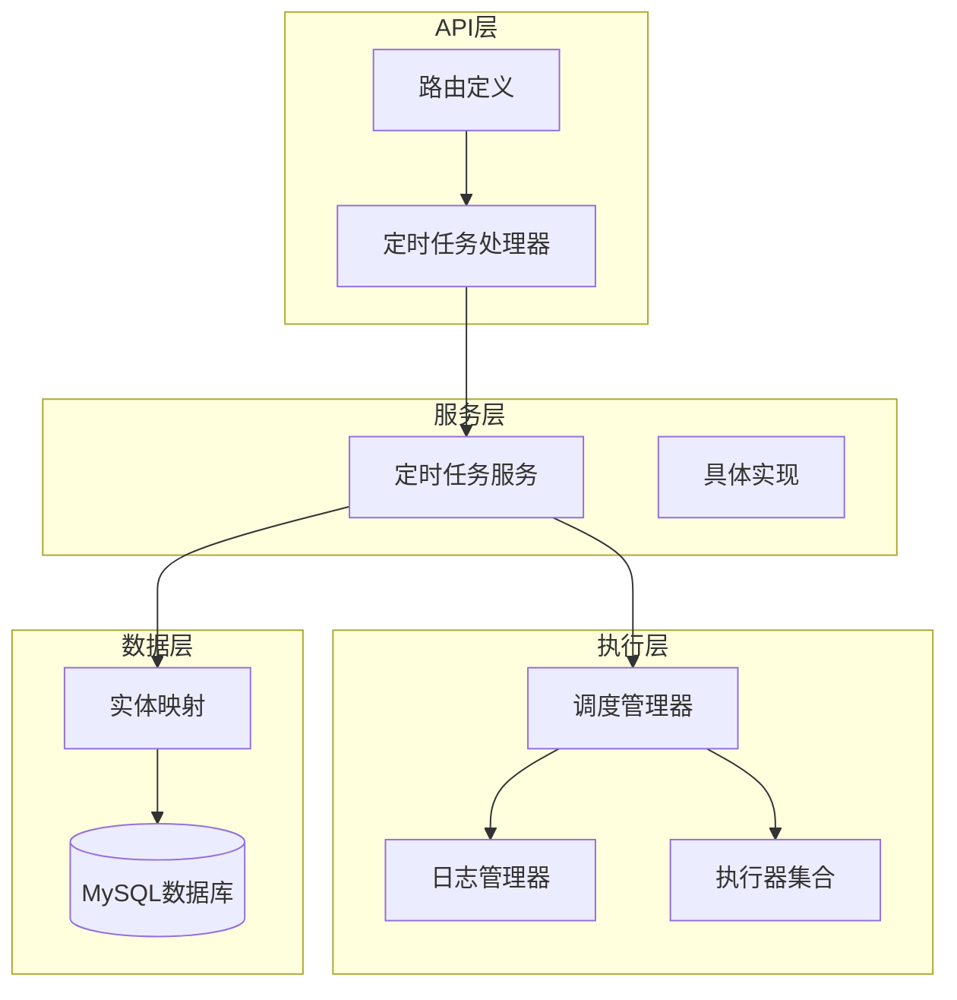
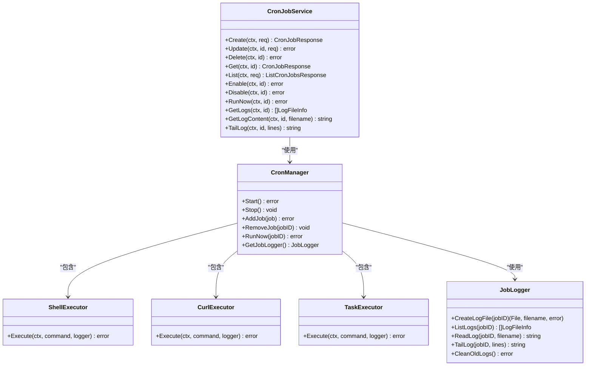
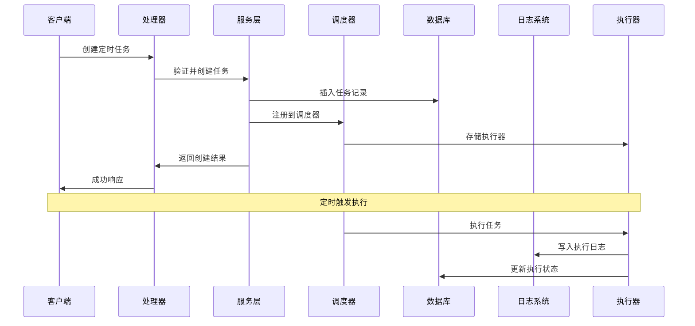
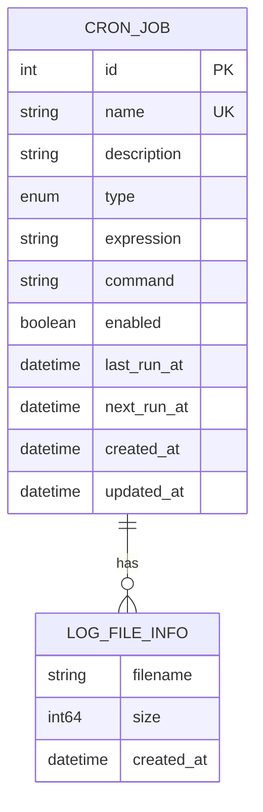

# 定时任务管理接口

<cite>
**本文档引用的文件**
- [cron_job.go](file://internal/handler/cron_job.go)
- [cron_job.go](file://internal/service/cron_job.go)
- [manager.go](file://internal/cron/manager.go)
- [executor.go](file://internal/cron/executor.go)
- [logger.go](file://internal/cron/logger.go)
- [registry.go](file://internal/tasks/registry.go)
- [router.go](file://internal/router.go)
- [cronjob.go](file://internal/ent/cronjob/cronjob.go)
- [global.go](file://internal/global/global.go)
- [config.yml](file://config/config.yml)
</cite>

## 目录
1. [简介](#简介)
2. [项目结构](#项目结构)
3. [核心组件](#核心组件)
4. [架构概览](#架构概览)
5. [详细接口规范](#详细接口规范)
6. [数据模型](#数据模型)
7. [任务类型与执行器](#任务类型与执行器)
8. [日志管理](#日志管理)
9. [错误处理](#错误处理)
10. [最佳实践](#最佳实践)
11. [故障排除指南](#故障排除指南)
12. [总结](#总结)

## 简介

定时任务管理接口提供了完整的定时任务全生命周期管理能力，包括任务创建、查询、更新、删除、启停控制、立即执行以及日志管理等功能。该系统基于robfig/cron库实现精确的定时调度，并支持多种任务类型（Shell命令、HTTP请求、Go任务）。

## 项目结构

定时任务管理功能主要分布在以下模块中：



**图表来源**
- [router.go:95-111](file://internal/router.go#L95-L111)
- [cron_job.go:14-58](file://internal/handler/cron_job.go#L14-L58)

**章节来源**
- [router.go:16-150](file://internal/router.go#L16-L150)

## 核心组件

### 组件架构



**图表来源**
- [cron_job.go:28-55](file://internal/service/cron_job.go#L28-L55)
- [manager.go:17-38](file://internal/cron/manager.go#L17-L38)
- [executor.go:18-37](file://internal/cron/executor.go#L18-L37)
- [logger.go:20-32](file://internal/cron/logger.go#L20-L32)

**章节来源**
- [cron_job.go:28-55](file://internal/service/cron_job.go#L28-L55)
- [manager.go:17-38](file://internal/cron/manager.go#L17-L38)

## 架构概览

定时任务系统的整体架构采用分层设计，确保职责分离和可维护性：



**图表来源**
- [cron_job.go:29-57](file://internal/handler/cron_job.go#L29-L57)
- [manager.go:85-116](file://internal/cron/manager.go#L85-L116)

## 详细接口规范

### 基础信息

- **基础URL**: `/api/v1/admin/auth/cron-jobs`
- **认证方式**: Bearer Token
- **内容类型**: `application/json`
- **标签**: 定时任务管理

### 1. 创建定时任务

**请求方法**: `POST`
**请求路径**: `/api/v1/admin/auth/cron-jobs`

**请求参数**:

| 参数名 | 类型 | 必填 | 描述 | 验证规则 |
|--------|------|------|------|----------|
| name | string | 是 | 任务名称 | required, max=100 |
| description | string | 否 | 任务描述 | max=500 |
| type | string | 是 | 任务类型 | required, oneof=shell,curl,task |
| expression | string | 是 | Cron表达式 | required |
| command | string | 是 | 执行命令或配置 | required |
| enabled | boolean | 否 | 是否启用 |  |

**响应格式**:

```json
{
  "code": 200,
  "message": "定时任务创建成功",
  "data": {
    "id": 1,
    "name": "示例任务",
    "description": "测试任务描述",
    "type": "shell",
    "expression": "0 */5 * * * *",
    "command": "echo hello",
    "enabled": true,
    "last_run_at": "2024-01-01T12:00:00Z",
    "next_run_at": "2024-01-01T12:05:00Z",
    "created_at": "2024-01-01T12:00:00Z",
    "updated_at": "2024-01-01T12:00:00Z"
  }
}
```

**错误码**:
- 400: 请求参数无效
- 409: 任务名称已存在
- 400: 无效的cron表达式
- 400: 无效的任务类型
- 400: Go任务未注册

**章节来源**
- [cron_job.go:14-58](file://internal/handler/cron_job.go#L14-L58)
- [cron_job.go:57-65](file://internal/service/cron_job.go#L57-L65)

### 2. 获取任务列表

**请求方法**: `GET`
**请求路径**: `/api/v1/admin/auth/cron-jobs`

**查询参数**:

| 参数名 | 类型 | 必填 | 描述 | 默认值 |
|--------|------|------|------|--------|
| page | int | 否 | 页码 | 1 |
| page_size | int | 否 | 每页数量 | 10 |
| keyword | string | 否 | 关键字搜索 | 无 |
| type | string | 否 | 任务类型 | 无 |
| enabled | boolean | 否 | 启用状态 | 无 |

**响应格式**:

```json
{
  "code": 200,
  "message": "获取定时任务列表成功",
  "data": {
    "total": 100,
    "page": 1,
    "data": [
      {
        "id": 1,
        "name": "示例任务",
        "description": "测试任务描述",
        "type": "shell",
        "expression": "0 */5 * * * *",
        "command": "echo hello",
        "enabled": true,
        "last_run_at": "2024-01-01T12:00:00Z",
        "next_run_at": "2024-01-01T12:05:00Z",
        "created_at": "2024-01-01T12:00:00Z",
        "updated_at": "2024-01-01T12:00:00Z"
      }
    ]
  }
}
```

**章节来源**
- [cron_job.go:60-102](file://internal/handler/cron_job.go#L60-L102)
- [cron_job.go:76-83](file://internal/service/cron_job.go#L76-L83)

### 3. 获取任务详情

**请求方法**: `GET`
**请求路径**: `/api/v1/admin/auth/cron-jobs/{id}`

**路径参数**:

| 参数名 | 类型 | 必填 | 描述 |
|--------|------|------|------|
| id | int | 是 | 任务ID |

**响应格式**: 同创建接口的响应数据

**错误码**:
- 404: 定时任务不存在

**章节来源**
- [cron_job.go:104-136](file://internal/handler/cron_job.go#L104-L136)
- [cron_job.go:271-284](file://internal/service/cron_job.go#L271-L284)

### 4. 更新定时任务

**请求方法**: `PUT`
**请求路径**: `/api/v1/admin/auth/cron-jobs/{id}`

**请求参数**:

| 参数名 | 类型 | 必填 | 描述 | 验证规则 |
|--------|------|------|------|----------|
| name | string | 否 | 任务名称 | max=100 |
| description | string | 否 | 任务描述 | max=500 |
| type | string | 否 | 任务类型 | oneof=shell,curl,task |
| expression | string | 否 | Cron表达式 | 
| command | string | 否 | 执行命令或配置 | 

**错误码**:
- 404: 定时任务不存在
- 409: 任务名称已存在
- 400: 无效的cron表达式
- 400: Go任务未注册

**章节来源**
- [cron_job.go:138-187](file://internal/handler/cron_job.go#L138-L187)
- [cron_job.go:166-246](file://internal/service/cron_job.go#L166-L246)

### 5. 删除定时任务

**请求方法**: `DELETE`
**请求路径**: `/api/v1/admin/auth/cron-jobs/{id}`

**错误码**:
- 404: 定时任务不存在

**章节来源**
- [cron_job.go:189-220](file://internal/handler/cron_job.go#L189-L220)
- [cron_job.go:248-269](file://internal/service/cron_job.go#L248-L269)

### 6. 启用定时任务

**请求方法**: `POST`
**请求路径**: `/api/v1/admin/auth/cron-jobs/{id}/enable`

**错误码**:
- 404: 定时任务不存在

**章节来源**
- [cron_job.go:222-253](file://internal/handler/cron_job.go#L222-L253)
- [cron_job.go:350-381](file://internal/service/cron_job.go#L350-L381)

### 7. 禁用定时任务

**请求方法**: `POST`
**请求路径**: `/api/v1/admin/auth/cron-jobs/{id}/disable`

**错误码**:
- 404: 定时任务不存在

**章节来源**
- [cron_job.go:255-286](file://internal/handler/cron_job.go#L255-L286)
- [cron_job.go:383-410](file://internal/service/cron_job.go#L383-L410)

### 8. 立即执行任务

**请求方法**: `POST`
**请求路径**: `/api/v1/admin/auth/cron-jobs/{id}/run`

**错误码**:
- 404: 定时任务不存在

**章节来源**
- [cron_job.go:288-319](file://internal/handler/cron_job.go#L288-L319)
- [cron_job.go:412-426](file://internal/service/cron_job.go#L412-L426)

### 9. 获取日志列表

**请求方法**: `GET`
**请求路径**: `/api/v1/admin/auth/cron-jobs/{id}/logs`

**响应格式**:

```json
{
  "code": 200,
  "message": "获取日志列表成功",
  "data": [
    {
      "filename": "20240101-120000.log",
      "size": 1024,
      "created_at": "2024-01-01T12:00:00Z"
    }
  ]
}
```

**章节来源**
- [cron_job.go:321-353](file://internal/handler/cron_job.go#L321-L353)
- [cron_job.go:428-442](file://internal/service/cron_job.go#L428-L442)

### 10. 读取日志尾部

**请求方法**: `GET`
**请求路径**: `/api/v1/admin/auth/cron-jobs/{id}/logs/tail`

**查询参数**:

| 参数名 | 类型 | 必填 | 描述 | 默认值 |
|--------|------|------|------|--------|
| lines | int | 否 | 读取行数 | 100 |

**响应格式**:

```json
{
  "code": 200,
  "message": "获取日志成功",
  "data": "日志内容..."
}
```

**章节来源**
- [cron_job.go:395-430](file://internal/handler/cron_job.go#L395-L430)
- [cron_job.go:460-474](file://internal/service/cron_job.go#L460-L474)

### 11. 获取日志内容

**请求方法**: `GET`
**请求路径**: `/api/v1/admin/auth/cron-jobs/{id}/logs/{filename}`

**路径参数**:

| 参数名 | 类型 | 必填 | 描述 |
|--------|------|------|------|
| id | int | 是 | 任务ID |
| filename | string | 是 | 日志文件名 |

**响应格式**:

```json
{
  "code": 200,
  "message": "获取日志内容成功",
  "data": "日志完整内容"
}
```

**错误码**:
- 404: 定时任务不存在
- 404: 日志文件不存在

**章节来源**
- [cron_job.go:355-393](file://internal/handler/cron_job.go#L355-L393)
- [cron_job.go:444-458](file://internal/service/cron_job.go#L444-L458)

## 数据模型

### CronJob实体结构



**图表来源**
- [cronjob.go:14-59](file://internal/ent/cronjob/cronjob.go#L14-L59)
- [logger.go:13-18](file://internal/cron/logger.go#L13-L18)

### 字段详细说明

| 字段名 | 类型 | 必填 | 描述 | 验证规则 |
|--------|------|------|------|----------|
| id | int | 是 | 主键ID | 自增 |
| name | string | 是 | 任务名称 | unique, max=100 |
| description | string | 否 | 任务描述 | max=500 |
| type | enum | 是 | 任务类型 | shell/curl/task |
| expression | string | 是 | Cron表达式 | 有效表达式 |
| command | string | 是 | 执行命令或配置 | 根据类型而定 |
| enabled | boolean | 是 | 是否启用 | 默认true |
| last_run_at | datetime | 否 | 最后执行时间 | 
| next_run_at | datetime | 否 | 下次执行时间 | 
| created_at | datetime | 是 | 创建时间 | 自动设置 |
| updated_at | datetime | 是 | 更新时间 | 自动设置 |

**章节来源**
- [cronjob.go:14-98](file://internal/ent/cronjob/cronjob.go#L14-L98)

## 任务类型与执行器

### 支持的任务类型

| 类型 | 描述 | 命令格式 | 执行器 |
|------|------|----------|--------|
| shell | Shell命令 | 任意shell命令 | ShellExecutor |
| curl | HTTP请求 | JSON配置对象 | CurlExecutor |
| task | Go任务 | 任务名称 | TaskExecutor |

### Shell任务执行

**特点**:
- 支持跨平台（Windows/cmd, Unix/sh）
- 命令输出直接写入日志文件
- 支持复杂shell脚本和管道操作

**安全考虑**:
- 命令执行在受控环境中进行
- 输出重定向到日志文件便于审计

### Curl任务执行

**JSON配置格式**:

```json
{
  "method": "GET",
  "url": "https://api.example.com/data",
  "headers": {
    "Authorization": "Bearer token",
    "Content-Type": "application/json"
  },
  "body": "{ \"key\": \"value\" }",
  "timeout": 30
}
```

**字段说明**:

| 字段名 | 类型 | 必填 | 描述 | 默认值 |
|--------|------|------|------|--------|
| method | string | 否 | HTTP方法 | GET |
| url | string | 是 | 请求地址 | 无 |
| headers | object | 否 | 请求头 | {} |
| body | string | 否 | 请求体 | 空字符串 |
| timeout | int | 否 | 超时时间(秒) | 30 |

### Task任务执行

**特点**:
- 基于Go函数的可编程任务
- 支持复杂业务逻辑
- 可通过注册表动态扩展

**注册示例**:

```go
func init() {
    tasks.Register("cleanup_expired_logs", CleanupExpiredLogs)
}

func CleanupExpiredLogs(ctx context.Context, logger io.Writer) error {
    fmt.Fprintf(logger, "开始清理过期日志...")
    // 实现清理逻辑
    return nil
}
```

**章节来源**
- [executor.go:23-125](file://internal/cron/executor.go#L23-L125)
- [registry.go:8-33](file://internal/tasks/registry.go#L8-L33)

## 日志管理

### 日志存储结构

日志文件采用以下目录结构：
```
./data/logs/cron/
└── job-{jobID}/
    ├── YYYYMMDD-HHMMSS.log
    └── ...
```

### 日志文件内容格式

每个任务执行都会生成独立的日志文件，格式如下：

```
========================================
任务: 示例任务 (ID: 1)
开始时间: 2024-01-01 12:00:00
========================================

[2024-01-01 12:00:01] 执行命令: echo hello
[2024-01-01 12:00:01] 响应状态: 200 OK
[2024-01-01 12:00:01] 响应内容:
hello

========================================
结束时间: 2024-01-01 12:00:01
耗时: 1s
状态: 成功
========================================
```

### 日志清理策略

系统内置日志清理机制：
- **清理频率**: 每天凌晨2点执行
- **保留时长**: 可配置（默认24小时）
- **清理范围**: 删除超过保留时长的日志文件
- **目录清理**: 删除空的日志目录

**章节来源**
- [logger.go:34-51](file://internal/cron/logger.go#L34-L51)
- [manager.go:60-70](file://internal/cron/manager.go#L60-L70)

## 错误处理

### 错误码定义

| 错误码 | 常量 | 描述 |
|--------|------|------|
| 400 | ResponseErrorCode | 请求参数无效 |
| 401 | ResponseErrorCode | 未授权访问 |
| 403 | ResponseErrorCode | 权限不足 |
| 404 | ErrCodeCronJobNotFound | 定时任务不存在 |
| 409 | ErrCodeCronJobNameExists | 任务名称已存在 |
| 422 | ErrCodeCronJobInvalidExpr | 无效的cron表达式 |
| 422 | ErrCodeCronJobInvalidType | 无效的任务类型 |
| 422 | ErrCodeCronJobTaskNotFound | Go任务未注册 |
| 422 | ErrCodeCronJobLogNotFound | 日志不存在 |

### 错误响应格式

```json
{
  "code": 400,
  "message": "请求参数无效",
  "data": null
}
```

**章节来源**
- [cron_job.go:43-54](file://internal/handler/cron_job.go#L43-L54)
- [service/cron_job.go:18-26](file://internal/service/cron_job.go#L18-L26)

## 最佳实践

### Cron表达式建议

**常用表达式模式**:

| 用途 | 表达式 | 说明 |
|------|--------|------|
| 每分钟 | `* * * * *` | 最小间隔 |
| 每5分钟 | `*/5 * * * *` | 常用监控 |
| 每小时 | `0 * * * *` | 小时级任务 |
| 每天凌晨2点 | `0 0 2 * * *` | 日常维护 |
| 工作日9点 | `0 0 9 * * 1-5` | 工作日任务 |

### 任务设计原则

1. **幂等性**: 确保重复执行不会产生副作用
2. **超时控制**: 为长时间任务设置合理超时
3. **资源管理**: 注意文件句柄和内存使用
4. **错误处理**: 完善异常捕获和恢复机制
5. **日志记录**: 详细记录执行过程和结果

### 性能优化

1. **批量操作**: 合理使用分页查询
2. **索引优化**: 在常用查询字段上建立索引
3. **缓存策略**: 对频繁访问的数据进行缓存
4. **并发控制**: 控制同时执行的任务数量

## 故障排除指南

### 常见问题诊断

**问题1: Cron表达式无效**
- 检查表达式语法是否正确
- 使用在线工具验证表达式
- 确认使用的时区设置

**问题2: 任务无法执行**
- 检查任务类型和命令格式
- 验证任务是否已启用
- 查看日志文件获取详细错误信息

**问题3: 日志文件缺失**
- 检查日志目录权限
- 验证日志清理策略配置
- 确认任务是否已经执行过

### 调试步骤

1. **查看系统日志**: 检查应用启动和运行日志
2. **验证数据库连接**: 确认定时任务表结构正确
3. **测试执行器**: 单独测试不同类型的执行器
4. **检查权限**: 验证任务执行所需的系统权限

**章节来源**
- [manager.go:41-77](file://internal/cron/manager.go#L41-L77)
- [logger.go:148-191](file://internal/cron/logger.go#L148-L191)

## 总结

定时任务管理接口提供了完整的任务生命周期管理能力，具有以下特点：

**核心优势**:
- 支持多种任务类型，满足不同场景需求
- 完善的日志管理和审计功能
- 精确的Cron调度机制
- 丰富的错误处理和状态反馈
- 良好的扩展性和可维护性

**适用场景**:
- 定时数据备份和清理
- 周期性报表生成
- 系统健康检查
- 数据同步和迁移
- 业务逻辑自动化

通过合理的配置和使用，该定时任务系统能够为企业提供稳定可靠的自动化解决方案。