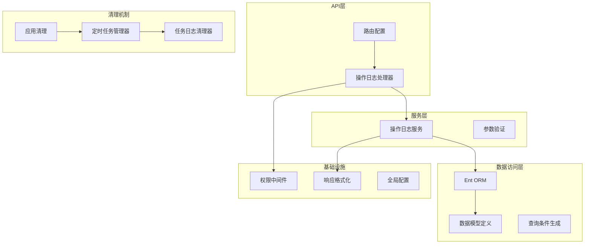
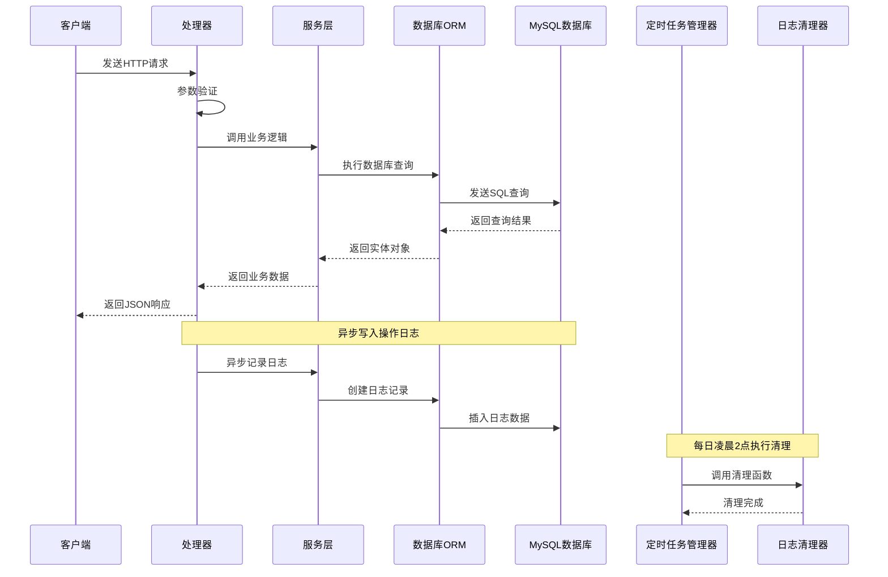
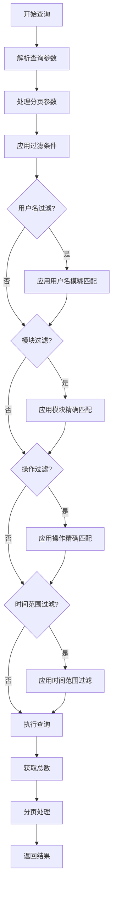
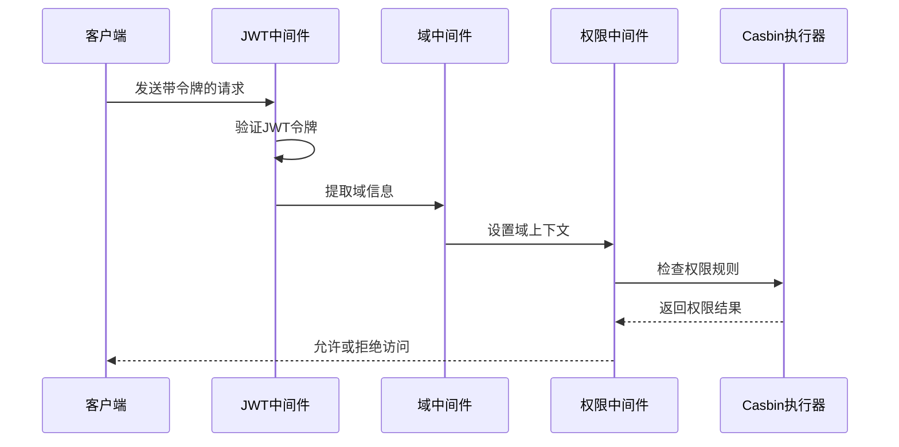
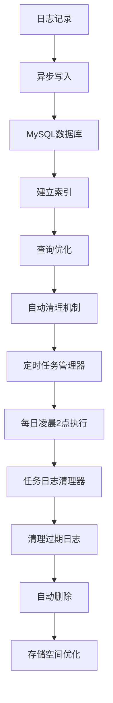
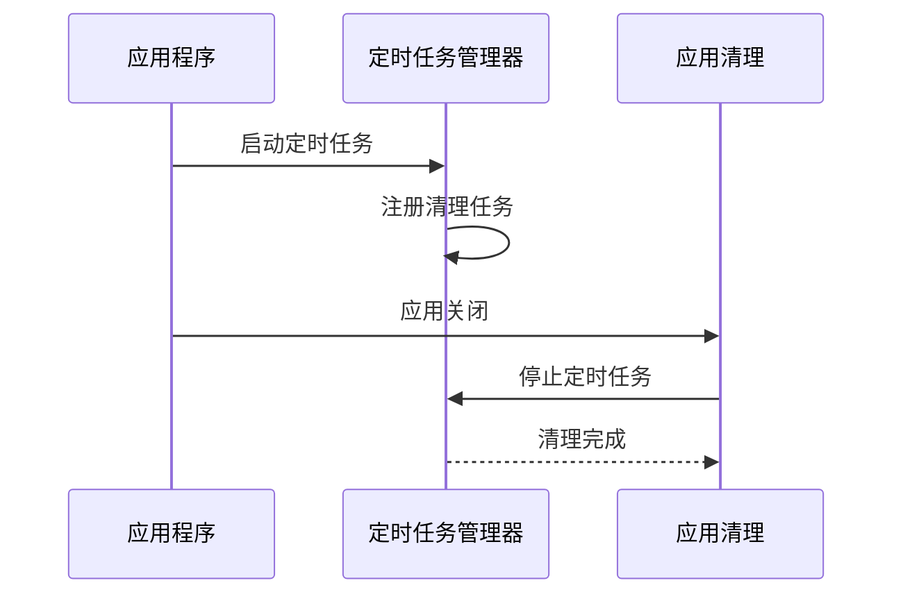

# 操作日志管理接口

<cite>
**本文档引用的文件**
- [operation_log.go](file://internal/handler/operation_log.go)
- [operation_log.go](file://internal/service/operation_log.go)
- [operationlog.go](file://internal/ent/operationlog/operationlog.go)
- [operationlog.go](file://internal/ent/schema/operationlog.go)
- [router.go](file://internal/router.go)
- [permission.go](file://internal/middleware/permission.go)
- [response.go](file://internal/utils/response.go)
- [global.go](file://internal/global/global.go)
- [msg.go](file://internal/global/msg.go)
- [config.yml](file://config/config.yml)
- [swagger.json](file://docs/swagger.json)
- [logger.go](file://internal/cron/logger.go)
- [manager.go](file://internal/cron/manager.go)
- [cleanup.go](file://internal/cleanup.go)
- [main.go](file://main.go)
</cite>

## 更新摘要
**所做更改**
- 更新了日志清理策略章节，反映手动清理端点已被自动清理机制替代
- 新增了自动清理机制的技术实现说明
- 更新了存储优化建议，增加自动清理相关的配置指导

## 目录
1. [简介](#简介)
2. [项目结构](#项目结构)
3. [核心组件](#核心组件)
4. [架构概览](#架构概览)
5. [详细接口规范](#详细接口规范)
6. [数据模型](#数据模型)
7. [查询过滤条件](#查询过滤条件)
8. [权限要求](#权限要求)
9. [性能考虑](#性能考虑)
10. [日志清理策略](#日志清理策略)
11. [存储优化建议](#存储优化建议)
12. [故障排除指南](#故障排除指南)
13. [结论](#结论)

## 简介

操作日志管理接口是系统中用于记录、查询和管理用户操作行为的重要功能模块。该接口提供了完整的操作日志生命周期管理能力，包括日志的自动记录、列表查询、详情获取等功能，为系统审计、安全监控和问题追踪提供了重要支撑。

**更新** 系统现已采用自动化的日志清理机制，替代了原有的手动清理端点，通过定时任务自动维护日志存储空间，确保系统长期稳定运行。

## 项目结构

操作日志功能在项目中的组织结构如下：



**图表来源**
- [operation_log.go:1-124](file://internal/handler/operation_log.go#L1-L124)
- [operation_log.go:1-200](file://internal/service/operation_log.go#L1-L200)
- [router.go:153-156](file://internal/router.go#L153-L156)
- [manager.go:17-38](file://internal/cron/manager.go#L17-L38)
- [logger.go:20-32](file://internal/cron/logger.go#L20-L32)

**章节来源**
- [operation_log.go:1-124](file://internal/handler/operation_log.go#L1-L124)
- [operation_log.go:1-200](file://internal/service/operation_log.go#L1-L200)
- [router.go:153-156](file://internal/router.go#L153-L156)
- [manager.go:17-38](file://internal/cron/manager.go#L17-L38)
- [logger.go:20-32](file://internal/cron/logger.go#L20-L32)

## 核心组件

### 处理器组件
操作日志处理器负责接收HTTP请求、参数验证和响应格式化：
- `ListOperationLogs`: 处理日志列表查询请求
- `GetOperationLog`: 处理日志详情查询请求
- `logOperation`: 辅助函数用于记录操作日志

### 服务组件
操作日志服务提供核心业务逻辑：
- `OperationLogService`: 实现日志记录、查询和详情获取
- `LogEntry`: 日志记录条目的数据结构
- `ListOperationLogsRequest`: 列表查询请求参数
- `OperationLogResponse`: 单个日志响应数据结构

### 数据模型组件
基于Ent框架的数据模型定义：
- `OperationLog`实体模型
- 查询条件生成器
- 字段验证器

### 清理机制组件
**新增** 自动清理机制提供日志存储管理：
- `CronManager`: 定时任务管理器，负责调度清理任务
- `JobLogger`: 任务日志清理器，管理过期日志文件
- `Cleanup`: 应用程序清理函数，优雅关闭清理服务

**章节来源**
- [operation_log.go:16-124](file://internal/handler/operation_log.go#L16-L124)
- [operation_log.go:25-200](file://internal/service/operation_log.go#L25-L200)
- [operationlog.go:17-91](file://internal/ent/schema/operationlog.go#L17-L91)
- [manager.go:17-38](file://internal/cron/manager.go#L17-L38)
- [logger.go:20-32](file://internal/cron/logger.go#L20-L32)

## 架构概览

操作日志系统的整体架构采用分层设计模式，包含自动清理机制：



**图表来源**
- [operation_log.go:88-124](file://internal/handler/operation_log.go#L88-L124)
- [operation_log.go:88-118](file://internal/service/operation_log.go#L88-L118)
- [manager.go:60-71](file://internal/cron/manager.go#L60-L71)
- [logger.go:148-191](file://internal/cron/logger.go#L148-L191)

## 详细接口规范

### 接口总览

| 方法 | 路径 | 功能 | 权限要求 |
|------|------|------|----------|
| GET | `/api/v1/admin/auth/operation-logs` | 获取操作日志列表 | 需要权限：`operation-logs:list` |
| GET | `/api/v1/admin/auth/operation-logs/:id` | 获取操作日志详情 | 需要权限：`operation-logs:get` |

### GET /api/v1/admin/auth/operation-logs

#### 请求参数

| 参数名 | 类型 | 必填 | 默认值 | 说明 |
|--------|------|------|--------|------|
| page | integer | 否 | 1 | 页码，最小值1 |
| page_size | integer | 否 | 10 | 每页数量，最小值1，最大值100 |
| username | string | 否 | - | 用户名，支持模糊匹配 |
| module | string | 否 | - | 模块名，精确匹配 |
| action | string | 否 | - | 操作类型，精确匹配 |
| start_time | string | 否 | - | 开始时间，RFC3339格式 |
| end_time | string | 否 | - | 结束时间，RFC3339格式 |

#### 响应格式

```json
{
  "code": 1,
  "message": "获取操作日志列表成功",
  "data": {
    "total": 100,
    "items": [
      {
        "id": 1,
        "user_id": 1,
        "username": "admin",
        "module": "用户管理",
        "action": "查询",
        "description": "查询用户列表",
        "method": "GET",
        "path": "/api/v1/admin/auth/users",
        "ip": "127.0.0.1",
        "user_agent": "Mozilla/5.0...",
        "request_body": "",
        "status_code": 200,
        "duration_ms": 150,
        "created_at": "2024-01-01T12:00:00Z"
      }
    ]
  }
}
```

#### 状态码说明

| 状态码 | 说明 | 响应示例 |
|--------|------|----------|
| 200 | 成功 | 返回日志列表数据 |
| 400 | 请求参数无效 | 参数验证失败 |
| 401 | 未授权 | JWT令牌无效或过期 |
| 403 | 权限不足 | 无访问权限 |
| 500 | 服务器错误 | 服务器内部错误 |

### GET /api/v1/admin/auth/operation-logs/:id

#### 路径参数

| 参数名 | 类型 | 必填 | 说明 |
|--------|------|------|------|
| id | integer | 是 | 日志记录ID，必须为正整数 |

#### 响应格式

```json
{
  "code": 1,
  "message": "获取操作日志成功",
  "data": {
    "id": 1,
    "user_id": 1,
    "username": "admin",
    "module": "用户管理",
    "action": "查询",
    "description": "查询用户列表",
    "method": "GET",
    "path": "/api/v1/admin/auth/users",
    "ip": "127.0.0.1",
    "user_agent": "Mozilla/5.0...",
    "request_body": "",
    "status_code": 200,
    "duration_ms": 150,
    "created_at": "2024-01-01T12:00:00Z"
  }
}
```

#### 状态码说明

| 状态码 | 说明 | 响应示例 |
|--------|------|----------|
| 200 | 成功 | 返回指定ID的日志详情 |
| 400 | 请求参数无效 | ID参数格式错误 |
| 401 | 未授权 | JWT令牌无效或过期 |
| 403 | 权限不足 | 无访问权限 |
| 404 | 资源不存在 | 指定ID的日志不存在 |
| 500 | 服务器错误 | 服务器内部错误 |

**章节来源**
- [operation_log.go:45-124](file://internal/handler/operation_log.go#L45-L124)
- [swagger.json:1749-1887](file://docs/swagger.json#L1749-L1887)

## 数据模型

### 操作日志字段说明

| 字段名 | 类型 | 长度限制 | 必填 | 说明 |
|--------|------|----------|------|------|
| id | integer | - | 是 | 自增主键 |
| user_id | integer | - | 否 | 操作用户ID |
| username | string | 255字符 | 是 | 用户名 |
| module | string | 255字符 | 是 | 模块名 |
| action | string | 255字符 | 是 | 操作类型 |
| description | string | 1024字符 | 否 | 操作描述 |
| method | string | 10字符 | 是 | HTTP方法 |
| path | string | 1024字符 | 是 | 请求路径 |
| ip | string | 50字符 | 否 | 客户端IP地址 |
| user_agent | string | 1024字符 | 否 | 用户代理信息 |
| request_body | text | - | 否 | 请求体内容（敏感信息） |
| status_code | integer | - | 否 | 响应状态码 |
| duration_ms | bigint | - | 否 | 请求耗时（毫秒） |
| created_at | datetime | - | 是 | 创建时间 |

### 数据库索引

操作日志表建立了以下索引以优化查询性能：

| 索引类型 | 索引字段 | 用途 |
|----------|----------|------|
| 主键索引 | id | 唯一标识符 |
| 普通索引 | user_id | 用户维度查询 |
| 普通索引 | module | 模块维度查询 |
| 普通索引 | action | 操作类型查询 |
| 普通索引 | created_at | 时间维度查询 |

**章节来源**
- [operationlog.go:17-91](file://internal/ent/schema/operationlog.go#L17-L91)
- [operationlog.go:13-98](file://internal/ent/operationlog/operationlog.go#L13-L98)

## 查询过滤条件

### 支持的过滤条件

操作日志查询支持多种过滤条件组合：



**图表来源**
- [operation_log.go:120-183](file://internal/service/operation_log.go#L120-L183)

### 过滤条件详解

#### 分页参数
- `page`: 页码，默认1，最小值1
- `page_size`: 每页数量，默认10，最小值1，最大值100

#### 文本过滤
- `username`: 支持模糊匹配（包含关键字）
- `module`: 精确匹配
- `action`: 精确匹配

#### 时间过滤
- `start_time`: 开始时间，RFC3339格式
- `end_time`: 结束时间，RFC3339格式

#### 查询顺序
查询按照创建时间倒序排列，最新的日志优先显示。

**章节来源**
- [operation_log.go:53-86](file://internal/service/operation_log.go#L53-L86)
- [operation_log.go:120-183](file://internal/service/operation_log.go#L120-L183)

## 权限要求

### 认证机制

操作日志接口采用JWT令牌进行身份认证：

1. **请求头格式**: `Authorization: Bearer <JWT_TOKEN>`
2. **令牌有效期**: 24小时（配置项：`login_expires: 86400`）
3. **令牌刷新**: 支持刷新令牌机制

### 权限控制

系统使用Casbin进行细粒度权限控制：



**图表来源**
- [permission.go:15-77](file://internal/middleware/permission.go#L15-L77)

### 权限规则

| 资源 | 操作 | 权限标识 |
|------|------|----------|
| 操作日志 | 列表查询 | `operation-logs:list` |
| 操作日志 | 详情获取 | `operation-logs:get` |

权限检查遵循Casbin的RBAC模型，支持多域管理。

**章节来源**
- [permission.go:14-94](file://internal/middleware/permission.go#L14-L94)
- [config.yml:77-143](file://config/config.yml#L77-L143)

## 性能考虑

### 查询优化

1. **索引利用**: 查询条件会充分利用数据库索引
2. **分页限制**: 最大每页100条记录，防止过度查询
3. **异步写入**: 日志记录采用异步方式，不影响主请求响应

### 缓存策略

- **权限缓存**: Casbin执行器支持缓存机制
- **配置缓存**: 系统配置支持内存缓存
- **Redis集成**: 支持Redis作为缓存后端

### 性能监控

系统提供以下性能指标：
- 请求耗时统计（`duration_ms`字段）
- 数据库查询性能监控
- 缓存命中率统计

**章节来源**
- [operation_log.go:88-118](file://internal/service/operation_log.go#L88-L118)
- [config.yml:32-58](file://config/config.yml#L32-L58)

## 日志清理策略

### 自动清理机制

**更新** 系统已完全采用自动化的日志清理机制，替代了原有的手动清理端点：



### 清理策略配置

| 策略类型 | 默认配置 | 说明 |
|----------|----------|------|
| 清理时间 | 每日凌晨2:00 | 系统定时任务执行清理 |
| 清理范围 | 所有操作日志 | 自动清理所有过期日志 |
| 保留期限 | 90天 | 默认保留最近90天的日志 |
| 清理阈值 | 100万条 | 当日志超过100万条时触发清理 |
| 存储优化 | 自动分区 | 支持按月分区存储 |

### 自动清理流程

1. **定时触发**: 每日凌晨2点自动执行清理任务
2. **过期检测**: 检测超过保留期限的日志记录
3. **批量删除**: 批量删除过期日志，避免频繁I/O操作
4. **存储优化**: 自动释放数据库存储空间

### 清理配置管理

**新增** 清理机制通过配置文件进行管理：

```yaml
# 日志清理配置
cleanup:
  enabled: true                    # 启用自动清理
  retention_days: 90              # 保留天数
  cleanup_time: "02:00:00"        # 清理时间
  batch_size: 1000                # 批量清理大小
  max_cleanup_rate: 10000         # 最大清理速率
```

### 应用程序生命周期管理

**更新** 清理机制与应用程序生命周期紧密集成：



**图表来源**
- [manager.go:40-77](file://internal/cron/manager.go#L40-L77)
- [cleanup.go:11-42](file://internal/cleanup.go#L11-L42)
- [main.go:95-102](file://main.go#L95-L102)

**章节来源**
- [manager.go:40-77](file://internal/cron/manager.go#L40-L77)
- [logger.go:148-191](file://internal/cron/logger.go#L148-L191)
- [cleanup.go:11-42](file://internal/cleanup.go#L11-L42)
- [main.go:95-102](file://main.go#L95-L102)

## 存储优化建议

### 数据库优化

1. **索引优化**
   - 确保`created_at`索引用于时间范围查询
   - 考虑添加复合索引优化常用查询组合

2. **表结构优化**
   - 对于大量文本字段，考虑使用压缩存储
   - 合理设置字段长度，避免浪费存储空间

3. **查询优化**
   - 使用EXPLAIN分析慢查询
   - 避免SELECT *，只查询必要字段
   - 合理使用LIMIT限制结果集

### 系统配置优化

1. **连接池配置**
   ```yaml
   database:
     connections:
       default:
         max_open_conns: 25
         max_idle_conns: 25
         conn_max_lifetime: 5
   ```

2. **缓存配置**
   ```yaml
   cache:
     stores:
       memory:
         default_ttl: 3600
       redis:
         default_ttl: 3600
         addr: localhost:6379
   ```

3. **日志配置**
   ```yaml
   log:
     max_size: 10
     max_backups: 10
     max_age: 180
   ```

4. **清理配置**
   ```yaml
   cleanup:
     enabled: true
     retention_days: 90
     cleanup_time: "02:00:00"
     batch_size: 1000
   ```

### 自动清理优化

**新增** 为自动清理机制提供的优化建议：

1. **清理频率调整**: 根据日志产生量调整清理频率
2. **批量处理优化**: 合理设置批量大小，平衡清理速度和系统负载
3. **监控告警**: 设置清理任务监控和异常告警
4. **备份策略**: 在清理前进行数据备份，确保数据安全

**章节来源**
- [config.yml:19-76](file://config/config.yml#L19-L76)
- [config.yml:11-18](file://config/config.yml#L11-L18)
- [config.yml:140-143](file://config/config.yml#L140-L143)

## 故障排除指南

### 常见问题及解决方案

#### 1. 权限相关问题

**问题**: 403 Forbidden
**原因**: 用户权限不足
**解决**: 
- 检查用户是否具有`operation-logs:*`权限
- 验证域配置是否正确
- 确认Casbin策略规则

#### 2. 数据库连接问题

**问题**: 500 Internal Server Error
**原因**: 数据库连接失败
**解决**:
- 检查数据库连接配置
- 验证数据库服务状态
- 查看数据库连接池配置

#### 3. 查询性能问题

**问题**: 查询响应缓慢
**原因**: 缺少适当索引或查询条件不当
**解决**:
- 分析查询执行计划
- 添加必要的索引
- 优化查询条件

#### 4. 清理任务异常

**问题**: 日志清理失败
**原因**: 定时任务执行异常
**解决**:
- 检查定时任务配置
- 验证清理权限
- 查看清理日志输出

### 错误码对照表

| 错误码 | 说明 | 处理建议 |
|--------|------|----------|
| 5001 | 操作日志不存在 | 检查日志ID有效性 |
| 401 | 未授权访问 | 检查JWT令牌 |
| 403 | 权限不足 | 检查用户权限 |
| 404 | 资源不存在 | 验证请求路径 |
| 5002 | 清理任务失败 | 检查定时任务配置 |

**章节来源**
- [msg.go:40-83](file://internal/global/msg.go#L40-L83)
- [operation_log.go:14-16](file://internal/service/operation_log.go#L14-L16)

## 结论

操作日志管理接口提供了完整、高效、安全的日志管理解决方案。通过合理的架构设计、完善的权限控制、优化的性能策略和自动化的清理机制，该接口能够满足生产环境的各种需求。

### 主要优势

1. **完整的功能覆盖**: 支持日志的记录、查询、详情获取等完整生命周期
2. **强大的过滤能力**: 支持多维度、多条件的复杂查询
3. **严格的权限控制**: 基于JWT和Casbin的双重安全防护
4. **高性能设计**: 异步写入、索引优化、缓存策略
5. **智能清理机制**: 自动化的日志清理，无需人工干预
6. **灵活的扩展性**: 基于Ent框架的可扩展数据模型

### 最佳实践建议

1. **合理使用过滤条件**: 避免全表扫描，充分利用索引
2. **控制查询范围**: 合理设置时间范围和分页参数
3. **监控系统性能**: 定期检查查询性能和数据库负载
4. **配置清理策略**: 根据业务需求调整清理参数
5. **安全配置**: 确保JWT配置和权限规则的安全性
6. **监控清理任务**: 定期检查清理任务执行状态

通过遵循这些最佳实践，可以确保操作日志系统的稳定运行和高效性能，同时享受自动化清理带来的便利。

**更新** 自动化清理机制的引入大大简化了日志管理流程，减少了运维负担，提高了系统的可靠性和稳定性。