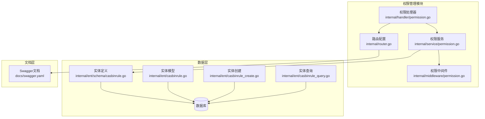
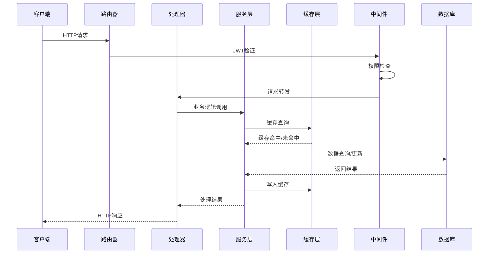
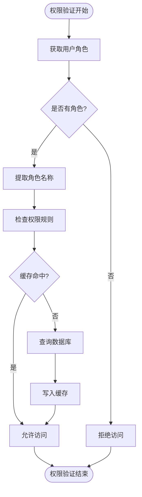
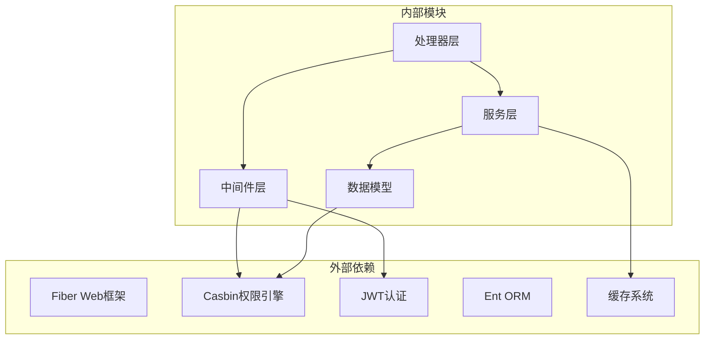
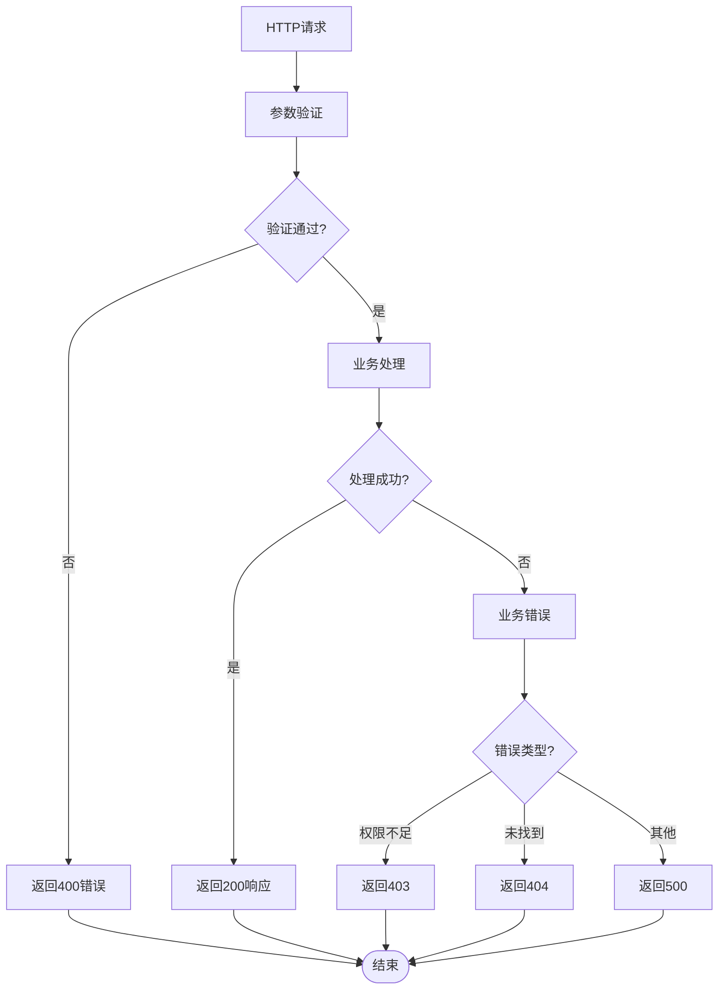

# 权限管理接口

<cite>
**本文档引用的文件**
- [permission.go](file://internal/handler/permission.go)
- [permission.go](file://internal/service/permission.go)
- [permission.go](file://internal/middleware/permission.go)
- [router.go](file://internal/router.go)
- [casbinrule.go](file://internal/ent/schema/casbinrule.go)
- [casbinrule.go](file://internal/ent/casbinrule.go)
- [casbinrule_create.go](file://internal/ent/casbinrule_create.go)
- [casbinrule_query.go](file://internal/ent/casbinrule_query.go)
- [swagger.yaml](file://docs/swagger.yaml)
- [response.go](file://internal/utils/response.go)
- [msg.go](file://internal/global/msg.go)
</cite>

## 更新摘要
**所做更改**
- 更新了Casbin规则实体的字段定义和索引配置
- 增强了权限查询能力，支持更灵活的过滤条件
- 改进了缓存机制，增加了角色权限缓存和用户权限缓存
- 新增了批量权限分配和移除功能
- 完善了用户权限获取接口，支持菜单、按钮和API权限的独立查询

## 目录
1. [简介](#简介)
2. [项目结构](#项目结构)
3. [核心组件](#核心组件)
4. [架构概览](#架构概览)
5. [详细接口规范](#详细接口规范)
6. [权限模型说明](#权限模型说明)
7. [权限分类](#权限分类)
8. [查询过滤条件](#查询过滤条件)
9. [依赖关系分析](#依赖关系分析)
10. [性能考虑](#性能考虑)
11. [故障排除指南](#故障排除指南)
12. [结论](#结论)

## 简介

权限管理接口是管理系统的核心安全组件，基于RBAC（基于角色的访问控制）模型实现。该系统采用Casbin作为权限引擎，支持API权限、菜单权限和按钮权限三种类型，提供完整的权限CRUD操作和查询功能。系统经过重大改进，包括增强的Casbin规则实体、改进的权限查询能力和优化的缓存机制。

## 项目结构

权限管理模块在项目中的组织结构如下：



**图表来源**
- [permission.go:1-567](file://internal/handler/permission.go#L1-L567)
- [permission.go:1-829](file://internal/service/permission.go#L1-L829)
- [router.go:1-190](file://internal/router.go#L1-L190)

**章节来源**
- [permission.go:1-567](file://internal/handler/permission.go#L1-L567)
- [permission.go:1-829](file://internal/service/permission.go#L1-L829)
- [router.go:1-190](file://internal/router.go#L1-L190)

## 核心组件

### 处理器层（Handler Layer）

处理器层负责HTTP请求的接收、参数验证和响应处理，提供RESTful API接口。新增了批量权限操作接口，包括为角色分配权限、从角色移除权限和获取用户权限等接口。

### 服务层（Service Layer）

服务层实现业务逻辑，包括权限验证、角色管理、用户权限查询等功能。引入了缓存机制，支持角色权限缓存和用户权限缓存，显著提升了查询性能。

### 中间件层（Middleware Layer）

中间件层提供权限控制、域管理和JWT验证等横切关注点。权限中间件集成了Casbin执行器，支持动态域权限验证。

### 数据层（Data Layer）

基于Ent框架的ORM模型，使用Casbin规则表存储权限信息。实体定义包含了完整的字段约束和索引配置。

**章节来源**
- [permission.go:14-567](file://internal/handler/permission.go#L14-L567)
- [permission.go:95-135](file://internal/service/permission.go#L95-L135)
- [permission.go:14-80](file://internal/middleware/permission.go#L14-L80)

## 架构概览

权限管理系统的整体架构采用分层设计，确保职责分离和可维护性：



**图表来源**
- [router.go:64-70](file://internal/router.go#L64-L70)
- [permission.go:15-80](file://internal/middleware/permission.go#L15-L80)
- [permission.go:28-60](file://internal/handler/permission.go#L28-L60)

## 详细接口规范

### 创建权限接口

**接口地址**: `POST /api/v1/admin/auth/permissions`

**功能描述**: 为指定角色创建新的权限规则

**权限要求**: 
- 需要Bearer Token认证
- 需要管理员权限

**请求参数**:

| 参数名 | 类型 | 必填 | 描述 | 示例 |
|--------|------|------|------|------|
| role_name | string | 是 | 角色名称 | admin |
| domain | string | 是 | 权限域 | default |
| type | string | 是 | 权限类型 | api/menu/button |
| object | string | 是 | 权限对象 | /api/users |
| action | string | 是 | 权限操作 | GET/POST/PUT/DELETE |
| description | string | 否 | 权限描述 | 用户管理权限 |

**响应格式**:

```json
{
  "code": 1,
  "message": "权限创建成功",
  "data": null
}
```

**错误码**:
- 400: 请求参数无效
- 401: 未授权访问
- 403: 拒绝访问
- 500: 服务器内部错误

**章节来源**
- [permission.go:14-60](file://internal/handler/permission.go#L14-L60)
- [permission.go:45-53](file://internal/service/permission.go#L45-L53)

### 更新权限接口

**接口地址**: `PUT /api/v1/admin/auth/permissions`

**功能描述**: 更新现有的权限规则

**权限要求**: 
- 需要Bearer Token认证
- 需要管理员权限

**请求参数**:

| 参数名 | 类型 | 必填 | 描述 | 示例 |
|--------|------|------|------|------|
| role_name | string | 是 | 角色名称 | admin |
| domain | string | 是 | 权限域 | default |
| type | string | 是 | 权限类型 | api/menu/button |
| object | string | 是 | 权限对象 | /api/users |
| action | string | 是 | 权限操作 | GET/POST/PUT/DELETE |
| new_object | string | 否 | 新的权限对象 | /api/users/:id |
| new_action | string | 否 | 新的权限操作 | GET |
| description | string | 否 | 权限描述 | 用户管理权限 |

**响应格式**:

```json
{
  "code": 1,
  "message": "权限更新成功",
  "data": null
}
```

**错误码**:
- 400: 请求参数无效
- 401: 未授权访问
- 403: 拒绝访问
- 500: 服务器内部错误

**章节来源**
- [permission.go:62-108](file://internal/handler/permission.go#L62-L108)
- [permission.go:55-65](file://internal/service/permission.go#L55-L65)

### 删除权限接口

**接口地址**: `DELETE /api/v1/admin/auth/permissions`

**功能描述**: 删除指定的权限规则

**权限要求**: 
- 需要Bearer Token认证
- 需要管理员权限

**查询参数**:

| 参数名 | 类型 | 必填 | 描述 | 示例 |
|--------|------|------|------|------|
| role_name | string | 是 | 角色名称 | admin |
| domain | string | 是 | 权限域 | default |
| object | string | 是 | 权限对象 | /api/users |
| action | string | 是 | 权限操作 | GET |

**响应格式**:

```json
{
  "code": 1,
  "message": "权限删除成功",
  "data": null
}
```

**错误码**:
- 400: 请求参数无效
- 401: 未授权访问
- 403: 拒绝访问
- 500: 服务器内部错误

**章节来源**
- [permission.go:110-158](file://internal/handler/permission.go#L110-L158)
- [permission.go:306-334](file://internal/service/permission.go#L306-L334)

### 获取权限详情接口

**接口地址**: `GET /api/v1/admin/auth/permissions/detail`

**功能描述**: 获取指定权限的详细信息

**权限要求**: 
- 需要Bearer Token认证
- 需要管理员权限

**查询参数**:

| 参数名 | 类型 | 必填 | 描述 | 示例 |
|--------|------|------|------|------|
| role_name | string | 是 | 角色名称 | admin |
| domain | string | 是 | 权限域 | default |
| object | string | 是 | 权限对象 | /api/users |
| action | string | 是 | 权限操作 | GET |

**响应格式**:

```json
{
  "code": 1,
  "message": "获取权限详情成功",
  "data": {
    "id": 1,
    "role_name": "admin",
    "domain": "default",
    "type": "api",
    "object": "/api/users",
    "action": "GET",
    "description": "用户管理权限"
  }
}
```

**错误码**:
- 400: 请求参数无效
- 401: 未授权访问
- 403: 拒绝访问
- 404: 权限不存在
- 500: 服务器内部错误

**章节来源**
- [permission.go:160-206](file://internal/handler/permission.go#L160-L206)
- [permission.go:336-355](file://internal/service/permission.go#L336-L355)

### 获取权限列表接口

**接口地址**: `GET /api/v1/admin/auth/permissions`

**功能描述**: 获取权限列表，支持分页和筛选

**权限要求**: 
- 需要Bearer Token认证
- 需要管理员权限

**查询参数**:

| 参数名 | 类型 | 必填 | 描述 | 示例 |
|--------|------|------|------|------|
| page | int | 否 | 页码，默认1 | 1 |
| page_size | int | 否 | 每页数量，默认10 | 10 |
| keyword | string | 否 | 关键字搜索 | 用户 |
| type | string | 否 | 权限类型 | api/menu/button |
| domain | string | 否 | 权限域 | default |
| role_name | string | 否 | 角色名称 | admin |

**响应格式**:

```json
{
  "code": 1,
  "message": "获取权限列表成功",
  "data": {
    "total": 100,
    "page": 1,
    "data": [
      {
        "id": 1,
        "role_name": "admin",
        "domain": "default",
        "type": "api",
        "object": "/api/users",
        "action": "GET",
        "description": "用户管理权限"
      }
    ]
  }
}
```

**错误码**:
- 400: 请求参数无效
- 401: 未授权访问
- 403: 拒绝访问
- 500: 服务器内部错误

**章节来源**
- [permission.go:208-257](file://internal/handler/permission.go#L208-L257)
- [permission.go:67-75](file://internal/service/permission.go#L67-L75)
- [permission.go:357-425](file://internal/service/permission.go#L357-L425)

### 为角色分配权限接口

**接口地址**: `POST /api/v1/admin/auth/roles/permissions/assign`

**功能描述**: 为指定角色分配多个权限

**权限要求**: 
- 需要Bearer Token认证
- 需要管理员权限

**请求参数**:

| 参数名 | 类型 | 必填 | 描述 | 示例 |
|--------|------|------|------|------|
| role_name | string | 是 | 角色名称 | admin |
| domain | string | 是 | 权限域 | default |
| permissions | array | 是 | 权限规则数组 | [{"object": "/api/users", "action": "GET"}] |

**响应格式**:

```json
{
  "code": 1,
  "message": "为角色分配权限成功",
  "data": null
}
```

**错误码**:
- 400: 请求参数无效
- 401: 未授权访问
- 403: 拒绝访问
- 404: 角色不存在
- 500: 服务器内部错误

**章节来源**
- [permission.go:259-309](file://internal/handler/permission.go#L259-L309)
- [permission.go:429-478](file://internal/service/permission.go#L429-L478)

### 从角色移除权限接口

**接口地址**: `POST /api/v1/admin/auth/roles/permissions/remove`

**功能描述**: 从指定角色移除多个权限

**权限要求**: 
- 需要Bearer Token认证
- 需要管理员权限

**请求参数**:

| 参数名 | 类型 | 必填 | 描述 | 示例 |
|--------|------|------|------|------|
| role_name | string | 是 | 角色名称 | admin |
| domain | string | 是 | 权限域 | default |
| permissions | array | 是 | 权限规则数组 | [{"object": "/api/users", "action": "GET"}] |

**响应格式**:

```json
{
  "code": 1,
  "message": "从角色移除权限成功",
  "data": null
}
```

**错误码**:
- 400: 请求参数无效
- 401: 未授权访问
- 403: 拒绝访问
- 404: 角色不存在
- 500: 服务器内部错误

**章节来源**
- [permission.go:311-361](file://internal/handler/permission.go#L311-L361)
- [permission.go:480-511](file://internal/service/permission.go#L480-L511)

### 获取角色权限接口

**接口地址**: `GET /api/v1/admin/auth/roles/permissions`

**功能描述**: 获取指定角色的所有权限

**权限要求**: 
- 需要Bearer Token认证
- 需要管理员权限

**查询参数**:

| 参数名 | 类型 | 必填 | 描述 | 示例 |
|--------|------|------|------|------|
| role_name | string | 是 | 角色名称 | admin |
| domain | string | 是 | 权限域 | default |

**响应格式**:

```json
{
  "code": 1,
  "message": "获取角色权限成功",
  "data": [
    {
      "id": 1,
      "role_name": "admin",
      "domain": "default",
      "type": "api",
      "object": "/api/users",
      "action": "GET",
      "description": "用户管理权限"
    }
  ]
}
```

**错误码**:
- 400: 请求参数无效
- 401: 未授权访问
- 403: 拒绝访问
- 404: 角色不存在
- 500: 服务器内部错误

**章节来源**
- [permission.go:363-405](file://internal/handler/permission.go#L363-L405)
- [permission.go:513-557](file://internal/service/permission.go#L513-L557)

### 获取用户菜单权限接口

**接口地址**: `GET /api/v1/admin/auth/user/menu-permissions`

**功能描述**: 获取当前用户的菜单权限

**权限要求**: 
- 需要Bearer Token认证

**查询参数**:

| 参数名 | 类型 | 必填 | 描述 | 示例 |
|--------|------|------|------|------|
| domain | string | 否 | 权限域，默认default | default |

**响应格式**:

```json
{
  "code": 1,
  "message": "获取用户菜单权限成功",
  "data": [
    {
      "id": 1,
      "role_name": "admin",
      "domain": "default",
      "type": "menu",
      "object": "/dashboard",
      "action": "menu",
      "description": "仪表板菜单"
    }
  ]
}
```

**错误码**:
- 401: 未授权访问
- 403: 拒绝访问
- 500: 服务器内部错误

**章节来源**
- [permission.go:407-440](file://internal/handler/permission.go#L407-L440)
- [permission.go:559-622](file://internal/service/permission.go#L559-L622)

### 获取用户按钮权限接口

**接口地址**: `GET /api/v1/admin/auth/user/button-permissions`

**功能描述**: 获取当前用户的按钮权限

**权限要求**: 
- 需要Bearer Token认证

**查询参数**:

| 参数名 | 类型 | 必填 | 描述 | 示例 |
|--------|------|------|------|------|
| domain | string | 否 | 权限域，默认default | default |

**响应格式**:

```json
{
  "code": 1,
  "message": "获取用户按钮权限成功",
  "data": [
    {
      "id": 1,
      "role_name": "admin",
      "domain": "default",
      "type": "button",
      "object": "add-user",
      "action": "button",
      "description": "添加用户按钮"
    }
  ]
}
```

**错误码**:
- 401: 未授权访问
- 403: 拒绝访问
- 500: 服务器内部错误

**章节来源**
- [permission.go:442-475](file://internal/handler/permission.go#L442-L475)
- [permission.go:624-687](file://internal/service/permission.go#L624-L687)

### 获取用户API权限接口

**接口地址**: `GET /api/v1/admin/auth/user/api-permissions`

**功能描述**: 获取当前用户的API权限

**权限要求**: 
- 需要Bearer Token认证

**查询参数**:

| 参数名 | 类型 | 必填 | 描述 | 示例 |
|--------|------|------|------|------|
| domain | string | 否 | 权限域，默认default | default |

**响应格式**:

```json
{
  "code": 1,
  "message": "获取用户API权限成功",
  "data": [
    {
      "id": 1,
      "role_name": "admin",
      "domain": "default",
      "type": "api",
      "object": "/api/users",
      "action": "GET",
      "description": "获取用户API权限"
    }
  ]
}
```

**错误码**:
- 401: 未授权访问
- 403: 拒绝访问
- 500: 服务器内部错误

**章节来源**
- [permission.go:477-510](file://internal/handler/permission.go#L477-L510)
- [permission.go:689-753](file://internal/service/permission.go#L689-L753)

### 获取用户所有权限接口

**接口地址**: `GET /api/v1/admin/auth/user/permissions`

**功能描述**: 获取当前用户的菜单和按钮权限

**权限要求**: 
- 需要Bearer Token认证

**查询参数**:

| 参数名 | 类型 | 必填 | 描述 | 示例 |
|--------|------|------|------|------|
| domain | string | 否 | 权限域，默认default | default |

**响应格式**:

```json
{
  "code": 1,
  "message": "获取用户权限成功",
  "data": {
    "menu": [
      {
        "id": 1,
        "role_name": "admin",
        "domain": "default",
        "type": "menu",
        "object": "/dashboard",
        "action": "menu",
        "description": "仪表板菜单"
      }
    ],
    "button": [
      {
        "id": 1,
        "role_name": "admin",
        "domain": "default",
        "type": "button",
        "object": "add-user",
        "action": "button",
        "description": "添加用户按钮"
      }
    ]
  }
}
```

**错误码**:
- 401: 未授权访问
- 403: 拒绝访问
- 500: 服务器内部错误

**章节来源**
- [permission.go:512-557](file://internal/handler/permission.go#L512-L557)
- [permission.go:755-798](file://internal/service/permission.go#L755-L798)

## 权限模型说明

### Casbin规则表结构

权限系统基于Casbin的P规则模型，使用统一的规则表存储所有类型的权限。实体定义包含了完整的字段约束和索引配置：

| 字段名 | 类型 | 描述 | 约束 |
|--------|------|------|------|
| Ptype | string | 规则类型 | 固定为"p"，最大长度100 |
| V0 | string | 角色名称 | 外键到角色表，最大长度100 |
| V1 | string | 权限域 | 默认"default"，最大长度100 |
| V2 | string | 权限对象 | API路径/菜单路径/按钮标识，最大长度100 |
| V3 | string | 权限操作 | HTTP方法/menu/button，最大长度100 |
| V4 | string | 权限类型 | api/menu/button，最大长度100 |
| V5 | string | 权限描述 | 可选描述信息，最大长度100 |

### 索引配置

Casbin规则表建立了复合唯一索引，确保权限规则的唯一性和查询性能：

```mermaid
graph LR
Ptype[Ptype: "p"] --> UniqueIndex[复合唯一索引]
V0[V0: 角色名称] --> UniqueIndex
V1[V1: 权限域] --> UniqueIndex
V2[V2: 权限对象] --> UniqueIndex
V3[V3: 权限操作] --> UniqueIndex
V4[V4: 权限类型] --> UniqueIndex
V5[V5: 权限描述] --> UniqueIndex
```

**图表来源**
- [casbinrule.go:32-36](file://internal/ent/schema/casbinrule.go#L32-L36)

### 权限验证流程



**图表来源**
- [permission.go:755-798](file://internal/service/permission.go#L755-L798)
- [casbinrule.go:15-37](file://internal/ent/schema/casbinrule.go#L15-L37)

**章节来源**
- [casbinrule.go:1-37](file://internal/ent/schema/casbinrule.go#L1-L37)
- [casbinrule.go:800-829](file://internal/service/permission.go#L800-L829)

## 权限分类

### API权限（api）
- **用途**: 控制对API接口的访问
- **对象示例**: `/api/users`, `/api/roles`
- **操作示例**: `GET`, `POST`, `PUT`, `DELETE`
- **特点**: 通过Casbin中间件自动验证

### 菜单权限（menu）
- **用途**: 控制导航菜单的显示
- **对象示例**: `/dashboard`, `/user-management`
- **操作值**: `menu`
- **特点**: 用于前端菜单渲染控制

### 按钮权限（button）
- **用途**: 控制页面按钮的显示和操作
- **对象示例**: `add-user`, `edit-user`, `delete-user`
- **操作值**: `button`
- **特点**: 用于细粒度的UI元素控制

**章节来源**
- [permission.go:27-37](file://internal/service/permission.go#L27-L37)
- [permission.go:39-43](file://internal/service/permission.go#L39-L43)

## 查询过滤条件

### 基础查询参数

| 参数名 | 类型 | 描述 | 默认值 | 限制 |
|--------|------|------|--------|------|
| page | int | 页码 | 1 | >= 1 |
| page_size | int | 每页条数 | 10 | 1-100 |
| keyword | string | 关键字 | 空 | 无 |
| type | string | 权限类型 | 空 | api/menu/button |
| domain | string | 权限域 | 空 | 无 |
| role_name | string | 角色名称 | 空 | 无 |

### 高级过滤规则

1. **分页控制**: 自动限制每页最大100条记录
2. **关键字搜索**: 支持对象名称和描述的模糊匹配
3. **多条件组合**: 可同时使用多种过滤条件
4. **排序规则**: 默认按创建时间倒序排列

**章节来源**
- [permission.go:67-75](file://internal/service/permission.go#L67-L75)
- [permission.go:357-425](file://internal/service/permission.go#L357-L425)

## 依赖关系分析

### 组件依赖图



### 错误处理机制

系统采用统一的错误处理机制：



**图表来源**
- [permission.go:36-54](file://internal/handler/permission.go#L36-L54)
- [response.go:9-50](file://internal/utils/response.go#L9-L50)

**章节来源**
- [permission.go:1-567](file://internal/handler/permission.go#L1-L567)
- [permission.go:1-829](file://internal/service/permission.go#L1-L829)
- [response.go:1-50](file://internal/utils/response.go#L1-L50)

## 性能考虑

### 缓存策略

系统实现了多层次的缓存机制：

1. **角色权限缓存**: 角色权限查询结果缓存5分钟
2. **用户权限缓存**: 用户菜单、按钮、API权限分别缓存
3. **缓存键设计**: 使用"role:perms:{roleName}:{domain}"和"user:{type}:{userID}:{domain}"格式
4. **缓存失效**: 权限变更时自动清除相关缓存

### 数据库优化

1. **索引设计**: Casbin规则表建立复合唯一索引
2. **查询优化**: 使用精确匹配和范围查询
3. **批量操作**: 支持批量权限分配和移除
4. **实体优化**: Ent框架自动生成高效的查询和更新代码

### 并发控制

1. **连接池**: 数据库连接池自动管理
2. **事务处理**: 关键操作使用事务保证一致性
3. **锁机制**: 防止并发修改导致的数据不一致

**章节来源**
- [permission.go:137-188](file://internal/service/permission.go#L137-L188)
- [casbinrule.go:32-36](file://internal/ent/schema/casbinrule.go#L32-L36)

## 故障排除指南

### 常见错误及解决方案

| 错误类型 | 错误码 | 可能原因 | 解决方案 |
|----------|--------|----------|----------|
| 认证失败 | 401 | JWT令牌无效 | 检查令牌格式和有效期 |
| 权限不足 | 403 | 用户无相应权限 | 检查用户角色和权限分配 |
| 资源不存在 | 404 | 权限规则不存在 | 确认权限参数正确性 |
| 参数错误 | 400 | 请求参数格式错误 | 检查请求格式和必填字段 |
| 服务器错误 | 500 | 系统内部异常 | 查看服务器日志 |

### 调试建议

1. **启用日志**: 在开发环境开启详细日志输出
2. **参数验证**: 使用Swagger测试接口参数
3. **缓存检查**: 权限变更后检查缓存是否正确失效
4. **数据库检查**: 验证Casbin规则表数据完整性

**章节来源**
- [permission.go:14-80](file://internal/middleware/permission.go#L14-L80)
- [msg.go:44-84](file://internal/global/msg.go#L44-L84)

## 结论

权限管理接口提供了完整的RBAC权限控制能力，经过重大改进后具有以下特点：

1. **安全性**: 基于JWT和Casbin的双重安全验证
2. **灵活性**: 支持多种权限类型和灵活的查询条件
3. **性能优化**: 引入缓存机制，显著提升查询性能
4. **可扩展性**: 模块化设计便于功能扩展
5. **易用性**: RESTful API设计符合现代Web标准
6. **批量操作**: 支持批量权限分配和移除
7. **用户权限**: 提供独立的用户权限查询接口

该系统能够满足大多数企业级应用的权限管理需求，为构建安全可靠的应用系统提供了坚实的基础。