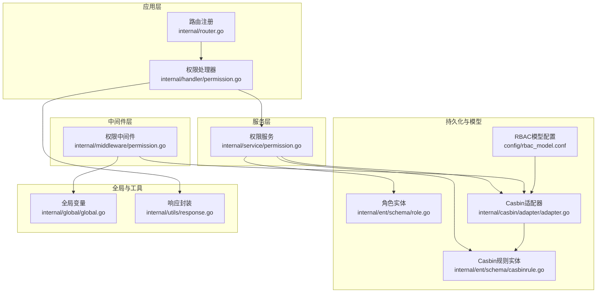
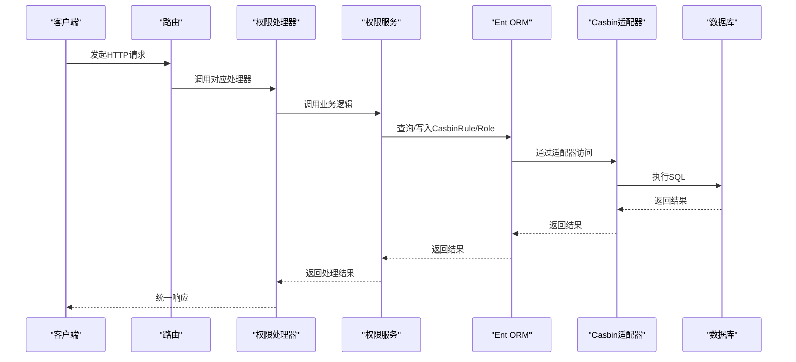
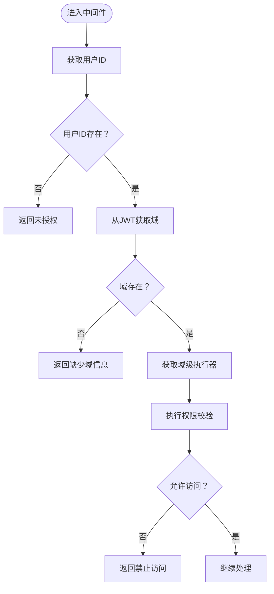
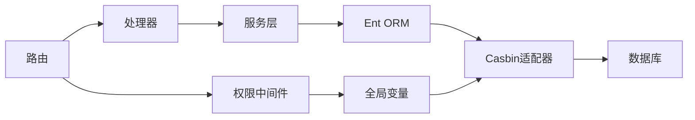

# 权限管理接口

<cite>
**本文引用的文件**
- [internal/handler/permission.go](file://internal/handler/permission.go)
- [internal/service/permission.go](file://internal/service/permission.go)
- [internal/middleware/permission.go](file://internal/middleware/permission.go)
- [internal/router.go](file://internal/router.go)
- [internal/init.go](file://internal/init.go)
- [internal/casbin/adapter/adapter.go](file://internal/casbin/adapter/adapter.go)
- [config/rbac_model.conf](file://config/rbac_model.conf)
- [internal/ent/schema/casbinrule.go](file://internal/ent/schema/casbinrule.go)
- [internal/ent/schema/role.go](file://internal/ent/schema/role.go)
- [internal/global/global.go](file://internal/global/global.go)
- [internal/utils/response.go](file://internal/utils/response.go)
- [docs/swagger.yaml](file://docs/swagger.yaml)
</cite>

## 目录
1. [简介](#简介)
2. [项目结构](#项目结构)
3. [核心组件](#核心组件)
4. [架构总览](#架构总览)
5. [详细组件分析](#详细组件分析)
6. [依赖分析](#依赖分析)
7. [性能考虑](#性能考虑)
8. [故障排查指南](#故障排查指南)
9. [结论](#结论)
10. [附录](#附录)

## 简介
本文件为权限管理接口的完整API文档，覆盖以下接口：
- 创建权限：POST /api/v1/admin/auth/permissions
- 更新权限：PUT /api/v1/admin/auth/permissions
- 删除权限：DELETE /api/v1/admin/auth/permissions
- 获取权限详情：GET /api/v1/admin/auth/permissions/detail
- 获取权限列表：GET /api/v1/admin/auth/permissions

同时，文档详细说明权限类型、权限规则格式、权限验证机制、权限与角色的关联关系、权限继承规则、冲突检测与解决策略，并提供操作示例与最佳实践。

## 项目结构
权限管理模块围绕“处理器（Handler）—服务（Service）—中间件（Middleware）—路由（Router）—Casbin适配器—实体Schema”的层次化设计组织，采用基于Casbin的RBAC模型，结合Ent ORM进行策略持久化与查询。

图表来源
- [internal/router.go:14-72](file://internal/router.go#L14-L72)
- [internal/handler/permission.go:13-222](file://internal/handler/permission.go#L13-L222)
- [internal/service/permission.go:115-671](file://internal/service/permission.go#L115-L671)
- [internal/middleware/permission.go:11-69](file://internal/middleware/permission.go#L11-L69)
- [internal/casbin/adapter/adapter.go:1-544](file://internal/casbin/adapter/adapter.go#L1-L544)
- [config/rbac_model.conf:1-15](file://config/rbac_model.conf#L1-L15)
- [internal/ent/schema/casbinrule.go:9-37](file://internal/ent/schema/casbinrule.go#L9-L37)
- [internal/ent/schema/role.go:10-73](file://internal/ent/schema/role.go#L10-L73)
- [internal/global/global.go:10-15](file://internal/global/global.go#L10-L15)
- [internal/utils/response.go:9-50](file://internal/utils/response.go#L9-L50)

章节来源
- [internal/router.go:14-72](file://internal/router.go#L14-L72)
- [internal/handler/permission.go:13-222](file://internal/handler/permission.go#L13-L222)
- [internal/service/permission.go:115-671](file://internal/service/permission.go#L115-L671)
- [internal/middleware/permission.go:11-69](file://internal/middleware/permission.go#L11-L69)
- [internal/casbin/adapter/adapter.go:1-544](file://internal/casbin/adapter/adapter.go#L1-L544)
- [config/rbac_model.conf:1-15](file://config/rbac_model.conf#L1-L15)
- [internal/ent/schema/casbinrule.go:9-37](file://internal/ent/schema/casbinrule.go#L9-L37)
- [internal/ent/schema/role.go:10-73](file://internal/ent/schema/role.go#L10-L73)
- [internal/global/global.go:10-15](file://internal/global/global.go#L10-L15)
- [internal/utils/response.go:9-50](file://internal/utils/response.go#L9-L50)

## 核心组件
- 处理器（Handler）
  - 负责解析请求、调用服务层、返回统一响应格式。
  - 关键接口：创建、更新、删除、详情查询、列表查询、角色权限分配/移除、用户权限查询。
- 服务（Service）
  - 定义权限类型、权限规则、请求/响应结构体。
  - 实现权限增删改查、角色权限批量分配/移除、用户权限查询、权限校验。
- 中间件（Middleware）
  - 在API层对每个请求进行权限校验，基于Casbin执行器进行强制访问控制。
- 路由（Router）
  - 统一挂载权限管理相关路由，绑定鉴权中间件与权限中间件。
- Casbin适配器与模型
  - 通过Ent ORM持久化策略；使用RBAC模型配置进行匹配。
- 实体Schema
  - CasbinRule与Role实体定义字段与索引约束。

章节来源
- [internal/handler/permission.go:13-222](file://internal/handler/permission.go#L13-L222)
- [internal/service/permission.go:24-113](file://internal/service/permission.go#L24-L113)
- [internal/middleware/permission.go:11-69](file://internal/middleware/permission.go#L11-L69)
- [internal/router.go:52-71](file://internal/router.go#L52-L71)
- [internal/casbin/adapter/adapter.go:115-175](file://internal/casbin/adapter/adapter.go#L115-L175)
- [config/rbac_model.conf:1-15](file://config/rbac_model.conf#L1-L15)
- [internal/ent/schema/casbinrule.go:9-37](file://internal/ent/schema/casbinrule.go#L9-L37)
- [internal/ent/schema/role.go:10-73](file://internal/ent/schema/role.go#L10-L73)

## 架构总览
权限管理采用“请求—中间件—处理器—服务—Casbin适配器—数据库”的链路，统一响应封装，支持多域（domain）隔离与角色继承。

图表来源
- [internal/router.go:52-71](file://internal/router.go#L52-L71)
- [internal/handler/permission.go:24-49](file://internal/handler/permission.go#L24-L49)
- [internal/service/permission.go:127-174](file://internal/service/permission.go#L127-L174)
- [internal/casbin/adapter/adapter.go:115-175](file://internal/casbin/adapter/adapter.go#L115-L175)

## 详细组件分析

### 数据模型与字段定义
- CasbinRule（策略表）
  - 字段：Ptype、V0、V1、V2、V3、V4、V5
  - 约束：唯一索引(Ptype,V0,V1,V2,V3,V4,V5)
  - 用途：存储权限规则（角色、域、对象、动作、类型、描述）
- Role（角色表）
  - 字段：id、name、display_name、description、is_system、status、created_by、updated_by
  - 约束：name唯一、status索引
  - 用途：角色元数据与状态管理

章节来源
- [internal/ent/schema/casbinrule.go:9-37](file://internal/ent/schema/casbinrule.go#L9-L37)
- [internal/ent/schema/role.go:10-73](file://internal/ent/schema/role.go#L10-L73)

### 权限类型与规则格式
- 权限类型（PermissionType）
  - api：API权限
  - menu：菜单权限
  - button：按钮权限
- 权限规则（PermissionRule）
  - object：资源标识（API路径、菜单路径或按钮标识）
  - action：动作标识（HTTP方法、menu、button）
- 请求与响应结构
  - CreatePermissionRequest：role_name、domain、type、object、action、description
  - UpdatePermissionRequest：role_name、domain、type、object、action、new_object、new_action、description
  - ListPermissionsRequest：page、page_size、keyword、type、domain、role_name
  - PermissionResponse：id、role_name、domain、type、object、action、description

章节来源
- [internal/service/permission.go:24-90](file://internal/service/permission.go#L24-L90)

### 权限验证机制与中间件
- 中间件职责
  - 从JWT中提取域（domain），并注入到上下文
  - 通过全局EnforcerManager获取对应域的Casbin执行器
  - 使用执行器进行强制权限校验（sub,obj,act），拒绝则返回403
- 执行器来源
  - 通过Casbin适配器读取数据库中的策略，按RBAC模型匹配

图表来源
- [internal/middleware/permission.go:11-69](file://internal/middleware/permission.go#L11-L69)
- [internal/global/global.go:10-15](file://internal/global/global.go#L10-L15)

章节来源
- [internal/middleware/permission.go:11-69](file://internal/middleware/permission.go#L11-L69)
- [internal/global/global.go:10-15](file://internal/global/global.go#L10-L15)

### 权限与角色的关联关系与继承规则
- 角色与权限
  - 权限以“角色+域+对象+动作”维度存储于CasbinRule
  - 用户通过UserRole关联到多个角色，形成多角色集合
- 权限继承
  - 用户最终权限为其所拥有多角色权限的并集
  - 中间件在执行校验时，会查询用户所有角色对应的权限
- 域（domain）隔离
  - 不同域下的同名对象/动作互不影响，确保租户/环境隔离

章节来源
- [internal/service/permission.go:466-640](file://internal/service/permission.go#L466-L640)
- [internal/ent/schema/casbinrule.go:9-37](file://internal/ent/schema/casbinrule.go#L9-L37)

### 权限冲突检测与解决策略
- 冲突检测
  - 创建权限前检查“角色+域+对象+动作”组合是否已存在，避免重复
  - 批量分配权限时跳过已存在的规则
- 冲突解决
  - 若发现重复，返回“权限已存在”错误
  - 对于需要变更的场景，使用更新接口修改对象或动作，或删除后重建
- 最佳实践
  - 统一规范对象命名（如API路径、菜单标识、按钮ID）
  - 明确动作语义（menu/button/api），避免歧义
  - 合理拆分域，减少跨域权限耦合

章节来源
- [internal/service/permission.go:143-157](file://internal/service/permission.go#L143-L157)
- [internal/service/permission.go:372-386](file://internal/service/permission.go#L372-L386)

### API定义与示例

#### 创建权限
- 方法与路径
  - POST /api/v1/admin/auth/permissions
- 请求体
  - role_name：角色名称
  - domain：域
  - type：权限类型（api/menu/button）
  - object：资源标识
  - action：动作标识
  - description：描述（可选）
- 成功响应
  - code：200
  - message：权限创建成功
- 错误响应
  - 400：无效请求参数
  - 409：权限已存在
  - 500：内部错误

章节来源
- [internal/handler/permission.go:13-50](file://internal/handler/permission.go#L13-L50)
- [internal/service/permission.go:127-174](file://internal/service/permission.go#L127-L174)

#### 更新权限
- 方法与路径
  - PUT /api/v1/admin/auth/permissions
- 请求体
  - role_name、domain、type、object、action（必填）
  - new_object、new_action（可选，用于更新对象或动作）
  - description（可选，用于更新描述）
- 成功响应
  - code：200
  - message：权限更新成功
- 错误响应
  - 400：无效请求参数
  - 404：权限不存在
  - 500：内部错误

章节来源
- [internal/handler/permission.go:52-89](file://internal/handler/permission.go#L52-L89)
- [internal/service/permission.go:176-236](file://internal/service/permission.go#L176-L236)

#### 删除权限
- 方法与路径
  - DELETE /api/v1/admin/auth/permissions
- 查询参数
  - role_name：角色名称
  - domain：域
  - object：资源标识
  - action：动作标识
- 成功响应
  - code：200
  - message：权限删除成功
- 错误响应
  - 400：无效请求参数
  - 404：权限不存在
  - 500：内部错误

章节来源
- [internal/handler/permission.go:91-133](file://internal/handler/permission.go#L91-L133)
- [internal/service/permission.go:238-263](file://internal/service/permission.go#L238-L263)

#### 获取权限详情
- 方法与路径
  - GET /api/v1/admin/auth/permissions/detail
- 查询参数
  - role_name、domain、object、action
- 成功响应
  - code：200
  - data：PermissionResponse
- 错误响应
  - 400：无效请求参数
  - 404：权限不存在
  - 500：内部错误

章节来源
- [internal/handler/permission.go:135-177](file://internal/handler/permission.go#L135-L177)
- [internal/service/permission.go:265-284](file://internal/service/permission.go#L265-L284)

#### 获取权限列表
- 方法与路径
  - GET /api/v1/admin/auth/permissions
- 查询参数
  - page：页码，默认1
  - page_size：每页数量，默认10，最大100
  - keyword：关键字（对象或描述）
  - type：权限类型
  - domain：域
  - role_name：角色名称
- 成功响应
  - code：200
  - data：ListPermissionsResponse（total、page、data）
- 错误响应
  - 500：内部错误

章节来源
- [internal/handler/permission.go:179-222](file://internal/handler/permission.go#L179-L222)
- [internal/service/permission.go:286-354](file://internal/service/permission.go#L286-L354)

### 角色权限管理与用户权限查询
- 为角色分配权限
  - POST /api/v1/admin/auth/roles/permissions/assign
  - 查询参数：role_name、domain
  - 请求体：权限规则数组（object、action）
- 从角色移除权限
  - POST /api/v1/admin/auth/roles/permissions/remove
  - 查询参数：role_name、domain
  - 请求体：权限规则数组
- 获取角色权限
  - GET /api/v1/admin/auth/roles/permissions
  - 查询参数：role_name、domain
- 获取用户权限
  - GET /api/v1/admin/auth/user/menu-permissions
  - GET /api/v1/admin/auth/user/button-permissions
  - GET /api/v1/admin/auth/user/api-permissions
  - GET /api/v1/admin/auth/user/permissions
  - 查询参数：domain（默认default）

章节来源
- [internal/handler/permission.go:224-496](file://internal/handler/permission.go#L224-L496)
- [internal/service/permission.go:356-600](file://internal/service/permission.go#L356-L600)

## 依赖分析
- 处理器依赖服务层接口，服务层依赖Ent ORM与Casbin适配器
- 中间件依赖全局EnforcerManager与JWT解析
- 路由在鉴权中间件后挂载权限中间件，确保所有受保护接口均经过权限校验

图表来源
- [internal/handler/permission.go:24-49](file://internal/handler/permission.go#L24-L49)
- [internal/service/permission.go:127-174](file://internal/service/permission.go#L127-L174)
- [internal/middleware/permission.go:33-52](file://internal/middleware/permission.go#L33-L52)
- [internal/router.go:52-71](file://internal/router.go#L52-L71)

章节来源
- [internal/handler/permission.go:24-49](file://internal/handler/permission.go#L24-L49)
- [internal/service/permission.go:127-174](file://internal/service/permission.go#L127-L174)
- [internal/middleware/permission.go:33-52](file://internal/middleware/permission.go#L33-L52)
- [internal/router.go:52-71](file://internal/router.go#L52-L71)

## 性能考虑
- 分页与筛选
  - 列表接口支持分页与多维筛选，建议合理设置page_size并使用关键词与类型过滤
- 查询优化
  - CasbinRule表具备唯一索引，创建/更新/删除前的唯一性检查与查询应充分利用索引
- 批量操作
  - 批量分配/移除权限时，适配器采用批量插入/删除，减少往返次数
- 中间件校验
  - 建议缓存域级执行器，避免频繁初始化

[本节为通用指导，不直接分析具体文件]

## 故障排查指南
- 常见错误
  - 400：请求参数缺失或格式错误
  - 401：未授权访问（缺少用户ID或域信息）
  - 403：权限不足（中间件拒绝）
  - 404：权限/角色不存在
  - 409：权限已存在
  - 500：内部错误（数据库异常、执行器异常）
- 排查步骤
  - 检查JWT是否包含域信息
  - 确认域级执行器是否正确初始化
  - 核对角色是否存在且状态正常
  - 核对权限组合（角色+域+对象+动作）是否唯一
  - 查看数据库日志与服务端日志定位异常

章节来源
- [internal/handler/permission.go:32-49](file://internal/handler/permission.go#L32-L49)
- [internal/middleware/permission.go:14-52](file://internal/middleware/permission.go#L14-L52)
- [internal/service/permission.go:16-22](file://internal/service/permission.go#L16-L22)

## 结论
本权限管理接口以Casbin为核心，结合Ent ORM与自定义适配器，实现了灵活的RBAC模型。通过严格的中间件校验、清晰的数据模型与完善的错误处理，能够满足多域、多角色、多类型的权限管理需求。建议在生产环境中遵循统一的命名规范、合理的域划分与最小权限原则，配合完善的审计与监控体系，保障系统安全与稳定。

[本节为总结性内容，不直接分析具体文件]

## 附录

### RBAC模型与匹配规则
- 请求定义：r(sub,obj,act)
- 策略定义：p(sub,obj,act)
- 角色定义：g(sub,sub)
- 策略效果：some(where(p.eft==allow))
- 匹配器：g(r.sub,p.sub) && keyMatch2(r.obj,p.obj) && regexMatch(r.act,p.act)

章节来源
- [config/rbac_model.conf:1-15](file://config/rbac_model.conf#L1-L15)

### 初始化流程（Casbin与ORM）
- 初始化数据库与Schema
- 初始化Casbin适配器并注册到全局执行器管理器
- 通过适配器加载策略到内存执行器

章节来源
- [internal/init.go:33-65](file://internal/init.go#L33-L65)
- [internal/casbin/adapter/adapter.go:115-175](file://internal/casbin/adapter/adapter.go#L115-L175)

### 统一响应封装
- 响应结构：code、message、data
- 成功/失败便捷方法，便于在处理器中快速返回

章节来源
- [internal/utils/response.go:9-50](file://internal/utils/response.go#L9-L50)