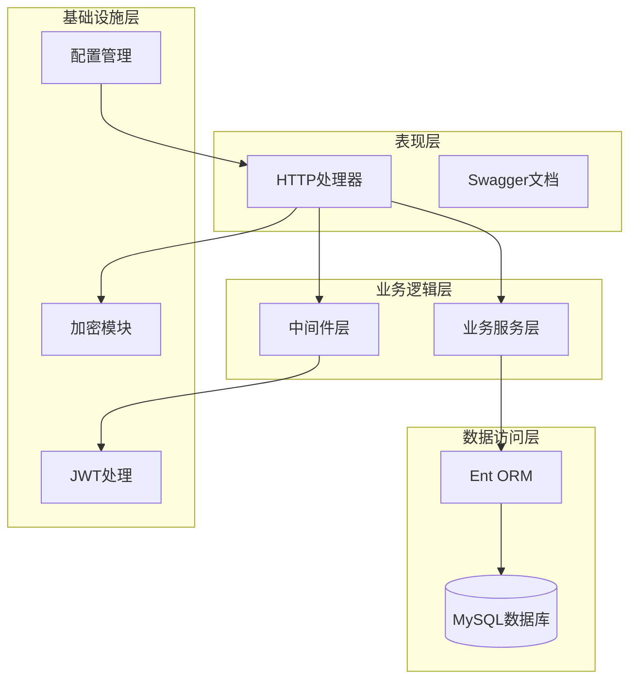
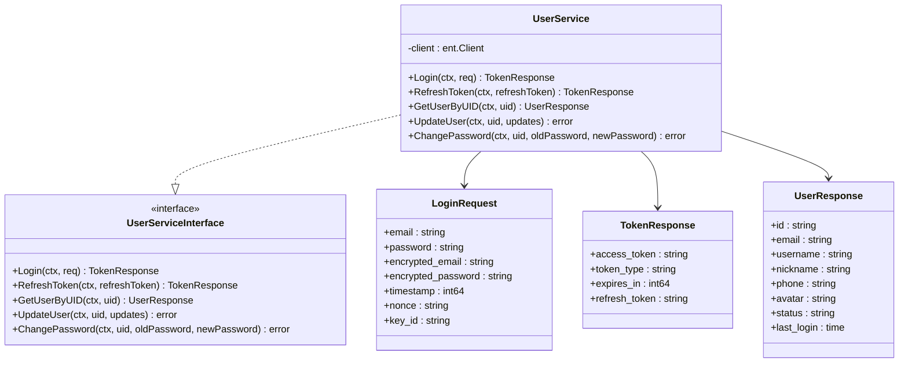
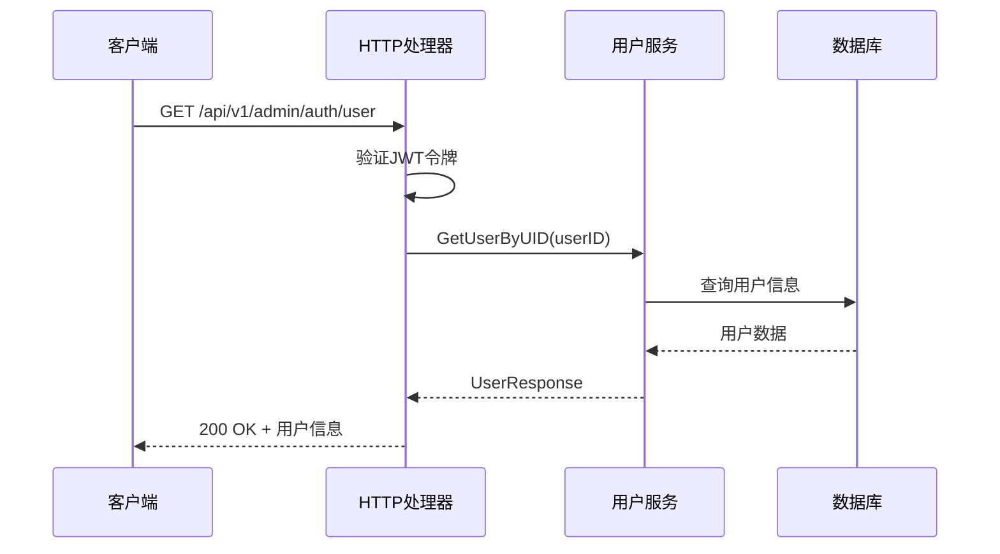
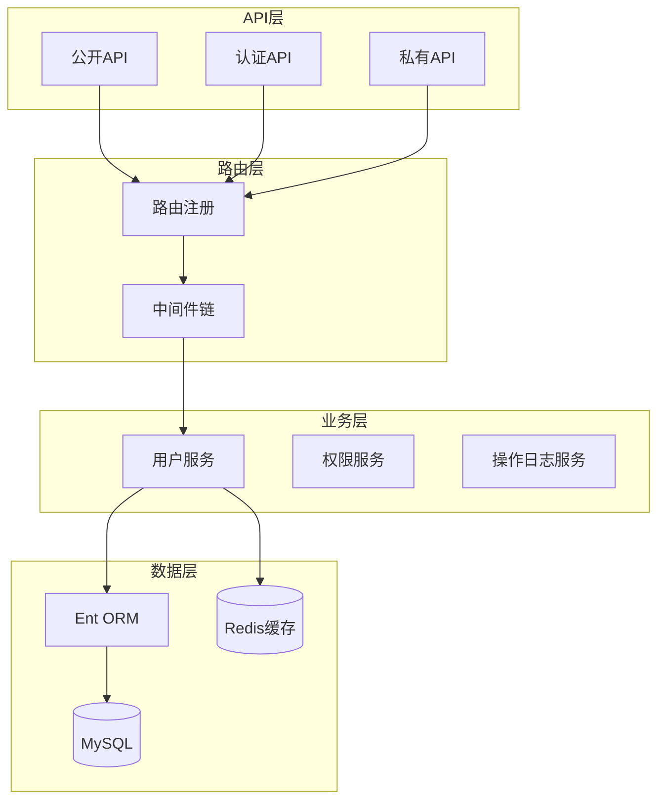
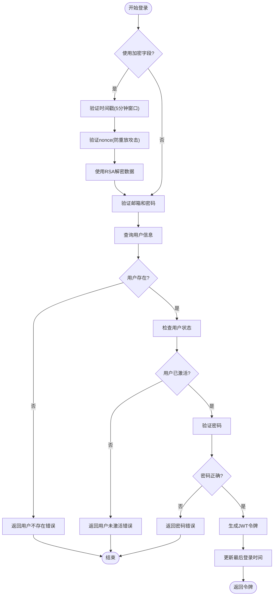
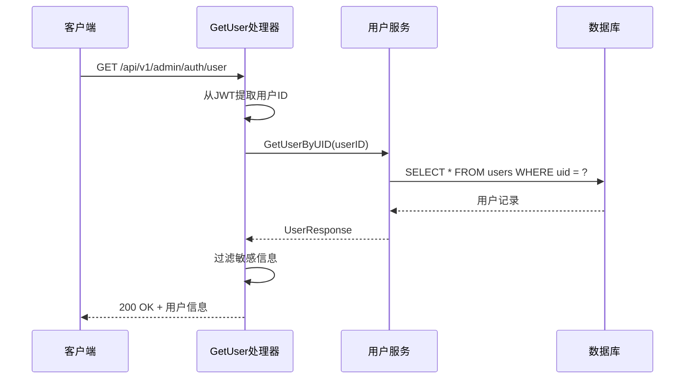
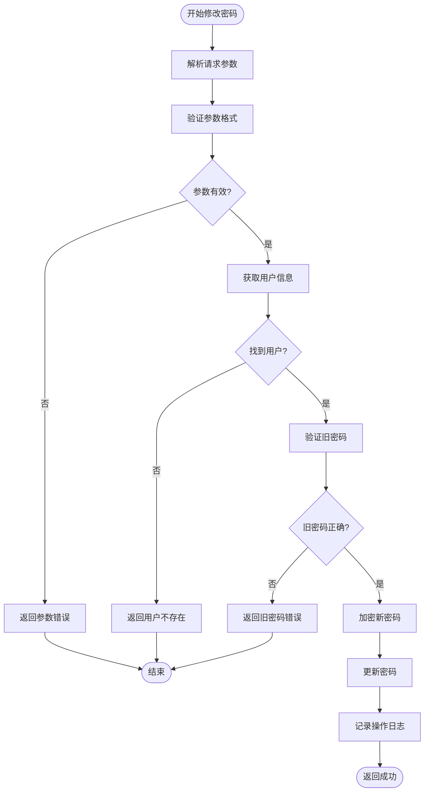
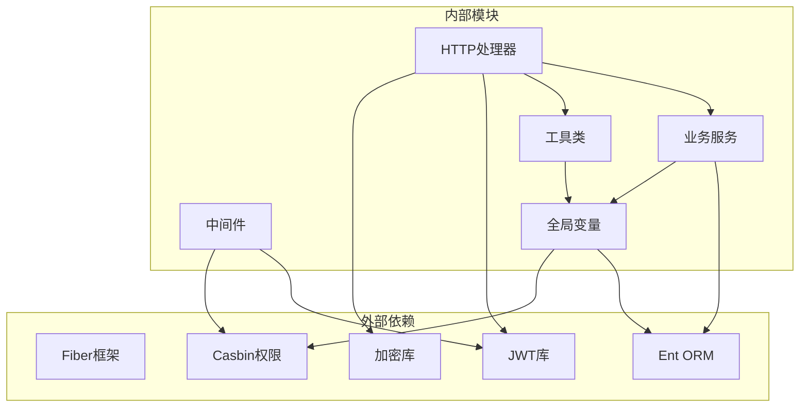
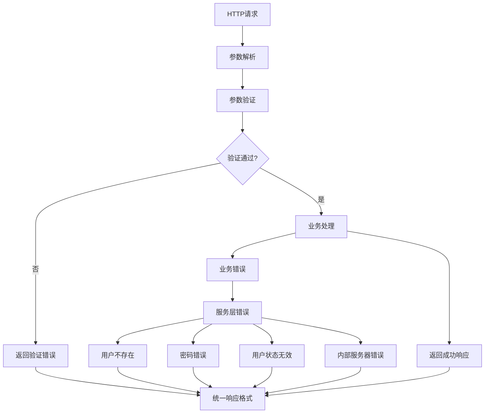

# 用户个人信息接口

<cite>
**本文档引用的文件**
- [user.go](file://internal/service/user.go)
- [public.go](file://internal/handler/public.go)
- [router.go](file://internal/router.go)
- [permission.go](file://internal/middleware/permission.go)
- [response.go](file://internal/utils/response.go)
- [user.go](file://internal/ent/schema/user.go)
- [global.go](file://internal/global/global.go)
- [config.yml](file://config/config.yml)
- [utils.go](file://internal/utils/utils.go)
- [msg.go](file://internal/global/msg.go)
- [main.go](file://main.go)
</cite>

## 目录
1. [简介](#简介)
2. [项目结构](#项目结构)
3. [核心组件](#核心组件)
4. [架构概览](#架构概览)
5. [详细组件分析](#详细组件分析)
6. [依赖关系分析](#依赖关系分析)
7. [性能考虑](#性能考虑)
8. [故障排除指南](#故障排除指南)
9. [结论](#结论)

## 简介

用户个人信息接口是管理系统中的核心功能模块，负责处理用户身份认证、个人信息管理和密码修改等关键业务逻辑。该接口采用JWT（JSON Web Token）认证机制，提供安全的用户身份验证和授权控制。

系统支持多种认证方式：
- 标准JWT认证：适用于普通用户操作
- RSA加密认证：满足等保要求，确保传输过程中的数据安全
- 刷新令牌机制：提供令牌续期功能

## 项目结构

基于Ent框架的分层架构设计，主要包含以下层次：

**图表来源**
- [router.go:16-190](file://internal/router.go#L16-L190)
- [public.go:1-299](file://internal/handler/public.go#L1-L299)

**章节来源**
- [router.go:16-190](file://internal/router.go#L16-L190)
- [main.go:47-108](file://main.go#L47-L108)

## 核心组件

### 用户服务层 (UserService)

用户服务层是整个用户个人信息接口的核心，提供了完整的用户生命周期管理功能：

**图表来源**
- [user.go:28-427](file://internal/service/user.go#L28-L427)

### HTTP处理器层

处理器层负责处理HTTP请求和响应，提供RESTful API接口：

**图表来源**
- [public.go:147-184](file://internal/handler/public.go#L147-L184)
- [user.go:242-261](file://internal/service/user.go#L242-L261)

**章节来源**
- [user.go:28-427](file://internal/service/user.go#L28-L427)
- [public.go:147-299](file://internal/handler/public.go#L147-L299)

## 架构概览

系统采用分层架构设计，确保关注点分离和代码可维护性：

**图表来源**
- [router.go:16-190](file://internal/router.go#L16-L190)
- [permission.go:11-80](file://internal/middleware/permission.go#L11-L80)

### 路由配置

系统路由按照功能模块进行组织，用户个人信息相关路由配置如下：

| 路由 | 方法 | 描述 | 中间件 |
|------|------|------|--------|
| `/api/v1/public/login` | POST | 用户登录 | 无 |
| `/api/v1/public/public-key` | GET | 获取RSA公钥 | 无 |
| `/api/v1/admin/auth/user` | GET | 获取当前用户信息 | JWT中间件 |
| `/api/v1/admin/auth/user` | PUT | 更新当前用户信息 | JWT中间件 |
| `/api/v1/admin/auth/password` | PUT | 修改当前用户密码 | JWT中间件 |
| `/api/v1/admin/refresh-token` | POST | 刷新访问令牌 | 无 |

**章节来源**
- [router.go:48-71](file://internal/router.go#L48-L71)
- [public.go:64-299](file://internal/handler/public.go#L64-L299)

## 详细组件分析

### 用户认证流程

用户认证采用多层安全机制，确保系统的安全性：

**图表来源**
- [public.go:78-145](file://internal/handler/public.go#L78-L145)
- [user.go:139-218](file://internal/service/user.go#L139-L218)

### 用户信息管理

用户信息管理功能支持个人信息的查看和更新：

**图表来源**
- [public.go:158-184](file://internal/handler/public.go#L158-L184)
- [user.go:242-261](file://internal/service/user.go#L242-L261)

### 密码修改流程

密码修改采用双层验证机制：

**图表来源**
- [public.go:234-263](file://internal/handler/public.go#L234-L263)
- [user.go:391-426](file://internal/service/user.go#L391-L426)

**章节来源**
- [public.go:147-263](file://internal/handler/public.go#L147-L263)
- [user.go:242-426](file://internal/service/user.go#L242-L426)

## 依赖关系分析

系统采用依赖注入和模块化设计，各组件之间的依赖关系清晰：

**图表来源**
- [router.go:3-14](file://internal/router.go#L3-L14)
- [permission.go:3-9](file://internal/middleware/permission.go#L3-L9)

### 错误处理机制

系统实现了统一的错误处理机制，确保错误信息的一致性和可维护性：

**图表来源**
- [response.go:9-50](file://internal/utils/response.go#L9-L50)
- [msg.go:44-84](file://internal/global/msg.go#L44-L84)

**章节来源**
- [response.go:9-50](file://internal/utils/response.go#L9-L50)
- [msg.go:44-84](file://internal/global/msg.go#L44-L84)

## 性能考虑

### 缓存策略

系统实现了多层次的缓存机制以提升性能：

1. **Redis缓存**：用于存储频繁访问的数据
2. **内存缓存**：用于短期数据缓存
3. **数据库索引**：优化查询性能

### JWT令牌管理

- 访问令牌默认有效期24小时
- 刷新令牌有效期更长，支持令牌续期
- 令牌采用HS256签名算法

### 数据库优化

- 用户表建立了邮箱、手机号、用户名的复合索引
- 支持分页查询和条件过滤
- 使用连接池管理数据库连接

## 故障排除指南

### 常见问题及解决方案

| 问题类型 | 症状 | 可能原因 | 解决方案 |
|----------|------|----------|----------|
| 认证失败 | 返回401未授权 | JWT令牌无效或过期 | 检查令牌格式和有效期，必要时使用刷新令牌 |
| 用户不存在 | 返回404资源不存在 | 用户ID错误或用户被删除 | 验证用户ID的有效性 |
| 密码错误 | 返回401无效密码 | 旧密码输入错误 | 确认旧密码正确性 |
| 权限不足 | 返回403拒绝访问 | 用户权限不足 | 检查用户角色和权限配置 |
| 服务器错误 | 返回500内部错误 | 系统异常或数据库连接失败 | 检查服务器日志和数据库连接 |

### 调试建议

1. **启用调试模式**：在配置文件中设置`debug: true`
2. **查看日志**：检查应用日志和数据库日志
3. **使用Swagger**：通过Swagger界面测试API接口
4. **监控指标**：关注系统性能指标和错误率

**章节来源**
- [config.yml:1-143](file://config/config.yml#L1-L143)
- [global/msg.go:44-84](file://internal/global/msg.go#L44-L84)

## 结论

用户个人信息接口是一个设计完善的认证和授权系统，具有以下特点：

1. **安全性**：采用JWT认证、RSA加密、防重放攻击等多重安全机制
2. **可扩展性**：模块化设计，支持功能扩展和性能优化
3. **易用性**：提供清晰的API接口和详细的文档
4. **可靠性**：完善的错误处理和日志记录机制

该系统为现代Web应用提供了坚实的基础，能够满足大多数企业级应用的需求。通过合理的架构设计和最佳实践，系统具备良好的可维护性和可扩展性。