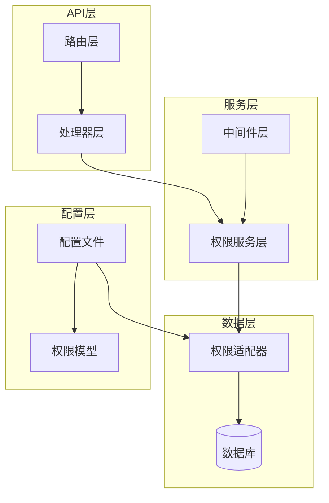
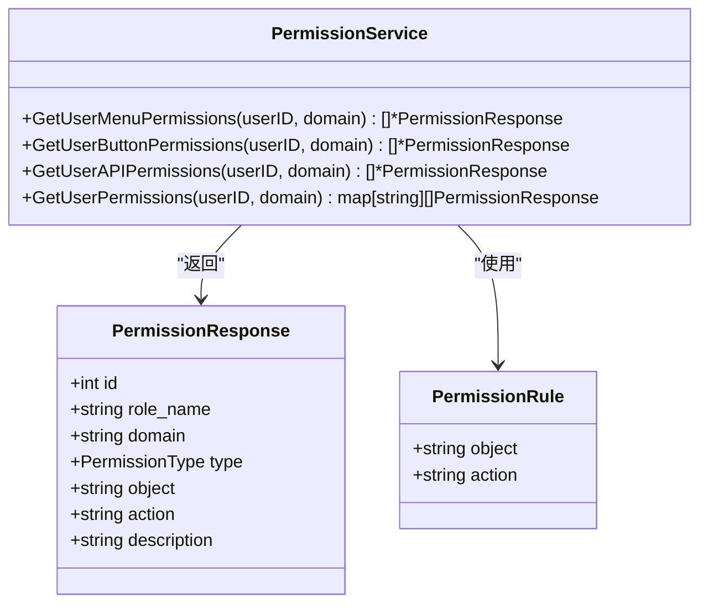
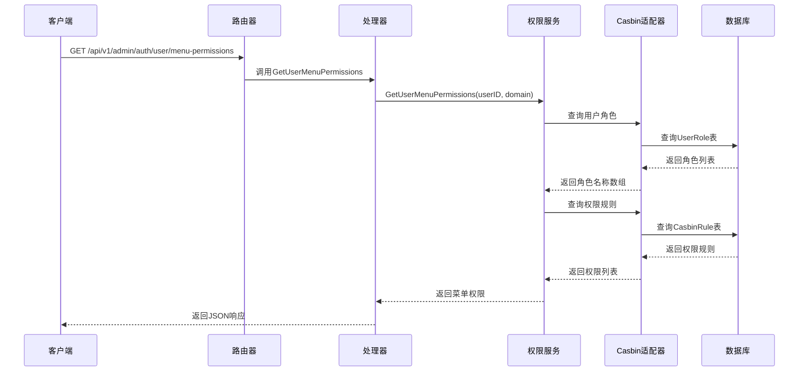
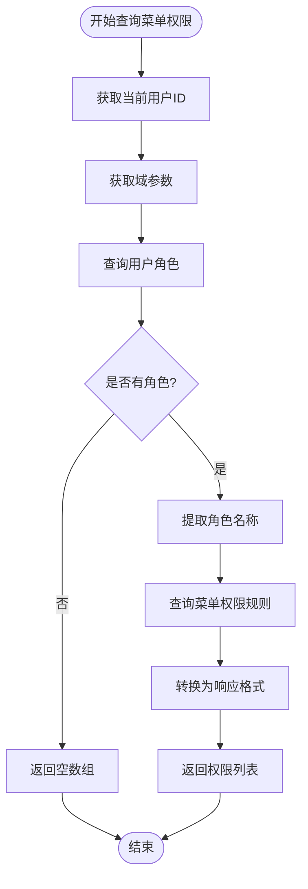
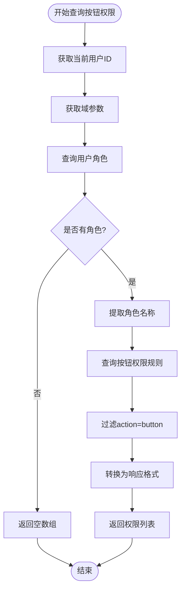
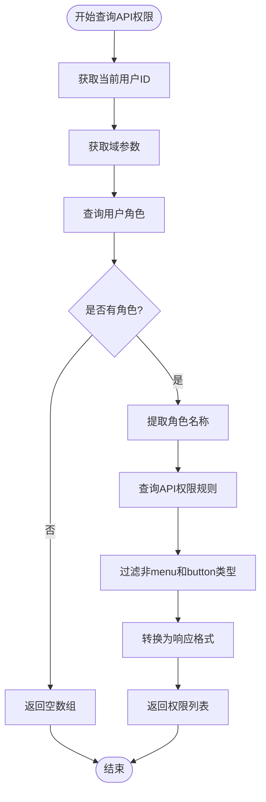
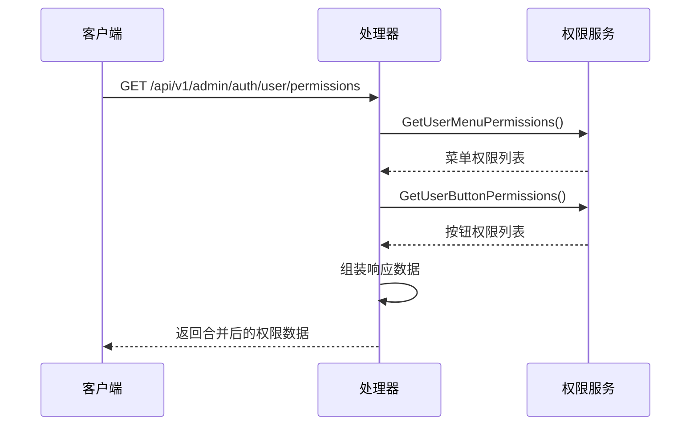
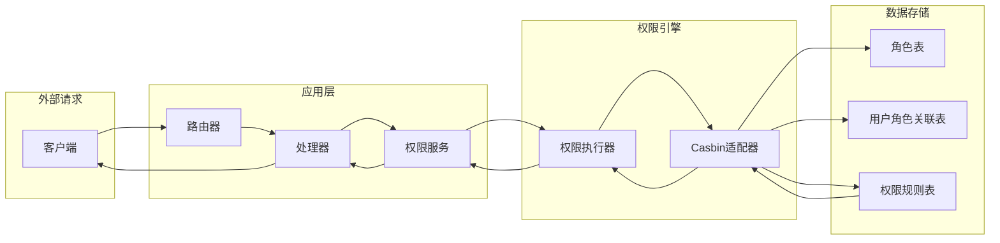
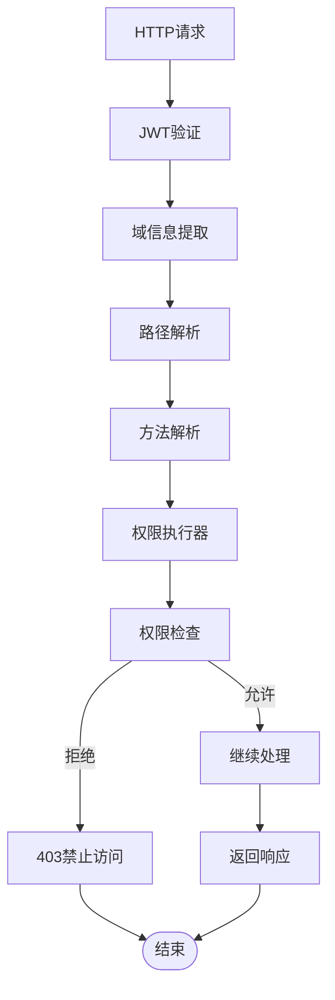

# 用户权限查询接口

<cite>
**本文档引用的文件**
- [permission.go](file://internal/handler/permission.go)
- [permission.go](file://internal/service/permission.go)
- [permission.go](file://internal/router.go)
- [permission.go](file://internal/middleware/permission.go)
- [adapter.go](file://internal/casbin/adapter/adapter.go)
- [rbac_model.conf](file://config/rbac_model.conf)
- [config.yml](file://config/config.yml)
- [global.go](file://internal/global/global.go)
- [response.go](file://internal/utils/response.go)
</cite>

## 目录
1. [简介](#简介)
2. [项目结构](#项目结构)
3. [核心组件](#核心组件)
4. [架构概览](#架构概览)
5. [详细组件分析](#详细组件分析)
6. [依赖关系分析](#依赖关系分析)
7. [性能考虑](#性能考虑)
8. [故障排除指南](#故障排除指南)
9. [结论](#结论)

## 简介

本文档详细介绍了用户权限查询接口的完整API文档，包括以下四个核心接口：

- 获取用户菜单权限接口：`/api/v1/admin/auth/user/menu-permissions`
- 获取用户按钮权限接口：`/api/v1/admin/auth/user/button-permissions`
- 获取用户API权限接口：`/api/v1/admin/auth/user/api-permissions`
- 获取用户所有权限接口：`/api/v1/admin/auth/user/permissions`

这些接口基于RBAC（基于角色的访问控制）模型实现，支持多域权限管理和实时权限验证。

## 项目结构

权限查询接口位于Go-admin项目的内部模块中，采用清晰的分层架构设计：



**图表来源**
- [permission.go:1-506](file://internal/handler/permission.go#L1-L506)
- [permission.go:1-671](file://internal/service/permission.go#L1-L671)
- [permission.go:1-73](file://internal/router.go#L1-L73)

**章节来源**
- [permission.go:1-506](file://internal/handler/permission.go#L1-L506)
- [permission.go:1-671](file://internal/service/permission.go#L1-L671)
- [permission.go:1-73](file://internal/router.go#L1-L73)

## 核心组件

### 权限类型定义

系统支持三种类型的权限：

| 权限类型 | 类型标识 | 描述 | 使用场景 |
|---------|---------|------|----------|
| API权限 | `api` | 用于API接口访问控制 | RESTful API调用 |
| 菜单权限 | `menu` | 用于前端菜单显示控制 | 导航菜单展示 |
| 按钮权限 | `button` | 用于前端按钮操作控制 | 按钮级功能权限 |

### 数据模型结构



**图表来源**
- [permission.go:74-113](file://internal/service/permission.go#L74-L113)

**章节来源**
- [permission.go:24-83](file://internal/service/permission.go#L24-L83)

## 架构概览

权限查询接口采用三层架构设计，确保了良好的可维护性和扩展性：



**图表来源**
- [permission.go:67-71](file://internal/router.go#L67-L71)
- [permission.go:358-388](file://internal/handler/permission.go#L358-L388)
- [permission.go:466-509](file://internal/service/permission.go#L466-L509)

## 详细组件分析

### 菜单权限查询接口

#### 接口定义
- **URL**: `/api/v1/admin/auth/user/menu-permissions`
- **方法**: GET
- **认证**: 需要JWT令牌
- **域**: 支持多域权限管理

#### 请求参数
| 参数名 | 类型 | 必需 | 默认值 | 描述 |
|--------|------|------|--------|------|
| domain | string | 否 | `default` | 权限域标识符 |

#### 响应格式
```json
{
  "code": 200,
  "message": "获取用户菜单权限成功",
  "data": [
    {
      "id": 1,
      "role_name": "admin",
      "domain": "default",
      "type": "menu",
      "object": "/dashboard",
      "action": "menu",
      "description": "仪表板菜单"
    }
  ]
}
```

#### 实现逻辑流程



**图表来源**
- [permission.go:358-388](file://internal/handler/permission.go#L358-L388)
- [permission.go:466-509](file://internal/service/permission.go#L466-L509)

**章节来源**
- [permission.go:358-388](file://internal/handler/permission.go#L358-L388)
- [permission.go:466-509](file://internal/service/permission.go#L466-L509)

### 按钮权限查询接口

#### 接口定义
- **URL**: `/api/v1/admin/auth/user/button-permissions`
- **方法**: GET
- **认证**: 需要JWT令牌

#### 请求参数
| 参数名 | 类型 | 必需 | 默认值 | 描述 |
|--------|------|------|--------|------|
| domain | string | 否 | `default` | 权限域标识符 |

#### 响应格式
```json
{
  "code": 200,
  "message": "获取用户按钮权限成功",
  "data": [
    {
      "id": 2,
      "role_name": "admin",
      "domain": "default",
      "type": "button",
      "object": "user:create",
      "action": "button",
      "description": "创建用户按钮"
    }
  ]
}
```

#### 实现逻辑

按钮权限查询与菜单权限类似，但查询条件不同：



**图表来源**
- [permission.go:390-420](file://internal/handler/permission.go#L390-L420)
- [permission.go:511-554](file://internal/service/permission.go#L511-L554)

**章节来源**
- [permission.go:390-420](file://internal/handler/permission.go#L390-L420)
- [permission.go:511-554](file://internal/service/permission.go#L511-L554)

### API权限查询接口

#### 接口定义
- **URL**: `/api/v1/admin/auth/user/api-permissions`
- **方法**: GET
- **认证**: 需要JWT令牌

#### 请求参数
| 参数名 | 类型 | 必需 | 默认值 | 描述 |
|--------|------|------|--------|------|
| domain | string | 否 | `default` | 权限域标识符 |

#### 响应格式
```json
{
  "code": 200,
  "message": "获取用户API权限成功",
  "data": [
    {
      "id": 3,
      "role_name": "admin",
      "domain": "default",
      "type": "api",
      "object": "/api/users",
      "action": "GET",
      "description": "获取用户API"
    }
  ]
}
```

#### 实现逻辑

API权限查询排除了菜单和按钮类型的权限：



**图表来源**
- [permission.go:422-452](file://internal/handler/permission.go#L422-L452)
- [permission.go:556-599](file://internal/service/permission.go#L556-L599)

**章节来源**
- [permission.go:422-452](file://internal/handler/permission.go#L422-L452)
- [permission.go:556-599](file://internal/service/permission.go#L556-L599)

### 综合权限查询接口

#### 接口定义
- **URL**: `/api/v1/admin/auth/user/permissions`
- **方法**: GET
- **认证**: 需要JWT令牌

#### 请求参数
| 参数名 | 类型 | 必需 | 默认值 | 描述 |
|--------|------|------|--------|------|
| domain | string | 否 | `default` | 权限域标识符 |

#### 响应格式
```json
{
  "code": 200,
  "message": "获取用户权限成功",
  "data": {
    "menu": [
      {
        "id": 1,
        "role_name": "admin",
        "domain": "default",
        "type": "menu",
        "object": "/dashboard",
        "action": "menu",
        "description": "仪表板菜单"
      }
    ],
    "button": [
      {
        "id": 2,
        "role_name": "admin",
        "domain": "default",
        "type": "button",
        "object": "user:create",
        "action": "button",
        "description": "创建用户按钮"
      }
    ]
  }
}
```

#### 实现逻辑

综合查询接口同时获取菜单和按钮权限：



**图表来源**
- [permission.go:454-496](file://internal/handler/permission.go#L454-L496)
- [permission.go:477-493](file://internal/service/permission.go#L477-L493)

**章节来源**
- [permission.go:454-496](file://internal/handler/permission.go#L454-L496)
- [permission.go:477-493](file://internal/service/permission.go#L477-L493)

## 依赖关系分析

### 权限查询的数据流



**图表来源**
- [permission.go:67-71](file://internal/router.go#L67-L71)
- [permission.go:12-53](file://internal/middleware/permission.go#L12-L53)
- [adapter.go:115-125](file://internal/casbin/adapter/adapter.go#L115-L125)

### 权限验证流程



**图表来源**
- [permission.go:12-53](file://internal/middleware/permission.go#L12-L53)

**章节来源**
- [permission.go:1-69](file://internal/middleware/permission.go#L1-L69)

## 性能考虑

### 缓存策略

系统支持多种缓存存储方式：

| 缓存类型 | 配置项 | TTL | 适用场景 |
|----------|--------|-----|----------|
| 内存缓存 | memory | 3600秒 | 开发环境、小规模部署 |
| Redis缓存 | redis | 3600秒 | 生产环境、高并发场景 |

### 性能优化建议

1. **数据库索引优化**
   - 在`casbin_rules`表上建立复合索引
   - 优化常用查询字段的索引策略

2. **批量查询优化**
   - 利用IN子句进行批量角色查询
   - 减少N+1查询问题

3. **连接池配置**
   - 合理配置数据库连接池大小
   - 优化连接超时时间

4. **中间件优化**
   - 缓存JWT解析结果
   - 减少重复的权限检查

**章节来源**
- [config.yml:32-41](file://config/config.yml#L32-L41)

## 故障排除指南

### 常见错误及解决方案

| 错误类型 | 错误码 | 描述 | 解决方案 |
|----------|--------|------|----------|
| 未授权访问 | 401 | JWT令牌缺失或无效 | 检查JWT令牌有效性 |
| 权限不足 | 403 | 用户无相应权限 | 检查用户角色和权限分配 |
| 参数错误 | 400 | 请求参数无效 | 验证请求参数格式 |
| 服务器错误 | 500 | 服务器内部错误 | 检查数据库连接和日志 |

### 调试建议

1. **启用调试模式**
   ```yaml
   app:
     debug: true
   ```

2. **查看日志文件**
   ```
   ./data/logs/admin-api.log
   ```

3. **检查数据库连接**
   - 验证数据库配置
   - 检查网络连接状态

**章节来源**
- [response.go:1-50](file://internal/utils/response.go#L1-L50)

## 结论

用户权限查询接口提供了完整的RBAC权限管理功能，支持：

- **多类型权限管理**：API、菜单、按钮三种权限类型
- **多域权限支持**：支持租户隔离的权限管理
- **实时权限验证**：基于Casbin的动态权限检查
- **灵活的查询接口**：支持单独查询和综合查询
- **高性能设计**：优化的数据库查询和缓存策略

该接口设计遵循了RESTful API最佳实践，具有良好的可扩展性和维护性，能够满足大多数企业级权限管理需求。