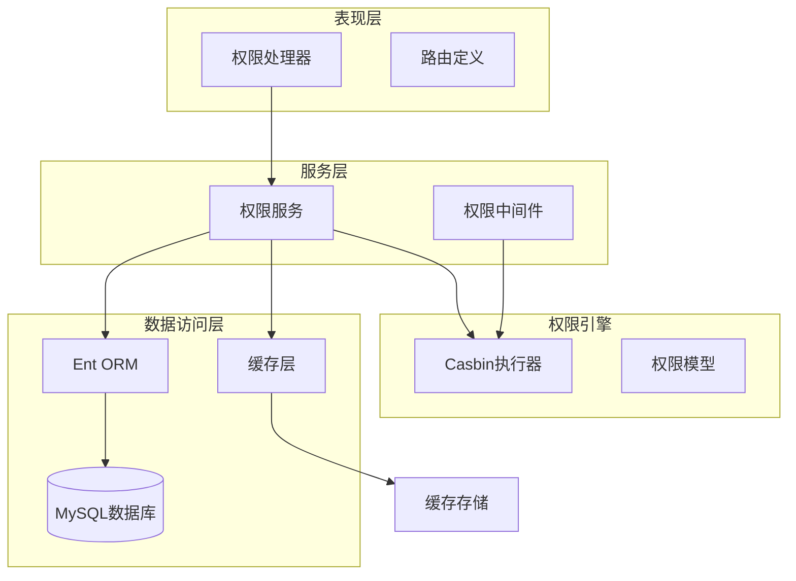
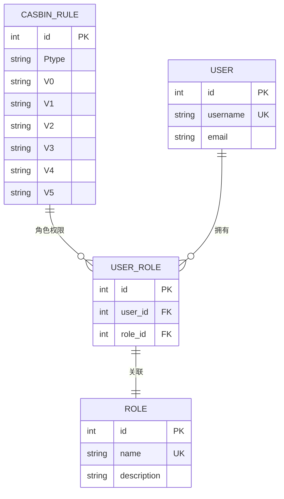
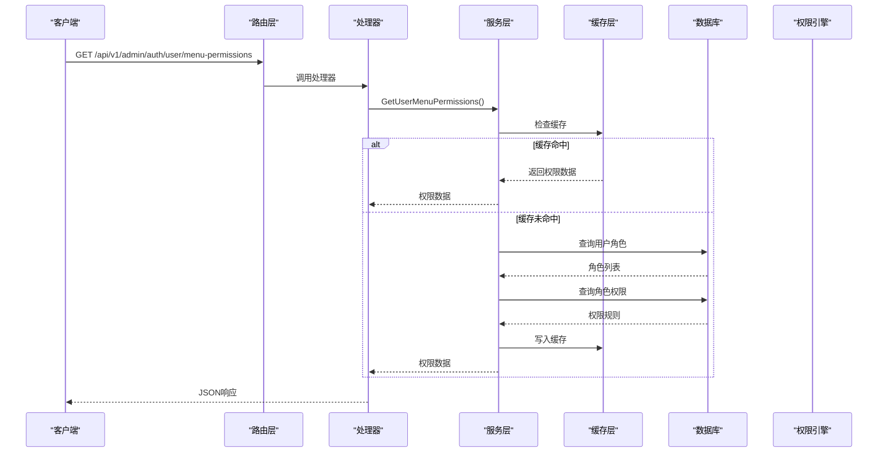
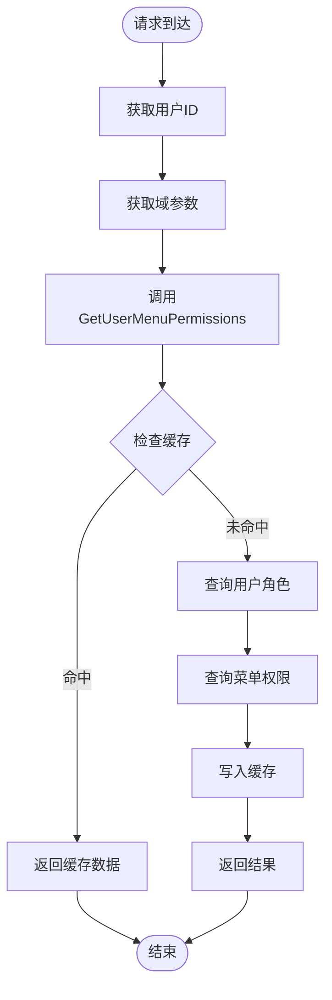
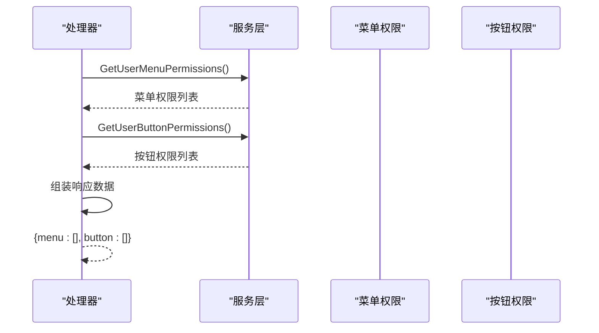
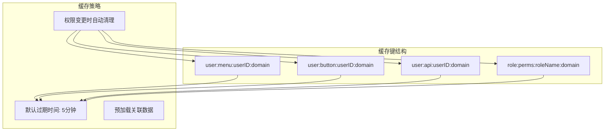
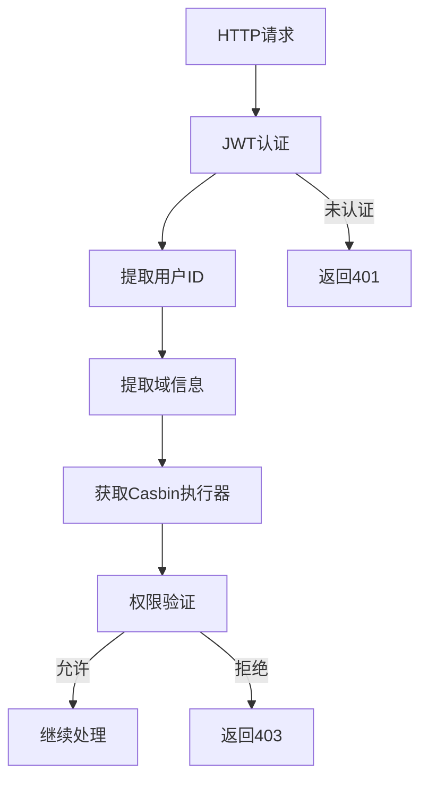
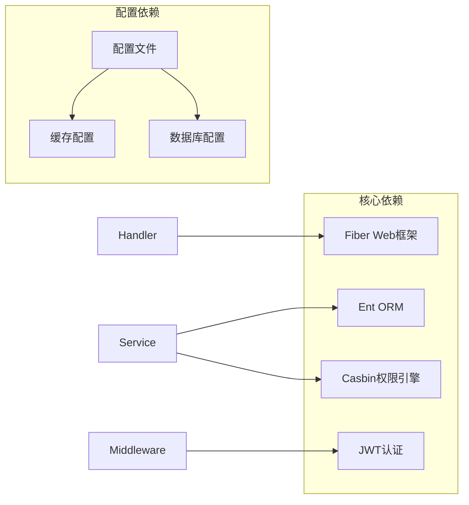
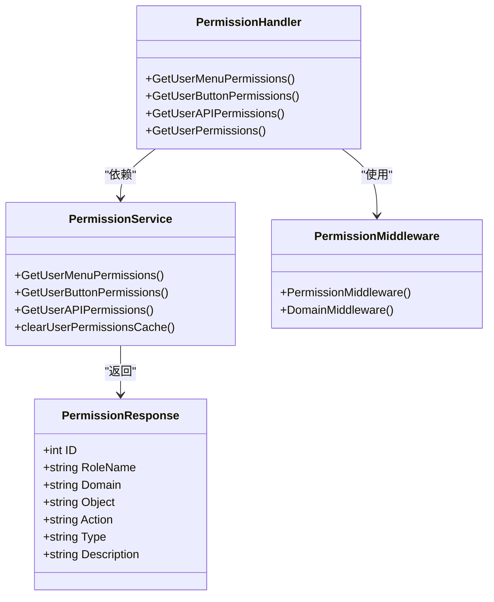

# 用户权限查询接口

<cite>
**本文档引用的文件**
- [permission.go](file://internal/handler/permission.go)
- [permission.go](file://internal/service/permission.go)
- [permission.go](file://internal/middleware/permission.go)
- [router.go](file://internal/router.go)
- [casbinrule.go](file://internal/ent/schema/casbinrule.go)
- [casbinrule.go](file://internal/ent/casbinrule/casbinrule.go)
- [config.yml](file://config/config.yml)
- [response.go](file://internal/utils/response.go)
</cite>

## 目录
1. [简介](#简介)
2. [项目结构](#项目结构)
3. [核心组件](#核心组件)
4. [架构概览](#架构概览)
5. [详细组件分析](#详细组件分析)
6. [依赖关系分析](#依赖关系分析)
7. [性能考虑](#性能考虑)
8. [故障排除指南](#故障排除指南)
9. [结论](#结论)

## 简介

本文档详细记录了用户权限查询接口的完整API规范，包括以下四个核心接口：
- GET /api/v1/admin/auth/user/menu-permissions - 获取用户菜单权限
- GET /api/v1/admin/auth/user/button-permissions - 获取用户按钮权限  
- GET /api/v1/admin/auth/user/api-permissions - 获取用户API权限
- GET /api/v1/admin/auth/user/permissions - 获取用户所有权限

这些接口基于RBAC（基于角色的访问控制）模型，使用Casbin作为权限引擎，实现了完整的权限查询、缓存机制和权限过滤功能。

## 项目结构

权限查询系统采用分层架构设计，主要包含以下层次：

**图表来源**
- [router.go:88-93](file://internal/router.go#L88-L93)
- [permission.go:411-561](file://internal/handler/permission.go#L411-L561)

**章节来源**
- [router.go:16-150](file://internal/router.go#L16-L150)

## 核心组件

### 权限类型定义

系统支持三种权限类型，通过Casbin规则中的V4字段标识：

| 权限类型 | 值 | 描述 | 使用场景 |
|---------|----|------|----------|
| API权限 | "api" | API接口访问权限 | RESTful API调用 |
| 菜单权限 | "menu" | 页面菜单访问权限 | 导航菜单显示 |
| 按钮权限 | "button" | 按钮操作权限 | 功能按钮显示 |

### 数据模型结构

权限数据存储在CasbinRule表中，采用多值字段设计：

**图表来源**
- [casbinrule.go:10-36](file://internal/ent/schema/casbinrule.go#L10-L36)

**章节来源**
- [casbinrule.go:14-36](file://internal/ent/schema/casbinrule.go#L14-L36)
- [casbinrule.go:11-47](file://internal/ent/casbinrule/casbinrule.go#L11-L47)

## 架构概览

用户权限查询系统采用三层架构模式：

**图表来源**
- [permission.go:411-444](file://internal/handler/permission.go#L411-L444)
- [permission.go:558-615](file://internal/service/permission.go#L558-L615)

## 详细组件分析

### 路由配置

所有用户权限查询接口都位于`/api/v1/admin/auth/user`路径下，并且都经过JWT认证和权限中间件保护：

| 接口路径 | HTTP方法 | 中间件链 | 功能描述 |
|---------|---------|---------|----------|
| /menu-permissions | GET | JWT认证 + 域中间件 + 权限中间件 | 获取用户菜单权限 |
| /button-permissions | GET | JWT认证 + 域中间件 + 权限中间件 | 获取用户按钮权限 |
| /api-permissions | GET | JWT认证 + 域中间件 + 权限中间件 | 获取用户API权限 |
| /permissions | GET | JWT认证 + 域中间件 + 权限中间件 | 获取用户所有权限 |

**章节来源**
- [router.go:88-93](file://internal/router.go#L88-L93)

### 处理器实现

每个处理器都遵循相同的模式：获取用户ID → 获取域 → 调用服务层 → 返回响应。

#### 用户菜单权限接口

**图表来源**
- [permission.go:411-444](file://internal/handler/permission.go#L411-L444)
- [permission.go:558-615](file://internal/service/permission.go#L558-L615)

#### 用户按钮权限接口

按钮权限查询与菜单权限类似，但查询条件不同：
- 查询条件：`V3 = "button"`
- 返回类型：按钮权限列表

#### 用户API权限接口

API权限查询排除了菜单和按钮类型的权限：
- 查询条件：`V3 ≠ "menu" AND V3 ≠ "button"`
- 返回类型：API权限列表

#### 用户所有权限接口

该接口聚合菜单和按钮权限，返回结构化的权限数据：

**图表来源**
- [permission.go:516-561](file://internal/handler/permission.go#L516-L561)

**章节来源**
- [permission.go:411-561](file://internal/handler/permission.go#L411-L561)

### 服务层实现

服务层负责核心业务逻辑，包括权限查询、缓存管理和错误处理。

#### 缓存机制

系统实现了多层次的缓存策略：

**图表来源**
- [permission.go:136-187](file://internal/service/permission.go#L136-L187)

#### 权限过滤条件

系统根据权限类型应用不同的过滤条件：

| 权限类型 | 过滤条件 | 查询字段 |
|---------|---------|---------|
| 菜单权限 | `V3 = "menu"` | V3 |
| 按钮权限 | `V3 = "button"` | V3 |
| API权限 | `V3 ≠ "menu" AND V3 ≠ "button"` | V3 |
| 角色权限 | `V0 IN (用户角色列表)` | V0 |

**章节来源**
- [permission.go:558-734](file://internal/service/permission.go#L558-L734)

### 中间件集成

权限中间件负责JWT认证和权限验证：

**图表来源**
- [permission.go:14-78](file://internal/middleware/permission.go#L14-L78)

**章节来源**
- [permission.go:14-94](file://internal/middleware/permission.go#L14-L94)

## 依赖关系分析

### 外部依赖

系统依赖以下关键组件：

**图表来源**
- [router.go:3-14](file://internal/router.go#L3-L14)
- [config.yml:32-58](file://config/config.yml#L32-L58)

### 内部依赖关系

**图表来源**
- [permission.go:411-561](file://internal/handler/permission.go#L411-L561)
- [permission.go:95-134](file://internal/service/permission.go#L95-L134)

**章节来源**
- [permission.go:1-571](file://internal/handler/permission.go#L1-L571)
- [permission.go:1-804](file://internal/service/permission.go#L1-L804)

## 性能考虑

### 缓存策略

系统采用智能缓存策略来优化性能：

1. **缓存键设计**：使用`user:menu:userID:domain`等结构化键名
2. **过期时间**：默认5分钟，平衡数据新鲜度和性能
3. **自动失效**：权限变更时自动清理相关缓存
4. **批量查询**：预加载用户角色关联数据减少N+1查询

### 数据库优化

1. **索引设计**：CasbinRule表对(Ptype,V0,V1,V2,V3,V4,V5)建立唯一索引
2. **查询优化**：使用IN子句批量查询用户角色权限
3. **Eager Loading**：预加载角色关联避免额外查询

### 前端渲染建议

对于前端权限渲染，建议采用以下策略：

1. **权限树构建**：将API权限转换为树形结构便于UI展示
2. **权限去重**：同一权限多次授予时进行去重处理
3. **懒加载**：菜单权限按需加载，提高首屏性能
4. **本地缓存**：前端本地缓存用户权限，减少重复请求

## 故障排除指南

### 常见错误及解决方案

| 错误类型 | 状态码 | 错误原因 | 解决方案 |
|---------|--------|---------|---------|
| 未认证访问 | 401 | JWT令牌缺失或无效 | 检查Authorization头，重新登录获取令牌 |
| 权限不足 | 403 | 用户无相应权限 | 检查用户角色和权限分配 |
| 参数错误 | 400 | 请求参数不合法 | 验证domain参数格式 |
| 服务器错误 | 500 | 服务内部异常 | 检查数据库连接和缓存配置 |

### 缓存问题排查

1. **缓存未生效**：检查缓存配置和TTL设置
2. **缓存污染**：确认权限变更后缓存清理机制正常工作
3. **缓存击穿**：实现缓存预热和热点数据保护

### 性能监控指标

- 缓存命中率
- 数据库查询延迟
- 平均响应时间
- 权限查询成功率

**章节来源**
- [permission.go:14-94](file://internal/middleware/permission.go#L14-L94)
- [config.yml:32-58](file://config/config.yml#L32-L58)

## 结论

用户权限查询接口提供了完整的RBAC权限管理能力，具有以下特点：

1. **模块化设计**：清晰的分层架构便于维护和扩展
2. **高性能实现**：智能缓存机制和数据库优化确保良好性能
3. **安全可靠**：JWT认证和Casbin权限验证双重保障
4. **灵活配置**：支持多域权限管理和动态权限配置

该接口体系为前端权限渲染提供了坚实的基础，支持菜单、按钮和API级别的细粒度权限控制，满足现代Web应用的权限管理需求。