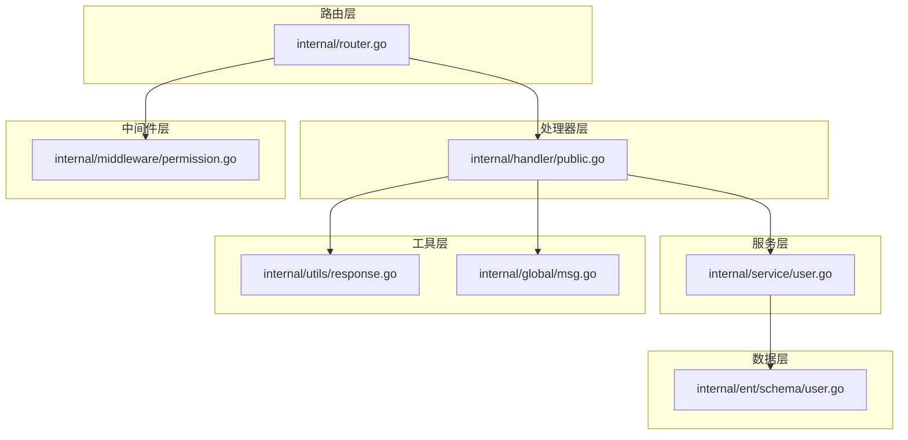
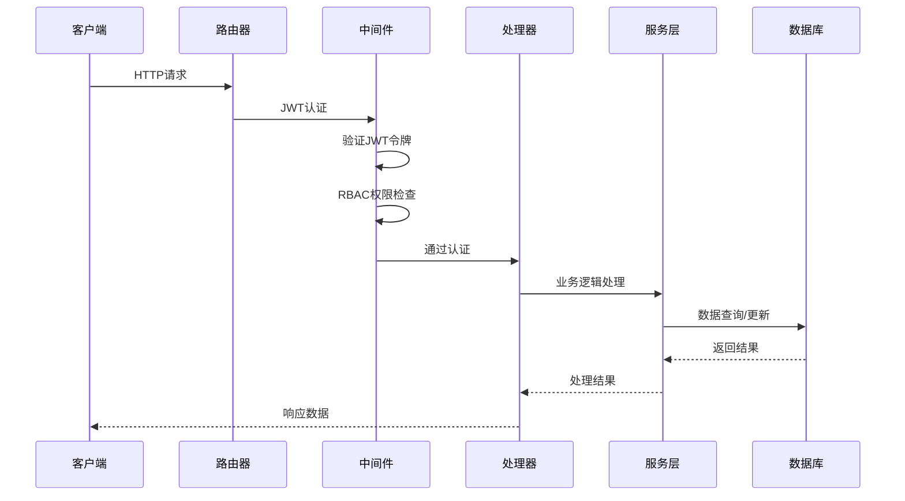
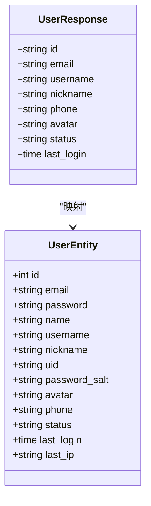
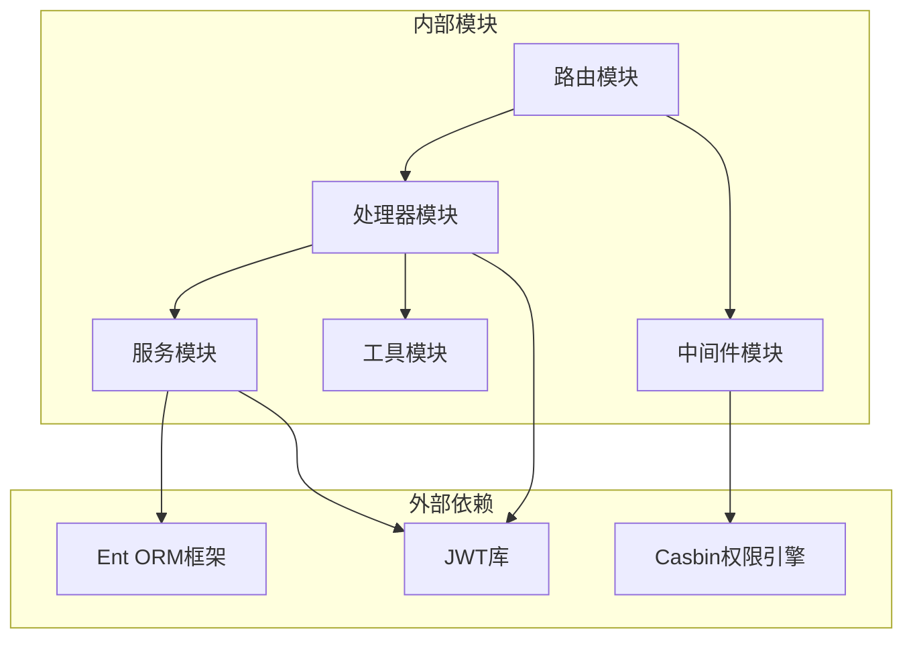
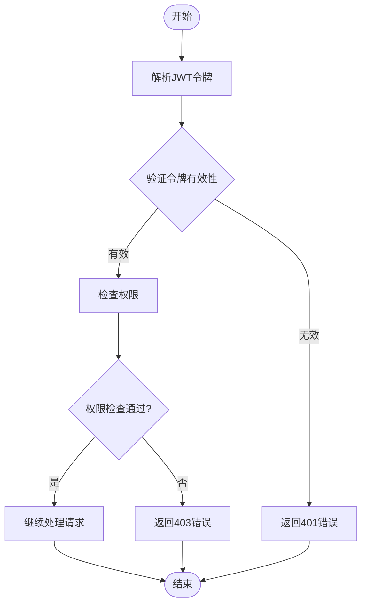

# 用户管理接口

<cite>
**本文档引用的文件**
- [router.go](file://internal/router.go)
- [user.go](file://internal/service/user.go)
- [public.go](file://internal/handler/public.go)
- [user.go](file://internal/ent/schema/user.go)
- [response.go](file://internal/utils/response.go)
- [msg.go](file://internal/global/msg.go)
- [permission.go](file://internal/middleware/permission.go)
- [config.yml](file://config/config.yml)
- [rbac_model.conf](file://config/rbac_model.conf)
- [swagger.yaml](file://docs/swagger.yaml)
</cite>

## 目录
1. [简介](#简介)
2. [项目结构](#项目结构)
3. [核心组件](#核心组件)
4. [架构概览](#架构概览)
5. [详细组件分析](#详细组件分析)
6. [依赖关系分析](#依赖关系分析)
7. [性能考虑](#性能考虑)
8. [故障排除指南](#故障排除指南)
9. [结论](#结论)

## 简介

本文档详细描述了Go-Admin管理系统中的用户管理接口，包括获取用户信息、更新用户信息和修改密码三个核心接口。这些接口基于JWT认证机制，采用RBAC权限控制系统，确保系统的安全性和可靠性。

## 项目结构

用户管理功能主要分布在以下模块中：



**图表来源**
- [router.go:14-41](file://internal/router.go#L14-L41)
- [public.go:13-147](file://internal/handler/public.go#L13-L147)
- [user.go:36-394](file://internal/service/user.go#L36-L394)

**章节来源**
- [router.go:1-73](file://internal/router.go#L1-L73)
- [public.go:1-180](file://internal/handler/public.go#L1-L180)

## 核心组件

### JWT认证中间件
系统使用JWT进行用户身份认证，支持访问令牌和刷新令牌两种类型：
- 访问令牌：短期有效，用于日常API调用
- 刷新令牌：长期有效，用于获取新的访问令牌

### RBAC权限控制
基于Casbin的RBAC模型，支持多域权限管理：
- 默认域：default
- 支持多租户权限隔离
- 动态权限策略管理

### 数据模型
用户实体包含以下核心字段：
- 基本信息：邮箱、用户名、昵称、头像
- 联系方式：手机号
- 状态管理：active、inactive、suspended
- 安全信息：密码哈希、盐值

**章节来源**
- [permission.go:11-69](file://internal/middleware/permission.go#L11-L69)
- [user.go:12-104](file://internal/ent/schema/user.go#L12-L104)

## 架构概览



**图表来源**
- [router.go:32-37](file://internal/router.go#L32-L37)
- [permission.go:12-52](file://internal/middleware/permission.go#L12-L52)
- [public.go:55-80](file://internal/handler/public.go#L55-L80)

## 详细组件分析

### 获取用户信息接口

#### 接口定义
- **HTTP方法**: GET
- **URL路径**: `/api/v1/admin/auth/user`
- **认证要求**: Bearer Token
- **权限要求**: 需要用户具备相应的读取权限

#### 请求参数
该接口不需要任何请求参数，用户信息从JWT令牌中提取。

#### 响应格式
```json
{
  "code": 1,
  "message": "成功",
  "data": {
    "id": "string",
    "email": "string",
    "username": "string", 
    "nickname": "string",
    "phone": "string",
    "avatar": "string",
    "status": "string"
  }
}
```

#### 数据模型定义



**图表来源**
- [user.go:69-79](file://internal/service/user.go#L69-L79)
- [user.go:18-80](file://internal/ent/schema/user.go#L18-L80)

#### 字段说明
| 字段名 | 类型 | 必填 | 描述 | 长度限制 |
|--------|------|------|------|----------|
| id | string | 是 | 用户唯一标识符 | - |
| email | string | 是 | 用户邮箱地址 | 最大255字符 |
| username | string | 否 | 用户名 | 最大255字符 |
| nickname | string | 否 | 用户昵称 | 最大255字符 |
| phone | string | 否 | 手机号码 | 最大20字符 |
| avatar | string | 否 | 头像URL | 最大1024字符 |
| status | string | 否 | 用户状态 | active/inactive/suspended |

#### 验证规则
- 邮箱格式：必须符合标准邮箱格式
- 手机号格式：仅允许数字字符
- 状态枚举：只能是active、inactive、suspended之一

**章节来源**
- [public.go:47-81](file://internal/handler/public.go#L47-L81)
- [user.go:69-79](file://internal/service/user.go#L69-L79)

### 更新用户信息接口

#### 接口定义
- **HTTP方法**: PUT  
- **URL路径**: `/api/v1/admin/auth/user`
- **认证要求**: Bearer Token
- **权限要求**: 需要用户具备相应的更新权限

#### 请求参数
```json
{
  "nickname": "string",
  "phone": "string", 
  "avatar": "string",
  "status": "string"
}
```

#### 响应格式
```json
{
  "code": 1,
  "message": "成功",
  "data": null
}
```

#### 更新字段说明
- **nickname**: 用户昵称，最大255字符
- **phone**: 手机号码，仅允许数字，最大20字符
- **avatar**: 头像URL，最大1024字符
- **status**: 用户状态，支持active、inactive、suspended

#### 错误处理
- 用户不存在：返回404错误
- 数据库操作失败：返回500错误

**章节来源**
- [public.go:83-109](file://internal/handler/public.go#L83-L109)
- [user.go:230-272](file://internal/service/user.go#L230-L272)

### 修改密码接口

#### 接口定义
- **HTTP方法**: PUT
- **URL路径**: `/api/v1/admin/auth/password`
- **认证要求**: Bearer Token
- **权限要求**: 需要用户具备相应的密码修改权限

#### 请求参数
```json
{
  "old_password": "string",
  "new_password": "string"
}
```

#### 响应格式
```json
{
  "code": 1,
  "message": "成功", 
  "data": null
}
```

#### 密码安全策略
- **旧密码验证**：必须与数据库中存储的密码匹配
- **新密码强度**：最小长度6个字符
- **密码加密**：使用盐值进行哈希加密存储
- **密码轮换**：支持定期更换密码

#### 错误处理
- 用户不存在：返回404错误
- 旧密码错误：返回401错误
- 密码加密失败：返回500错误

**章节来源**
- [public.go:111-147](file://internal/handler/public.go#L111-L147)
- [user.go:358-393](file://internal/service/user.go#L358-L393)

## 依赖关系分析



**图表来源**
- [router.go:3-12](file://internal/router.go#L3-L12)
- [permission.go:3-9](file://internal/middleware/permission.go#L3-L9)

### 关键依赖关系

#### JWT认证流程


**图表来源**
- [permission.go:12-52](file://internal/middleware/permission.go#L12-L52)

**章节来源**
- [router.go:32-37](file://internal/router.go#L32-L37)
- [permission.go:11-69](file://internal/middleware/permission.go#L11-L69)

## 性能考虑

### 缓存策略
- **JWT令牌缓存**：访问令牌短期缓存，减少重复验证开销
- **用户信息缓存**：常用用户信息短期缓存
- **权限策略缓存**：Casbin策略规则缓存

### 数据库优化
- **索引优化**：邮箱、手机号、用户名建立索引
- **查询优化**：避免N+1查询问题
- **连接池**：合理配置数据库连接池大小

### 并发处理
- **请求并发**：Fiber框架支持高并发请求处理
- **中间件并发**：JWT和权限检查支持并发执行
- **数据库并发**：使用事务保证数据一致性

## 故障排除指南

### 常见错误及解决方案

#### 认证相关错误
| 错误代码 | 错误原因 | 解决方案 |
|----------|----------|----------|
| 401 | 未授权访问 | 检查JWT令牌是否正确传递 |
| 401 | JWT令牌过期 | 使用刷新令牌获取新令牌 |
| 403 | 权限不足 | 检查用户角色和权限配置 |
| 404 | 用户不存在 | 验证用户ID是否正确 |

#### 业务逻辑错误
| 错误代码 | 错误原因 | 解决方案 |
|----------|----------|----------|
| 400 | 请求参数错误 | 检查请求体格式和必填字段 |
| 400 | 旧密码错误 | 确认用户输入的旧密码 |
| 500 | 数据库操作失败 | 检查数据库连接和SQL语句 |

#### 配置相关错误
- **JWT密钥配置**：确保config.yml中的secret配置正确
- **权限模型配置**：检查rbac_model.conf配置文件
- **数据库连接**：验证数据库连接字符串配置

**章节来源**
- [msg.go:4-46](file://internal/global/msg.go#L4-L46)
- [config.yml:1-143](file://config/config.yml#L1-L143)

### 调试建议

1. **启用调试模式**：在config.yml中设置debug: true
2. **查看日志文件**：检查data/logs目录下的日志文件
3. **使用Swagger**：通过/docs路径访问API文档进行测试
4. **单元测试**：运行测试用例验证接口功能

## 结论

Go-Admin系统的用户管理接口设计遵循RESTful API最佳实践，采用JWT认证和RBAC权限控制，确保了系统的安全性、可扩展性和易维护性。接口提供了完整的用户生命周期管理功能，包括用户信息查询、更新和密码管理等核心业务场景。

通过合理的架构设计和完善的错误处理机制，系统能够稳定可靠地支持各种业务需求。同时，清晰的文档和示例为开发者提供了良好的开发体验。