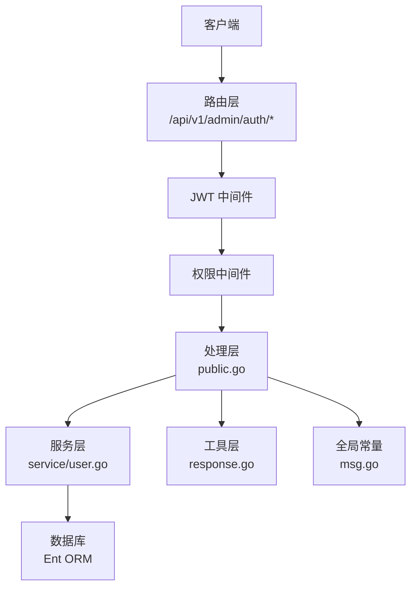
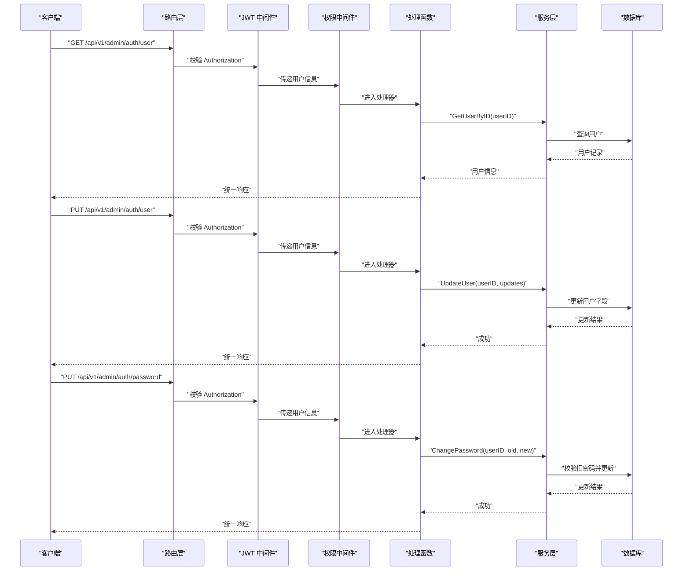
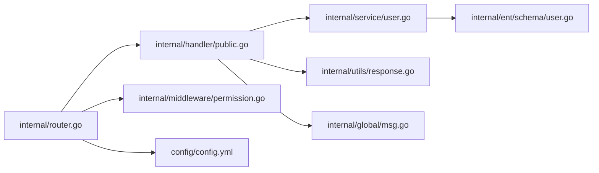

# 用户管理接口

<cite>
**本文引用的文件**
- [main.go](file://main.go)
- [router.go](file://internal/router.go)
- [public.go](file://internal/handler/public.go)
- [user.go](file://internal/service/user.go)
- [permission.go](file://internal/middleware/permission.go)
- [response.go](file://internal/utils/response.go)
- [msg.go](file://internal/global/msg.go)
- [user.go](file://internal/ent/schema/user.go)
- [config.yml](file://config/config.yml)
- [swagger.yaml](file://docs/swagger.yaml)
</cite>

## 目录
1. [简介](#简介)
2. [项目结构](#项目结构)
3. [核心组件](#核心组件)
4. [架构总览](#架构总览)
5. [详细组件分析](#详细组件分析)
6. [依赖分析](#依赖分析)
7. [性能考虑](#性能考虑)
8. [故障排除指南](#故障排除指南)
9. [结论](#结论)
10. [附录](#附录)

## 简介
本文件为用户管理接口的完整API文档，覆盖以下三个与“当前用户”直接相关的接口：
- GET /api/v1/admin/auth/user：获取当前登录用户信息
- PUT /api/v1/admin/auth/user：更新当前登录用户资料
- PUT /api/v1/admin/auth/password：修改当前登录用户密码

文档将详细说明每个接口的请求参数、响应格式、权限要求、数据模型、错误处理以及调用示例。

## 项目结构
后端基于 Fiber 框架，采用分层设计：
- 路由层：在路由注册中挂载鉴权中间件与权限中间件
- 处理层：HTTP 请求处理函数，负责参数解析、调用服务层并返回统一响应
- 服务层：封装业务逻辑，如用户查询、更新、密码修改等
- 中间件：JWT 鉴权与权限校验
- 工具层：统一响应体封装
- 数据模型：Ent ORM 定义的用户实体

图表来源
- [router.go:16-62](file://internal/router.go#L16-L62)
- [public.go:62-178](file://internal/handler/public.go#L62-L178)
- [user.go:237-279](file://internal/service/user.go#L237-L279)
- [response.go:9-49](file://internal/utils/response.go#L9-L49)
- [msg.go:4-83](file://internal/global/msg.go#L4-L83)

章节来源
- [router.go:16-62](file://internal/router.go#L16-L62)
- [main.go:47-104](file://main.go#L47-L104)

## 核心组件
- 路由注册：在 v1 版本下挂载 /admin/auth 组，并绑定三类用户管理接口
- 鉴权中间件：基于 JWT 的 Bearer 认证
- 权限中间件：基于 Casbin 的细粒度权限控制
- 处理函数：解析请求、调用服务层、记录操作日志、返回统一响应
- 服务层：封装用户查询、更新、密码修改等业务逻辑
- 统一响应：固定结构 code/message/data

章节来源
- [router.go:53-62](file://internal/router.go#L53-L62)
- [permission.go:14-93](file://internal/middleware/permission.go#L14-L93)
- [public.go:62-178](file://internal/handler/public.go#L62-L178)
- [user.go:27-44](file://internal/service/user.go#L27-L44)
- [response.go:9-49](file://internal/utils/response.go#L9-L49)

## 架构总览
用户管理接口的调用链路如下：

图表来源
- [router.go:53-62](file://internal/router.go#L53-L62)
- [public.go:73-178](file://internal/handler/public.go#L73-L178)
- [user.go:215-401](file://internal/service/user.go#L215-L401)

## 详细组件分析

### 接口：GET /api/v1/admin/auth/user
- 功能：获取当前登录用户信息
- 认证方式：Bearer Token
- 权限要求：需登录且用户状态有效
- 请求参数：无
- 响应数据：用户基本信息对象
- 错误码：
  - 401 未授权
  - 404 资源不存在
  - 500 内部服务器错误

响应数据字段说明
- id：用户唯一标识
- email：用户邮箱
- username：用户名
- nickname：用户昵称
- phone：手机号
- avatar：头像URL
- status：用户状态

章节来源
- [router.go:60](file://internal/router.go#L60)
- [public.go:62-99](file://internal/handler/public.go#L62-L99)
- [user.go:74-84](file://internal/service/user.go#L74-L84)
- [user.go:215-235](file://internal/service/user.go#L215-L235)
- [swagger.yaml:2490-2522](file://docs/swagger.yaml#L2490-L2522)

### 接口：PUT /api/v1/admin/auth/user
- 功能：更新当前登录用户资料
- 认证方式：Bearer Token
- 权限要求：需登录且用户状态有效
- 请求体：任意键值对，允许更新的字段包括 nickname、phone、avatar、status
- 响应数据：无（仅状态码）
- 错误码：
  - 400 请求参数错误
  - 401 未授权
  - 500 内部服务器错误

更新流程
- 解析请求体为 map[string]interface{}
- 调用服务层 UpdateUser(userID, updates)
- 支持字段：nickname、phone、avatar、status
- 成功后记录操作日志

章节来源
- [router.go:61](file://internal/router.go#L61)
- [public.go:101-133](file://internal/handler/public.go#L101-L133)
- [user.go:237-279](file://internal/service/user.go#L237-L279)
- [swagger.yaml:2523-2558](file://docs/swagger.yaml#L2523-L2558)

### 接口：PUT /api/v1/admin/auth/password
- 功能：修改当前登录用户密码
- 认证方式：Bearer Token
- 权限要求：需登录且用户状态有效
- 请求体：旧密码与新密码
- 响应数据：无（仅状态码）
- 错误码：
  - 400 请求参数错误
  - 401 未授权（旧密码错误）
  - 404 资源不存在
  - 500 内部服务器错误

密码验证规则
- 旧密码必须正确
- 新密码长度至少6位
- 密码采用安全散列存储

章节来源
- [router.go:62](file://internal/router.go#L62)
- [public.go:135-178](file://internal/handler/public.go#L135-L178)
- [user.go:366-401](file://internal/service/user.go#L366-L401)
- [swagger.yaml:1689-1728](file://docs/swagger.yaml#L1689-L1728)

### 数据模型与字段说明
用户实体字段（节选）
- email：唯一，邮箱格式校验
- password：敏感字段，最大长度255
- username：可选
- nickname：可选
- uid：可选，用户唯一标识
- password_salt：敏感字段，密码盐值
- avatar：可选，头像URL
- phone：可选，数字格式校验
- status：枚举值 active/inactive/suspended
- last_login：可选，最后登录时间
- last_ip：可选，最后登录IP

章节来源
- [user.go:24-80](file://internal/ent/schema/user.go#L24-L80)

### 统一响应结构
- code：整数，业务状态码
- message：字符串，状态描述
- data：任意，业务数据（可选）

章节来源
- [response.go:9-49](file://internal/utils/response.go#L9-L49)
- [msg.go:44-83](file://internal/global/msg.go#L44-L83)

### 鉴权与权限控制
- 鉴权中间件：从 Authorization 头解析 Bearer Token，提取用户信息
- 权限中间件：从 JWT 中获取 domain 与 user_id，结合 Casbin 执行权限校验
- 路由中间件链：JWT -> Domain -> Permission -> Handler

章节来源
- [router.go:53-59](file://internal/router.go#L53-L59)
- [permission.go:14-93](file://internal/middleware/permission.go#L14-L93)

## 依赖分析
- 路由依赖：Fiber 应用实例、JWT 中间件、权限中间件、服务实例注入
- 处理层依赖：统一响应封装、服务接口、JWT 用户数据提取
- 服务层依赖：Ent ORM、加密库、配置与日志
- 中间件依赖：JWT、Casbin、全局配置

图表来源
- [router.go:16-149](file://internal/router.go#L16-L149)
- [public.go:13-11](file://internal/handler/public.go#L13-L11)
- [user.go:3-17](file://internal/service/user.go#L3-L17)
- [user.go:18-104](file://internal/ent/schema/user.go#L18-L104)
- [response.go:3-8](file://internal/utils/response.go#L3-L8)
- [msg.go:3-14](file://internal/global/msg.go#L3-L14)
- [permission.go:3-12](file://internal/middleware/permission.go#L3-L12)
- [config.yml:1-143](file://config/config.yml#L1-L143)

章节来源
- [router.go:16-149](file://internal/router.go#L16-L149)

## 性能考虑
- 缓存策略：路由层可按需启用缓存服务（内存或 Redis），用于角色与权限服务
- 日志与监控：统一响应与操作日志便于追踪与性能分析
- 数据库索引：用户表对 email、phone、username 建有索引，有利于查询与去重
- 密钥与过期：JWT 密钥与过期时间在配置文件中集中管理

章节来源
- [router.go:35-44](file://internal/router.go#L35-L44)
- [user.go:90-110](file://internal/service/user.go#L90-L110)
- [user.go:91-96](file://internal/ent/schema/user.go#L91-L96)
- [config.yml:1-143](file://config/config.yml#L1-L143)

## 故障排除指南
常见错误与排查要点
- 401 未授权
  - 检查 Authorization 头是否为 Bearer Token
  - 校验 Token 是否过期或被篡改
- 403 拒绝访问
  - 检查用户域与权限策略是否匹配
  - 确认 Casbin 策略是否正确加载
- 404 资源不存在
  - 用户不存在或已被删除
- 500 内部服务器错误
  - 数据库异常、加密失败、服务层异常
- 参数校验失败（400）
  - 密码长度不足、请求体格式错误

章节来源
- [permission.go:14-93](file://internal/middleware/permission.go#L14-L93)
- [public.go:33-60](file://internal/handler/public.go#L33-L60)
- [public.go:114-133](file://internal/handler/public.go#L114-L133)
- [public.go:149-178](file://internal/handler/public.go#L149-L178)
- [msg.go:4-14](file://internal/global/msg.go#L4-L14)

## 结论
本文档梳理了用户个人信息管理相关接口的完整规范，明确了鉴权与权限控制机制、数据模型、错误处理与调用流程。建议在生产环境中：
- 严格管理 JWT 密钥与过期时间
- 对敏感字段进行最小化暴露
- 使用缓存与索引优化查询性能
- 完善日志与监控体系

## 附录

### API 调用示例（示意）
- 获取用户信息
  - 方法：GET
  - 路径：/api/v1/admin/auth/user
  - 请求头：Authorization: Bearer <token>
  - 响应：包含用户基础信息的对象
- 更新用户资料
  - 方法：PUT
  - 路径：/api/v1/admin/auth/user
  - 请求头：Authorization: Bearer <token>
  - 请求体：{ "nickname": "新昵称", "phone": "13800001111" }
  - 响应：成功状态码
- 修改密码
  - 方法：PUT
  - 路径：/api/v1/admin/auth/password
  - 请求头：Authorization: Bearer <token>
  - 请求体：{ "old_password": "旧密码", "new_password": "新密码(≥6位)" }
  - 响应：成功状态码

章节来源
- [swagger.yaml:2490-2558](file://docs/swagger.yaml#L2490-L2558)
- [swagger.yaml:1689-1728](file://docs/swagger.yaml#L1689-L1728)