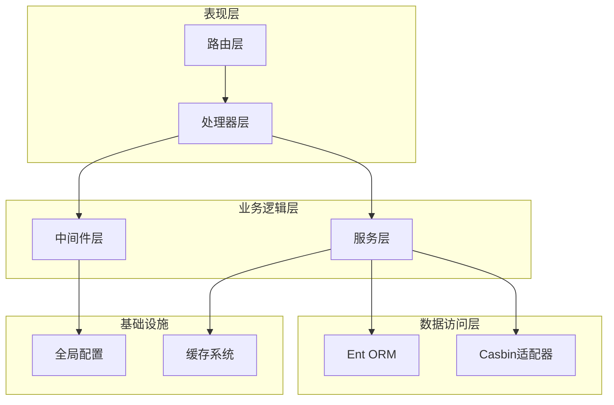
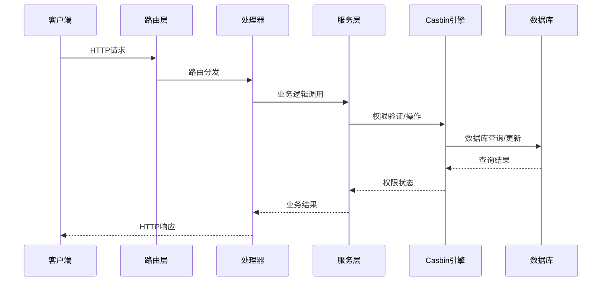
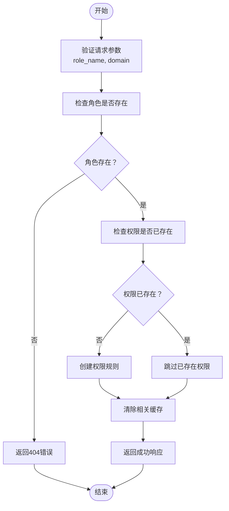
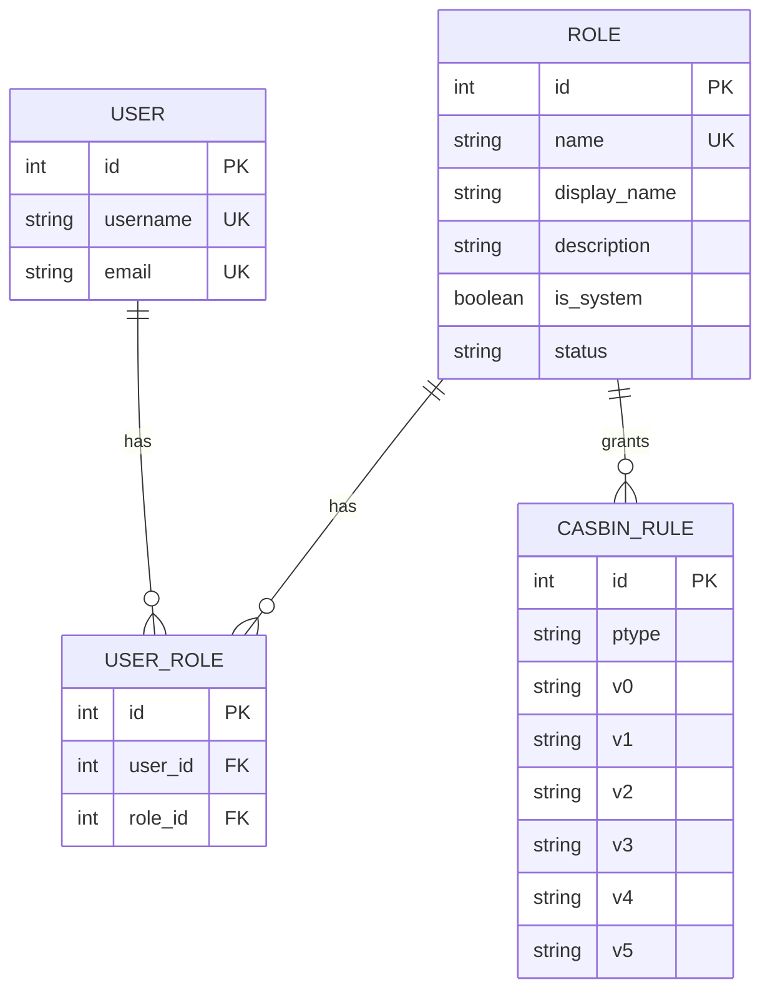
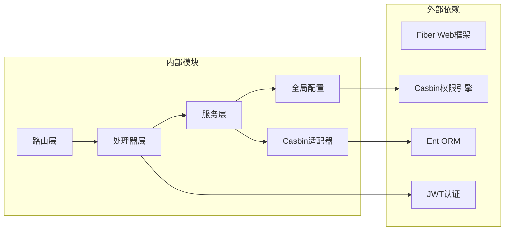

# 角色权限管理接口

<cite>
**本文档引用的文件**
- [router.go](file://internal/router.go)
- [permission.go](file://internal/handler/permission.go)
- [permission.go](file://internal/service/permission.go)
- [adapter.go](file://internal/casbin/adapter/adapter.go)
- [casbinrule.go](file://internal/ent/schema/casbinrule.go)
- [permission.go](file://internal/middleware/permission.go)
- [global.go](file://internal/global/global.go)
</cite>

## 目录
1. [简介](#简介)
2. [项目结构](#项目结构)
3. [核心组件](#核心组件)
4. [架构概览](#架构概览)
5. [详细接口文档](#详细接口文档)
6. [权限分配流程](#权限分配流程)
7. [批量权限操作](#批量权限操作)
8. [权限继承机制](#权限继承机制)
9. [依赖关系分析](#依赖关系分析)
10. [性能考虑](#性能考虑)
11. [故障排除指南](#故障排除指南)
12. [结论](#结论)

## 简介

本文档详细记录了角色权限管理接口的完整API规范，涵盖角色权限分配和管理的核心功能。系统基于Casbin权限引擎构建，采用RBAC（基于角色的访问控制）模型，支持多域权限管理和缓存优化。

## 项目结构

系统采用分层架构设计，主要包含以下层次：

**图表来源**
- [router.go:16-149](file://internal/router.go#L16-L149)
- [permission.go:1-571](file://internal/handler/permission.go#L1-L571)
- [permission.go:1-804](file://internal/service/permission.go#L1-L804)

**章节来源**
- [router.go:16-149](file://internal/router.go#L16-L149)

## 核心组件

### 路由注册
系统在路由层集中注册了所有权限管理相关的API端点，包括角色权限管理、用户权限查询等功能。

### 处理器层
处理器负责HTTP请求的接收、参数解析、错误处理和响应格式化，确保API的一致性和可靠性。

### 服务层
服务层实现了具体的业务逻辑，包括权限验证、角色权限管理、用户权限查询等核心功能。

### 数据持久层
基于Ent ORM框架，提供类型安全的数据库操作，支持复杂的查询和事务处理。

**章节来源**
- [permission.go:1-571](file://internal/handler/permission.go#L1-L571)
- [permission.go:1-804](file://internal/service/permission.go#L1-L804)

## 架构概览

系统采用多层架构，结合Casbin权限引擎实现细粒度的权限控制：

**图表来源**
- [permission.go:259-311](file://internal/handler/permission.go#L259-L311)
- [permission.go:427-477](file://internal/service/permission.go#L427-L477)

## 详细接口文档

### 接口总览

系统提供三个核心的权限管理接口：

1. **POST /api/v1/admin/auth/roles/permissions/assign** - 为角色分配权限
2. **POST /api/v1/admin/auth/roles/permissions/remove** - 从角色移除权限  
3. **GET /api/v1/admin/auth/roles/permissions** - 获取角色权限列表

### POST /api/v1/admin/auth/roles/permissions/assign

#### 功能描述
为指定角色批量分配多个权限规则。

#### 请求参数
- **查询参数**：
  - `role_name` (string, 必填): 角色名称
  - `domain` (string, 必填): 权限域

- **请求体**：数组格式的权限规则对象
  - `object` (string, 必填): 权限对象（API路径、菜单路径或按钮标识）
  - `action` (string, 必填): 权限操作（HTTP方法、menu或button）

#### 响应格式
- **成功响应**：返回操作成功的通用响应格式
- **错误响应**：
  - 400：请求参数无效
  - 401：未授权访问
  - 403：权限不足
  - 404：角色不存在
  - 500：服务器内部错误

#### 权限要求
- 需要管理员身份认证
- 需要具有角色管理相关权限

**章节来源**
- [permission.go:259-311](file://internal/handler/permission.go#L259-L311)
- [permission.go:427-477](file://internal/service/permission.go#L427-L477)

### POST /api/v1/admin/auth/roles/permissions/remove

#### 功能描述
从指定角色批量移除多个权限规则。

#### 请求参数
- **查询参数**：
  - `role_name` (string, 必填): 角色名称
  - `domain` (string, 必填): 权限域

- **请求体**：数组格式的权限规则对象
  - `object` (string, 必填): 权限对象
  - `action` (string, 必填): 权限操作

#### 响应格式
- **成功响应**：返回操作成功的通用响应格式
- **错误响应**：同分配接口的错误响应

#### 权限要求
- 需要管理员身份认证
- 需要具有角色管理相关权限

**章节来源**
- [permission.go:313-365](file://internal/handler/permission.go#L313-L365)
- [permission.go:479-510](file://internal/service/permission.go#L479-L510)

### GET /api/v1/admin/auth/roles/permissions

#### 功能描述
获取指定角色的所有权限列表。

#### 请求参数
- **查询参数**：
  - `role_name` (string, 必填): 角色名称
  - `domain` (string, 必填): 权限域

#### 响应格式
- **成功响应**：返回权限列表数组
  - `id` (integer): 权限规则ID
  - `role_name` (string): 角色名称
  - `domain` (string): 权限域
  - `type` (string): 权限类型（api/menu/button）
  - `object` (string): 权限对象
  - `action` (string): 权限操作
  - `description` (string): 权限描述

- **错误响应**：同上

#### 权限要求
- 需要管理员身份认证
- 需要具有角色管理相关权限

**章节来源**
- [permission.go:367-409](file://internal/handler/permission.go#L367-L409)
- [permission.go:512-556](file://internal/service/permission.go#L512-L556)

## 权限分配流程

### 单条权限分配流程

**图表来源**
- [permission.go:427-477](file://internal/service/permission.go#L427-L477)

### 批量权限分配流程

系统支持一次性为角色分配多个权限，流程如下：

1. **参数验证**：验证角色名称和域参数的有效性
2. **角色检查**：确认目标角色存在且可操作
3. **逐条处理**：对每个权限规则执行以下步骤：
   - 类型推断：根据action自动确定权限类型
   - 存在性检查：避免重复添加相同权限
   - 权限创建：向数据库插入新的权限规则
4. **缓存清理**：清除角色和相关用户的权限缓存
5. **响应返回**：返回批量操作结果

**章节来源**
- [permission.go:427-477](file://internal/service/permission.go#L427-L477)

## 批量权限操作

### 批量分配权限
- 支持一次操作多个权限规则
- 自动去重，避免重复权限
- 批量操作在单个事务中完成
- 操作完成后统一清理缓存

### 批量移除权限
- 支持一次移除多个权限规则
- 对不存在的权限规则进行容错处理
- 批量删除操作保证原子性
- 统一清理相关缓存

### 性能优化
- 使用数据库批量操作减少往返次数
- 缓存层避免重复查询
- 事务保证数据一致性

**章节来源**
- [permission.go:427-510](file://internal/service/permission.go#L427-L510)

## 权限继承机制

### 角色到用户继承
系统通过用户角色关联实现权限继承：

**图表来源**
- [casbinrule.go:10-36](file://internal/ent/schema/casbinrule.go#L10-L36)
- [permission.go:558-734](file://internal/service/permission.go#L558-L734)

### 权限类型识别
系统根据action自动识别权限类型：
- `menu` → 菜单权限
- `button` → 按钮权限  
- 其他 → API权限

### 用户权限聚合
用户最终权限是其所有角色权限的并集，系统通过以下步骤实现：

1. **用户角色查询**：获取用户所属的所有角色
2. **角色权限查询**：查询每个角色的权限规则
3. **权限合并**：将所有权限规则合并去重
4. **缓存存储**：将结果缓存以提高查询性能

**章节来源**
- [permission.go:558-734](file://internal/service/permission.go#L558-L734)

## 依赖关系分析

### 核心依赖链

**图表来源**
- [router.go:16-149](file://internal/router.go#L16-L149)
- [permission.go:118-134](file://internal/service/permission.go#L118-L134)
- [global.go:11-16](file://internal/global/global.go#L11-L16)

### 中间件依赖

系统权限控制通过中间件实现，依赖关系如下：

1. **JWT中间件**：验证用户身份和域信息
2. **权限中间件**：基于Casbin进行权限验证
3. **域中间件**：设置当前操作域

**章节来源**
- [permission.go:14-94](file://internal/middleware/permission.go#L14-L94)

## 性能考虑

### 缓存策略
- **角色权限缓存**：缓存角色的权限列表，5分钟过期
- **用户权限缓存**：缓存用户的菜单、按钮、API权限，5分钟过期
- **缓存清理**：权限变更后自动清理相关缓存

### 数据库优化
- **索引设计**：Casbin规则表建立复合唯一索引
- **查询优化**：使用IN子句批量查询用户角色权限
- **事务处理**：批量操作在单个事务中完成

### 并发控制
- **连接池**：数据库连接池支持高并发
- **锁机制**：权限变更时的互斥访问
- **超时控制**：合理的数据库操作超时设置

## 故障排除指南

### 常见错误及解决方案

| 错误代码 | 错误类型 | 可能原因 | 解决方案 |
|---------|---------|---------|---------|
| 400 | 参数错误 | 请求参数缺失或格式不正确 | 检查role_name和domain参数，确保请求体格式正确 |
| 401 | 未授权 | JWT令牌无效或过期 | 重新登录获取有效令牌 |
| 403 | 权限不足 | 当前用户无操作权限 | 确认用户具备相应的管理权限 |
| 404 | 资源不存在 | 角色或权限规则不存在 | 检查角色名称是否正确，确认权限规则存在 |
| 500 | 服务器错误 | 数据库连接异常或内部错误 | 检查数据库连接状态，查看服务器日志 |

### 调试建议
1. **启用详细日志**：查看权限中间件的日志输出
2. **检查Casbin规则**：验证数据库中的权限规则是否正确
3. **测试JWT令牌**：确认令牌中包含正确的域信息
4. **监控缓存状态**：检查缓存是否正常工作

**章节来源**
- [permission.go:276-311](file://internal/handler/permission.go#L276-L311)
- [permission.go:330-365](file://internal/handler/permission.go#L330-L365)

## 结论

本角色权限管理接口提供了完整的RBAC权限控制能力，支持：

- **细粒度权限控制**：基于Casbin的灵活权限模型
- **多域支持**：支持不同域的独立权限管理
- **批量操作**：高效处理大量权限规则
- **缓存优化**：提升权限查询性能
- **类型安全**：基于Ent ORM的类型安全操作

系统设计遵循RESTful API规范，提供清晰的错误处理和响应格式，适合在企业级应用中部署使用。