# 角色权限管理接口

<cite>
**本文档引用的文件**
- [router.go](file://internal/router.go)
- [permission.go](file://internal/handler/permission.go)
- [permission.go](file://internal/service/permission.go)
- [role.go](file://internal/handler/role.go)
- [role.go](file://internal/service/role.go)
- [permission.go](file://internal/middleware/permission.go)
- [adapter.go](file://internal/casbin/adapter/adapter.go)
- [casbinrule.go](file://internal/ent/schema/casbinrule.go)
- [rbac_model.conf](file://config/rbac_model.conf)
- [global.go](file://internal/global/global.go)
- [init.go](file://internal/init.go)
</cite>

## 目录
1. [简介](#简介)
2. [项目结构](#项目结构)
3. [核心组件](#核心组件)
4. [架构概览](#架构概览)
5. [详细组件分析](#详细组件分析)
6. [依赖关系分析](#依赖关系分析)
7. [性能考虑](#性能考虑)
8. [故障排除指南](#故障排除指南)
9. [结论](#结论)

## 简介

本文档详细介绍了基于RBAC（基于角色的访问控制）模型的权限管理系统，重点涵盖角色权限管理接口的设计与实现。系统采用Casbin作为权限引擎，结合Ent ORM进行数据持久化，提供了完整的角色权限分配、移除和查询功能。

## 项目结构

系统采用分层架构设计，主要分为以下层次：

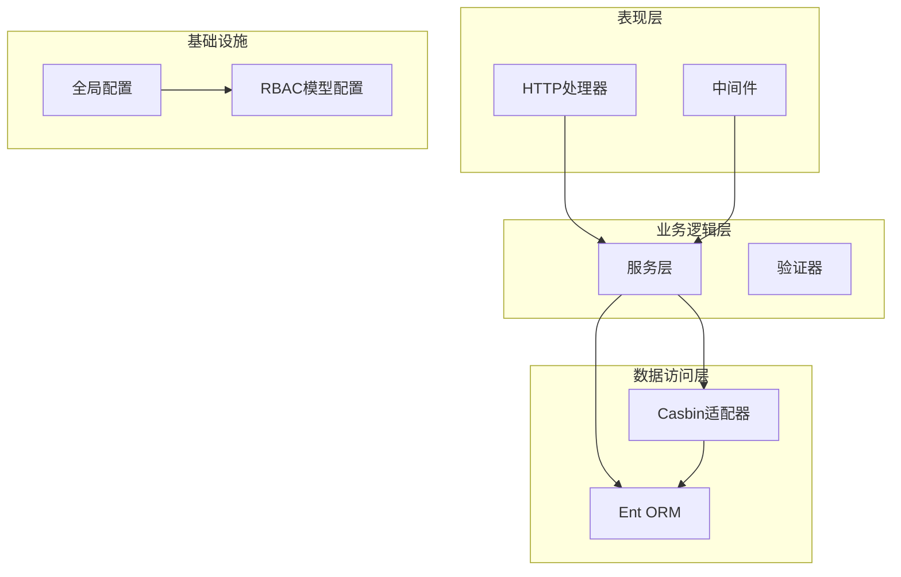

**图表来源**
- [router.go:14-73](file://internal/router.go#L14-L73)
- [permission.go:115-125](file://internal/service/permission.go#L115-L125)

**章节来源**
- [router.go:14-73](file://internal/router.go#L14-L73)
- [init.go:17-66](file://internal/init.go#L17-L66)

## 核心组件

### 角色权限管理接口

系统提供三个核心的权限管理接口：

1. **为角色分配权限** (`POST /api/v1/admin/auth/roles/permissions/assign`)
2. **从角色移除权限** (`POST /api/v1/admin/auth/roles/permissions/remove`)  
3. **获取角色权限** (`GET /api/v1/admin/auth/roles/permissions`)

### 权限类型定义

系统支持三种权限类型：
- **API权限**：用于控制API接口访问
- **菜单权限**：用于控制页面菜单显示
- **按钮权限**：用于控制按钮级操作权限

**章节来源**
- [permission.go:24-34](file://internal/service/permission.go#L24-L34)
- [permission.go:356-403](file://internal/service/permission.go#L356-L403)

## 架构概览

系统采用多层架构，通过中间件实现统一的权限控制：

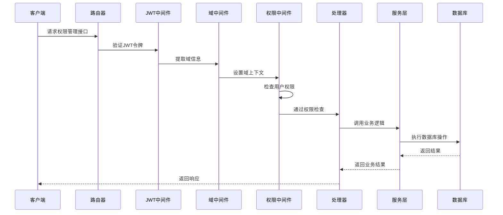

**图表来源**
- [router.go:32-37](file://internal/router.go#L32-L37)
- [permission.go:12-53](file://internal/middleware/permission.go#L12-L53)

**章节来源**
- [router.go:32-64](file://internal/router.go#L32-L64)
- [permission.go:12-53](file://internal/middleware/permission.go#L12-L53)

## 详细组件分析

### 角色权限分配接口

#### 接口定义

**URL**: `POST /api/v1/admin/auth/roles/permissions/assign`

**请求参数**:
- `role_name` (查询参数): 角色名称
- `domain` (查询参数): 域名
- 请求体: 权限规则数组

**请求体格式**:
```json
[
  {
    "object": "字符串",
    "action": "字符串"
  }
]
```

**响应格式**:
```json
{
  "code": 0,
  "message": "字符串",
  "data": "操作成功"
}
```

#### 处理流程

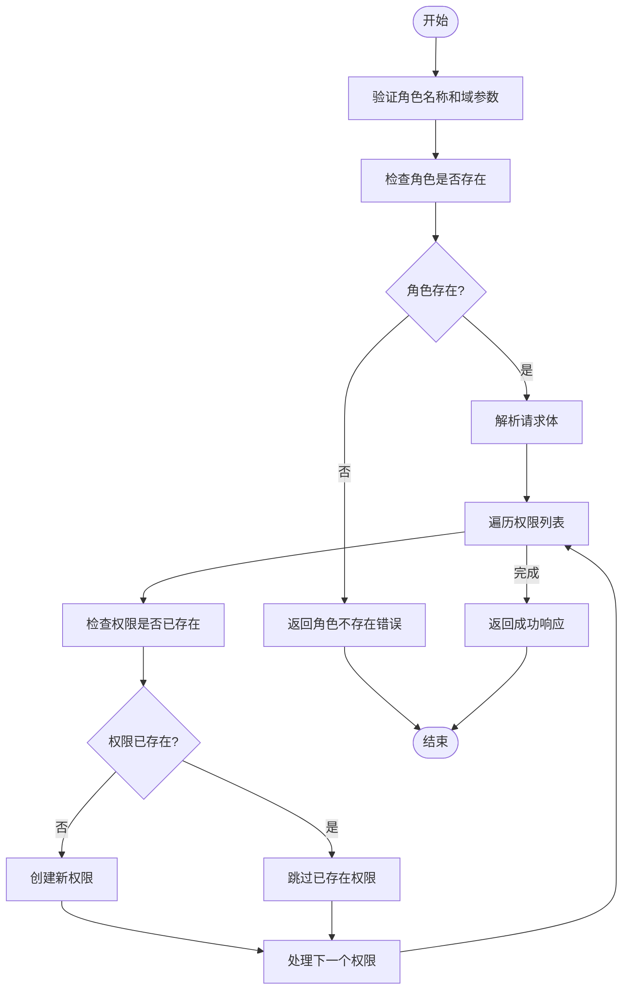

**图表来源**
- [permission.go:237-269](file://internal/handler/permission.go#L237-L269)
- [permission.go:356-403](file://internal/service/permission.go#L356-L403)

**章节来源**
- [permission.go:224-269](file://internal/handler/permission.go#L224-L269)
- [permission.go:356-403](file://internal/service/permission.go#L356-L403)

### 从角色移除权限接口

#### 接口定义

**URL**: `POST /api/v1/admin/auth/roles/permissions/remove`

**请求参数**:
- `role_name` (查询参数): 角色名称
- `domain` (查询参数): 域名
- 请求体: 权限规则数组

**处理流程**:

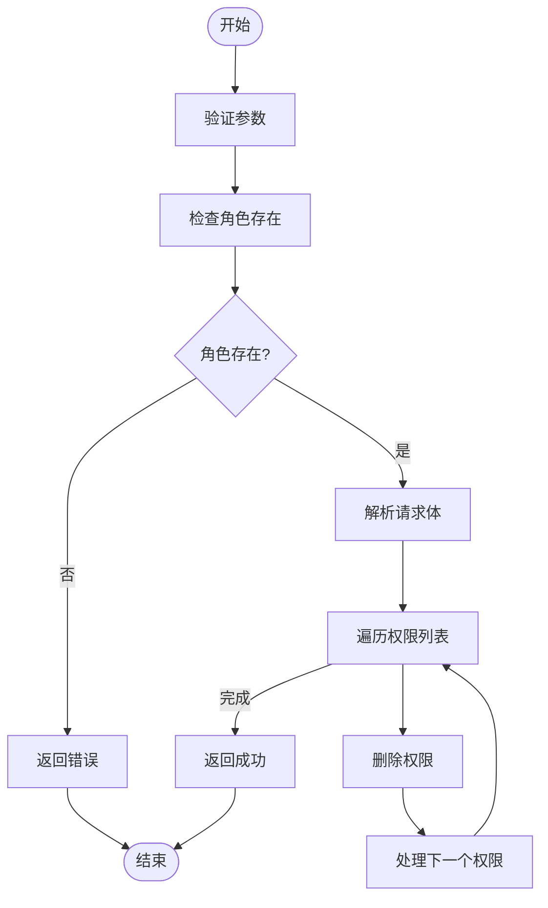

**图表来源**
- [permission.go:284-316](file://internal/handler/permission.go#L284-L316)
- [permission.go:405-433](file://internal/service/permission.go#L405-L433)

**章节来源**
- [permission.go:271-316](file://internal/handler/permission.go#L271-L316)
- [permission.go:405-433](file://internal/service/permission.go#L405-L433)

### 获取角色权限接口

#### 接口定义

**URL**: `GET /api/v1/admin/auth/roles/permissions`

**请求参数**:
- `role_name` (查询参数): 角色名称
- `domain` (查询参数): 域名

**响应格式**:
```json
{
  "code": 0,
  "message": "字符串",
  "data": [
    {
      "id": 1,
      "role_name": "字符串",
      "domain": "字符串",
      "type": "字符串",
      "object": "字符串",
      "action": "字符串",
      "description": "字符串"
    }
  ]
}
```

**处理流程**:

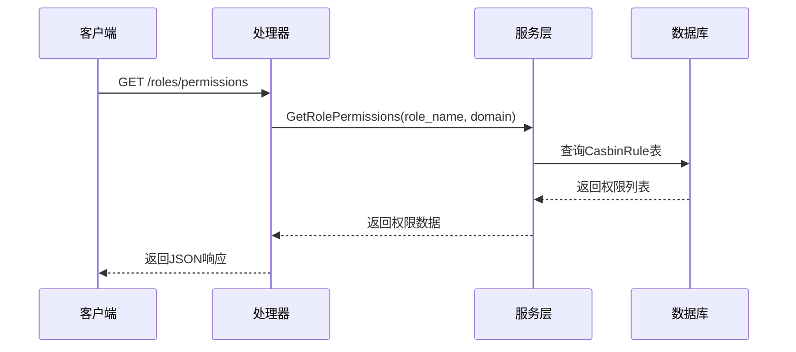

**图表来源**
- [permission.go:318-356](file://internal/handler/permission.go#L318-L356)
- [permission.go:435-464](file://internal/service/permission.go#L435-L464)

**章节来源**
- [permission.go:318-356](file://internal/handler/permission.go#L318-L356)
- [permission.go:435-464](file://internal/service/permission.go#L435-L464)

### 权限数据模型

#### Casbin规则模型

系统使用Casbin的P型策略规则来存储权限信息：

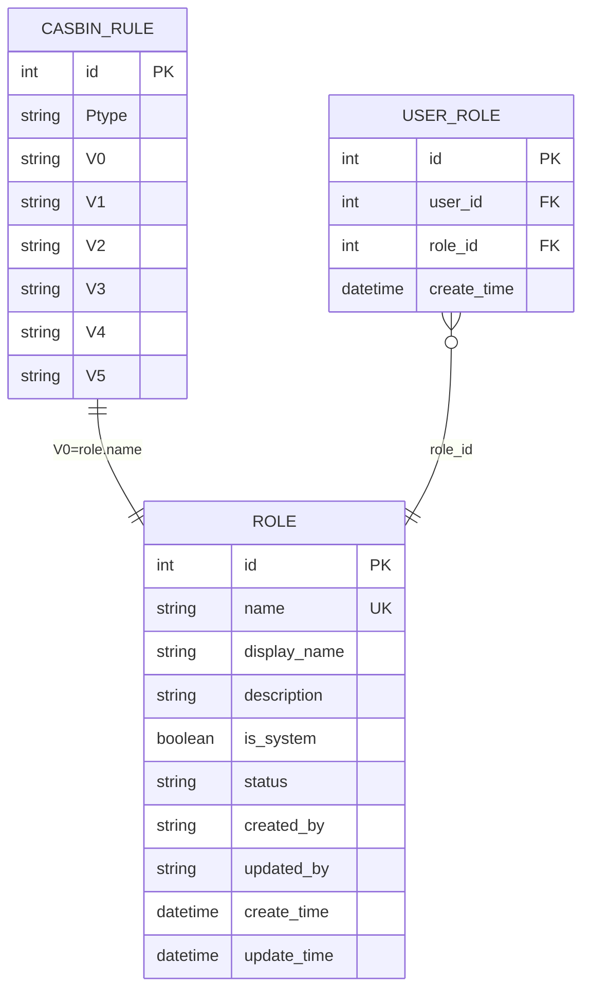

**图表来源**
- [casbinrule.go:15-25](file://internal/ent/schema/casbinrule.go#L15-L25)

**章节来源**
- [casbinrule.go:15-37](file://internal/ent/schema/casbinrule.go#L15-L37)

### 权限继承和覆盖规则

#### RBAC模型配置

系统采用标准的RBAC模型配置：

```mermaid
graph LR
subgraph "请求定义"
R[r = sub, obj, act]
end
subgraph "策略定义"
P[p = sub, obj, act]
end
subgraph "角色定义"
G[g = _, _]
end
subgraph "策略效果"
E[e = some(where (p.eft == allow))]
end
subgraph "匹配器"
M[m = g(r.sub, p.sub) && keyMatch2(r.obj, p.obj) && regexMatch(r.act, p.act)]
end
```

**图表来源**
- [rbac_model.conf:1-15](file://config/rbac_model.conf#L1-L15)

#### 权限继承机制

1. **用户角色继承**: 用户通过`USER_ROLE`表继承多个角色
2. **权限传递**: 通过Casbin的`g`关系定义实现角色到用户的继承
3. **权限合并**: 用户最终权限为其所有角色权限的并集

**章节来源**
- [rbac_model.conf:1-15](file://config/rbac_model.conf#L1-L15)

### 批量权限操作

#### 批量分配权限

服务层实现了高效的批量权限分配机制：

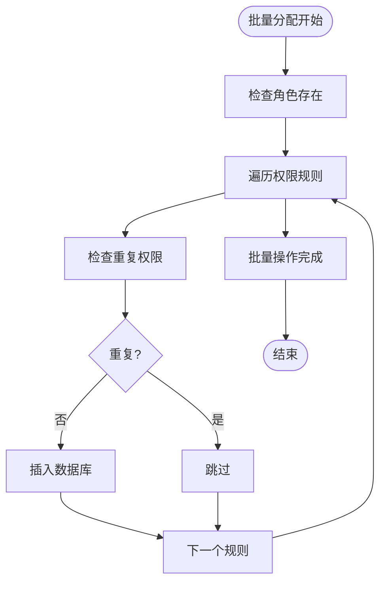

**图表来源**
- [permission.go:367-400](file://internal/service/permission.go#L367-L400)

#### 批量移除权限

批量移除权限采用相同的模式，但使用删除操作：

**章节来源**
- [permission.go:367-433](file://internal/service/permission.go#L367-L433)

### 权限冲突处理机制

#### 冲突检测

系统在权限分配时自动检测冲突：

1. **重复权限检测**: 在分配前检查权限是否已存在
2. **自动跳过**: 已存在的权限会被自动跳过，避免重复创建
3. **事务保证**: 使用数据库事务确保操作的原子性

#### 错误处理

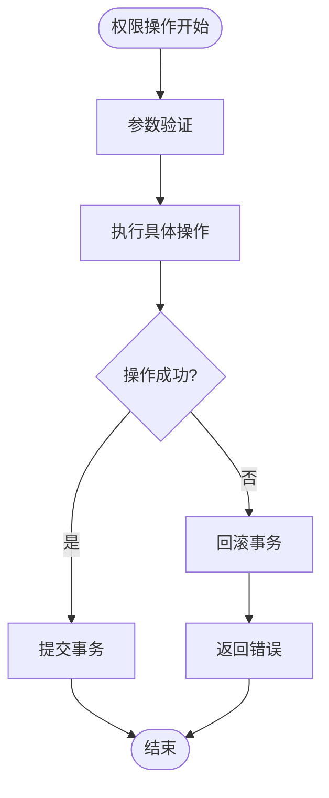

**图表来源**
- [adapter.go:304-325](file://internal/casbin/adapter/adapter.go#L304-L325)

**章节来源**
- [adapter.go:304-325](file://internal/casbin/adapter/adapter.go#L304-L325)

### 权限验证中间件

#### 中间件工作流程

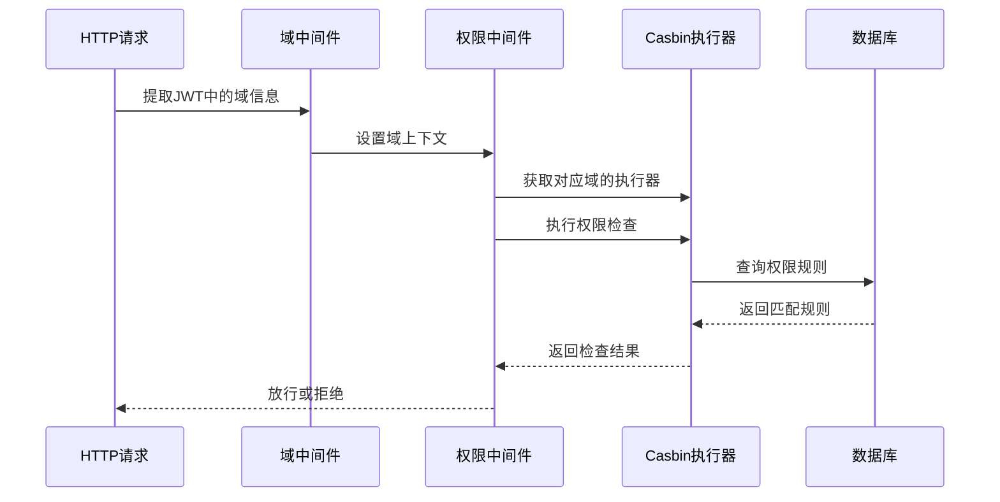

**图表来源**
- [permission.go:12-53](file://internal/middleware/permission.go#L12-L53)

**章节来源**
- [permission.go:12-53](file://internal/middleware/permission.go#L12-L53)

## 依赖关系分析

### 组件依赖图

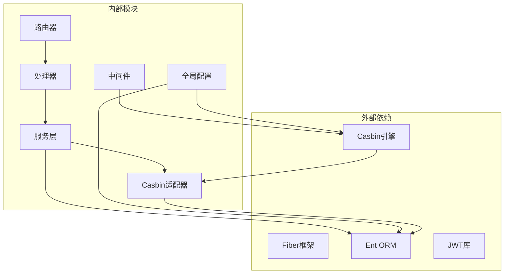

**图表来源**
- [router.go:3-12](file://internal/router.go#L3-L12)
- [init.go:17-66](file://internal/init.go#L17-L66)

**章节来源**
- [router.go:3-12](file://internal/router.go#L3-L12)
- [init.go:17-66](file://internal/init.go#L17-L66)

### 数据流分析

系统的核心数据流如下：

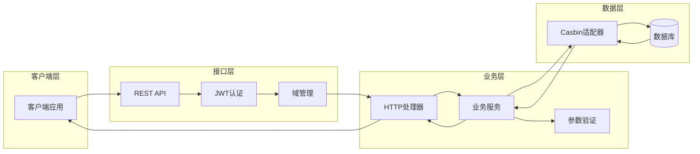

**图表来源**
- [permission.go:12-53](file://internal/middleware/permission.go#L12-L53)
- [adapter.go:115-125](file://internal/casbin/adapter/adapter.go#L115-L125)

**章节来源**
- [permission.go:12-53](file://internal/middleware/permission.go#L12-L53)
- [adapter.go:115-125](file://internal/casbin/adapter/adapter.go#L115-L125)

## 性能考虑

### 数据库优化

1. **索引设计**: Casbin规则表使用复合唯一索引优化查询性能
2. **批量操作**: 支持批量插入和删除操作，减少数据库往返次数
3. **事务管理**: 使用数据库事务确保操作的原子性和一致性

### 缓存策略

1. **Casbin缓存**: Casbin执行器支持内存缓存策略
2. **连接池**: 数据库连接池优化数据库连接复用
3. **中间件缓存**: JWT和域信息在请求上下文中缓存

### 并发处理

1. **并发安全**: 所有权限操作都是线程安全的
2. **锁机制**: 使用数据库锁防止并发冲突
3. **超时控制**: 设置合理的操作超时时间

## 故障排除指南

### 常见错误及解决方案

#### 角色相关错误

| 错误类型 | 错误码 | 描述 | 解决方案 |
|---------|--------|------|----------|
| 角色不存在 | 400 | 角色名称无效或不存在 | 检查角色名称是否正确 |
| 角色已存在 | 400 | 角色名称重复 | 修改角色名称 |
| 角色被使用 | 400 | 角色正在被用户使用 | 先移除用户关联再删除 |
| 系统角色保护 | 400 | 系统内置角色不可删除 | 不要尝试删除系统角色 |

#### 权限相关错误

| 错误类型 | 错误码 | 描述 | 解决方案 |
|---------|--------|------|----------|
| 权限不存在 | 404 | 权限规则不存在 | 检查权限参数 |
| 权限已存在 | 400 | 权限规则重复 | 移除重复权限 |
| 参数无效 | 400 | 请求参数格式错误 | 检查请求格式 |
| 权限检查失败 | 500 | Casbin执行器异常 | 检查Casbin配置 |

#### 数据库相关错误

| 错误类型 | 错误码 | 描述 | 解决方案 |
|---------|--------|------|----------|
| 连接失败 | 500 | 数据库连接异常 | 检查数据库配置 |
| 查询超时 | 500 | 数据库查询超时 | 优化查询条件 |
| 事务失败 | 500 | 数据库事务异常 | 检查事务状态 |

**章节来源**
- [role.go:14-23](file://internal/service/role.go#L14-L23)
- [permission.go:16-22](file://internal/service/permission.go#L16-L22)

### 调试技巧

1. **启用调试日志**: 在开发环境中启用Ent ORM的调试日志
2. **检查Casbin策略**: 使用Casbin提供的策略管理工具检查策略状态
3. **监控数据库性能**: 使用数据库监控工具跟踪查询性能
4. **验证JWT令牌**: 检查JWT令牌的有效性和域信息

## 结论

本角色权限管理系统基于成熟的RBAC模型和Casbin权限引擎构建，提供了完整的权限管理功能。系统具有以下特点：

1. **模块化设计**: 清晰的分层架构便于维护和扩展
2. **高性能**: 采用批量操作和缓存机制提升性能
3. **安全性**: 完善的错误处理和权限验证机制
4. **可扩展性**: 支持自定义权限类型和匹配规则

系统支持角色权限的完整生命周期管理，包括创建、分配、移除和查询操作，能够满足大多数企业级权限管理需求。通过合理的架构设计和性能优化，系统能够在高并发场景下保持稳定的性能表现。