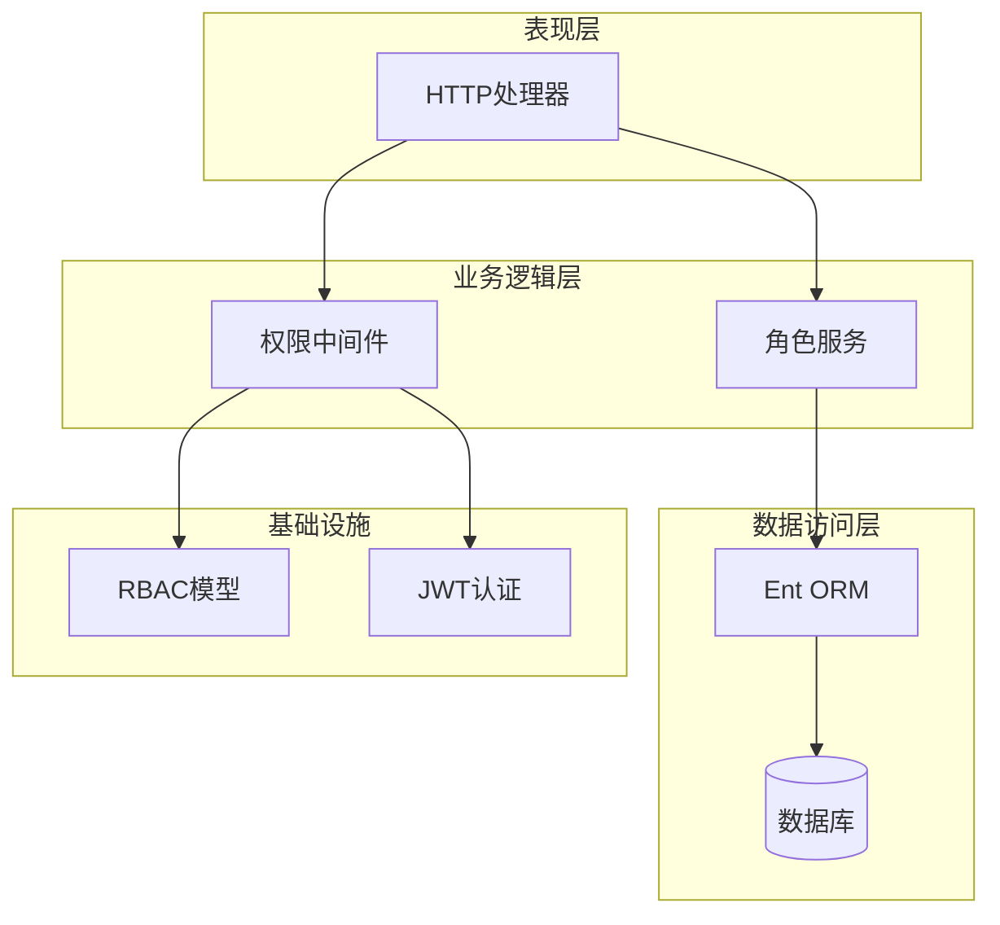
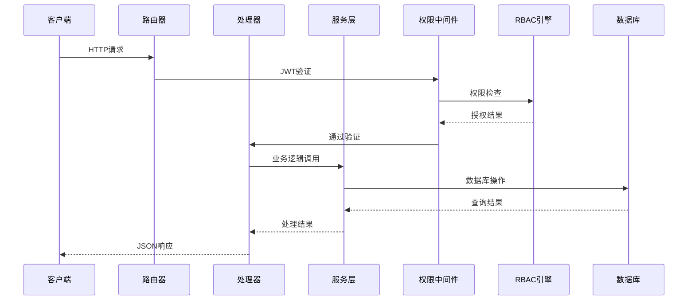
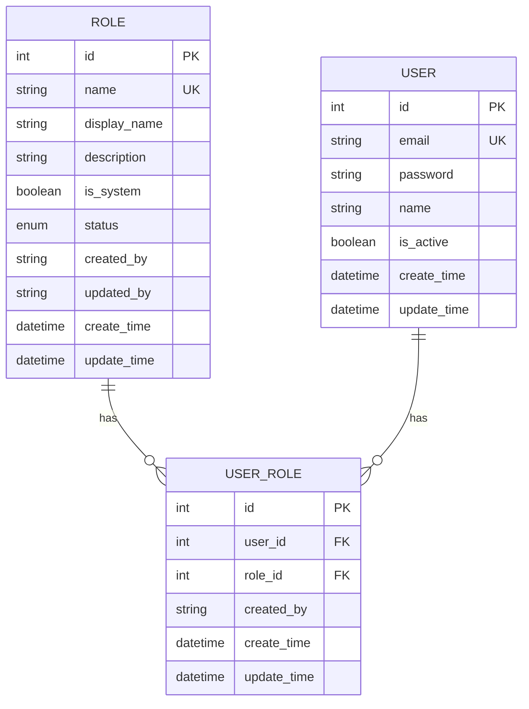
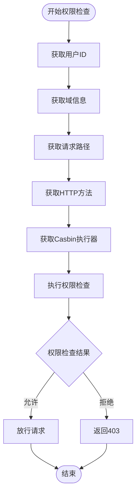
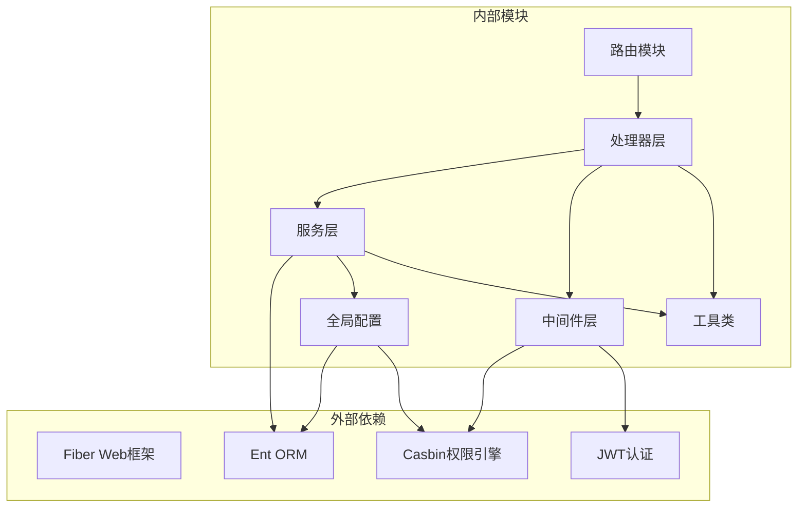
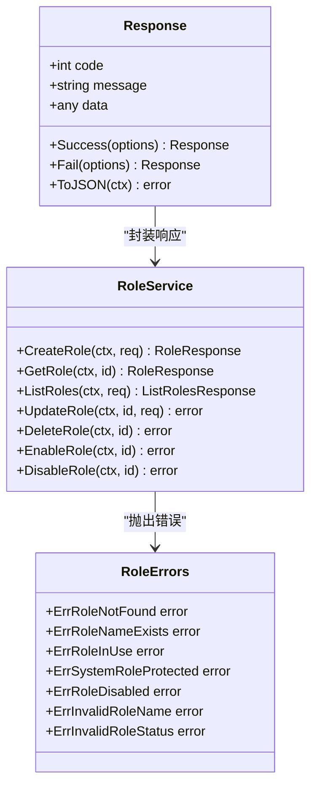

# 角色管理接口

<cite>
**本文档引用的文件**
- [role.go](file://internal/handler/role.go)
- [role.go](file://internal/service/role.go)
- [role.go](file://internal/ent/role/role.go)
- [role.go](file://internal/ent/schema/role.go)
- [router.go](file://internal/router.go)
- [permission.go](file://internal/middleware/permission.go)
- [response.go](file://internal/utils/response.go)
- [global.go](file://internal/global/global.go)
- [msg.go](file://internal/global/msg.go)
- [rbac_model.conf](file://config/rbac_model.conf)
- [userrole.go](file://internal/ent/userrole/userrole.go)
</cite>

## 目录
1. [简介](#简介)
2. [项目结构](#项目结构)
3. [核心组件](#核心组件)
4. [架构概览](#架构概览)
5. [详细接口文档](#详细接口文档)
6. [数据模型与状态枚举](#数据模型与状态枚举)
7. [权限继承与层级关系](#权限继承与层级关系)
8. [依赖关系分析](#依赖关系分析)
9. [性能考虑](#性能考虑)
10. [故障排除指南](#故障排除指南)
11. [结论](#结论)

## 简介

本文件详细描述了GoAdmin后台管理系统中的角色管理接口。系统基于RBAC（基于角色的访问控制）模型，提供了完整的企业级角色管理功能，包括角色的创建、查询、更新、删除以及状态管理等操作。

## 项目结构

角色管理模块采用分层架构设计，主要包含以下层次：



**图表来源**
- [router.go:14-51](file://internal/router.go#L14-L51)
- [role.go:1-152](file://internal/handler/role.go#L1-L152)

**章节来源**
- [router.go:14-51](file://internal/router.go#L14-L51)
- [role.go:1-152](file://internal/handler/role.go#L1-L152)

## 核心组件

### 处理器层（Handler Layer）

处理器负责HTTP请求的接收和响应的发送，实现了RESTful API接口：

- **CreateRole**: 创建新角色
- **GetRole**: 获取单个角色详情
- **ListRoles**: 获取角色列表
- **UpdateRole**: 更新角色信息
- **DeleteRole**: 删除角色
- **EnableRole**: 启用角色
- **DisableRole**: 禁用角色

### 服务层（Service Layer）

服务层封装了业务逻辑，提供了角色管理的核心功能：

- **RoleService**: 实现角色CRUD操作
- **权限验证**: 角色状态和权限检查
- **数据验证**: 输入参数验证和业务规则检查

### 数据访问层（Data Access Layer）

使用Ent ORM框架进行数据库操作：

- **Role实体**: 角色数据模型
- **UserRole关联**: 用户与角色的多对多关系
- **权限规则**: Casbin权限策略存储

**章节来源**
- [role.go:13-152](file://internal/handler/role.go#L13-L152)
- [role.go:25-48](file://internal/service/role.go#L25-L48)

## 架构概览

系统采用JWT认证和RBAC权限控制相结合的安全架构：



**图表来源**
- [permission.go:12-53](file://internal/middleware/permission.go#L12-L53)
- [router.go:32-37](file://internal/router.go#L32-L37)

**章节来源**
- [permission.go:12-53](file://internal/middleware/permission.go#L12-L53)
- [rbac_model.conf:1-15](file://config/rbac_model.conf#L1-L15)

## 详细接口文档

### 创建角色接口

**URL**: `/api/v1/admin/auth/roles`
**方法**: `POST`
**认证**: 需要JWT认证
**权限**: 需要角色管理权限

#### 请求参数

| 参数名 | 类型 | 必填 | 描述 | 长度限制 |
|--------|------|------|------|----------|
| name | string | 是 | 角色名称 | 最大100字符 |
| display_name | string | 是 | 显示名称 | 最大255字符 |
| description | string | 否 | 角色描述 | 最大500字符 |
| created_by | string | 否 | 创建者标识 | 最大255字符 |

#### 响应格式

**成功响应** (`200 OK`):
```json
{
  "code": 1,
  "message": "角色创建成功",
  "data": {
    "id": 1,
    "name": "admin",
    "display_name": "管理员",
    "description": "系统管理员",
    "is_system": false,
    "status": "active",
    "created_by": "admin_user",
    "updated_by": "",
    "created_at": "2024-01-01 12:00:00",
    "updated_at": "2024-01-01 12:00:00"
  }
}
```

**失败响应** (`400 Bad Request`):
```json
{
  "code": 0,
  "message": "请求参数无效",
  "data": null
}
```

#### 状态码说明

- `200`: 成功创建角色
- `400`: 请求参数无效或验证失败
- `401`: 未授权访问
- `403`: 没有权限访问
- `500`: 服务器内部错误

**章节来源**
- [role.go:13-29](file://internal/handler/role.go#L13-L29)
- [role.go:94-143](file://internal/service/role.go#L94-L143)

### 获取角色详情接口

**URL**: `/api/v1/admin/auth/roles/:id`
**方法**: `GET`
**认证**: 需要JWT认证
**权限**: 需要角色管理权限

#### 路径参数

| 参数名 | 类型 | 必填 | 描述 |
|--------|------|------|------|
| id | int | 是 | 角色ID |

#### 响应格式

**成功响应** (`200 OK`):
```json
{
  "code": 1,
  "message": "获取角色成功",
  "data": {
    "id": 1,
    "name": "admin",
    "display_name": "管理员",
    "description": "系统管理员",
    "is_system": false,
    "status": "active",
    "created_by": "admin_user",
    "updated_by": "",
    "created_at": "2024-01-01 12:00:00",
    "updated_at": "2024-01-01 12:00:00"
  }
}
```

**失败响应** (`404 Not Found`):
```json
{
  "code": 0,
  "message": "角色不存在",
  "data": null
}
```

#### 状态码说明

- `200`: 成功获取角色详情
- `400`: 无效的角色ID
- `404`: 角色不存在
- `500`: 服务器内部错误

**章节来源**
- [role.go:31-48](file://internal/handler/role.go#L31-L48)
- [role.go:145-159](file://internal/service/role.go#L145-L159)

### 获取角色列表接口

**URL**: `/api/v1/admin/auth/roles`
**方法**: `GET`
**认证**: 需要JWT认证
**权限**: 需要角色管理权限

#### 查询参数

| 参数名 | 类型 | 必填 | 描述 | 默认值 | 限制 |
|--------|------|------|------|--------|------|
| page | int | 否 | 页码 | 1 | ≥1 |
| page_size | int | 否 | 每页数量 | 10 | 1-100 |
| keyword | string | 否 | 搜索关键词 | 无 | 无 |
| status | string | 否 | 角色状态 | 无 | active/inactive |

#### 响应格式

**成功响应** (`200 OK`):
```json
{
  "code": 1,
  "message": "获取角色列表成功",
  "data": {
    "total": 100,
    "page": 1,
    "data": [
      {
        "id": 1,
        "name": "admin",
        "display_name": "管理员",
        "description": "系统管理员",
        "is_system": false,
        "status": "active",
        "created_by": "admin_user",
        "updated_by": "",
        "created_at": "2024-01-01 12:00:00",
        "updated_at": "2024-01-01 12:00:00"
      }
    ]
  }
}
```

**失败响应** (`500 Internal Server Error`):
```json
{
  "code": 0,
  "message": "获取角色列表失败",
  "data": null
}
```

#### 状态码说明

- `200`: 成功获取角色列表
- `400`: 请求参数无效
- `500`: 服务器内部错误

**章节来源**
- [role.go:50-74](file://internal/handler/role.go#L50-L74)
- [role.go:161-222](file://internal/service/role.go#L161-L222)

### 更新角色接口

**URL**: `/api/v1/admin/auth/roles/:id`
**方法**: `PUT`
**认证**: 需要JWT认证
**权限**: 需要角色管理权限

#### 路径参数

| 参数名 | 类型 | 必填 | 描述 |
|--------|------|------|------|
| id | int | 是 | 角色ID |

#### 请求参数

| 参数名 | 类型 | 必填 | 描述 | 长度限制 |
|--------|------|------|------|----------|
| display_name | string | 否 | 显示名称 | 最大255字符 |
| description | string | 否 | 角色描述 | 最大500字符 |
| updated_by | string | 否 | 更新者标识 | 最大255字符 |

#### 响应格式

**成功响应** (`200 OK`):
```json
{
  "code": 1,
  "message": "角色更新成功",
  "data": null
}
```

**失败响应** (`404 Not Found`):
```json
{
  "code": 0,
  "message": "角色不存在",
  "data": null
}
```

#### 状态码说明

- `200`: 成功更新角色
- `400`: 无效的角色ID或请求参数无效
- `404`: 角色不存在
- `500`: 服务器内部错误

**章节来源**
- [role.go:76-97](file://internal/handler/role.go#L76-L97)
- [role.go:224-267](file://internal/service/role.go#L224-L267)

### 删除角色接口

**URL**: `/api/v1/admin/auth/roles/:id`
**方法**: `DELETE`
**认证**: 需要JWT认证
**权限**: 需要角色管理权限

#### 路径参数

| 参数名 | 类型 | 必填 | 描述 |
|--------|------|------|------|
| id | int | 是 | 角色ID |

#### 响应格式

**成功响应** (`200 OK`):
```json
{
  "code": 1,
  "message": "角色删除成功",
  "data": null
}
```

**失败响应** (`400` 或 `409`):
```json
{
  "code": 0,
  "message": "角色正在使用中，无法删除",
  "data": null
}
```

#### 状态码说明

- `200`: 成功删除角色
- `400`: 无效的角色ID
- `404`: 角色不存在
- `409`: 角色正在使用中，无法删除
- `500`: 服务器内部错误

**章节来源**
- [role.go:99-115](file://internal/handler/role.go#L99-L115)
- [role.go:269-309](file://internal/service/role.go#L269-L309)

### 启用角色接口

**URL**: `/api/v1/admin/auth/roles/:id/enable`
**方法**: `PUT`
**认证**: 需要JWT认证
**权限**: 需要角色管理权限

#### 路径参数

| 参数名 | 类型 | 必填 | 描述 |
|--------|------|------|------|
| id | int | 是 | 角色ID |

#### 响应格式

**成功响应** (`200 OK`):
```json
{
  "code": 1,
  "message": "角色启用成功",
  "data": null
}
```

**失败响应** (`404 Not Found`):
```json
{
  "code": 0,
  "message": "角色不存在",
  "data": null
}
```

#### 状态码说明

- `200`: 成功启用角色
- `400`: 无效的角色ID
- `404`: 角色不存在
- `500`: 服务器内部错误

**章节来源**
- [role.go:117-133](file://internal/handler/role.go#L117-L133)
- [role.go:311-344](file://internal/service/role.go#L311-L344)

### 禁用角色接口

**URL**: `/api/v1/admin/auth/roles/:id/disable`
**方法**: `PUT`
**认证**: 需要JWT认证
**权限**: 需要角色管理权限

#### 路径参数

| 参数名 | 类型 | 必填 | 描述 |
|--------|------|------|------|
| id | int | 是 | 角色ID |

#### 响应格式

**成功响应** (`200 OK`):
```json
{
  "code": 1,
  "message": "角色禁用成功",
  "data": null
}
```

**失败响应** (`404 Not Found`):
```json
{
  "code": 0,
  "message": "角色不存在",
  "data": null
}
```

#### 状态码说明

- `200`: 成功禁用角色
- `400`: 无效的角色ID
- `404`: 角色不存在
- `500`: 服务器内部错误

**章节来源**
- [role.go:135-151](file://internal/handler/role.go#L135-L151)
- [role.go:346-379](file://internal/service/role.go#L346-L379)

## 数据模型与状态枚举

### 角色实体模型



**图表来源**
- [role.go:16-50](file://internal/ent/schema/role.go#L16-L50)
- [userrole.go:14-47](file://internal/ent/userrole/userrole.go#L14-L47)

### 字段详细说明

| 字段名 | 类型 | 是否必填 | 描述 | 约束条件 |
|--------|------|----------|------|----------|
| id | int | 是 | 角色唯一标识 | 自增主键 |
| name | string | 是 | 角色名称 | 唯一，最大100字符 |
| display_name | string | 是 | 显示名称 | 最大255字符 |
| description | string | 否 | 角色描述 | 最大500字符 |
| is_system | boolean | 否 | 是否系统内置角色 | 默认false |
| status | enum | 否 | 角色状态 | active/inactive，默认active |
| created_by | string | 否 | 创建者标识 | 最大255字符 |
| updated_by | string | 否 | 更新者标识 | 最大255字符 |
| create_time | datetime | 否 | 创建时间 | 自动设置 |
| update_time | datetime | 否 | 更新时间 | 自动更新 |

### 状态枚举值

角色状态枚举定义：
- `active`: 启用状态
- `inactive`: 禁用状态

### 索引设计

- `name`: 唯一索引，确保角色名称唯一性
- `status`: 普通索引，支持按状态查询

**章节来源**
- [role.go:16-50](file://internal/ent/schema/role.go#L16-L50)
- [role.go:89-113](file://internal/ent/role/role.go#L89-L113)

## 权限继承与层级关系

### RBAC权限模型

系统采用标准的RBAC（基于角色的访问控制）模型，结合Casbin实现细粒度权限控制：

```mermaid
graph TB
subgraph "权限模型"
subgraph "请求定义"
R[r = sub, obj, act]
end
subgraph "策略定义"
P[p = sub, obj, act]
end
subgraph "角色定义"
G[g = _, _]
end
subgraph "策略效果"
E[e = some(where (p.eft == allow))]
end
subgraph "匹配器"
M[m = g(r.sub, p.sub) && keyMatch2(r.obj, p.obj) && regexMatch(r.act, p.act)]
end
end
```

**图表来源**
- [rbac_model.conf:1-15](file://config/rbac_model.conf#L1-L15)

### 权限检查流程



**图表来源**
- [permission.go:32-52](file://internal/middleware/permission.go#L32-L52)

### 角色层级关系

系统支持角色的层级继承关系，通过Casbin的G函数实现：

- **直接权限**: 角色直接拥有的权限
- **间接权限**: 通过角色继承链获得的权限
- **域隔离**: 不同域之间的权限完全隔离

### 权限匹配规则

1. **角色匹配**: `g(r.sub, p.sub)` - 用户角色与权限角色匹配
2. **对象匹配**: `keyMatch2(r.obj, p.obj)` - 请求对象与权限对象匹配
3. **动作匹配**: `regexMatch(r.act, p.act)` - HTTP方法与权限动作匹配

**章节来源**
- [rbac_model.conf:1-15](file://config/rbac_model.conf#L1-L15)
- [permission.go:12-53](file://internal/middleware/permission.go#L12-L53)

## 依赖关系分析

### 组件依赖图



**图表来源**
- [router.go:3-12](file://internal/router.go#L3-L12)
- [global.go:10-14](file://internal/global/global.go#L10-L14)

### 错误处理机制

系统采用统一的错误处理机制：



**图表来源**
- [response.go:9-13](file://internal/utils/response.go#L9-L13)
- [role.go:14-23](file://internal/service/role.go#L14-L23)

**章节来源**
- [router.go:3-12](file://internal/router.go#L3-L12)
- [response.go:9-50](file://internal/utils/response.go#L9-L50)
- [role.go:14-23](file://internal/service/role.go#L14-L23)

## 性能考虑

### 查询优化

1. **索引优化**: 
   - 角色名称建立唯一索引
   - 角色状态建立普通索引
   - 支持高效的按状态和名称查询

2. **分页优化**:
   - 默认每页10条记录
   - 最大支持100条记录/页
   - 使用LIMIT和OFFSET实现高效分页

3. **缓存策略**:
   - 系统内置角色可考虑缓存
   - 频繁访问的角色信息可缓存

### 并发处理

- 使用Ent ORM的并发安全特性
- JWT令牌验证采用无状态设计
- 权限检查使用Casbin的高性能引擎

## 故障排除指南

### 常见错误及解决方案

| 错误类型 | 错误码 | 可能原因 | 解决方案 |
|----------|--------|----------|----------|
| 角色不存在 | 2001 | 角色ID错误或角色已被删除 | 验证角色ID有效性，检查数据库状态 |
| 角色名称已存在 | 2002 | 角色名称重复 | 修改角色名称，确保唯一性 |
| 角色正在使用中 | 2003 | 角色仍被用户关联 | 先解除用户关联再删除角色 |
| 系统内置角色受保护 | 2004 | 尝试修改系统角色 | 不允许修改系统内置角色 |
| 角色已禁用 | 2005 | 尝试使用禁用角色 | 先启用角色再进行操作 |
| 角色名称无效 | 2006 | 名称为空或超长 | 检查输入长度和格式 |
| 角色状态无效 | 2007 | 状态值不在枚举范围内 | 使用有效的状态值 |

### 调试建议

1. **日志监控**: 启用详细的请求日志和错误日志
2. **数据库检查**: 定期检查角色表的数据完整性
3. **权限验证**: 使用Casbin的调试模式验证权限规则
4. **性能监控**: 监控数据库查询性能和API响应时间

**章节来源**
- [msg.go:15-23](file://internal/global/msg.go#L15-L23)
- [msg.go:37-45](file://internal/global/msg.go#L37-L45)

## 结论

GoAdmin的角色管理接口提供了完整的企业级权限管理功能，具有以下特点：

1. **完整的CRUD操作**: 支持角色的全生命周期管理
2. **严格的权限控制**: 基于RBAC模型的细粒度权限控制
3. **统一的错误处理**: 标准化的错误码和响应格式
4. **良好的扩展性**: 模块化设计便于功能扩展
5. **高性能实现**: 优化的数据库查询和缓存策略

该接口设计符合RESTful API规范，具有清晰的语义和一致的响应格式，适合在企业级应用中使用。