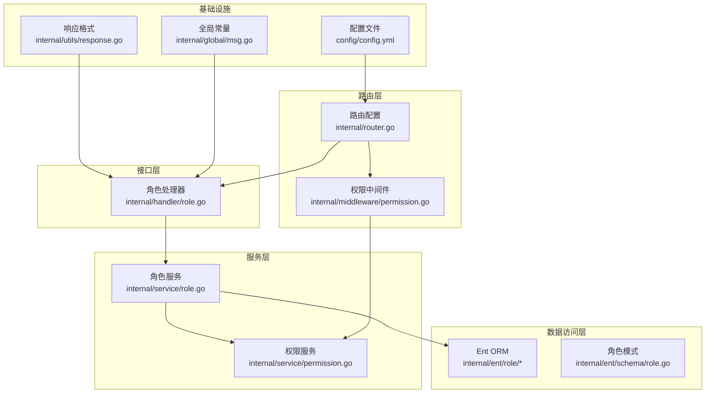
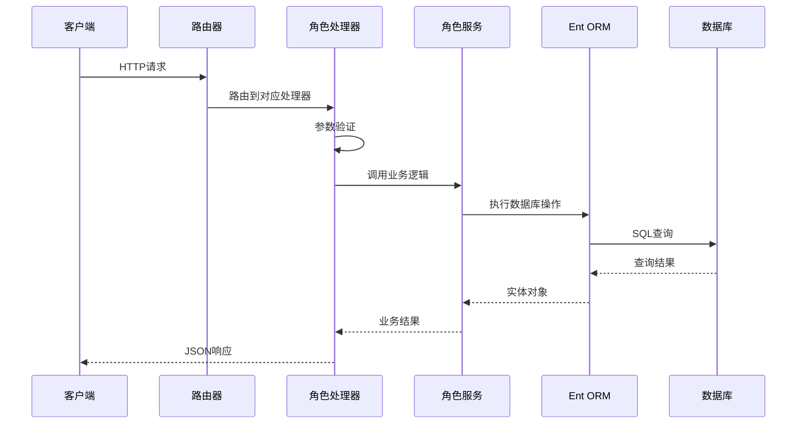
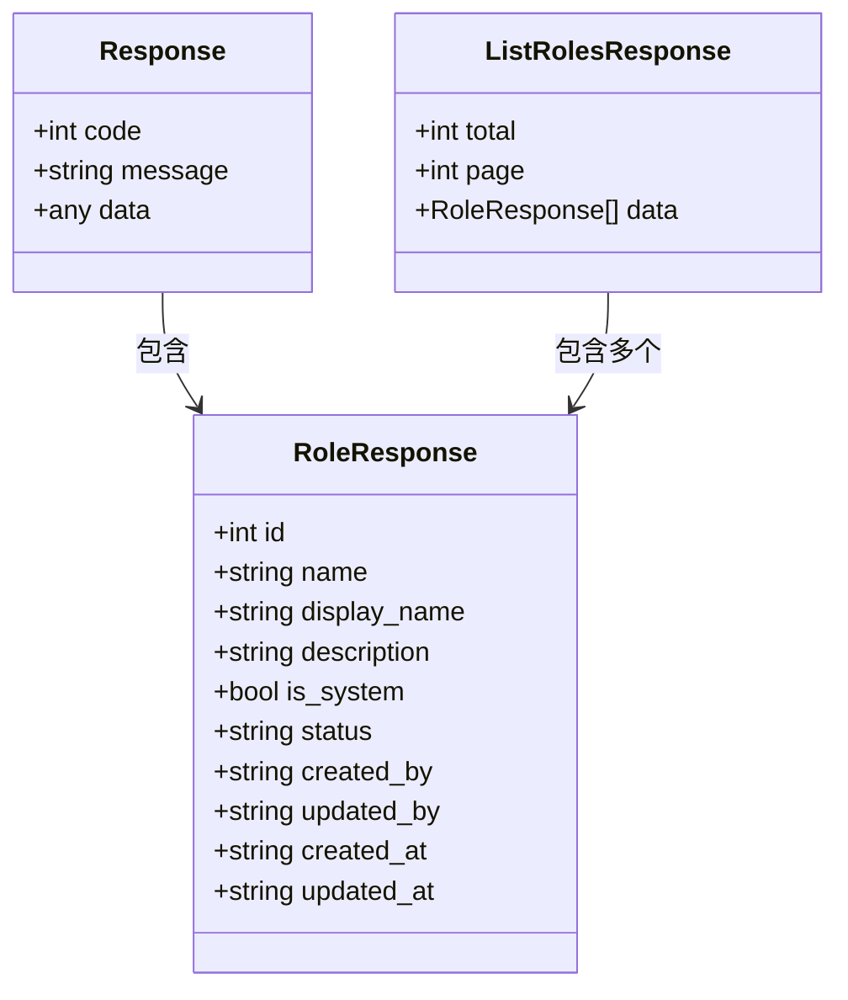
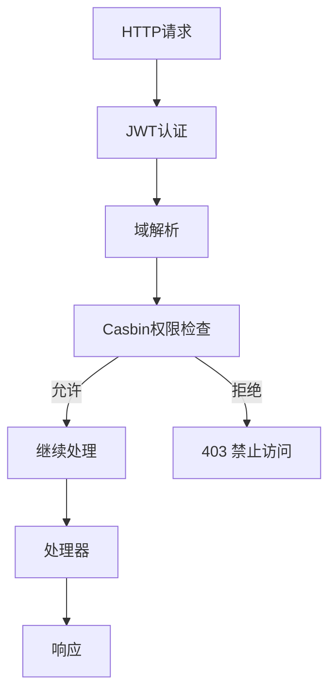
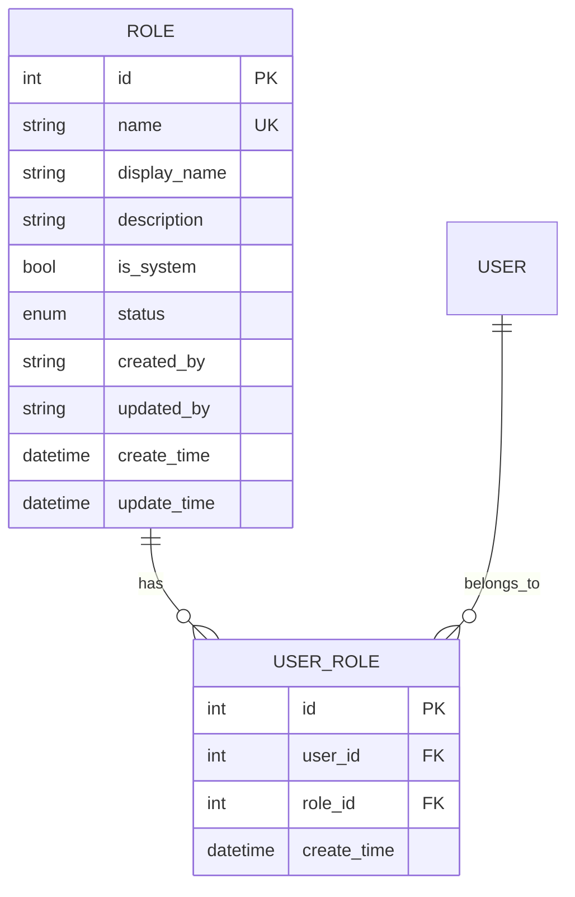

# 角色管理接口

<cite>
**本文档引用的文件**
- [role.go](file://internal/handler/role.go)
- [role.go](file://internal/service/role.go)
- [role.go](file://internal/ent/role/role.go)
- [router.go](file://internal/router.go)
- [permission.go](file://internal/middleware/permission.go)
- [response.go](file://internal/utils/response.go)
- [msg.go](file://internal/global/msg.go)
- [config.yml](file://config/config.yml)
- [role.go](file://internal/ent/schema/role.go)
</cite>

## 目录
1. [简介](#简介)
2. [项目结构](#项目结构)
3. [核心组件](#核心组件)
4. [架构概览](#架构概览)
5. [详细接口规范](#详细接口规范)
6. [权限与安全](#权限与安全)
7. [数据模型](#数据模型)
8. [错误处理](#错误处理)
9. [性能考虑](#性能考虑)
10. [故障排除指南](#故障排除指南)
11. [结论](#结论)

## 简介

本文档详细描述了管理员后台的角色管理接口规范。系统提供了完整的角色CRUD操作和状态管理功能，包括角色创建、查询、更新、删除以及启用/禁用操作。所有接口均基于JWT认证和Casbin权限控制系统，确保系统的安全性和一致性。

## 项目结构

角色管理功能分布在以下关键组件中：

**图表来源**
- [role.go:1-303](file://internal/handler/role.go#L1-L303)
- [role.go:1-429](file://internal/service/role.go#L1-L429)
- [router.go:1-150](file://internal/router.go#L1-L150)

**章节来源**
- [role.go:1-303](file://internal/handler/role.go#L1-L303)
- [role.go:1-429](file://internal/service/role.go#L1-L429)
- [router.go:1-150](file://internal/router.go#L1-L150)

## 核心组件

### 接口层组件

接口层负责HTTP请求处理和响应格式化，主要包含以下组件：

- **角色处理器**：处理所有角色相关的HTTP请求
- **权限中间件**：提供JWT认证和权限验证
- **响应格式化器**：统一API响应格式

### 服务层组件

服务层提供业务逻辑实现：

- **角色服务**：实现角色的CRUD操作和状态管理
- **权限服务**：管理角色与权限的关联关系
- **操作日志服务**：记录用户操作行为

### 数据访问层组件

数据访问层使用Ent ORM框架：

- **角色实体**：定义角色的数据结构和约束
- **用户角色关联**：管理用户与角色的多对多关系

**章节来源**
- [role.go:1-303](file://internal/handler/role.go#L1-L303)
- [role.go:1-429](file://internal/service/role.go#L1-L429)
- [role.go:1-167](file://internal/ent/role/role.go#L1-L167)

## 架构概览

系统采用分层架构设计，确保关注点分离和代码可维护性：

**图表来源**
- [router.go:64-72](file://internal/router.go#L64-L72)
- [role.go:30-58](file://internal/handler/role.go#L30-L58)

## 详细接口规范

### 基础信息

- **基础URL**：`/api/v1/admin/auth/roles`
- **认证方式**：Bearer Token (JWT)
- **内容类型**：`application/json`
- **响应格式**：统一响应格式

### 统一响应格式

所有接口响应遵循统一格式：

**图表来源**
- [response.go:9-13](file://internal/utils/response.go#L9-L13)
- [role.go:89-116](file://internal/service/role.go#L89-L116)

### 创建角色

#### 请求信息
- **方法**：POST
- **路径**：`/api/v1/admin/auth/roles`
- **权限**：需要角色管理权限

#### 请求参数
| 字段名 | 类型 | 必填 | 描述 | 长度限制 |
|--------|------|------|------|----------|
| name | string | 是 | 角色名称 | 最大100字符 |
| display_name | string | 是 | 显示名称 | 最大255字符 |
| description | string | 否 | 角色描述 | 最大500字符 |
| created_by | string | 否 | 创建者ID | 最大255字符 |

#### 响应数据
成功时返回创建的角色信息，包含所有字段。

#### 错误码
- **400**：请求参数无效
- **401**：未授权访问
- **403**：权限不足
- **409**：角色名称已存在
- **500**：服务器内部错误

**章节来源**
- [role.go:15-58](file://internal/handler/role.go#L15-L58)
- [role.go:74-167](file://internal/service/role.go#L74-L167)

### 获取角色详情

#### 请求信息
- **方法**：GET
- **路径**：`/api/v1/admin/auth/roles/{id}`
- **权限**：需要角色管理权限

#### 路径参数
| 参数名 | 类型 | 必填 | 描述 |
|--------|------|------|------|
| id | int | 是 | 角色ID |

#### 响应数据
返回指定ID的角色详细信息。

#### 错误码
- **400**：无效的角色ID
- **401**：未授权访问
- **403**：权限不足
- **404**：角色不存在
- **500**：服务器内部错误

**章节来源**
- [role.go:60-93](file://internal/handler/role.go#L60-L93)
- [role.go:169-183](file://internal/service/role.go#L169-L183)

### 获取角色列表

#### 请求信息
- **方法**：GET
- **路径**：`/api/v1/admin/auth/roles`
- **权限**：需要角色管理权限

#### 查询参数
| 参数名 | 类型 | 必填 | 描述 | 默认值 |
|--------|------|------|------|--------|
| page | int | 否 | 页码 | 1 |
| page_size | int | 否 | 每页数量 | 10 |
| keyword | string | 否 | 关键字 | 无 |
| status | string | 否 | 状态 | 无 |

#### 响应数据
返回分页的角色列表，包含总记录数、当前页码和数据数组。

#### 错误码
- **400**：请求参数无效
- **401**：未授权访问
- **403**：权限不足
- **500**：服务器内部错误

**章节来源**
- [role.go:95-137](file://internal/handler/role.go#L95-L137)
- [role.go:185-246](file://internal/service/role.go#L185-L246)

### 更新角色

#### 请求信息
- **方法**：PUT
- **路径**：`/api/v1/admin/auth/roles/{id}`
- **权限**：需要角色管理权限

#### 路径参数
| 参数名 | 类型 | 必填 | 描述 |
|--------|------|------|------|
| id | int | 是 | 角色ID |

#### 请求参数
| 字段名 | 类型 | 必填 | 描述 | 长度限制 |
|--------|------|------|------|----------|
| display_name | string | 否 | 显示名称 | 最大255字符 |
| description | string | 否 | 角色描述 | 最大500字符 |
| updated_by | string | 否 | 更新者ID | 最大255字符 |

#### 响应数据
更新成功后返回空数据。

#### 错误码
- **400**：无效的角色ID或请求参数无效
- **401**：未授权访问
- **403**：权限不足
- **404**：角色不存在
- **500**：服务器内部错误

**章节来源**
- [role.go:139-184](file://internal/handler/role.go#L139-L184)
- [role.go:248-294](file://internal/service/role.go#L248-L294)

### 删除角色

#### 请求信息
- **方法**：DELETE
- **路径**：`/api/v1/admin/auth/roles/{id}`
- **权限**：需要角色管理权限

#### 路径参数
| 参数名 | 类型 | 必填 | 描述 |
|--------|------|------|------|
| id | int | 是 | 角色ID |

#### 响应数据
删除成功后返回空数据。

#### 错误码
- **400**：无效的角色ID
- **401**：未授权访问
- **403**：权限不足
- **404**：角色不存在
- **409**：角色正在使用中或系统内置角色
- **500**：服务器内部错误

**章节来源**
- [role.go:186-228](file://internal/handler/role.go#L186-L228)
- [role.go:296-336](file://internal/service/role.go#L296-L336)

### 启用角色

#### 请求信息
- **方法**：PUT
- **路径**：`/api/v1/admin/auth/roles/{id}/enable`
- **权限**：需要角色管理权限

#### 路径参数
| 参数名 | 类型 | 必填 | 描述 |
|--------|------|------|------|
| id | int | 是 | 角色ID |

#### 响应数据
启用成功后返回空数据。

#### 错误码
- **400**：无效的角色ID
- **401**：未授权访问
- **403**：权限不足
- **404**：角色不存在
- **500**：服务器内部错误

**章节来源**
- [role.go:230-265](file://internal/handler/role.go#L230-L265)
- [role.go:338-374](file://internal/service/role.go#L338-L374)

### 禁用角色

#### 请求信息
- **方法**：PUT
- **路径**：`/api/v1/admin/auth/roles/{id}/disable`
- **权限**：需要角色管理权限

#### 路径参数
| 参数名 | 类型 | 必填 | 描述 |
|--------|------|------|------|
| id | int | 是 | 角色ID |

#### 响应数据
禁用成功后返回空数据。

#### 错误码
- **400**：无效的角色ID
- **401**：未授权访问
- **403**：权限不足
- **404**：角色不存在
- **500**：服务器内部错误

**章节来源**
- [role.go:267-302](file://internal/handler/role.go#L267-L302)
- [role.go:376-412](file://internal/service/role.go#L376-L412)

## 权限与安全

### 认证机制

系统使用JWT进行身份认证，所有受保护的接口都需要有效的Bearer Token。

### 权限控制

权限控制通过Casbin实现，支持多域RBAC模型：

**图表来源**
- [permission.go:15-78](file://internal/middleware/permission.go#L15-L78)

### 系统角色保护

系统内置角色具有特殊保护机制：
- 系统角色不允许删除
- 系统角色不允许修改显示名称
- 系统角色状态不可更改

**章节来源**
- [permission.go:1-94](file://internal/middleware/permission.go#L1-L94)
- [role.go:310-355](file://internal/service/role.go#L310-L355)

## 数据模型

### 角色实体结构

**图表来源**
- [role.go:16-50](file://internal/ent/schema/role.go#L16-L50)

### 角色状态枚举

| 状态值 | 描述 | 默认值 |
|--------|------|--------|
| active | 启用状态 | 是 |
| inactive | 禁用状态 | 否 |

### 数据库索引

- **唯一索引**：name字段
- **普通索引**：status字段
- **时间戳索引**：create_time和update_time

**章节来源**
- [role.go:89-113](file://internal/ent/role/role.go#L89-L113)
- [role.go:61-66](file://internal/ent/schema/role.go#L61-L66)

## 错误处理

### 错误码定义

系统使用统一的错误码体系：

| 错误码 | 描述 | 用途 |
|--------|------|------|
| 0 | 失败 | 通用错误 |
| 401 | 未授权 | 认证失败 |
| 403 | 拒绝访问 | 权限不足 |
| 404 | 资源不存在 | 资源查找失败 |
| 409 | 冲突 | 数据冲突 |
| 500 | 内部服务器错误 | 系统异常 |

### 角色相关错误码

| 错误码 | 描述 | 触发条件 |
|--------|------|----------|
| 2001 | 角色不存在 | 角色ID无效 |
| 2002 | 角色名称已存在 | 创建重复角色 |
| 2003 | 角色正在使用中，无法删除 | 角色被用户使用 |
| 2004 | 系统内置角色受保护 | 尝试修改系统角色 |
| 2005 | 角色已禁用 | 使用禁用角色 |
| 2006 | 角色名称无效 | 名称格式不正确 |
| 2007 | 角色状态无效 | 状态值非法 |

**章节来源**
- [msg.go:15-22](file://internal/global/msg.go#L15-L22)
- [role.go:16-25](file://internal/service/role.go#L16-L25)

## 性能考虑

### 缓存策略

系统实现了多层次的缓存机制：

1. **角色权限缓存**：缓存角色拥有的权限列表
2. **用户权限缓存**：缓存用户的具体权限
3. **权限规则缓存**：缓存权限规则映射

### 数据库优化

- 使用索引优化常用查询
- 实现分页查询避免大数据集
- 使用连接池管理数据库连接

### 性能监控

建议监控以下指标：
- API响应时间
- 数据库查询延迟
- 缓存命中率
- 并发请求数

## 故障排除指南

### 常见问题

#### 1. 角色创建失败
**可能原因**：
- 角色名称重复
- 角色名称格式不正确
- 数据库连接异常

**解决方法**：
- 检查角色名称唯一性
- 验证输入格式
- 确认数据库服务正常

#### 2. 权限验证失败
**可能原因**：
- JWT令牌过期
- 用户权限配置错误
- Casbin策略未正确加载

**解决方法**：
- 刷新JWT令牌
- 检查用户角色分配
- 重新加载Casbin策略

#### 3. 系统角色保护错误
**可能原因**：
- 尝试修改系统内置角色
- 尝试删除系统内置角色

**解决方法**：
- 避免修改系统角色
- 使用自定义角色替代

### 调试建议

1. **启用调试模式**：查看详细的错误日志
2. **检查JWT配置**：确认密钥和过期时间设置
3. **验证数据库连接**：确保连接参数正确
4. **监控缓存状态**：检查缓存是否正常工作

**章节来源**
- [role.go:120-167](file://internal/service/role.go#L120-L167)
- [permission.go:15-78](file://internal/middleware/permission.go#L15-L78)

## 结论

角色管理接口提供了完整的权限管理体系，支持：
- 标准的CRUD操作
- 角色状态管理
- 多域权限控制
- 系统角色保护
- 统一的错误处理

系统采用分层架构设计，确保了代码的可维护性和扩展性。通过JWT认证和Casbin权限控制，系统提供了强大的安全保证。建议在生产环境中合理配置缓存和监控，以获得最佳的性能表现。