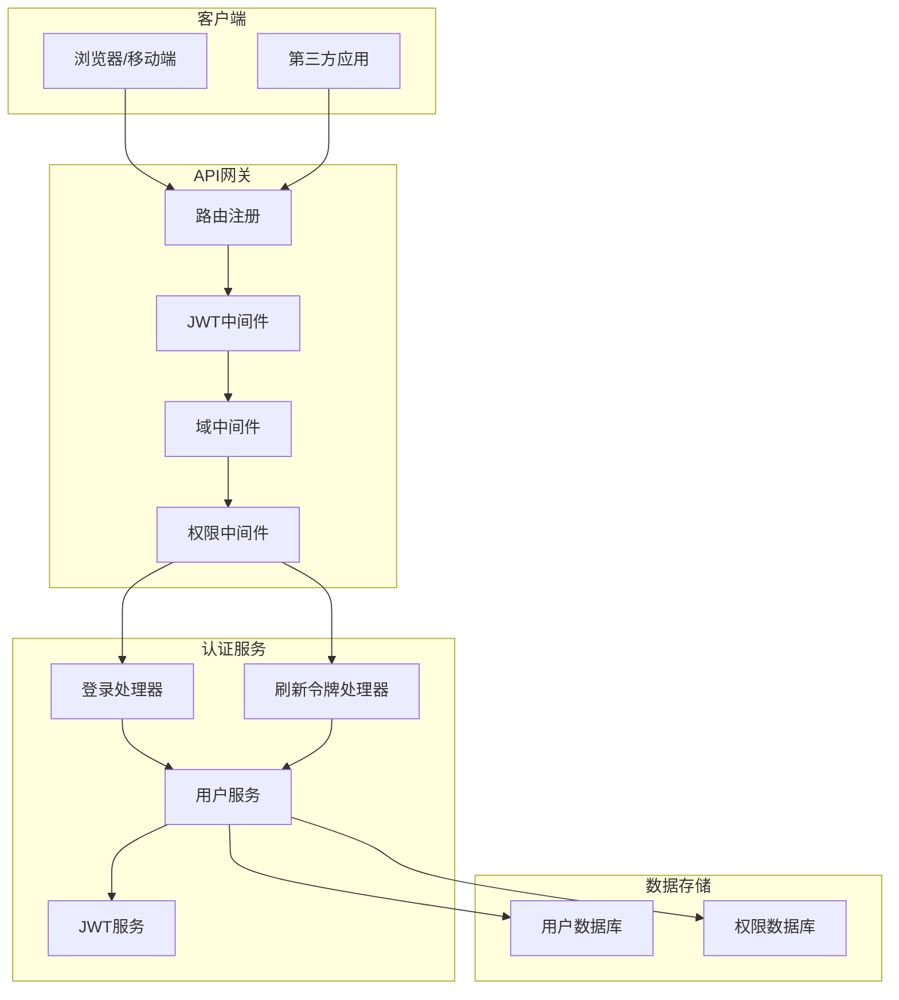
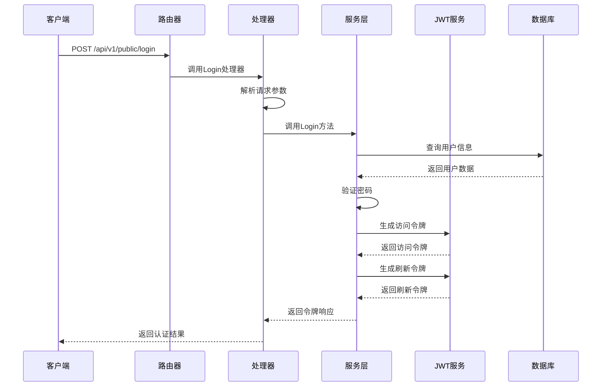
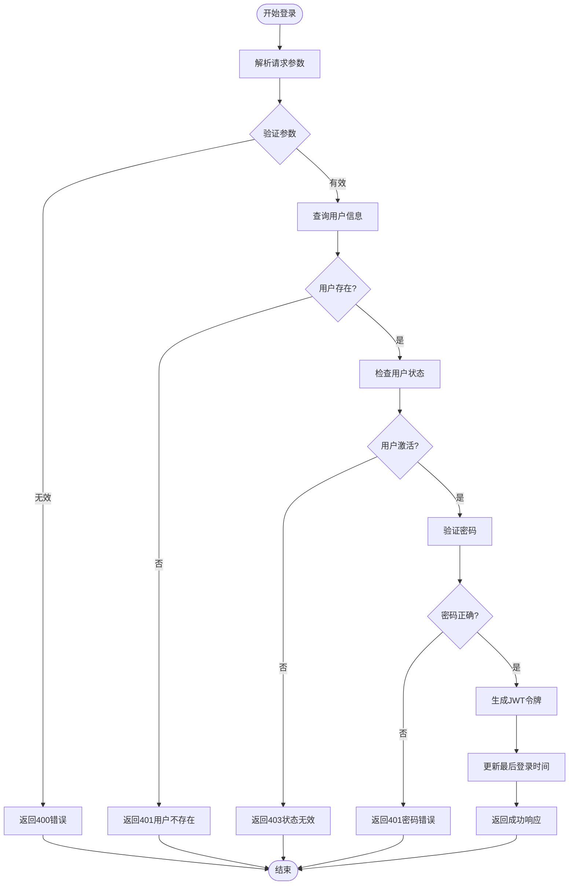
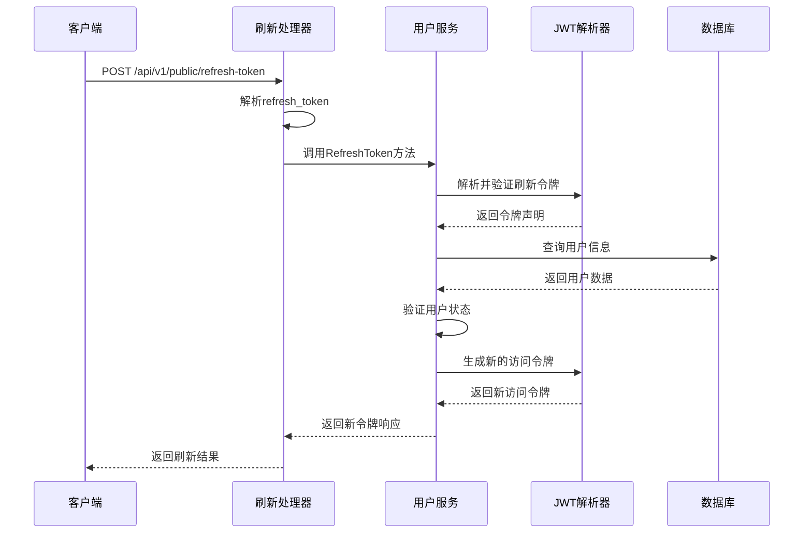
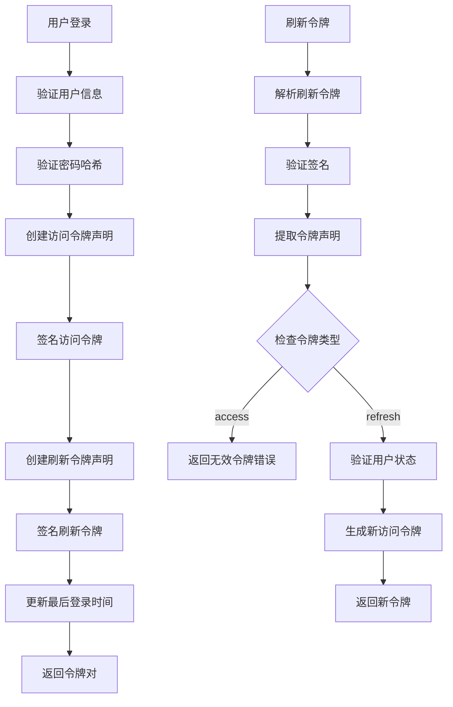
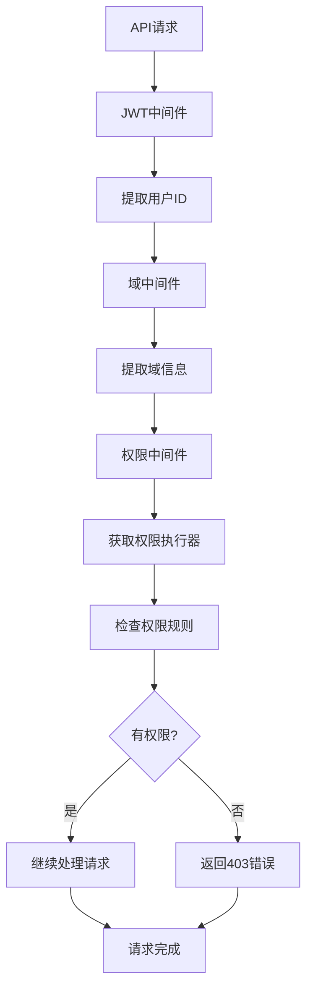
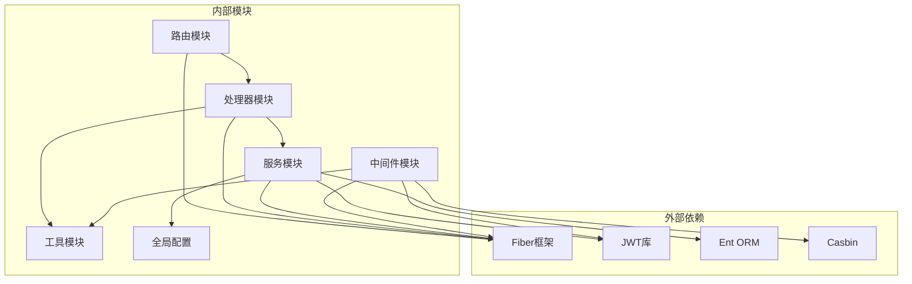

# 认证接口

<cite>
**本文档引用的文件**
- [main.go](file://main.go)
- [router.go](file://internal/router.go)
- [public.go](file://internal/handler/public.go)
- [user.go](file://internal/service/user.go)
- [permission.go](file://internal/middleware/permission.go)
- [response.go](file://internal/utils/response.go)
- [msg.go](file://internal/global/msg.go)
- [config.yml](file://config/config.yml)
- [docs.go](file://docs/docs.go)
</cite>

## 目录
1. [简介](#简介)
2. [项目结构](#项目结构)
3. [核心组件](#核心组件)
4. [架构概览](#架构概览)
5. [详细组件分析](#详细组件分析)
6. [依赖关系分析](#依赖关系分析)
7. [性能考虑](#性能考虑)
8. [故障排除指南](#故障排除指南)
9. [结论](#结论)

## 简介
本文档详细说明了管理系统的认证接口，包括用户登录接口和令牌刷新接口。系统采用JWT（JSON Web Token）认证机制，支持基于角色的访问控制（RBAC），并通过多域权限模型实现灵活的权限管理。

## 项目结构
认证系统主要分布在以下模块中：
- **路由层**：定义API端点和中间件链
- **处理器层**：实现具体的认证逻辑
- **服务层**：封装业务逻辑和JWT令牌生成
- **中间件层**：提供权限控制和域管理
- **工具层**：统一响应格式和错误处理



**图表来源**
- [router.go:14-40](file://internal/router.go#L14-L40)
- [public.go:22-45](file://internal/handler/public.go#L22-L45)
- [user.go:127-206](file://internal/service/user.go#L127-L206)

**章节来源**
- [router.go:14-40](file://internal/router.go#L14-L40)
- [main.go:43-89](file://main.go#L43-L89)

## 核心组件
认证系统的核心组件包括：

### JWT中间件
系统使用自定义的JWT中间件进行身份验证，支持以下功能：
- 令牌解析和验证
- 用户信息提取
- 自动权限检查

### 用户服务
提供完整的用户认证和令牌管理功能：
- 用户登录验证
- JWT令牌生成
- 令牌刷新机制
- 密码验证

### 权限中间件
实现基于Casbin的RBAC权限控制：
- 动态域权限管理
- API级权限检查
- 实时权限验证

**章节来源**
- [permission.go:11-53](file://internal/middleware/permission.go#L11-L53)
- [user.go:27-34](file://internal/service/user.go#L27-L34)

## 架构概览
认证系统采用分层架构设计，确保职责分离和代码可维护性。



**图表来源**
- [public.go:22-45](file://internal/handler/public.go#L22-L45)
- [user.go:127-206](file://internal/service/user.go#L127-L206)

## 详细组件分析

### 登录接口 (/api/v1/public/login)

#### 接口定义
- **HTTP方法**：POST
- **请求URL**：`/api/v1/public/login`
- **请求头**：`Content-Type: application/json`
- **认证要求**：无需认证

#### 请求参数
| 参数名 | 类型 | 必填 | 描述 |
|--------|------|------|------|
| email | string | 是 | 用户邮箱地址 |
| password | string | 是 | 用户密码 |

请求示例：
```json
{
  "email": "user@example.com",
  "password": "password123"
}
```

#### 响应格式
成功的登录响应包含以下字段：

| 字段名 | 类型 | 描述 |
|--------|------|------|
| code | integer | 响应码，200表示成功 |
| message | string | 响应消息 |
| data.access_token | string | 访问令牌 |
| data.token_type | string | 令牌类型，固定为"Bearer" |
| data.expires_in | integer | 令牌过期时间（秒） |
| data.refresh_token | string | 刷新令牌（可选） |

成功响应示例：
```json
{
  "code": 1,
  "message": "成功",
  "data": {
    "access_token": "eyJhbGciOiJIUzI1NiIsInR5cCI6IkpXVCJ9...",
    "token_type": "Bearer",
    "expires_in": 86400,
    "refresh_token": "eyJhbGciOiJIUzI1NiIsInR5cCI6IkpXVCJ9..."
  }
}
```

#### 错误响应
系统支持多种错误场景：

| 错误码 | HTTP状态码 | 描述 | 响应示例 |
|--------|------------|------|----------|
| 400 | 400 | 请求参数无效 | `{ "code": 0, "message": "失败" }` |
| 401 | 401 | 用户不存在或密码错误 | `{ "code": 401, "message": "未授权" }` |
| 403 | 403 | 用户状态无效 | `{ "code": 403, "message": "拒绝访问" }` |
| 500 | 500 | 服务器内部错误 | `{ "code": 500, "message": "内部服务器错误" }` |

#### 登录流程


**图表来源**
- [public.go:22-45](file://internal/handler/public.go#L22-L45)
- [user.go:127-206](file://internal/service/user.go#L127-L206)

**章节来源**
- [public.go:13-45](file://internal/handler/public.go#L13-L45)
- [user.go:55-67](file://internal/service/user.go#L55-L67)
- [msg.go:26-35](file://internal/global/msg.go#L26-L35)

### 令牌刷新接口 (/api/v1/public/refresh-token)

#### 接口定义
- **HTTP方法**：POST
- **请求URL**：`/api/v1/public/refresh-token`
- **请求头**：`Content-Type: application/json`
- **认证要求**：无需认证

#### 请求参数
| 参数名 | 类型 | 必填 | 描述 |
|--------|------|------|------|
| refresh_token | string | 是 | 用于刷新访问令牌的刷新令牌 |

请求示例：
```json
{
  "refresh_token": "eyJhbGciOiJIUzI1NiIsInR5cCI6IkpXVCJ9..."
}
```

#### 响应格式
刷新令牌成功后的响应与登录响应相同，包含新的访问令牌：

| 字段名 | 类型 | 描述 |
|--------|------|------|
| code | integer | 响应码，200表示成功 |
| message | string | 响应消息 |
| data.access_token | string | 新的访问令牌 |
| data.token_type | string | 令牌类型，固定为"Bearer" |
| data.expires_in | integer | 新令牌过期时间（秒） |
| data.refresh_token | string | 原刷新令牌（保持不变） |

成功响应示例：
```json
{
  "code": 1,
  "message": "成功",
  "data": {
    "access_token": "eyJhbGciOiJIUzI1NiIsInR5cCI6IkpXVCJ9...",
    "token_type": "Bearer",
    "expires_in": 86400,
    "refresh_token": "eyJhbGciOiJIUzI1NiIsInR5cCI6IkpXVCJ9..."
  }
}
```

#### 错误响应
| 错误码 | HTTP状态码 | 描述 | 响应示例 |
|--------|------------|------|----------|
| 400 | 400 | 请求参数无效 | `{ "code": 0, "message": "失败" }` |
| 401 | 401 | 刷新令牌无效 | `{ "code": 401, "message": "未授权" }` |
| 500 | 500 | 服务器内部错误 | `{ "code": 500, "message": "内部服务器错误" }` |

#### 刷新流程


**图表来源**
- [public.go:149-179](file://internal/handler/public.go#L149-L179)
- [user.go:274-356](file://internal/service/user.go#L274-L356)

**章节来源**
- [public.go:149-179](file://internal/handler/public.go#L149-L179)
- [user.go:274-356](file://internal/service/user.go#L274-L356)

### JWT认证流程详解

#### 令牌结构
系统生成两种类型的JWT令牌：

**访问令牌（Access Token）**
- 有效期：配置文件中`login_expires`设置，默认24小时
- 用途：API请求的身份验证
- 结构包含：用户ID、用户名、签发者、域、过期时间等

**刷新令牌（Refresh Token）**
- 有效期：配置文件中`refresh_expires`设置
- 用途：获取新的访问令牌
- 结构包含：用户ID、用户名、签发者、域、过期时间等

#### 令牌生成过程


**图表来源**
- [user.go:154-205](file://internal/service/user.go#L154-L205)
- [user.go:279-355](file://internal/service/user.go#L279-L355)

**章节来源**
- [user.go:154-205](file://internal/service/user.go#L154-L205)
- [user.go:279-355](file://internal/service/user.go#L279-L355)

### 认证中间件工作原理

#### 中间件链
认证请求通过以下中间件链处理：

1. **JWT中间件**：解析和验证JWT令牌
2. **域中间件**：提取并设置用户域信息
3. **权限中间件**：执行API级权限检查

#### 权限检查流程


**图表来源**
- [permission.go:12-52](file://internal/middleware/permission.go#L12-L52)

**章节来源**
- [permission.go:12-52](file://internal/middleware/permission.go#L12-L52)
- [router.go:32-37](file://internal/router.go#L32-L37)

## 依赖关系分析

### 组件依赖图


**图表来源**
- [router.go:3-12](file://internal/router.go#L3-L12)
- [public.go:3-11](file://internal/handler/public.go#L3-L11)

### 关键依赖关系
- **路由到处理器**：路由层负责将HTTP请求分发到相应的处理器
- **处理器到服务**：处理器调用服务层执行业务逻辑
- **服务到数据层**：服务层通过ORM访问数据库
- **中间件到JWT**：中间件依赖JWT库进行令牌解析和验证

**章节来源**
- [router.go:3-12](file://internal/router.go#L3-L12)
- [public.go:3-11](file://internal/handler/public.go#L3-L11)

## 性能考虑
认证系统的性能优化策略：

### 缓存策略
- **JWT令牌缓存**：可考虑缓存活跃的JWT令牌以减少重复解析
- **用户信息缓存**：缓存用户基础信息减少数据库查询
- **权限规则缓存**：缓存权限检查结果提高权限验证速度

### 连接池优化
- **数据库连接池**：合理配置MySQL连接池大小
- **Redis连接池**：优化Redis连接池参数
- **超时配置**：设置合理的数据库和缓存超时时间

### 并发处理
- **goroutine池**：限制并发请求数量防止系统过载
- **请求队列**：实现请求排队机制避免瞬时高峰
- **降级策略**：在高负载时提供降级服务

## 故障排除指南

### 常见认证问题

#### 登录失败
**问题**：用户无法登录，返回401错误
**可能原因**：
- 用户名或密码错误
- 用户账户被禁用
- 数据库连接异常

**解决步骤**：
1. 验证用户凭据是否正确
2. 检查用户状态是否为激活状态
3. 确认数据库连接正常
4. 查看系统日志获取详细错误信息

#### 令牌过期
**问题**：访问令牌过期导致API调用失败
**解决方法**：
1. 使用刷新令牌获取新的访问令牌
2. 检查系统配置中的令牌过期时间
3. 实现自动刷新机制

#### 权限不足
**问题**：返回403错误，提示无权限访问
**可能原因**：
- 用户权限不足
- API权限规则配置错误
- 域配置不正确

**解决步骤**：
1. 检查用户角色和权限分配
2. 验证API权限规则
3. 确认域配置正确性

#### JWT中间件问题
**问题**：JWT中间件抛出异常
**可能原因**：
- 令牌格式不正确
- 令牌签名验证失败
- 令牌过期

**诊断方法**：
1. 检查Authorization头格式
2. 验证令牌签名密钥
3. 确认令牌时间戳有效

**章节来源**
- [msg.go:4-23](file://internal/global/msg.go#L4-L23)
- [permission.go:14-49](file://internal/middleware/permission.go#L14-L49)

### 调试技巧
1. **启用调试模式**：在配置文件中设置`debug: true`
2. **查看系统日志**：检查`data/logs/admin-api.log`文件
3. **使用Swagger**：通过`/swagger`端点查看API文档
4. **监控指标**：关注认证相关的性能指标

## 结论
本认证系统提供了完整的用户身份验证和授权机制，具有以下特点：

### 安全特性
- 基于JWT的无状态认证
- 支持多域权限管理
- 完整的错误处理和安全防护
- 可配置的令牌过期时间

### 架构优势
- 清晰的分层架构设计
- 灵活的中间件机制
- 可扩展的服务层设计
- 统一的响应格式

### 最佳实践建议
1. **生产环境配置**：使用强随机密钥，合理设置令牌过期时间
2. **监控告警**：建立完善的监控和告警机制
3. **定期审计**：定期审查权限配置和访问日志
4. **安全更新**：及时更新依赖库和安全补丁

通过遵循本文档的指导和最佳实践，可以确保认证系统的安全性和可靠性，为用户提供良好的认证体验。