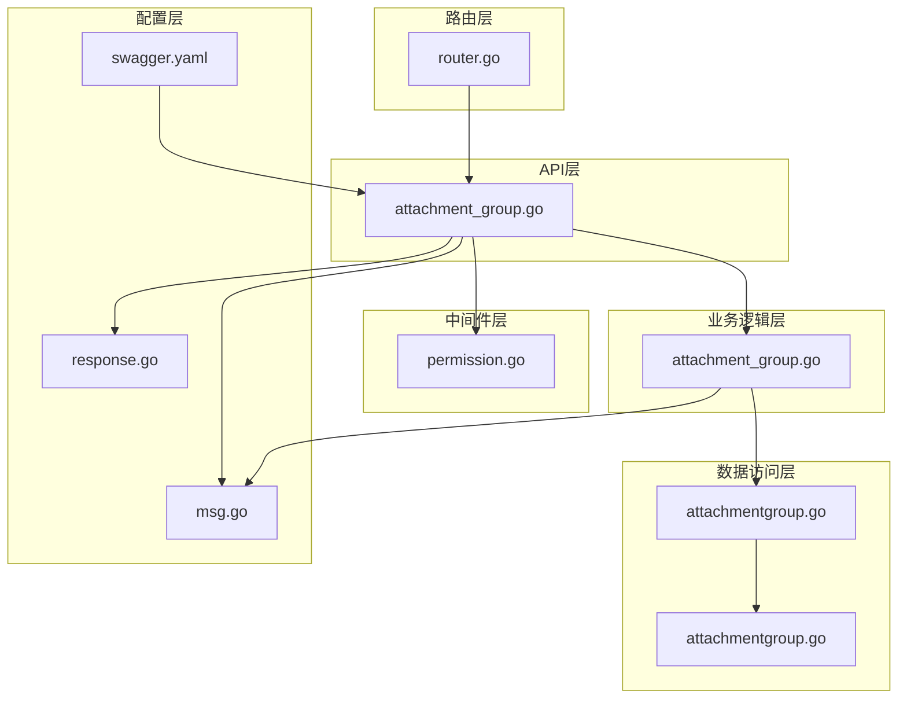
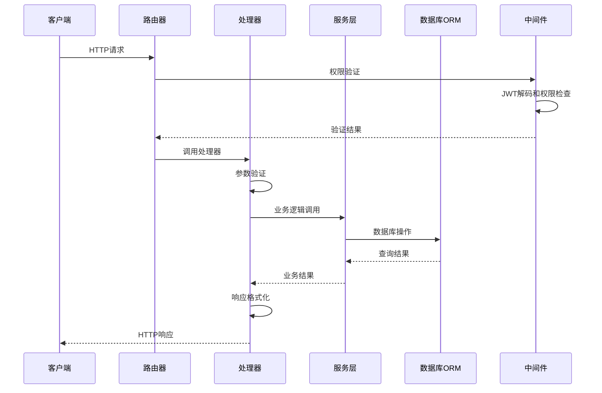
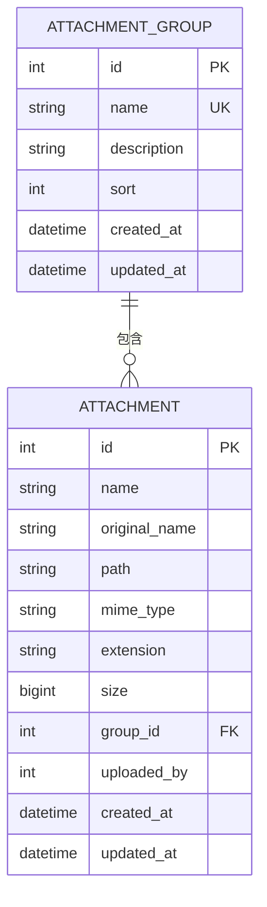
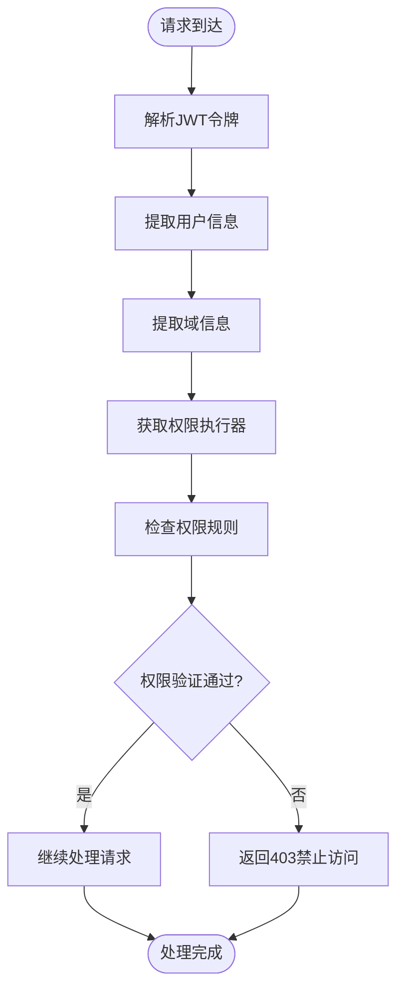
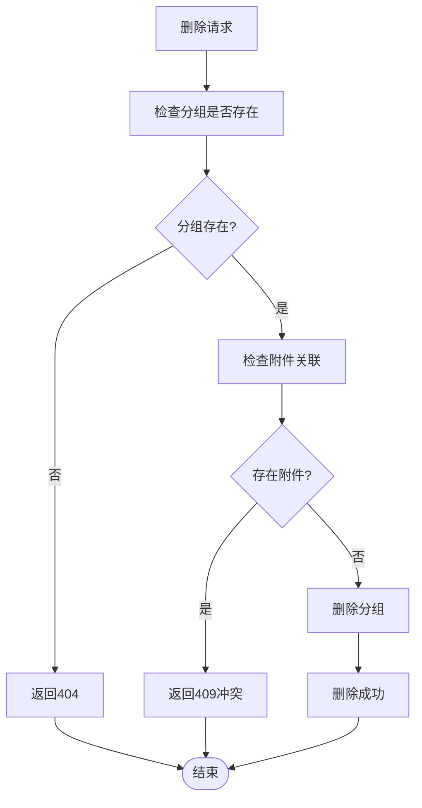

# 附件分组管理接口

<cite>
**本文档引用的文件**
- [internal/handler/attachment_group.go](file://internal/handler/attachment_group.go)
- [internal/service/attachment_group.go](file://internal/service/attachment_group.go)
- [internal/router.go](file://internal/router.go)
- [internal/middleware/permission.go](file://internal/middleware/permission.go)
- [internal/global/msg.go](file://internal/global/msg.go)
- [internal/utils/response.go](file://internal/utils/response.go)
- [internal/ent/schema/attachmentgroup.go](file://internal/ent/schema/attachmentgroup.go)
- [internal/ent/attachmentgroup.go](file://internal/ent/attachmentgroup.go)
- [internal/ent/schema/attachment.go](file://internal/ent/schema/attachment.go)
- [docs/swagger.yaml](file://docs/swagger.yaml)
</cite>

## 目录
1. [简介](#简介)
2. [项目结构](#项目结构)
3. [核心组件](#核心组件)
4. [架构概览](#架构概览)
5. [详细接口规范](#详细接口规范)
6. [数据模型](#数据模型)
7. [权限控制](#权限控制)
8. [文件关联管理](#文件关联管理)
9. [错误处理](#错误处理)
10. [性能考虑](#性能考虑)
11. [故障排除指南](#故障排除指南)
12. [结论](#结论)

## 简介

附件分组管理接口是管理系统中用于组织和管理文件附件的重要功能模块。该模块提供了完整的附件分组CRUD操作，支持分组层级结构管理、权限控制和文件关联管理。通过RESTful API设计，用户可以创建、查询、更新和删除附件分组，同时确保数据的一致性和完整性。

## 项目结构

附件分组管理功能在项目中的组织结构如下：



**图表来源**
- [internal/router.go:113-130](file://internal/router.go#L113-L130)
- [internal/handler/attachment_group.go:15-54](file://internal/handler/attachment_group.go#L15-L54)

**章节来源**
- [internal/router.go:113-130](file://internal/router.go#L113-L130)
- [internal/handler/attachment_group.go:1-223](file://internal/handler/attachment_group.go#L1-L223)

## 核心组件

### 处理器组件 (Handler)
负责HTTP请求处理和响应格式化，实现了完整的CRUD操作：
- 请求参数验证和解析
- 业务逻辑调用
- 错误处理和响应构建
- 操作日志记录

### 服务组件 (Service)
提供业务逻辑封装，包含：
- 数据验证规则
- 数据库操作封装
- 业务规则检查
- 错误码定义

### 数据模型组件
基于Ent框架的数据模型定义，支持：
- 自动化的数据库迁移
- 类型安全的查询构建
- 关系映射和约束定义

**章节来源**
- [internal/handler/attachment_group.go:15-223](file://internal/handler/attachment_group.go#L15-L223)
- [internal/service/attachment_group.go:20-264](file://internal/service/attachment_group.go#L20-L264)

## 架构概览

附件分组管理采用经典的三层架构设计，各层职责清晰分离：



**图表来源**
- [internal/router.go:53-59](file://internal/router.go#L53-L59)
- [internal/middleware/permission.go:15-77](file://internal/middleware/permission.go#L15-L77)
- [internal/handler/attachment_group.go:30-54](file://internal/handler/attachment_group.go#L30-L54)

## 详细接口规范

### 创建附件分组

**接口地址**: `POST /api/v1/admin/auth/attachment-groups`

**功能描述**: 创建新的附件分组，支持分组名称、描述和排序号设置。

**请求参数**:
- Content-Type: application/json
- 请求体字段:
  - name (string, 必填): 分组名称，最大长度255字符
  - description (string, 可选): 分组描述，最大长度500字符
  - sort (integer, 可选): 排序号，默认值0

**响应格式**:
```json
{
  "code": 1,
  "message": "分组创建成功",
  "data": {
    "id": 1,
    "name": "示例分组",
    "description": "分组描述",
    "sort": 0,
    "created_at": "2024-01-01 12:00:00",
    "updated_at": "2024-01-01 12:00:00"
  }
}
```

**权限要求**:
- 需要有效的Bearer Token
- 需要相应的API权限（通过Casbin权限系统验证）

**状态码**:
- 200: 创建成功
- 400: 请求参数无效
- 401: 未授权访问
- 403: 权限不足
- 409: 分组名称已存在
- 500: 服务器内部错误

**章节来源**
- [internal/handler/attachment_group.go:15-54](file://internal/handler/attachment_group.go#L15-L54)
- [internal/service/attachment_group.go:41-106](file://internal/service/attachment_group.go#L41-L106)

### 获取附件分组列表

**接口地址**: `GET /api/v1/admin/auth/attachment-groups`

**功能描述**: 获取附件分组列表，支持分页和关键字搜索。

**查询参数**:
- page (integer, 可选): 页码，默认1
- page_size (integer, 可选): 每页数量，默认10，最大100
- keyword (string, 可选): 关键字搜索

**响应格式**:
```json
{
  "code": 1,
  "message": "获取分组列表成功",
  "data": {
    "total": 100,
    "page": 1,
    "data": [
      {
        "id": 1,
        "name": "示例分组",
        "description": "分组描述",
        "sort": 0,
        "created_at": "2024-01-01 12:00:00",
        "updated_at": "2024-01-01 12:00:00"
      }
    ]
  }
}
```

**权限要求**:
- 需要有效的Bearer Token
- 需要相应的API权限

**状态码**:
- 200: 获取成功
- 400: 请求参数无效
- 401: 未授权访问
- 403: 权限不足
- 500: 服务器内部错误

**章节来源**
- [internal/handler/attachment_group.go:56-96](file://internal/handler/attachment_group.go#L56-L96)
- [internal/service/attachment_group.go:203-251](file://internal/service/attachment_group.go#L203-L251)

### 获取附件分组详情

**接口地址**: `GET /api/v1/admin/auth/attachment-groups/{id}`

**功能描述**: 根据ID获取附件分组的详细信息。

**路径参数**:
- id (integer, 必填): 分组ID

**响应格式**:
```json
{
  "code": 1,
  "message": "获取分组成功",
  "data": {
    "id": 1,
    "name": "示例分组",
    "description": "分组描述",
    "sort": 0,
    "created_at": "2024-01-01 12:00:00",
    "updated_at": "2024-01-01 12:00:00"
  }
}
```

**权限要求**:
- 需要有效的Bearer Token
- 需要相应的API权限

**状态码**:
- 200: 获取成功
- 400: 分组ID无效
- 401: 未授权访问
- 403: 权限不足
- 404: 分组不存在
- 500: 服务器内部错误

**章节来源**
- [internal/handler/attachment_group.go:98-130](file://internal/handler/attachment_group.go#L98-L130)
- [internal/service/attachment_group.go:188-201](file://internal/service/attachment_group.go#L188-L201)

### 更新附件分组

**接口地址**: `PUT /api/v1/admin/auth/attachment-groups/{id}`

**功能描述**: 根据ID更新附件分组信息。

**路径参数**:
- id (integer, 必填): 分组ID

**请求参数**:
- Content-Type: application/json
- 请求体字段:
  - name (string, 可选): 分组名称，最大长度255字符
  - description (string, 可选): 分组描述，最大长度500字符
  - sort (integer, 可选): 排序号

**响应格式**:
```json
{
  "code": 1,
  "message": "分组更新成功",
  "data": null
}
```

**权限要求**:
- 需要有效的Bearer Token
- 需要相应的API权限

**状态码**:
- 200: 更新成功
- 400: 请求参数无效
- 401: 未授权访问
- 403: 权限不足
- 404: 分组不存在
- 409: 分组名称已存在
- 500: 服务器内部错误

**章节来源**
- [internal/handler/attachment_group.go:132-181](file://internal/handler/attachment_group.go#L132-L181)
- [internal/service/attachment_group.go:108-153](file://internal/service/attachment_group.go#L108-L153)

### 删除附件分组

**接口地址**: `DELETE /api/v1/admin/auth/attachment-groups/{id}`

**功能描述**: 根据ID删除附件分组，如果分组下存在附件则拒绝删除。

**路径参数**:
- id (integer, 必填): 分组ID

**响应格式**:
```json
{
  "code": 1,
  "message": "分组删除成功",
  "data": null
}
```

**权限要求**:
- 需要有效的Bearer Token
- 需要相应的API权限

**状态码**:
- 200: 删除成功
- 400: 分组ID无效
- 401: 未授权访问
- 403: 权限不足
- 404: 分组不存在
- 409: 分组下存在附件，无法删除
- 500: 服务器内部错误

**章节来源**
- [internal/handler/attachment_group.go:183-222](file://internal/handler/attachment_group.go#L183-L222)
- [internal/service/attachment_group.go:155-186](file://internal/service/attachment_group.go#L155-L186)

## 数据模型

### 附件分组实体

附件分组实体定义了分组的基本属性和约束：



**图表来源**
- [internal/ent/schema/attachmentgroup.go:17-48](file://internal/ent/schema/attachmentgroup.go#L17-L48)
- [internal/ent/schema/attachment.go:18-68](file://internal/ent/schema/attachment.go#L18-L68)

### 字段详细说明

**附件分组字段**:
- id: 主键，自增整数
- name: 分组名称，唯一约束，最大255字符
- description: 分组描述，可选，最大500字符
- sort: 排序号，默认0
- created_at: 创建时间，只读
- updated_at: 更新时间，只读

**附件字段**:
- id: 主键，自增整数
- name: 文件名，最大255字符
- original_name: 原始文件名，最大255字符
- path: 存储路径，最大1024字符
- mime_type: MIME类型，最大255字符
- extension: 文件扩展名，最大50字符
- size: 文件大小（字节），整数类型
- group_id: 分组ID，外键关联到附件分组
- uploaded_by: 上传用户ID
- created_at: 创建时间
- updated_at: 更新时间

**章节来源**
- [internal/ent/schema/attachmentgroup.go:17-48](file://internal/ent/schema/attachmentgroup.go#L17-L48)
- [internal/ent/schema/attachment.go:18-68](file://internal/en/schema/attachment.go#L18-L68)

## 权限控制

### 认证机制

系统采用JWT（JSON Web Token）进行身份认证，所有受保护的API接口都需要有效的Bearer Token。

### 权限验证流程



**图表来源**
- [internal/middleware/permission.go:15-77](file://internal/middleware/permission.go#L15-L77)

### 权限规则

权限验证基于Casbin访问控制模型，验证规则包括：
- 用户ID（字符串形式）
- 域（Domain）
- 请求路径
- HTTP方法

### 中间件配置

权限中间件在路由注册时自动生效：
- 应用JWT中间件进行身份验证
- 设置域中间件
- 应用权限中间件进行访问控制
- 应用权限中间件进行API权限检查

**章节来源**
- [internal/middleware/permission.go:15-94](file://internal/middleware/permission.go#L15-L94)
- [internal/router.go:53-59](file://internal/router.go#L53-L59)

## 文件关联管理

### 关联关系

附件分组与附件之间存在一对多的关联关系：
- 一个分组可以包含多个附件
- 一个附件只能属于一个分组
- 删除分组前必须先清理所有关联的附件

### 删除保护机制

系统实现了智能的删除保护机制：



**图表来源**
- [internal/service/attachment_group.go:155-186](file://internal/service/attachment_group.go#L155-L186)

### 数据一致性保证

- 使用数据库事务确保操作的原子性
- 实现级联删除策略
- 维护外键约束完整性
- 提供回滚机制

**章节来源**
- [internal/service/attachment_group.go:155-186](file://internal/service/attachment_group.go#L155-L186)

## 错误处理

### 错误码定义

系统定义了完整的错误码体系，附件分组相关的错误码如下：

| 错误码 | 错误类型 | 描述 |
|--------|----------|------|
| 3001 | 附件不存在 | 附件不存在 |
| 3002 | 分组不存在 | 附件分组不存在 |
| 3003 | 分组非空 | 附件分组下存在附件，无法删除 |
| 3004 | 分组已存在 | 附件分组名称已存在 |
| 3005 | 上传失败 | 附件上传失败 |
| 3006 | 删除失败 | 附件删除失败 |

### 错误响应格式

所有API接口遵循统一的响应格式：

```json
{
  "code": 0,
  "message": "错误描述",
  "data": null
}
```

### 错误处理策略

- 参数验证失败：返回400状态码
- 权限不足：返回403状态码  
- 资源不存在：返回404状态码
- 业务逻辑冲突：返回409状态码
- 服务器内部错误：返回500状态码

**章节来源**
- [internal/global/msg.go:32-42](file://internal/global/msg.go#L32-L42)
- [internal/utils/response.go:9-50](file://internal/utils/response.go#L9-L50)

## 性能考虑

### 查询优化

- 分页查询限制每页最大100条记录
- 支持关键字搜索的全文索引
- 排序基于sort字段和创建时间
- 避免N+1查询问题

### 缓存策略

- 角色和权限信息支持缓存
- 配置信息缓存
- 减少数据库查询次数

### 并发控制

- 使用连接池管理数据库连接
- 实现乐观锁防止并发更新冲突
- 数据库层面的约束保证数据一致性

## 故障排除指南

### 常见问题

**问题1: 创建分组时报错"分组名称已存在"**
- 检查分组名称是否重复
- 确认大小写敏感性
- 验证数据库唯一约束

**问题2: 删除分组时报错"分组下存在附件，无法删除"**
- 先删除分组下的所有附件
- 或者移动附件到其他分组
- 检查附件关联关系

**问题3: 权限验证失败**
- 检查JWT令牌有效性
- 验证用户域信息
- 确认权限规则配置

### 调试建议

1. 查看请求日志获取详细信息
2. 检查数据库连接状态
3. 验证中间件执行顺序
4. 使用Swagger测试工具验证接口

**章节来源**
- [internal/service/attachment_group.go:14-18](file://internal/service/attachment_group.go#L14-L18)
- [internal/middleware/permission.go:15-77](file://internal/middleware/permission.go#L15-L77)

## 结论

附件分组管理接口提供了完整、安全、高效的文件分类管理功能。通过清晰的架构设计、严格的权限控制和完善的错误处理机制，确保了系统的稳定性和可靠性。该接口设计符合RESTful标准，易于集成和扩展，为后续的功能扩展奠定了良好的基础。

系统的主要优势包括：
- 完整的CRUD操作支持
- 强大的权限控制机制
- 数据一致性和完整性保障
- 良好的性能表现
- 详细的错误处理和日志记录