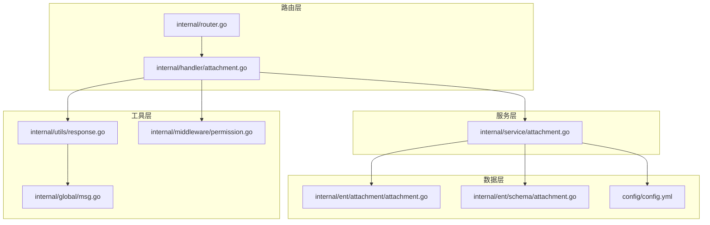
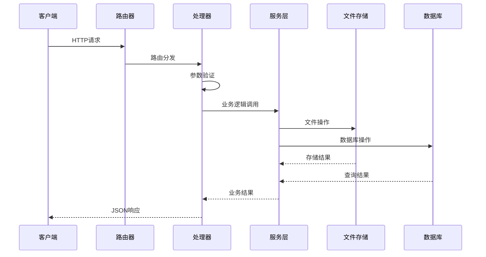
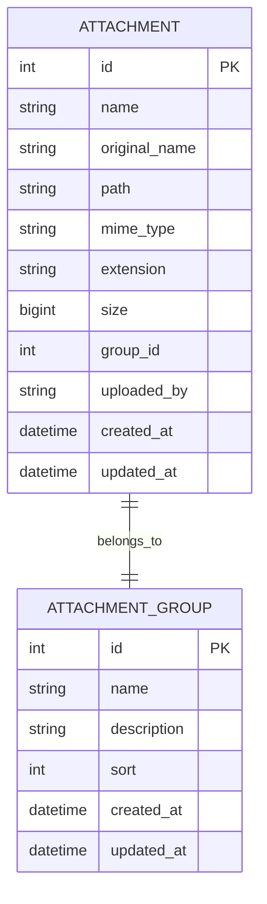

# 附件管理接口

<cite>
**本文档引用的文件**
- [internal/handler/attachment.go](file://internal/handler/attachment.go)
- [internal/service/attachment.go](file://internal/service/attachment.go)
- [internal/router.go](file://internal/router.go)
- [config/config.yml](file://config/config.yml)
- [internal/utils/response.go](file://internal/utils/response.go)
- [internal/global/msg.go](file://internal/global/msg.go)
- [internal/ent/attachment/attachment.go](file://internal/ent/attachment/attachment.go)
- [internal/ent/schema/attachment.go](file://internal/ent/schema/attachment.go)
- [docs/swagger.yaml](file://docs/swagger.yaml)
- [internal/middleware/permission.go](file://internal/middleware/permission.go)
</cite>

## 更新摘要
**变更内容**
- 更新了数据模型部分，反映 `uploaded_by` 字段从整数类型改为字符串类型
- 更新了接口响应示例，展示新的字符串类型格式
- 更新了数据类型说明，反映UID用户识别方案的实施
- 更新了相关代码示例和响应格式

## 目录
1. [简介](#简介)
2. [项目结构](#项目结构)
3. [核心组件](#核心组件)
4. [架构概览](#架构概览)
5. [详细接口规范](#详细接口规范)
6. [数据模型](#数据模型)
7. [文件存储配置](#文件存储配置)
8. [批量操作限制](#批量操作限制)
9. [错误处理](#错误处理)
10. [性能考虑](#性能考虑)
11. [故障排除指南](#故障排除指南)
12. [结论](#结论)

## 简介

附件管理接口是管理系统中用于文件上传、管理和预览的核心功能模块。该模块提供了完整的文件生命周期管理能力，包括文件上传、批量删除、列表查询、详情获取、文件预览和移动分组等操作。

系统采用基于JWT的身份验证机制，所有接口都需要有效的访问令牌才能调用。文件存储支持本地存储和S3云存储两种模式，具有良好的扩展性。**更新** 系统现已实施UID用户识别方案，`uploaded_by` 字段采用字符串类型存储用户标识符。

## 项目结构

附件管理功能主要分布在以下核心文件中：



**图表来源**
- [internal/router.go:132-143](file://internal/router.go#L132-L143)
- [internal/handler/attachment.go:16-301](file://internal/handler/attachment.go#L16-L301)
- [internal/service/attachment.go:38-50](file://internal/service/attachment.go#L38-L50)

**章节来源**
- [internal/router.go:132-143](file://internal/router.go#L132-L143)
- [internal/handler/attachment.go:16-301](file://internal/handler/attachment.go#L16-L301)
- [internal/service/attachment.go:38-50](file://internal/service/attachment.go#L38-L50)

## 核心组件

### 路由处理器 (Handler)
负责HTTP请求的接收、参数解析和响应格式化，实现了所有附件管理相关的业务逻辑。

### 服务层 (Service)
提供核心业务逻辑，包括文件上传、存储、查询、删除等功能，并处理与数据库和文件系统的交互。

### 数据实体 (Entity)
基于Ent框架的数据模型，定义了附件表的结构和字段约束。

### 配置管理
通过YAML配置文件管理文件存储、数据库连接等系统配置。

**章节来源**
- [internal/handler/attachment.go:16-301](file://internal/handler/attachment.go#L16-L301)
- [internal/service/attachment.go:38-50](file://internal/service/attachment.go#L38-L50)
- [internal/ent/attachment/attachment.go:14-48](file://internal/ent/attachment/attachment.go#L14-L48)

## 架构概览



**图表来源**
- [internal/router.go:132-143](file://internal/router.go#L132-L143)
- [internal/handler/attachment.go:31-64](file://internal/handler/attachment.go#L31-L64)
- [internal/service/attachment.go:94-148](file://internal/service/attachment.go#L94-L148)

## 详细接口规范

### 文件上传接口

**接口地址**: `POST /api/v1/admin/auth/attachments/upload`

**接口描述**: 上传文件附件，支持指定分组

**认证方式**: Bearer Token

**请求参数**:

| 参数名 | 类型 | 必填 | 描述 |
|--------|------|------|------|
| file | file | 是 | 上传的文件 |
| group_id | int | 否 | 分组ID |

**请求头**:
- Content-Type: multipart/form-data

**响应格式**:
```json
{
  "code": 1,
  "message": "上传成功",
  "data": {
    "id": 1,
    "name": "example.txt",
    "original_name": "example.txt",
    "path": "attachments/2024/01/uuid.txt",
    "mime_type": "text/plain",
    "extension": "txt",
    "size": 1024,
    "group_id": null,
    "uploaded_by": "user_uid_1234567890abcdef",
    "created_at": "2024-01-01 12:00:00",
    "updated_at": "2024-01-01 12:00:00"
  }
}
```

**章节来源**
- [internal/handler/attachment.go:16-64](file://internal/handler/attachment.go#L16-L64)
- [internal/service/attachment.go:94-148](file://internal/service/attachment.go#L94-L148)

### 批量删除接口

**接口地址**: `DELETE /api/v1/admin/auth/attachments/batch`

**接口描述**: 批量删除多个附件

**认证方式**: Bearer Token

**请求参数**:
```json
{
  "ids": [1, 2, 3]
}
```

**响应格式**:
```json
{
  "code": 1,
  "message": "批量删除成功"
}
```

**章节来源**
- [internal/handler/attachment.go:220-254](file://internal/handler/attachment.go#L220-L254)
- [internal/service/attachment.go:174-198](file://internal/service/attachment.go#L174-L198)

### 获取文件列表接口

**接口地址**: `GET /api/v1/admin/auth/attachments`

**接口描述**: 获取附件列表，支持分页、关键字搜索、分组筛选和MIME类型筛选

**认证方式**: Bearer Token

**查询参数**:

| 参数名 | 类型 | 必填 | 描述 | 默认值 |
|--------|------|------|------|--------|
| page | int | 否 | 页码 | 1 |
| page_size | int | 否 | 每页数量 | 10 |
| keyword | string | 否 | 按名称搜索 | 无 |
| group_id | int | 否 | 分组ID筛选 | 无 |
| mime_type | string | 否 | MIME类型筛选 | 无 |

**响应格式**:
```json
{
  "code": 1,
  "message": "获取附件列表成功",
  "data": {
    "total": 100,
    "page": 1,
    "data": [
      {
        "id": 1,
        "name": "example.txt",
        "original_name": "example.txt",
        "path": "attachments/2024/01/uuid.txt",
        "mime_type": "text/plain",
        "extension": "txt",
        "size": 1024,
        "group_id": null,
        "uploaded_by": "user_uid_1234567890abcdef",
        "created_at": "2024-01-01 12:00:00",
        "updated_at": "2024-01-01 12:00:00"
      }
    ]
  }
}
```

**章节来源**
- [internal/handler/attachment.go:63-105](file://internal/handler/attachment.go#L63-L105)
- [internal/service/attachment.go:215-274](file://internal/service/attachment.go#L215-L274)

### 获取文件详情接口

**接口地址**: `GET /api/v1/admin/auth/attachments/:id`

**接口描述**: 根据ID获取附件详细信息

**认证方式**: Bearer Token

**路径参数**:

| 参数名 | 类型 | 必填 | 描述 |
|--------|------|------|------|
| id | int | 是 | 附件ID |

**响应格式**:
```json
{
  "code": 1,
  "message": "获取附件成功",
  "data": {
    "id": 1,
    "name": "example.txt",
    "original_name": "example.txt",
    "path": "attachments/2024/01/uuid.txt",
    "mime_type": "text/plain",
    "extension": "txt",
    "size": 1024,
    "group_id": null,
    "uploaded_by": "user_uid_1234567890abcdef",
    "created_at": "2024-01-01 12:00:00",
    "updated_at": "2024-01-01 12:00:00"
  }
}
```

**章节来源**
- [internal/handler/attachment.go:107-139](file://internal/handler/attachment.go#L107-L139)
- [internal/service/attachment.go:200-213](file://internal/service/attachment.go#L200-L213)

### 文件预览接口

**接口地址**: `GET /api/v1/admin/auth/attachments/:id/preview`

**接口描述**: 根据ID预览或下载附件。图片和PDF直接预览，其他类型作为下载

**认证方式**: Bearer Token

**路径参数**:

| 参数名 | 类型 | 必填 | 描述 |
|--------|------|------|------|
| id | int | 是 | 附件ID |

**响应格式**: 
- Content-Type: 根据文件MIME类型设置
- Content-Disposition: inline（预览）或 attachment（下载）
- 文件内容（二进制）

**章节来源**
- [internal/handler/attachment.go:141-182](file://internal/handler/attachment.go#L141-L182)
- [internal/service/attachment.go:276-294](file://internal/service/attachment.go#L276-L294)

### 删除文件接口

**接口地址**: `DELETE /api/v1/admin/auth/attachments/:id`

**接口描述**: 根据ID删除附件

**认证方式**: Bearer Token

**路径参数**:

| 参数名 | 类型 | 必填 | 描述 |
|--------|------|------|------|
| id | int | 是 | 附件ID |

**响应格式**:
```json
{
  "code": 1,
  "message": "附件删除成功"
}
```

**章节来源**
- [internal/handler/attachment.go:184-218](file://internal/handler/attachment.go#L184-L218)
- [internal/service/attachment.go:150-172](file://internal/service/attachment.go#L150-L172)

### 移动文件接口

**接口地址**: `PUT /api/v1/admin/auth/attachments/:id/move`

**接口描述**: 将附件移动到指定分组，group_id为null时移出分组

**认证方式**: Bearer Token

**路径参数**:

| 参数名 | 类型 | 必填 | 描述 |
|--------|------|------|------|
| id | int | 是 | 附件ID |

**请求参数**:
```json
{
  "group_id": 1
}
```

**响应格式**:
```json
{
  "code": 1,
  "message": "移动成功"
}
```

**章节来源**
- [internal/handler/attachment.go:256-301](file://internal/handler/attachment.go#L256-L301)
- [internal/service/attachment.go:296-321](file://internal/service/attachment.go#L296-L321)

## 数据模型

### 附件实体结构



**图表来源**
- [internal/ent/attachment/attachment.go:14-48](file://internal/ent/attachment/attachment.go#L14-L48)

### 响应数据结构

#### 附件响应 (AttachmentResponse)
- id: 附件ID
- name: 生成的文件名
- original_name: 原始文件名
- path: 存储路径
- mime_type: MIME类型
- extension: 文件扩展名
- size: 文件大小（字节）
- group_id: 分组ID
- uploaded_by: **更新** 上传用户UID（字符串类型）
- created_at: 创建时间
- updated_at: 更新时间

#### 列表响应 (ListAttachmentsResponse)
- total: 总记录数
- page: 当前页码
- data: 附件数组

#### 批量删除请求 (BatchDeleteRequest)
- ids: 附件ID数组（至少1个）

#### 移动请求 (MoveAttachmentRequest)
- group_id: 目标分组ID（null表示移出分组）

**章节来源**
- [internal/service/attachment.go:52-91](file://internal/service/attachment.go#L52-L91)
- [docs/swagger.yaml:23-47](file://docs/swagger.yaml#L23-L47)

## 文件存储配置

系统支持多种文件存储方式，通过配置文件进行管理：

### 本地存储配置
```yaml
filesystem:
  default: local
  is_and_local: false
  disks:
    local:
      driver: local
      options:
        root: ./data/storage
```

### S3云存储配置
```yaml
filesystem:
  default: s3
  disks:
    s3:
      driver: s3
      options:
        access_key: ""
        secret_key: ""
        region: ""
        bucket: ""
        endpoint: ""
```

### 存储路径规则
文件按照年月进行目录组织：
```
attachments/
├── 2024/
│   ├── 01/
│   │   ├── uuid-12345.txt
│   │   ├── uuid-67890.pdf
│   │   └── uuid-abcde.jpg
│   └── 02/
└── 2025/
```

**章节来源**
- [config/config.yml:60-76](file://config/config.yml#L60-L76)
- [internal/service/attachment.go:120-127](file://internal/service/attachment.go#L120-L127)

## 批量操作限制

### 批量删除限制
- 最小数量：1个附件
- 最大数量：无限制（受系统内存和性能影响）
- 批量操作会同时处理文件删除和数据库记录删除

### 列表查询限制
- 最大分页大小：100条/页
- 默认分页大小：10条/页
- 支持多条件组合查询

**章节来源**
- [internal/service/attachment.go:83-86](file://internal/service/attachment.go#L83-L86)
- [internal/service/attachment.go:223-225](file://internal/service/attachment.go#L223-L225)

## 错误处理

### HTTP状态码
- 200: 请求成功
- 400: 请求参数错误
- 401: 未授权访问
- 403: 拒绝访问
- 404: 资源不存在
- 500: 服务器内部错误

### 自定义错误码
- 附件不存在：3001
- 附件上传失败：3005
- 附件删除失败：3006

### 错误响应格式
```json
{
  "code": 0,
  "message": "错误描述"
}
```

**章节来源**
- [internal/global/msg.go:32-42](file://internal/global/msg.go#L32-L42)
- [internal/utils/response.go:9-13](file://internal/utils/response.go#L9-L13)

## 性能考虑

### 存储优化
- 文件按年月分目录存储，避免单目录文件过多
- 使用UUID命名确保文件名唯一性
- 支持S3云存储，便于水平扩展

### 查询优化
- 列表查询支持分页和条件过滤
- 数据库查询添加适当的索引
- 支持MIME类型前缀匹配

### 内存管理
- 文件上传采用流式处理，避免大文件占用过多内存
- 批量操作使用数据库事务保证一致性

## 故障排除指南

### 常见问题及解决方案

**文件上传失败**
- 检查文件大小是否超过限制
- 确认存储磁盘空间充足
- 验证文件权限设置正确

**文件预览异常**
- 确认文件MIME类型正确识别
- 检查浏览器兼容性
- 验证文件完整性

**批量删除失败**
- 检查附件ID有效性
- 确认用户权限足够
- 查看系统日志获取详细错误信息

**章节来源**
- [internal/service/attachment.go:94-148](file://internal/service/attachment.go#L94-L148)
- [internal/handler/attachment.go:31-64](file://internal/handler/attachment.go#L31-L64)

## 结论

附件管理接口提供了完整的文件生命周期管理功能，具有以下特点：

1. **完整的API覆盖**：支持文件上传、删除、查询、预览和移动等所有核心功能
2. **灵活的存储方案**：支持本地和云存储，易于扩展
3. **完善的错误处理**：提供详细的错误码和响应格式
4. **安全的访问控制**：基于JWT的认证机制
5. **良好的性能设计**：支持分页查询和批量操作
6. **更新** **UID用户识别方案**：采用字符串类型的用户标识符，提供更好的用户管理能力

该接口设计符合RESTful API标准，具有良好的可维护性和扩展性，能够满足大多数文件管理场景的需求。