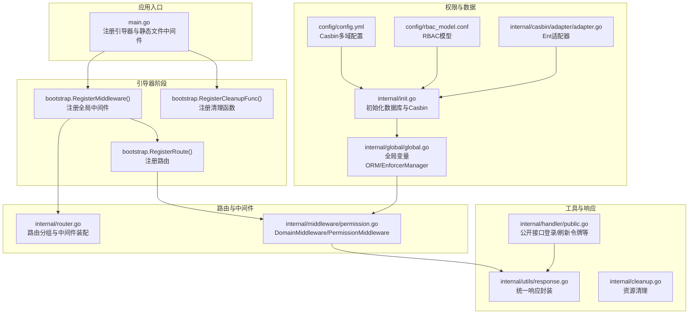
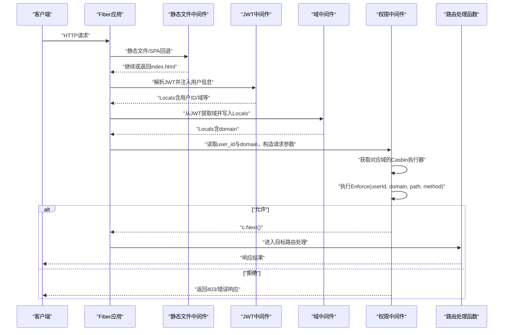
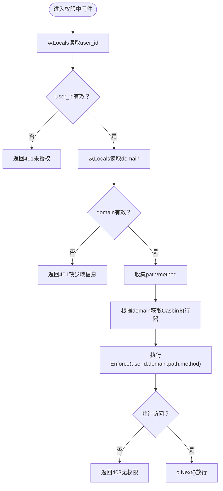
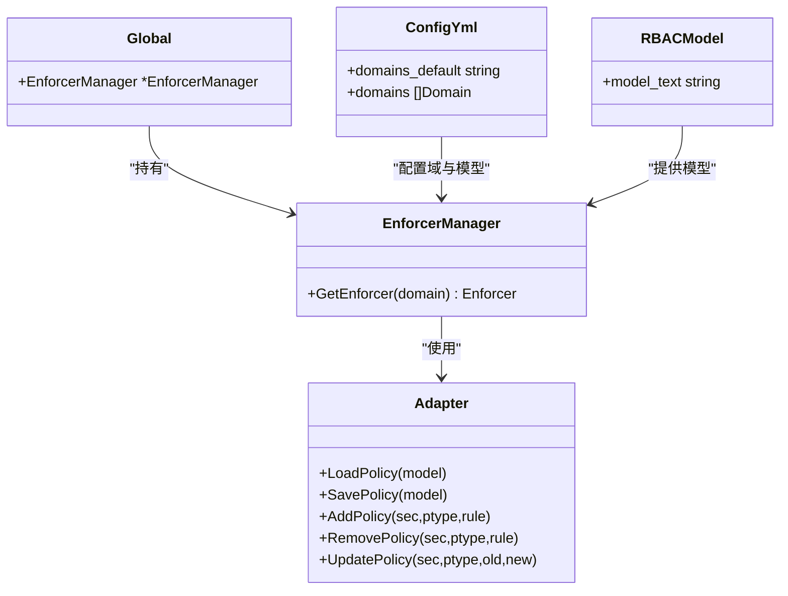
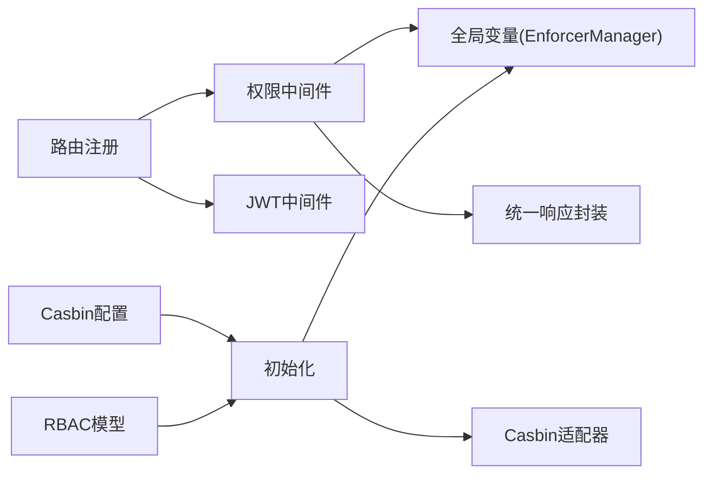

# 中间件系统

<cite>
**本文引用的文件**
- [main.go](file://main.go)
- [router.go](file://internal/router.go)
- [permission.go](file://internal/middleware/permission.go)
- [response.go](file://internal/utils/response.go)
- [config.yml](file://config/config.yml)
- [rbac_model.conf](file://config/rbac_model.conf)
- [global.go](file://internal/global/global.go)
- [init.go](file://internal/init.go)
- [adapter.go](file://internal/casbin/adapter/adapter.go)
- [public.go](file://internal/handler/public.go)
- [cleanup.go](file://internal/cleanup.go)
</cite>

## 目录
1. [简介](#简介)
2. [项目结构](#项目结构)
3. [核心组件](#核心组件)
4. [架构总览](#架构总览)
5. [详细组件分析](#详细组件分析)
6. [依赖关系分析](#依赖关系分析)
7. [性能考量](#性能考量)
8. [故障排查指南](#故障排查指南)
9. [结论](#结论)
10. [附录](#附录)

## 简介
本文件系统性阐述 Go Admin 管理系统的中间件体系，重点覆盖：
- Fiber 框架中间件机制与执行顺序
- JWT 认证中间件的实现原理（令牌解析、用户信息注入、权限检查）
- 权限控制中间件与 Casbin 集成的工作流程
- 中间件链的组合与嵌套机制
- 自定义中间件的开发方法与最佳实践
- 性能优化策略与错误处理机制
- 中间件调试与日志记录
- 静态文件中间件与 SPA 路由处理
- 中间件配置与动态启用/禁用机制
- 中间件扩展与插件开发指南

## 项目结构
本项目采用“引导器 + 路由注册 + 中间件 + 服务层”的分层组织方式。应用通过引导器注册中间件、路由与清理逻辑；路由层对 API 进行分组与中间件装配；中间件层负责认证与权限控制；服务层与数据层（Ent + Casbin）协同完成权限策略持久化与执行。

图表来源
- [main.go:47-76](file://main.go#L47-L76)
- [router.go:14-72](file://internal/router.go#L14-L72)
- [permission.go:11-68](file://internal/middleware/permission.go#L11-L68)
- [global.go:10-14](file://internal/global/global.go#L10-L14)
- [init.go:49-65](file://internal/init.go#L49-L65)
- [adapter.go:115-175](file://internal/casbin/adapter/adapter.go#L115-L175)
- [config.yml:77-143](file://config/config.yml#L77-L143)
- [rbac_model.conf:1-15](file://config/rbac_model.conf#L1-15)
- [response.go:9-49](file://internal/utils/response.go#L9-L49)
- [public.go:13-45](file://internal/handler/public.go#L13-L45)
- [cleanup.go:7-19](file://internal/cleanup.go#L7-L19)

章节来源
- [main.go:43-89](file://main.go#L43-L89)
- [router.go:14-72](file://internal/router.go#L14-L72)

## 核心组件
- JWT 认证中间件：基于第三方库从请求上下文中提取 JWT 用户数据，注入域信息到 Locals。
- 域中间件：从 JWT 中读取域字段，作为 Casbin 策略执行的域标识。
- 权限中间件：从 Locals 读取用户 ID 与域，结合请求路径与方法，调用 Casbin 执行器进行权限校验。
- 统一响应封装：集中处理错误码、消息与 JSON 输出。
- 静态文件与 SPA 中间件：挂载前端打包目录，拦截非 API 请求返回 index.html，实现 SPA 路由回退。
- 引导器与生命周期：在引导阶段注册中间件、路由与清理函数，确保资源正确初始化与释放。

章节来源
- [permission.go:11-68](file://internal/middleware/permission.go#L11-L68)
- [response.go:9-49](file://internal/utils/response.go#L9-L49)
- [main.go:47-76](file://main.go#L47-L76)
- [router.go:14-72](file://internal/router.go#L14-L72)

## 架构总览
下图展示从请求进入应用到路由处理与权限校验的整体流程，以及中间件链的执行顺序与职责划分。

图表来源
- [main.go:47-76](file://main.go#L47-L76)
- [router.go:32-37](file://internal/router.go#L32-L37)
- [permission.go:11-68](file://internal/middleware/permission.go#L11-L68)

## 详细组件分析

### Fiber 中间件机制与执行顺序
- 中间件以“洋葱模型”串行执行，先入后出。每个中间件可选择调用 c.Next() 将控制权交给下一个中间件，或直接返回响应结束请求。
- 在引导器阶段注册的全局中间件（如静态文件与 SPA 回退）先于路由中间件执行；路由内部按声明顺序依次执行。
- 本项目中，JWT 中间件与域中间件在路由分组中串联，权限中间件位于最后，确保在路由处理前完成鉴权。

章节来源
- [router.go:16-20](file://internal/router.go#L16-L20)
- [router.go:32-37](file://internal/router.go#L32-L37)

### JWT 认证中间件与用户信息注入
- JWT 中间件负责从请求上下文解析令牌并获取用户数据（例如用户 ID、域等），并将关键信息写入 Locals，供后续中间件与处理器使用。
- 在公开接口（如登录、刷新令牌）中，处理器直接从 Locals 获取服务实例与统一响应封装，避免重复解析。

章节来源
- [router.go:32-37](file://internal/router.go#L32-L37)
- [public.go:22-45](file://internal/handler/public.go#L22-L45)

### 域中间件与权限中间件
- 域中间件从 JWT 用户数据中读取域信息，并将其写入 Locals，作为 Casbin 执行的关键维度。
- 权限中间件从 Locals 读取用户 ID 与域，结合请求路径与方法，向 Casbin 执行器发起 Enforce 调用，若返回不允许则直接返回错误响应，否则放行至路由处理函数。

图表来源
- [permission.go:11-68](file://internal/middleware/permission.go#L11-L68)

章节来源
- [permission.go:11-68](file://internal/middleware/permission.go#L11-L68)

### 权限控制中间件与 Casbin 集成
- 初始化阶段创建 Casbin 执行器管理器，并使用 Ent 适配器将策略持久化到数据库表。
- 权限中间件通过执行器管理器按域获取对应执行器，再执行 Enforce 判断是否允许访问。
- Casbin 多域配置支持不同租户或业务域拥有独立模型与策略集，可通过配置项启用自动加载以提升性能。

图表来源
- [global.go:10-14](file://internal/global/global.go#L10-L14)
- [init.go:49-65](file://internal/init.go#L49-L65)
- [adapter.go:115-175](file://internal/casbin/adapter/adapter.go#L115-L175)
- [config.yml:77-143](file://config/config.yml#L77-L143)
- [rbac_model.conf:1-15](file://config/rbac_model.conf#L1-15)

章节来源
- [init.go:49-65](file://internal/init.go#L49-L65)
- [adapter.go:115-175](file://internal/casbin/adapter/adapter.go#L115-L175)
- [config.yml:77-143](file://config/config.yml#L77-L143)
- [rbac_model.conf:1-15](file://config/rbac_model.conf#L1-15)

### 中间件链的组合与嵌套机制
- 路由分组支持在 Group 内部串联多个中间件，形成嵌套链路。例如 v1 版本组、公开接口组与认证接口组均在其内部注册中间件。
- JWT 中间件、域中间件与权限中间件在认证路由组中按序串联，确保鉴权前置执行。

章节来源
- [router.go:14-72](file://internal/router.go#L14-L72)

### 自定义中间件的开发方法与最佳实践
- 返回类型：实现 fiber.Handler，接收 *fiber.Ctx 并返回 error。
- 数据传递：通过 c.Locals 注入/读取上下文数据，避免全局变量污染。
- 错误处理：使用统一响应封装输出标准错误码与消息，便于前端与监控系统识别。
- 性能考虑：尽量减少 IO 操作，必要时缓存执行器或策略；对频繁访问的域启用自动加载。
- 可测试性：将外部依赖（如 JWT 解析、Casbin 执行器）抽象为接口或通过依赖注入传入。

章节来源
- [permission.go:11-68](file://internal/middleware/permission.go#L11-L68)
- [response.go:9-49](file://internal/utils/response.go#L9-L49)

### 静态文件中间件与 SPA 路由处理
- 应用启动时注册静态文件中间件，映射嵌入式前端资源目录。
- 通用中间件对非 API 请求进行拦截：若请求的静态文件不存在，则返回 index.html，实现 SPA 路由回退；否则继续处理。

章节来源
- [main.go:47-76](file://main.go#L47-L76)

### 中间件配置与动态启用/禁用机制
- Casbin 多域配置支持为不同域设置独立模型与自动加载策略，高频域建议开启自动加载以降低首次延迟。
- 路由层通过在 Group 中按需添加中间件实现动态启用/禁用，无需修改全局配置即可灵活调整。

章节来源
- [config.yml:77-143](file://config/config.yml#L77-L143)
- [router.go:32-37](file://internal/router.go#L32-L37)

### 中间件扩展与插件开发指南
- 插件化思路：将中间件抽象为可插拔模块，通过配置开关控制启用。
- 日志与指标：在中间件中增加请求耗时、命中率等指标采集，结合统一日志输出。
- 安全加固：对敏感接口增加速率限制、IP 白名单等中间件，形成安全防护链。

## 依赖关系分析
- 中间件依赖全局执行器管理器与统一响应封装。
- 路由层依赖中间件与处理器，处理器依赖服务层与响应封装。
- 初始化阶段负责创建 ORM 与 Casbin 执行器管理器，并注入全局变量。

图表来源
- [permission.go:11-68](file://internal/middleware/permission.go#L11-L68)
- [global.go:10-14](file://internal/global/global.go#L10-L14)
- [router.go:14-72](file://internal/router.go#L14-L72)
- [init.go:49-65](file://internal/init.go#L49-L65)
- [adapter.go:115-175](file://internal/casbin/adapter/adapter.go#L115-L175)
- [config.yml:77-143](file://config/config.yml#L77-L143)
- [rbac_model.conf:1-15](file://config/rbac_model.conf#L1-15)

章节来源
- [permission.go:11-68](file://internal/middleware/permission.go#L11-L68)
- [router.go:14-72](file://internal/router.go#L14-L72)
- [init.go:49-65](file://internal/init.go#L49-L65)

## 性能考量
- 执行器缓存：通过执行器管理器按域缓存 Enforcer，避免重复构建。
- 自动加载：为高频域开启自动加载，减少首次请求延迟。
- 批量策略：适配器保存策略时采用批量插入，降低数据库压力。
- 早返回：在中间件中尽早判断无效请求（如缺少用户 ID 或域），减少后续处理成本。
- 日志级别：生产环境建议降低中间件日志级别，避免 I/O 影响吞吐。

章节来源
- [config.yml:77-143](file://config/config.yml#L77-L143)
- [adapter.go:177-214](file://internal/casbin/adapter/adapter.go#L177-L214)

## 故障排查指南
- 401 未授权：检查 JWT 中间件是否正确注入 user_id 与 domain；确认请求头携带有效的 Bearer Token。
- 403 无权限：检查权限中间件是否能从 Locals 读取 user_id 与 domain；核对 Casbin 策略是否包含对应规则。
- 500 获取执行器失败/权限检查失败：检查执行器管理器初始化是否成功；确认数据库连接正常且策略表存在。
- SPA 路由 404：确认静态文件中间件已注册；检查嵌入式资源路径与 PathPrefix 是否正确。

章节来源
- [permission.go:11-68](file://internal/middleware/permission.go#L11-L68)
- [main.go:47-76](file://main.go#L47-L76)
- [init.go:49-65](file://internal/init.go#L49-L65)

## 结论
本中间件系统以 Fiber 为基础，结合 JWT 与 Casbin 实现了清晰的认证与授权链路。通过路由分组与中间件链的组合，实现了灵活的权限控制与良好的可扩展性。配合多域配置与自动加载策略，可在保证安全性的同时兼顾性能。建议在生产环境中进一步完善日志与指标采集，并持续优化策略模型与执行器缓存策略。

## 附录
- 统一响应封装用于标准化错误与成功响应，便于前端与监控系统消费。
- 清理函数在应用退出时关闭数据库连接，避免资源泄漏。

章节来源
- [response.go:9-49](file://internal/utils/response.go#L9-L49)
- [cleanup.go:7-19](file://internal/cleanup.go#L7-L19)