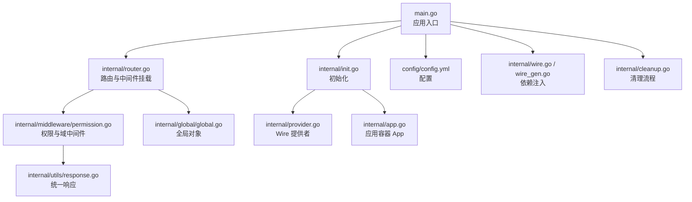
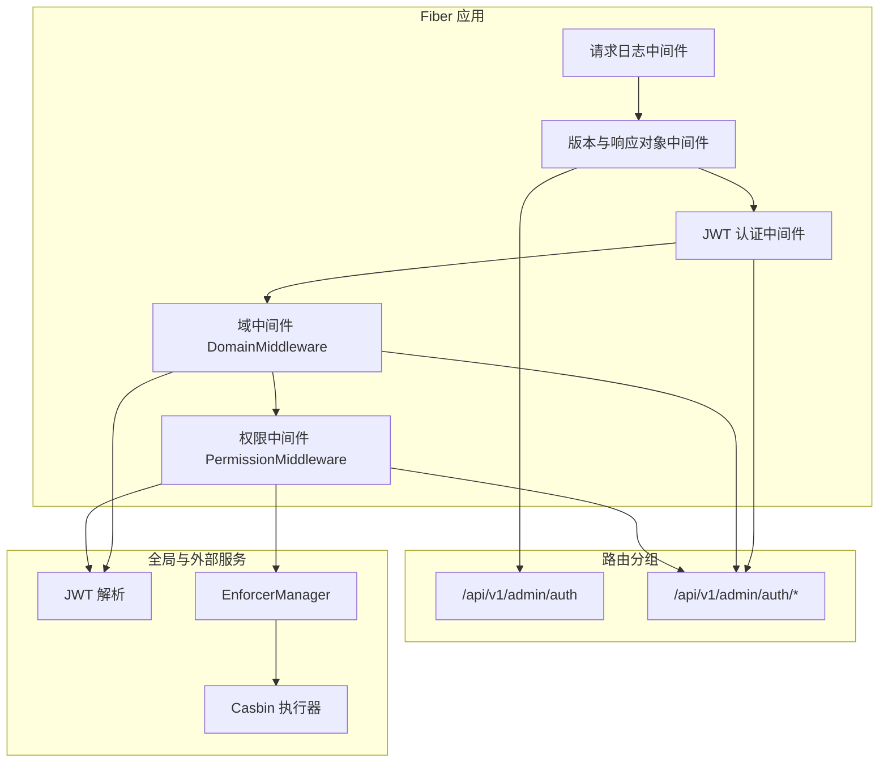
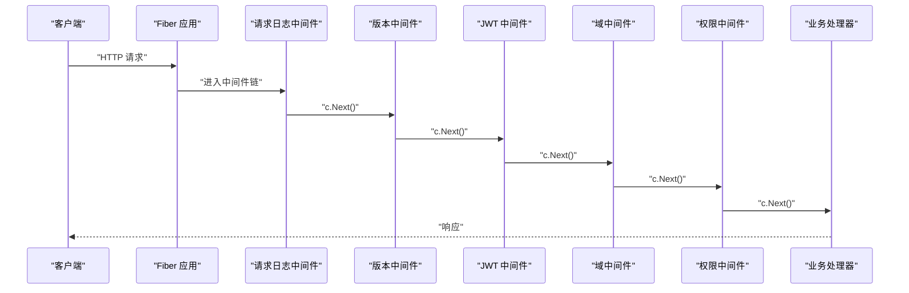
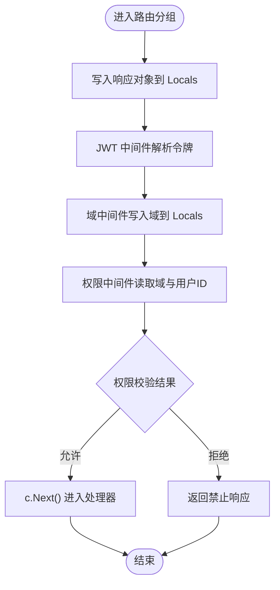
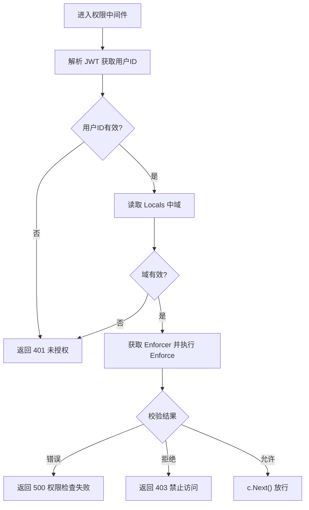
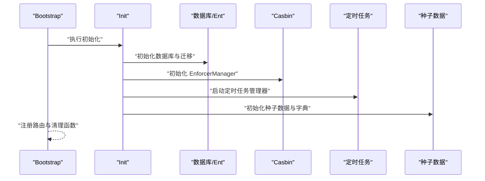
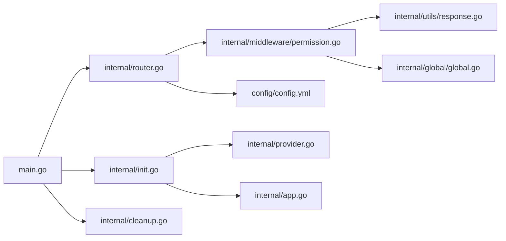

# 中间件架构设计

<cite>
**本文引用的文件**
- [main.go](file://main.go)
- [router.go](file://internal/router.go)
- [permission.go](file://internal/middleware/permission.go)
- [response.go](file://internal/utils/response.go)
- [global.go](file://internal/global/global.go)
- [init.go](file://internal/init.go)
- [provider.go](file://internal/provider.go)
- [app.go](file://internal/app.go)
- [config.yml](file://config/config.yml)
- [wire.go](file://internal/wire.go)
- [wire_gen.go](file://internal/wire_gen.go)
- [cleanup.go](file://internal/cleanup.go)
</cite>

## 目录
1. [简介](#简介)
2. [项目结构](#项目结构)
3. [核心组件](#核心组件)
4. [架构总览](#架构总览)
5. [详细组件分析](#详细组件分析)
6. [依赖分析](#依赖分析)
7. [性能考虑](#性能考虑)
8. [故障排查指南](#故障排查指南)
9. [结论](#结论)
10. [附录](#附录)

## 简介
本文件系统性阐述基于 Fiber 框架的中间件架构设计，围绕中间件链式调用机制、注册流程、执行顺序与上下文传递展开；同时覆盖生命周期管理、错误传播与异常处理策略，扩展性设计（自定义中间件与插件化思路）、与路由系统的集成方式、性能影响分析、配置管理与动态加载、以及测试与调试方法。文档面向不同技术背景读者，既提供高层概览也给出代码级映射与可视化图示。

## 项目结构
项目采用 Fiber 作为 Web 核心框架，结合 CMF 生态组件（JWT、Casbin、日志、缓存、文件系统等）构建中间件体系。核心目录与职责如下：
- internal/router.go：路由注册与中间件挂载点，定义 API 分组与中间件链
- internal/middleware/permission.go：权限与域中间件，负责 JWT 解析、域提取、权限校验
- internal/utils/response.go：统一响应封装，贯穿中间件与处理器
- internal/global/global.go：全局共享对象（如 EnforcerManager、Bootstrap）
- internal/init.go：应用初始化，含数据库、Casbin、定时任务、种子数据等
- internal/provider.go：Wire 提供者，装配 ORM、Casbin、文件系统等依赖
- internal/app.go：应用依赖容器 App，承载配置、日志、DB、缓存、Casbin、文件系统等
- config/config.yml：应用配置，含数据库、缓存、Redis、文件系统、Casbin 多域等
- main.go：入口，注册中间件、路由、清理函数，并运行 Bootstrap
- internal/wire.go / internal/wire_gen.go：Wire 依赖注入生成与手动实现
- internal/cleanup.go：应用退出清理流程

图表来源
- [main.go:47-107](file://main.go#L47-L107)
- [router.go:16-189](file://internal/router.go#L16-L189)
- [permission.go:11-79](file://internal/middleware/permission.go#L11-L79)
- [response.go:9-49](file://internal/utils/response.go#L9-L49)
- [global.go:11-16](file://internal/global/global.go#L11-L16)
- [init.go:39-96](file://internal/init.go#L39-L96)
- [provider.go:17-46](file://internal/provider.go#L17-L46)
- [app.go:15-25](file://internal/app.go#L15-L25)
- [config.yml:1-143](file://config/config.yml#L1-L143)
- [wire.go:22-37](file://internal/wire.go#L22-L37)
- [wire_gen.go:17-62](file://internal/wire_gen.go#L17-L62)
- [cleanup.go:11-42](file://internal/cleanup.go#L11-L42)

章节来源
- [main.go:47-107](file://main.go#L47-L107)
- [router.go:16-189](file://internal/router.go#L16-L189)
- [permission.go:11-79](file://internal/middleware/permission.go#L11-L79)
- [response.go:9-49](file://internal/utils/response.go#L9-L49)
- [global.go:11-16](file://internal/global/global.go#L11-L16)
- [init.go:39-96](file://internal/init.go#L39-L96)
- [provider.go:17-46](file://internal/provider.go#L17-L46)
- [app.go:15-25](file://internal/app.go#L15-L25)
- [config.yml:1-143](file://config/config.yml#L1-L143)
- [wire.go:22-37](file://internal/wire.go#L22-L37)
- [wire_gen.go:17-62](file://internal/wire_gen.go#L17-L62)
- [cleanup.go:11-42](file://internal/cleanup.go#L11-L42)

## 核心组件
- Fiber 应用与中间件链
  - 在入口处通过 Bootstrap 注册通用中间件（静态资源与 SPA 回退）与路由注册函数
  - 路由层通过 Group 与 Handler 组合形成中间件链，链上通过 c.Next() 传递控制权
- 权限与域中间件
  - DomainMiddleware：从 JWT 中解析域信息并写入 c.Locals，供后续中间件使用
  - PermissionMiddleware：从 JWT 获取用户 UID，结合域、路径、方法调用 Casbin 执行器进行权限校验
- 统一响应封装
  - Response 结构体与 Success/Fail/ToJSON 方法，保证中间件与处理器输出一致
- 全局对象与初始化
  - EnforcerManager（Casbin 执行器管理器）在初始化阶段创建并注入全局
  - App 容器承载配置、日志、DB、缓存、文件系统等，作为依赖注入与全局共享的载体
- 配置与动态加载
  - config.yml 支持多域 Casbin 模型配置，可按需自动加载或延迟加载
- 生命周期与清理
  - 初始化阶段创建定时任务管理器、密钥轮换与种子数据
  - 退出阶段持久化 UID 计数器、停止定时任务、关闭数据库连接池与 Ent 客户端

章节来源
- [main.go:59-96](file://main.go#L59-L96)
- [router.go:16-189](file://internal/router.go#L16-L189)
- [permission.go:11-79](file://internal/middleware/permission.go#L11-L79)
- [response.go:9-49](file://internal/utils/response.go#L9-L49)
- [global.go:11-16](file://internal/global/global.go#L11-L16)
- [init.go:39-96](file://internal/init.go#L39-L96)
- [app.go:15-25](file://internal/app.go#L15-L25)
- [config.yml:77-143](file://config/config.yml#L77-L143)
- [cleanup.go:11-42](file://internal/cleanup.go#L11-L42)

## 架构总览
下图展示 Fiber 中间件链在路由注册中的组织方式，以及权限中间件如何与 JWT、Casbin、全局对象协作：

图表来源
- [main.go:59-96](file://main.go#L59-L96)
- [router.go:22-70](file://internal/router.go#L22-L70)
- [permission.go:11-79](file://internal/middleware/permission.go#L11-L79)
- [global.go:11-16](file://internal/global/global.go#L11-L16)

## 详细组件分析

### 中间件注册与执行顺序
- 注册位置
  - 入口通过 Bootstrap.RegisterMiddleware 注册通用中间件：静态文件中间件（API 前缀跳过）、SPA 回退逻辑
  - 路由注册通过 internal.RegisterRoute 完成，内部使用 app.Group 与多个中间件组合
- 执行顺序
  - Fiber 中间件遵循“先注册先执行”的栈式顺序，c.Next() 控制进入下一个中间件
  - 在路由分组中，版本中间件、JWT 中间件、域中间件、权限中间件依次排列，形成“认证 → 域 → 权限”的检查链

图表来源
- [main.go:62-94](file://main.go#L62-L94)
- [router.go:22-70](file://internal/router.go#L22-L70)
- [permission.go:11-79](file://internal/middleware/permission.go#L11-L79)

章节来源
- [main.go:59-96](file://main.go#L59-L96)
- [router.go:16-189](file://internal/router.go#L16-L189)

### 上下文传递与 Locals 使用
- 版本中间件在 c.Locals 写入响应对象实例，供后续处理器复用
- 域中间件从 JWT 中提取域信息写入 c.Locals，权限中间件读取该值进行策略匹配
- JWT 中间件在路由分组中提供用户认证能力，配合权限中间件实现“认证+权限”双层校验

图表来源
- [router.go:22-70](file://internal/router.go#L22-L70)
- [permission.go:11-79](file://internal/middleware/permission.go#L11-L79)
- [response.go:9-49](file://internal/utils/response.go#L9-L49)

章节来源
- [router.go:22-70](file://internal/router.go#L22-L70)
- [permission.go:11-79](file://internal/middleware/permission.go#L11-L79)
- [response.go:9-49](file://internal/utils/response.go#L9-L49)

### 权限中间件与错误传播
- 错误分类与传播
  - 未授权访问：JWT 缺失或用户ID为空
  - 缺少域信息：JWT 中缺失域字段
  - 权限检查失败：Casbin 执行器返回错误或拒绝
  - 内部错误：获取执行器失败或内部异常
- 统一响应
  - 通过 utils.Response.Fail 返回标准化 JSON 响应，状态码与消息由中间件决定

图表来源
- [permission.go:11-79](file://internal/middleware/permission.go#L11-L79)
- [response.go:35-49](file://internal/utils/response.go#L35-L49)

章节来源
- [permission.go:11-79](file://internal/middleware/permission.go#L11-L79)
- [response.go:35-49](file://internal/utils/response.go#L35-L49)

### 生命周期管理与初始化
- 初始化阶段
  - 数据库与 Ent 客户端初始化，自动迁移 schema
  - Casbin EnforcerManager 初始化，支持多域模型
  - 定时任务管理器启动
  - 密钥轮换与非重复攻击防护初始化
  - 种子数据与字典数据初始化
- 退出阶段
  - 持久化 UID 计数器
  - 停止定时任务管理器
  - 关闭数据库连接池与 Ent 客户端

图表来源
- [main.go:59-96](file://main.go#L59-L96)
- [init.go:39-96](file://internal/init.go#L39-L96)
- [provider.go:17-46](file://internal/provider.go#L17-L46)

章节来源
- [init.go:39-96](file://internal/init.go#L39-L96)
- [provider.go:17-46](file://internal/provider.go#L17-L46)
- [cleanup.go:11-42](file://internal/cleanup.go#L11-L42)

### 扩展性设计与插件化思路
- 自定义中间件开发模式
  - 遵循 fiber.Handler 签名，使用 c.Next() 实现链式调用
  - 通过 c.Locals 传递上下文数据，避免全局变量耦合
  - 使用统一响应封装，保持错误与结果格式一致
- 插件化架构建议
  - 将中间件抽象为可配置模块，通过配置文件启用/禁用
  - 使用工厂函数按需创建中间件实例，支持参数化配置
  - 对耗时操作（如缓存、远程鉴权）采用异步或预热策略

章节来源
- [permission.go:11-79](file://internal/middleware/permission.go#L11-L79)
- [response.go:9-49](file://internal/utils/response.go#L9-L49)

### 与路由系统的集成与性能影响
- 集成方式
  - 路由分组中串联多个中间件，形成“认证 → 域 → 权限”的检查链
  - 版本中间件统一设置响应对象与版本头，减少处理器样板代码
- 性能影响
  - JWT 解析与 Casbin 权限校验为关键路径，建议：
    - 启用 Casbin 多域自动加载（config.yml）以降低首次延迟
    - 使用缓存（内存/Redis）缓存热点策略或用户权限
    - 对高频接口进行限流与熔断

章节来源
- [router.go:22-70](file://internal/router.go#L22-L70)
- [config.yml:77-143](file://config/config.yml#L77-L143)

### 配置管理、动态加载与热更新
- 配置中心
  - config.yml 提供数据库、缓存、Redis、文件系统、Casbin 多域等集中配置
- 动态加载
  - Casbin 多域支持 auto_load 与延迟加载，建议高频域开启自动加载
- 热更新
  - 对于策略变更，可在初始化阶段触发 Enforcer.LoadPolicy 或通过管理接口触发重载
  - 静态资源与前端打包可通过嵌入文件系统中间件实现热替换

章节来源
- [config.yml:77-143](file://config/config.yml#L77-L143)
- [init.go:294-306](file://internal/init.go#L294-L306)
- [main.go:62-94](file://main.go#L62-L94)

### 测试策略与调试方法
- 单元测试
  - 对中间件行为进行隔离测试：JWT 无效、域缺失、权限拒绝、正常放行
  - 使用 Fiber 测试工具构造最小 Fiber 应用，挂载目标中间件链进行验证
- 集成测试
  - 通过完整路由注册流程，验证中间件链在真实场景下的行为
- 调试方法
  - 启用请求日志中间件，观察中间件执行顺序与响应时间
  - 在关键中间件中打印 c.Locals 与上下文信息，定位数据传递问题
  - 使用统一响应封装，便于在日志中快速识别错误来源

章节来源
- [main.go:59-96](file://main.go#L59-L96)
- [router.go:16-189](file://internal/router.go#L16-L189)
- [response.go:9-49](file://internal/utils/response.go#L9-L49)

## 依赖分析
- 组件耦合
  - 路由层依赖中间件与全局对象（JWT、EnforcerManager）
  - 中间件依赖统一响应封装与全局对象
  - 初始化阶段依赖 ProviderSet 完成依赖装配
- 外部依赖
  - Fiber、JWT、Casbin、日志、缓存、文件系统、ORM（Ent）

图表来源
- [router.go:16-189](file://internal/router.go#L16-L189)
- [permission.go:11-79](file://internal/middleware/permission.go#L11-L79)
- [response.go:9-49](file://internal/utils/response.go#L9-L49)
- [global.go:11-16](file://internal/global/global.go#L11-L16)
- [config.yml:1-143](file://config/config.yml#L1-L143)
- [main.go:59-96](file://main.go#L59-L96)
- [init.go:39-96](file://internal/init.go#L39-L96)
- [provider.go:17-46](file://internal/provider.go#L17-L46)
- [app.go:15-25](file://internal/app.go#L15-L25)
- [cleanup.go:11-42](file://internal/cleanup.go#L11-L42)

章节来源
- [router.go:16-189](file://internal/router.go#L16-L189)
- [permission.go:11-79](file://internal/middleware/permission.go#L11-L79)
- [response.go:9-49](file://internal/utils/response.go#L9-L49)
- [global.go:11-16](file://internal/global/global.go#L11-L16)
- [config.yml:1-143](file://config/config.yml#L1-L143)
- [main.go:59-96](file://main.go#L59-L96)
- [init.go:39-96](file://internal/init.go#L39-L96)
- [provider.go:17-46](file://internal/provider.go#L17-L46)
- [app.go:15-25](file://internal/app.go#L15-L25)
- [cleanup.go:11-42](file://internal/cleanup.go#L11-L42)

## 性能考虑
- 中间件链长度与顺序
  - 将高成本中间件（如权限校验）置于链后，但确保必要中间件（如 JWT）前置
- 缓存策略
  - 对 Casbin 策略与用户权限进行缓存，减少重复查询
- 异步与预热
  - 对高频域启用自动加载，避免首次请求延迟
- 资源释放
  - 退出阶段及时关闭数据库连接池与定时任务，避免资源泄漏

[本节为通用指导，无需列出章节来源]

## 故障排查指南
- 常见错误与定位
  - 401 未授权：检查 JWT 中间件是否正确解析，确认令牌有效与签名正确
  - 403 禁止访问：检查 DomainMiddleware 是否写入域，权限中间件是否正确读取
  - 500 权限检查失败：检查 EnforcerManager 初始化与 Casbin 策略加载
- 日志与响应
  - 启用请求日志中间件，结合统一响应封装快速定位错误来源
- 清理与重启
  - 退出阶段持久化 UID 计数器，确保重启后连续性；重启后验证定时任务与数据库连接状态

章节来源
- [permission.go:11-79](file://internal/middleware/permission.go#L11-L79)
- [response.go:35-49](file://internal/utils/response.go#L35-L49)
- [main.go:59-96](file://main.go#L59-L96)
- [cleanup.go:11-42](file://internal/cleanup.go#L11-L42)

## 结论
本项目以 Fiber 为核心，通过清晰的中间件链设计实现了“认证 → 域 → 权限”的安全控制闭环；借助统一响应封装与全局对象管理，提升了可维护性与一致性。初始化与清理流程保障了系统稳定运行，配置文件支持多域与动态加载，满足扩展需求。建议在生产环境中进一步强化缓存、限流与监控，持续优化中间件链性能与可观测性。

[本节为总结性内容，无需列出章节来源]

## 附录
- 依赖注入与应用容器
  - Wire 通过 ProviderSet 装配 ORM、Casbin、缓存、文件系统等依赖
  - 手动实现等效于 Wire 的 InitializeApp，便于兼容旧模式
- 配置要点
  - Casbin 多域模型与自动加载策略
  - Redis 缓存连接参数与默认 TTL
  - 文件系统本地与 S3 配置

章节来源
- [wire.go:22-37](file://internal/wire.go#L22-L37)
- [wire_gen.go:17-62](file://internal/wire_gen.go#L17-L62)
- [config.yml:77-143](file://config/config.yml#L77-L143)