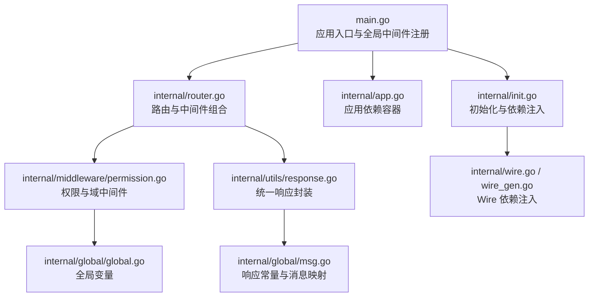
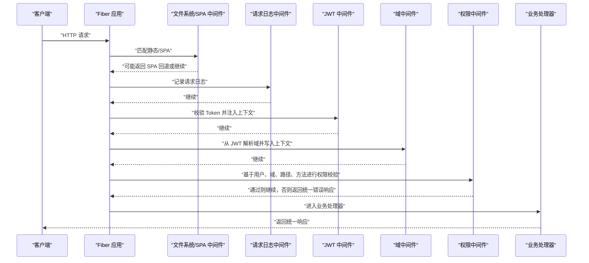
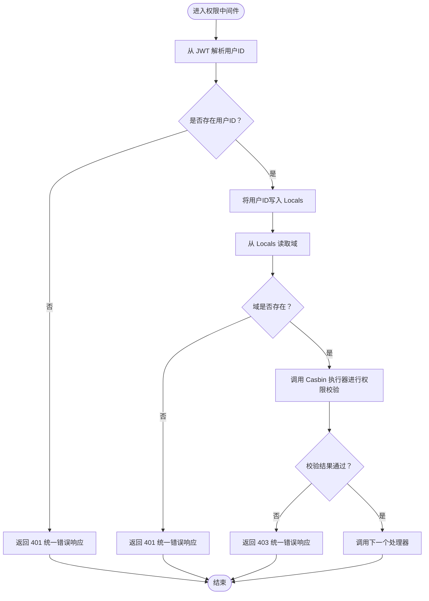
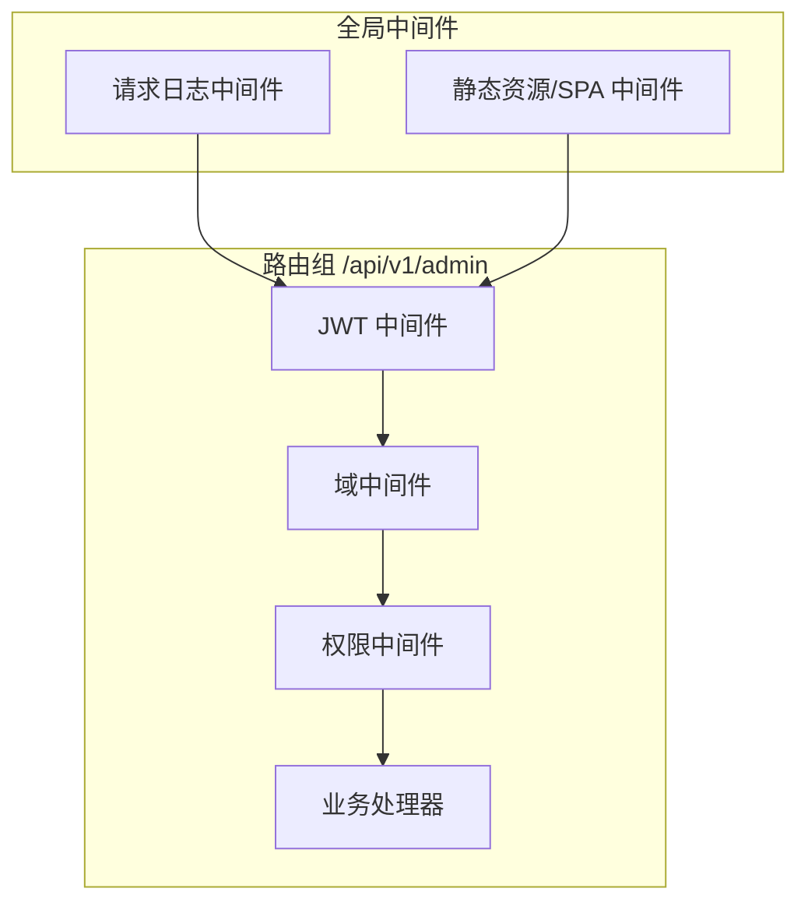
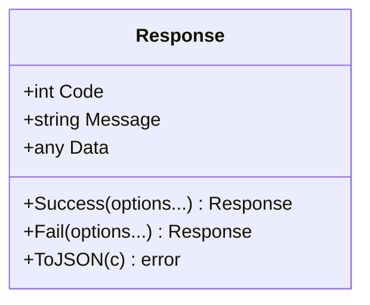
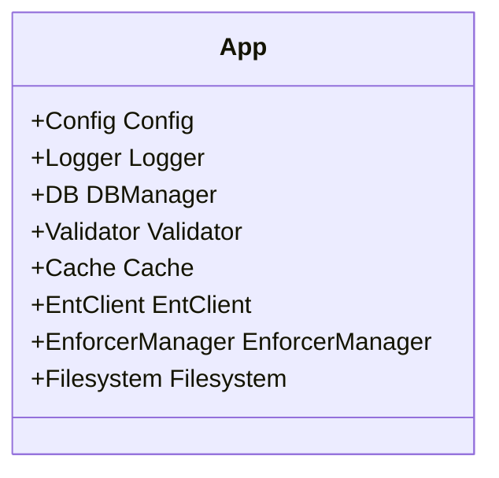
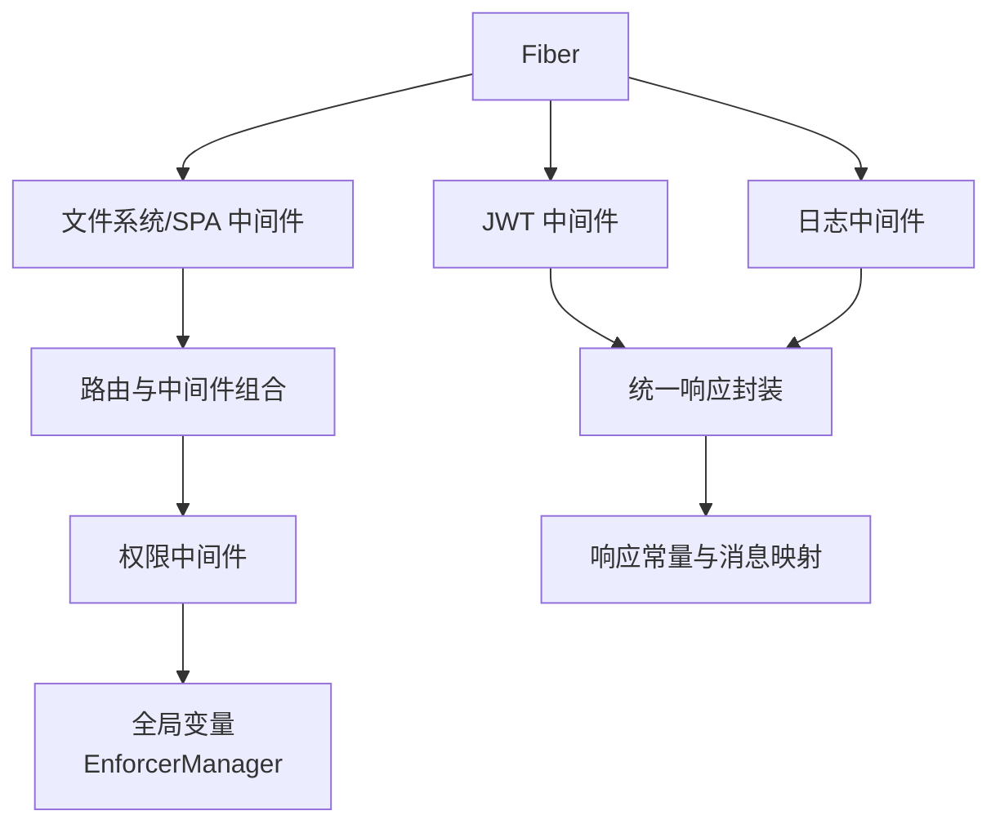

# 中间件系统

<cite>
**本文引用的文件**
- [main.go](file://main.go)
- [internal/middleware/permission.go](file://internal/middleware/permission.go)
- [internal/router.go](file://internal/router.go)
- [internal/utils/response.go](file://internal/utils/response.go)
- [internal/global/global.go](file://internal/global/global.go)
- [internal/global/msg.go](file://internal/global/msg.go)
- [internal/app.go](file://internal/app.go)
- [internal/init.go](file://internal/init.go)
- [internal/wire.go](file://internal/wire.go)
- [internal/wire_gen.go](file://internal/wire_gen.go)
</cite>

## 目录
1. [简介](#简介)
2. [项目结构](#项目结构)
3. [核心组件](#核心组件)
4. [架构总览](#架构总览)
5. [详细组件分析](#详细组件分析)
6. [依赖分析](#依赖分析)
7. [性能考量](#性能考量)
8. [故障排除指南](#故障排除指南)
9. [结论](#结论)
10. [附录](#附录)

## 简介
本文件系统性阐述基于 Fiber 的 Go Admin 管理系统中间件体系，重点覆盖：
- 中间件执行顺序与链式调用机制
- 错误处理与统一响应格式
- 内置中间件功能与配置方法（权限验证、域解析、JWT 认证、静态资源与 SPA 路由）
- 自定义中间件开发指南（接口实现、上下文处理、异常捕获）
- 性能优化策略与最佳实践
- 调试方法与故障排除
- 扩展与插件化方案
- 安全考虑与性能影响分析

## 项目结构
中间件系统主要分布在以下位置：
- 应用入口与全局中间件注册：main.go
- 路由与中间件组合：internal/router.go
- 权限与域中间件：internal/middleware/permission.go
- 统一响应封装：internal/utils/response.go
- 全局变量与常量：internal/global/global.go、internal/global/msg.go
- 依赖注入与初始化：internal/app.go、internal/init.go、internal/wire.go、internal/wire_gen.go

图表来源
- [main.go:59-96](file://main.go#L59-L96)
- [internal/router.go:16-190](file://internal/router.go#L16-L190)
- [internal/middleware/permission.go:11-79](file://internal/middleware/permission.go#L11-L79)
- [internal/utils/response.go:9-49](file://internal/utils/response.go#L9-L49)
- [internal/global/global.go:11-16](file://internal/global/global.go#L11-L16)
- [internal/global/msg.go:44-83](file://internal/global/msg.go#L44-L83)
- [internal/app.go:15-25](file://internal/app.go#L15-L25)
- [internal/init.go:57-96](file://internal/init.go#L57-L96)
- [internal/wire.go:22-37](file://internal/wire.go#L22-L37)
- [internal/wire_gen.go:17-62](file://internal/wire_gen.go#L17-L62)

章节来源
- [main.go:47-107](file://main.go#L47-L107)
- [internal/router.go:16-190](file://internal/router.go#L16-L190)

## 核心组件
- 权限中间件：负责从 JWT 提取用户信息，结合域与路径方法进行权限校验，不通过则返回统一错误响应。
- 域中间件：从 JWT 中提取域信息并写入上下文，供权限中间件使用。
- JWT 中间件：由外部库提供，用于认证与上下文注入。
- 日志中间件：由外部库提供，用于请求级日志记录。
- 文件系统与 SPA 中间件：静态资源托管与 SPA 回退到 index.html。
- 统一响应封装：统一输出结构，便于前端消费与错误处理。

章节来源
- [internal/middleware/permission.go:11-79](file://internal/middleware/permission.go#L11-L79)
- [internal/router.go:16-190](file://internal/router.go#L16-L190)
- [internal/utils/response.go:9-49](file://internal/utils/response.go#L9-L49)

## 架构总览
Fiber 的中间件采用“洋葱模型”链式调用，每个中间件可选择是否调用下一个中间件或直接返回响应。在本项目中，全局中间件与路由级中间件共同构成完整的请求处理链。

图表来源
- [main.go:62-94](file://main.go#L62-L94)
- [internal/router.go:16-190](file://internal/router.go#L16-L190)
- [internal/middleware/permission.go:11-79](file://internal/middleware/permission.go#L11-L79)

## 详细组件分析

### 权限中间件与域中间件
- 域中间件职责：从 JWT 中提取域信息并写入上下文，供后续中间件使用；若缺失则返回统一错误响应。
- 权限中间件职责：从 JWT 提取用户 ID，结合域、请求路径与方法，通过 Casbin 执行器进行权限校验；失败时返回统一错误响应；通过则调用下一个处理器。
- 上下文传递：通过 Fiber 的 Locals 传递用户 ID 与域信息，供业务层使用。
- 统一响应：使用统一响应封装返回标准 JSON 结构。

图表来源
- [internal/middleware/permission.go:11-79](file://internal/middleware/permission.go#L11-L79)
- [internal/utils/response.go:9-49](file://internal/utils/response.go#L9-L49)

章节来源
- [internal/middleware/permission.go:11-79](file://internal/middleware/permission.go#L11-L79)
- [internal/utils/response.go:9-49](file://internal/utils/response.go#L9-L49)

### 路由与中间件组合
- 全局中间件：在应用启动时注册，包含请求日志中间件、静态资源与 SPA 路由回退。
- 路由组中间件：按版本、模块划分中间件链，确保认证、域解析、权限校验与业务服务注入的正确顺序。
- 关键顺序：JWT -> 域中间件 -> 权限中间件 -> 业务处理器。

图表来源
- [internal/router.go:16-190](file://internal/router.go#L16-L190)
- [main.go:62-94](file://main.go#L62-L94)

章节来源
- [internal/router.go:16-190](file://internal/router.go#L16-L190)
- [main.go:62-94](file://main.go#L62-L94)

### 统一响应封装
- 结构：包含状态码、消息与可选数据体。
- 方法：Success/Fail 支持多参数覆盖默认值；ToJSON 输出标准 JSON。
- 常量与消息映射：集中定义成功、失败及各类业务错误码与消息，便于前后端一致化。

图表来源
- [internal/utils/response.go:9-49](file://internal/utils/response.go#L9-L49)
- [internal/global/msg.go:44-83](file://internal/global/msg.go#L44-L83)

章节来源
- [internal/utils/response.go:9-49](file://internal/utils/response.go#L9-L49)
- [internal/global/msg.go:44-83](file://internal/global/msg.go#L44-L83)

### 依赖注入与初始化
- 应用依赖容器：聚合配置、日志、数据库、校验器、缓存、Ent 客户端、Casbin 执行器、文件系统等。
- 初始化：在初始化阶段注入全局变量（如 EnforcerManager），并启动定时任务与密钥管理等。
- Wire：提供依赖注入集合，简化初始化流程。

图表来源
- [internal/app.go:15-25](file://internal/app.go#L15-L25)
- [internal/init.go:57-96](file://internal/init.go#L57-L96)
- [internal/wire.go:22-37](file://internal/wire.go#L22-L37)
- [internal/wire_gen.go:17-62](file://internal/wire_gen.go#L17-L62)

章节来源
- [internal/app.go:15-25](file://internal/app.go#L15-L25)
- [internal/init.go:57-96](file://internal/init.go#L57-L96)
- [internal/wire.go:22-37](file://internal/wire.go#L22-L37)
- [internal/wire_gen.go:17-62](file://internal/wire_gen.go#L17-L62)

## 依赖分析
- 外部依赖
  - Fiber：Web 框架与中间件生态
  - JWT：认证中间件与用户信息提取
  - Casbin：权限模型与执行器
  - CMF 工具集：日志、配置、缓存、文件系统、校验等
- 内部依赖
  - 全局变量：EnforcerManager、Bootstrap、ORM、CronManager
  - 统一响应：响应常量与消息映射
  - 依赖注入：Wire ProviderSet 与手动初始化

图表来源
- [internal/router.go:16-190](file://internal/router.go#L16-L190)
- [internal/middleware/permission.go:11-79](file://internal/middleware/permission.go#L11-L79)
- [internal/global/global.go:11-16](file://internal/global/global.go#L11-L16)
- [internal/global/msg.go:44-83](file://internal/global/msg.go#L44-L83)
- [internal/utils/response.go:9-49](file://internal/utils/response.go#L9-L49)

章节来源
- [internal/router.go:16-190](file://internal/router.go#L16-L190)
- [internal/middleware/permission.go:11-79](file://internal/middleware/permission.go#L11-L79)
- [internal/global/global.go:11-16](file://internal/global/global.go#L11-L16)
- [internal/global/msg.go:44-83](file://internal/global/msg.go#L44-L83)
- [internal/utils/response.go:9-49](file://internal/utils/response.go#L9-L49)

## 性能考量
- 中间件顺序优化
  - 将快速失败的中间件（如 JWT、域解析）置于前部，尽早短路无效请求。
  - 将权限校验放在认证之后，避免对未认证请求进行昂贵的权限判断。
- 缓存与预热
  - 对权限规则与用户域信息进行缓存，减少 Casbin 查询次数。
  - 在初始化阶段预热常用规则，降低首次请求延迟。
- 日志与监控
  - 使用轻量级日志中间件，避免在高并发场景下产生过多 IO。
  - 对慢请求进行采样记录，定位瓶颈。
- 资源与静态文件
  - 静态资源中间件通过 Next 过滤 API 请求，减少不必要的文件系统扫描。
  - SPA 回退仅在 404 时触发，避免对正常静态资源请求造成额外开销。

[本节为通用性能建议，无需特定文件引用]

## 故障排除指南
- 401 未授权
  - 检查 JWT 是否有效、是否携带、是否过期。
  - 确认域中间件是否正确从 JWT 中提取域信息。
- 403 拒绝访问
  - 核对 Casbin 规则是否包含该用户、域、路径与方法的策略。
  - 检查 EnforcerManager 是否正确初始化与可用。
- 500 内部错误
  - 权限校验过程中的异常会返回统一错误响应。
  - 检查日志中间件输出与统一响应封装是否正常工作。
- 调试步骤
  - 开启详细日志，观察中间件执行顺序与上下文内容。
  - 使用最小化路由与中间件组合复现问题。
  - 校验依赖注入是否成功，全局变量是否正确赋值。

章节来源
- [internal/middleware/permission.go:11-79](file://internal/middleware/permission.go#L11-L79)
- [internal/utils/response.go:9-49](file://internal/utils/response.go#L9-L49)
- [internal/global/global.go:11-16](file://internal/global/global.go#L11-L16)

## 结论
本中间件系统以 Fiber 为基础，结合 JWT、Casbin 与统一响应封装，构建了清晰的链式调用与错误处理机制。通过合理的中间件顺序、缓存与日志策略，可在保证安全性的同时提升性能。建议在生产环境中进一步完善监控与告警，持续优化权限规则与中间件链路。

[本节为总结性内容，无需特定文件引用]

## 附录

### 自定义中间件开发指南
- 接口实现
  - 实现 Fiber.Handler 签名，接收上下文并返回错误。
- 上下文处理
  - 使用 c.Locals 存储跨处理器共享的数据。
  - 使用 c.Next() 控制链式调用。
- 异常捕获
  - 在中间件内捕获并转换为统一响应，避免将原始错误暴露给客户端。
- 示例参考
  - 参考权限中间件与域中间件的实现方式，遵循相同的错误处理与上下文传递模式。

章节来源
- [internal/middleware/permission.go:11-79](file://internal/middleware/permission.go#L11-L79)
- [internal/utils/response.go:9-49](file://internal/utils/response.go#L9-L49)

### 中间件扩展与插件化方案
- 插件化思路
  - 将中间件抽象为可配置的插件，支持启用/禁用与参数化配置。
  - 通过依赖注入容器动态注册中间件，便于测试与替换。
- 最佳实践
  - 保持中间件单一职责，避免过度耦合。
  - 提供统一的错误处理与日志输出规范。
  - 对关键中间件提供可观测性指标与采样日志。

[本节为概念性内容，无需特定文件引用]

### 安全考虑与性能影响
- 安全
  - JWT 必须严格校验签名与过期时间，避免重放攻击。
  - 权限校验必须基于用户域隔离，防止越权访问。
  - 统一响应不应泄露敏感信息，错误细节仅在内部日志记录。
- 性能
  - 中间件链路应尽量短且高效，避免重复计算。
  - 对权限查询与外部依赖进行缓存与连接池管理。
  - 静态资源与 SPA 回退仅在必要时触发。

[本节为通用安全与性能建议，无需特定文件引用]