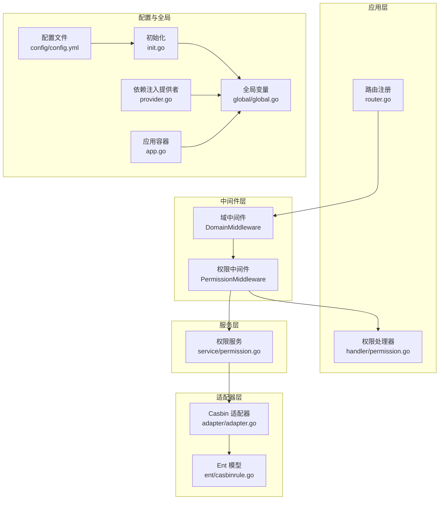
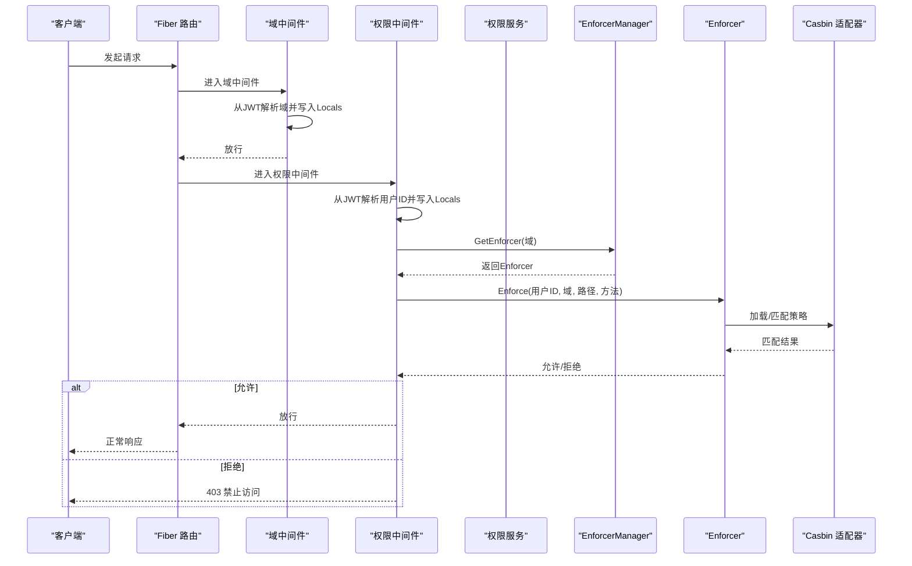
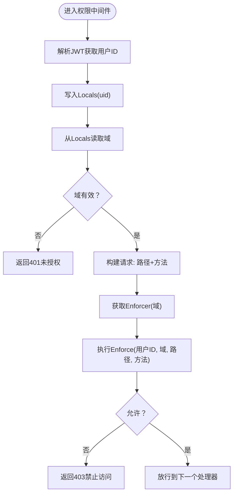
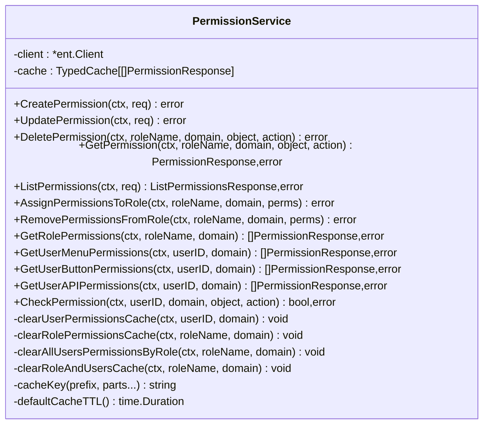
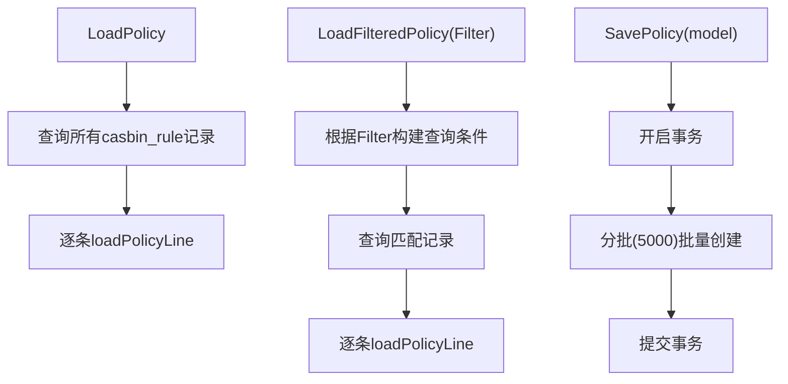
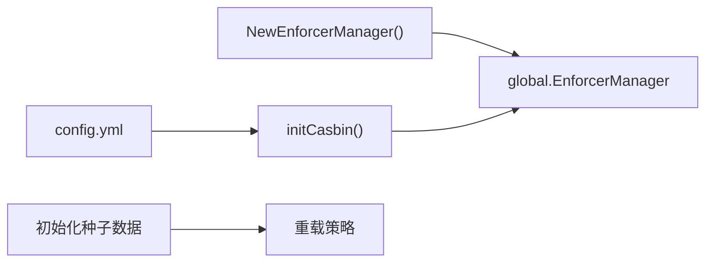
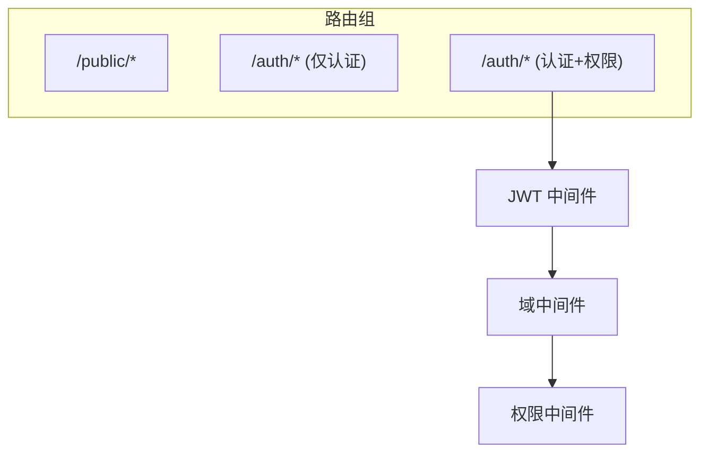
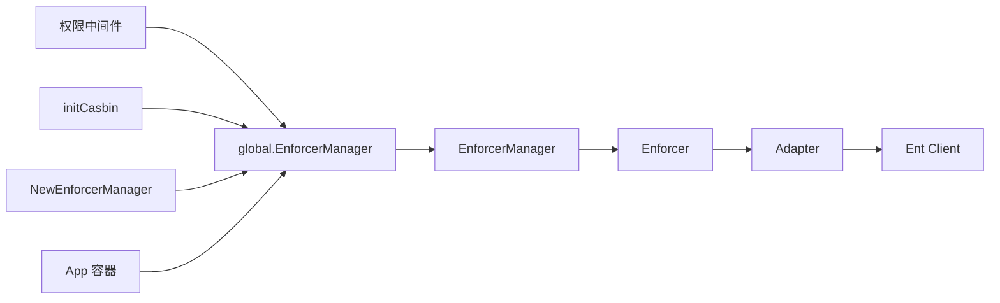

# 权限验证中间件

<cite>
**本文档引用的文件**
- [permission.go](file://internal/middleware/permission.go)
- [adapter.go](file://internal/casbin/adapter/adapter.go)
- [permission.go](file://internal/service/permission.go)
- [permission.go](file://internal/handler/permission.go)
- [config.yml](file://config/config.yml)
- [global.go](file://internal/global/global.go)
- [router.go](file://internal/router.go)
- [init.go](file://internal/init.go)
- [provider.go](file://internal/provider.go)
- [app.go](file://internal/app.go)
- [casbinrule.go](file://internal/ent/casbinrule.go)
- [permission_test.go](file://internal/service/permission_test.go)
</cite>

## 目录
1. [简介](#简介)
2. [项目结构](#项目结构)
3. [核心组件](#核心组件)
4. [架构总览](#架构总览)
5. [详细组件分析](#详细组件分析)
6. [依赖关系分析](#依赖关系分析)
7. [性能考虑](#性能考虑)
8. [故障排除指南](#故障排除指南)
9. [结论](#结论)
10. [附录](#附录)

## 简介
本文件面向基于 Casbin 的 RBAC 权限验证中间件，系统性阐述权限检查算法、策略匹配机制与权限缓存策略；详细说明中间件配置参数、权限规则定义与动态更新机制；提供从用户认证、角色分配到权限检查与结果处理的完整流程示例；解释中间件与其他中间件的协作关系与执行顺序；并给出最佳实践、性能优化建议与常见问题排查方法。

## 项目结构
围绕权限验证的关键目录与文件如下：
- 中间件层：权限中间件与域中间件
- 服务层：权限服务（含缓存、角色与用户权限查询）
- 适配器层：Casbin 适配器（基于 Ent ORM 的持久化）
- 配置层：多域模型配置与缓存配置
- 路由层：中间件注册顺序与路由分组
- 初始化层：Casbin EnforcerManager 初始化与策略加载
- 测试层：缓存命中与失效行为验证

**图表来源**
- [router.go:64-70](file://internal/router.go#L64-L70)
- [permission.go:12-80](file://internal/middleware/permission.go#L12-L80)
- [permission.go:1-566](file://internal/handler/permission.go#L1-L566)
- [adapter.go:115-175](file://internal/casbin/adapter/adapter.go#L115-L175)
- [casbinrule.go:14-34](file://internal/ent/casbinrule.go#L14-L34)
- [config.yml:77-143](file://config/config.yml#L77-L143)
- [global.go:11-16](file://internal/global/global.go#L11-L16)
- [init.go:118-132](file://internal/init.go#L118-L132)
- [provider.go:38-46](file://internal/provider.go#L38-L46)
- [app.go:15-26](file://internal/app.go#L15-L26)

**章节来源**
- [router.go:16-190](file://internal/router.go#L16-L190)
- [permission.go:12-80](file://internal/middleware/permission.go#L12-L80)
- [permission.go:1-566](file://internal/handler/permission.go#L1-L566)
- [adapter.go:115-175](file://internal/casbin/adapter/adapter.go#L115-L175)
- [casbinrule.go:14-34](file://internal/ent/casbinrule.go#L14-L34)
- [config.yml:77-143](file://config/config.yml#L77-L143)
- [global.go:11-16](file://internal/global/global.go#L11-L16)
- [init.go:118-132](file://internal/init.go#L118-L132)
- [provider.go:38-46](file://internal/provider.go#L38-L46)
- [app.go:15-26](file://internal/app.go#L15-L26)

## 核心组件
- 权限中间件：从 JWT 提取用户 ID 与域，构造 Casbin 请求主体，调用 Enforcer 进行权限检查，决定放行或拒绝。
- 域中间件：从 JWT 中提取域信息并写入 Locals，供权限中间件使用。
- 权限服务：封装权限 CRUD、角色权限分配、用户权限查询与缓存管理。
- Casbin 适配器：将策略与角色分配规则持久化到数据库，支持批量保存、事务与过滤加载。
- 配置与初始化：多域模型配置、EnforcerManager 初始化、策略加载与种子数据注入。

**章节来源**
- [permission.go:11-80](file://internal/middleware/permission.go#L11-L80)
- [permission.go:96-135](file://internal/service/permission.go#L96-L135)
- [adapter.go:115-175](file://internal/casbin/adapter/adapter.go#L115-L175)
- [config.yml:77-143](file://config/config.yml#L77-L143)
- [init.go:118-132](file://internal/init.go#L118-L132)

## 架构总览
下图展示从请求进入应用到权限决策的全链路：

**图表来源**
- [router.go:64-70](file://internal/router.go#L64-L70)
- [permission.go:12-80](file://internal/middleware/permission.go#L12-L80)
- [permission.go:755-798](file://internal/service/permission.go#L755-L798)
- [adapter.go:115-175](file://internal/casbin/adapter/adapter.go#L115-L175)

## 详细组件分析

### 权限中间件（DomainMiddleware 与 PermissionMiddleware）
- 域中间件职责：从 JWT 中提取域信息，写入 c.Locals("domain")，供后续中间件使用。
- 权限中间件职责：
  - 从 JWT 提取用户 ID，写入 c.Locals("uid")。
  - 从 c.Locals("domain") 读取域。
  - 从 Fiber 上下文获取请求路径与方法。
  - 通过全局 EnforcerManager 获取对应域的 Enforcer。
  - 调用 Enforcer.Enforce(...) 执行权限检查。
  - 根据结果返回 401/403 或放行。

**图表来源**
- [permission.go:12-80](file://internal/middleware/permission.go#L12-L80)

**章节来源**
- [permission.go:11-80](file://internal/middleware/permission.go#L11-L80)

### 权限服务（PermissionService）
- 接口与职责：提供权限 CRUD、角色权限分配/移除、用户菜单/按钮/API 权限查询、权限检查等。
- 缓存策略：
  - 角色权限缓存：按 "role:perms:{roleName}:{domain}" 缓存。
  - 用户权限缓存：按 "user:{type}:{userID}:{domain}" 缓存，其中 type ∈ {menu, button, api}。
  - 默认 TTL：5 分钟。
  - 缓存失效：创建/更新/删除权限、角色权限变更、用户角色变更后清除相关缓存。
- 用户权限查询：
  - 通过用户 UID 获取其数据库 ID。
  - 查询用户角色集合（预加载 Role）。
  - 基于角色名集合查询策略规则，按类型过滤（menu/button/API）。
- 权限检查：
  - 同样基于用户角色集合与策略规则进行存在性判断。

**图表来源**
- [permission.go:96-135](file://internal/service/permission.go#L96-L135)
- [permission.go:514-557](file://internal/service/permission.go#L514-L557)
- [permission.go:560-753](file://internal/service/permission.go#L560-L753)
- [permission.go:755-798](file://internal/service/permission.go#L755-L798)

**章节来源**
- [permission.go:96-135](file://internal/service/permission.go#L96-L135)
- [permission.go:147-188](file://internal/service/permission.go#L147-L188)
- [permission.go:514-753](file://internal/service/permission.go#L514-L753)
- [permission.go:755-798](file://internal/service/permission.go#L755-L798)

### Casbin 适配器（Adapter）
- 数据模型字段映射：Ptype、V0-V5 对应策略类型与规则字段。
- 加载策略：支持全量加载与过滤加载（Filter 结构），过滤条件按 Ptype/V0-V5 维度组合。
- 保存策略：支持单条/批量添加、更新、删除；使用事务保证一致性。
- 更新策略：支持单条更新、批量更新、按条件更新并返回旧规则集。
- 性能优化：批量插入采用分批（默认 5000）提交。

**图表来源**
- [adapter.go:115-175](file://internal/casbin/adapter/adapter.go#L115-L175)
- [adapter.go:177-214](file://internal/casbin/adapter/adapter.go#L177-L214)
- [adapter.go:216-325](file://internal/casbin/adapter/adapter.go#L216-L325)

**章节来源**
- [adapter.go:115-175](file://internal/casbin/adapter/adapter.go#L115-L175)
- [adapter.go:177-214](file://internal/casbin/adapter/adapter.go#L177-L214)
- [adapter.go:216-325](file://internal/casbin/adapter/adapter.go#L216-L325)

### 配置与初始化
- 多域模型配置：支持 domains_default 与 domains 列表，每个域可配置 auto_load、model_text 等。
- EnforcerManager 初始化：通过 provider 与 init 流程创建，使用自定义适配器与配置。
- 策略加载与种子数据：初始化时为 admin 角色创建通配符策略与用户到角色的分组规则，并可触发策略重载。

**图表来源**
- [config.yml:77-143](file://config/config.yml#L77-L143)
- [provider.go:43-46](file://internal/provider.go#L43-L46)
- [init.go:118-132](file://internal/init.go#L118-L132)
- [init.go:294-306](file://internal/init.go#L294-L306)

**章节来源**
- [config.yml:77-143](file://config/config.yml#L77-L143)
- [provider.go:43-46](file://internal/provider.go#L43-L46)
- [init.go:118-132](file://internal/init.go#L118-L132)
- [init.go:294-306](file://internal/init.go#L294-L306)

### 路由与中间件协作
- 路由分组：公开接口与需要认证的接口分离；认证接口再分为仅认证与认证+权限两类。
- 中间件顺序：jwt -> DomainMiddleware -> PermissionMiddleware。
- 服务注入：在中间件链中注入权限服务、响应工具与操作日志服务。

**图表来源**
- [router.go:49-70](file://internal/router.go#L49-L70)

**章节来源**
- [router.go:49-70](file://internal/router.go#L49-L70)

## 依赖关系分析
- 中间件依赖全局 EnforcerManager 获取域对应的 Enforcer。
- 权限服务依赖 Ent ORM 与可选缓存，查询与更新策略规则。
- 适配器依赖 Ent 客户端与数据库驱动，负责策略持久化。
- 初始化阶段通过 provider 注入 EnforcerManager，app 容器持有全局引用。

**图表来源**
- [permission.go:42-47](file://internal/middleware/permission.go#L42-L47)
- [global.go:11-16](file://internal/global/global.go#L11-L16)
- [init.go:118-132](file://internal/init.go#L118-L132)
- [provider.go:43-46](file://internal/provider.go#L43-L46)
- [app.go:15-26](file://internal/app.go#L15-L26)

**章节来源**
- [permission.go:42-47](file://internal/middleware/permission.go#L42-L47)
- [global.go:11-16](file://internal/global/global.go#L11-L16)
- [init.go:118-132](file://internal/init.go#L118-L132)
- [provider.go:43-46](file://internal/provider.go#L43-L46)
- [app.go:15-26](file://internal/app.go#L15-L26)

## 性能考虑
- 缓存策略
  - 用户权限缓存：按用户+域+类型缓存，TTL 默认 5 分钟；适合高频读取场景。
  - 角色权限缓存：按角色+域缓存，适合角色权限查询。
  - 缓存失效：权限增删改、角色权限变更、用户角色变更均触发缓存清理，保证一致性。
- 批量写入
  - 适配器保存策略采用分批（默认 5000）批量插入，降低数据库压力。
- 多域模型
  - 建议高频访问的域设置 auto_load: true，减少首次加载开销。
- 数据库索引
  - 建议在 casbin_rule 表上为 Ptype/V0-V5 字段建立复合索引，加速策略匹配。

[本节为通用性能建议，无需特定文件引用]

## 故障排除指南
- 常见错误与定位
  - 401 未授权：JWT 中缺少用户 ID 或域信息；检查 DomainMiddleware 与 JWT 中间件顺序。
  - 403 禁止访问：Enforce 返回拒绝；检查策略规则、角色分配与路径/方法匹配。
  - 500 服务器错误：Enforcer 获取失败或权限检查异常；检查 EnforcerManager 初始化与数据库连接。
- 缓存问题
  - 缓存未命中：确认缓存键格式与 TTL；检查缓存存储驱动与配置。
  - 缓存未失效：确认权限变更后是否调用了缓存清理逻辑。
- 调试方法
  - 开启请求日志中间件，观察中间件执行顺序与响应状态。
  - 使用权限服务的 GetUserMenuPermissions/GetUserButtonPermissions/GetUserAPIPermissions 接口验证用户权限。
  - 在测试中验证缓存命中与失效行为（参考测试文件）。

**章节来源**
- [permission.go:14-62](file://internal/middleware/permission.go#L14-L62)
- [permission.go:147-188](file://internal/service/permission.go#L147-L188)
- [permission_test.go:116-200](file://internal/service/permission_test.go#L116-L200)

## 结论
本权限验证中间件以 Casbin 为核心，结合多域模型与缓存策略，实现了高效、可扩展的 RBAC 权限控制。通过明确的中间件顺序、完善的缓存与失效机制以及清晰的配置与初始化流程，系统在保证安全性的同时兼顾了性能与可维护性。建议在生产环境中启用 auto_load、合理设置缓存 TTL，并为策略表建立合适的索引以进一步提升性能。

## 附录

### 权限规则定义与匹配机制
- 规则类型
  - 策略规则（p）：角色域内对资源与动作的授权。
  - 角色分配规则（g）：用户 UID 到角色与域的映射。
- 匹配器
  - 域内匹配：sub(dom) 与请求域一致。
  - 资源匹配：请求对象与策略对象一致或策略对象为通配符。
  - 动作匹配：请求动作与策略动作一致或策略动作为通配符。
- 通配符策略
  - 种子数据为 admin 角色配置通配符策略，确保超级管理员拥有所有权限。

**章节来源**
- [config.yml:87-101](file://config/config.yml#L87-L101)
- [init.go:232-292](file://internal/init.go#L232-L292)

### 中间件配置参数
- JWT 密钥：用于签发与验证令牌，影响用户 ID 与域信息的提取。
- 多域配置：domains_default、domains.auto_load、domains.model_text。
- 缓存配置：默认内存缓存与 Redis 缓存，支持 TTL 设置。

**章节来源**
- [config.yml:1-18](file://config/config.yml#L1-L18)
- [config.yml:32-41](file://config/config.yml#L32-L41)
- [config.yml:77-143](file://config/config.yml#L77-L143)

### 动态权限更新机制
- 权限 CRUD：通过权限服务的 Create/Update/Delete 接口更新策略规则。
- 角色权限变更：AssignPermissionsToRole/RemovePermissionsFromRole 会清理相关缓存。
- 用户权限变更：用户角色变更后，相关用户权限缓存会被清理。
- 策略重载：初始化阶段可触发 Enforcer.LoadPolicy() 重载策略。

**章节来源**
- [permission.go:190-240](file://internal/service/permission.go#L190-L240)
- [permission.go:428-478](file://internal/service/permission.go#L428-L478)
- [permission.go:480-511](file://internal/service/permission.go#L480-L511)
- [init.go:294-306](file://internal/init.go#L294-L306)

### 权限验证流程示例（步骤化）
- 用户认证：JWT 中间件校验令牌，提取用户 ID 与域。
- 域设置：域中间件将域写入 Locals。
- 权限检查：权限中间件获取 Enforcer 并执行 Enforce。
- 结果处理：允许放行，拒绝返回 403。

**章节来源**
- [router.go:64-70](file://internal/router.go#L64-L70)
- [permission.go:12-80](file://internal/middleware/permission.go#L12-L80)