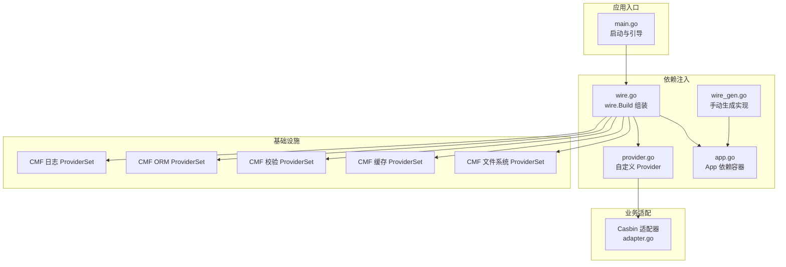
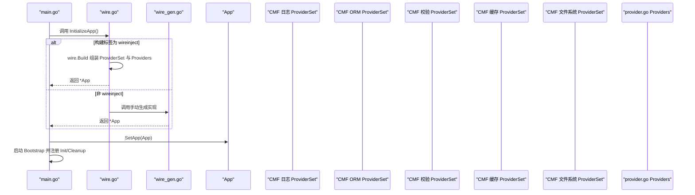
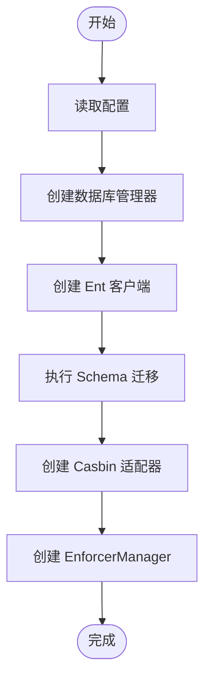
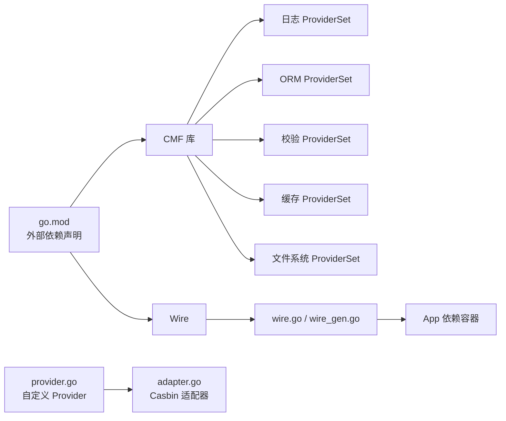

# Provider 配置

<cite>
**本文引用的文件列表**
- [provider.go](file://internal/provider.go)
- [wire.go](file://internal/wire.go)
- [wire_gen.go](file://internal/wire_gen.go)
- [app.go](file://internal/app.go)
- [init.go](file://internal/init.go)
- [cleanup.go](file://internal/cleanup.go)
- [main.go](file://main.go)
- [adapter.go](file://internal/casbin/adapter/adapter.go)
- [config.yml](file://config/config.yml)
- [go.mod](file://go.mod)
</cite>

## 目录
1. [简介](#简介)
2. [项目结构](#项目结构)
3. [核心组件](#核心组件)
4. [架构总览](#架构总览)
5. [详细组件分析](#详细组件分析)
6. [依赖关系分析](#依赖关系分析)
7. [性能考虑](#性能考虑)
8. [故障排查指南](#故障排查指南)
9. [结论](#结论)
10. [附录](#附录)

## 简介
本文件围绕项目中的 Provider 配置与依赖注入体系展开，重点解释：
- Provider 函数的定义方法与参数传递机制（构造函数注入与工厂函数）
- ProviderSet 的组织方式与模块化配置策略
- 依赖关系声明、循环依赖检测与规避
- 自定义 Provider 的开发指南（接口定义、实现细节、注册方法）
- Provider 的作用域与生命周期管理
- 复杂依赖关系的配置示例与性能优化建议

本项目采用 Google Wire 作为依赖注入框架，并结合 CMF 库提供的 ProviderSet（日志、ORM、校验、缓存、文件系统等）统一构建应用依赖容器。

## 项目结构
项目采用分层+模块化的组织方式：
- 根目录包含入口程序、配置文件与内部模块
- 内部模块包含依赖注入、应用初始化、清理、服务与处理器等
- 通过 Wire 构建应用依赖容器，对外暴露统一的 App 结构体

图表来源
- [wire.go:22-37](file://internal/wire.go#L22-L37)
- [wire_gen.go:18-62](file://internal/wire_gen.go#L18-L62)
- [provider.go:17-46](file://internal/provider.go#L17-L46)
- [app.go:15-28](file://internal/app.go#L15-L28)
- [adapter.go:76-113](file://internal/casbin/adapter/adapter.go#L76-L113)

章节来源
- [wire.go:1-38](file://internal/wire.go#L1-L38)
- [wire_gen.go:1-62](file://internal/wire_gen.go#L1-L62)
- [provider.go:1-47](file://internal/provider.go#L1-L47)
- [app.go:1-28](file://internal/app.go#L1-L28)
- [main.go:1-108](file://main.go#L1-L108)

## 核心组件
- App 依赖容器：集中承载配置、日志、数据库、校验器、缓存、文件系统、Ent ORM 客户端、Casbin EnforcerManager、SSE Hub、SSE TicketStore 等
- 自定义 Provider：NewEntClient、NewCasbinAdapter、NewEnforcerManager
- ProviderSet：来自 CMF 的日志、ORM、校验、缓存、文件系统 ProviderSet
- 手动生成实现：wire_gen.go 提供非 wireinject 构建下的等效实现

章节来源
- [app.go:16-28](file://internal/app.go#L16-L28)
- [provider.go:17-46](file://internal/provider.go#L17-L46)
- [wire.go:22-37](file://internal/wire.go#L22-L37)
- [wire_gen.go:18-62](file://internal/wire_gen.go#L18-L62)

## 架构总览
Wire 通过 wire.Build 将 ProviderSet 与自定义 Provider 组合，形成完整的依赖图；运行时通过生成的 InitializeApp 返回 App 实例，供主程序使用。

图表来源
- [wire.go:22-37](file://internal/wire.go#L22-L37)
- [wire_gen.go:18-62](file://internal/wire_gen.go#L18-L62)
- [main.go:47-61](file://main.go#L47-L61)

章节来源
- [wire.go:22-37](file://internal/wire.go#L22-L37)
- [wire_gen.go:18-62](file://internal/wire_gen.go#L18-L62)
- [main.go:47-96](file://main.go#L47-L96)

## 详细组件分析

### Provider 函数定义与参数传递
- NewEntClient：接收配置与数据库管理器，创建 Ent 客户端并执行自动迁移
- NewCasbinAdapter：接收 Ent 客户端，创建 Casbin 适配器
- NewEnforcerManager：接收 Casbin 适配器与配置，创建 EnforcerManager

这些 Provider 体现了“构造函数注入”与“工厂函数”的混合模式：
- 构造函数注入：通过函数参数显式声明依赖（如 NewEntClient 接收 *config.Config 与 *orm.DBManager）
- 工厂函数：通过 Provider 返回对象（如 NewEntClient 返回 *ent.Client）

章节来源
- [provider.go:17-46](file://internal/provider.go#L17-L46)

### ProviderSet 的组织与模块化配置
- ProviderSet 来自 CMF 库的日志、ORM、校验、缓存、文件系统模块，分别以 ProviderSet 形式暴露
- 在 wire.Build 中统一引入，形成模块化配置策略：按功能域拆分 ProviderSet，便于替换与扩展

章节来源
- [wire.go:26-31](file://internal/wire.go#L26-L31)

### 依赖关系声明与循环依赖检测
- wire.Build 显式声明依赖关系：先引入基础 ProviderSet，再引入自定义 Provider
- 依赖链路清晰：配置 -> 数据库管理器 -> Ent 客户端 -> Casbin 适配器 -> EnforcerManager
- 循环依赖检测：Wire 在编译期会检测并报错，若出现循环依赖，应调整 Provider 设计或拆分模块

章节来源
- [wire.go:24-35](file://internal/wire.go#L24-L35)

### 自定义 Provider 开发指南
- 接口定义：Provider 函数签名应明确依赖类型与返回值类型
- 实现细节：在函数体内完成对象创建、初始化与必要校验（如数据库连接、Schema 迁移）
- 注册方法：在 wire.Build 中将 Provider 函数加入依赖图；如需工厂函数，可直接在 Build 中注册

章节来源
- [provider.go:17-46](file://internal/provider.go#L17-L46)
- [wire.go:24-35](file://internal/wire.go#L24-L35)

### 作用域与生命周期管理
- App 作为全局依赖容器，承载各子系统实例
- 清理流程：在 Cleanup 中依次持久化 UID、清理过期分片会话、停止分片清理协程、停止 CronManager、关闭数据库连接池与 Ent 客户端，确保资源释放
- 生命周期：通过 Bootstrap 的 RegisterInitFunc 与 RegisterCleanupFunc 管理初始化与清理

章节来源
- [app.go:16-28](file://internal/app.go#L16-L28)
- [cleanup.go:12-51](file://internal/cleanup.go#L12-L51)
- [main.go:59-106](file://main.go#L59-L106)

### 复杂依赖关系配置示例
- 数据库与权限控制链路：配置 -> 数据库管理器 -> Ent 客户端 -> Casbin 适配器 -> EnforcerManager
- 该链路通过 ProviderSet 与自定义 Provider 组合，形成稳定的依赖图

图表来源
- [provider.go:17-46](file://internal/provider.go#L17-L46)
- [adapter.go:76-113](file://internal/casbin/adapter/adapter.go#L76-L113)

章节来源
- [provider.go:17-46](file://internal/provider.go#L17-L46)
- [adapter.go:76-113](file://internal/casbin/adapter/adapter.go#L76-L113)

## 依赖关系分析
- 外部依赖：Wire、CMF 库（日志、ORM、校验、缓存、文件系统）、Ent ORM、Casbin
- 内部依赖：provider.go 中的自定义 Provider 与 internal/casbin/adapter/adapter.go 中的适配器实现
- 构建标签：wireinject 控制是否启用 Wire 生成代码路径

图表来源
- [go.mod:5-18](file://go.mod#L5-L18)
- [wire.go:6-16](file://internal/wire.go#L6-L16)
- [provider.go:3-15](file://internal/provider.go#L3-L15)
- [adapter.go:15-36](file://internal/casbin/adapter/adapter.go#L15-L36)

章节来源
- [go.mod:1-128](file://go.mod#L1-L128)
- [wire.go:1-38](file://internal/wire.go#L1-L38)
- [provider.go:1-47](file://internal/provider.go#L1-L47)
- [adapter.go:1-544](file://internal/casbin/adapter/adapter.go#L1-L544)

## 性能考虑
- 数据库迁移策略：自动迁移开启 DropIndex 与 DropColumn，确保 Schema 变更时清理旧索引与列，减少冗余开销
- 批量写入：Casbin 适配器在保存策略时采用批量插入，提升写入吞吐
- 缓存与文件系统：通过 CMF ProviderSet 提供的缓存与文件系统实现，结合配置文件中的存储选项，优化 I/O 性能
- 连接池与资源释放：在 Cleanup 中关闭数据库连接池与 Ent 客户端，避免资源泄漏

章节来源
- [provider.go:30-33](file://internal/provider.go#L30-L33)
- [adapter.go:199-213](file://internal/casbin/adapter/adapter.go#L199-L213)
- [cleanup.go:22-49](file://internal/cleanup.go#L22-L49)
- [config.yml:32-74](file://config/config.yml#L32-L74)

## 故障排查指南
- 初始化失败：检查配置文件与数据库连接参数，确认迁移成功
- 权限策略未生效：确认 EnforcerManager 已正确注入并重新加载策略
- 资源未释放：确保在 Cleanup 中调用关闭数据库连接池与 Ent 客户端
- 依赖冲突：若出现编译期错误，检查 wire.Build 中的依赖顺序与 Provider 签名

章节来源
- [init.go:98-132](file://internal/init.go#L98-L132)
- [init.go:134-310](file://internal/init.go#L134-L310)
- [cleanup.go:12-51](file://internal/cleanup.go#L12-L51)
- [wire.go:24-35](file://internal/wire.go#L24-L35)

## 结论
本项目的 Provider 配置以 Wire 为核心，结合 CMF 的 ProviderSet 与自定义 Provider，实现了模块化、可维护且高性能的依赖注入体系。通过清晰的依赖声明、合理的生命周期管理与完善的清理流程，能够稳定支撑复杂业务场景。

## 附录
- 配置文件位置与关键项：配置文件位于 config/config.yml，包含应用、日志、数据库、缓存、Redis、文件系统等配置项
- 启动流程：main.go 中通过 Bootstrap 注册初始化与清理函数，并在初始化阶段优先使用 Wire 注入的 App 实例

章节来源
- [config.yml:1-74](file://config/config.yml#L1-L74)
- [main.go:47-96](file://main.go#L47-L96)