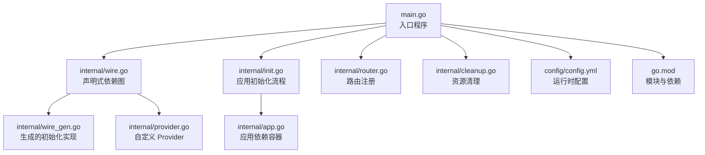
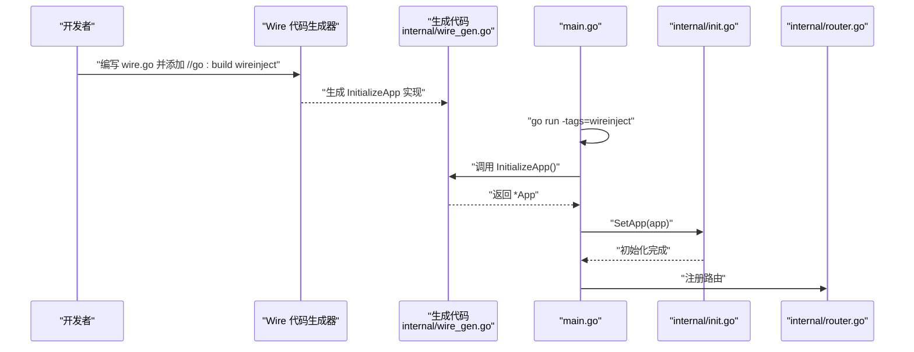
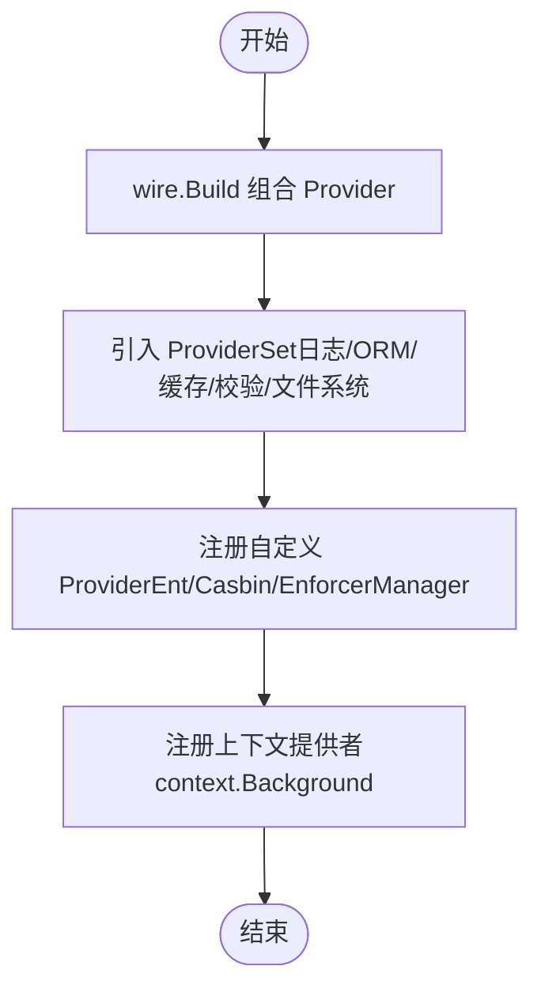
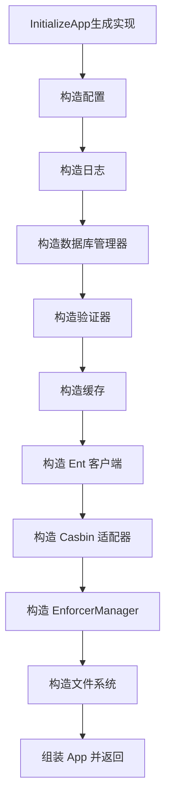
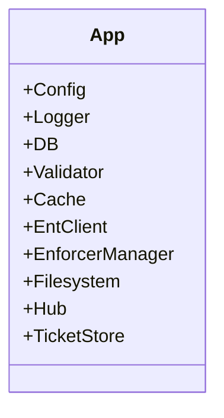
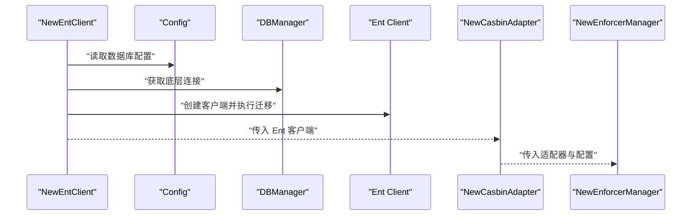
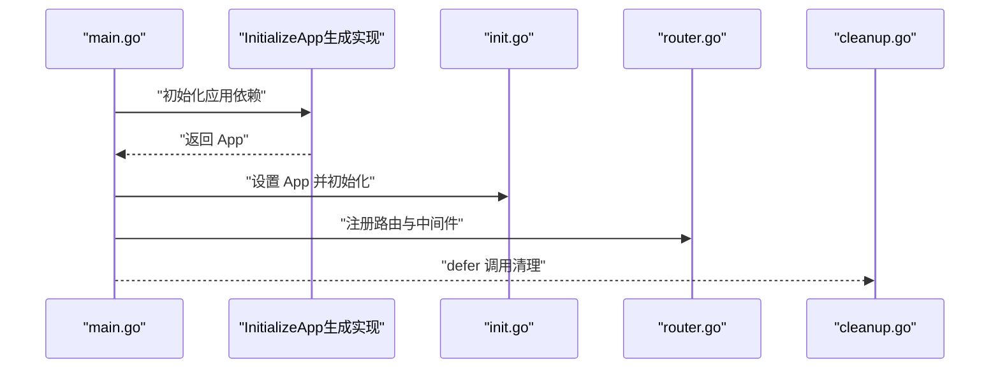
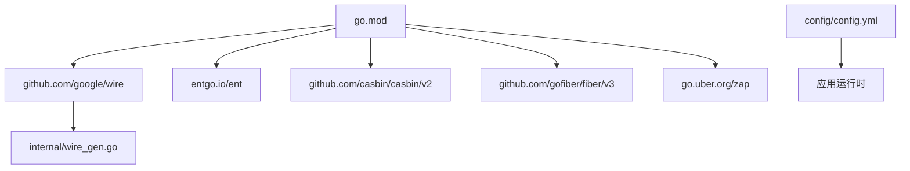

# Wire 框架使用

<cite>
**本文引用的文件**
- [main.go](file://main.go)
- [internal/wire.go](file://internal/wire.go)
- [internal/wire_gen.go](file://internal/wire_gen.go)
- [internal/provider.go](file://internal/provider.go)
- [internal/app.go](file://internal/app.go)
- [internal/init.go](file://internal/init.go)
- [internal/router.go](file://internal/router.go)
- [internal/cleanup.go](file://internal/cleanup.go)
- [go.mod](file://go.mod)
- [config/config.yml](file://config/config.yml)
</cite>

## 目录
1. [简介](#简介)
2. [项目结构](#项目结构)
3. [核心组件](#核心组件)
4. [架构总览](#架构总览)
5. [详细组件分析](#详细组件分析)
6. [依赖分析](#依赖分析)
7. [性能考虑](#性能考虑)
8. [故障排查指南](#故障排查指南)
9. [结论](#结论)
10. [附录](#附录)

## 简介
本文件面向使用 Wire 框架进行依赖注入与编译时代码生成的开发者，结合项目中的实际用法，系统讲解以下主题：
- Wire 注解指令与 Provider 的声明方式（wire.Build、ProviderSet、自定义 Provider 等）
- 编译时代码生成机制与 build tags 的作用
- 依赖注入的声明式写法与生成代码的结构
- 最佳实践、常见错误与调试方法
- 从简单到复杂的示例路径与落地建议

## 项目结构
该项目采用“入口程序 + 内部包 + 生成代码”的组织方式：
- 入口程序负责调用 Wire 生成的初始化函数，完成应用依赖装配
- internal 包下包含：
  - wire.go：声明式依赖图与 wire.Build
  - wire_gen.go：由 Wire 生成的初始化实现（非 wireinject 构建标签）
  - provider.go：自定义 Provider（如 Ent 客户端、Casbin 适配器、EnforcerManager）
  - app.go：应用依赖容器结构体
  - init.go、router.go、cleanup.go：应用生命周期、路由与资源清理
- 根目录包含配置文件与模块描述文件

图表来源
- [main.go:47-106](file://main.go#L47-L106)
- [internal/wire.go:22-37](file://internal/wire.go#L22-L37)
- [internal/wire_gen.go:17-62](file://internal/wire_gen.go#L17-L62)
- [internal/init.go:46-129](file://internal/init.go#L46-L129)
- [internal/router.go:16-365](file://internal/router.go#L16-L365)
- [internal/cleanup.go:12-51](file://internal/cleanup.go#L12-L51)
- [internal/app.go:16-28](file://internal/app.go#L16-L28)
- [internal/provider.go:17-46](file://internal/provider.go#L17-L46)
- [config/config.yml:1-147](file://config/config.yml#L1-L147)
- [go.mod:1-145](file://go.mod#L1-L145)

章节来源
- [main.go:47-106](file://main.go#L47-L106)
- [internal/wire.go:22-37](file://internal/wire.go#L22-L37)
- [internal/wire_gen.go:17-62](file://internal/wire_gen.go#L17-L62)
- [internal/init.go:46-129](file://internal/init.go#L46-L129)
- [internal/router.go:16-365](file://internal/router.go#L16-L365)
- [internal/cleanup.go:12-51](file://internal/cleanup.go#L12-L51)
- [internal/app.go:16-28](file://internal/app.go#L16-L28)
- [internal/provider.go:17-46](file://internal/provider.go#L17-L46)
- [config/config.yml:1-147](file://config/config.yml#L1-L147)
- [go.mod:1-145](file://go.mod#L1-L145)

## 核心组件
- 应用依赖容器 App：集中持有配置、日志、数据库、验证器、缓存、Ent 客户端、Casbin 策略管理器、文件系统、SSE Hub、SSE TicketStore 等依赖
- 声明式依赖图：通过 wire.Build 组合 ProviderSet 与自定义 Provider，形成可编译的依赖图
- 生成代码：wire_gen.go 中的手工等价实现，用于非 wireinject 构建场景
- 生命周期与路由：init.go 负责初始化（含 SSE Hub/TicketStore 初始化）；router.go 注册路由；cleanup.go 负责资源回收

章节来源
- [internal/app.go:16-28](file://internal/app.go#L16-L28)
- [internal/wire.go:22-37](file://internal/wire.go#L22-L37)
- [internal/wire_gen.go:17-62](file://internal/wire_gen.go#L17-L62)
- [internal/init.go:46-129](file://internal/init.go#L46-L129)
- [internal/router.go:16-365](file://internal/router.go#L16-L365)
- [internal/cleanup.go:12-51](file://internal/cleanup.go#L12-L51)

## 架构总览
Wire 在本项目中的工作流如下：
- 开发者在 wire.go 中声明依赖图（ProviderSet、自定义 Provider、上下文提供者）
- 使用构建标签 wireinject 触发 wire 代码生成，生成 wire_gen.go
- 运行时通过 main.go 调用 InitializeApp，获得 App 实例
- 应用初始化、路由注册、资源清理均围绕 App 依赖容器展开

图表来源
- [internal/wire.go:1-38](file://internal/wire.go#L1-L38)
- [internal/wire_gen.go:17-62](file://internal/wire_gen.go#L17-L62)
- [main.go:47-57](file://main.go#L47-L57)
- [internal/init.go:29-37](file://internal/init.go#L29-L37)
- [internal/router.go:16-365](file://internal/router.go#L16-L365)

## 详细组件分析

### 组件一：声明式依赖图（wire.Build 与 ProviderSet）
- wire.Build：在 wire.go 中通过 wire.Build 组合多个 Provider，形成可解析的依赖图
- ProviderSet：来自第三方库（如日志、ORM、缓存、校验、文件系统）的 ProviderSet，统一纳入依赖图
- 自定义 Provider：NewEntClient、NewCasbinAdapter、NewEnforcerManager 等，负责复杂对象的构造与初始化
- 上下文提供者：provideContext 返回 context.Background，作为依赖注入的根上下文

图表来源
- [internal/wire.go:22-37](file://internal/wire.go#L22-L37)
- [internal/provider.go:17-46](file://internal/provider.go#L17-L46)
- [internal/wire.go:18-20](file://internal/wire.go#L18-L20)

章节来源
- [internal/wire.go:18-37](file://internal/wire.go#L18-L37)
- [internal/provider.go:17-46](file://internal/provider.go#L17-L46)

### 组件二：生成代码结构与等价实现
- 生成文件：internal/wire_gen.go 在非 wireinject 构建标签下，提供与 wire.Build 等价的手工实现
- 初始化顺序：先构造配置，再依次构造日志、数据库、验证器、缓存、Ent 客户端、Casbin 适配器、策略管理器、文件系统，最后组装 App
- 错误传播：任一步骤出错，立即返回错误，保证初始化失败时不会得到部分初始化的 App

图表来源
- [internal/wire_gen.go:17-62](file://internal/wire_gen.go#L17-L62)

章节来源
- [internal/wire_gen.go:17-62](file://internal/wire_gen.go#L17-L62)

### 组件三：应用依赖容器（App）
- App 结构体集中持有应用所需的所有依赖，便于在初始化、路由、服务层复用
- 字段覆盖：配置、日志、数据库、验证器、缓存、Ent 客户端、策略管理器、文件系统、SSE Hub、SSE TicketStore

图表来源
- [internal/app.go:16-28](file://internal/app.go#L16-L28)

章节来源
- [internal/app.go:16-28](file://internal/app.go#L16-L28)

### 组件四：自定义 Provider（Ent、Casbin、EnforcerManager）
- NewEntClient：基于配置与数据库管理器创建 Ent 客户端，并执行 schema 自动迁移
- NewCasbinAdapter：基于 Ent 客户端创建 Casbin 适配器
- NewEnforcerManager：基于适配器与配置创建策略管理器

图表来源
- [internal/provider.go:17-46](file://internal/provider.go#L17-L46)

章节来源
- [internal/provider.go:17-46](file://internal/provider.go#L17-L46)

### 组件五：入口程序与生命周期
- main.go：调用 InitializeApp 获取 App，设置全局日志与引导流程，注册中间件与路由，最后在 defer 中执行清理
- init.go：兼容旧模式与新注入模式，优先使用 Wire 注入的依赖，否则回退到手动初始化；顺序执行：global.ORM 设置 → EnforcerManager 配置 → CronManager 启动 → Nonce 存储 → 分片清理协程 → RSA 密钥轮换 → SSE Hub/TicketStore → 种子数据
- cleanup.go：在退出前保存 UID 计数器、清理过期分片会话、停止分片清理协程、停止定时任务、关闭数据库连接池与 Ent 客户端

图表来源
- [main.go:47-106](file://main.go#L47-L106)
- [internal/init.go:46-129](file://internal/init.go#L46-L129)
- [internal/router.go:16-365](file://internal/router.go#L16-L365)
- [internal/cleanup.go:12-51](file://internal/cleanup.go#L12-L51)

章节来源
- [main.go:47-106](file://main.go#L47-L106)
- [internal/init.go:46-129](file://internal/init.go#L46-L129)
- [internal/router.go:16-365](file://internal/router.go#L16-L365)
- [internal/cleanup.go:12-51](file://internal/cleanup.go#L12-L51)

## 依赖分析
- 模块与外部依赖：go.mod 明确声明了 Wire、Ent、Casbin、Fiber、Zap 等依赖
- 构建标签：wireinject 用于触发代码生成；非 wireinject 时使用生成的初始化实现
- 配置驱动：config.yml 提供应用、日志、数据库、缓存、Redis、文件系统、Casbin 等配置项

图表来源
- [go.mod:1-145](file://go.mod#L1-L145)
- [config/config.yml:1-147](file://config/config.yml#L1-L147)
- [internal/wire_gen.go:17-62](file://internal/wire_gen.go#L17-L62)

章节来源
- [go.mod:1-145](file://go.mod#L1-L145)
- [config/config.yml:1-147](file://config/config.yml#L1-L147)
- [internal/wire_gen.go:17-62](file://internal/wire_gen.go#L17-L62)

## 性能考虑
- 生成代码的初始化顺序与依赖关系清晰，避免重复初始化与循环依赖
- 使用 ProviderSet 与自定义 Provider 将复杂对象的构造逻辑集中，便于优化与替换
- 在路由层按需注入缓存、文件系统等依赖，减少不必要的对象创建
- 建议将高频访问的域（Casbin）配置为自动加载，以降低首次访问延迟

## 故障排查指南
- 构建标签问题
  - 症状：运行时报错找不到 InitializeApp 或生成代码未生效
  - 排查：确认是否使用了 wireinject 构建标签；检查 //go:build 与 +build 注释是否正确
  - 参考
    - [internal/wire.go:1-3](file://internal/wire.go#L1-L3)
    - [internal/wire_gen.go:1-3](file://internal/wire_gen.go#L1-L3)
- Provider 缺失或签名不匹配
  - 症状：wire 无法解析依赖图
  - 排查：核对 wire.Build 中的 Provider 名称、参数类型与返回值类型是否与实际一致
  - 参考
    - [internal/wire.go:22-37](file://internal/wire.go#L22-L37)
    - [internal/provider.go:17-46](file://internal/provider.go#L17-L46)
- 初始化失败
  - 症状：InitializeApp 返回错误
  - 排查：逐个检查配置项、数据库连接、文件系统路径、Casbin 模型等
  - 参考
    - [internal/wire_gen.go:17-62](file://internal/wire_gen.go#L17-L62)
    - [config/config.yml:1-147](file://config/config.yml#L1-L147)
- 资源泄漏
  - 症状：退出时数据库连接池未关闭
  - 排查：确认 cleanup.go 中的关闭顺序与调用
  - 参考
    - [internal/cleanup.go:12-51](file://internal/cleanup.go#L12-L51)

章节来源
- [internal/wire.go:1-3](file://internal/wire.go#L1-L3)
- [internal/wire_gen.go:1-3](file://internal/wire_gen.go#L1-L3)
- [internal/wire.go:22-37](file://internal/wire.go#L22-L37)
- [internal/provider.go:17-46](file://internal/provider.go#L17-L46)
- [internal/wire_gen.go:17-62](file://internal/wire_gen.go#L17-L62)
- [config/config.yml:1-147](file://config/config.yml#L1-L147)
- [internal/cleanup.go:12-51](file://internal/cleanup.go#L12-L51)

## 结论
本项目通过 Wire 将依赖注入声明化与编译时生成相结合，实现了清晰、可维护且高性能的应用初始化流程。配合构建标签与生成代码，既能满足开发期的快速迭代，也能在生产环境保持稳定的初始化行为。建议在团队内推广统一的 ProviderSet 使用规范与初始化顺序约定，持续优化关键路径（如 Casbin 域自动加载）。

## 附录

### A. Wire 注解与指令速览
- wire.Build：组合多个 Provider 形成依赖图
- ProviderSet：第三方库提供的可直接纳入依赖图的 Provider 集合
- 自定义 Provider：函数签名明确输入输出，遵循依赖注入原则
- 上下文提供者：如 provideContext 返回 context.Background
- 构建标签：//go:build wireinject 与 +build wireinject 用于触发生成

章节来源
- [internal/wire.go:18-37](file://internal/wire.go#L18-L37)

### B. 从简单到复杂的示例路径
- 简单示例：仅使用 ProviderSet 与少量自定义 Provider
  - 参考
    - [internal/wire.go:22-37](file://internal/wire.go#L22-L37)
- 中等复杂度：引入上下文提供者与多 ProviderSet
  - 参考
    - [internal/wire.go:18-20](file://internal/wire.go#L18-L20)
    - [internal/wire.go:26-31](file://internal/wire.go#L26-L31)
- 复杂示例：Ent 客户端、Casbin 适配器与策略管理器串联
  - 参考
    - [internal/provider.go:17-46](file://internal/provider.go#L17-L46)
    - [internal/wire.go:32-35](file://internal/wire.go#L32-L35)

### C. 最佳实践
- 将 ProviderSet 与自定义 Provider 分层组织，避免 wire.Build 过长
- 明确上下文提供者位置，确保依赖链起点稳定
- 在 config.yml 中集中管理配置，避免硬编码
- 在 init.go 中兼容新旧注入模式，平滑过渡
- 在 cleanup.go 中严格控制关闭顺序，避免竞态

章节来源
- [internal/wire.go:22-37](file://internal/wire.go#L22-L37)
- [internal/provider.go:17-46](file://internal/provider.go#L17-L46)
- [config/config.yml:1-143](file://config/config.yml#L1-L143)
- [internal/init.go:39-96](file://internal/init.go#L39-L96)
- [internal/cleanup.go:11-42](file://internal/cleanup.go#L11-L42)