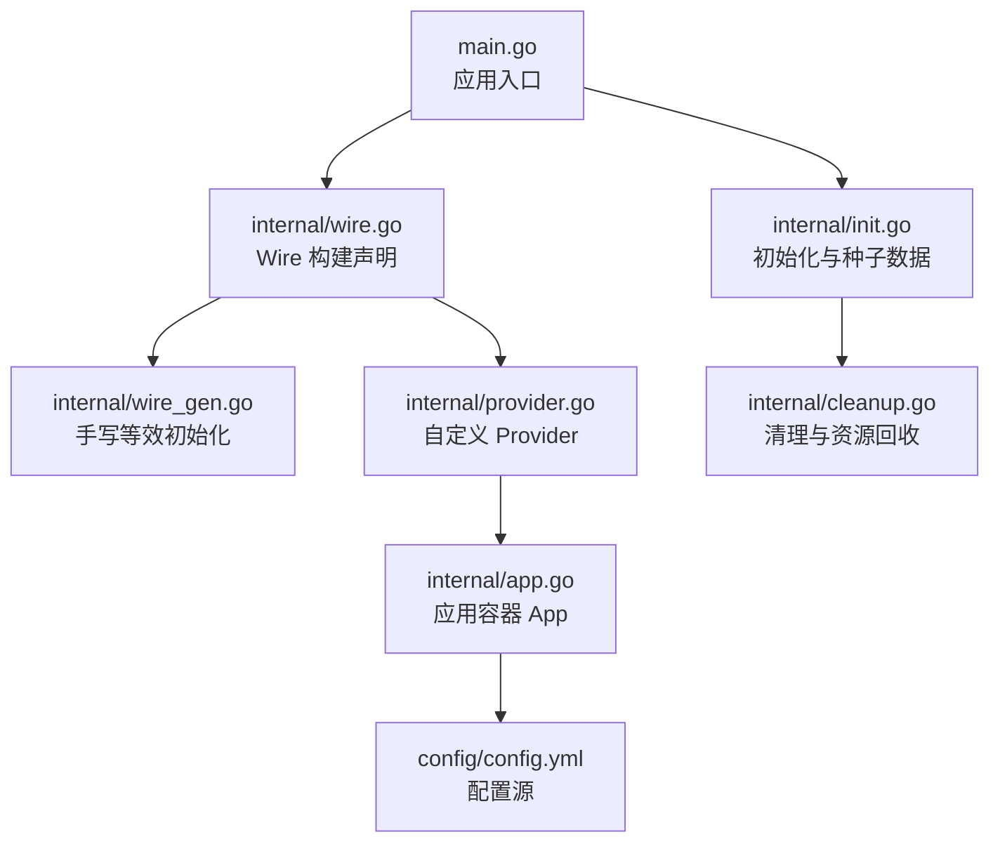
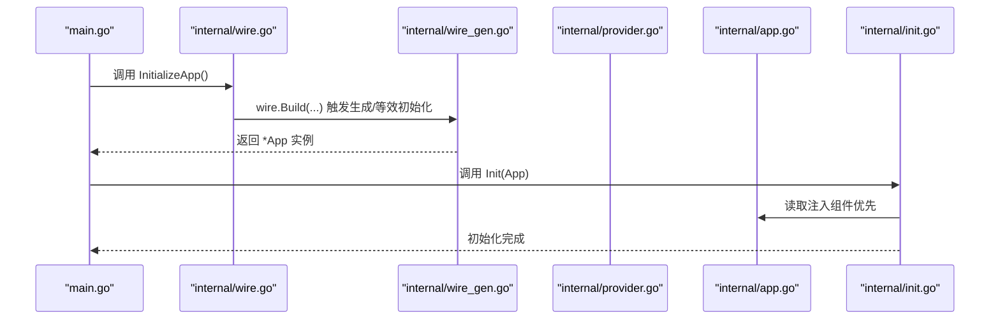
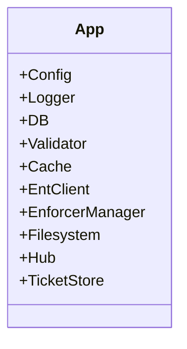
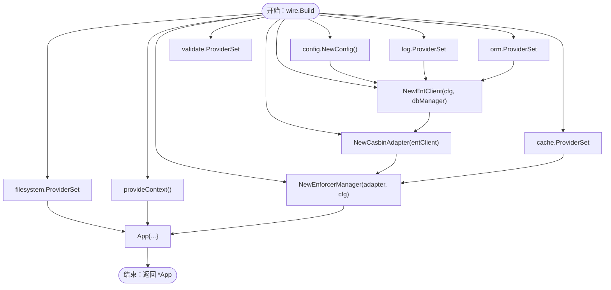
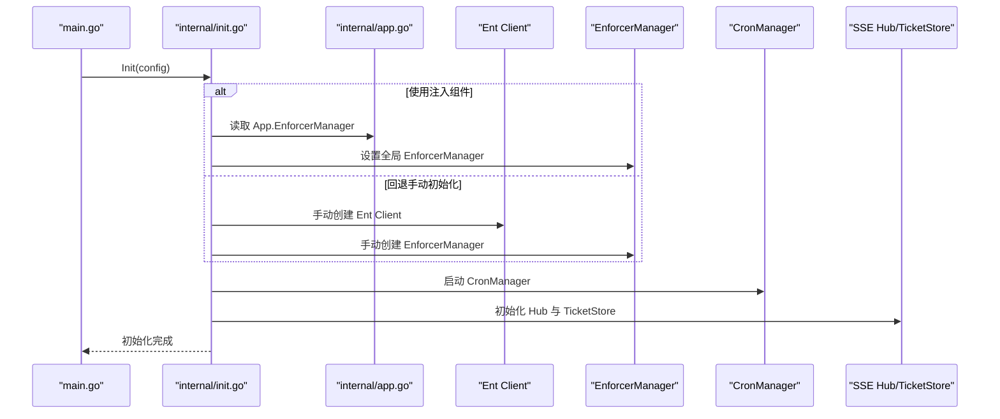
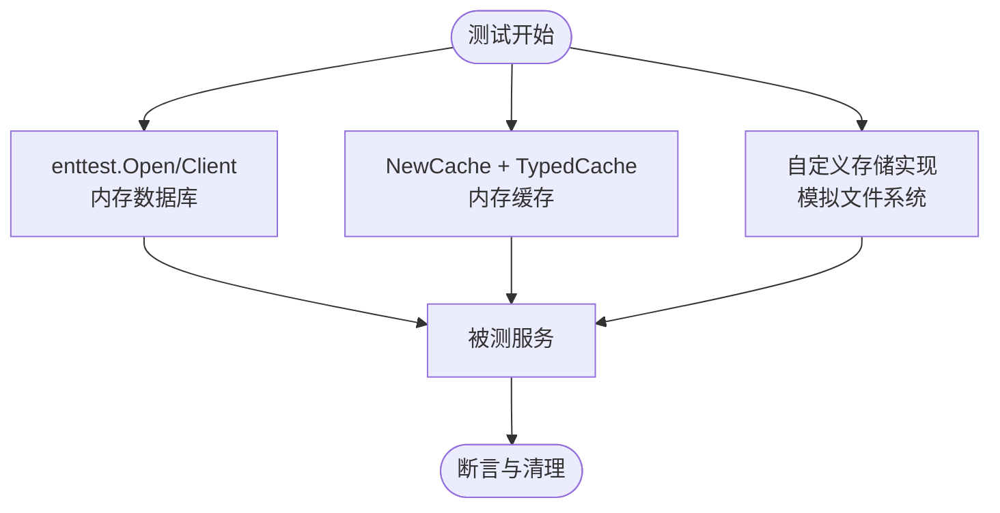
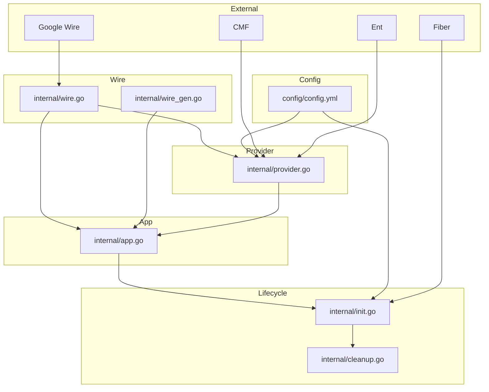

# 依赖注入系统

<cite>
**本文引用的文件**
- [main.go](file://main.go)
- [internal/wire.go](file://internal/wire.go)
- [internal/wire_gen.go](file://internal/wire_gen.go)
- [internal/provider.go](file://internal/provider.go)
- [internal/app.go](file://internal/app.go)
- [internal/init.go](file://internal/init.go)
- [internal/cleanup.go](file://internal/cleanup.go)
- [config/config.yml](file://config/config.yml)
- [go.mod](file://go.mod)
- [internal/service/attachment_test.go](file://internal/service/attachment_test.go)
- [internal/service/permission_test.go](file://internal/service/permission_test.go)
</cite>

## 目录
1. [简介](#简介)
2. [项目结构](#项目结构)
3. [核心组件](#核心组件)
4. [架构总览](#架构总览)
5. [详细组件分析](#详细组件分析)
6. [依赖关系分析](#依赖关系分析)
7. [性能考量](#性能考量)
8. [故障排查指南](#故障排查指南)
9. [结论](#结论)
10. [附录](#附录)

## 简介
本文件系统性阐述 Go Admin 管理系统的依赖注入与装配机制，基于 Google Wire 框架实现。内容涵盖 Provider 函数定义、依赖声明、组件生命周期管理、应用容器初始化流程、自定义 Provider 开发指南、测试中的依赖注入实践、性能影响与优化策略，以及常见问题诊断与解决方法，并提供依赖关系图与依赖树分析方法。

## 项目结构
围绕依赖注入的关键文件与职责如下：
- 入口与运行时集成
  - main.go：应用入口，调用 InitializeApp 完成依赖注入并启动引导流程。
- Wire 配置与生成
  - internal/wire.go：wireinject 构建标签下的依赖集合声明，定义 Provider 与绑定关系。
  - internal/wire_gen.go：!wireinject 构建标签下的手写等效初始化逻辑，作为 Wire 生成代码的参考实现。
- 组件提供者
  - internal/provider.go：自定义 Provider 函数，负责创建 Ent ORM 客户端、Casbin 适配器与 EnforcerManager。
  - internal/app.go：应用容器 App 结构体，承载所有注入组件。
- 生命周期与初始化
  - internal/init.go：初始化阶段，优先使用 Wire 注入的组件，否则回退到手动初始化；依次执行 global.ORM 设置、EnforcerManager 配置、CronManager 启动、Nonce 存储初始化、分片清理协程启动、RSA 密钥轮换初始化、SSE Hub 与 TicketStore 初始化、种子数据与字典数据初始化。
  - internal/cleanup.go：清理阶段，有序关闭资源：持久化 UID → 清理过期分片会话 → 停止清理协程 → 停止 CronManager → 关闭 DB 连接池 → 关闭 Ent client。
- 配置
  - config/config.yml：应用配置，驱动数据库、缓存、文件系统、Casbin 等组件的初始化参数。
- 测试
  - internal/service/*.go：服务层测试，展示如何在测试中构造最小依赖集，替代真实依赖（如内存缓存、SQLite 内存数据库）。

**图表来源**
- [main.go:47-107](file://main.go#L47-L107)
- [internal/wire.go:22-37](file://internal/wire.go#L22-L37)
- [internal/wire_gen.go:17-62](file://internal/wire_gen.go#L17-L62)
- [internal/provider.go:17-46](file://internal/provider.go#L17-L46)
- [internal/app.go:16-28](file://internal/app.go#L16-L28)
- [internal/init.go:46-129](file://internal/init.go#L46-L129)
- [internal/cleanup.go:12-51](file://internal/cleanup.go#L12-L51)
- [config/config.yml:1-147](file://config/config.yml#L1-L147)

**章节来源**
- [main.go:47-107](file://main.go#L47-L107)
- [internal/wire.go:22-37](file://internal/wire.go#L22-L37)
- [internal/wire_gen.go:17-62](file://internal/wire_gen.go#L17-L62)
- [internal/provider.go:17-46](file://internal/provider.go#L17-L46)
- [internal/app.go:16-28](file://internal/app.go#L16-L28)
- [internal/init.go:46-129](file://internal/init.go#L46-L129)
- [internal/cleanup.go:12-51](file://internal/cleanup.go#L12-L51)
- [config/config.yml:1-147](file://config/config.yml#L1-L147)

## 核心组件
- 应用容器 App
  - 字段包含：配置、日志、数据库管理器、验证器、缓存、Ent ORM 客户端、Casbin EnforcerManager、文件系统、SSE Hub、SSE TicketStore。
  - 作用：统一承载所有注入组件，供后续初始化与业务使用。
- Provider 函数
  - NewEntClient：基于配置与数据库管理器创建 Ent 客户端，并执行自动迁移（WithDropIndex/WithDropColumn）。
  - NewCasbinAdapter：基于 Ent 客户端创建 Casbin 适配器。
  - NewEnforcerManager：基于适配器与配置创建 EnforcerManager。
  - provideContext：提供根上下文，用于需要 context.Context 的 Provider。
- 初始化与清理
  - Init：优先使用 Wire 注入组件，否则回退手动初始化；依次执行：global.ORM 设置 → EnforcerManager 配置 → CronManager 启动 → Nonce 存储初始化 → 分片清理协程启动 → RSA 密钥轮换初始化 → SSE Hub 与 TicketStore 初始化 → 种子数据与字典数据初始化。
  - Cleanup：持久化 UID 计数器 → 清理过期分片会话 → 停止分片清理协程 → 停止 CronManager → 关闭 DB 连接池 → 关闭 Ent client。

**章节来源**
- [internal/app.go:16-28](file://internal/app.go#L16-L28)
- [internal/provider.go:17-46](file://internal/provider.go#L17-L46)
- [internal/init.go:46-129](file://internal/init.go#L46-L129)
- [internal/cleanup.go:12-51](file://internal/cleanup.go#L12-L51)

## 架构总览
下图展示了从应用启动到依赖注入完成的端到端流程，以及各组件之间的依赖关系。

**图表来源**
- [main.go:47-107](file://main.go#L47-L107)
- [internal/wire.go:22-37](file://internal/wire.go#L22-L37)
- [internal/wire_gen.go:17-62](file://internal/wire_gen.go#L17-L62)
- [internal/provider.go:17-46](file://internal/provider.go#L17-L46)
- [internal/init.go:39-96](file://internal/init.go#L39-L96)

## 详细组件分析

### 组件一：应用容器 App
- 结构体字段覆盖了系统关键能力：配置、日志、数据库、验证、缓存、ORM、权限控制、文件系统、SSE 实时推送（Hub 与 TicketStore）。
- 作为依赖注入的最终产物，贯穿初始化、运行与清理阶段。

**图表来源**
- [internal/app.go:16-28](file://internal/app.go#L16-L28)

**章节来源**
- [internal/app.go:16-28](file://internal/app.go#L16-L28)

### 组件二：Provider 函数与装配顺序
- wire.Build 中的装配顺序即为依赖解析顺序，Wire 会根据类型推断与显式绑定自动解析依赖。
- 关键 Provider 与依赖链：
  - provideContext → NewEntClient(cfg, dbManager)
  - config.NewConfig → NewEntClient
  - log.ProviderSet → NewEntClient
  - orm.ProviderSet → NewEntClient
  - validate.ProviderSet → NewCasbinAdapter
  - cache.ProviderSet → NewEnforcerManager
  - filesystem.ProviderSet → App.Filesystem
  - NewEntClient → NewCasbinAdapter → NewEnforcerManager

**图表来源**
- [internal/wire.go:22-37](file://internal/wire.go#L22-L37)
- [internal/provider.go:17-46](file://internal/provider.go#L17-L46)
- [internal/wire_gen.go:17-62](file://internal/wire_gen.go#L17-L62)

**章节来源**
- [internal/wire.go:22-37](file://internal/wire.go#L22-L37)
- [internal/provider.go:17-46](file://internal/provider.go#L17-L46)
- [internal/wire_gen.go:17-62](file://internal/wire_gen.go#L17-L62)

### 组件三：初始化与生命周期
- 初始化阶段优先使用注入组件，若缺失则回退到手动初始化，保证兼容性。
- 初始化流程：global.ORM 设置 → EnforcerManager 配置 → CronManager 启动 → Nonce 存储初始化 → 分片清理协程启动 → RSA 密钥轮换初始化 → SSE Hub 与 TicketStore 初始化 → 种子数据与字典数据初始化。
- 清理流程：持久化 UID 计数器 → 清理过期分片会话 → 停止分片清理协程 → 停止 CronManager → 关闭 DB 连接池 → 关闭 Ent client。

**图表来源**
- [internal/init.go:46-129](file://internal/init.go#L46-L129)
- [internal/app.go:16-28](file://internal/app.go#L16-L28)

**章节来源**
- [internal/init.go:46-129](file://internal/init.go#L46-L129)
- [internal/app.go:16-28](file://internal/app.go#L16-L28)

### 组件四：测试中的依赖注入
- 在测试中，通过最小化依赖集替代真实外部依赖，例如：
  - 使用内存缓存替代 Redis 或本地缓存，避免外部依赖。
  - 使用 SQLite 内存数据库替代真实数据库，提升测试速度与隔离性。
  - 使用自定义存储实现替代真实文件系统，便于断言与控制。
- 测试工具与模式：
  - enttest.Open/enttest.NewClient：自动迁移与内存数据库初始化。
  - NewCache + TypedCache：构造测试用缓存。
  - 自定义存储实现：模拟文件系统行为。

**图表来源**
- [internal/service/attachment_test.go:56-82](file://internal/service/attachment_test.go#L56-L82)
- [internal/service/permission_test.go:46-62](file://internal/service/permission_test.go#L46-L62)

**章节来源**
- [internal/service/attachment_test.go:56-82](file://internal/service/attachment_test.go#L56-L82)
- [internal/service/permission_test.go:46-62](file://internal/service/permission_test.go#L46-L62)

## 依赖关系分析
- 外部依赖
  - Google Wire：提供依赖注入与代码生成能力。
  - CMF 生态：配置、日志、ORM、验证、缓存、文件系统、Casbin。
  - Ent：ORM 与 Schema 管理。
  - Fiber：Web 框架。
- 内部耦合
  - wire.go 与 wire_gen.go 形成“声明-等效实现”对，确保构建标签切换时行为一致。
  - provider.go 与 init.go 协作，前者负责装配，后者负责初始化与兼容回退。
  - config.yml 为所有 Provider 提供配置输入，决定组件行为与连接参数。

**图表来源**
- [internal/wire.go:22-37](file://internal/wire.go#L22-L37)
- [internal/wire_gen.go:17-62](file://internal/wire_gen.go#L17-L62)
- [internal/provider.go:17-46](file://internal/provider.go#L17-L46)
- [internal/app.go:16-28](file://internal/app.go#L16-L28)
- [internal/init.go:46-129](file://internal/init.go#L46-L129)
- [internal/cleanup.go:12-51](file://internal/cleanup.go#L12-L51)
- [config/config.yml:1-147](file://config/config.yml#L1-L147)
- [go.mod:12](file://go.mod#L12)

**章节来源**
- [go.mod:12](file://go.mod#L12)
- [internal/wire.go:22-37](file://internal/wire.go#L22-L37)
- [internal/wire_gen.go:17-62](file://internal/wire_gen.go#L17-L62)
- [internal/provider.go:17-46](file://internal/provider.go#L17-L46)
- [internal/app.go:16-28](file://internal/app.go#L16-L28)
- [internal/init.go:46-129](file://internal/init.go#L46-L129)
- [internal/cleanup.go:12-51](file://internal/cleanup.go#L12-L51)
- [config/config.yml:1-147](file://config/config.yml#L1-L147)

## 性能考量
- 生成与构建
  - wire.Build 仅在 wireinject 构建标签下触发生成；!wireinject 下由手写等效逻辑提供相同行为，避免在常规构建中引入生成开销。
- 组件初始化顺序
  - 数据库与 ORM 的初始化应尽早完成，以便后续组件复用连接与连接池。
- 缓存策略
  - 在权限查询等高频场景使用缓存，结合测试中对缓存失效的断言，确保缓存命中率与一致性。
- 连接池与资源释放
  - 清理阶段先停止定时任务，再关闭数据库连接池与 ORM 客户端，避免并发访问与资源泄漏。

[本节为通用性能建议，无需特定文件引用]

## 故障排查指南
- 无法解析依赖
  - 检查 wire.Build 中是否遗漏 Provider 或未导出类型。
  - 确认 provideContext 等上下文 Provider 是否存在且返回正确的 context。
- 注入组件为空
  - 检查 Init 是否正确读取 App 注入组件；若为空，确认 wireinject 构建标签是否正确启用。
- 数据库连接失败
  - 核对 config.yml 中数据库连接参数与驱动配置。
  - 确认 NewEntClient 的 DNS 与驱动参数正确。
- 权限策略未生效
  - 确认 EnforcerManager 是否成功注入；若回退到手动初始化，检查 Casbin 适配器与模型配置。
- 清理阶段报错
  - 检查 Cleanup 中的关闭顺序与错误处理，确保连接池与客户端均正确关闭。

**章节来源**
- [internal/wire.go:22-37](file://internal/wire.go#L22-L37)
- [internal/init.go:46-129](file://internal/init.go#L46-L129)
- [internal/cleanup.go:12-51](file://internal/cleanup.go#L12-L51)
- [config/config.yml:19-31](file://config/config.yml#L19-L31)
- [config/config.yml:19-31](file://config/config.yml#L19-L31)

## 结论
本系统采用 Google Wire 实现清晰、可维护的依赖注入与装配机制。通过 Provider 函数与 wire.Build 明确声明依赖关系，配合 App 容器统一承载组件，并在初始化与清理阶段严格管理生命周期。测试中以最小依赖集替代真实外部依赖，提升可测试性与稳定性。遵循本文的最佳实践与排障建议，可在保证性能的同时获得良好的可维护性与可靠性。

[本节为总结性内容，无需特定文件引用]

## 附录
- 自定义 Provider 开发指南
  - 明确输入参数：尽量使用接口或抽象类型，降低耦合。
  - 处理错误：Provider 应返回 error，便于上层统一处理。
  - 上下文：对于需要 context 的组件，提供对应的 provideContext。
  - 可测试性：优先注入接口，便于在测试中替换为模拟实现。
- 依赖树分析方法
  - 使用 wire.Build 的依赖解析结果，结合 wire_gen.go 的等效实现，绘制依赖树。
  - 从 config.NewConfig 开始，逐层追踪到具体组件（如 Ent Client、Casbin Adapter、EnforcerManager）。
- 测试中的 Provider 替代
  - 在测试中使用内存缓存、SQLite 内存数据库与自定义存储实现，替代真实外部依赖，确保测试快速、稳定与可重复。

**章节来源**
- [internal/wire.go:22-37](file://internal/wire.go#L22-L37)
- [internal/wire_gen.go:17-62](file://internal/wire_gen.go#L17-L62)
- [internal/provider.go:17-46](file://internal/provider.go#L17-L46)
- [internal/service/attachment_test.go:56-82](file://internal/service/attachment_test.go#L56-L82)
- [internal/service/permission_test.go:46-62](file://internal/service/permission_test.go#L46-L62)