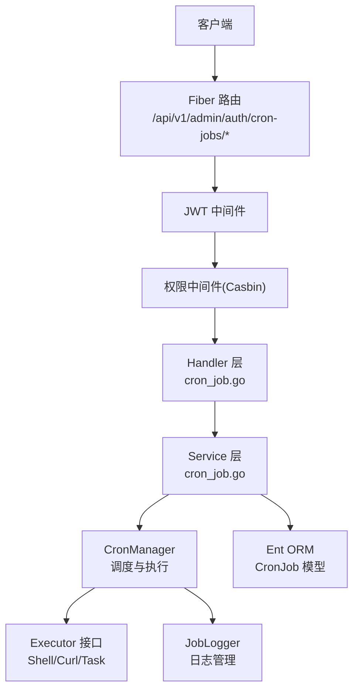
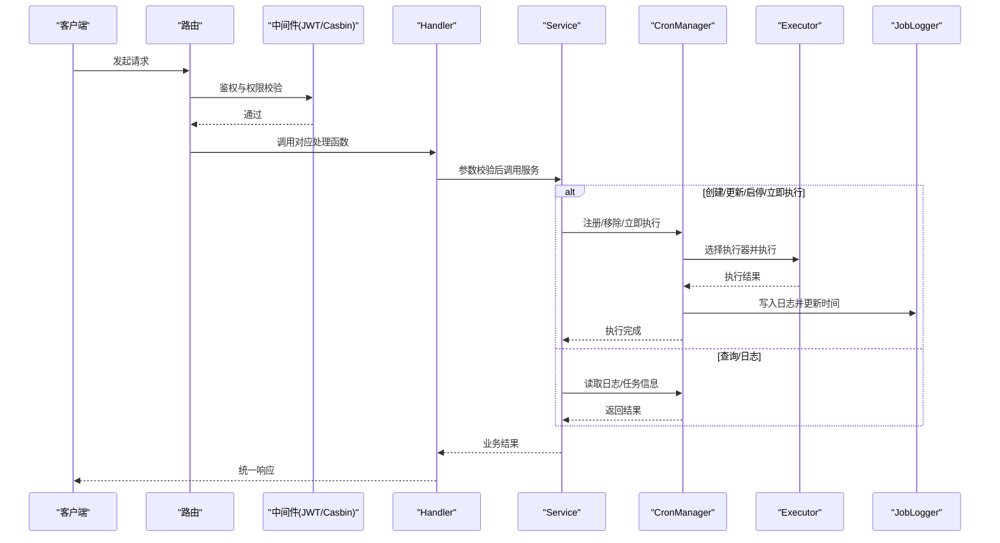
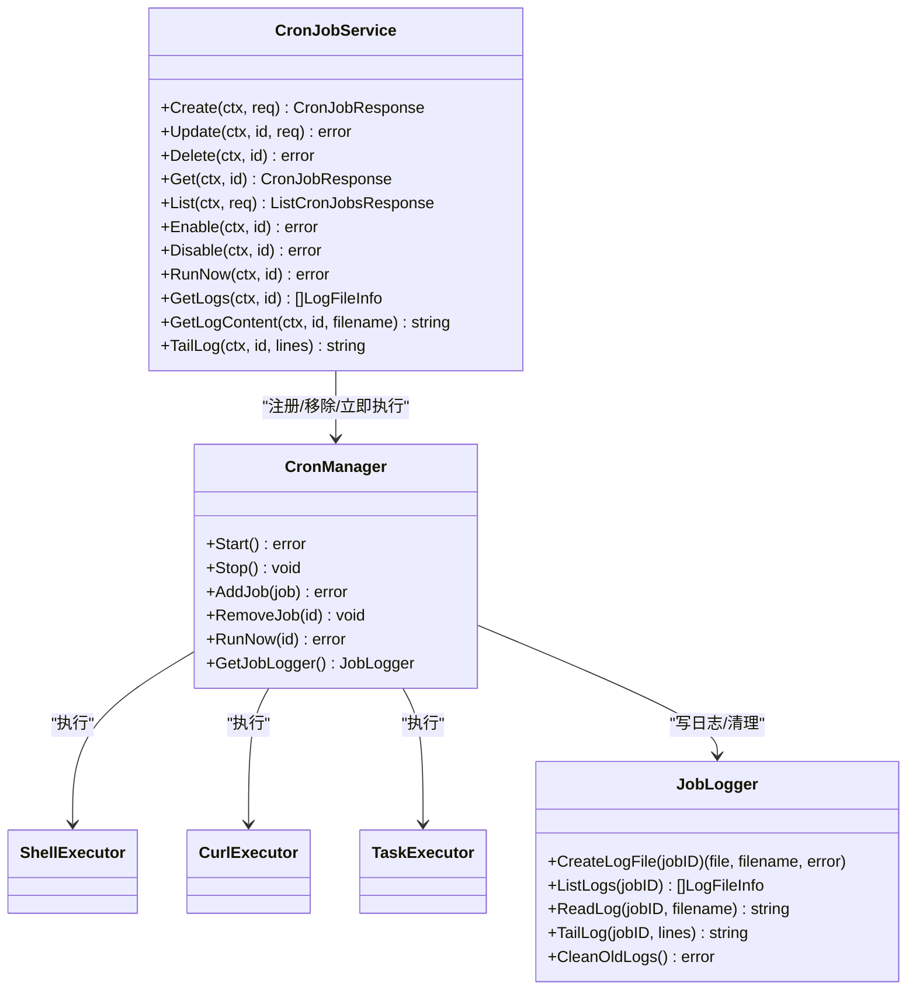

# API接口规范

<cite>
**本文引用的文件**
- [internal/handler/cron_job.go](file://internal/handler/cron_job.go)
- [internal/service/cron_job.go](file://internal/service/cron_job.go)
- [internal/router.go](file://internal/router.go)
- [internal/ent/cronjob/cronjob.go](file://internal/ent/cronjob/cronjob.go)
- [internal/middleware/permission.go](file://internal/middleware/permission.go)
- [internal/global/msg.go](file://internal/global/msg.go)
- [internal/cron/manager.go](file://internal/cron/manager.go)
- [internal/cron/executor.go](file://internal/cron/executor.go)
- [internal/cron/logger.go](file://internal/cron/logger.go)
- [internal/tasks/registry.go](file://internal/tasks/registry.go)
- [docs/swagger.yaml](file://docs/swagger.yaml)
</cite>

## 目录
1. [简介](#简介)
2. [项目结构](#项目结构)
3. [核心组件](#核心组件)
4. [架构总览](#架构总览)
5. [详细组件分析](#详细组件分析)
6. [依赖关系分析](#依赖关系分析)
7. [性能与可靠性](#性能与可靠性)
8. [故障排查指南](#故障排查指南)
9. [结论](#结论)
10. [附录](#附录)

## 简介
本文件为“定时任务API接口”的完整技术文档，覆盖RESTful端点设计、任务管理与执行接口、认证与授权、参数校验、错误码与异常处理、最佳实践与常见问题等。系统基于 Fiber 框架构建，采用 JWT 进行认证、Casbin 进行细粒度权限控制，支持三种任务类型（Shell、Curl、Go Task），并提供日志采集与查看能力。

## 项目结构
- 路由层：在路由中统一挂载 /api/v1/admin/auth/cron-jobs 及其子路径，绑定鉴权中间件与权限中间件。
- 处理层：每个端点对应 handler 层函数，负责参数解析、调用服务层、封装响应。
- 服务层：实现业务逻辑，包括任务创建/更新/删除/查询、启停、立即执行、日志读取等。
- 执行层：CronManager 负责调度与执行；Executor 提供 Shell/Curl/Task 三类执行器；JobLogger 负责日志文件管理。
- 数据模型：Ent 自动生成的 CronJob 模型，约束字段与枚举类型。
- 文档：Swagger YAML 定义了端点、请求/响应结构与参数约束。

图表来源
- [internal/router.go:95-112](file://internal/router.go#L95-L112)
- [internal/handler/cron_job.go:14-58](file://internal/handler/cron_job.go#L14-L58)
- [internal/service/cron_job.go:43-55](file://internal/service/cron_job.go#L43-L55)
- [internal/cron/manager.go:17-38](file://internal/cron/manager.go#L17-L38)
- [internal/cron/executor.go:18-21](file://internal/cron/executor.go#L18-L21)
- [internal/cron/logger.go:20-32](file://internal/cron/logger.go#L20-L32)
- [internal/ent/cronjob/cronjob.go:90-112](file://internal/ent/cronjob/cronjob.go#L90-L112)

章节来源
- [internal/router.go:95-112](file://internal/router.go#L95-L112)
- [docs/swagger.yaml:1023-1533](file://docs/swagger.yaml#L1023-L1533)

## 核心组件
- 路由与中间件
  - 路由组：/api/v1/admin/auth/cron-jobs
  - 中间件链：JWT 鉴权 → 域中间件 → 权限中间件（Casbin）→ 服务实例注入
- Handler 层
  - 统一参数校验（解析+验证），错误码映射，响应封装
- Service 层
  - 业务规则：名称唯一性、cron 表达式校验、任务类型与命令一致性、启用状态变更时的调度器同步
- CronManager
  - 调度器启动/停止、任务注册/移除、立即执行、日志写入与下次执行时间更新
- Executor
  - ShellExecutor：跨平台 shell 执行
  - CurlExecutor：JSON 配置的 HTTP 请求执行
  - TaskExecutor：从全局注册表查找并执行 Go 任务
- JobLogger
  - 日志文件创建、列出、读取、尾部读取、过期清理
- Ent CronJob 模型
  - 字段：name、description、type、expression、command、enabled、last_run_at、next_run_at、createdAt、updatedAt
  - 枚举：type ∈ {shell, curl, task}

章节来源
- [internal/router.go:53-59](file://internal/router.go#L53-L59)
- [internal/middleware/permission.go:14-78](file://internal/middleware/permission.go#L14-L78)
- [internal/handler/cron_job.go:14-58](file://internal/handler/cron_job.go#L14-L58)
- [internal/service/cron_job.go:107-164](file://internal/service/cron_job.go#L107-L164)
- [internal/cron/manager.go:17-116](file://internal/cron/manager.go#L17-L116)
- [internal/cron/executor.go:18-126](file://internal/cron/executor.go#L18-L126)
- [internal/cron/logger.go:20-192](file://internal/cron/logger.go#L20-L192)
- [internal/ent/cronjob/cronjob.go:90-112](file://internal/ent/cronjob/cronjob.go#L90-L112)

## 架构总览
定时任务系统采用“路由-处理-服务-执行-日志”分层架构，结合 JWT 与 Casbin 实现认证与授权，确保接口安全可控。

图表来源
- [internal/router.go:95-112](file://internal/router.go#L95-L112)
- [internal/middleware/permission.go:14-78](file://internal/middleware/permission.go#L14-L78)
- [internal/handler/cron_job.go:28-58](file://internal/handler/cron_job.go#L28-L58)
- [internal/service/cron_job.go:107-164](file://internal/service/cron_job.go#L107-L164)
- [internal/cron/manager.go:85-147](file://internal/cron/manager.go#L85-L147)
- [internal/cron/executor.go:23-126](file://internal/cron/executor.go#L23-L126)
- [internal/cron/logger.go:34-146](file://internal/cron/logger.go#L34-L146)

## 详细组件分析

### RESTful 端点与请求/响应规范
- 基础路径
  - /api/v1/admin/auth/cron-jobs
- 认证与授权
  - Bearer Token（JWT）鉴权
  - Casbin 域级权限控制（路径+方法）
- 响应格式
  - 统一响应体：{ code, message, data }
  - code 0/1/2（失败/成功/操作成功），配合全局错误码映射

章节来源
- [internal/handler/cron_job.go:14-28](file://internal/handler/cron_job.go#L14-L28)
- [internal/middleware/permission.go:14-78](file://internal/middleware/permission.go#L14-L78)
- [internal/global/msg.go:3-42](file://internal/global/msg.go#L3-L42)
- [docs/swagger.yaml:1023-1533](file://docs/swagger.yaml#L1023-L1533)

### 任务管理接口
- 创建定时任务
  - 方法：POST
  - 路径：/api/v1/admin/auth/cron-jobs
  - 请求体：CreateCronJobRequest
  - 响应：CronJobResponse
  - 校验：名称唯一、cron 表达式有效、type 与 command 匹配（task 需已在注册表）
- 获取任务列表
  - 方法：GET
  - 路径：/api/v1/admin/auth/cron-jobs
  - 查询参数：page/page_size/keyword/type/enabled
  - 响应：ListCronJobsResponse
- 获取任务详情
  - 方法：GET
  - 路径：/api/v1/admin/auth/cron-jobs/{id}
  - 响应：CronJobResponse
- 更新任务
  - 方法：PUT
  - 路径：/api/v1/admin/auth/cron-jobs/{id}
  - 请求体：UpdateCronJobRequest
  - 校验：名称唯一、cron 表达式有效、type 与 command 匹配
- 删除任务
  - 方法：DELETE
  - 路径：/api/v1/admin/auth/cron-jobs/{id}
- 启用/禁用任务
  - 方法：POST
  - 路径：/api/v1/admin/auth/cron-jobs/{id}/enable 或 /disable
- 立即执行
  - 方法：POST
  - 路径：/api/v1/admin/auth/cron-jobs/{id}/run

章节来源
- [internal/handler/cron_job.go:14-220](file://internal/handler/cron_job.go#L14-L220)
- [internal/service/cron_job.go:57-269](file://internal/service/cron_job.go#L57-L269)
- [docs/swagger.yaml:1023-1533](file://docs/swagger.yaml#L1023-L1533)

### 任务执行接口
- 日志列表
  - 方法：GET
  - 路径：/api/v1/admin/auth/cron-jobs/{id}/logs
  - 响应：[]cron.LogFileInfo
- 最新日志尾部
  - 方法：GET
  - 路径：/api/v1/admin/auth/cron-jobs/{id}/logs/tail?lines=N
  - 响应：string
- 读取指定日志文件
  - 方法：GET
  - 路径：/api/v1/admin/auth/cron-jobs/{id}/logs/{filename}
  - 响应：string

章节来源
- [internal/handler/cron_job.go:321-430](file://internal/handler/cron_job.go#L321-L430)
- [internal/service/cron_job.go:428-474](file://internal/service/cron_job.go#L428-L474)
- [internal/cron/logger.go:53-146](file://internal/cron/logger.go#L53-L146)
- [docs/swagger.yaml:1344-1492](file://docs/swagger.yaml#L1344-L1492)

### 参数与数据验证规则
- CreateCronJobRequest
  - name：必填，最大长度 100
  - description：可选，最大长度 500
  - type：必填，枚举 {shell, curl, task}
  - expression：必填，cron 表达式（秒精度）
  - command：必填
  - enabled：可选布尔
- UpdateCronJobRequest
  - name/description/type/expression/command：可选，若提供需满足相应约束
- ListCronJobsRequest
  - page/page_size：最小值 0，page 默认 1，page_size 默认 10，最大 100
  - keyword/type/enabled：可选
- 日志接口
  - filename：路径穿越校验，仅允许合法文件名
  - lines：默认 100

章节来源
- [internal/service/cron_job.go:57-83](file://internal/service/cron_job.go#L57-L83)
- [internal/ent/cronjob/cronjob.go:90-112](file://internal/ent/cronjob/cronjob.go#L90-L112)
- [internal/cron/logger.go:88-105](file://internal/cron/logger.go#L88-L105)

### 错误码与异常处理
- 全局错误码（节选）
  - 4000-4099：定时任务相关
    - 4001：任务不存在
    - 4002：任务名称已存在
    - 4003：无效的 cron 表达式
    - 4004：无效的任务类型
    - 4005：Go task 未注册
    - 4006：日志不存在
- Handler 层统一错误映射与响应封装
- Service 层抛出具体错误，上层捕获并转换为统一错误码

章节来源
- [internal/global/msg.go:24-42](file://internal/global/msg.go#L24-L42)
- [internal/handler/cron_job.go:43-54](file://internal/handler/cron_job.go#L43-L54)

### 认证与授权机制
- JWT 鉴权
  - 从请求头 Authorization 中提取 Bearer Token，解析用户信息
- 域中间件
  - 从 JWT 中提取域信息，注入到上下文
- 权限中间件（Casbin）
  - 以 “用户ID + 域 + 路径 + 方法” 进行授权判断
- 路由挂载
  - /api/v1/admin/auth/cron-jobs 及其子路径均受上述中间件保护

章节来源
- [internal/middleware/permission.go:14-78](file://internal/middleware/permission.go#L14-L78)
- [internal/router.go:53-59](file://internal/router.go#L53-L59)

### 任务执行器与日志
- 执行器
  - ShellExecutor：跨平台 shell 执行，输出/错误重定向至日志
  - CurlExecutor：解析 JSON 配置，支持 method/url/headers/body/timeout
  - TaskExecutor：从 tasks.Registry 查找并执行已注册的 Go 任务
- 日志
  - 每次执行创建独立日志文件，按任务 ID 分目录
  - 支持列出、读取、尾部读取、过期清理
- 调度
  - CronManager 启动时加载启用中的任务并注册到调度器
  - 启用/禁用会同步调度器；立即执行会异步触发

章节来源
- [internal/cron/executor.go:18-126](file://internal/cron/executor.go#L18-L126)
- [internal/cron/logger.go:20-192](file://internal/cron/logger.go#L20-L192)
- [internal/cron/manager.go:17-116](file://internal/cron/manager.go#L17-L116)
- [internal/tasks/registry.go:11-33](file://internal/tasks/registry.go#L11-L33)

## 依赖关系分析

图表来源
- [internal/service/cron_job.go:28-41](file://internal/service/cron_job.go#L28-L41)
- [internal/cron/manager.go:17-38](file://internal/cron/manager.go#L17-L38)
- [internal/cron/executor.go:18-21](file://internal/cron/executor.go#L18-L21)
- [internal/cron/logger.go:20-32](file://internal/cron/logger.go#L20-L32)

章节来源
- [internal/service/cron_job.go:28-41](file://internal/service/cron_job.go#L28-L41)
- [internal/cron/manager.go:17-38](file://internal/cron/manager.go#L17-L38)

## 性能与可靠性
- 并发与异步
  - 立即执行采用 goroutine 异步触发，避免阻塞请求线程
- 资源隔离
  - 每个任务独立日志文件，便于定位与归档
- 调度器
  - 启动时加载启用中的任务，周期性清理过期日志
- 超时控制
  - CurlExecutor 支持超时配置，避免长时间阻塞
- 建议
  - 控制 page_size 上限，避免一次性返回过多数据
  - 对高频查询增加缓存（可选）

[本节为通用建议，无需特定文件引用]

## 故障排查指南
- 常见错误与定位
  - 4001：任务不存在（ID 错误或已被删除）
  - 4002：任务名称重复（修改 name 后重试）
  - 4003：cron 表达式无效（检查秒/分/时/日/月/周格式）
  - 4004：任务类型非法（type 必须为 shell/curl/task）
  - 4005：Go task 未注册（确认任务已在 tasks.Registry 注册）
  - 4006：日志不存在（确认任务 ID 正确且日志已生成）
- 日志查看
  - 使用 /logs 列表获取可用文件，再用 /logs/{filename} 或 /logs/tail 读取
- 权限问题
  - 确认 JWT 有效、域正确、用户具备对应 API 权限

章节来源
- [internal/global/msg.go:65-71](file://internal/global/msg.go#L65-L71)
- [internal/handler/cron_job.go:43-54](file://internal/handler/cron_job.go#L43-L54)
- [internal/cron/logger.go:88-105](file://internal/cron/logger.go#L88-L105)

## 结论
本系统提供了完善的定时任务管理与执行能力，具备清晰的分层架构、严格的参数校验、统一的错误码与响应格式、完善的日志体系，以及基于 JWT 和 Casbin 的认证授权机制。通过标准化的 RESTful 接口，用户可以安全地创建、管理、执行与监控各类定时任务。

[本节为总结，无需特定文件引用]

## 附录

### API 端点一览（摘要）
- GET /api/v1/admin/auth/cron-jobs
  - 查询任务列表（分页、筛选）
- POST /api/v1/admin/auth/cron-jobs
  - 创建任务
- GET /api/v1/admin/auth/cron-jobs/{id}
  - 获取任务详情
- PUT /api/v1/admin/auth/cron-jobs/{id}
  - 更新任务
- DELETE /api/v1/admin/auth/cron-jobs/{id}
  - 删除任务
- POST /api/v1/admin/auth/cron-jobs/{id}/enable
  - 启用任务
- POST /api/v1/admin/auth/cron-jobs/{id}/disable
  - 禁用任务
- POST /api/v1/admin/auth/cron-jobs/{id}/run
  - 立即执行
- GET /api/v1/admin/auth/cron-jobs/{id}/logs
  - 获取日志列表
- GET /api/v1/admin/auth/cron-jobs/{id}/logs/tail?lines=N
  - 读取最新日志尾部
- GET /api/v1/admin/auth/cron-jobs/{id}/logs/{filename}
  - 读取指定日志文件

章节来源
- [docs/swagger.yaml:1023-1533](file://docs/swagger.yaml#L1023-L1533)