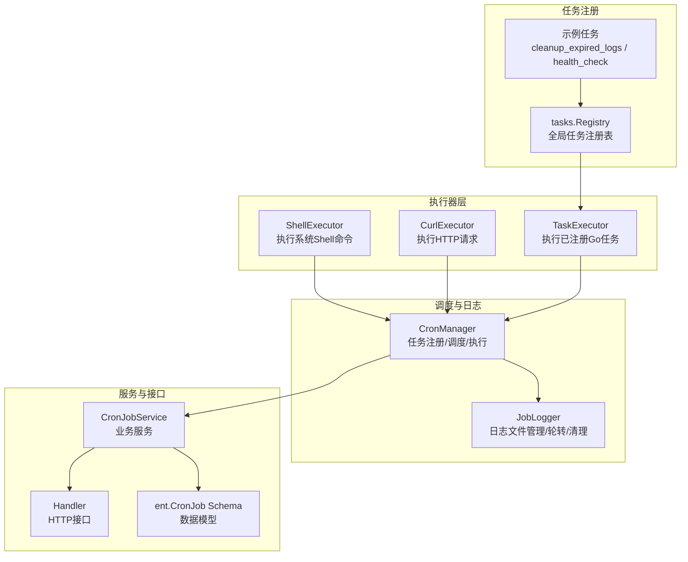
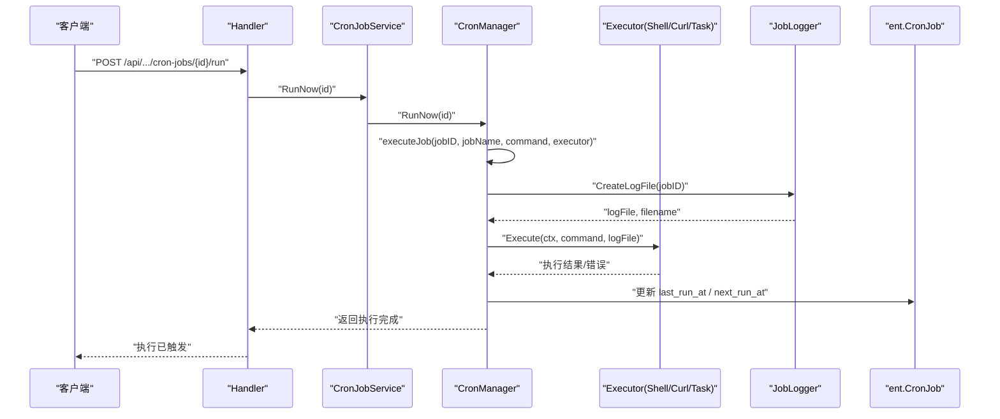
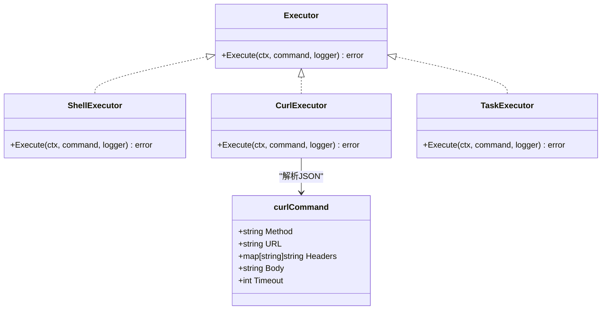
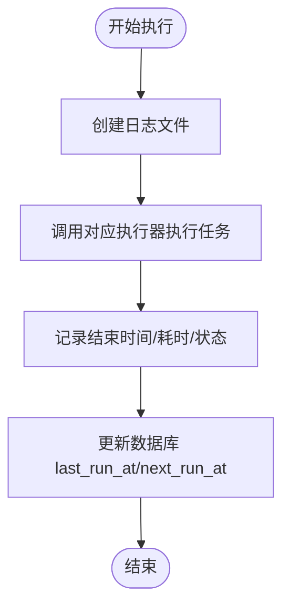
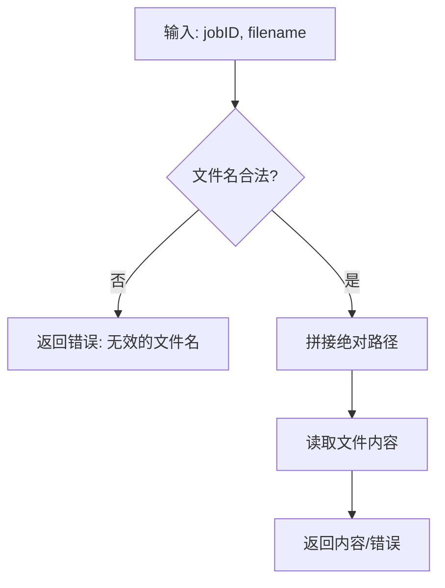
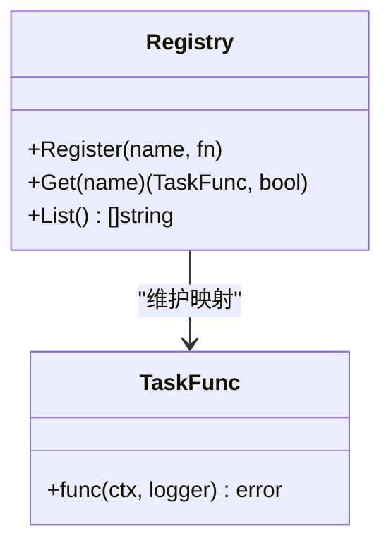
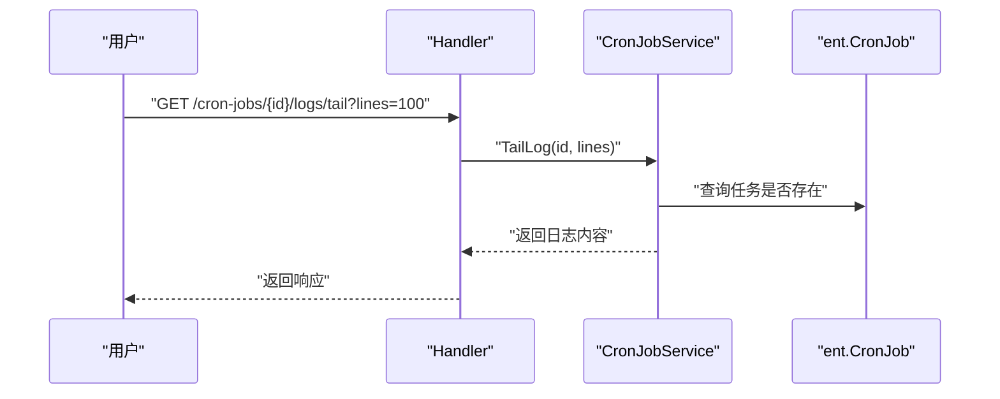
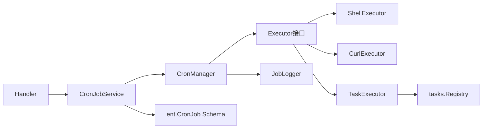

# 任务执行器

<cite>
**本文引用的文件**
- [executor.go](file://internal/cron/executor.go)
- [manager.go](file://internal/cron/manager.go)
- [logger.go](file://internal/cron/logger.go)
- [registry.go](file://internal/tasks/registry.go)
- [example.go](file://internal/tasks/example.go)
- [cron_job.go](file://internal/service/cron_job.go)
- [cron_job.go](file://internal/handler/cron_job.go)
- [cronjob.go](file://internal/ent/schema/cronjob.go)
- [init.go](file://internal/init.go)
- [config.yml](file://config/config.yml)
- [executor_test.go](file://internal/cron/executor_test.go)
- [logger_test.go](file://internal/cron/logger_test.go)
</cite>

## 目录
1. [简介](#简介)
2. [项目结构](#项目结构)
3. [核心组件](#核心组件)
4. [架构总览](#架构总览)
5. [详细组件分析](#详细组件分析)
6. [依赖分析](#依赖分析)
7. [性能考虑](#性能考虑)
8. [故障排查指南](#故障排查指南)
9. [结论](#结论)
10. [附录](#附录)

## 简介
本文件面向“任务执行器”的技术文档，系统化阐述三类任务执行机制：Shell 命令执行器、HTTP 请求执行器与 Go 任务执行器；同时覆盖上下文管理、超时控制、资源限制、安全防护（命令注入与权限控制）、状态管理与结果反馈、错误处理与异常恢复、性能监控与调试工具等主题。文档基于仓库中的实际实现进行分析，并通过图示帮助读者快速理解各模块之间的交互关系。

## 项目结构
任务执行器相关代码主要分布在以下模块：
- cron 包：执行器接口与三种执行器实现、调度管理器、日志管理器
- tasks 包：Go 任务注册表与示例任务
- service/handler 包：对外暴露的 API 服务层与控制器层
- ent/schema：定时任务数据模型定义
- init 与 config：应用初始化与日志存储路径配置

图表来源
- [executor.go:18-126](file://internal/cron/executor.go#L18-L126)
- [manager.go:17-237](file://internal/cron/manager.go#L17-L237)
- [logger.go:20-192](file://internal/cron/logger.go#L20-L192)
- [registry.go:8-33](file://internal/tasks/registry.go#L8-L33)
- [example.go:10-29](file://internal/tasks/example.go#L10-L29)
- [cron_job.go:28-492](file://internal/service/cron_job.go#L28-L492)
- [cron_job.go:14-431](file://internal/handler/cron_job.go#L14-L431)
- [cronjob.go:11-82](file://internal/ent/schema/cronjob.go#L11-L82)

章节来源
- [executor.go:1-126](file://internal/cron/executor.go#L1-L126)
- [manager.go:1-237](file://internal/cron/manager.go#L1-L237)
- [logger.go:1-192](file://internal/cron/logger.go#L1-L192)
- [registry.go:1-33](file://internal/tasks/registry.go#L1-L33)
- [example.go:1-29](file://internal/tasks/example.go#L1-L29)
- [cron_job.go:1-492](file://internal/service/cron_job.go#L1-L492)
- [cron_job.go:1-431](file://internal/handler/cron_job.go#L1-L431)
- [cronjob.go:1-82](file://internal/ent/schema/cronjob.go#L1-L82)
- [init.go:59-64](file://internal/init.go#L59-L64)
- [config.yml:11-18](file://config/config.yml#L11-L18)

## 核心组件
- 执行器接口与实现
  - Executor 接口：统一的 Execute(ctx, command, logger) 方法签名
  - ShellExecutor：跨平台执行系统 Shell 命令，输出重定向至 logger
  - CurlExecutor：解析 JSON 配置，构造 HTTP 请求并记录响应摘要
  - TaskExecutor：从 tasks.Registry 查找并调用已注册的 Go 任务函数
- 调度管理器 CronManager
  - 加载数据库中启用的任务，注册到调度器
  - 维护任务与调度条目的映射，支持立即执行、启停、更新下次执行时间
  - 执行时创建日志文件，记录开始/结束时间、耗时与状态
- 日志管理器 JobLogger
  - 按任务 ID 分目录存储日志，文件名包含时间戳
  - 提供列出、读取、尾读、清理过期日志能力
  - 内置路径穿越校验，保障文件读取安全
- 任务注册表 tasks.Registry
  - 全局 map 存储任务名到函数的映射
  - 提供 Register/Get/List 等操作，示例任务在 init 中注册
- 服务与接口层
  - CronJobService：负责任务的增删改查、启停、立即执行、日志查询
  - Handler：对外提供 REST API，调用服务层完成业务流程
  - ent.CronJob Schema：持久化任务元数据（名称、类型、表达式、命令、启用状态、时间字段）

章节来源
- [executor.go:18-126](file://internal/cron/executor.go#L18-L126)
- [manager.go:17-237](file://internal/cron/manager.go#L17-L237)
- [logger.go:20-192](file://internal/cron/logger.go#L20-L192)
- [registry.go:8-33](file://internal/tasks/registry.go#L8-L33)
- [example.go:10-29](file://internal/tasks/example.go#L10-L29)
- [cron_job.go:28-492](file://internal/service/cron_job.go#L28-L492)
- [cron_job.go:14-431](file://internal/handler/cron_job.go#L14-L431)
- [cronjob.go:11-82](file://internal/ent/schema/cronjob.go#L11-L82)

## 架构总览
下图展示从 HTTP 请求到任务执行、日志落盘与状态更新的完整链路。

图表来源
- [cron_job.go:288-319](file://internal/handler/cron_job.go#L288-L319)
- [cron_job.go:412-426](file://internal/service/cron_job.go#L412-L426)
- [manager.go:154-221](file://internal/cron/manager.go#L154-L221)
- [logger.go:34-51](file://internal/cron/logger.go#L34-L51)
- [executor.go:27-37](file://internal/cron/executor.go#L27-L37)

## 详细组件分析

### 执行器接口与实现
- 接口设计
  - Execute(ctx, command, logger) error：统一的执行入口，便于扩展新类型的执行器
- ShellExecutor
  - 跨平台选择系统 shell 并执行命令，标准输出与错误输出均写入 logger
  - 适合执行系统脚本、批处理等
- CurlExecutor
  - JSON 配置结构包含 method/url/headers/body/timeout
  - 默认 GET、默认超时 30 秒、超时通过 context 控制
  - 记录请求与响应摘要，超过长度的内容截断
  - 状态码 ≥ 400 视为错误
- TaskExecutor
  - 通过任务名在全局注册表中查找函数并执行
  - 适合执行业务逻辑、数据处理等 Go 代码

图表来源
- [executor.go:18-126](file://internal/cron/executor.go#L18-L126)
- [executor.go:42-49](file://internal/cron/executor.go#L42-L49)

章节来源
- [executor.go:18-126](file://internal/cron/executor.go#L18-L126)

### 调度管理器 CronManager
- 职责
  - 从数据库加载启用的任务，注册到调度器
  - 提供 AddJob/RemoveJob/RunNow/Stop 等能力
  - 执行时创建日志文件，记录开始/结束时间、耗时与状态
  - 更新 CronJob 的 last_run_at 与 next_run_at 字段
- 关键流程
  - executeJob：创建日志文件 → 执行任务 → 记录耗时与状态 → 更新数据库
  - updateNextRunAt：根据调度器条目更新下次执行时间

图表来源
- [manager.go:154-221](file://internal/cron/manager.go#L154-L221)

章节来源
- [manager.go:17-237](file://internal/cron/manager.go#L17-L237)

### 日志管理器 JobLogger
- 功能
  - CreateLogFile：按任务 ID 分目录生成带时间戳的日志文件
  - ListLogs/TailLog：列出日志、读取最新日志尾部若干行
  - ReadLog：读取指定日志文件内容（内置路径穿越校验）
  - CleanOldLogs：按保留时长清理过期日志并删除空目录
- 安全
  - ReadLog 对文件名进行严格校验，拒绝包含路径分隔符或父目录引用的非法文件名

图表来源
- [logger.go:88-105](file://internal/cron/logger.go#L88-L105)

章节来源
- [logger.go:20-192](file://internal/cron/logger.go#L20-L192)

### 任务注册表 tasks.Registry
- 结构
  - map[string]TaskFunc：任务名到函数的映射
  - 提供 Register/Get/List：注册、获取、枚举任务
- 示例
  - 在 init 中注册两个示例任务，便于演示与测试

图表来源
- [registry.go:8-33](file://internal/tasks/registry.go#L8-L33)
- [example.go:10-29](file://internal/tasks/example.go#L10-L29)

章节来源
- [registry.go:1-33](file://internal/tasks/registry.go#L1-L33)
- [example.go:1-29](file://internal/tasks/example.go#L1-L29)

### 服务与接口层
- CronJobService
  - 负责任务的创建、更新、删除、查询、启停、立即执行、日志查询
  - 对 cron 表达式与任务类型进行校验；对 type=task 的命令进行注册表校验
- Handler
  - 提供 REST API：创建、列表、详情、更新、删除、启停、立即执行、日志列表、日志内容、尾读
  - 参数校验与错误码映射，返回统一响应结构

图表来源
- [cron_job.go:395-430](file://internal/handler/cron_job.go#L395-L430)
- [cron_job.go:460-474](file://internal/service/cron_job.go#L460-L474)

章节来源
- [cron_job.go:28-492](file://internal/service/cron_job.go#L28-L492)
- [cron_job.go:14-431](file://internal/handler/cron_job.go#L14-L431)

## 依赖分析
- 组件耦合
  - CronManager 依赖 Executor 接口，通过 map 映射不同执行器类型
  - CronManager 依赖 JobLogger 进行日志管理
  - CronJobService 依赖 CronManager 与 ent.CronJob Schema
  - Handler 依赖 CronJobService
  - TaskExecutor 依赖 tasks.Registry
- 外部依赖
  - 调度器：robfig/cron/v3
  - ORM：entgo.io/ent
  - 日志：zap（用于错误与状态记录）
  - Web：github.com/gofiber/fiber/v2（API 层）
- 数据模型
  - CronJob：包含名称、类型、表达式、命令、启用状态、时间字段等

图表来源
- [manager.go:26-37](file://internal/cron/manager.go#L26-L37)
- [executor.go:18-126](file://internal/cron/executor.go#L18-L126)
- [logger.go:20-32](file://internal/cron/logger.go#L20-L32)
- [registry.go:11-23](file://internal/tasks/registry.go#L11-L23)
- [cron_job.go:43-55](file://internal/service/cron_job.go#L43-L55)
- [cronjob.go:11-82](file://internal/ent/schema/cronjob.go#L11-L82)

章节来源
- [manager.go:17-37](file://internal/cron/manager.go#L17-L37)
- [executor.go:18-126](file://internal/cron/executor.go#L18-L126)
- [logger.go:20-32](file://internal/cron/logger.go#L20-L32)
- [registry.go:8-23](file://internal/tasks/registry.go#L8-L23)
- [cron_job.go:43-55](file://internal/service/cron_job.go#L43-L55)
- [cronjob.go:11-82](file://internal/ent/schema/cronjob.go#L11-L82)

## 性能考虑
- 超时控制
  - CurlExecutor 使用 context.WithTimeout 控制 HTTP 请求超时，默认 30 秒
  - ShellExecutor 通过 exec.CommandContext 支持取消，但未显式设置超时
- 日志写入
  - 日志文件以同步方式打开，写入即时落盘，保证可靠性但可能影响吞吐
- 调度精度
  - 使用 robfig/cron/v3，支持秒级表达式，满足细粒度调度需求
- 资源限制
  - 当前实现未显式设置 CPU/内存/文件句柄等资源限制，建议在生产环境结合系统级 cgroups 或容器资源配额进行约束
- 并发与隔离
  - 每个任务独立日志文件，避免相互干扰；建议在 TaskExecutor 中引入 goroutine 与 channel 机制以支持并发与结果聚合

## 故障排查指南
- 常见错误与定位
  - 任务类型错误：未知的任务类型将导致注册失败
  - Cron 表达式无效：创建/更新时进行解析校验
  - Go 任务未注册：type=task 且命令未在注册表中时返回错误
  - 日志读取失败：路径穿越校验失败或文件不存在
  - HTTP 请求失败：解析 JSON、URL/Method 校验、状态码 ≥ 400
- 调试建议
  - 使用 TailLog 快速查看最新日志尾部
  - 使用 GetLogs 列出历史日志文件，再用 GetLogContent 读取具体内容
  - 单元测试参考
    - executor_test：覆盖 Shell/Curl/Task 三类执行器的基本行为与错误场景
    - logger_test：覆盖日志创建、列举、尾读、清理与路径穿越校验
- 错误处理策略
  - 执行器层：返回明确的错误信息，便于上层识别与提示
  - 服务层：将业务错误映射为统一错误码，API 层转换为标准响应
  - 异常恢复：日志中记录开始/结束时间与耗时，便于定位慢任务与失败原因

章节来源
- [cron_job.go:18-26](file://internal/service/cron_job.go#L18-L26)
- [executor_test.go:16-183](file://internal/cron/executor_test.go#L16-L183)
- [logger_test.go:105-116](file://internal/cron/logger_test.go#L105-L116)

## 结论
该任务执行器以接口抽象与注册表机制为核心，实现了 Shell、HTTP 与 Go 任务的统一调度与执行。通过 CronManager 与 JobLogger 的配合，提供了可靠的状态记录与日志管理。在安全性方面，CurlExecutor 的超时控制与 JobLogger 的路径校验有效降低了风险。建议在生产环境中补充资源限制、并发控制与更丰富的监控指标，以进一步提升稳定性与可观测性。

## 附录
- 初始化与配置
  - 应用启动时创建 CronManager 并启动调度器，日志目录位于配置文件中定义的路径
- 数据模型字段说明
  - CronJob：包含名称、类型、表达式、命令、启用状态、时间字段等，便于持久化与查询

章节来源
- [init.go:59-64](file://internal/init.go#L59-L64)
- [config.yml:11-18](file://config/config.yml#L11-L18)
- [cronjob.go:17-72](file://internal/ent/schema/cronjob.go#L17-L72)