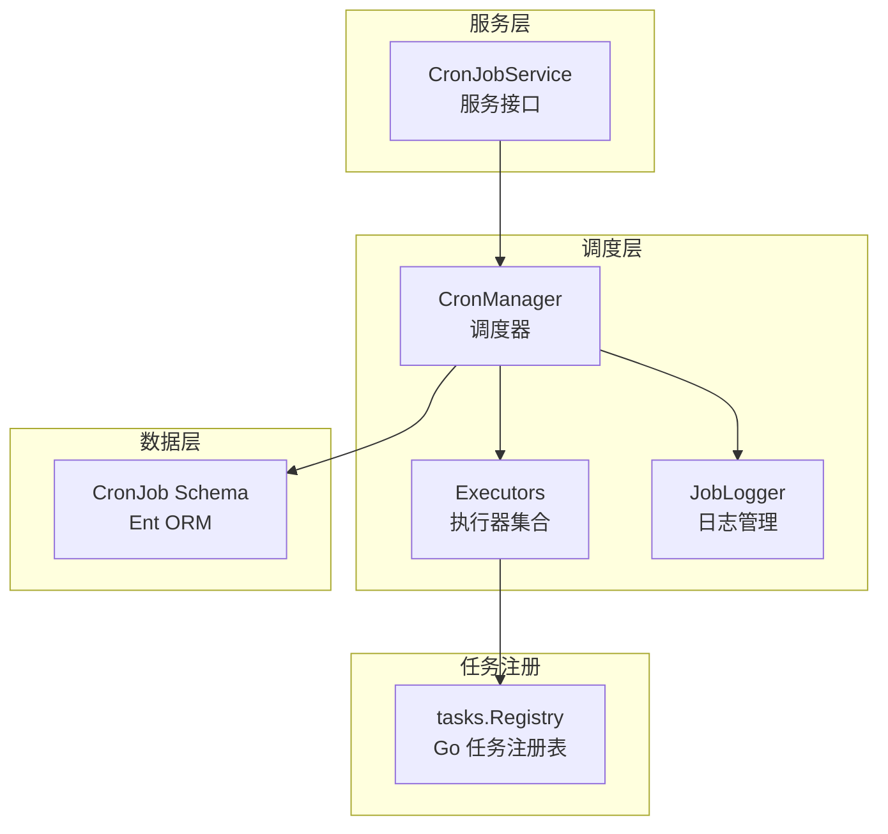
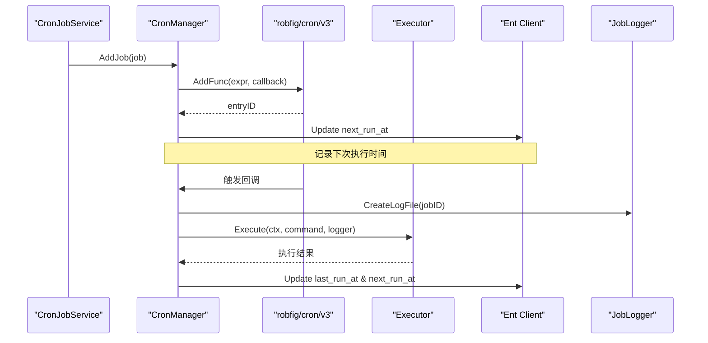
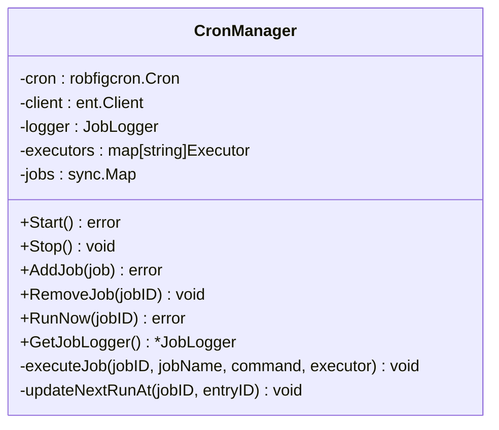
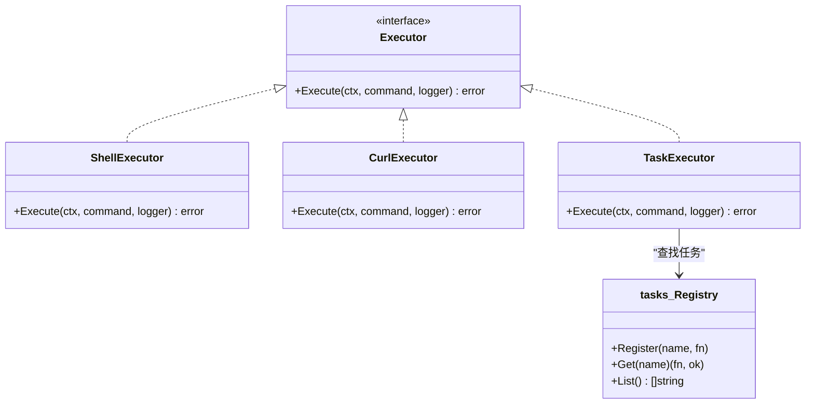
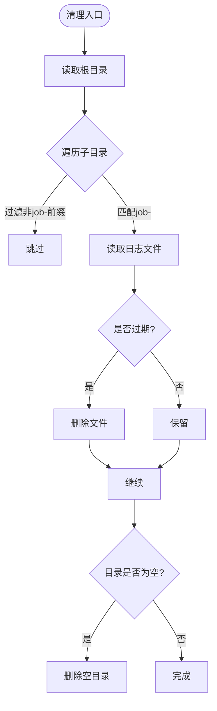
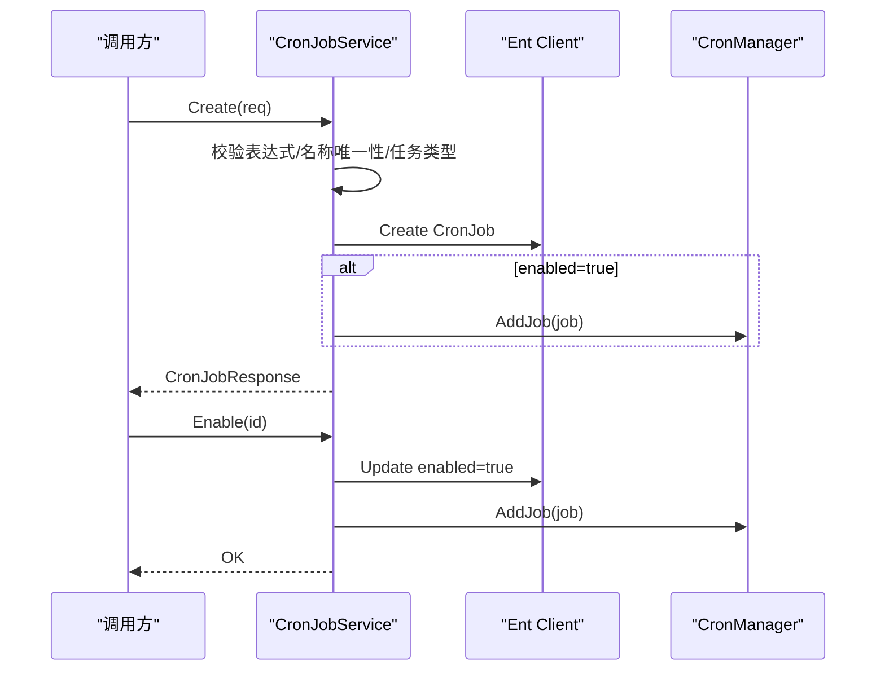
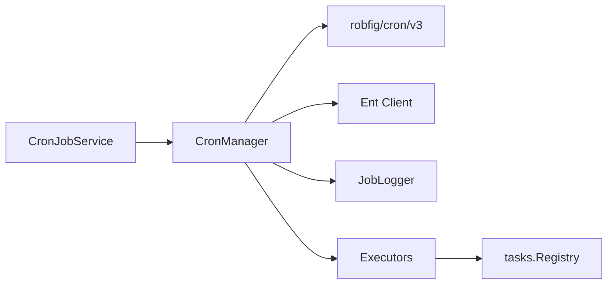

# 任务调度机制

<cite>
**本文引用的文件**
- [manager.go](file://internal/cron/manager.go)
- [executor.go](file://internal/cron/executor.go)
- [logger.go](file://internal/cron/logger.go)
- [registry.go](file://internal/tasks/registry.go)
- [example.go](file://internal/tasks/example.go)
- [cron_job.go](file://internal/service/cron_job.go)
- [cronjob.go](file://internal/ent/schema/cronjob.go)
- [go.mod](file://go.mod)
- [config.yml](file://config/config.yml)
- [manager_test.go](file://internal/cron/manager_test.go)
- [logger_test.go](file://internal/cron/logger_test.go)
- [cron_job_test.go](file://internal/service/cron_job_test.go)
</cite>

## 目录
1. [简介](#简介)
2. [项目结构](#项目结构)
3. [核心组件](#核心组件)
4. [架构总览](#架构总览)
5. [详细组件分析](#详细组件分析)
6. [依赖分析](#依赖分析)
7. [性能考虑](#性能考虑)
8. [故障排查指南](#故障排查指南)
9. [结论](#结论)
10. [附录](#附录)

## 简介
本文件系统化阐述该仓库中的定时任务调度机制，重点覆盖以下方面：
- Cron 表达式的解析与调度算法，基于 robfig/cron/v3 库
- 任务注册、启动、停止、移除的完整生命周期管理
- 调度器核心实现原理：任务队列管理、并发控制与资源限制
- 触发时机的精确计算与边界条件处理（秒级精度）
- 性能优化策略与内存管理方案
- 可靠性保障机制与故障恢复处理

## 项目结构
调度子系统主要分布在以下模块：
- internal/cron：调度器与执行器、日志管理
- internal/tasks：Go 任务注册表
- internal/service：定时任务服务层（校验、持久化、与调度器交互）
- internal/ent/schema：定时任务实体定义（Ent ORM）
- config：应用配置（含日志与存储路径等）

图表来源
- [manager.go:17-38](file://internal/cron/manager.go#L17-L38)
- [executor.go:18-37](file://internal/cron/executor.go#L18-L37)
- [logger.go:20-32](file://internal/cron/logger.go#L20-L32)
- [cron_job.go:43-55](file://internal/service/cron_job.go#L43-L55)
- [cronjob.go:11-82](file://internal/ent/schema/cronjob.go#L11-L82)
- [registry.go:11-23](file://internal/tasks/registry.go#L11-L23)

章节来源
- [manager.go:17-38](file://internal/cron/manager.go#L17-L38)
- [executor.go:18-37](file://internal/cron/executor.go#L18-L37)
- [logger.go:20-32](file://internal/cron/logger.go#L20-L32)
- [cron_job.go:43-55](file://internal/service/cron_job.go#L43-L55)
- [cronjob.go:11-82](file://internal/ent/schema/cronjob.go#L11-L82)
- [registry.go:11-23](file://internal/tasks/registry.go#L11-L23)

## 核心组件
- CronManager：调度器核心，负责加载、注册、启动、停止任务，并维护任务映射与下次执行时间更新
- Executors：三类执行器
  - ShellExecutor：系统 shell 执行命令
  - CurlExecutor：解析 JSON 配置并发起 HTTP 请求
  - TaskExecutor：从 tasks.Registry 查找并执行已注册的 Go 任务
- JobLogger：任务日志管理，支持按任务分目录、按时间排序、尾读、清理过期日志
- CronJobService：服务层，负责校验 Cron 表达式、任务类型与名称唯一性、启用/禁用、立即执行、日志查询等
- Ent CronJob Schema：定时任务实体，包含名称、类型、表达式、命令、启用状态、最近/下次执行时间等字段

章节来源
- [manager.go:17-38](file://internal/cron/manager.go#L17-L38)
- [executor.go:18-126](file://internal/cron/executor.go#L18-L126)
- [logger.go:20-192](file://internal/cron/logger.go#L20-L192)
- [cron_job.go:43-492](file://internal/service/cron_job.go#L43-L492)
- [cronjob.go:11-82](file://internal/ent/schema/cronjob.go#L11-L82)
- [registry.go:11-33](file://internal/tasks/registry.go#L11-L33)

## 架构总览
调度系统采用“服务层-调度器-执行器-日志”的分层设计，robfig/cron/v3 提供秒级精度的调度引擎，Ent ORM 负责持久化，Go 任务通过全局注册表统一管理。

图表来源
- [manager.go:85-116](file://internal/cron/manager.go#L85-L116)
- [manager.go:154-221](file://internal/cron/manager.go#L154-L221)
- [cron_job.go:107-164](file://internal/service/cron_job.go#L107-L164)

## 详细组件分析

### CronManager 组件
- 职责
  - 启动时从数据库加载启用的任务并注册到调度器
  - 提供 AddJob/RemoveJob/RunNow 接口
  - 在执行前后更新任务的 last_run_at 与 next_run_at
  - 内置日志清理任务（每日凌晨 2:00）
- 关键数据结构
  - cron：robfig/cron/v3 实例（秒级）
  - jobs：jobID -> entryID 映射（sync.Map）
  - executors：执行器映射（shell/curl/task）
- 生命周期
  - Start：查询启用任务 -> 注册到调度器 -> 启动调度器
  - AddJob：校验类型 -> 注册回调 -> 记录 entryID -> 更新 next_run_at
  - RemoveJob：根据 jobID 取消 entry
  - RunNow：查询任务 -> 异步执行
  - Stop：优雅关闭调度器

图表来源
- [manager.go:17-38](file://internal/cron/manager.go#L17-L38)
- [manager.go:85-116](file://internal/cron/manager.go#L85-L116)
- [manager.go:154-221](file://internal/cron/manager.go#L154-L221)

章节来源
- [manager.go:40-77](file://internal/cron/manager.go#L40-L77)
- [manager.go:85-116](file://internal/cron/manager.go#L85-L116)
- [manager.go:118-147](file://internal/cron/manager.go#L118-L147)
- [manager.go:154-221](file://internal/cron/manager.go#L154-L221)
- [manager.go:223-237](file://internal/cron/manager.go#L223-L237)

### Executors 组件
- ShellExecutor
  - 使用系统 shell 执行命令，标准输出/错误重定向到日志
  - 支持 Windows 与类 Unix 平台
- CurlExecutor
  - 解析 JSON 配置（method/url/headers/body/timeout），构造 HTTP 请求
  - 超时控制，响应状态码与内容截断记录
- TaskExecutor
  - 从 tasks.Registry 查找并执行已注册的 Go 任务

图表来源
- [executor.go:18-126](file://internal/cron/executor.go#L18-L126)
- [registry.go:11-33](file://internal/tasks/registry.go#L11-L33)

章节来源
- [executor.go:23-37](file://internal/cron/executor.go#L23-L37)
- [executor.go:39-113](file://internal/cron/executor.go#L39-L113)
- [executor.go:115-126](file://internal/cron/executor.go#L115-L126)
- [registry.go:11-33](file://internal/tasks/registry.go#L11-L33)
- [example.go:10-29](file://internal/tasks/example.go#L10-L29)

### JobLogger 组件
- 功能
  - CreateLogFile：按任务 ID 创建独立日志文件（按时间戳命名）
  - ListLogs/TailLog：列出与尾读日志文件
  - CleanOldLogs：按保留时长清理过期日志，空目录自动删除
  - ReadLog：安全读取指定日志文件（防路径穿越）
- 设计要点
  - 日志目录结构：{baseDir}/job-{id}/{timestamp}.log
  - 保留时长通过构造函数注入
  - 文件读写使用同步写入（O_SYNC）保证落盘

图表来源
- [logger.go:148-192](file://internal/cron/logger.go#L148-L192)

章节来源
- [logger.go:34-51](file://internal/cron/logger.go#L34-L51)
- [logger.go:53-86](file://internal/cron/logger.go#L53-L86)
- [logger.go:88-105](file://internal/cron/logger.go#L88-L105)
- [logger.go:107-146](file://internal/cron/logger.go#L107-L146)
- [logger.go:148-192](file://internal/cron/logger.go#L148-L192)

### CronJobService 组件
- 职责
  - 校验 Cron 表达式（robfigcron.Parser，秒级）
  - 校验任务类型与 Go 任务是否已注册
  - 管理任务启停：Create/Update/Delete/Enable/Disable
  - 立即执行 RunNow
  - 日志查询：GetLogs/GetLogContent/TailLog
- 关键流程
  - Create：校验表达式与名称唯一性 -> 写入 DB -> 若启用则注册到调度器
  - Update：校验新表达式与任务类型 -> 更新 DB -> 若启用则移除旧条目并重新注册
  - Enable/Disable：更新 DB 状态 -> 启用时注册，禁用时移除并清空 next_run_at
  - RunNow：查询是否存在 -> 委托 CronManager.RunNow

图表来源
- [cron_job.go:107-164](file://internal/service/cron_job.go#L107-L164)
- [cron_job.go:350-381](file://internal/service/cron_job.go#L350-L381)

章节来源
- [cron_job.go:107-164](file://internal/service/cron_job.go#L107-L164)
- [cron_job.go:166-246](file://internal/service/cron_job.go#L166-L246)
- [cron_job.go:248-269](file://internal/service/cron_job.go#L248-L269)
- [cron_job.go:350-410](file://internal/service/cron_job.go#L350-L410)
- [cron_job.go:412-426](file://internal/service/cron_job.go#L412-L426)
- [cron_job.go:428-474](file://internal/service/cron_job.go#L428-L474)

### Ent CronJob Schema
- 字段
  - id/name/description/type/expression/command/enabled/last_run_at/next_run_at/created_at/updated_at
- 索引
  - enabled、type 索引，便于查询与筛选

章节来源
- [cronjob.go:11-82](file://internal/ent/schema/cronjob.go#L11-L82)

## 依赖分析
- 外部库
  - robfig/cron/v3：秒级 Cron 调度器
  - ent：ORM 数据访问
  - zap：日志
  - lumberjack：日志轮转（用于应用日志）
- 内部依赖
  - CronJobService 依赖 CronManager 与 Ent Client
  - CronManager 依赖 Ent Client、JobLogger、Executors
  - Executors 依赖 tasks.Registry（Go 任务）

图表来源
- [go.mod:16](file://go.mod#L16)
- [cron_job.go:43-55](file://internal/service/cron_job.go#L43-L55)
- [manager.go:17-38](file://internal/cron/manager.go#L17-L38)

章节来源
- [go.mod:16](file://go.mod#L16)
- [cron_job.go:43-55](file://internal/service/cron_job.go#L43-L55)
- [manager.go:17-38](file://internal/cron/manager.go#L17-L38)

## 性能考虑
- 秒级精度与调度开销
  - 使用 robfig/cron/v3.WithSeconds()，每秒扫描一次，适合中小规模任务集
  - 建议任务数量控制在数百以内，避免过多表达式导致扫描成本上升
- 并发与资源控制
  - 任务执行为单线程串行回调，避免竞争；若需并发，建议在执行器内部自行管理 goroutine
  - ShellExecutor/CurlExecutor 使用 context 控制超时，避免阻塞
- IO 与日志
  - JobLogger 使用 O_SYNC 写入，确保落盘但可能影响吞吐；可结合业务需求评估是否关闭同步
  - 日志清理任务每日执行，避免磁盘膨胀
- 内存管理
  - jobs 映射使用 sync.Map，适合高并发读写场景
  - CronManager 维护 next_run_at，减少重复计算
- 优化建议
  - 对高频任务合并为更粗粒度表达式
  - 使用 TaskExecutor 执行 Go 任务，避免 shell 调用开销
  - 合理设置日志保留时长，平衡存储与可观测性

[本节为通用性能指导，无需特定文件引用]

## 故障排查指南
- Cron 表达式无效
  - 现象：创建/更新时报错
  - 排查：确认表达式符合 robfig/cron/v3 秒级语法
  - 参考
    - [cron_job.go:110-113](file://internal/service/cron_job.go#L110-L113)
    - [cron_job.go:200-206](file://internal/service/cron_job.go#L200-L206)
- 任务类型不支持
  - 现象：AddJob 报未知类型
  - 排查：确认 type 为 shell/curl/task
  - 参考
    - [manager.go:87-90](file://internal/cron/manager.go#L87-L90)
- Go 任务未注册
  - 现象：TaskExecutor 执行报未注册
  - 排查：确认已在 init 中 Register
  - 参考
    - [executor.go:119-124](file://internal/cron/executor.go#L119-L124)
    - [example.go:10-13](file://internal/tasks/example.go#L10-L13)
- 任务未触发
  - 现象：任务未执行或未更新 next_run_at
  - 排查：确认任务已启用；查看 CronManager 日志；检查表达式是否合理
  - 参考
    - [manager.go:42-58](file://internal/cron/manager.go#L42-L58)
    - [manager.go:223-236](file://internal/cron/manager.go#L223-L236)
- 日志无法读取
  - 现象：TailLog/ReadLog 报错
  - 排查：确认文件名合法（无路径穿越）；确认日志目录存在且有权限
  - 参考
    - [logger.go:88-105](file://internal/cron/logger.go#L88-L105)
    - [logger.go:107-146](file://internal/cron/logger.go#L107-L146)
- 调度器未启动
  - 现象：Start 后任务未注册
  - 排查：确认数据库连接正常；查看 Start 日志
  - 参考
    - [manager.go:40-77](file://internal/cron/manager.go#L40-L77)

章节来源
- [cron_job.go:110-113](file://internal/service/cron_job.go#L110-L113)
- [cron_job.go:200-206](file://internal/service/cron_job.go#L200-L206)
- [manager.go:87-90](file://internal/cron/manager.go#L87-L90)
- [executor.go:119-124](file://internal/cron/executor.go#L119-L124)
- [example.go:10-13](file://internal/tasks/example.go#L10-L13)
- [manager.go:42-58](file://internal/cron/manager.go#L42-L58)
- [manager.go:223-236](file://internal/cron/manager.go#L223-L236)
- [logger.go:88-105](file://internal/cron/logger.go#L88-L105)
- [logger.go:107-146](file://internal/cron/logger.go#L107-L146)
- [manager.go:40-77](file://internal/cron/manager.go#L40-L77)

## 结论
该调度系统以 robfig/cron/v3 为核心，结合 Ent ORM 与自研日志管理，提供了完整的定时任务生命周期管理能力。通过服务层校验与调度器回调解耦，系统具备良好的扩展性与可维护性。建议在生产环境中关注任务数量、日志 IO 与超时控制，以获得稳定与高性能的调度体验。

[本节为总结性内容，无需特定文件引用]

## 附录

### Cron 表达式解析与调度算法
- 解析器
  - 使用 robfig/cron/v3.Parser，支持秒级表达式
  - 服务层与调度器均进行表达式校验
- 调度算法
  - 基于时间推进的扫描机制，每秒检查一次
  - 通过 entry.Next 计算下一次触发时间
- 边界条件
  - 闰秒、夏令时切换、跨年等边界由底层库处理
  - 表达式非法直接拒绝，避免无效任务

章节来源
- [cron_job.go:110-113](file://internal/service/cron_job.go#L110-L113)
- [manager.go:223-236](file://internal/cron/manager.go#L223-L236)

### 任务生命周期管理
- 注册：Create/Enable -> AddJob -> 更新 next_run_at
- 运行：Cron 回调 -> executeJob -> 更新 last_run_at/next_run_at
- 停止：Stop -> 优雅关闭调度器
- 移除：RemoveJob -> 从调度器移除
- 立即执行：RunNow -> 查询任务 -> 异步执行

章节来源
- [cron_job.go:107-164](file://internal/service/cron_job.go#L107-L164)
- [cron_job.go:350-410](file://internal/service/cron_job.go#L350-L410)
- [manager.go:40-77](file://internal/cron/manager.go#L40-L77)
- [manager.go:118-147](file://internal/cron/manager.go#L118-L147)

### 可靠性与故障恢复
- 任务执行失败不影响调度器继续运行
- 日志文件记录执行开始/结束、耗时与错误，便于排障
- 内置日志清理任务，防止磁盘占用
- CronJobService 对 DB 操作失败进行错误包装，便于上层感知

章节来源
- [manager.go:154-221](file://internal/cron/manager.go#L154-L221)
- [logger.go:148-192](file://internal/cron/logger.go#L148-L192)
- [cron_job.go:107-164](file://internal/service/cron_job.go#L107-L164)

### 测试参考
- manager_test：验证 AddJob/RemoveJob/RunNow/Start 等行为
- logger_test：验证日志创建、读取、尾读、清理
- cron_job_test：验证服务层 CRUD、启停、日志查询

章节来源
- [manager_test.go:23-44](file://internal/cron/manager_test.go#L23-L44)
- [manager_test.go:46-85](file://internal/cron/manager_test.go#L46-L85)
- [manager_test.go:87-125](file://internal/cron/manager_test.go#L87-L125)
- [manager_test.go:142-198](file://internal/cron/manager_test.go#L142-L198)
- [logger_test.go:12-38](file://internal/cron/logger_test.go#L12-L38)
- [logger_test.go:40-85](file://internal/cron/logger_test.go#L40-L85)
- [logger_test.go:105-116](file://internal/cron/logger_test.go#L105-L116)
- [logger_test.go:118-148](file://internal/cron/logger_test.go#L118-L148)
- [logger_test.go:160-184](file://internal/cron/logger_test.go#L160-L184)
- [cron_job_test.go:42-67](file://internal/service/cron_job_test.go#L42-L67)
- [cron_job_test.go:94-107](file://internal/service/cron_job_test.go#L94-L107)
- [cron_job_test.go:109-146](file://internal/service/cron_job_test.go#L109-L146)
- [cron_job_test.go:159-184](file://internal/service/cron_job_test.go#L159-L184)
- [cron_job_test.go:329-360](file://internal/service/cron_job_test.go#L329-L360)
- [cron_job_test.go:372-406](file://internal/service/cron_job_test.go#L372-L406)
- [cron_job_test.go:408-444](file://internal/service/cron_job_test.go#L408-L444)