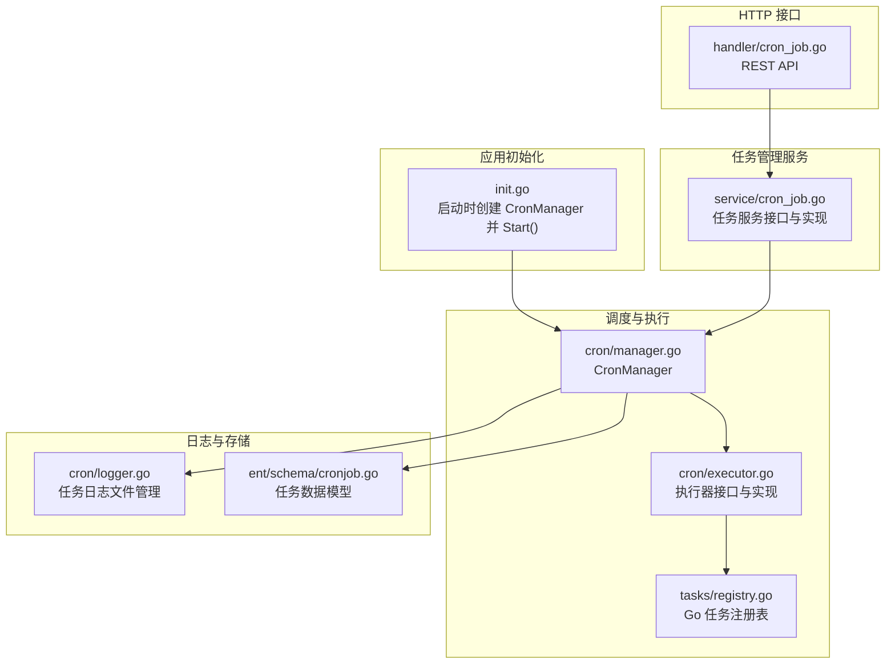
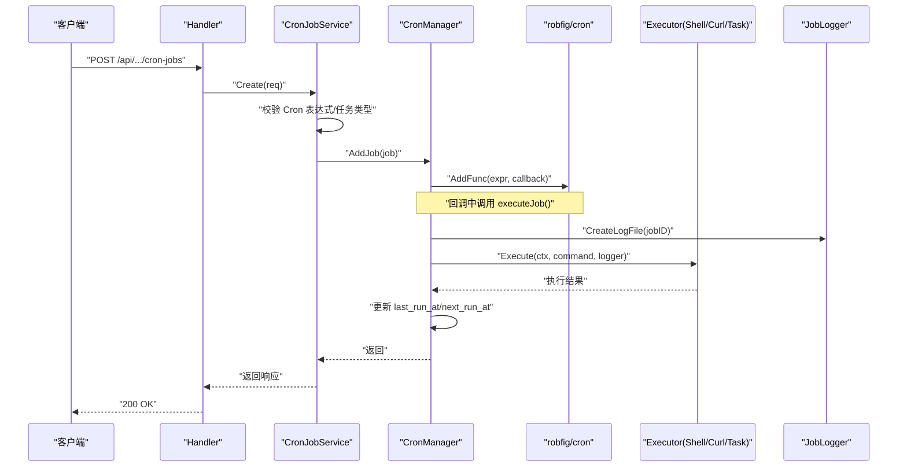
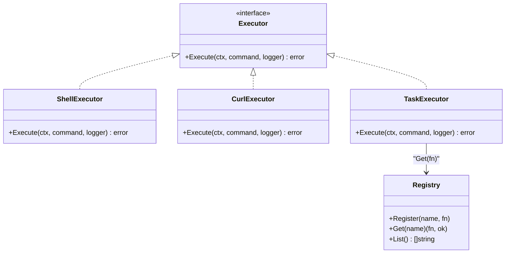
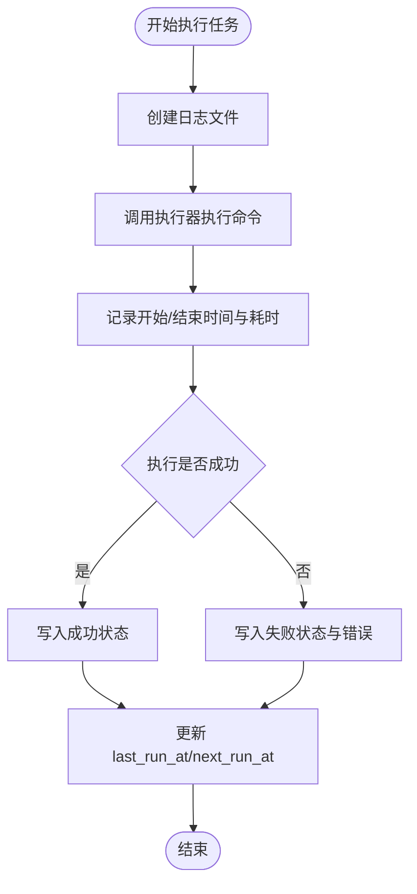
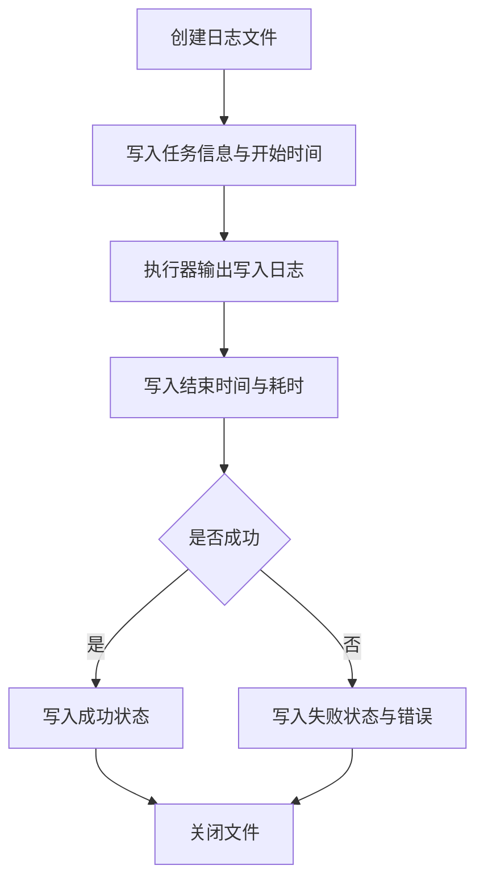
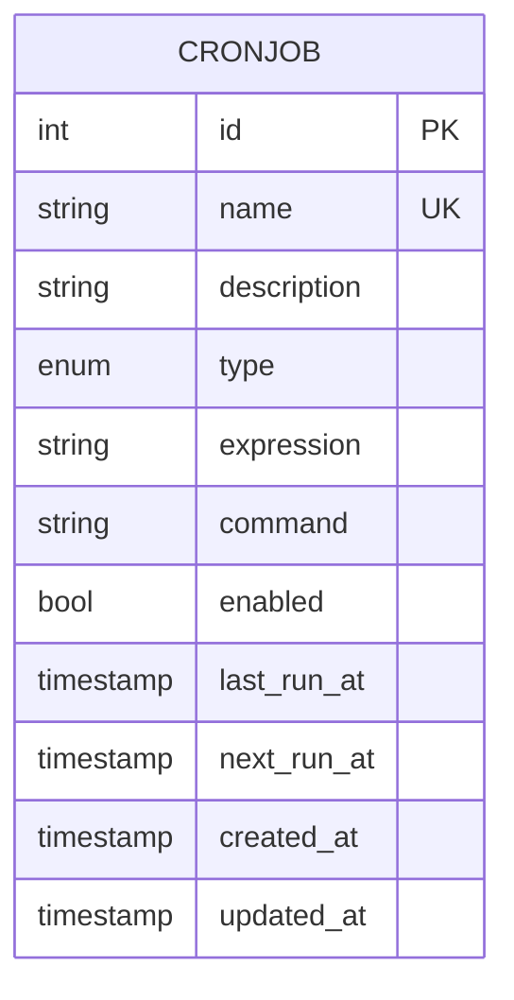
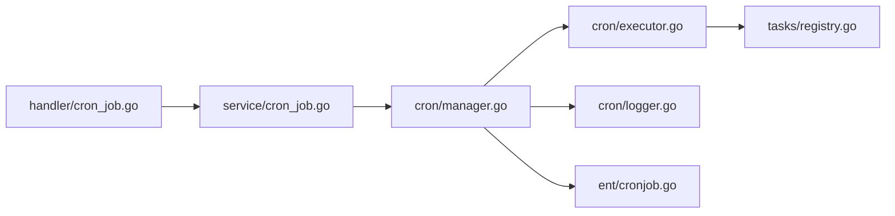

# 定时任务系统

<cite>
**本文引用的文件**
- [executor.go](file://internal/cron/executor.go)
- [manager.go](file://internal/cron/manager.go)
- [logger.go](file://internal/cron/logger.go)
- [registry.go](file://internal/tasks/registry.go)
- [example.go](file://internal/tasks/example.go)
- [cron_job.go](file://internal/service/cron_job.go)
- [cron_job.go](file://internal/handler/cron_job.go)
- [cronjob.go](file://internal/ent/schema/cronjob.go)
- [init.go](file://internal/init.go)
- [config.yml](file://config/config.yml)
- [executor_test.go](file://internal/cron/executor_test.go)
- [manager_test.go](file://internal/cron/manager_test.go)
</cite>

## 目录
1. [简介](#简介)
2. [项目结构](#项目结构)
3. [核心组件](#核心组件)
4. [架构总览](#架构总览)
5. [详细组件分析](#详细组件分析)
6. [依赖分析](#依赖分析)
7. [性能考虑](#性能考虑)
8. [故障排查指南](#故障排查指南)
9. [结论](#结论)
10. [附录](#附录)

## 简介
本文件系统性阐述 Go Admin 管理系统的定时任务子系统，覆盖任务类型与执行器、Cron 表达式解析与调度机制、任务队列与并发控制、日志与监控、API 接口与配置、以及可靠性与故障恢复策略。该系统通过统一的 Cron 管理器协调多种任务执行器，结合数据库持久化与独立日志文件，提供稳定可靠的后台任务能力。

## 项目结构
定时任务相关代码主要分布在以下模块：
- cron 执行层：执行器接口与三种执行器（Shell、HTTP、Go Task）
- cron 管理层：Cron 管理器、任务注册与调度、日志清理
- tasks 注册表：Go 自定义任务注册与查找
- service 层：任务 CRUD、校验、启停、立即执行、日志查询
- handler 层：对外 HTTP API
- ent schema：任务数据模型
- 初始化：应用启动时创建并启动 Cron 管理器

图表来源
- [init.go:59-64](file://internal/init.go#L59-L64)
- [manager.go:26-37](file://internal/cron/manager.go#L26-L37)
- [executor.go:18-125](file://internal/cron/executor.go#L18-L125)
- [registry.go:11-23](file://internal/tasks/registry.go#L11-L23)
- [logger.go:26-32](file://internal/cron/logger.go#L26-L32)
- [cronjob.go:11-82](file://internal/ent/schema/cronjob.go#L11-L82)

章节来源
- [init.go:59-64](file://internal/init.go#L59-L64)
- [manager.go:26-37](file://internal/cron/manager.go#L26-L37)
- [executor.go:18-125](file://internal/cron/executor.go#L18-L125)
- [registry.go:11-23](file://internal/tasks/registry.go#L11-L23)
- [logger.go:26-32](file://internal/cron/logger.go#L26-L32)
- [cronjob.go:11-82](file://internal/ent/schema/cronjob.go#L11-L82)

## 核心组件
- 执行器接口与实现
  - ShellExecutor：基于系统 shell 执行命令，输出重定向至日志
  - CurlExecutor：解析 JSON 配置，构造 HTTP 请求，记录状态与响应摘要
  - TaskExecutor：从全局注册表查找并执行 Go 自定义任务
- CronManager：统一管理 Cron 调度、任务注册/移除、立即执行、日志清理与下次执行时间更新
- JobLogger：按任务 ID 维度生成独立日志文件，支持列出、读取、尾读、清理过期日志
- 任务注册表：tasks.Registry 提供注册、查找、枚举 Go 任务
- 服务与接口：service 层负责校验、启停、立即执行、日志查询；handler 层提供 REST API

章节来源
- [executor.go:18-125](file://internal/cron/executor.go#L18-L125)
- [manager.go:17-24](file://internal/cron/manager.go#L17-L24)
- [logger.go:20-32](file://internal/cron/logger.go#L20-L32)
- [registry.go:8-32](file://internal/tasks/registry.go#L8-L32)
- [cron_job.go:28-41](file://internal/service/cron_job.go#L28-L41)

## 架构总览
系统采用“服务层-调度层-执行层-日志层”的分层设计。服务层负责输入校验与业务规则，调度层负责 Cron 解析与任务编排，执行层负责具体任务执行，日志层负责任务执行日志的持久化与查询。

图表来源
- [cron_job.go:107-164](file://internal/service/cron_job.go#L107-L164)
- [manager.go:85-116](file://internal/cron/manager.go#L85-L116)
- [manager.go:154-221](file://internal/cron/manager.go#L154-L221)
- [executor.go:23-37](file://internal/cron/executor.go#L23-L37)
- [executor.go:39-113](file://internal/cron/executor.go#L39-L113)
- [executor.go:115-125](file://internal/cron/executor.go#L115-L125)
- [logger.go:34-51](file://internal/cron/logger.go#L34-L51)

## 详细组件分析

### 执行器组件
- ShellExecutor
  - 作用：在不同平台下通过系统 shell 执行命令，标准输出与错误输出写入日志
  - 关键点：跨平台命令选择、上下文超时、日志重定向
- CurlExecutor
  - 作用：解析 JSON 配置，构造 HTTP 请求，记录状态码与响应摘要，错误状态码视为执行失败
  - 关键点：JSON 校验、默认方法与超时、请求头设置、响应体截断
- TaskExecutor
  - 作用：从 tasks.Registry 查找并执行已注册的 Go 任务
  - 关键点：任务名称唯一性、未注册任务的错误提示

图表来源
- [executor.go:18-125](file://internal/cron/executor.go#L18-L125)
- [registry.go:11-23](file://internal/tasks/registry.go#L11-L23)

章节来源
- [executor.go:18-125](file://internal/cron/executor.go#L18-L125)
- [registry.go:11-23](file://internal/tasks/registry.go#L11-L23)

### CronManager 组件
- 职责
  - 启动时从数据库加载启用的任务并注册到调度器
  - 提供 AddJob/RemoveJob/RunNow 接口
  - 执行任务时创建日志文件、记录开始/结束时间、耗时与状态
  - 更新任务的 last_run_at 与 next_run_at
  - 内置每日 2:00 的日志清理任务
- 并发与队列
  - Cron 调度器本身为单线程调度，回调在各自 goroutine 中执行
  - 未见显式任务队列与并发上限控制，同一时刻多个任务可能并发执行

图表来源
- [manager.go:154-221](file://internal/cron/manager.go#L154-L221)
- [logger.go:34-51](file://internal/cron/logger.go#L34-L51)

章节来源
- [manager.go:40-77](file://internal/cron/manager.go#L40-L77)
- [manager.go:85-116](file://internal/cron/manager.go#L85-L116)
- [manager.go:154-221](file://internal/cron/manager.go#L154-L221)

### 日志管理组件
- 文件组织：按任务 ID 创建独立目录，每次执行生成带时间戳的 .log 文件
- 功能：列出日志、读取指定日志、尾读最新日志、清理过期日志
- 安全：读取日志时进行路径校验，防止路径穿越

图表来源
- [logger.go:34-51](file://internal/cron/logger.go#L34-L51)
- [logger.go:53-86](file://internal/cron/logger.go#L53-L86)
- [logger.go:88-105](file://internal/cron/logger.go#L88-L105)
- [logger.go:107-146](file://internal/cron/logger.go#L107-L146)
- [logger.go:148-191](file://internal/cron/logger.go#L148-L191)

章节来源
- [logger.go:20-32](file://internal/cron/logger.go#L20-L32)
- [logger.go:34-51](file://internal/cron/logger.go#L34-L51)
- [logger.go:53-86](file://internal/cron/logger.go#L53-L86)
- [logger.go:88-105](file://internal/cron/logger.go#L88-L105)
- [logger.go:107-146](file://internal/cron/logger.go#L107-L146)
- [logger.go:148-191](file://internal/cron/logger.go#L148-L191)

### 数据模型与 API
- 数据模型
  - CronJob 包含名称、类型、表达式、命令、启用状态、最近/下次执行时间等字段
  - 支持按启用状态与类型建立索引
- API 接口
  - 创建、更新、删除、查询、列表、启用、禁用、立即执行
  - 日志列表、日志内容、尾读日志

图表来源
- [cronjob.go:17-72](file://internal/ent/schema/cronjob.go#L17-L72)

章节来源
- [cronjob.go:17-72](file://internal/ent/schema/cronjob.go#L17-L72)
- [cron_job.go:107-164](file://internal/service/cron_job.go#L107-L164)
- [cron_job.go:166-246](file://internal/service/cron_job.go#L166-L246)
- [cron_job.go:248-269](file://internal/service/cron_job.go#L248-L269)
- [cron_job.go:271-284](file://internal/service/cron_job.go#L271-L284)
- [cron_job.go:286-348](file://internal/service/cron_job.go#L286-L348)
- [cron_job.go:350-410](file://internal/service/cron_job.go#L350-L410)
- [cron_job.go:412-426](file://internal/service/cron_job.go#L412-L426)
- [cron_job.go:428-474](file://internal/service/cron_job.go#L428-L474)
- [handler.cron_job.go:14-58](file://internal/handler/cron_job.go#L14-L58)
- [handler.cron_job.go:60-102](file://internal/handler/cron_job.go#L60-L102)
- [handler.cron_job.go:104-136](file://internal/handler/cron_job.go#L104-L136)
- [handler.cron_job.go:138-187](file://internal/handler/cron_job.go#L138-L187)
- [handler.cron_job.go:189-220](file://internal/handler/cron_job.go#L189-L220)
- [handler.cron_job.go:222-253](file://internal/handler/cron_job.go#L222-L253)
- [handler.cron_job.go:255-286](file://internal/handler/cron_job.go#L255-L286)
- [handler.cron_job.go:288-319](file://internal/handler/cron_job.go#L288-L319)
- [handler.cron_job.go:321-353](file://internal/handler/cron_job.go#L321-L353)
- [handler.cron_job.go:355-393](file://internal/handler/cron_job.go#L355-L393)
- [handler.cron_job.go:395-430](file://internal/handler/cron_job.go#L395-L430)

### Cron 表达式解析与调度机制
- 解析器
  - 使用 robfig/cron 的解析器，支持秒级精度（含 Seconds 字段）
  - 服务层在创建/更新任务时对表达式进行校验
- 触发时机
  - CronManager 在 Start() 时加载启用任务并注册到调度器
  - AddJob/RemoveJob/RunNow 提供动态管理
- 执行频率控制
  - 由 cron 表达式决定，系统不额外限频
- 时间精度
  - 支持秒级表达式，确保高精度触发

章节来源
- [cron_job.go:109-113](file://internal/service/cron_job.go#L109-L113)
- [cron_job.go:198-206](file://internal/service/cron_job.go#L198-L206)
- [manager.go:29](file://internal/cron/manager.go#L29)
- [manager.go:40-77](file://internal/cron/manager.go#L40-L77)
- [manager.go:85-116](file://internal/cron/manager.go#L85-L116)

### 任务执行器实现原理
- 任务队列管理
  - 未见显式队列结构，执行器直接被调度器回调触发
- 并发控制
  - 未见内置并发上限或互斥锁，多个任务可能并发执行
- 资源限制
  - ShellExecutor 使用 exec.CommandContext，可通过上下文取消；CurlExecutor 设置超时
  - 未见内存、CPU、连接池等资源限制

章节来源
- [executor.go:27-36](file://internal/cron/executor.go#L27-L36)
- [executor.go:68-70](file://internal/cron/executor.go#L68-L70)
- [manager.go:154-221](file://internal/cron/manager.go#L154-L221)

### 任务执行监控与日志
- 执行状态跟踪
  - 任务执行前后记录时间戳与耗时，成功/失败状态写入日志
  - 数据库记录 last_run_at 与 next_run_at
- 日志记录
  - 每次执行生成独立日志文件，支持列出、读取、尾读
  - 内置日志清理任务，按保留时长清理过期日志
- 异常处理
  - 执行器返回错误即视为失败，记录错误信息
  - 服务层针对不同错误返回相应错误码

章节来源
- [manager.go:154-221](file://internal/cron/manager.go#L154-L221)
- [logger.go:34-51](file://internal/cron/logger.go#L34-L51)
- [logger.go:148-191](file://internal/cron/logger.go#L148-L191)
- [cron_job.go:17-26](file://internal/service/cron_job.go#L17-L26)

### API 接口与配置
- API 接口
  - 创建、更新、删除、查询、列表、启用、禁用、立即执行
  - 日志列表、日志内容、尾读日志
- 配置参数
  - 日志根目录与保留时长在 CronManager 初始化时传入
  - 应用配置文件包含日志、数据库、缓存、Redis 等基础配置

章节来源
- [handler.cron_job.go:14-58](file://internal/handler/cron_job.go#L14-L58)
- [handler.cron_job.go:60-102](file://internal/handler/cron_job.go#L60-L102)
- [handler.cron_job.go:104-136](file://internal/handler/cron_job.go#L104-L136)
- [handler.cron_job.go:138-187](file://internal/handler/cron_job.go#L138-L187)
- [handler.cron_job.go:189-220](file://internal/handler/cron_job.go#L189-L220)
- [handler.cron_job.go:222-253](file://internal/handler/cron_job.go#L222-L253)
- [handler.cron_job.go:255-286](file://internal/handler/cron_job.go#L255-L286)
- [handler.cron_job.go:288-319](file://internal/handler/cron_job.go#L288-L319)
- [handler.cron_job.go:321-353](file://internal/handler/cron_job.go#L321-L353)
- [handler.cron_job.go:355-393](file://internal/handler/cron_job.go#L355-L393)
- [handler.cron_job.go:395-430](file://internal/handler/cron_job.go#L395-L430)
- [init.go:60](file://internal/init.go#L60)
- [config.yml:11-18](file://config/config.yml#L11-L18)

## 依赖分析
- 外部依赖
  - robfig/cron：Cron 表达式解析与调度
  - ent：ORM 与数据模型
  - zap：日志记录
  - fiber：HTTP 框架（用于 API）
- 内部依赖
  - service 层依赖 cron 管理器与 tasks 注册表
  - handler 层依赖 service 层
  - cron 管理器依赖执行器与日志器

图表来源
- [cron_job.go:44-55](file://internal/service/cron_job.go#L44-L55)
- [cron_job.go:107-164](file://internal/service/cron_job.go#L107-L164)
- [manager.go:26-37](file://internal/cron/manager.go#L26-L37)
- [executor.go:15](file://internal/cron/executor.go#L15)
- [registry.go:11-23](file://internal/tasks/registry.go#L11-L23)
- [logger.go:26-32](file://internal/cron/logger.go#L26-L32)
- [cronjob.go:11-82](file://internal/ent/schema/cronjob.go#L11-L82)

章节来源
- [cron_job.go:44-55](file://internal/service/cron_job.go#L44-L55)
- [manager.go:26-37](file://internal/cron/manager.go#L26-L37)
- [executor.go:15](file://internal/cron/executor.go#L15)
- [registry.go:11-23](file://internal/tasks/registry.go#L11-L23)
- [logger.go:26-32](file://internal/cron/logger.go#L26-L32)
- [cronjob.go:11-82](file://internal/ent/schema/cronjob.go#L11-L82)

## 性能考虑
- Cron 表达式解析与调度
  - 使用秒级解析器，触发精度高；建议表达式避免过于密集，减少 CPU 占用
- 执行器性能
  - ShellExecutor 与 CurlExecutor 均为阻塞 IO，建议控制命令复杂度与网络请求大小
  - TaskExecutor 依赖业务实现，需注意任务内部的 IO 与计算开销
- 日志与存储
  - 每次执行生成独立日志文件，建议合理设置保留时长，避免磁盘占用过高
- 并发与资源
  - 当前未见并发上限控制，建议在业务侧避免大量高并发任务同时触发
  - 对外部 HTTP 请求建议设置合理的超时与重试策略

## 故障排查指南
- 常见错误与定位
  - 任务类型错误：未知任务类型导致注册失败
  - Cron 表达式无效：服务层校验失败
  - Go 任务未注册：TaskExecutor 执行时报错
  - 日志读取失败：路径校验失败或文件不存在
- 排查步骤
  - 通过 API 查询任务详情与日志列表
  - 使用尾读接口查看最新日志
  - 检查 CronManager 的启动日志与错误日志
- 测试参考
  - 执行器单元测试覆盖了 Shell、Curl、Task 的典型场景
  - 管理器单元测试覆盖了任务注册、移除、立即执行与启动加载

章节来源
- [cron_job.go:17-26](file://internal/service/cron_job.go#L17-L26)
- [logger.go:88-105](file://internal/cron/logger.go#L88-L105)
- [executor_test.go:18-41](file://internal/cron/executor_test.go#L18-L41)
- [executor_test.go:45-146](file://internal/cron/executor_test.go#L45-L146)
- [executor_test.go:150-182](file://internal/cron/executor_test.go#L150-L182)
- [manager_test.go:23-44](file://internal/cron/manager_test.go#L23-L44)
- [manager_test.go:46-85](file://internal/cron/manager_test.go#L46-L85)
- [manager_test.go:87-125](file://internal/cron/manager_test.go#L87-L125)
- [manager_test.go:127-140](file://internal/cron/manager_test.go#L127-L140)
- [manager_test.go:142-198](file://internal/cron/manager_test.go#L142-L198)
- [manager_test.go:200-213](file://internal/cron/manager_test.go#L200-L213)

## 结论
该定时任务系统提供了完整的任务生命周期管理：从创建、启停、立即执行到日志监控与清理。通过统一的 Cron 管理器与多种执行器，满足 Shell 命令、HTTP 请求与 Go 自定义任务的多样化需求。系统在 Cron 精度、日志完整性与错误处理方面表现良好，但在并发控制与资源限制方面尚有改进空间。建议在生产环境中配合合理的 Cron 表达式与任务设计，确保系统稳定性与性能。

## 附录
- 启动流程
  - 应用启动时创建 CronManager 并调用 Start()，加载启用任务并启动调度器
- 任务类型
  - shell：执行系统命令
  - curl：执行 HTTP 请求
  - task：执行已注册的 Go 任务

章节来源
- [init.go:59-64](file://internal/init.go#L59-L64)
- [manager.go:26-37](file://internal/cron/manager.go#L26-L37)
- [manager.go:40-77](file://internal/cron/manager.go#L40-L77)
- [cron_job.go:58-65](file://internal/service/cron_job.go#L58-L65)