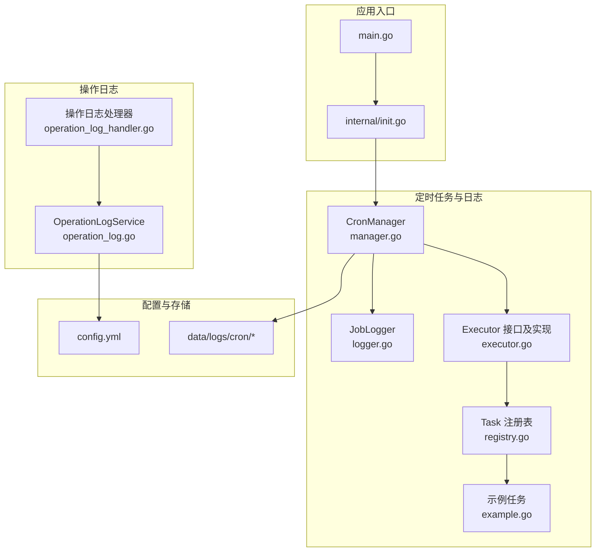
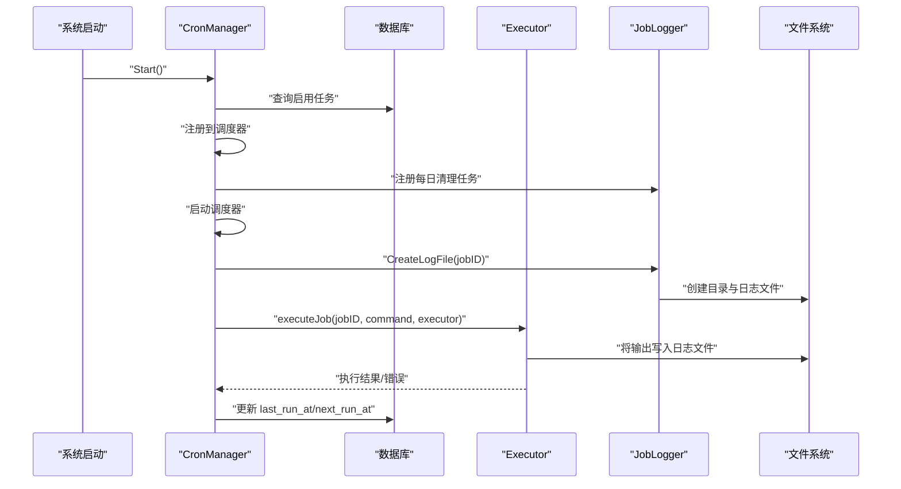
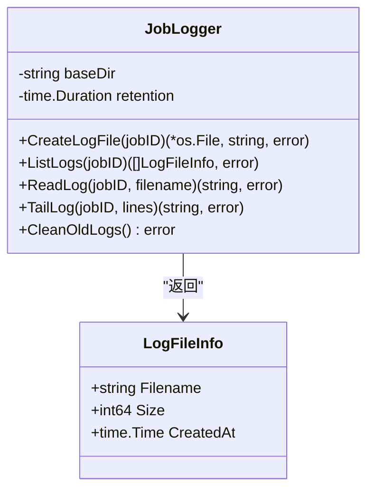
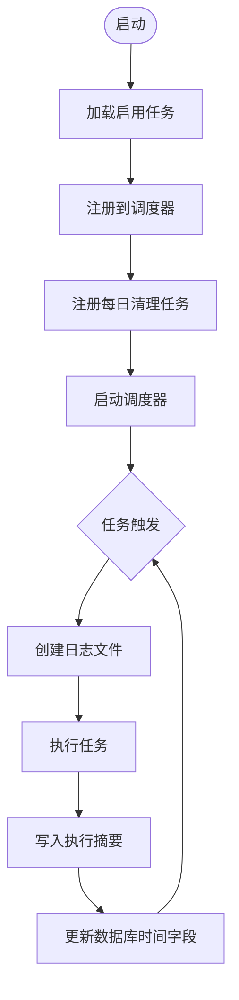
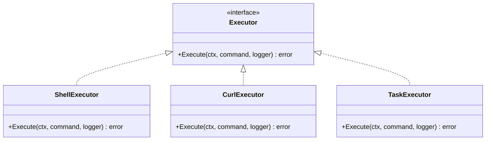
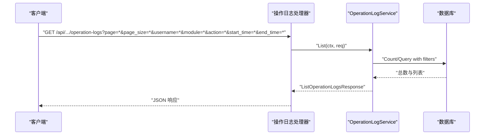
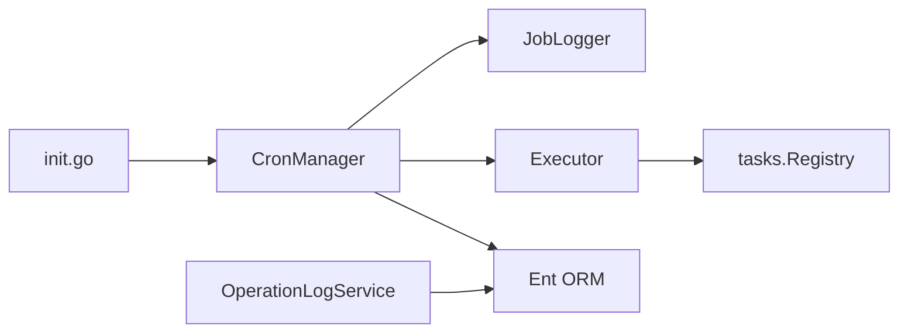

# 日志管理系统

<cite>
**本文引用的文件**
- [logger.go](file://internal/cron/logger.go)
- [manager.go](file://internal/cron/manager.go)
- [executor.go](file://internal/cron/executor.go)
- [registry.go](file://internal/tasks/registry.go)
- [example.go](file://internal/tasks/example.go)
- [operation_log.go](file://internal/service/operation_log.go)
- [operation_log_handler.go](file://internal/handler/operation_log.go)
- [init.go](file://internal/init.go)
- [main.go](file://main.go)
- [config.yml](file://config/config.yml)
- [logger_test.go](file://internal/cron/logger_test.go)
- [operation_log_test.go](file://internal/service/operation_log_test.go)
</cite>

## 目录
1. [简介](#简介)
2. [项目结构](#项目结构)
3. [核心组件](#核心组件)
4. [架构总览](#架构总览)
5. [详细组件分析](#详细组件分析)
6. [依赖关系分析](#依赖关系分析)
7. [性能考虑](#性能考虑)
8. [故障排查指南](#故障排查指南)
9. [结论](#结论)
10. [附录](#附录)

## 简介
本系统是一个定时任务日志管理平台，围绕“定时任务执行 + 日志生成与管理 + 查询检索 + 清理归档”的完整闭环构建。系统采用分层架构，核心包括：
- 定时任务管理器：负责任务注册、调度、执行与日志写入
- 任务执行器：支持 Shell、HTTP、Go Task 三种执行方式
- 日志管理器：负责任务日志文件的创建、轮转、清理与读取
- 操作日志服务：提供后台操作日志的持久化、查询与检索
- Web 层：提供 REST 接口与前端静态资源托管

系统特性：
- 日志文件按任务 ID 分目录存放，文件名包含时间戳，便于轮转与定位
- 支持按时间范围、任务 ID、关键字等多维过滤查询
- 提供实时日志查看能力（基于文件尾部读取）
- 内置过期日志自动清理任务，保障磁盘空间
- 高并发场景下通过异步写入与分页查询降低阻塞

## 项目结构
系统采用分层与职责分离的设计：
- internal/cron：定时任务与日志管理
- internal/service：业务服务层（含操作日志）
- internal/handler：HTTP 处理器层
- internal/tasks：Go Task 注册与示例
- internal/init.go：应用初始化与 CronManager 启动
- config/config.yml：系统配置（含日志轮转参数）

图表来源
- [manager.go:17-38](file://internal/cron/manager.go#L17-L38)
- [logger.go:20-32](file://internal/cron/logger.go#L20-L32)
- [executor.go:18-37](file://internal/cron/executor.go#L18-L37)
- [registry.go:11-23](file://internal/tasks/registry.go#L11-L23)
- [operation_log.go:25-35](file://internal/service/operation_log.go#L25-L35)
- [operation_log_handler.go:49-93](file://internal/handler/operation_log.go#L49-L93)
- [init.go:59-64](file://internal/init.go#L59-L64)
- [config.yml:11-18](file://config/config.yml#L11-L18)

章节来源
- [main.go:47-104](file://main.go#L47-L104)
- [init.go:31-67](file://internal/init.go#L31-L67)
- [config.yml:11-18](file://config/config.yml#L11-L18)

## 核心组件
- 定时任务管理器（CronManager）
  - 负责加载数据库中的启用任务、注册到调度器、执行任务并写入日志、更新下次执行时间
  - 内置每日 2:00 的过期日志清理任务
- 日志管理器（JobLogger）
  - 为每次任务执行创建独立日志文件，按任务 ID 分目录
  - 提供列出、读取、尾部读取、清理过期日志等功能
- 任务执行器（Executor）
  - ShellExecutor：在不同平台调用系统 shell 执行命令
  - CurlExecutor：解析 JSON 配置执行 HTTP 请求，带超时与响应截断
  - TaskExecutor：从全局注册表查找并执行 Go Task
- 操作日志服务（OperationLogService）
  - 异步记录用户操作日志，支持分页、多字段过滤（用户名、模块、动作、时间范围）
  - 提供详情查询与总数统计
- 任务注册表（tasks.Registry）
  - 维护已注册的 Go Task 名称与函数映射

章节来源
- [manager.go:17-38](file://internal/cron/manager.go#L17-L38)
- [logger.go:20-32](file://internal/cron/logger.go#L20-L32)
- [executor.go:18-37](file://internal/cron/executor.go#L18-L37)
- [operation_log.go:18-35](file://internal/service/operation_log.go#L18-L35)
- [registry.go:11-23](file://internal/tasks/registry.go#L11-L23)

## 架构总览
系统整体流程：
- 应用启动时初始化 CronManager 并启动调度器
- 任务触发时，CronManager 创建任务日志文件，选择对应执行器执行命令
- 执行器将输出写入日志文件，同时记录执行结果与耗时
- 每日凌晨 2:00 自动清理超过保留时长的日志文件
- 操作日志通过异步服务写入数据库，提供 REST 接口查询

图表来源
- [init.go:59-64](file://internal/init.go#L59-L64)
- [manager.go:40-77](file://internal/cron/manager.go#L40-L77)
- [manager.go:154-221](file://internal/cron/manager.go#L154-L221)
- [logger.go:34-51](file://internal/cron/logger.go#L34-L51)
- [executor.go:26-37](file://internal/cron/executor.go#L26-L37)

## 详细组件分析

### JobLogger 日志管理器
职责与能力：
- 创建日志文件：按任务 ID 创建目录，文件名为时间戳 + .log
- 列出日志：按修改时间倒序返回文件信息（名称、大小、创建时间）
- 读取日志：安全校验文件名，读取完整内容
- 尾部读取：读取最新日志文件的最后 N 行（默认 100）
- 清理过期日志：按保留时长删除旧文件，并清理空目录

图表来源
- [logger.go:13-32](file://internal/cron/logger.go#L13-L32)
- [logger.go:34-51](file://internal/cron/logger.go#L34-L51)
- [logger.go:53-86](file://internal/cron/logger.go#L53-L86)
- [logger.go:88-105](file://internal/cron/logger.go#L88-L105)
- [logger.go:107-146](file://internal/cron/logger.go#L107-L146)
- [logger.go:148-191](file://internal/cron/logger.go#L148-L191)

章节来源
- [logger.go:13-191](file://internal/cron/logger.go#L13-L191)
- [logger_test.go:12-38](file://internal/cron/logger_test.go#L12-L38)
- [logger_test.go:40-85](file://internal/cron/logger_test.go#L40-L85)
- [logger_test.go:87-116](file://internal/cron/logger_test.go#L87-L116)
- [logger_test.go:118-148](file://internal/cron/logger_test.go#L118-L148)
- [logger_test.go:150-158](file://internal/cron/logger_test.go#L150-L158)
- [logger_test.go:160-209](file://internal/cron/logger_test.go#L160-L209)

### CronManager 定时任务管理器
职责与能力：
- 启动：从数据库加载启用任务，注册到调度器；注册每日清理任务
- 运行：执行任务前创建日志文件，执行后写入结果摘要并更新数据库时间字段
- 控制：支持立即执行、移除任务、查询日志器实例

图表来源
- [manager.go:40-77](file://internal/cron/manager.go#L40-L77)
- [manager.go:154-221](file://internal/cron/manager.go#L154-L221)

章节来源
- [manager.go:17-38](file://internal/cron/manager.go#L17-L38)
- [manager.go:40-77](file://internal/cron/manager.go#L40-L77)
- [manager.go:85-116](file://internal/cron/manager.go#L85-L116)
- [manager.go:127-147](file://internal/cron/manager.go#L127-L147)
- [manager.go:149-152](file://internal/cron/manager.go#L149-L152)
- [manager.go:154-221](file://internal/cron/manager.go#L154-L221)

### Executor 执行器体系
职责与能力：
- ShellExecutor：跨平台执行命令，标准输出与错误输出均写入日志
- CurlExecutor：解析 JSON 配置，支持方法、URL、头、体、超时；记录请求与响应摘要
- TaskExecutor：从全局注册表查找并执行 Go Task

图表来源
- [executor.go:18-37](file://internal/cron/executor.go#L18-L37)
- [executor.go:26-37](file://internal/cron/executor.go#L26-L37)
- [executor.go:51-113](file://internal/cron/executor.go#L51-L113)
- [executor.go:118-125](file://internal/cron/executor.go#L118-L125)

章节来源
- [executor.go:18-126](file://internal/cron/executor.go#L18-L126)
- [registry.go:11-33](file://internal/tasks/registry.go#L11-L33)
- [example.go:10-29](file://internal/tasks/example.go#L10-L29)

### 操作日志服务与处理器
职责与能力：
- OperationLogService：异步记录操作日志，支持多字段过滤、分页查询、总数统计
- 操作日志处理器：提供 REST 接口，支持分页、用户名、模块、动作、时间范围查询

图表来源
- [operation_log_handler.go:49-93](file://internal/handler/operation_log.go#L49-L93)
- [operation_log.go:120-183](file://internal/service/operation_log.go#L120-L183)

章节来源
- [operation_log.go:18-86](file://internal/service/operation_log.go#L18-L86)
- [operation_log.go:88-118](file://internal/service/operation_log.go#L88-L118)
- [operation_log.go:120-183](file://internal/service/operation_log.go#L120-L183)
- [operation_log.go:185-197](file://internal/service/operation_log.go#L185-L197)
- [operation_log.go:199-217](file://internal/service/operation_log.go#L199-L217)
- [operation_log_handler.go:49-127](file://internal/handler/operation_log.go#L49-L127)

### 日志轮转与文件大小控制
- 文件命名：按任务 ID 分目录，文件名为时间戳 + .log
- 轮转策略：通过保留时长控制日志生命周期，每日清理任务自动删除过期文件
- 存储位置：./data/logs/cron 下按 job-{id} 子目录组织
- 清理规则：删除早于保留时长的文件，若目录为空则一并删除

章节来源
- [logger.go:34-51](file://internal/cron/logger.go#L34-L51)
- [logger.go:148-191](file://internal/cron/logger.go#L148-L191)
- [manager.go:60-71](file://internal/cron/manager.go#L60-L71)
- [init.go:60](file://internal/init.go#L60)

### 日志内容格式与结构化设计
- 文件头：任务名、任务 ID、开始时间
- 执行过程：执行器输出写入日志
- 文件尾：结束时间、耗时、状态（成功/失败）、错误信息
- 结构化字段：任务元数据、执行摘要、错误描述

章节来源
- [manager.go:167-200](file://internal/cron/manager.go#L167-L200)

### 日志查询与检索
- 按任务 ID：通过 JobLogger.ListLogs/TailLog 获取任务日志
- 按时间范围：通过 CronManager 的日志清理与文件时间戳实现
- 关键字过滤：通过文件内容读取与字符串匹配实现（建议结合索引或外部搜索）

章节来源
- [logger.go:53-86](file://internal/cron/logger.go#L53-L86)
- [logger.go:107-146](file://internal/cron/logger.go#L107-L146)
- [logger.go:88-105](file://internal/cron/logger.go#L88-L105)

### 实时日志查看（tail -f 模拟）
- 通过 TailLog 读取最新日志文件的最后 N 行
- 支持前端轮询或 WebSocket（需扩展）实现近似 tail -f 效果
- 注意：当前实现为文件读取，非真正的流式推送

章节来源
- [logger.go:107-146](file://internal/cron/logger.go#L107-L146)

### 日志清理与归档策略
- 自动清理：每日 2:00 执行清理任务，删除超过保留时长的日志文件
- 保留时长：通过构造函数参数配置（默认 7 天）
- 归档建议：可在清理任务基础上扩展为压缩归档并移动至远端存储

章节来源
- [manager.go:60-71](file://internal/cron/manager.go#L60-L71)
- [logger.go:148-191](file://internal/cron/logger.go#L148-L191)
- [init.go:60](file://internal/init.go#L60)

## 依赖关系分析
- CronManager 依赖 JobLogger、Executor、Ent ORM
- JobLogger 依赖文件系统
- Executor 依赖 tasks.Registry（Go Task）
- OperationLogService 依赖 Ent ORM
- 应用启动时初始化 CronManager 并注入全局

图表来源
- [manager.go:17-38](file://internal/cron/manager.go#L17-L38)
- [logger.go:20-32](file://internal/cron/logger.go#L20-L32)
- [executor.go:18-37](file://internal/cron/executor.go#L18-L37)
- [registry.go:11-23](file://internal/tasks/registry.go#L11-L23)
- [operation_log.go:25-35](file://internal/service/operation_log.go#L25-L35)
- [init.go:59-64](file://internal/init.go#L59-L64)

章节来源
- [manager.go:17-38](file://internal/cron/manager.go#L17-L38)
- [logger.go:20-32](file://internal/cron/logger.go#L20-L32)
- [executor.go:18-37](file://internal/cron/executor.go#L18-L37)
- [registry.go:11-23](file://internal/tasks/registry.go#L11-L23)
- [operation_log.go:25-35](file://internal/service/operation_log.go#L25-L35)
- [init.go:59-64](file://internal/init.go#L59-L64)

## 性能考虑
- 异步写入：操作日志服务采用 goroutine 异步写入，避免阻塞主流程
- 分页查询：操作日志列表支持分页与排序，减少一次性数据传输
- 文件读取：日志读取采用逐行扫描，内存占用可控
- 资源释放：日志文件句柄及时关闭，避免句柄泄漏
- 并发安全：CronManager 使用 sync.Map 存储任务映射，保证并发安全

章节来源
- [operation_log.go:88-118](file://internal/service/operation_log.go#L88-L118)
- [operation_log.go:120-183](file://internal/service/operation_log.go#L120-L183)
- [manager.go:154-221](file://internal/cron/manager.go#L154-L221)

## 故障排查指南
常见问题与处理：
- 日志文件无法创建
  - 检查日志目录权限与磁盘空间
  - 确认 baseDir 路径有效
- 读取日志报错
  - 校验文件名是否包含路径遍历字符
  - 确认文件是否存在且可读
- TailLog 返回空
  - 确认任务是否已产生日志文件
  - 检查文件是否被清理
- 清理任务未执行
  - 检查调度器是否启动
  - 确认每日 2:00 的计划任务是否注册成功
- 操作日志查询异常
  - 检查时间范围格式是否符合 RFC3339
  - 确认数据库连接与表结构

章节来源
- [logger.go:88-105](file://internal/cron/logger.go#L88-L105)
- [logger.go:107-146](file://internal/cron/logger.go#L107-L146)
- [logger.go:148-191](file://internal/cron/logger.go#L148-L191)
- [manager.go:60-71](file://internal/cron/manager.go#L60-L71)
- [operation_log.go:120-183](file://internal/service/operation_log.go#L120-L183)

## 结论
该日志管理系统围绕定时任务执行与日志管理构建，具备完善的日志生成、存储、查询与清理能力。通过分层设计与清晰的职责划分，系统在保证功能完整性的同时兼顾了可维护性与可扩展性。建议后续增强：
- 实时日志查看的 WebSocket 支持
- 日志内容的结构化与索引
- 自动归档与远程备份策略
- 更细粒度的权限控制与审计

## 附录
- 配置项参考
  - 日志文件路径：./data/logs/admin-api.log
  - 控制台输出：开启
  - 文件输出：开启
  - 单文件最大大小：10 MB
  - 保留备份数：10
  - 保留天数：180

章节来源
- [config.yml:11-18](file://config/config.yml#L11-L18)