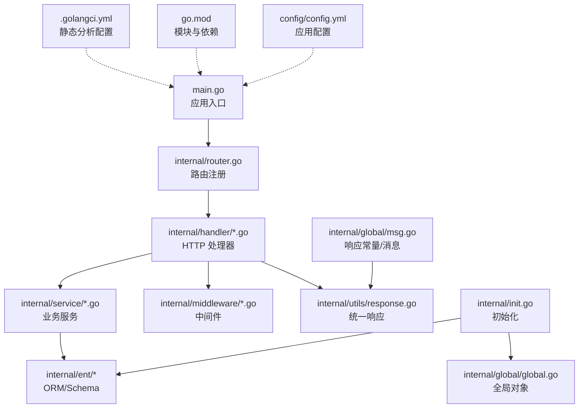
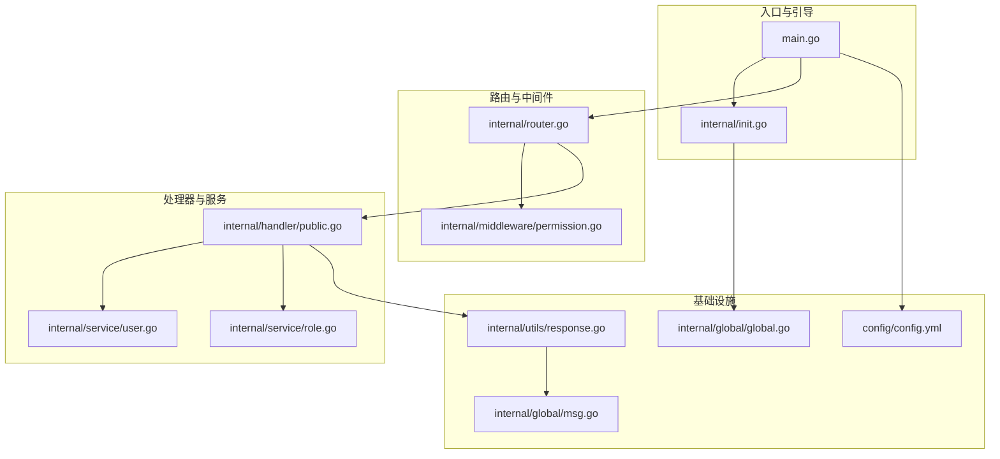
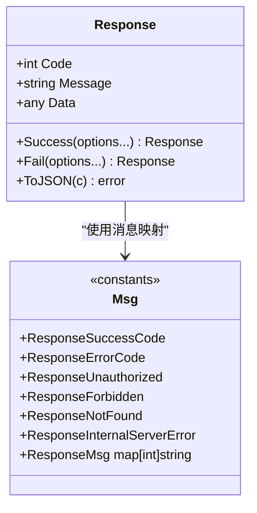
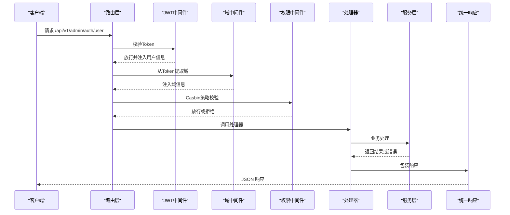
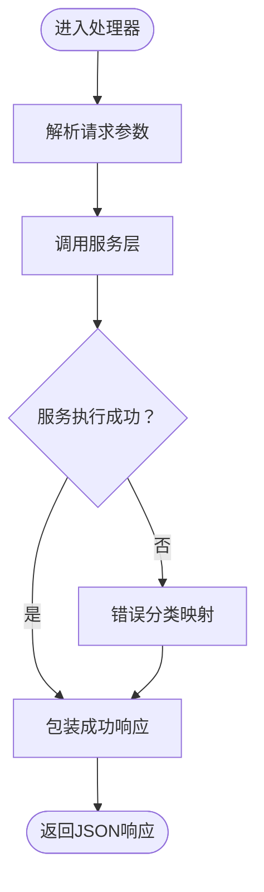
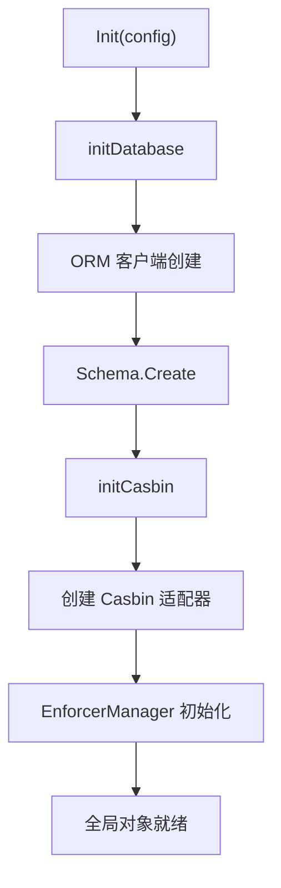
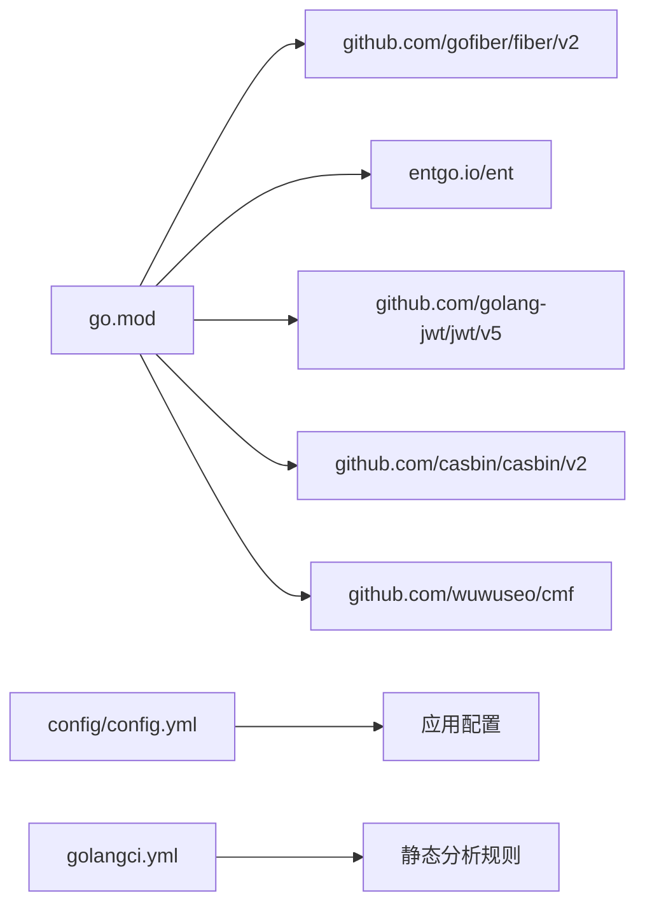

# 代码规范

<cite>
**本文引用的文件**
- [main.go](file://main.go)
- [.golangci.yml](file://.golangci.yml)
- [go.mod](file://go.mod)
- [config.yml](file://config/config.yml)
- [internal/init.go](file://internal/init.go)
- [internal/router.go](file://internal/router.go)
- [internal/middleware/permission.go](file://internal/middleware/permission.go)
- [internal/handler/public.go](file://internal/handler/public.go)
- [internal/service/user.go](file://internal/service/user.go)
- [internal/service/role.go](file://internal/service/role.go)
- [internal/utils/response.go](file://internal/utils/response.go)
- [internal/utils/utils.go](file://internal/utils/utils.go)
- [internal/global/msg.go](file://internal/global/msg.go)
- [internal/global/global.go](file://internal/global/global.go)
</cite>

## 目录
1. [引言](#引言)
2. [项目结构](#项目结构)
3. [核心组件](#核心组件)
4. [架构总览](#架构总览)
5. [详细组件分析](#详细组件分析)
6. [依赖分析](#依赖分析)
7. [性能考虑](#性能考虑)
8. [故障排查指南](#故障排查指南)
9. [结论](#结论)
10. [附录](#附录)

## 引言
本文件为 Go Admin 管理系统制定统一的代码规范与质量标准，覆盖命名约定、代码格式化、注释规范、项目组织原则、响应格式标准化、错误处理模式、日志记录规范、golangci-lint 配置与静态分析规则、以及代码一致性与可维护性最佳实践。目标是确保团队协作高效、代码可读性强、可维护性高，并降低回归风险。

## 项目结构
项目采用按职责分层的组织方式，主要目录与职责如下：
- internal：核心业务代码，按领域拆分 service、handler、middleware、utils、global、ent（数据访问层）等
- config：应用配置文件（YAML）
- docs：文档与 Swagger 配置
- data：运行时日志与存储目录
- 根目录：入口程序 main.go、模块定义 go.mod、静态分析配置 .golangci.yml

图表来源
- [main.go:1-90](file://main.go#L1-L90)
- [internal/router.go:1-73](file://internal/router.go#L1-L73)
- [internal/handler/public.go:1-180](file://internal/handler/public.go#L1-L180)
- [internal/service/user.go:1-394](file://internal/service/user.go#L1-L394)
- [internal/service/role.go:1-396](file://internal/service/role.go#L1-L396)
- [internal/utils/response.go:1-50](file://internal/utils/response.go#L1-L50)
- [internal/global/msg.go:1-46](file://internal/global/msg.go#L1-L46)
- [internal/init.go:1-66](file://internal/init.go#L1-L66)
- [.golangci.yml:1-38](file://.golangci.yml#L1-L38)
- [go.mod:1-120](file://go.mod#L1-L120)
- [config/config.yml:1-143](file://config/config.yml#L1-L143)

章节来源
- [main.go:1-90](file://main.go#L1-L90)
- [internal/router.go:1-73](file://internal/router.go#L1-L73)
- [internal/init.go:1-66](file://internal/init.go#L1-L66)
- [.golangci.yml:1-38](file://.golangci.yml#L1-L38)
- [go.mod:1-120](file://go.mod#L1-L120)
- [config/config.yml:1-143](file://config/config.yml#L1-L143)

## 核心组件
- 统一响应结构：通过 Response 结构体与工具函数封装 JSON 响应，保证前后端交互一致
- 错误码与消息：集中定义响应常量与消息映射，便于国际化与统一管理
- 初始化流程：数据库与 Casbin 权限引擎的初始化顺序与错误处理
- 路由与中间件：版本化路由、JWT 认证、域中间件、权限中间件
- 业务服务：用户、角色等核心业务逻辑，含参数校验、错误分类与返回

章节来源
- [internal/utils/response.go:1-50](file://internal/utils/response.go#L1-L50)
- [internal/utils/utils.go:1-9](file://internal/utils/utils.go#L1-L9)
- [internal/global/msg.go:1-46](file://internal/global/msg.go#L1-L46)
- [internal/init.go:1-66](file://internal/init.go#L1-L66)
- [internal/router.go:1-73](file://internal/router.go#L1-L73)
- [internal/middleware/permission.go:1-69](file://internal/middleware/permission.go#L1-L69)
- [internal/service/user.go:1-394](file://internal/service/user.go#L1-L394)
- [internal/service/role.go:1-396](file://internal/service/role.go#L1-L396)

## 架构总览
系统基于 Fiber 框架构建，采用 MVC+分层架构：
- 入口 main.go 注册引导流程、中间件、路由与清理函数
- 路由层负责版本化与鉴权/权限中间件装配
- 处理器层负责请求解析、调用服务层并输出统一响应
- 服务层封装业务规则与数据访问
- 中间件层负责认证、域识别与权限校验
- 初始化层负责 ORM 与权限引擎的建立

图表来源
- [main.go:1-90](file://main.go#L1-L90)
- [internal/init.go:1-66](file://internal/init.go#L1-L66)
- [internal/router.go:1-73](file://internal/router.go#L1-L73)
- [internal/middleware/permission.go:1-69](file://internal/middleware/permission.go#L1-L69)
- [internal/handler/public.go:1-180](file://internal/handler/public.go#L1-L180)
- [internal/service/user.go:1-394](file://internal/service/user.go#L1-L394)
- [internal/service/role.go:1-396](file://internal/service/role.go#L1-L396)
- [internal/utils/response.go:1-50](file://internal/utils/response.go#L1-L50)
- [internal/global/msg.go:1-46](file://internal/global/msg.go#L1-L46)
- [internal/global/global.go:1-15](file://internal/global/global.go#L1-L15)
- [config/config.yml:1-143](file://config/config.yml#L1-L143)

## 详细组件分析

### 统一响应与错误处理
- 响应结构：统一的 Response 结构体包含 code、message、data 字段；提供 Success/Fail 工具方法与 ToJSON 输出
- 错误码与消息：集中于 global/msg.go，包含通用状态码与业务错误码，配合 utils.GetResponseMsg 获取消息
- 处理器侧：handler 层根据服务层返回的错误进行分类映射，统一通过 Response 输出

图表来源
- [internal/utils/response.go:1-50](file://internal/utils/response.go#L1-L50)
- [internal/utils/utils.go:1-9](file://internal/utils/utils.go#L1-L9)
- [internal/global/msg.go:1-46](file://internal/global/msg.go#L1-L46)

章节来源
- [internal/utils/response.go:1-50](file://internal/utils/response.go#L1-L50)
- [internal/utils/utils.go:1-9](file://internal/utils/utils.go#L1-L9)
- [internal/global/msg.go:1-46](file://internal/global/msg.go#L1-L46)
- [internal/handler/public.go:1-180](file://internal/handler/public.go#L1-L180)

### 路由与中间件
- 版本化路由：/api/v1 下挂载公开与认证接口组
- JWT 中间件：对需要认证的路由进行签名校验
- 域中间件：从 JWT 提取域信息，作为权限校验维度
- 权限中间件：基于 Casbin 执行器进行策略匹配

图表来源
- [internal/router.go:1-73](file://internal/router.go#L1-L73)
- [internal/middleware/permission.go:1-69](file://internal/middleware/permission.go#L1-L69)
- [internal/handler/public.go:1-180](file://internal/handler/public.go#L1-L180)
- [internal/service/user.go:1-394](file://internal/service/user.go#L1-L394)

章节来源
- [internal/router.go:1-73](file://internal/router.go#L1-L73)
- [internal/middleware/permission.go:1-69](file://internal/middleware/permission.go#L1-L69)
- [internal/handler/public.go:1-180](file://internal/handler/public.go#L1-L180)

### 业务服务（用户与角色）
- 用户服务：登录、刷新令牌、获取用户信息、更新用户、修改密码
- 角色服务：创建、查询、列表、更新、删除、启停角色
- 错误分类：针对业务场景定义专用错误，便于上层统一处理

图表来源
- [internal/handler/public.go:1-180](file://internal/handler/public.go#L1-L180)
- [internal/service/user.go:1-394](file://internal/service/user.go#L1-L394)
- [internal/service/role.go:1-396](file://internal/service/role.go#L1-L396)

章节来源
- [internal/service/user.go:1-394](file://internal/service/user.go#L1-L394)
- [internal/service/role.go:1-396](file://internal/service/role.go#L1-L396)
- [internal/handler/public.go:1-180](file://internal/handler/public.go#L1-L180)

### 初始化与全局对象
- 数据库初始化：选择驱动、建立连接、创建 Schema
- Casbin 初始化：基于 ORM 适配器创建执行器管理器
- 全局对象：ORM、Bootstrap、EnforcerManager

图表来源
- [internal/init.go:1-66](file://internal/init.go#L1-L66)
- [internal/global/global.go:1-15](file://internal/global/global.go#L1-L15)

章节来源
- [internal/init.go:1-66](file://internal/init.go#L1-L66)
- [internal/global/global.go:1-15](file://internal/global/global.go#L1-L15)

## 依赖分析
- 模块与框架：Fiber、Ent、JWT、Casbin、CMF（自研框架）
- 配置与日志：YAML 配置文件、日志落盘与轮转
- 静态分析：golangci-lint 启用 gofmt、golint、govet，排除生成代码与测试文件

图表来源
- [go.mod:1-120](file://go.mod#L1-L120)
- [config/config.yml:1-143](file://config/config.yml#L1-L143)
- [.golangci.yml:1-38](file://.golangci.yml#L1-L38)

章节来源
- [go.mod:1-120](file://go.mod#L1-L120)
- [config/config.yml:1-143](file://config/config.yml#L1-L143)
- [.golangci.yml:1-38](file://.golangci.yml#L1-L38)

## 性能考虑
- 路由与中间件链路尽量短，避免重复解析与计算
- 权限中间件按需加载域与策略，建议高频域开启自动加载
- 日志落盘采用轮转，避免磁盘 IO 抖动
- ORM 查询使用索引字段过滤，避免全表扫描
- 缓存层（内存/Redis）合理设置 TTL，减少数据库压力

## 故障排查指南
- 统一响应错误码定位：结合 global/msg.go 中的错误码与消息快速定位问题类别
- 中间件链路：JWT/域/权限任一环节失败都会导致 401/403，逐层检查
- 初始化失败：数据库连接失败、Schema 创建异常、Casbin 初始化异常
- 日志：查看 config.yml 中的日志路径与级别，结合错误码定位

章节来源
- [internal/global/msg.go:1-46](file://internal/global/msg.go#L1-L46)
- [internal/middleware/permission.go:1-69](file://internal/middleware/permission.go#L1-L69)
- [internal/init.go:1-66](file://internal/init.go#L1-L66)
- [config/config.yml:1-143](file://config/config.yml#L1-L143)

## 结论
通过统一的响应结构、清晰的分层架构、严格的中间件与错误处理机制、完善的静态分析与配置管理，Go Admin 系统能够在保证功能完整性的同时，显著提升代码质量与可维护性。建议在后续迭代中持续完善单元测试与集成测试，强化可观测性与安全审计。

## 附录

### 命名约定
- 包名：小写、简洁、语义明确（如 internal/service）
- 函数/方法：驼峰命名，动词开头（如 Login、GetUserByID）
- 变量：小驼峰（如 userID、accessToken）
- 常量：大写+下划线或驼峰（如 ResponseSuccessCode），集中于 global/msg.go
- 结构体：名词或复合词（如 LoginRequest、TokenResponse）

### 代码格式化与注释规范
- 格式化：使用 gofmt；在提交前执行 gofmt -w
- 注释：包注释、导出类型/函数注释、复杂逻辑注释；遵循 godoc 规范
- 文件注释：每个文件顶部添加简要说明与作者信息

### 项目组织原则
- 文件命名：小写加下划线（如 permission.go），避免缩写
- 目录结构：按职责分层（service/handler/middleware/utils/global/ent）
- 模块划分：功能域内聚、跨域低耦合；新增功能优先在对应领域内扩展

### 响应格式标准化
- 成功：code=1，message=“成功”，data 可选
- 失败：code=0，message=“失败”，可携带业务错误码与消息
- 行为成功：code=2，message=“操作成功”
- 未授权/拒绝/资源不存在/内部错误等：使用统一错误码

章节来源
- [internal/utils/response.go:1-50](file://internal/utils/response.go#L1-L50)
- [internal/global/msg.go:1-46](file://internal/global/msg.go#L1-L46)

### 错误处理模式
- 业务错误：定义专用错误变量，上层处理器进行分类映射
- 数据访问错误：区分 NotFound、ValidationError 等
- 通用错误：统一返回 ResponseInternalServerError

章节来源
- [internal/service/user.go:1-394](file://internal/service/user.go#L1-L394)
- [internal/service/role.go:1-396](file://internal/service/role.go#L1-L396)

### 日志记录规范
- 日志路径与轮转：在 config/config.yml 中配置
- 日志级别：开发环境 debug，生产环境 info+
- 日志内容：请求上下文、错误堆栈、关键业务事件

章节来源
- [config/config.yml:1-143](file://config/config.yml#L1-L143)

### golangci-lint 配置与静态分析
- 启用规则：gofmt、golint、govet
- 排除规则：生成代码目录 internal/ent、测试文件
- 超时与问题上限：默认超时 5 分钟，不限制最大问题数

章节来源
- [.golangci.yml:1-38](file://.golangci.yml#L1-L38)

### 代码审查检查清单
- 命名与注释：是否符合命名约定与 godoc 规范
- 错误处理：是否覆盖所有分支并正确映射到统一响应
- 中间件：JWT/域/权限中间件是否按序正确装配
- ORM/事务：查询条件是否使用索引字段，事务边界是否清晰
- 配置：敏感信息是否通过 config.yml 管理
- 静态分析：是否通过 golangci-lint 并修复告警
- 可测试性：关键逻辑是否可注入与可测试