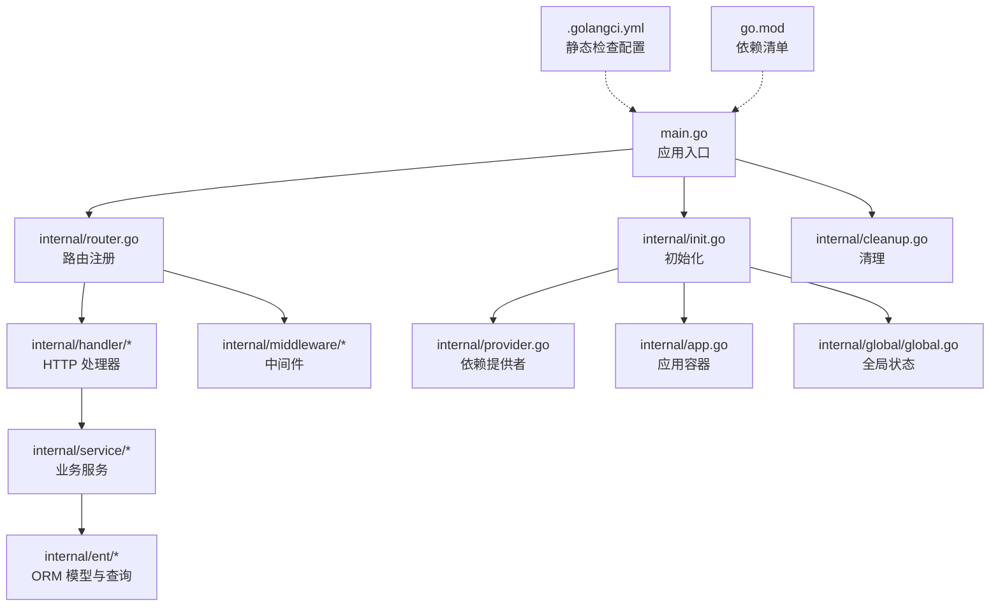
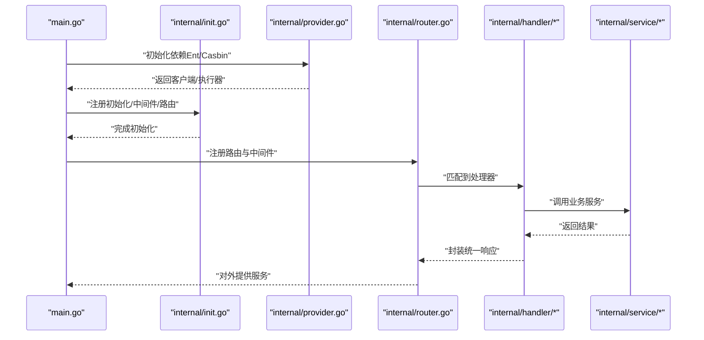
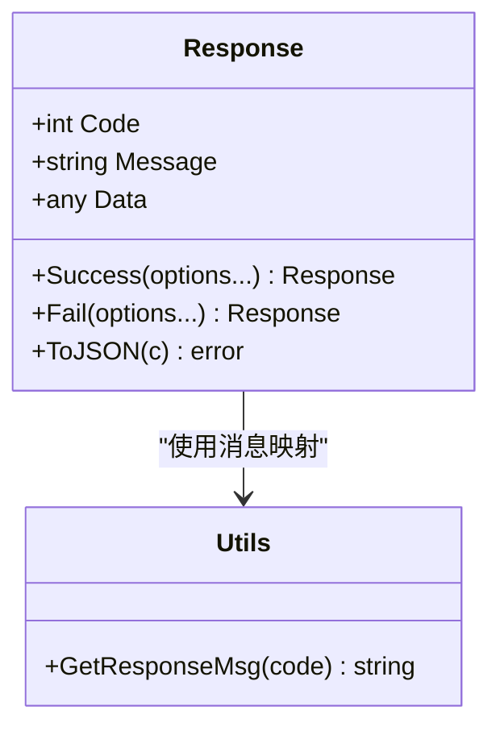
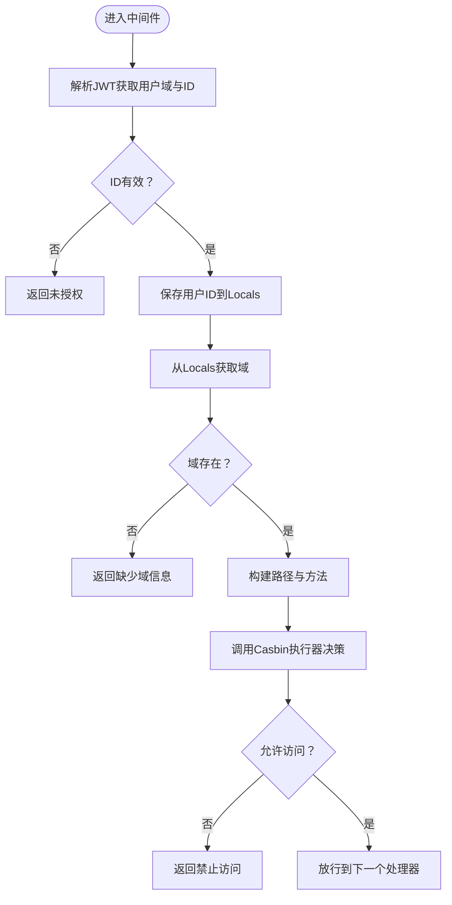
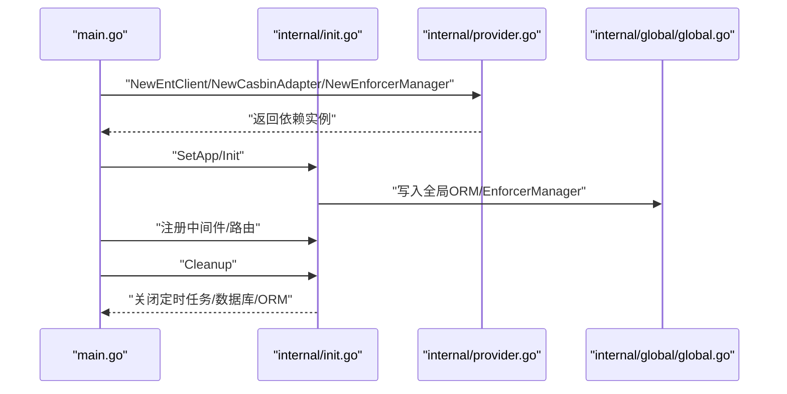
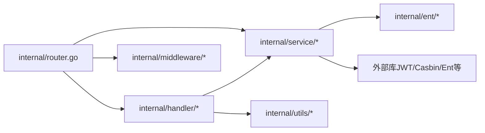

# 代码规范

<cite>
**本文引用的文件**
- [main.go](file://main.go)
- [.golangci.yml](file://.golangci.yml)
- [go.mod](file://go.mod)
- [internal/router.go](file://internal/router.go)
- [internal/provider.go](file://internal/provider.go)
- [internal/init.go](file://internal/init.go)
- [internal/cleanup.go](file://internal/cleanup.go)
- [internal/app.go](file://internal/app.go)
- [internal/global/global.go](file://internal/global/global.go)
- [internal/middleware/permission.go](file://internal/middleware/permission.go)
- [internal/utils/response.go](file://internal/utils/response.go)
- [internal/utils/utils.go](file://internal/utils/utils.go)
- [internal/handler/public.go](file://internal/handler/public.go)
- [internal/service/user.go](file://internal/service/user.go)
</cite>

## 目录
1. [简介](#简介)
2. [项目结构](#项目结构)
3. [核心组件](#核心组件)
4. [架构总览](#架构总览)
5. [详细组件分析](#详细组件分析)
6. [依赖分析](#依赖分析)
7. [性能考虑](#性能考虑)
8. [故障排查指南](#故障排查指南)
9. [结论](#结论)
10. [附录](#附录)

## 简介
本文件面向 Go Admin 管理系统，提供一套完整的 Go 语言代码规范与最佳实践，覆盖命名约定、代码格式化、注释规范、代码组织结构、工具链配置与集成等方面。规范以仓库现有实现为依据，结合可推广的工程实践，帮助团队统一风格、提升可维护性与可读性。

## 项目结构
项目采用按功能域划分的层次化组织方式：
- cmd：应用入口与种子数据初始化
- config：配置文件
- internal：核心业务模块（路由、中间件、服务、处理器、工具、全局状态、任务等）
- docs：文档与 Swagger 配置
- data：运行时数据（日志、存储）
- tmp_cmf_changes：临时变更（非核心）

图表来源
- [main.go:1-105](file://main.go#L1-L105)
- [internal/router.go:1-150](file://internal/router.go#L1-L150)
- [internal/init.go:1-101](file://internal/init.go#L1-L101)
- [internal/cleanup.go:1-38](file://internal/cleanup.go#L1-L38)
- [.golangci.yml:1-38](file://.golangci.yml#L1-L38)
- [go.mod:1-127](file://go.mod#L1-L127)

章节来源
- [main.go:1-105](file://main.go#L1-L105)
- [internal/router.go:1-150](file://internal/router.go#L1-L150)
- [.golangci.yml:1-38](file://.golangci.yml#L1-L38)
- [go.mod:1-127](file://go.mod#L1-L127)

## 核心组件
- 应用容器与依赖注入
  - App 结构体承载配置、日志、数据库、校验器、缓存、Ent 客户端、权限执行器、文件系统等依赖。
  - 通过 Wire Provider 提供 Ent 客户端、Casbin 适配器与 EnforcerManager。
- 初始化与清理
  - Init 负责数据库与权限系统的初始化；Cleanup 负责有序关闭资源。
- 路由与中间件
  - 路由按版本与权限分组；中间件负责 JWT、域解析与权限校验。
- 处理器与服务
  - 处理器负责参数解析、调用服务层、封装响应；服务层封装业务逻辑与数据访问。
- 统一响应
  - Response 统一输出结构，配合全局消息映射与工具函数。

章节来源
- [internal/app.go:1-26](file://internal/app.go#L1-L26)
- [internal/provider.go:1-44](file://internal/provider.go#L1-L44)
- [internal/init.go:1-101](file://internal/init.go#L1-L101)
- [internal/cleanup.go:1-38](file://internal/cleanup.go#L1-L38)
- [internal/router.go:1-150](file://internal/router.go#L1-L150)
- [internal/middleware/permission.go:1-94](file://internal/middleware/permission.go#L1-L94)
- [internal/utils/response.go:1-50](file://internal/utils/response.go#L1-L50)
- [internal/utils/utils.go:1-9](file://internal/utils/utils.go#L1-L9)

## 架构总览
下图展示了启动流程、依赖注入、路由注册与中间件执行的关键交互。

图表来源
- [main.go:47-104](file://main.go#L47-L104)
- [internal/init.go:31-67](file://internal/init.go#L31-L67)
- [internal/provider.go:17-43](file://internal/provider.go#L17-L43)
- [internal/router.go:16-149](file://internal/router.go#L16-L149)
- [internal/handler/public.go:13-214](file://internal/handler/public.go#L13-L214)
- [internal/service/user.go:27-402](file://internal/service/user.go#L27-L402)

## 详细组件分析

### 命名约定
- 包名
  - 使用小写、简洁、语义明确的短词，避免复数与缩写，如 internal、handler、service、middleware、utils、global。
- 函数/方法名
  - 驼峰命名，动词开头，体现行为，如 InitializeApp、Login、GetUser、ChangePassword、RefreshToken。
- 变量名
  - 驼峰命名，简洁且具上下文含义，如 userID、accessToken、refreshToken、domain。
- 常量/错误
  - 错误常量使用统一前缀与清晰语义，如 ErrUserNotFound、ErrInvalidPassword、ErrInvalidUserStatus。
- 类型名
  - 结构体与接口使用名词或名词短语，如 App、UserServiceInterface、LoginRequest、TokenResponse。
- 文件与目录
  - 文件名小写，多词以下划线或驼峰组合；目录按功能域划分，如 internal/handler、internal/service、internal/middleware。

章节来源
- [internal/app.go:15-25](file://internal/app.go#L15-L25)
- [internal/service/user.go:19-25](file://internal/service/user.go#L19-L25)
- [internal/service/user.go:27-84](file://internal/service/user.go#L27-L84)
- [internal/handler/public.go:13-17](file://internal/handler/public.go#L13-L17)
- [internal/middleware/permission.go:14-93](file://internal/middleware/permission.go#L14-L93)

### 代码格式化与导入组织
- gofmt
  - 项目通过 golangci-lint 启用 gofmt，建议在编辑器中配置保存时自动格式化。
- 缩进与行宽
  - 使用 8 空格缩进（部分代码段落），遵循 gofmt 默认 8 空格；行宽建议不超过 100 字符，必要时换行。
- 导入分组
  - 标准库、第三方库、内部包分组，每组内字母序排列；同一组内按使用频率与语义分组。
- 示例参考
  - main.go 的导入分组与排序体现了推荐风格。
  - internal/router.go 展示了 Fiber 路由与中间件的组织方式。

章节来源
- [.golangci.yml:19-21](file://.golangci.yml#L19-L21)
- [main.go:3-22](file://main.go#L3-L22)
- [internal/router.go:3-14](file://internal/router.go#L3-L14)

### 注释规范
- 包注释
  - 包首部使用简洁描述，如 package internal、package handler。
- 函数/方法注释
  - 使用行注释或块注释说明用途、参数、返回值与错误场景；Swagger 注解用于公开 API 文档。
- 行内注释
  - 对复杂逻辑、边界条件与安全要点进行简明解释。
- Swagger 注解
  - 在处理器中使用注解标注摘要、描述、标签、请求/响应结构与路由路径。

章节来源
- [internal/handler/public.go:19-32](file://internal/handler/public.go#L19-L32)
- [internal/handler/public.go:62-72](file://internal/handler/public.go#L62-L72)
- [internal/handler/public.go:135-148](file://internal/handler/public.go#L135-L148)
- [internal/handler/public.go:180-191](file://internal/handler/public.go#L180-L191)

### 代码组织最佳实践
- 分层与职责
  - 路由层：注册路由与中间件，不直接处理业务。
  - 中间件层：鉴权、域解析、权限校验、日志记录。
  - 处理器层：参数解析、调用服务、封装统一响应。
  - 服务层：业务编排、数据访问、错误定义与传播。
  - 工具层：通用工具与统一响应封装。
- 依赖注入
  - 使用 Wire Provider 提供数据库、权限执行器等依赖，确保初始化一致性与可测试性。
- 全局状态
  - 通过 internal/global 存放跨模块共享对象，避免循环依赖与全局污染。
- 资源清理
  - 在 Cleanup 中按顺序关闭定时任务、数据库连接池与 ORM 客户端，保证优雅退出。

章节来源
- [internal/router.go:16-149](file://internal/router.go#L16-L149)
- [internal/middleware/permission.go:14-93](file://internal/middleware/permission.go#L14-L93)
- [internal/handler/public.go:13-214](file://internal/handler/public.go#L13-L214)
- [internal/service/user.go:27-402](file://internal/service/user.go#L27-L402)
- [internal/provider.go:17-43](file://internal/provider.go#L17-L43)
- [internal/global/global.go:11-16](file://internal/global/global.go#L11-L16)
- [internal/cleanup.go:10-37](file://internal/cleanup.go#L10-L37)

### 统一响应与错误处理
- 统一响应结构
  - Response 包含 code、message、data，提供 Success/Fail 与 ToJSON 方法。
- 错误处理策略
  - 处理器根据服务返回的错误类型映射为合适的 HTTP 状态与响应码；对校验错误与业务错误进行区分。
- 全局消息映射
  - 通过工具函数获取响应消息，保持前后端一致的提示语。

图表来源
- [internal/utils/response.go:9-49](file://internal/utils/response.go#L9-L49)
- [internal/utils/utils.go:5-8](file://internal/utils/utils.go#L5-L8)

章节来源
- [internal/utils/response.go:1-50](file://internal/utils/response.go#L1-L50)
- [internal/utils/utils.go:1-9](file://internal/utils/utils.go#L1-L9)
- [internal/handler/public.go:33-60](file://internal/handler/public.go#L33-L60)
- [internal/handler/public.go:149-177](file://internal/handler/public.go#L149-L177)

### 权限中间件流程
- 从 JWT 中提取用户域与用户 ID，校验类型与格式。
- 从本地上下文获取域信息，构造路径与方法。
- 通过 Casbin 执行器进行权限决策，拒绝时返回统一错误响应。

图表来源
- [internal/middleware/permission.go:15-77](file://internal/middleware/permission.go#L15-L77)

章节来源
- [internal/middleware/permission.go:1-94](file://internal/middleware/permission.go#L1-L94)

### 依赖注入与初始化流程
- Wire Provider
  - 提供 Ent 客户端、Casbin 适配器与 EnforcerManager，确保初始化一致性。
- 初始化与清理
  - Init 负责数据库与权限系统初始化；Cleanup 负责有序关闭资源。

图表来源
- [internal/provider.go:17-43](file://internal/provider.go#L17-L43)
- [internal/init.go:31-67](file://internal/init.go#L31-L67)
- [internal/global/global.go:11-16](file://internal/global/global.go#L11-L16)
- [internal/cleanup.go:10-37](file://internal/cleanup.go#L10-L37)

章节来源
- [internal/provider.go:1-44](file://internal/provider.go#L1-L44)
- [internal/init.go:1-101](file://internal/init.go#L1-L101)
- [internal/cleanup.go:1-38](file://internal/cleanup.go#L1-L38)
- [internal/global/global.go:1-17](file://internal/global/global.go#L1-L17)

## 依赖分析
- 内部依赖
  - internal/router 依赖 internal/handler、internal/middleware、internal/service、internal/utils。
  - internal/handler 依赖 internal/service、internal/utils、外部验证与 JWT。
  - internal/service 依赖 internal/ent（ORM）与加密、JWT 等工具。
- 外部依赖
  - Fiber、Casbin、Ent、JWT、Zap、Swag 等。

图表来源
- [internal/router.go:16-149](file://internal/router.go#L16-L149)
- [internal/handler/public.go:13-214](file://internal/handler/public.go#L13-L214)
- [internal/service/user.go:27-402](file://internal/service/user.go#L27-L402)

章节来源
- [internal/router.go:1-150](file://internal/router.go#L1-L150)
- [internal/handler/public.go:1-214](file://internal/handler/public.go#L1-L214)
- [internal/service/user.go:1-402](file://internal/service/user.go#L1-L402)
- [go.mod:5-21](file://go.mod#L5-L21)

## 性能考虑
- 路由与中间件
  - 将通用中间件置于路由组顶部，减少重复逻辑；按需加载服务实例，避免不必要的初始化。
- 数据访问
  - 使用 Ent 的查询优化与索引设计，避免 N+1 查询；批量操作时合并事务。
- 缓存与权限
  - 在高并发场景下，利用缓存与权限执行器的高效决策能力，降低数据库压力。
- 日志与监控
  - 使用 Zap 记录关键路径与错误；对慢请求与异常进行告警。

## 故障排查指南
- 初始化失败
  - 检查数据库连接与迁移是否成功；确认 Casbin 适配器创建与 EnforcerManager 初始化。
- 权限拒绝
  - 核对 JWT 中域与用户 ID 是否正确；确认 Casbin 策略是否匹配路径与方法。
- 统一响应异常
  - 检查 Response 成功/失败分支与消息映射；确认 ToJSON 输出是否被拦截。
- 清理阶段报错
  - 确认定时任务先于数据库关闭；检查 ORM 客户端是否已关闭。

章节来源
- [internal/init.go:31-100](file://internal/init.go#L31-L100)
- [internal/middleware/permission.go:15-77](file://internal/middleware/permission.go#L15-L77)
- [internal/utils/response.go:19-49](file://internal/utils/response.go#L19-L49)
- [internal/cleanup.go:10-37](file://internal/cleanup.go#L10-L37)

## 结论
本规范以项目现有实现为基础，总结了命名、格式、注释、组织与工具链的最佳实践。建议在团队内推广并持续通过 golangci-lint 等工具强化执行，确保代码质量与一致性。

## 附录

### 工具配置与集成
- golangci-lint
  - 启用 gofmt、golint、govet；排除生成代码与测试文件；设置超时与最大问题数。
- gofmt
  - 作为 linter 启用，建议在 IDE 中配置保存时自动格式化。
- go vet
  - 用于静态检查常见错误与不规范写法。
- 集成建议
  - 在 CI 中运行 golangci-lint；在本地编辑器中启用 gofmt；提交前执行 gofmt 与 golangci-lint。

章节来源
- [.golangci.yml:1-38](file://.golangci.yml#L1-L38)
- [go.mod:1-127](file://go.mod#L1-L127)