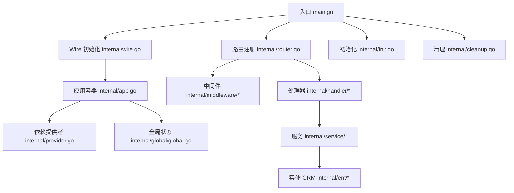
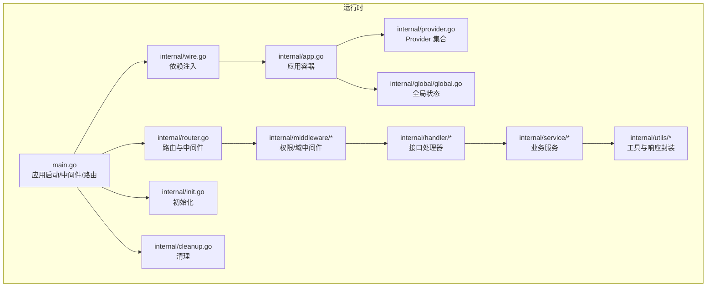
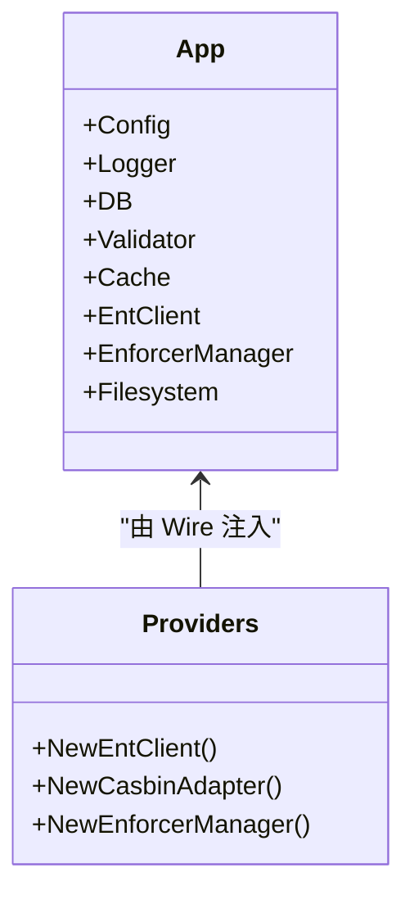
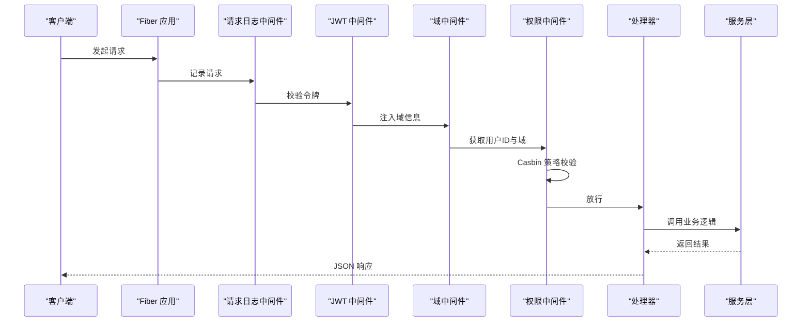
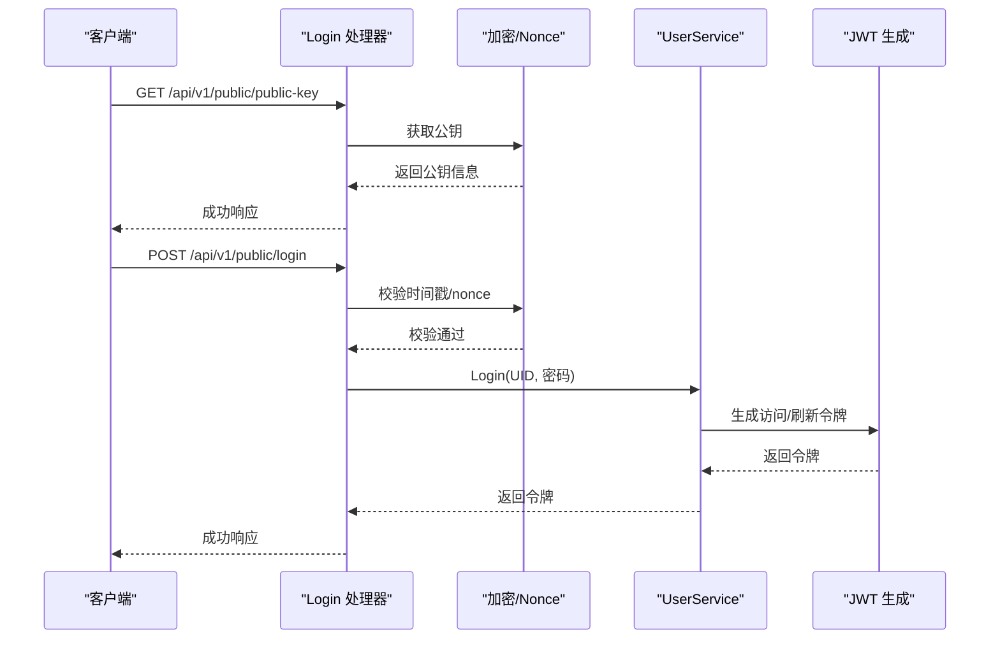
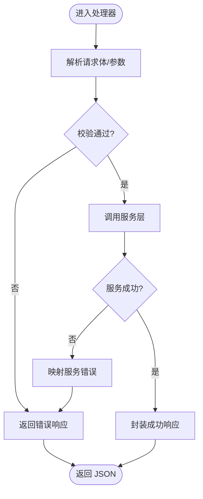
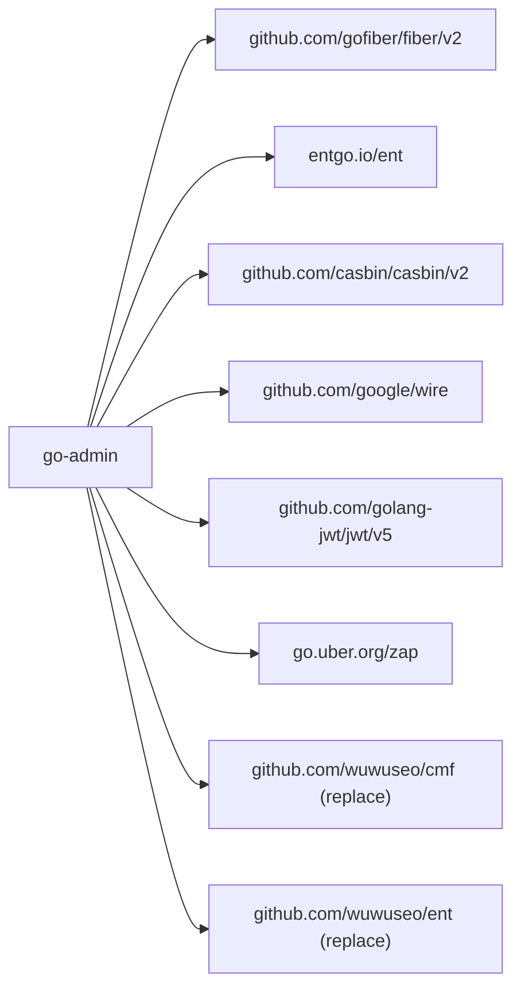

# 代码规范与最佳实践

<cite>
**本文引用的文件**
- [main.go](file://main.go)
- [internal/app.go](file://internal/app.go)
- [internal/provider.go](file://internal/provider.go)
- [internal/router.go](file://internal/router.go)
- [internal/wire.go](file://internal/wire.go)
- [internal/init.go](file://internal/init.go)
- [internal/cleanup.go](file://internal/cleanup.go)
- [internal/global/global.go](file://internal/global/global.go)
- [internal/middleware/permission.go](file://internal/middleware/permission.go)
- [internal/handler/public.go](file://internal/handler/public.go)
- [internal/service/user.go](file://internal/service/user.go)
- [internal/utils/response.go](file://internal/utils/response.go)
- [internal/utils/utils.go](file://internal/utils/utils.go)
- [.golangci.yml](file://.golangci.yml)
- [go.mod](file://go.mod)
</cite>

## 目录
1. [简介](#简介)
2. [项目结构](#项目结构)
3. [核心组件](#核心组件)
4. [架构总览](#架构总览)
5. [详细组件分析](#详细组件分析)
6. [依赖分析](#依赖分析)
7. [性能考虑](#性能考虑)
8. [故障排查指南](#故障排查指南)
9. [结论](#结论)
10. [附录](#附录)

## 简介
本指南面向 Go Admin 管理系统的开发团队，旨在建立统一的代码规范与最佳实践，覆盖以下方面：
- Go 语言编码规范：命名约定、文件组织与目录命名
- 架构设计原则：分层架构、依赖注入、中间件设计
- 代码注释与文档规范：接口注释、Swagger 文档标记
- Git 提交消息格式与分支管理策略
- 代码审查清单与质量检查标准
- 正误示例的对比与定位（通过“章节来源”指向具体文件）

## 项目结构
Go Admin 采用清晰的分层与职责分离：
- 入口层：main.go 负责应用启动、Wire 初始化、中间件挂载与路由注册
- 内核层：internal 包含应用容器 App、依赖提供者 provider、初始化与清理流程
- 路由层：internal/router.go 组织 API 路由与中间件链
- 中间件层：internal/middleware 实现权限与域中间件
- 处理器层：internal/handler 实现业务接口与 Swagger 注解
- 服务层：internal/service 实现业务逻辑与错误定义
- 工具层：internal/utils 提供响应封装、UID 生成、安全读取等通用能力
- 全局状态：internal/global 维护 ORM、EnforcerManager、CronManager 等全局对象
- 配置与构建：go.mod、.golangci.yml 管理依赖与静态检查

**图示来源**
- [main.go:47-107](file://main.go#L47-L107)
- [internal/wire.go:22-37](file://internal/wire.go#L22-L37)
- [internal/app.go:15-25](file://internal/app.go#L15-L25)
- [internal/provider.go:17-46](file://internal/provider.go#L17-L46)
- [internal/router.go:16-189](file://internal/router.go#L16-L189)
- [internal/middleware/permission.go:11-79](file://internal/middleware/permission.go#L11-L79)
- [internal/handler/public.go:27-145](file://internal/handler/public.go#L27-L145)
- [internal/service/user.go:28-427](file://internal/service/user.go#L28-L427)
- [internal/global/global.go:11-16](file://internal/global/global.go#L11-L16)
- [internal/init.go:39-96](file://internal/init.go#L39-L96)
- [internal/cleanup.go:11-42](file://internal/cleanup.go#L11-L42)

**章节来源**
- [main.go:1-108](file://main.go#L1-L108)
- [internal/router.go:1-190](file://internal/router.go#L1-L190)
- [internal/wire.go:1-38](file://internal/wire.go#L1-L38)
- [internal/app.go:1-26](file://internal/app.go#L1-L26)
- [internal/provider.go:1-47](file://internal/provider.go#L1-L47)
- [internal/global/global.go:1-17](file://internal/global/global.go#L1-L17)

## 核心组件
- 应用容器 App：集中持有配置、日志、数据库、校验器、缓存、Ent 客户端、Casbin 执行器、文件系统等依赖
- 依赖提供者：通过 Wire Provider 将各子系统注入 App，保证依赖来源单一、生命周期可控
- 初始化与清理：Init 负责数据库、Casbin、定时任务、密钥与种子数据；Cleanup 负责资源回收
- 路由与中间件：按版本与权限分组，统一注入服务与响应封装
- 处理器与服务：处理器负责请求解析与响应封装，服务层实现业务逻辑与错误语义
- 工具与全局：统一响应结构、UID 生成、请求体安全读取、全局状态管理

**章节来源**
- [internal/app.go:15-25](file://internal/app.go#L15-L25)
- [internal/provider.go:17-46](file://internal/provider.go#L17-L46)
- [internal/init.go:39-96](file://internal/init.go#L39-L96)
- [internal/cleanup.go:11-42](file://internal/cleanup.go#L11-L42)
- [internal/router.go:16-189](file://internal/router.go#L16-L189)
- [internal/handler/public.go:27-145](file://internal/handler/public.go#L27-L145)
- [internal/service/user.go:28-427](file://internal/service/user.go#L28-L427)
- [internal/utils/response.go:9-49](file://internal/utils/response.go#L9-L49)
- [internal/utils/utils.go:70-83](file://internal/utils/utils.go#L70-L83)
- [internal/global/global.go:11-16](file://internal/global/global.go#L11-L16)

## 架构总览
系统采用 Fiber 作为 Web 框架，结合 Wire 进行依赖注入，Ent 作为 ORM，Casbin 实现 RBAC 权限控制，CMF 提供配置、日志、JWT、加密、缓存等基础设施。

**图示来源**
- [main.go:47-107](file://main.go#L47-L107)
- [internal/wire.go:22-37](file://internal/wire.go#L22-L37)
- [internal/app.go:15-25](file://internal/app.go#L15-L25)
- [internal/provider.go:17-46](file://internal/provider.go#L17-L46)
- [internal/router.go:16-189](file://internal/router.go#L16-L189)
- [internal/middleware/permission.go:11-79](file://internal/middleware/permission.go#L11-L79)
- [internal/handler/public.go:27-145](file://internal/handler/public.go#L27-L145)
- [internal/service/user.go:28-427](file://internal/service/user.go#L28-L427)
- [internal/utils/response.go:9-49](file://internal/utils/response.go#L9-L49)
- [internal/utils/utils.go:70-83](file://internal/utils/utils.go#L70-L83)
- [internal/global/global.go:11-16](file://internal/global/global.go#L11-L16)
- [internal/init.go:39-96](file://internal/init.go#L39-L96)
- [internal/cleanup.go:11-42](file://internal/cleanup.go#L11-L42)

## 详细组件分析

### 依赖注入与应用容器
- 使用 Wire 的 ProviderSet 将配置、日志、ORM、校验、缓存、文件系统、Ent 客户端、Casbin 适配器与执行器注入 App
- 通过 InitializeApp 返回统一的 App 实例，便于后续初始化与路由注册使用

**图示来源**
- [internal/app.go:15-25](file://internal/app.go#L15-L25)
- [internal/provider.go:17-46](file://internal/provider.go#L17-L46)
- [internal/wire.go:22-37](file://internal/wire.go#L22-L37)

**章节来源**
- [internal/app.go:15-25](file://internal/app.go#L15-L25)
- [internal/provider.go:17-46](file://internal/provider.go#L17-L46)
- [internal/wire.go:22-37](file://internal/wire.go#L22-L37)

### 路由与中间件链
- 路由按 /api/v1/admin 分层，公开接口与认证接口分离
- 中间件链：请求日志、JWT 认证、域中间件、权限中间件、服务注入、响应封装
- 权限中间件基于 Casbin 执行器进行策略校验

**图示来源**
- [internal/router.go:16-189](file://internal/router.go#L16-L189)
- [internal/middleware/permission.go:11-79](file://internal/middleware/permission.go#L11-L79)
- [internal/handler/public.go:27-145](file://internal/handler/public.go#L27-L145)
- [internal/service/user.go:28-427](file://internal/service/user.go#L28-L427)

**章节来源**
- [internal/router.go:16-189](file://internal/router.go#L16-L189)
- [internal/middleware/permission.go:11-79](file://internal/middleware/permission.go#L11-L79)

### 登录流程与安全要点
- 公钥获取：返回密钥ID、公钥、算法、有效期与轮换周期
- 登录：支持明文或加密字段（等保要求），校验时间戳与 nonce 防重放，解密后校验密码
- 令牌：生成访问令牌与刷新令牌，记录最后登录时间

**图示来源**
- [internal/handler/public.go:27-145](file://internal/handler/public.go#L27-L145)
- [internal/service/user.go:139-218](file://internal/service/user.go#L139-L218)

**章节来源**
- [internal/handler/public.go:27-145](file://internal/handler/public.go#L27-L145)
- [internal/service/user.go:139-218](file://internal/service/user.go#L139-L218)

### 错误处理与响应封装
- 统一响应结构：包含 code、message、data
- 处理器侧通过 utils.Response 快速构造成功/失败响应
- 服务层定义明确的错误类型，便于上层映射

**图示来源**
- [internal/utils/response.go:9-49](file://internal/utils/response.go#L9-L49)
- [internal/handler/public.go:78-144](file://internal/handler/public.go#L78-L144)
- [internal/service/user.go:20-26](file://internal/service/user.go#L20-L26)

**章节来源**
- [internal/utils/response.go:9-49](file://internal/utils/response.go#L9-L49)
- [internal/utils/utils.go:48-61](file://internal/utils/utils.go#L48-L61)
- [internal/service/user.go:20-26](file://internal/service/user.go#L20-L26)

## 依赖分析
- 主模块 go-admin 依赖 Fiber、Ent、Casbin、Wire、JWT、Zap 等
- 通过 replace 指向本地 cmf 与 ent，便于二次开发与调试
- .golangci.yml 启用 gofmt、golint、govet，并排除生成代码与测试文件

**图示来源**
- [go.mod:5-19](file://go.mod#L5-L19)
- [go.mod:126-127](file://go.mod#L126-L127)
- [.golangci.yml:14-26](file://.golangci.yml#L14-L26)

**章节来源**
- [go.mod:1-128](file://go.mod#L1-L128)
- [.golangci.yml:1-38](file://.golangci.yml#L1-L38)

## 性能考虑
- 中间件顺序与短路：权限中间件尽早失败，减少后续处理开销
- 缓存策略：对高频查询（角色、权限、配置）启用缓存服务，降低数据库压力
- 日志与监控：统一请求日志中间件，结合 Zap 输出，避免阻塞主业务
- ORM 优化：批量写入、索引与查询条件优化，避免 N+1 查询
- 文件系统：静态资源与 API 请求分流，避免不必要的文件系统扫描

## 故障排查指南
- 启动失败：检查 InitializeApp 是否成功注入 App，确认数据库与 Casbin 初始化日志
- 权限拒绝：确认 JWT 中是否包含域信息，权限中间件是否正确获取用户ID与域，Casbin 策略是否加载
- 登录异常：检查加密字段、时间戳窗口、nonce 存储是否重复使用，密码哈希与盐值
- 资源清理：确认 Cleanup 是否关闭数据库连接池与 Ent 客户端，定时任务是否停止

**章节来源**
- [internal/init.go:39-96](file://internal/init.go#L39-L96)
- [internal/middleware/permission.go:11-79](file://internal/middleware/permission.go#L11-L79)
- [internal/handler/public.go:78-145](file://internal/handler/public.go#L78-L145)
- [internal/cleanup.go:11-42](file://internal/cleanup.go#L11-L42)

## 结论
本指南总结了 Go Admin 在命名规范、分层架构、依赖注入、中间件设计、注释与文档、质量检查等方面的最佳实践。建议团队在日常开发中严格遵循，持续改进，确保系统稳定性、可维护性与安全性。

## 附录

### Go 语言编码规范与命名约定
- 包名：小写、简洁、不缩写，体现职责（如 internal/service、internal/utils）
- 函数名：动词开头、驼峰命名，体现行为（如 Login、GenerateUID）
- 变量名：简洁、语义明确，避免缩写（如 userID、accessToken）
- 常量名：全部大写、下划线分隔（如 ResponseSuccessCode）
- 接口名：以 er 结尾（如 UserServiceInterface）
- 错误变量：以 Err 前缀（如 ErrUserNotFound）
- 文件命名：小写加下划线（如 permission_middleware.go）

### 文件组织与目录命名
- internal：内部实现，按功能分层（handler、service、middleware、utils、global、ent 等）
- cmd：命令入口（如 main.go）
- config：配置文件（如 config.yml）
- data/storage：持久化数据与缓存目录
- docs：文档与 Swagger 产物
- .golangci.yml：静态检查配置

### 架构设计原则
- 分层架构：入口层、路由层、中间件层、处理器层、服务层、工具层、全局状态
- 依赖注入：通过 Wire Provider 集中管理依赖，避免硬编码
- 中间件设计：职责单一、顺序合理、尽早失败
- 错误处理：明确错误类型与返回码，统一响应封装

### 代码注释与文档规范
- 处理器函数使用 Swagger 注解（@Summary、@Description、@Tags、@Router、@Success、@Failure）
- 结构体字段使用 JSON 标签与中文注释，便于前端对接
- 关键流程添加注释说明（如 UID 生成、Nonce 防重放、密钥轮换）

### Git 提交消息格式与分支管理策略
- 提交消息格式：类型(scope): 描述（如 feat(router): 新增权限中间件）
- 分支策略：main/master 保护，feature/* 开发，release/* 发布，hotfix/* 紧急修复

### 代码审查清单与质量检查标准
- 代码风格：通过 gofmt、golint、govet
- 逻辑正确性：边界条件、空值处理、错误映射
- 安全性：防重放、密码哈希、JWT 签名验证
- 性能：中间件顺序、缓存使用、ORM 查询优化
- 可维护性：命名一致性、注释完整性、模块内聚与低耦合

### 正误示例定位（以路径代替代码）
- 正确：处理器统一使用 utils.Response 构造响应，参考 [internal/handler/public.go:78-145](file://internal/handler/public.go#L78-L145)
- 错误：直接返回错误字符串而非统一响应结构，应避免
- 正确：服务层定义明确错误类型，参考 [internal/service/user.go:20-26](file://internal/service/user.go#L20-L26)
- 错误：在处理器中直接拼接 JSON，应使用 utils.Response
- 正确：中间件链顺序合理，权限中间件尽早失败，参考 [internal/router.go:64-70](file://internal/router.go#L64-L70)
- 错误：权限中间件位置不当导致拦截异常，应调整注册顺序
- 正确：初始化与清理流程完整，参考 [internal/init.go:39-96](file://internal/init.go#L39-L96)、[internal/cleanup.go:11-42](file://internal/cleanup.go#L11-L42)
- 错误：遗漏资源关闭或初始化失败未记录日志