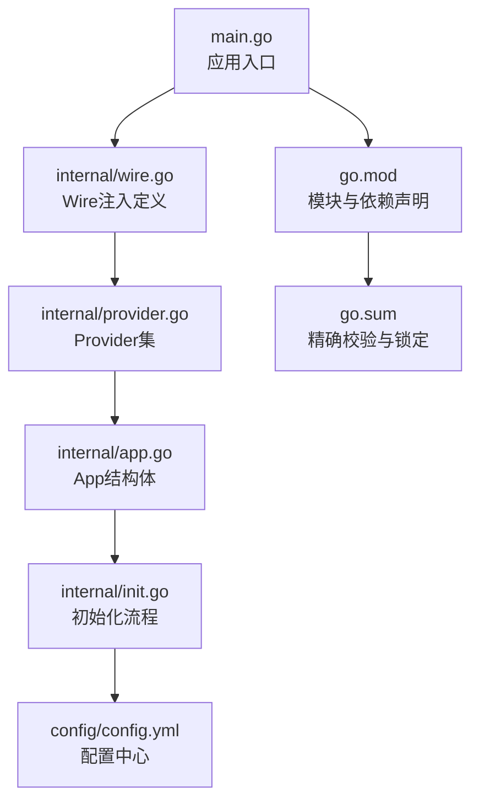
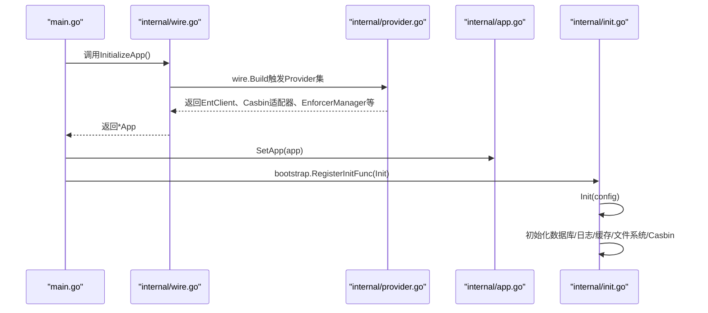
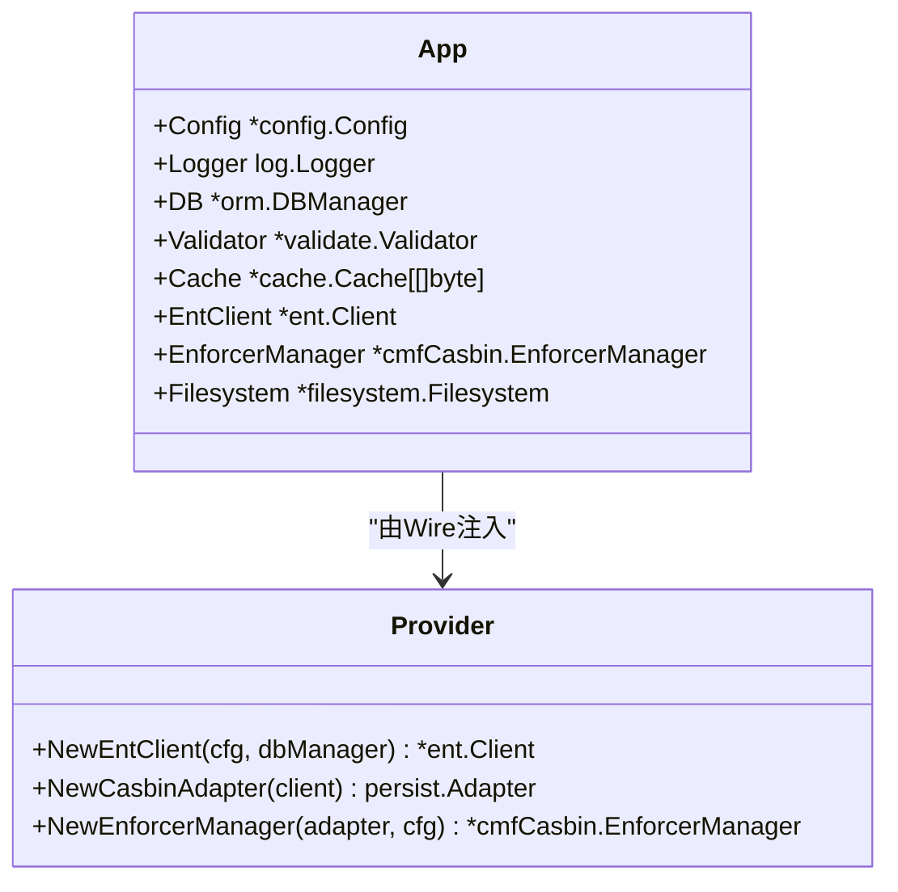
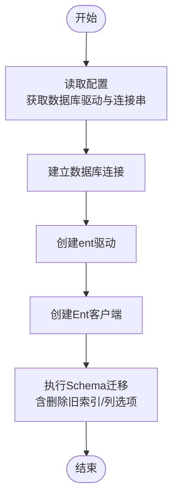
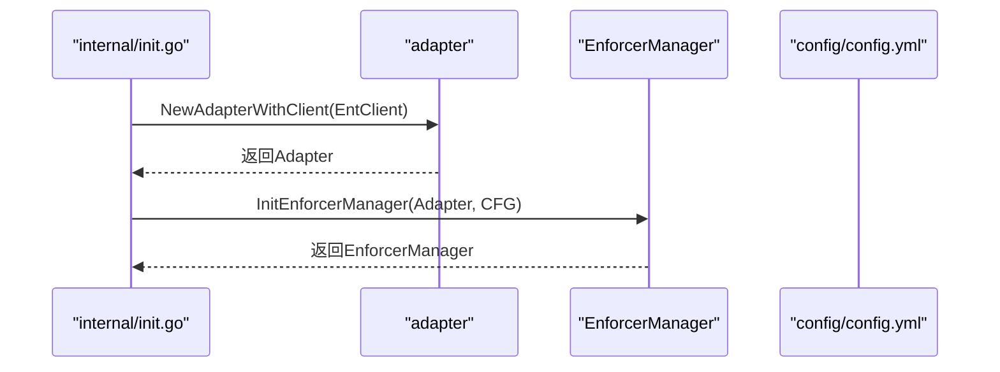
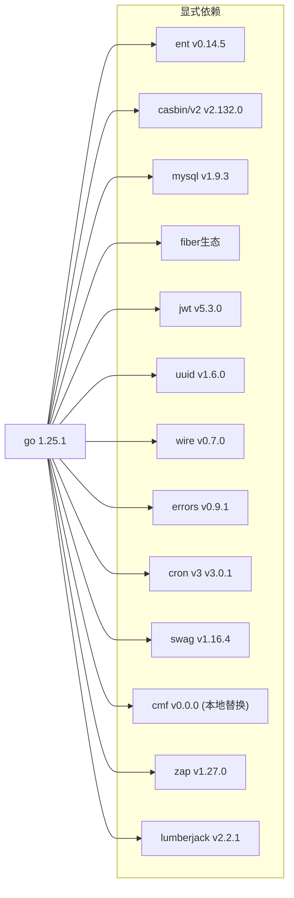

# 依赖管理

<cite>
**本文引用的文件**   
- [go.mod](file://go.mod)
- [go.sum](file://go.sum)
- [.golangci.yml](file://.golangci.yml)
- [main.go](file://main.go)
- [internal/app.go](file://internal/app.go)
- [internal/init.go](file://internal/init.go)
- [internal/provider.go](file://internal/provider.go)
- [internal/wire.go](file://internal/wire.go)
- [config/config.yml](file://config/config.yml)
</cite>

## 目录
1. [简介](#简介)
2. [项目结构](#项目结构)
3. [核心组件](#核心组件)
4. [架构总览](#架构总览)
5. [详细组件分析](#详细组件分析)
6. [依赖分析](#依赖分析)
7. [性能考虑](#性能考虑)
8. [故障排查指南](#故障排查指南)
9. [结论](#结论)
10. [附录](#附录)

## 简介
本文件面向Go Admin管理系统，系统性梳理项目中的依赖管理实践，覆盖Go modules的使用、版本管理、依赖声明与约束、更新策略、第三方库选择标准、安全扫描、依赖树分析与优化、缓存与镜像配置、最佳实践与常见陷阱。文档基于仓库中实际存在的go.mod、go.sum、.golangci.yml以及关键源码文件进行分析与总结。

## 项目结构
本项目采用模块化组织方式，核心入口位于main.go，内部通过Wire进行依赖注入，初始化日志、数据库、缓存、文件系统、Casbin等子系统，并注册中间件与路由。配置文件config.yml集中管理应用、日志、数据库、缓存、Redis、文件系统、Casbin等运行参数。

**图示来源**
- [main.go:47-104](file://main.go#L47-L104)
- [internal/wire.go:22-37](file://internal/wire.go#L22-L37)
- [internal/provider.go:17-43](file://internal/provider.go#L17-L43)
- [internal/app.go:15-25](file://internal/app.go#L15-L25)
- [internal/init.go:31-67](file://internal/init.go#L31-L67)
- [config/config.yml:1-143](file://config/config.yml#L1-L143)
- [go.mod:1-127](file://go.mod#L1-L127)
- [go.sum:1-402](file://go.sum#L1-L402)

**章节来源**
- [main.go:1-105](file://main.go#L1-L105)
- [internal/wire.go:1-38](file://internal/wire.go#L1-L38)
- [internal/provider.go:1-44](file://internal/provider.go#L1-L44)
- [internal/app.go:1-26](file://internal/app.go#L1-L26)
- [internal/init.go:1-101](file://internal/init.go#L1-L101)
- [config/config.yml:1-143](file://config/config.yml#L1-L143)
- [go.mod:1-127](file://go.mod#L1-L127)
- [go.sum:1-402](file://go.sum#L1-L402)

## 核心组件
- 模块与版本
  - 模块名：go-admin
  - Go语言版本：1.25.1
  - 显式依赖：ent、casbin、mysql驱动、fiber框架及其生态、jwt、uuid、wire、errors、cron、swag、cmf、zap、lumberjack等
  - 间接依赖：大量第三方库通过go.sum锁定，如aws-sdk、prometheus、validator、viper、redis客户端、fasthttp、gRPC相关等
  - 替换规则：本地替换github.com/wuwuseo/cmf指向本地路径，便于开发调试
- 依赖注入与初始化
  - 使用Wire按需注入App所需组件（配置、日志、数据库、缓存、文件系统、Casbin、Ent客户端等）
  - 初始化流程中优先使用Wire注入的实例，否则回退到手动初始化
- 配置中心
  - 通过config.yml集中管理应用、日志、数据库、缓存、Redis、文件系统、Casbin等配置项

**章节来源**
- [go.mod:1-127](file://go.mod#L1-L127)
- [go.sum:1-402](file://go.sum#L1-L402)
- [internal/wire.go:22-37](file://internal/wire.go#L22-L37)
- [internal/provider.go:17-43](file://internal/provider.go#L17-L43)
- [internal/init.go:31-67](file://internal/init.go#L31-L67)
- [config/config.yml:1-143](file://config/config.yml#L1-L143)

## 架构总览
下图展示应用启动时的依赖关系与初始化顺序，体现模块、注入器、提供者与具体实现之间的交互。

**图示来源**
- [main.go:47-61](file://main.go#L47-L61)
- [internal/wire.go:22-37](file://internal/wire.go#L22-L37)
- [internal/provider.go:17-43](file://internal/provider.go#L17-L43)
- [internal/app.go:15-25](file://internal/app.go#L15-L25)
- [internal/init.go:31-67](file://internal/init.go#L31-L67)

## 详细组件分析

### 组件A：依赖注入与应用容器
- Wire注入
  - 通过wire.Build聚合配置、日志、ORM、验证器、缓存、文件系统等Provider
  - 提供NewEntClient、NewCasbinAdapter、NewEnforcerManager等工厂函数
- App容器
  - App结构体聚合配置、日志、数据库、验证器、缓存、Ent客户端、Casbin管理器、文件系统等
- 初始化流程
  - Init优先使用Wire注入的实例；若缺失则回退到手动初始化数据库与Casbin

**图示来源**
- [internal/app.go:15-25](file://internal/app.go#L15-L25)
- [internal/provider.go:17-43](file://internal/provider.go#L17-L43)
- [internal/wire.go:22-37](file://internal/wire.go#L22-L37)

**章节来源**
- [internal/wire.go:1-38](file://internal/wire.go#L1-L38)
- [internal/provider.go:1-44](file://internal/provider.go#L1-L44)
- [internal/app.go:1-26](file://internal/app.go#L1-L26)
- [internal/init.go:31-67](file://internal/init.go#L31-L67)

### 组件B：数据库与Schema迁移
- 数据库驱动与连接
  - 使用github.com/go-sql-driver/mysql作为MySQL驱动
  - 通过ORM层获取数据库连接并创建ent驱动
- Schema迁移
  - 在创建Ent客户端后执行自动迁移，启用删除旧索引与列的选项以保证变更安全

**图示来源**
- [internal/provider.go:18-33](file://internal/provider.go#L18-L33)

**章节来源**
- [internal/provider.go:17-43](file://internal/provider.go#L17-L43)

### 组件C：Casbin权限管理
- 适配器与管理器
  - 通过Ent客户端创建Casbin适配器
  - 初始化EnforcerManager并结合config.yml中的多域配置
- 初始化流程
  - Init中优先使用Wire注入的EnforcerManager，否则手动创建

**图示来源**
- [internal/init.go:86-100](file://internal/init.go#L86-L100)
- [internal/provider.go:35-43](file://internal/provider.go#L35-L43)
- [config/config.yml:77-143](file://config/config.yml#L77-L143)

**章节来源**
- [internal/init.go:1-101](file://internal/init.go#L1-L101)
- [internal/provider.go:1-44](file://internal/provider.go#L1-L44)
- [config/config.yml:1-143](file://config/config.yml#L1-L143)

## 依赖分析
- 模块与版本
  - 模块：go-admin
  - Go版本：1.25.1
  - 显式依赖：ent v0.14.5、casbin/v2 v2.132.0、mysql驱动 v1.9.3、fiber生态、jwt v5.3.0、uuid v1.6.0、wire v0.7.0、errors v0.9.1、cron v3 v3.0.1、swag v1.16.4、cmf v0.0.0（本地替换）、zap v1.27.0、lumberjack v2.2.1等
  - 间接依赖：通过go.sum可见大量子依赖，如aws-sdk、prometheus、validator、viper、redis、fasthttp、gRPC相关等
  - 替换规则：github.com/wuwuseo/cmf => D:/www/cmf
- 依赖树与循环依赖
  - 从go.mod可见直接依赖关系清晰，间接依赖通过go.sum锁定
  - 未发现显式循环导入迹象；Wire注入链路自上而下，耦合度低
- 版本约束
  - go.mod中未使用版本约束修饰符（如//indirect），所有依赖均以明确版本声明
  - go.sum确保精确锁定，避免漂移

**图示来源**
- [go.mod:3-21](file://go.mod#L3-L21)
- [go.mod:23-124](file://go.mod#L23-L124)
- [go.mod:126-127](file://go.mod#L126-L127)

**章节来源**
- [go.mod:1-127](file://go.mod#L1-L127)
- [go.sum:1-402](file://go.sum#L1-L402)

## 性能考虑
- 日志与输出
  - 使用zap与lumberjack进行高性能日志记录与滚动，配置文件中包含最大文件大小、备份数与保留天数
- 缓存与存储
  - 支持内存与Redis两种缓存后端，Redis连接池参数可调
- Web静态资源
  - 通过Fiber中间件提供SPA静态资源服务，避免重复请求
- ORM与Schema
  - Ent自动迁移开启删除旧索引/列选项，有助于在频繁迭代中保持Schema整洁

**章节来源**
- [config/config.yml:11-18](file://config/config.yml#L11-L18)
- [config/config.yml:32-41](file://config/config.yml#L32-L41)
- [config/config.yml:42-58](file://config/config.yml#L42-L58)
- [internal/provider.go:27-30](file://internal/provider.go#L27-L30)

## 故障排查指南
- 依赖版本不一致或缺失
  - 使用go mod tidy同步依赖，确保go.mod与go.sum一致
  - 若出现“找不到模块”错误，检查本地替换规则是否正确映射至本地路径
- 初始化失败
  - 数据库连接失败：核对config.yml中的数据库连接信息
  - Casbin初始化失败：确认适配器创建与模型配置正确
- 代码质量与规范
  - .golangci.yml启用了gofmt、golint、govet等基础检查，建议在提交前运行以减少CI失败

**章节来源**
- [go.mod:126-127](file://go.mod#L126-L127)
- [config/config.yml:19-31](file://config/config.yml#L19-L31)
- [internal/init.go:69-84](file://internal/init.go#L69-L84)
- [internal/init.go:86-100](file://internal/init.go#L86-L100)
- [.golangci.yml:14-38](file://.golangci.yml#L14-L38)

## 结论
本项目在依赖管理方面具备以下特点：
- 清晰的模块边界与版本约束，显式依赖与替换规则明确
- 通过Wire实现依赖注入，降低模块间耦合，提升可测试性
- 配置中心集中管理运行参数，便于运维与扩展
- 依赖树通过go.sum精确锁定，配合go mod tidy维持一致性
- 建议持续关注第三方库的安全公告与维护状态，定期进行安全扫描与版本升级

## 附录

### 附录A：Go modules使用要点
- module声明与Go版本
  - 在go.mod顶部声明模块名与Go版本
- 依赖声明与版本约束
  - require块列出直接依赖及版本
  - replace块用于本地替换，便于开发调试
- 依赖锁定与同步
  - go.sum精确锁定依赖树
  - go mod tidy同步依赖，去除未使用包，补充缺失包

**章节来源**
- [go.mod:1-3](file://go.mod#L1-L3)
- [go.mod:5-21](file://go.mod#L5-L21)
- [go.mod:23-124](file://go.mod#L23-L124)
- [go.mod:126-127](file://go.mod#L126-L127)

### 附录B：依赖更新策略
- 升级依赖版本
  - 使用go get <pkg>@<version>或go get <pkg>@latest
  - 更新后运行go mod tidy与go test，确保兼容性
- 处理版本冲突
  - 查看go.mod中的版本差异，必要时引入replace或降级
- 回滚到稳定版本
  - 基于go.sum回滚到已知稳定提交
- 依赖树分析与优化
  - 使用go list -deps与go mod graph查看依赖关系
  - 移除未使用的包，避免引入不必要依赖

**章节来源**
- [go.mod:1-127](file://go.mod#L1-L127)
- [go.sum:1-402](file://go.sum#L1-L402)

### 附录C：第三方库选择标准
- 性能考量
  - 优先选择活跃维护、有基准测试与性能报告的库
- 安全性评估
  - 关注CVE与安全公告，避免使用已披露高危漏洞的版本
- 维护状态检查
  - 查看最近提交频率、Issue响应速度与社区反馈

**章节来源**
- [go.mod:5-21](file://go.mod#L5-L21)
- [go.mod:23-124](file://go.mod#L23-L124)

### 附录D：依赖安全扫描
- 工具与流程
  - 使用govulncheck进行漏洞扫描
  - 在CI中集成扫描步骤，确保每次提交均进行安全检查
- 结果处理
  - 对发现的漏洞制定修复计划，优先修复高危与严重级别

**章节来源**
- [go.mod:1-127](file://go.mod#L1-L127)

### 附录E：依赖缓存与镜像配置
- 依赖缓存
  - 使用go build -a -installsuffix cache -u ./...加速二次构建
- 镜像配置
  - 在企业网络环境可配置GOPROXY以提升下载效率

**章节来源**
- [go.mod:1-127](file://go.mod#L1-L127)

### 附录F：最佳实践与常见陷阱
- 最佳实践
  - 明确模块边界，避免循环依赖
  - 使用Wire统一注入，集中管理生命周期
  - 配置中心集中化，避免硬编码
  - 定期运行安全扫描与代码质量检查
- 常见陷阱
  - 忽视go.sum导致的版本漂移
  - 过度依赖间接依赖，增加攻击面
  - 未及时清理未使用依赖，增大镜像体积

**章节来源**
- [internal/wire.go:22-37](file://internal/wire.go#L22-L37)
- [internal/provider.go:17-43](file://internal/provider.go#L17-L43)
- [.golangci.yml:14-38](file://.golangci.yml#L14-L38)