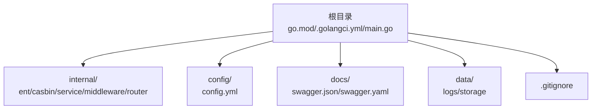
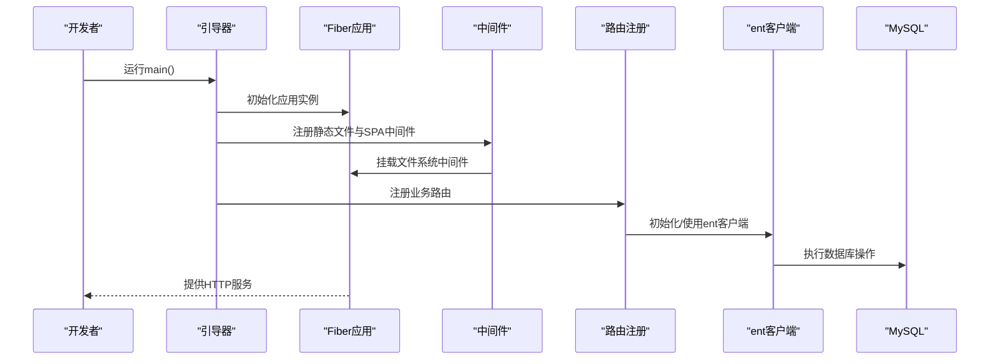
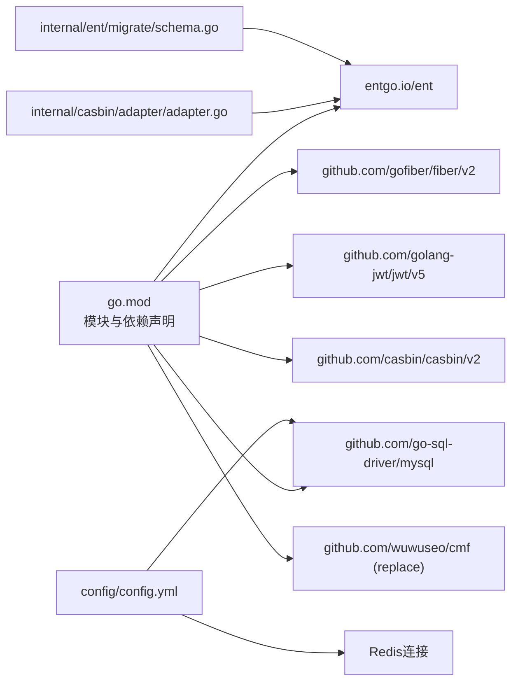

# 开发工具配置

<cite>
**本文引用的文件**
- [go.mod](file://go.mod)
- [.golangci.yml](file://.golangci.yml)
- [main.go](file://main.go)
- [config.yml](file://config/config.yml)
- [.gitignore](file://.gitignore)
- [adapter.go](file://internal/casbin/adapter/adapter.go)
- [schema.go](file://internal/ent/migrate/schema.go)
- [client.go](file://internal/ent/client.go)
</cite>

## 目录
1. [简介](#简介)
2. [项目结构](#项目结构)
3. [核心组件](#核心组件)
4. [架构总览](#架构总览)
5. [详细组件分析](#详细组件分析)
6. [依赖分析](#依赖分析)
7. [性能考虑](#性能考虑)
8. [故障排除指南](#故障排除指南)
9. [结论](#结论)
10. [附录](#附录)

## 简介
本文件面向Go Admin管理系统的开发者，提供从IDE到本地开发环境的完整工具链配置指南。内容涵盖：
- IDE设置建议（VS Code、GoLand）
- Go模块与依赖管理（go.mod维护、版本控制）
- 代码格式化工具（gofmt、goimports）使用
- golangci-lint配置与自定义规则
- Git钩子配置（pre-commit）
- Docker与数据库本地开发环境
- 调试与热重载开发模式
- 常用开发命令与脚本

## 项目结构
该仓库采用按功能域分层的组织方式：
- 根目录包含模块元信息、静态资源嵌入、应用入口与配置
- internal目录下按领域拆分：ent ORM、casbin权限适配器、服务层、中间件、全局状态等
- config目录存放运行时配置
- docs目录包含Swagger文档
- data目录用于日志与存储

**图表来源**
- [go.mod:1-120](file://go.mod#L1-L120)
- [main.go:1-90](file://main.go#L1-L90)
- [config.yml:1-143](file://config/config.yml#L1-L143)

**章节来源**
- [go.mod:1-120](file://go.mod#L1-L120)
- [main.go:1-90](file://main.go#L1-L90)
- [config.yml:1-143](file://config/config.yml#L1-L143)

## 核心组件
- 应用入口与静态资源嵌入：通过embed将前端dist目录打包进二进制，实现单体部署
- 配置中心：YAML配置驱动应用、数据库、缓存、Redis、文件系统、Casbin等
- 权限适配器：基于ent客户端的Casbin策略存储适配器
- ORM与迁移：ent框架生成的Schema与迁移逻辑
- Lint与格式化：golangci-lint与gofmt/goimports

**章节来源**
- [main.go:40-89](file://main.go#L40-L89)
- [config.yml:1-143](file://config/config.yml#L1-L143)
- [adapter.go:60-113](file://internal/casbin/adapter/adapter.go#L60-L113)
- [schema.go:42-145](file://internal/ent/migrate/schema.go#L42-L145)

## 架构总览
应用启动流程概览如下：

**图表来源**
- [main.go:43-78](file://main.go#L43-L78)
- [adapter.go:77-95](file://internal/casbin/adapter/adapter.go#L77-L95)
- [client.go:55-109](file://internal/ent/client.go#L55-L109)

## 详细组件分析

### IDE设置建议（VS Code、GoLand）

- VS Code
  - 插件推荐：Go、gopls、gotests、Swagger Viewer、EditorConfig、YAML
  - 设置要点：
    - 使用工作区设置启用gofmt与goimports
    - 在保存时自动格式化：editor.formatOnSave
    - 启用go vet与go lint：go.lintTool、go.vetOnSave
    - 配置任务与调试：tasks.json与launch.json
  - 项目根目录即工作区根，确保gopls能正确解析模块

- GoLand
  - Go模块自动识别，无需额外配置
  - 代码格式化：Go fmt与goimports已内置
  - Lint集成：golangci-lint可在External Tools中配置
  - 调试：直接运行main.go，或配置Run/Debug配置

[本节为通用IDE配置建议，不涉及具体源码文件，故无“章节来源”]

### Go模块管理与依赖版本控制

- go.mod
  - 指定模块名、Go版本与显式依赖
  - 间接依赖通过require块列出
  - replace指令将github.com/wuwuseo/cmf替换为本地路径，便于联调
- 版本控制最佳实践
  - 使用语义化版本，尽量固定次要版本或补丁版本范围
  - 定期执行go mod tidy同步依赖
  - go.sum随go.mod变更同步更新

**章节来源**
- [go.mod:1-120](file://go.mod#L1-L120)

### 代码格式化工具（gofmt、goimports）

- gofmt
  - 统一代码风格，保证一致性
  - 建议在保存时自动执行
- goimports
  - 自动插入缺失的导入并删除未使用的导入
  - 与gofmt配合使用，确保导入顺序与格式一致
- VS Code集成
  - editor.formatOnSave启用gofmt
  - vetAndLintOnSave启用go vet与go lint
- GoLand集成
  - Settings -> Go -> Code Style -> Formatter
  - 配置External Tools调用goimports

[本节为通用工具使用建议，不涉及具体源码文件，故无“章节来源”]

### golangci-lint配置与自定义规则

- 当前配置要点
  - 跳过目录：tmp、web
  - 跳过测试文件：.*_test\.go$
  - 默认超时：5分钟
  - 启用linters：gofmt、golint、govet
  - 禁用linters：maligned、prealloc
  - 排除规则：对internal/ent下的golint检查放行
- 自定义规则建议
  - 新增复杂度检查：gocyclo、dupl
  - 新增安全检查：gosec
  - 新增注释规范：misspell
  - 针对生成代码的路径排除可扩展至其他目录

**章节来源**
- [.golangci.yml:1-38](file://.golangci.yml#L1-L38)

### Git钩子配置（pre-commit）

- 推荐流程
  - 安装pre-commit：pip install pre-commit
  - 创建.git/hooks/pre-commit脚本，执行以下命令：
    - gofmt -w .
    - goimports -w .
    - golangci-lint run
    - go test ./...
- 注意事项
  - 保持脚本可执行权限
  - 将生成代码目录加入忽略，避免重复检查
  - 在CI中同样执行golangci-lint与测试

[本节为通用Git钩子配置建议，不涉及具体源码文件，故无“章节来源”]

### Docker开发环境配置

- 建议步骤
  - 编写Dockerfile：基于官方golang镜像构建，复制源码，安装依赖，暴露端口
  - 编写docker-compose.yml：编排应用、MySQL、Redis服务
  - 使用卷挂载：将本地代码映射到容器，实现热重载开发
- 端口与服务
  - 应用端口：9501
  - MySQL：3306
  - Redis：6379
- 环境变量
  - 数据库连接字符串
  - Redis连接参数
  - 日志路径与级别

[本节为通用Docker配置建议，不涉及具体源码文件，故无“章节来源”]

### 数据库本地开发环境搭建

- MySQL
  - 使用Docker快速启动：指定root密码、数据库名、表前缀
  - 在config.yml中配置host、port、user、password、name、table_prefix
- Redis
  - 启动本地Redis或使用Docker
  - 在config.yml中配置addr、db、连接池参数
- ent迁移
  - 使用ent命令生成Schema与迁移文件
  - 执行迁移脚本初始化数据库结构

**章节来源**
- [config.yml:19-31](file://config/config.yml#L19-L31)
- [config.yml:42-58](file://config/config.yml#L42-L58)
- [schema.go:42-145](file://internal/ent/migrate/schema.go#L42-L145)

### 调试环境与热重载开发模式

- 调试环境
  - main.go中通过bootstrap注册中间件与路由，便于断点调试
  - 可在IDE中设置断点于中间件与路由处理函数
- 热重载开发模式
  - 使用外部工具如air或fresh监听文件变化并重启进程
  - 或在Docker Compose中挂载代码卷并使用watch模式
- 日志与输出
  - config.yml中的日志配置可输出到文件与控制台，便于排查

**章节来源**
- [main.go:43-78](file://main.go#L43-L78)
- [config.yml:11-17](file://config/config.yml#L11-L17)

### 常用开发命令与脚本

- 依赖管理
  - go mod tidy：同步依赖
  - go list -m all：查看当前模块依赖树
- 代码质量
  - golangci-lint run：执行lint
  - go test ./...：运行全部测试
- 生成与迁移
  - ent命令生成Schema与迁移文件
  - 执行迁移脚本初始化数据库
- 构建与运行
  - go build -o go-admin：构建二进制
  - ./go-admin：运行应用
- 前端资源
  - 将前端dist目录放置于web目录，或通过embed打包

**章节来源**
- [go.mod:1-120](file://go.mod#L1-L120)
- [.golangci.yml:1-38](file://.golangci.yml#L1-L38)
- [main.go:40-41](file://main.go#L40-L41)

## 依赖分析

**图表来源**
- [go.mod:5-13](file://go.mod#L5-L13)
- [adapter.go:60-113](file://internal/casbin/adapter/adapter.go#L60-L113)
- [schema.go:42-145](file://internal/ent/migrate/schema.go#L42-L145)
- [config.yml:19-58](file://config/config.yml#L19-L58)

**章节来源**
- [go.mod:1-120](file://go.mod#L1-L120)
- [adapter.go:60-113](file://internal/casbin/adapter/adapter.go#L60-L113)
- [schema.go:42-145](file://internal/ent/migrate/schema.go#L42-L145)
- [config.yml:19-58](file://config/config.yml#L19-L58)

## 性能考虑
- Casbin多域模型：高频访问域可开启自动加载以减少首次延迟
- Redis连接池：合理设置连接池大小与生命周期，避免过多空闲连接
- ent调试选项：仅在开发阶段启用Debug模式，生产关闭以避免性能损耗
- Swagger开关：生产关闭Swagger以减少不必要的开销

[本节为通用性能建议，不涉及具体源码文件，故无“章节来源”]

## 故障排除指南
- golangci-lint报错
  - 检查排除规则是否覆盖生成代码目录
  - 确认linters启用列表与禁用列表符合团队规范
- ent连接失败
  - 核对数据库连接参数与表前缀
  - 确认ent Schema与迁移脚本一致
- 权限适配器初始化失败
  - 检查数据库驱动与DSN
  - 确认ent客户端初始化成功后再创建适配器
- 日志无法输出
  - 检查config.yml中的日志路径与权限
  - 确认日志轮转参数合理

**章节来源**
- [.golangci.yml:28-38](file://.golangci.yml#L28-L38)
- [adapter.go:62-95](file://internal/casbin/adapter/adapter.go#L62-L95)
- [client.go:85-87](file://internal/ent/client.go#L85-L87)
- [config.yml:11-17](file://config/config.yml#L11-L17)

## 结论
通过统一的IDE配置、严格的依赖管理、完善的代码质量工具链与本地化开发环境，可以显著提升Go Admin项目的开发效率与稳定性。建议团队在CI中复用相同的golangci-lint与测试流程，确保代码质量的一致性。

## 附录

### 配置文件清单与用途
- go.mod：模块与依赖声明
- .golangci.yml：golangci-lint规则与排除
- config.yml：应用、数据库、缓存、Redis、文件系统、Casbin配置
- .gitignore：忽略目录与日志文件
- main.go：应用入口、静态资源嵌入、中间件与路由注册

**章节来源**
- [go.mod:1-120](file://go.mod#L1-L120)
- [.golangci.yml:1-38](file://.golangci.yml#L1-L38)
- [config.yml:1-143](file://config/config.yml#L1-L143)
- [.gitignore:1-4](file://.gitignore#L1-L4)
- [main.go:1-90](file://main.go#L1-L90)