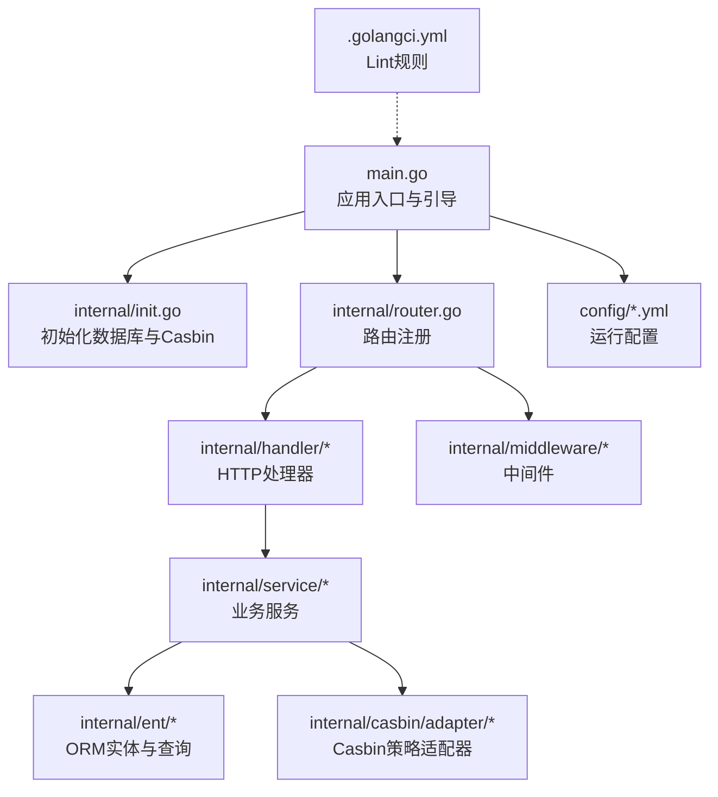
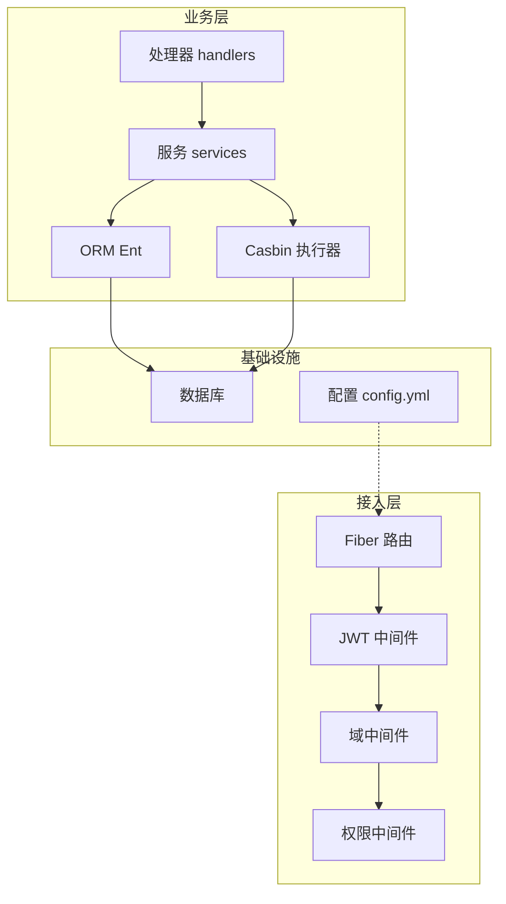
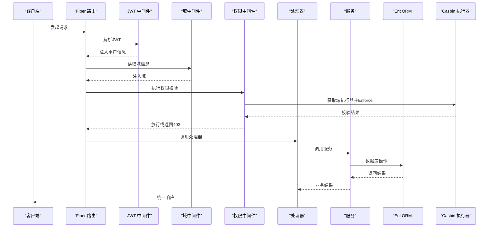
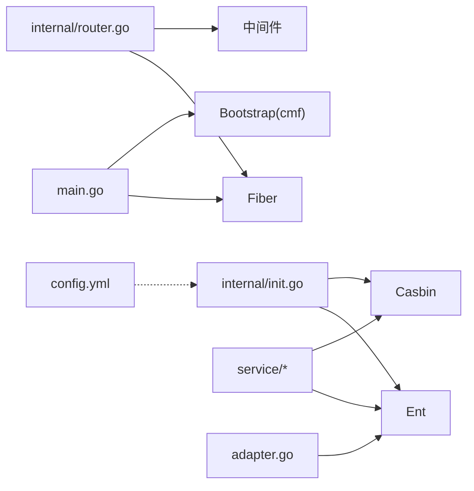

# 开发指南

<cite>
**本文引用的文件**
- [main.go](file://main.go)
- [init.go](file://internal/init.go)
- [router.go](file://internal/router.go)
- [go.mod](file://go.mod)
- [.golangci.yml](file://.golangci.yml)
- [global.go](file://internal/global/global.go)
- [msg.go](file://internal/global/msg.go)
- [response.go](file://internal/utils/response.go)
- [utils.go](file://internal/utils/utils.go)
- [permission.go](file://internal/middleware/permission.go)
- [public.go](file://internal/handler/public.go)
- [user.go](file://internal/service/user.go)
- [role.go](file://internal/service/role.go)
- [permission.go](file://internal/service/permission.go)
- [adapter.go](file://internal/casbin/adapter/adapter.go)
- [config.yml](file://config/config.yml)
</cite>

## 目录
1. [简介](#简介)
2. [项目结构](#项目结构)
3. [核心组件](#核心组件)
4. [架构总览](#架构总览)
5. [详细组件分析](#详细组件分析)
6. [依赖分析](#依赖分析)
7. [性能考虑](#性能考虑)
8. [故障排查指南](#故障排查指南)
9. [结论](#结论)
10. [附录](#附录)

## 简介
本开发指南面向 Go Admin 管理系统的核心开发者与贡献者，旨在提供统一的代码规范、最佳实践、模块划分原则、新功能开发流程、测试策略、代码审查与质量保障机制、日志与错误报告标准、性能分析与调试技巧、第三方库集成与依赖管理、开发工具配置以及贡献流程等完整指导。文档基于仓库现有代码进行分析与总结，确保内容可落地、可执行。

## 项目结构
项目采用分层与职责分离的组织方式：
- 应用入口与引导：main.go 负责 Fiber 应用初始化、静态资源托管、中间件注册与路由注册。
- 内部模块：internal 下按领域与层次拆分，包含初始化、路由、处理器、中间件、服务、工具、全局状态与 Casbin 适配器。
- 配置：config 目录提供应用、数据库、缓存、Redis、文件系统与 Casbin 多域模型配置。
- 文档：docs 目录包含 Swagger 文档元数据。
- 依赖：go.mod 声明核心依赖与替换路径，.golangci.yml 配置 Lint 规则。

图表来源
- [main.go:43-89](file://main.go#L43-L89)
- [init.go:17-65](file://internal/init.go#L17-L65)
- [router.go:14-72](file://internal/router.go#L14-L72)

章节来源
- [main.go:1-90](file://main.go#L1-L90)
- [go.mod:1-120](file://go.mod#L1-L120)

## 核心组件
- 应用引导与生命周期
  - 引导器负责注册初始化函数、中间件、路由与清理函数，统一管理 Fiber 应用生命周期。
  - 静态资源托管与 SPA 路由回退逻辑，确保前端单页应用与后端 API 协同工作。
- 数据库与 ORM
  - 初始化阶段创建数据库连接与 Schema，使用 Ent 作为 ORM，支持事务与批量写入。
- 权限与鉴权
  - 基于 JWT 的认证与授权，结合 Casbin 实现多域 RBAC 策略执行。
- 路由与中间件
  - 统一版本前缀与响应封装；认证中间件从 JWT 中提取域信息；权限中间件通过 Casbin 执行器校验。
- 服务层
  - 用户、角色、权限三大服务，覆盖登录、令牌刷新、用户资料、角色管理、权限分配与查询等能力。
- 工具与全局状态
  - 统一响应结构与消息映射，全局变量承载 ORM、引导器与 Casbin 执行器管理器。

章节来源
- [main.go:43-89](file://main.go#L43-L89)
- [init.go:17-65](file://internal/init.go#L17-L65)
- [router.go:14-72](file://internal/router.go#L14-L72)
- [response.go:9-49](file://internal/utils/response.go#L9-L49)
- [permission.go:11-68](file://internal/middleware/permission.go#L11-L68)
- [user.go:19-393](file://internal/service/user.go#L19-L393)
- [role.go:14-395](file://internal/service/role.go#L14-L395)
- [permission.go:16-670](file://internal/service/permission.go#L16-L670)
- [adapter.go:115-543](file://internal/casbin/adapter/adapter.go#L115-L543)
- [global.go:10-14](file://internal/global/global.go#L10-L14)
- [msg.go:3-45](file://internal/global/msg.go#L3-L45)

## 架构总览
系统采用“引导器 + Fiber + 中间件 + 服务层 + ORM + Casbin”的分层架构。请求从 Fiber 路由进入，经由认证与权限中间件，交由处理器调用服务层，服务层通过 Ent 访问数据库，并通过 Casbin 执行器进行权限校验。

图表来源
- [router.go:14-72](file://internal/router.go#L14-L72)
- [permission.go:11-68](file://internal/middleware/permission.go#L11-L68)
- [user.go:19-393](file://internal/service/user.go#L19-L393)
- [role.go:14-395](file://internal/service/role.go#L14-L395)
- [permission.go:16-670](file://internal/service/permission.go#L16-L670)
- [adapter.go:115-543](file://internal/casbin/adapter/adapter.go#L115-L543)
- [config.yml:1-143](file://config/config.yml#L1-L143)

## 详细组件分析

### 应用入口与引导（main.go）
- 功能要点
  - 注册引导器初始化函数、中间件与路由。
  - 静态资源挂载与 SPA 回退：对非 /api 请求尝试返回前端 index.html，否则放行。
  - 清理函数在退出时执行，确保资源释放。
- 设计考量
  - 将前端构建产物嵌入二进制，简化部署。
  - 中间件顺序决定认证与权限校验的前置条件。

章节来源
- [main.go:43-89](file://main.go#L43-L89)

### 初始化流程（internal/init.go）
- 功能要点
  - 初始化数据库连接与 Schema。
  - 基于 Ent 适配器创建 Casbin 执行器管理器并注入全局。
- 错误处理
  - 数据库与 Casbin 初始化失败时直接返回错误，避免后续组件异常。

章节来源
- [init.go:17-65](file://internal/init.go#L17-L65)

### 路由与中间件（internal/router.go 与 middleware/permission.go）
- 路由分组
  - /api/v1/admin 下提供公开与认证接口；认证接口进一步按域与权限中间件保护。
- 中间件链
  - JWT 中间件：从请求中解析 JWT 并注入用户信息。
  - 域中间件：从 JWT 中提取域信息并注入到上下文。
  - 权限中间件：从全局执行器管理器获取对应域的执行器，执行 Enforce 校验。

图表来源
- [router.go:14-72](file://internal/router.go#L14-L72)
- [permission.go:11-68](file://internal/middleware/permission.go#L11-L68)
- [user.go:19-393](file://internal/service/user.go#L19-L393)

章节来源
- [router.go:14-72](file://internal/router.go#L14-L72)
- [permission.go:11-68](file://internal/middleware/permission.go#L11-L68)

### 统一响应与消息（internal/utils/response.go 与 internal/utils/utils.go 与 internal/global/msg.go）
- 统一响应结构包含 code、message、data 字段，支持 Success/Fail 两种快速构造。
- 消息映射集中维护，便于国际化与一致性。
- 通过全局变量暴露响应码与消息表，供各层使用。

章节来源
- [response.go:9-49](file://internal/utils/response.go#L9-L49)
- [utils.go:5-8](file://internal/utils/utils.go#L5-L8)
- [msg.go:3-45](file://internal/global/msg.go#L3-L45)

### 用户服务（internal/service/user.go）
- 能力范围
  - 登录、刷新令牌、获取用户信息、更新用户资料、修改密码。
  - 密码加密与校验、JWT 签发与刷新、登录时间更新。
- 错误处理
  - 明确的业务错误类型，便于上层统一处理与提示。

章节来源
- [user.go:19-393](file://internal/service/user.go#L19-L393)

### 角色服务（internal/service/role.go）
- 能力范围
  - 创建、查询、列表、更新、删除角色；启用/禁用角色。
  - 对系统内置角色进行保护，防止非法修改与删除。
- 查询与分页
  - 支持关键词与状态过滤，分页参数校验与默认值处理。

章节来源
- [role.go:14-395](file://internal/service/role.go#L14-L395)

### 权限服务（internal/service/permission.go）
- 能力范围
  - 创建、更新、删除、查询权限；为角色分配/移除权限；查询用户菜单、按钮、API 权限。
  - 权限类型区分 API、菜单、按钮，支持按域与角色维度查询。
- 数据模型
  - 基于 Casbin 规则表存储策略，服务层通过 Ent 查询与写入。

章节来源
- [permission.go:16-670](file://internal/service/permission.go#L16-L670)

### Casbin 适配器（internal/casbin/adapter/adapter.go）
- 能力范围
  - 支持策略加载、保存、增删改查、批量写入、事务封装。
  - 支持过滤加载与多域策略管理。
- 性能优化
  - 批量插入与事务回滚/提交，降低写入成本与提升一致性。

章节来源
- [adapter.go:115-543](file://internal/casbin/adapter/adapter.go#L115-L543)

### 处理器（internal/handler/public.go）
- 能力范围
  - 登录、刷新令牌、获取与更新用户信息、修改密码。
  - 结合服务层与统一响应，返回标准化 JSON。
- 文档注解
  - 使用 Swagger 注解标注接口摘要、参数与返回值，便于自动生成文档。

章节来源
- [public.go:13-179](file://internal/handler/public.go#L13-L179)

## 依赖分析
- 核心依赖
  - Fiber：Web 框架与中间件生态。
  - Ent：类型安全的 ORM 与 Schema 管理。
  - Casbin：基于模型的策略存储与执行。
  - MySQL 驱动：数据库访问。
  - JWT：令牌签发与解析。
- 本地替换
  - cmf 通过 replace 指向本地路径，便于二次开发与联调。

图表来源
- [go.mod:5-13](file://go.mod#L5-L13)
- [main.go:3-18](file://main.go#L3-L18)
- [init.go:3-15](file://internal/init.go#L3-L15)
- [router.go:3-12](file://internal/router.go#L3-L12)
- [adapter.go:27-36](file://internal/casbin/adapter/adapter.go#L27-L36)
- [config.yml:1-143](file://config/config.yml#L1-L143)

章节来源
- [go.mod:1-120](file://go.mod#L1-L120)

## 性能考虑
- 数据库层
  - 批量写入：Casbin 适配器使用批量创建减少多次往返。
  - 事务封装：统一的 WithTx 函数确保一致性与回滚。
- 缓存与存储
  - 配置中提供内存与 Redis 存储选项，建议在高并发场景启用 Redis。
- 日志轮转
  - 使用 lumberjack 进行日志文件轮转，避免磁盘占用过大。
- 中间件与路由
  - 将认证与权限中间件置于路由链靠前位置，尽早失败以减少后续处理。

章节来源
- [adapter.go:178-214](file://internal/casbin/adapter/adapter.go#L178-L214)
- [adapter.go:304-325](file://internal/casbin/adapter/adapter.go#L304-L325)
- [config.yml:32-58](file://config/config.yml#L32-L58)
- [config.yml:11-18](file://config/config.yml#L11-L18)

## 故障排查指南
- 启动失败
  - 检查数据库连接参数与驱动，确认初始化日志输出。
- 权限拒绝
  - 确认 JWT 中是否包含域信息；检查 Casbin 策略是否正确写入；核对路径与方法匹配。
- 登录失败
  - 核对用户状态、密码校验与盐值；检查 JWT 秘钥与过期时间配置。
- 响应异常
  - 统一响应结构与消息映射，优先检查 code/message 是否符合预期。

章节来源
- [init.go:33-47](file://internal/init.go#L33-L47)
- [permission.go:11-68](file://internal/middleware/permission.go#L11-L68)
- [user.go:127-206](file://internal/service/user.go#L127-L206)
- [response.go:19-44](file://internal/utils/response.go#L19-L44)

## 结论
本指南基于现有代码梳理了 Go Admin 的整体架构、模块职责与关键流程，提供了从开发、测试到上线的全流程建议。遵循本文规范可显著提升代码质量、可维护性与团队协作效率。

## 附录

### 代码规范与最佳实践
- 命名约定
  - 包名小写、简洁；类型与接口以名词或形容词命名；方法以动词开头。
  - 错误类型以“ErrXxx”命名，常量使用全大写与下划线。
- 注释规范
  - 公共类型与方法提供英文注释，说明用途、参数与返回值。
  - Swagger 注解用于 API 文档生成，保持与实现一致。
- 错误处理模式
  - 明确的业务错误类型与统一的错误码映射；在服务层返回错误，上层统一包装响应。
- 日志记录
  - 使用配置中的日志组件，按级别输出；避免在热路径打印过多细节。

章节来源
- [public.go:13-179](file://internal/handler/public.go#L13-L179)
- [msg.go:3-45](file://internal/global/msg.go#L3-L45)
- [config.yml:11-18](file://config/config.yml#L11-L18)

### 新功能开发流程
- 需求分析
  - 明确接口定义、权限模型与数据模型变更。
- 路由与中间件
  - 在路由中新增接口，必要时添加认证与权限中间件。
- 处理器
  - 编写处理器，解析请求、调用服务、返回统一响应。
- 服务层
  - 实现业务逻辑，处理错误与边界条件。
- ORM 与 Casbin
  - 如需新增实体或策略，同步更新 Ent Schema 与 Casbin 规则。
- 测试
  - 编写单元测试与集成测试，覆盖正常与异常路径。
- 文档与发布
  - 更新 Swagger 注解与配置，进行代码审查与发布。

章节来源
- [router.go:14-72](file://internal/router.go#L14-L72)
- [user.go:19-393](file://internal/service/user.go#L19-L393)
- [role.go:14-395](file://internal/service/role.go#L14-L395)
- [permission.go:16-670](file://internal/service/permission.go#L16-L670)
- [adapter.go:115-543](file://internal/casbin/adapter/adapter.go#L115-L543)

### 单元测试与集成测试编写指南
- 单元测试
  - 针对服务层方法编写，使用 Ent 的测试客户端或内存数据库。
  - 使用表驱动测试覆盖边界与异常分支。
- 集成测试
  - 启动最小化应用（引导器），调用路由与处理器，断言响应与副作用。
- Lint 与格式
  - 使用 .golangci.yml 配置的 linters，确保代码风格一致。

章节来源
- [.golangci.yml:14-38](file://.golangci.yml#L14-L38)
- [go.mod:1-120](file://go.mod#L1-L120)

### 代码审查流程与质量保证
- 提交流程
  - 分支命名清晰，提交信息描述明确；关联需求与测试。
- 审查清单
  - 代码风格、错误处理、安全性（SQL 注入、XSS、权限）、性能与可测试性。
- 自动化
  - Lint 与测试在 CI 中执行，确保合并前质量门槛。

章节来源
- [.golangci.yml:14-38](file://.golangci.yml#L14-L38)

### 日志记录与错误报告标准
- 日志级别
  - info：关键流程与初始化完成；warn/error：异常与错误。
- 文件轮转
  - 使用 lumberjack，按大小与天数轮转，保留历史日志。
- 错误报告
  - 使用统一响应结构，错误码与消息映射集中管理。

章节来源
- [config.yml:11-18](file://config/config.yml#L11-L18)
- [msg.go:3-45](file://internal/global/msg.go#L3-L45)

### 性能分析与调试技巧
- 数据库
  - 使用批量写入与事务；对热点查询建立索引；监控慢查询。
- 中间件
  - 将昂贵操作前置，尽早失败；避免在中间件中做重逻辑。
- 调试
  - 使用 Fiber 的日志与中间件链定位问题；结合 Casbin 执行器日志核对策略。

章节来源
- [adapter.go:178-214](file://internal/casbin/adapter/adapter.go#L178-L214)
- [permission.go:11-68](file://internal/middleware/permission.go#L11-L68)

### 第三方库集成与依赖管理
- 集成步骤
  - 在 go.mod 中添加依赖与必要替换；在初始化中注册；在路由或中间件中使用。
- 替换路径
  - 通过 replace 指向本地路径，便于联调与定制。
- 版本策略
  - 保持主版本稳定，次要版本谨慎升级；通过测试验证兼容性。

章节来源
- [go.mod:119](file://go.mod#L119)
- [init.go:3-15](file://internal/init.go#L3-L15)

### 开发工具配置与 IDE 设置建议
- Lint
  - 启用 gofmt、golint、govet；忽略生成代码目录。
- 格式化
  - 使用 gofmt；在 IDE 中配置保存时自动格式化。
- 调试
  - 在 IDE 中设置断点与环境变量；使用测试配置文件。

章节来源
- [.golangci.yml:14-38](file://.golangci.yml#L14-L38)

### 贡献代码流程与规范
- 分支策略
  - develop 主干，feature/bugfix 分支，PR 合并前通过审查与测试。
- 提交信息
  - 简洁描述问题与修复；引用相关 Issue 或需求。
- 代码质量
  - 通过 Lint、单元测试与集成测试；保持文档与注释同步。

章节来源
- [.golangci.yml:14-38](file://.golangci.yml#L14-L38)