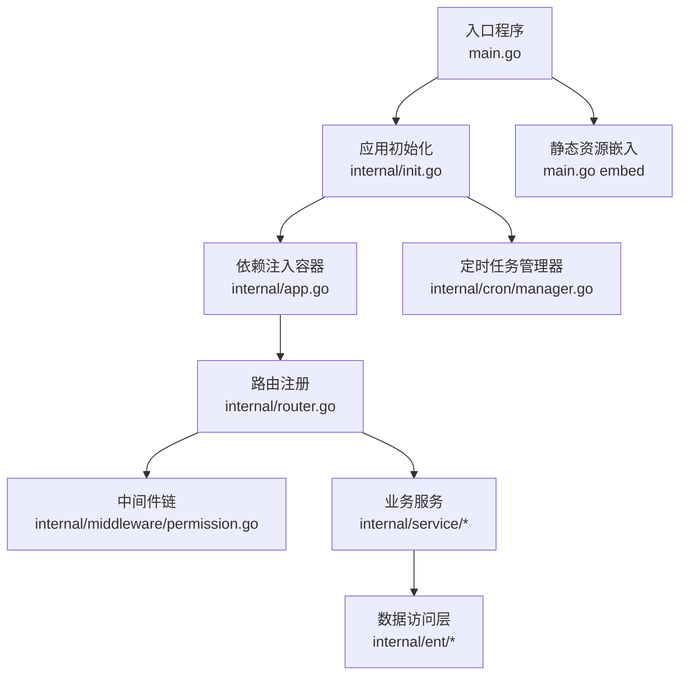
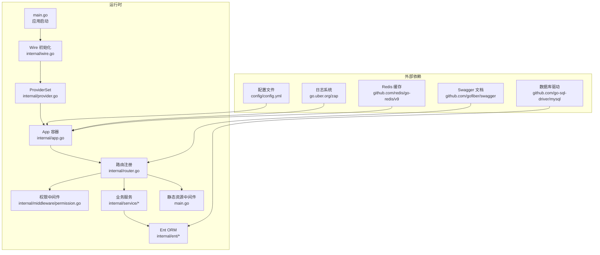
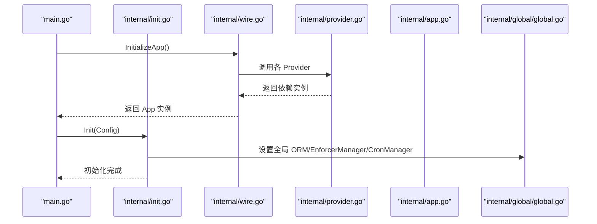
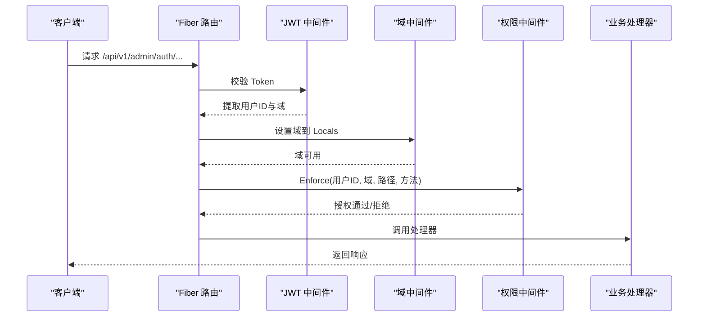
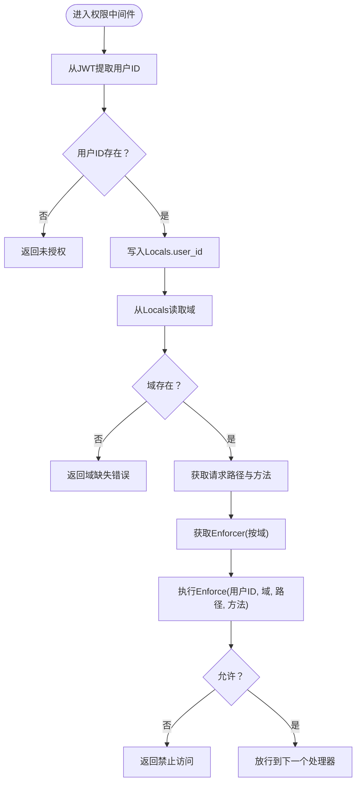
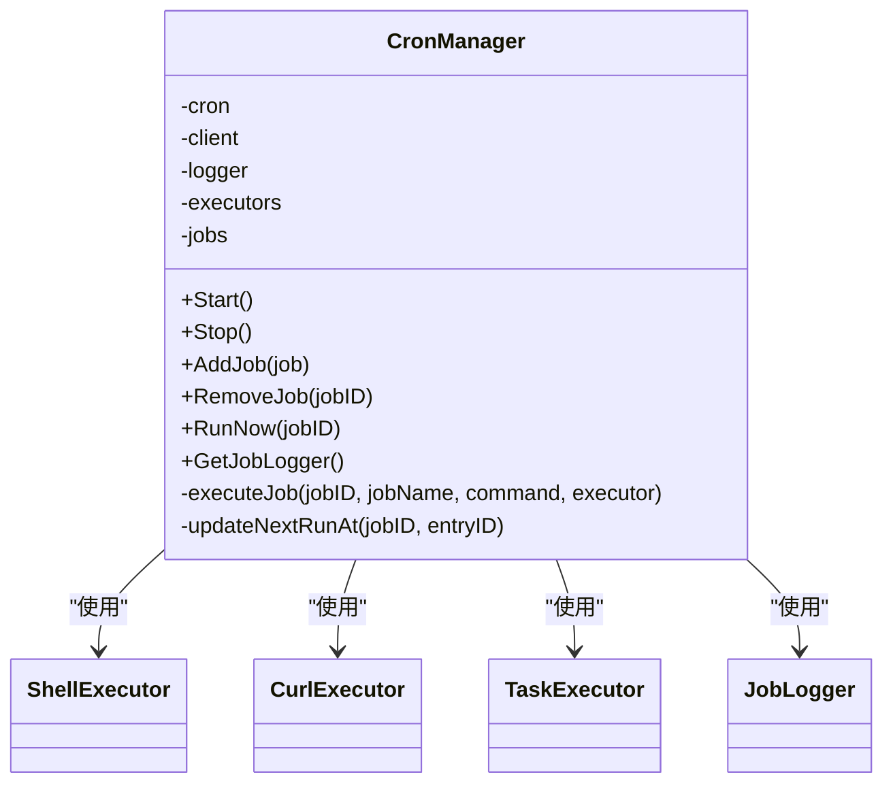
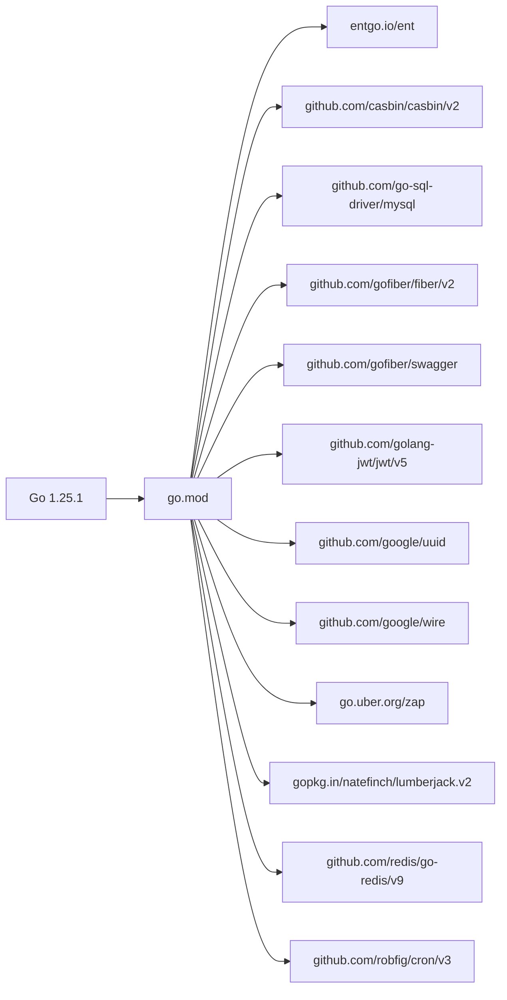

# 开发指南

<cite>
**本文引用的文件**
- [go.mod](file://go.mod)
- [go.sum](file://go.sum)
- [main.go](file://main.go)
- [config.yml](file://config/config.yml)
- [.golangci.yml](file://.golangci.yml)
- [internal/app.go](file://internal/app.go)
- [internal/init.go](file://internal/init.go)
- [internal/provider.go](file://internal/provider.go)
- [internal/router.go](file://internal/router.go)
- [internal/wire.go](file://internal/wire.go)
- [internal/wire_gen.go](file://internal/wire_gen.go)
- [internal/middleware/permission.go](file://internal/middleware/permission.go)
- [internal/global/global.go](file://internal/global/global.go)
- [internal/cron/manager.go](file://internal/cron/manager.go)
- [internal/tasks/example.go](file://internal/tasks/example.go)
- [internal/service/permission_test.go](file://internal/service/permission_test.go)
</cite>

## 目录
1. [简介](#简介)
2. [项目结构](#项目结构)
3. [核心组件](#核心组件)
4. [架构总览](#架构总览)
5. [详细组件分析](#详细组件分析)
6. [依赖分析](#依赖分析)
7. [性能考虑](#性能考虑)
8. [故障排查指南](#故障排查指南)
9. [结论](#结论)
10. [附录](#附录)

## 简介
本开发指南面向Go Admin管理系统，旨在帮助开发者建立一致的代码规范与最佳实践，明确开发环境搭建步骤，掌握依赖管理策略，制定贡献流程与测试要求，并提供扩展开发（新增功能模块、中间件与插件）与调试排障的方法。文档基于仓库现有源码进行分析，确保内容与实际实现保持一致。

## 项目结构
项目采用分层与职责分离的组织方式：
- 根目录包含入口程序、配置、文档与构建相关文件
- internal 内部模块按领域与层次划分：
  - app、init、provider：应用初始化与依赖注入
  - router：路由注册与中间件装配
  - middleware：鉴权与权限中间件
  - handler/service：控制器与业务服务
  - ent：数据访问层（Ent ORM）
  - cron：定时任务子系统
  - tasks：任务注册与示例
  - global：全局共享对象
  - utils：通用工具
- config：运行时配置
- docs：Swagger 文档
- data：日志与存储目录

图表来源
- [main.go:47-104](file://main.go#L47-L104)
- [internal/init.go:31-67](file://internal/init.go#L31-L67)
- [internal/app.go:15-26](file://internal/app.go#L15-L26)
- [internal/router.go:16-150](file://internal/router.go#L16-L150)
- [internal/middleware/permission.go:14-94](file://internal/middleware/permission.go#L14-L94)
- [internal/cron/manager.go:17-77](file://internal/cron/manager.go#L17-L77)

章节来源
- [main.go:1-105](file://main.go#L1-L105)
- [internal/router.go:1-150](file://internal/router.go#L1-L150)

## 核心组件
- 应用依赖容器 App：集中持有配置、日志、数据库、验证器、缓存、Ent客户端、Casbin执行器与文件系统等依赖
- 初始化流程：优先使用 Wire 注入；若未注入则回退到手动初始化数据库与权限系统
- 路由与中间件：统一鉴权、域校验、权限校验、请求日志
- 定时任务：基于 cron 表达式调度，支持 shell/curl/task 三类执行器，内置日志轮转与保留策略
- 测试：使用 SQLite 内存数据库与 Ent 测试工具链，覆盖权限缓存命中与失效场景

章节来源
- [internal/app.go:15-26](file://internal/app.go#L15-L26)
- [internal/init.go:31-101](file://internal/init.go#L31-L101)
- [internal/router.go:16-150](file://internal/router.go#L16-L150)
- [internal/cron/manager.go:17-237](file://internal/cron/manager.go#L17-L237)
- [internal/service/permission_test.go:1-528](file://internal/service/permission_test.go#L1-L528)

## 架构总览
系统采用 Fiber 作为 Web 框架，结合 CMF 通用能力与 Ent ORM，形成“配置驱动 + 依赖注入 + 中间件 + 业务服务”的分层架构。权限控制通过 Casbin 策略引擎实现多域 RBAC。

图表来源
- [main.go:47-104](file://main.go#L47-L104)
- [internal/wire.go:22-37](file://internal/wire.go#L22-L37)
- [internal/provider.go:17-44](file://internal/provider.go#L17-L44)
- [internal/app.go:15-26](file://internal/app.go#L15-L26)
- [internal/router.go:16-150](file://internal/router.go#L16-L150)
- [config/config.yml:1-143](file://config/config.yml#L1-L143)

## 详细组件分析

### 依赖注入与初始化
- Wire 构建：通过 ProviderSet 组合配置、日志、ORM、验证器、缓存、文件系统、Ent 客户端、Casbin 适配器与执行器管理器
- 回退机制：若未注入 EntClient 或 EnforcerManager，则在 Init 中手动初始化数据库与权限系统
- 全局共享：ORM、EnforcerManager、CronManager 通过 internal/global 全局变量暴露给其他模块

图表来源
- [main.go:47-67](file://main.go#L47-L67)
- [internal/wire.go:22-37](file://internal/wire.go#L22-L37)
- [internal/provider.go:17-44](file://internal/provider.go#L17-L44)
- [internal/init.go:31-67](file://internal/init.go#L31-L67)
- [internal/global/global.go:11-16](file://internal/global/global.go#L11-L16)

章节来源
- [internal/wire.go:1-38](file://internal/wire.go#L1-L38)
- [internal/wire_gen.go:17-62](file://internal/wire_gen.go#L17-L62)
- [internal/provider.go:17-44](file://internal/provider.go#L17-L44)
- [internal/init.go:31-101](file://internal/init.go#L31-L101)
- [internal/global/global.go:11-16](file://internal/global/global.go#L11-L16)

### 路由与中间件
- 路由分组：/api/v1/admin 下挂载公开与认证接口，认证链路包含 JWT 校验、域中间件、权限中间件
- 中间件职责：
  - 域中间件：从 JWT 提取域信息并写入 Locals
  - 权限中间件：根据用户ID、域、路径与方法调用 Casbin 执行器进行授权
- 服务层注入：在路由中间件中为每个请求注入 UserService、RoleService、PermissionService、OperationLogService、CronJobService、AttachmentGroupService、AttachmentService 等

图表来源
- [internal/router.go:48-149](file://internal/router.go#L48-L149)
- [internal/middleware/permission.go:14-94](file://internal/middleware/permission.go#L14-L94)

章节来源
- [internal/router.go:16-150](file://internal/router.go#L16-L150)
- [internal/middleware/permission.go:14-94](file://internal/middleware/permission.go#L14-L94)

### 权限中间件算法
权限校验流程如下：

图表来源
- [internal/middleware/permission.go:14-94](file://internal/middleware/permission.go#L14-L94)

章节来源
- [internal/middleware/permission.go:14-94](file://internal/middleware/permission.go#L14-L94)

### 定时任务管理器
- 加载策略：启动时从数据库加载启用的任务，按 cron 表达式注册
- 执行器：支持 shell、curl、task 三种类型，统一通过接口执行
- 日志：每次执行创建独立日志文件，记录开始/结束时间、耗时与结果
- 维护：内置每日凌晨2点清理过期日志的任务

图表来源
- [internal/cron/manager.go:17-237](file://internal/cron/manager.go#L17-L237)
- [internal/tasks/example.go:10-29](file://internal/tasks/example.go#L10-L29)

章节来源
- [internal/cron/manager.go:17-237](file://internal/cron/manager.go#L17-L237)
- [internal/tasks/example.go:10-29](file://internal/tasks/example.go#L10-L29)

### 配置与环境
- 应用配置：端口、调试开关、Swagger 开关、密钥、登录过期时间等
- 日志：文件路径、控制台输出、文件输出、滚动参数
- 数据库：默认连接、驱动、主机、端口、用户、密码、库名、SSL、表前缀
- 缓存：内存与 Redis 两种存储，支持 TTL
- 文件系统：本地与 S3 两种驱动
- Casbin：多域配置，支持默认域与内联模型文本

章节来源
- [config/config.yml:1-143](file://config/config.yml#L1-L143)

## 依赖分析
- 语言与工具链：Go 1.25.1，Wire 依赖注入，Fiber Web 框架，Ent ORM，Casbin 权限，Swagger 文档
- 运行时依赖：MySQL 驱动、Zap 日志、Lumberjack 日志滚动、Redis 客户端、Cron 调度
- 间接依赖：大量第三方库通过 go.mod 引入，替换项指向本地 cmf 工程

图表来源
- [go.mod:3-21](file://go.mod#L3-L21)
- [go.mod:23-124](file://go.mod#L23-L124)

章节来源
- [go.mod:1-127](file://go.mod#L1-L127)
- [go.sum:1-402](file://go.sum#L1-L402)

## 性能考虑
- 依赖注入：通过 Wire 减少重复初始化与耦合，提升启动与维护效率
- 缓存：权限服务支持缓存注入，减少频繁查询数据库与 Casbin 策略计算
- 日志滚动：Lumberjack 控制单文件大小与保留数量，避免磁盘膨胀
- 定时任务：按需加载启用任务，避免不必要的调度开销；日志清理任务降低长期占用
- ORM：Ent 自动生成查询与更新，配合索引与迁移策略保证一致性与性能

## 故障排查指南
- 启动失败
  - 检查配置文件是否正确（数据库连接、日志路径、缓存与文件系统）
  - 查看初始化日志，确认 Wire 注入是否成功
- 权限拒绝
  - 确认 JWT 中包含用户ID与域信息
  - 检查 Casbin 策略是否正确匹配路径与方法
  - 核对域中间件是否正确设置域
- 数据库问题
  - 确认数据库驱动与连接串正确
  - 检查 Ent Schema 迁移是否成功
- 定时任务异常
  - 查看任务日志文件，确认命令与执行器类型
  - 检查 cron 表达式与下次执行时间更新
- 代码质量
  - 使用 golangci-lint 检查格式与静态分析，排除生成代码与测试文件

章节来源
- [internal/middleware/permission.go:14-94](file://internal/middleware/permission.go#L14-L94)
- [internal/init.go:31-101](file://internal/init.go#L31-L101)
- [internal/cron/manager.go:154-221](file://internal/cron/manager.go#L154-L221)
- [.golangci.yml:1-38](file://.golangci.yml#L1-L38)

## 结论
本指南总结了 Go Admin 系统的代码规范、开发环境、依赖管理、贡献流程与扩展开发要点。建议在日常开发中遵循：
- 以 Wire 管理依赖，保持初始化一致性
- 在路由层统一接入 JWT、域与权限中间件
- 使用缓存优化热点权限查询
- 通过配置文件集中管理运行时参数
- 严格测试与静态检查，保障质量

## 附录

### 代码规范与最佳实践
- 命名约定
  - 包名小写、简短且语义明确
  - 类型与接口以名词或抽象概念命名，如 Service、Manager、Handler
  - 方法遵循动宾结构，如 CreateUser、EnableRole
- 注释规范
  - 包注释说明职责与边界
  - 导出类型与方法提供简洁说明，复杂逻辑补充设计意图
  - 错误处理注释说明可能的错误与恢复策略
- 错误处理
  - 明确区分业务错误与系统错误，使用结构化日志记录上下文
  - 对外响应统一通过 Response 工具封装
- 并发与资源
  - 使用 sync.Map 管理定时任务映射，避免竞态
  - 定时任务执行使用 goroutine，确保不影响调度器

### 开发环境搭建
- 工具与版本
  - Go 1.25.1
  - IDE：推荐 VS Code 或 GoLand，安装 Go、Swagger、Wire 等插件
- 依赖安装
  - 使用 go mod tidy 同步依赖
  - 如需替换本地 cmf 工程，确保 go.mod replace 正确指向
- 运行与调试
  - 直接运行 main.go 启动服务
  - Swagger 文档地址：/swagger/index.html（根据配置开启）
  - 使用断点调试中间件链与业务处理器

章节来源
- [go.mod:126-127](file://go.mod#L126-L127)
- [config/config.yml:1-143](file://config/config.yml#L1-L143)

### 依赖管理策略
- 使用 Go Modules 管理依赖版本与替换
- go.mod 中显式声明主版本与替换项，go.sum 保证可复现性
- 定期执行 go mod tidy 与 go mod vendor（如需）保持一致性

章节来源
- [go.mod:1-127](file://go.mod#L1-L127)
- [go.sum:1-402](file://go.sum#L1-L402)

### 贡献指南
- 分支与提交
  - 基于 develop 分支创建特性分支
  - 提交信息清晰描述变更目的与影响范围
- Pull Request
  - PR 描述包含需求背景、改动内容、测试覆盖与风险评估
  - 至少一名代码审查者批准
- 代码审查标准
  - 代码风格与命名符合项目规范
  - 关键路径有单元测试覆盖
  - 性能与安全性无明显缺陷
- 测试要求
  - 单元测试：使用 SQLite 内存数据库与 Ent 测试工具链
  - 覆盖权限缓存命中与失效场景，确保缓存一致性
  - 集成测试：涉及数据库与外部依赖时，使用临时环境验证

章节来源
- [internal/service/permission_test.go:1-528](file://internal/service/permission_test.go#L1-L528)

### 扩展开发指导
- 新增功能模块
  - 在 internal/handler 与 internal/service 下分别实现处理器与服务
  - 在 internal/router.go 中注册路由与中间件
  - 若涉及权限，确保 Casbin 策略与路径/动作匹配
- 中间件开发
  - 遵循 Fiber.Handler 签名，注意错误处理与响应封装
  - 在路由组中按需挂载，避免全局污染
- 插件系统
  - 通过任务注册机制扩展后台任务（参考 internal/tasks）
  - 通过 ProviderSet 注入新依赖，保持初始化一致性

章节来源
- [internal/router.go:16-150](file://internal/router.go#L16-L150)
- [internal/tasks/example.go:10-29](file://internal/tasks/example.go#L10-L29)
- [internal/provider.go:17-44](file://internal/provider.go#L17-L44)

### 调试技巧与问题排查
- 日志定位
  - 使用 Zap 输出结构化日志，结合 Fiber 请求日志中间件
  - 关注初始化阶段的日志，快速定位依赖注入与数据库连接问题
- 权限排查
  - 打印 JWT Claims 中的用户ID与域，核对中间件链执行顺序
  - 检查 Casbin EnforcerManager 的域配置与策略
- 性能诊断
  - 使用缓存命中率与延迟指标评估热点查询
  - 定时任务日志记录耗时，识别慢任务

章节来源
- [internal/middleware/permission.go:14-94](file://internal/middleware/permission.go#L14-L94)
- [internal/cron/manager.go:154-221](file://internal/cron/manager.go#L154-L221)