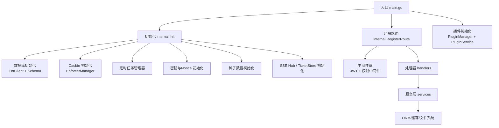
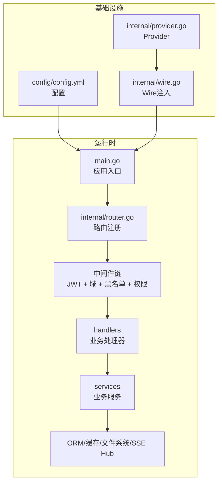
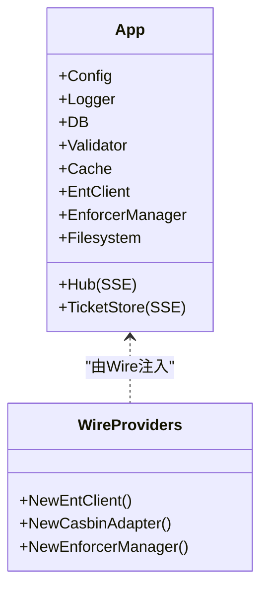
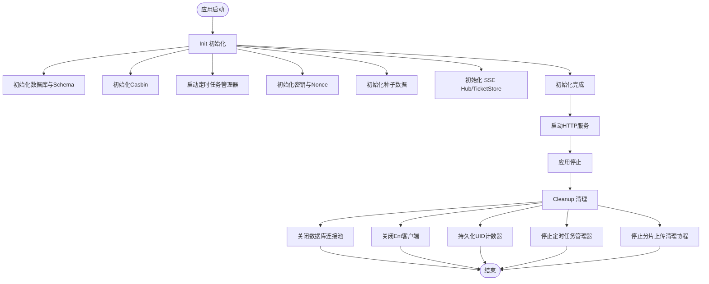
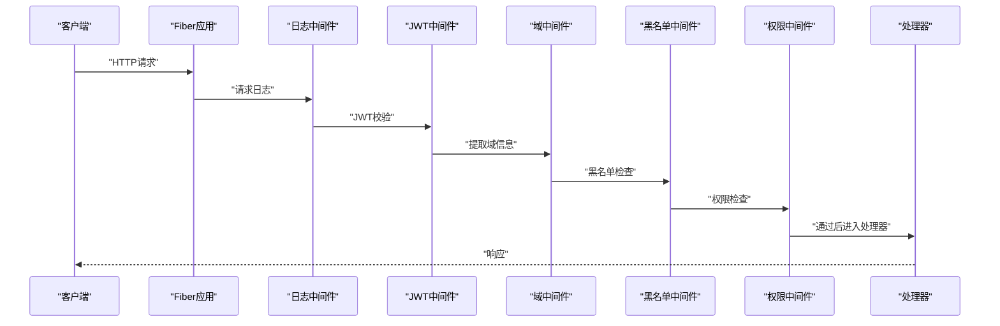
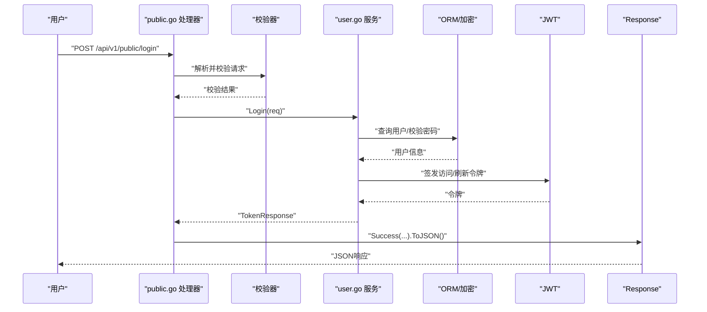
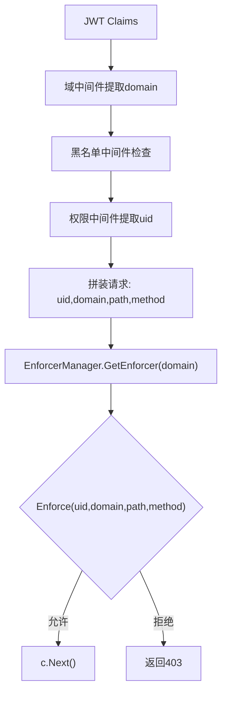
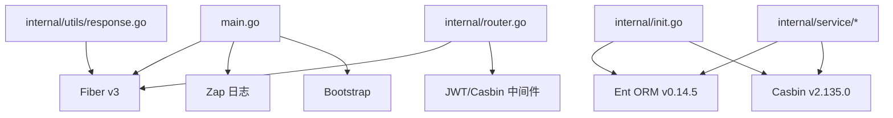

# 开发指南

<cite>
**本文引用的文件**
- [main.go](file://main.go)
- [internal/app.go](file://internal/app.go)
- [internal/router.go](file://internal/router.go)
- [config/config.yml](file://config/config.yml)
- [go.mod](file://go.mod)
- [.golangci.yml](file://.golangci.yml)
- [internal/init.go](file://internal/init.go)
- [internal/cleanup.go](file://internal/cleanup.go)
- [internal/provider.go](file://internal/provider.go)
- [internal/wire.go](file://internal/wire.go)
- [internal/handler/public.go](file://internal/handler/public.go)
- [internal/service/user.go](file://internal/service/user.go)
- [internal/middleware/permission.go](file://internal/middleware/permission.go)
- [internal/utils/response.go](file://internal/utils/response.go)
- [internal/global/msg.go](file://internal/global/msg.go)
- [internal/utils/utils.go](file://internal/utils/utils.go)
</cite>

## 目录
1. [简介](#简介)
2. [项目结构](#项目结构)
3. [核心组件](#核心组件)
4. [架构总览](#架构总览)
5. [详细组件分析](#详细组件分析)
6. [依赖分析](#依赖分析)
7. [性能考虑](#性能考虑)
8. [调试与故障排除](#调试与故障排除)
9. [结论](#结论)
10. [附录](#附录)

## 简介
本指南面向 Go Admin 管理系统的开发者，提供从环境搭建、编码规范、开发流程到新功能开发模板、调试与性能分析、常见问题排查以及架构演进的全流程说明。系统基于 Fiber v3 框架构建，采用 Wire 依赖注入、Ent ORM、Casbin 权限控制、Redis 缓存与本地文件系统，并通过 CMF 基础设施模块统一配置、日志、JWT、校验等能力。系统还支持插件系统（Phase 1）、站内消息与 SSE 实时推送等扩展能力。

## 项目结构
项目采用"内部模块化 + 层次化"的组织方式：
- cmd/main.go：应用入口，负责初始化、挂载中间件、注册路由、启动生命周期钩子
- internal/*：核心业务层，按职责拆分为 app、init、router、handler、service、middleware、utils、tasks、global、provider、wire、plugin 等
- config/config.yml：应用配置中心，涵盖应用、日志、数据库、缓存、Redis、文件系统、Casbin 等
- go.mod/go.sum：依赖管理
- .golangci.yml：静态检查规则

图表来源
- [main.go:47-107](file://main.go#L47-L107)
- [internal/init.go:39-96](file://internal/init.go#L39-L96)
- [internal/router.go:16-365](file://internal/router.go#L16-L365)

章节来源
- [main.go:1-108](file://main.go#L1-108)
- [internal/router.go:1-365](file://internal/router.go#L1-L365)
- [config/config.yml:1-143](file://config/config.yml#L1-L143)

## 核心组件
- 应用容器 App：集中持有配置、日志、数据库、校验器、缓存、Ent 客户端、Casbin 执行器、文件系统、SSE Hub 与 TicketStore 等
- 初始化与清理：统一在 Init 中完成数据库、权限、定时任务、密钥与Nonce、种子数据、SSE Hub；Cleanup 负责资源回收
- 路由与中间件：版本化路由组、JWT 认证、域中间件、黑名单中间件、权限中间件、文件系统中间件
- 处理器与服务：按领域划分，如用户、角色、权限、定时任务、附件、配置、字典、操作日志、插件管理、站内消息等
- 响应封装：统一的 Response 结构体，简化错误与成功响应

章节来源
- [internal/app.go:15-28](file://internal/app.go#L15-L28)
- [internal/init.go:39-96](file://internal/init.go#L39-L96)
- [internal/cleanup.go:11-42](file://internal/cleanup.go#L11-L42)
- [internal/router.go:16-365](file://internal/router.go#L16-L365)
- [internal/utils/response.go:9-50](file://internal/utils/response.go#L9-L50)

## 架构总览
系统采用"入口 -> 初始化 -> 路由注册 -> 中间件链 -> 处理器 -> 服务 -> ORM/缓存/文件系统"的调用链路，配合 Wire 提供依赖注入，保证模块解耦与可测试性。

图表来源
- [main.go:47-107](file://main.go#L47-L107)
- [internal/router.go:16-365](file://internal/router.go#L16-L365)
- [internal/wire.go:22-37](file://internal/wire.go#L22-L37)
- [internal/provider.go:17-46](file://internal/provider.go#L17-L46)
- [config/config.yml:1-143](file://config/config.yml#L1-L143)

## 详细组件分析

### 依赖注入与应用容器
- Wire 构建集：配置、日志、ORM、校验、缓存、文件系统、EntClient、Casbin 适配器与执行器管理器
- App 容器：集中持有各基础设施组件，包含 SSE Hub 与 TicketStore，便于在中间件与处理器中按需获取

图表来源
- [internal/app.go:15-28](file://internal/app.go#L15-L28)
- [internal/provider.go:17-46](file://internal/provider.go#L17-L46)
- [internal/wire.go:22-37](file://internal/wire.go#L22-L37)

章节来源
- [internal/app.go:15-28](file://internal/app.go#L15-L28)
- [internal/provider.go:17-46](file://internal/provider.go#L17-L46)
- [internal/wire.go:22-37](file://internal/wire.go#L22-L37)

### 初始化与清理流程
- 初始化 Init：数据库（含表前缀与自动迁移）、Casbin（适配器与执行器管理器）、定时任务管理器、密钥与Nonce、种子数据与字典种子、SSE Hub 与 TicketStore、分片上传清理协程
- 清理 Cleanup：持久化 UID 计数器、清理过期分片上传会话、停止分片上传清理协程、停止定时任务、关闭数据库连接池与 Ent 客户端

图表来源
- [internal/init.go:39-96](file://internal/init.go#L39-L96)
- [internal/init.go:98-132](file://internal/init.go#L98-L132)
- [internal/cleanup.go:11-42](file://internal/cleanup.go#L11-L42)

章节来源
- [internal/init.go:39-96](file://internal/init.go#L39-L96)
- [internal/init.go:98-132](file://internal/init.go#L98-L132)
- [internal/cleanup.go:11-42](file://internal/cleanup.go#L11-L42)

### 路由与中间件
- 版本化路由：/api/v1 下按模块划分，公开接口与需要认证/权限的接口分离
- 中间件链：请求日志、JWT 认证、域中间件、黑名单中间件、权限中间件
- 文件系统中间件：静态资源托管，SPA 回退至 index.html
- 插件代理路由：/api/v1/plugin/:plugin_id/* 转发到已启用的插件进程（支持 TCP 与 UDS）

图表来源
- [internal/router.go:16-365](file://internal/router.go#L16-L365)
- [internal/middleware/permission.go:11-80](file://internal/middleware/permission.go#L11-L80)
- [main.go:62-96](file://main.go#L62-L96)

章节来源
- [internal/router.go:16-365](file://internal/router.go#L16-L365)
- [internal/middleware/permission.go:11-80](file://internal/middleware/permission.go#L11-L80)
- [main.go:62-96](file://main.go#L62-L96)

### 处理器与服务：用户登录与个人信息
- 处理器 public.go：提供获取公钥、登录、刷新令牌、获取/更新用户信息、修改密码等接口
- 服务 user.go：实现登录、刷新令牌、用户信息查询、更新、密码修改等业务逻辑
- 统一响应封装：utils/response.go 提供 Success/Fail/ToJSON
- 注意：Fiber v3 中 BodyParser 已废弃，需使用 Bind().Body() 进行请求体绑定；QueryInt 等类型化 Query 方法已移除，需使用 Query + 类型转换

图表来源
- [internal/handler/public.go:78-145](file://internal/handler/public.go#L78-L145)
- [internal/service/user.go:139-218](file://internal/service/user.go#L139-L218)
- [internal/utils/response.go:19-49](file://internal/utils/response.go#L19-L49)

章节来源
- [internal/handler/public.go:78-145](file://internal/handler/public.go#L78-L145)
- [internal/service/user.go:139-218](file://internal/service/user.go#L139-L218)
- [internal/utils/response.go:19-49](file://internal/utils/response.go#L19-L49)

### 权限中间件与 Casbin
- 权限中间件：从 JWT 提取用户 UID 与域，结合路径与方法进行权限决策
- 域中间件：确保域信息来自 JWT 并传递给权限中间件
- 黑名单中间件：在权限检查前拦截已加入黑名单的用户
- Casbin 执行器：按域动态获取 Enforcer 并执行策略匹配

图表来源
- [internal/middleware/permission.go:11-80](file://internal/middleware/permission.go#L11-L80)

章节来源
- [internal/middleware/permission.go:11-80](file://internal/middleware/permission.go#L11-L80)

## 依赖分析
- 运行时依赖：Fiber v3、Ent、Casbin、MySQL 驱动、JWT、Zap 日志、CMF 基础设施等
- 构建与注入：Wire 用于依赖装配；go:embed 用于前端静态资源嵌入
- 静态检查：golangci-lint 启用 gofmt、golint、govet，排除生成代码与测试文件
- local replace：通过 replace 指令指向本地 cmf 与 ent 仓库，便于二次开发与联调

图表来源
- [go.mod:5-18](file://go.mod#L5-L18)
- [main.go:3-22](file://main.go#L3-L22)
- [internal/init.go:39-96](file://internal/init.go#L39-L96)
- [internal/router.go:16-365](file://internal/router.go#L16-L365)
- [.golangci.yml:14-27](file://.golangci.yml#L14-L27)

章节来源
- [go.mod:5-18](file://go.mod#L5-L18)
- [main.go:3-22](file://main.go#L3-L22)
- [.golangci.yml:14-27](file://.golangci.yml#L14-L27)

## 性能考虑
- 数据库连接与迁移：Ent 自动迁移开启索引与列删除清理，建议在生产环境谨慎使用 WithForeignKeys=false
- 缓存与文件系统：根据业务热点选择内存或 Redis 缓存；文件系统支持本地与 S3，注意并发与网络延迟
- 日志与中间件：请求日志中间件会增加开销，建议在生产关闭或降级
- 定时任务：日志保留周期与 CronManager 生命周期需与磁盘空间策略匹配
- SSE 连接：ticket 鉴权独立控制有效期，避免长连接占用认证中间件资源

章节来源
- [internal/provider.go:30-33](file://internal/provider.go#L30-L33)
- [config/config.yml:60-76](file://config/config.yml#L60-L76)
- [internal/router.go:16-20](file://internal/router.go#L16-L20)

## 调试与故障排除
- 启动失败：检查 config.yml 的数据库、Redis、文件系统配置；查看初始化日志
- 权限拒绝：确认 JWT 中 domain 与 uid 正确；核对 Casbin 策略与分组规则
- 登录异常：检查加密登录流程中的时间戳、Nonce、KeyID 校验；确认密钥轮换周期
- 资源 404：确认文件系统中间件 Next 条件与 SPA 回退逻辑
- 清理阶段报错：关注数据库连接池与 Ent 客户端关闭顺序
- 插件相关：检查插件包格式是否正确（plugin.yaml）、确认插件路径安全、Socket 路径是否在不可控目录之外

章节来源
- [internal/init.go:39-96](file://internal/init.go#L39-L96)
- [internal/middleware/permission.go:11-80](file://internal/middleware/permission.go#L11-L80)
- [internal/handler/public.go:89-127](file://internal/handler/public.go#L89-L127)
- [main.go:62-96](file://main.go#L62-L96)
- [internal/cleanup.go:11-42](file://internal/cleanup.go#L11-L42)

## 结论
本指南提供了从环境搭建、编码规范、开发流程到新功能模板、调试与性能优化的完整路径。建议在新功能开发中遵循"路由 -> 中间件 -> 处理器 -> 服务 -> ORM/缓存/文件系统"的分层设计，使用 Wire 管理依赖，保持配置集中化与可测试性。

## 附录

### 开发环境搭建与 IDE 配置
- Go 版本：1.25.1+
- 依赖安装：go mod download
- IDE 插件：Go、Swagger、YAML、EditorConfig
- 代码格式化：gofmt；编辑器设置自动格式化
- 静态检查：golangci-lint，规则见 .golangci.yml
- 测试命令：go test ./...
- Swagger 生成：swag init --parseInternal --parseDependency
- 代码生成：go generate ./internal/ent

章节来源
- [go.mod:3](file://go.mod#L3)
- [.golangci.yml:14-27](file://.golangci.yml#L14-L27)

### 代码规范与最佳实践
- 命名约定：包名小写；结构体与接口以名词；方法以动词开头；常量全大写
- 注释标准：包注释、导出类型与方法注释；复杂逻辑添加行内注释
- 架构原则：单一职责、依赖倒置、接口隔离；服务层只做编排与校验；处理器只做绑定与响应（无业务逻辑）
- 错误处理：使用语义化错误类型；在处理器中转换为统一响应；全局错误码在 internal/global/msg.go 中定义
- 依赖方向：handler → service → ent/global/cmf，避免服务层反向依赖处理器
- 缓存键：使用 utils.BuildCacheKey 统一格式
- 用户标识：使用 UID（而非 DB ID）作为用户标识
- 操作日志：必须为只读审计记录，禁止清理功能
- 服务注入：通过 c.Locals("service") 获取依赖注入的 service 实例
- 权限信息：通过 c.Locals("auth") 获取当前用户信息

章节来源
- [internal/utils/response.go:9-50](file://internal/utils/response.go#L9-L50)
- [internal/service/user.go:20-35](file://internal/service/user.go#L20-L35)
- [internal/global/msg.go:1-178](file://internal/global/msg.go#L1-L178)

### 开发流程
- 功能开发：新增路由 -> 注册中间件 -> 实现处理器 -> 编写服务层 -> ORM/缓存/文件系统交互
- 代码审查：关注依赖注入、错误传播、日志与安全点
- 测试验证：单元测试覆盖服务层关键分支；集成测试覆盖路由与中间件
- 持续集成：golangci-lint 作为 CI 步骤；数据库迁移与权限策略变更需审慎

章节来源
- [internal/router.go:16-365](file://internal/router.go#L16-L365)
- [internal/handler/public.go:78-145](file://internal/handler/public.go#L78-L145)
- [internal/service/user.go:139-218](file://internal/service/user.go#L139-L218)

### 新功能开发模板（步骤）
- 路由注册
  - 在 internal/router.go 中新增路由组与具体路由
  - 为公开接口与需要权限的接口分别注册中间件
- 服务层实现
  - 在 internal/service 下新增服务接口与实现
  - 使用 global.ORM 或注入的客户端进行数据访问
- 数据模型扩展
  - 如需新增实体，使用 Ent schema 定义并在初始化时自动迁移
- 处理器实现
  - 在 internal/handler 下新增处理器函数，解析请求、调用服务、返回统一响应
  - 使用 validate.ParseAndValidate 进行请求体校验（而非已废弃的 BodyParser）
  - 使用 c.Query() + 类型转换处理查询参数（QueryInt 等已移除）
- 中间件与权限
  - 若涉及权限，确保在路由组中注册权限中间件，并在 Casbin 中配置策略

章节来源
- [internal/router.go:16-365](file://internal/router.go#L16-L365)
- [internal/service/user.go:28-45](file://internal/service/user.go#L28-L45)
- [internal/provider.go:17-36](file://internal/provider.go#L17-L36)
- [internal/handler/public.go:78-145](file://internal/handler/public.go#L78-L145)

### 调试技巧与性能分析
- 调试技巧
  - 使用 Zap 日志输出关键路径；在处理器中打印请求与响应摘要
  - 使用 Postman 或 Swagger UI 快速验证路由与中间件链
  - 对权限问题，打印 JWT Claims 与 Enforcer 决策过程
- 性能分析
  - 使用 go pprof 分析 CPU 与内存热点
  - 关注数据库慢查询与连接池利用率
  - 对高并发场景评估缓存命中率与文件系统 I/O

章节来源
- [main.go:55-57](file://main.go#L55-L57)
- [internal/middleware/permission.go:42-63](file://internal/middleware/permission.go#L42-L63)

### 常见问题与解决方案
- 登录失败：检查时间戳窗口、Nonce 是否重复、KeyID 是否正确
- 权限 403：确认 JWT 中 domain 与 uid；检查 Casbin 策略与分组规则是否匹配
- 数据库迁移失败：确认 WithDropIndex/WithDropColumn 配置与生产风险
- 前端 404：检查文件系统中间件的 Next 条件与 SPA 回退逻辑

章节来源
- [internal/handler/public.go:89-127](file://internal/handler/public.go#L89-L127)
- [internal/middleware/permission.go:11-80](file://internal/middleware/permission.go#L11-L80)
- [internal/provider.go:30-33](file://internal/provider.go#L30-L33)
- [main.go:62-96](file://main.go#L62-L96)

### 代码重构与架构演进
- 依赖注入：持续使用 Wire 管理基础设施；避免在服务层直接 new
- 分层清晰：处理器只做绑定与响应；服务层只做编排与校验；DAO 层抽象于 ORM
- 配置集中：所有外部依赖通过 config.yml 管理；必要时引入环境变量
- 可观测性：完善日志与指标；对关键路径增加监控告警

章节来源
- [internal/wire.go:22-37](file://internal/wire.go#L22-L37)
- [config/config.yml:1-143](file://config/config.yml#L1-L143)
