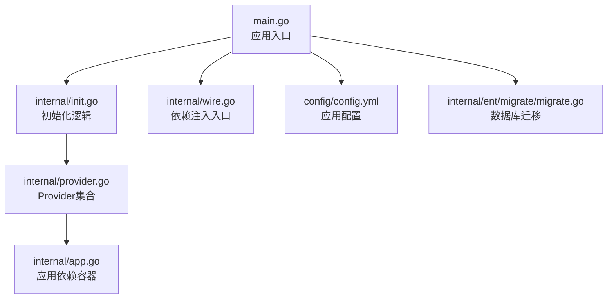
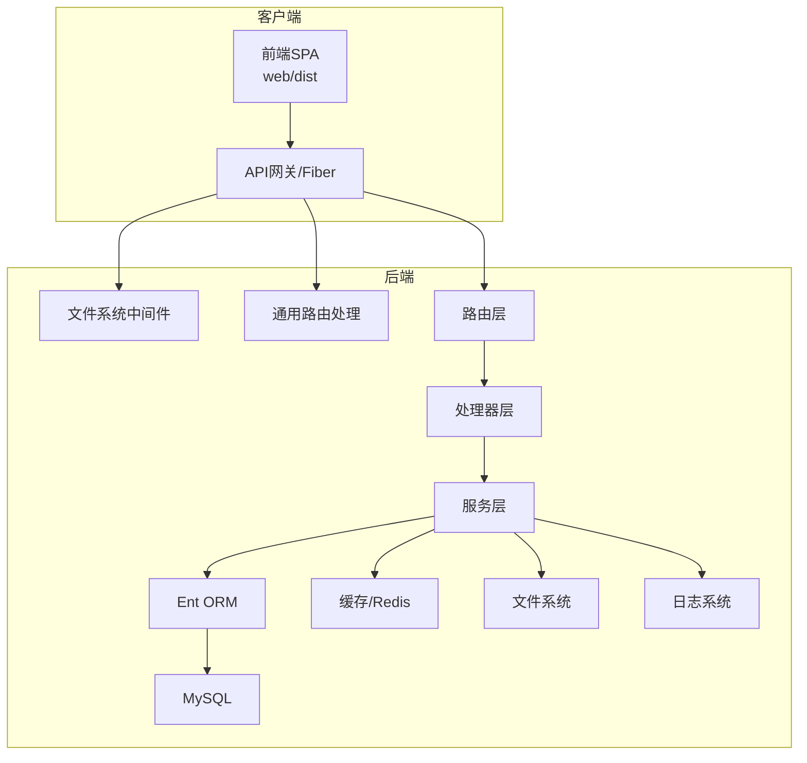
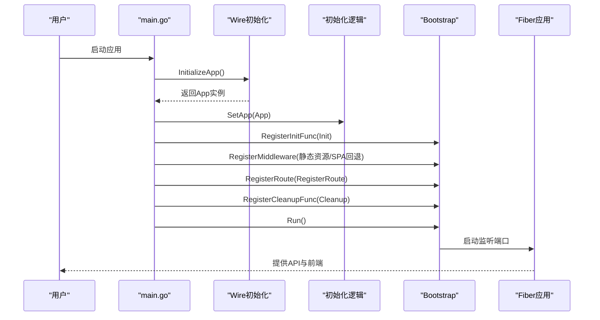
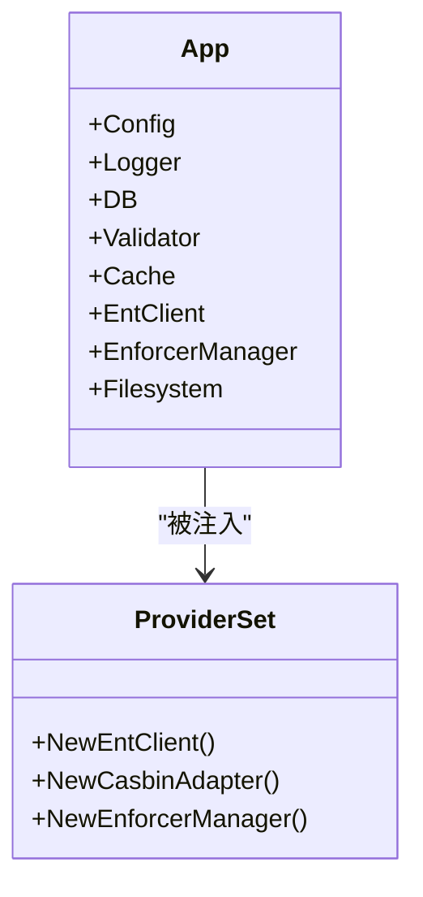
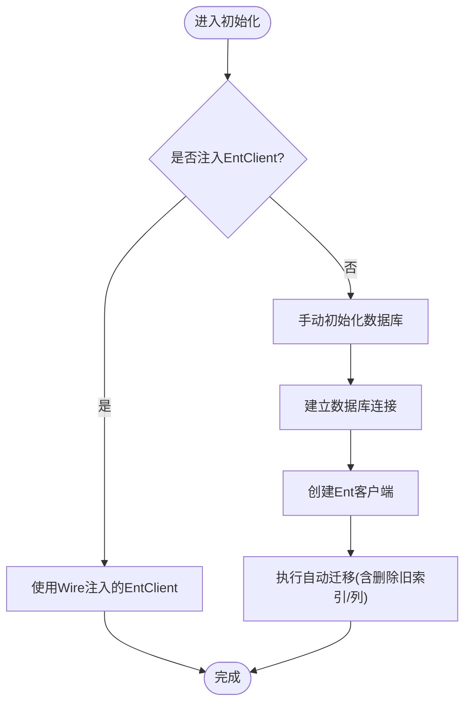
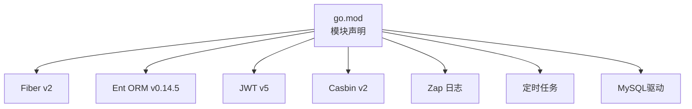

# 开发环境搭建

<cite>
**本文引用的文件**
- [go.mod](file://go.mod)
- [main.go](file://main.go)
- [config/config.yml](file://config/config.yml)
- [.golangci.yml](file://.golangci.yml)
- [internal/app.go](file://internal/app.go)
- [internal/init.go](file://internal/init.go)
- [internal/provider.go](file://internal/provider.go)
- [internal/wire.go](file://internal/wire.go)
- [internal/ent/migrate/migrate.go](file://internal/ent/migrate/migrate.go)
- [README.md](file://README.md)
</cite>

## 目录
1. [简介](#简介)
2. [项目结构](#项目结构)
3. [核心组件](#核心组件)
4. [架构总览](#架构总览)
5. [详细组件分析](#详细组件分析)
6. [依赖分析](#依赖分析)
7. [性能考虑](#性能考虑)
8. [故障排查指南](#故障排查指南)
9. [结论](#结论)
10. [附录](#附录)

## 简介
本指南面向希望在本地快速搭建 Go Admin 管理系统开发环境的工程师与技术团队。内容覆盖：
- Go 语言开发环境安装与配置（含版本要求、GOPATH/GOROOT、IDE 推荐）
- 数据库环境准备（MySQL 安装、初始化脚本、连接配置）
- 依赖管理（Go Modules 基本操作、版本与更新策略）
- Docker 环境搭建（容器化开发与运行）
- 调试工具（Delve）配置与断点调试
- 常见问题排查与解决方案

## 项目结构
该仓库采用“入口文件 + 内部包 + 配置 + 数据目录”的组织方式，核心入口为应用主程序，内部包负责初始化、路由、服务与工具层，配置集中在 YAML 文件中，数据目录用于日志与文件存储。

图表来源
- [main.go:47-104](file://main.go#L47-L104)
- [internal/init.go:31-67](file://internal/init.go#L31-L67)
- [internal/wire.go:22-37](file://internal/wire.go#L22-L37)
- [internal/provider.go:17-43](file://internal/provider.go#L17-L43)
- [internal/app.go:15-25](file://internal/app.go#L15-L25)
- [config/config.yml:1-143](file://config/config.yml#L1-L143)
- [internal/ent/migrate/migrate.go:35-65](file://internal/ent/migrate/migrate.go#L35-L65)

章节来源
- [main.go:1-105](file://main.go#L1-L105)
- [README.md:40-69](file://README.md#L40-L69)

## 核心组件
- 应用入口与生命周期
  - 入口文件负责初始化应用、注册中间件与路由、挂载前端静态资源、启动服务与清理流程。
- 初始化与依赖注入
  - 通过 Wire 生成依赖注入图，集中提供配置、日志、ORM、验证器、缓存、文件系统、Ent 客户端与 Casbin 管理器。
- 配置中心
  - YAML 配置文件集中管理应用、日志、数据库、缓存、Redis、文件系统与 Casbin 等模块参数。
- 数据库与迁移
  - 使用 Ent ORM 进行数据库连接与自动迁移，支持索引与列的删除策略以适应演进。

章节来源
- [main.go:47-104](file://main.go#L47-L104)
- [internal/app.go:15-25](file://internal/app.go#L15-L25)
- [internal/init.go:31-100](file://internal/init.go#L31-L100)
- [internal/provider.go:17-43](file://internal/provider.go#L17-L43)
- [internal/wire.go:22-37](file://internal/wire.go#L22-L37)
- [config/config.yml:1-143](file://config/config.yml#L1-L143)
- [internal/ent/migrate/migrate.go:35-65](file://internal/ent/migrate/migrate.go#L35-L65)

## 架构总览
下图展示从浏览器到数据库的数据流与组件交互，体现分层架构与中间件职责。

图表来源
- [main.go:62-91](file://main.go#L62-L91)
- [internal/app.go:15-25](file://internal/app.go#L15-L25)
- [config/config.yml:19-58](file://config/config.yml#L19-L58)

## 详细组件分析

### 组件一：应用入口与生命周期
- 初始化流程
  - 通过 Wire 初始化应用依赖，设置全局日志器，注册中间件（静态资源与 SPA 回退）、路由与清理函数。
- 中间件与路由
  - 静态文件根目录映射至嵌入的前端资源；对非 API 请求回退到 index.html，实现 SPA 路由。
- 生命周期
  - 启动前与退出时分别执行清理逻辑，保证资源释放。

图表来源
- [main.go:47-104](file://main.go#L47-L104)
- [internal/init.go:31-67](file://internal/init.go#L31-L67)

章节来源
- [main.go:47-104](file://main.go#L47-L104)

### 组件二：依赖注入与应用容器
- 依赖注入
  - 使用 Wire 生成注入图，提供配置、日志、ORM、验证器、缓存、文件系统、Ent 客户端与 Casbin 管理器。
- 应用容器
  - App 结构体聚合各子系统，便于在初始化阶段按需注入或回退到手动初始化。

图表来源
- [internal/app.go:15-25](file://internal/app.go#L15-L25)
- [internal/provider.go:17-43](file://internal/provider.go#L17-L43)
- [internal/wire.go:22-37](file://internal/wire.go#L22-L37)

章节来源
- [internal/app.go:15-25](file://internal/app.go#L15-L25)
- [internal/provider.go:17-43](file://internal/provider.go#L17-L43)
- [internal/wire.go:22-37](file://internal/wire.go#L22-L37)

### 组件三：数据库初始化与迁移
- 初始化策略
  - 若未注入 EntClient，则根据配置手动建立数据库连接并创建 Ent 客户端；随后执行自动迁移。
- 迁移策略
  - 支持删除旧索引与列，确保 schema 变更时的灵活性与一致性。

图表来源
- [internal/init.go:31-84](file://internal/init.go#L31-L84)
- [internal/provider.go:17-33](file://internal/provider.go#L17-L33)
- [internal/ent/migrate/migrate.go:35-65](file://internal/ent/migrate/migrate.go#L35-L65)

章节来源
- [internal/init.go:31-84](file://internal/init.go#L31-L84)
- [internal/provider.go:17-33](file://internal/provider.go#L17-L33)
- [internal/ent/migrate/migrate.go:35-65](file://internal/ent/migrate/migrate.go#L35-L65)

### 组件四：配置中心与多模块参数
- 应用配置
  - 包括应用名称、端口、调试模式、Swagger 开关、JWT 密钥与过期时间等。
- 日志配置
  - 控制日志输出位置、文件轮转参数与控制台输出开关。
- 数据库配置
  - 默认连接为 MySQL，支持主机、端口、用户名、密码、数据库名、SSL 与表前缀。
- 缓存与 Redis
  - 支持内存与 Redis 两种缓存驱动，Redis 提供连接池与超时参数。
- 文件系统
  - 支持本地与 S3 兼容对象存储，可配置根目录与桶信息。
- Casbin
  - 支持多域模型配置，可自动加载或按需加载，便于多租户场景。

章节来源
- [config/config.yml:1-143](file://config/config.yml#L1-L143)

## 依赖分析
- 语言与工具链
  - Go 版本要求与模块声明位于模块文件中。
- 第三方依赖
  - Web 框架、ORM、JWT、Casbin、缓存、日志、定时任务等均通过模块声明引入。
- 间接依赖
  - 通过 go.mod 的 indirect 列表可见大量间接依赖，确保构建与运行稳定。

图表来源
- [go.mod:3-21](file://go.mod#L3-L21)

章节来源
- [go.mod:3-21](file://go.mod#L3-L21)
- [go.mod:23-124](file://go.mod#L23-L124)

## 性能考虑
- Fiber 作为 Web 框架具备高性能特性，建议在开发与生产环境中保持其默认配置。
- 日志轮转与文件系统 I/O 对性能有直接影响，建议在生产环境开启文件输出并合理设置轮转参数。
- Redis 缓存连接池大小与超时参数需结合并发与延迟目标调优。
- 数据库迁移策略（删除旧索引/列）有助于 schema 演进，但需注意迁移窗口与备份策略。

## 故障排查指南
- 端口占用
  - 现象：启动失败，提示端口冲突。
  - 处理：修改配置中的端口或释放占用端口。
- 数据库连接失败
  - 现象：无法连接 MySQL。
  - 处理：核对主机、端口、用户名、密码与数据库名；确认 MySQL 服务已启动且允许远程连接（开发环境）。
- Swagger 文档不可用
  - 现象：访问 Swagger 页面报错。
  - 处理：确认配置中已开启 Swagger，并检查中间件注册顺序。
- 日志文件未生成
  - 现象：data/logs 下无日志文件。
  - 处理：确认日志输出配置与目录权限，确保进程有写入权限。
- 缓存/Redis 连接异常
  - 现象：缓存读写失败。
  - 处理：核对 Redis 地址、认证与连接池参数；确认 Redis 服务可用。
- Ent 迁移失败
  - 现象：启动时报 schema 错误。
  - 处理：检查迁移选项与数据库权限；必要时备份后重试迁移。

章节来源
- [config/config.yml:11-18](file://config/config.yml#L11-L18)
- [config/config.yml:19-58](file://config/config.yml#L19-L58)
- [internal/ent/migrate/migrate.go:35-65](file://internal/ent/migrate/migrate.go#L35-L65)

## 结论
通过本指南，您可以在本地快速完成 Go Admin 的开发环境搭建，涵盖语言环境、数据库、依赖管理、容器化与调试工具配置，并掌握常见问题的排查方法。建议在开发过程中遵循模块化与配置分离的原则，结合 Wire 的依赖注入能力，持续优化性能与可维护性。

## 附录

### A. Go 开发环境安装与配置
- 版本要求
  - 项目要求 Go 1.25.1 或更高版本。
- GOPATH/GOROOT
  - 建议使用 Go 1.18+ 的工作区模式，无需强制设置 GOPATH；若使用旧版工作区，请确保 GOPATH 正确指向项目所在目录。
- IDE 推荐配置
  - VS Code：安装 Go 扩展、Go Live Share、Markdown 预览等；启用 gofmt、golines、golangci-lint。
  - GoLand：启用内置的代码格式化、静态分析与测试工具；配置运行/调试配置文件。

章节来源
- [go.mod:3](file://go.mod#L3)
- [README.md:287-304](file://README.md#L287-L304)

### B. 数据库环境准备（MySQL）
- 安装与初始化
  - 安装 MySQL 5.7+ 或 8.0+；创建数据库与字符集（UTF8MB4）。
- 连接配置
  - 在配置文件中填写主机、端口、用户名、密码与数据库名；如需 SSL 或表前缀，可在相应字段配置。
- 初始化脚本
  - 项目通过 Ent 自动迁移创建表结构；首次运行会自动执行迁移。

章节来源
- [README.md:92-95](file://README.md#L92-L95)
- [config/config.yml:19-31](file://config/config.yml#L19-L31)
- [internal/init.go:69-84](file://internal/init.go#L69-L84)
- [internal/ent/migrate/migrate.go:35-65](file://internal/ent/migrate/migrate.go#L35-L65)

### C. 依赖管理（Go Modules）
- 基本操作
  - 下载依赖：go mod download
  - 清理未使用的依赖：go mod tidy
  - 查看依赖树：go list -m all
- 版本与更新策略
  - 使用 go get 更新到最新次要/补丁版本；锁定关键依赖版本以保证稳定性。
  - 定期执行 go mod tidy 以同步 go.sum 并清理未使用依赖。

章节来源
- [README.md:87-90](file://README.md#L87-L90)
- [go.mod:3-21](file://go.mod#L3-L21)

### D. Docker 环境搭建
- 构建镜像
  - 使用项目根目录的 Dockerfile（如存在）构建镜像；或参考部署指南中的命令。
- 运行容器
  - 将容器端口映射到宿主机端口，挂载日志与存储目录以便持久化。
- 注意事项
  - 确保容器网络与数据库、Redis 的连通性；在容器内正确配置环境变量与配置文件路径。

章节来源
- [README.md:378-387](file://README.md#L378-L387)

### E. 调试工具配置（Delve）
- 安装与使用
  - 安装 Delve：go install github.com/go-delve/delve/cmd/dlv@latest
  - 启动调试：dlv debug --headless --listen=:2345 --api-version=2 --accept-multiclient ./main.go
- 断点与变量检查
  - 在 IDE 中设置断点；使用变量检查面板查看上下文变量与结构体字段。
- 与 Wire 的配合
  - 调试时可保留 Wire 初始化流程，便于在断点处观察 App 容器与各子系统状态。

章节来源
- [README.md:287-304](file://README.md#L287-L304)
- [internal/wire.go:22-37](file://internal/wire.go#L22-L37)
- [internal/app.go:15-25](file://internal/app.go#L15-L25)