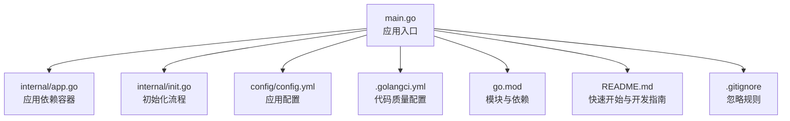
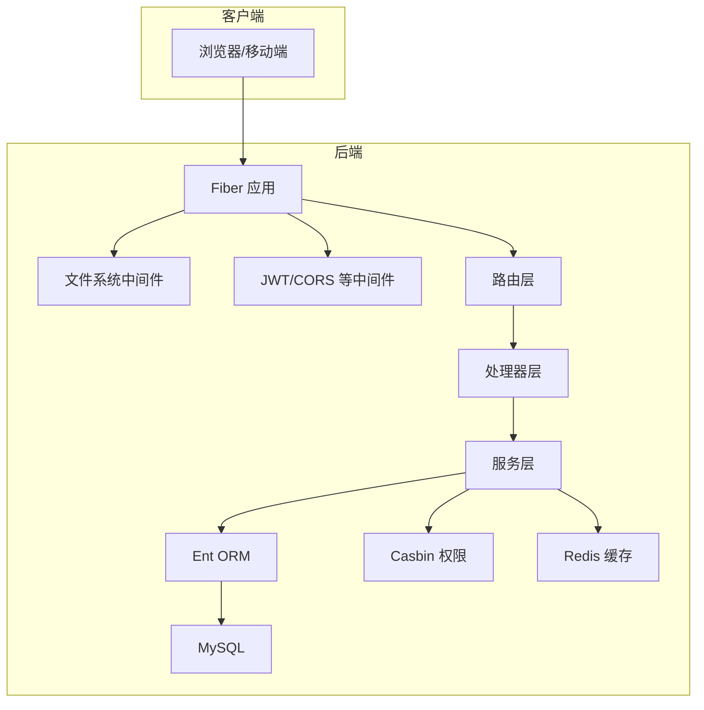
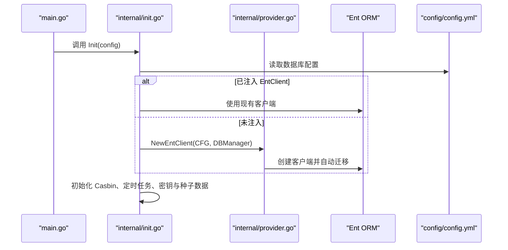
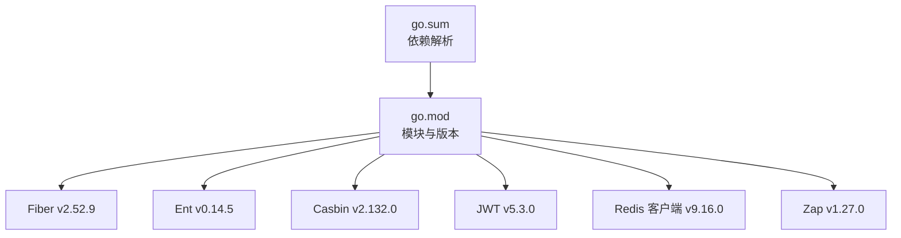

# 开发环境搭建

<cite>
**本文引用的文件**
- [go.mod](file://go.mod)
- [.golangci.yml](file://.golangci.yml)
- [config.yml](file://config/config.yml)
- [main.go](file://main.go)
- [README.md](file://README.md)
- [.gitignore](file://.gitignore)
- [internal/init.go](file://internal/init.go)
- [internal/provider.go](file://internal/provider.go)
- [internal/app.go](file://internal/app.go)
</cite>

## 目录
1. [简介](#简介)
2. [项目结构](#项目结构)
3. [核心组件](#核心组件)
4. [架构总览](#架构总览)
5. [详细组件分析](#详细组件分析)
6. [依赖关系分析](#依赖关系分析)
7. [性能考虑](#性能考虑)
8. [故障排除指南](#故障排除指南)
9. [结论](#结论)
10. [附录](#附录)

## 简介
本指南面向希望在本地快速搭建 Go Admin 管理系统开发环境的工程师与技术团队。内容覆盖 Go 语言版本要求、开发工具安装（VS Code、GoLand、Docker）、项目克隆与依赖安装、数据库与 Redis 的本地配置、IDE 的 Go 开发环境配置要点、.golangci.yml 配置详解以及常见问题排查。

## 项目结构
该仓库采用模块化与分层架构组织，核心入口位于根目录的 main.go，配置集中在 config/config.yml，核心业务与基础设施位于 internal 包中，前端静态资源通过 embed 内嵌至二进制。

图表来源
- [main.go:1-108](file://main.go#L1-L108)
- [internal/app.go:1-26](file://internal/app.go#L1-L26)
- [internal/init.go:1-372](file://internal/init.go#L1-L372)
- [config/config.yml:1-143](file://config/config.yml#L1-L143)
- [.golangci.yml:1-38](file://.golangci.yml#L1-L38)
- [go.mod:1-128](file://go.mod#L1-L128)
- [README.md:1-480](file://README.md#L1-L480)
- [.gitignore:1-8](file://.gitignore#L1-L8)

章节来源
- [README.md:40-69](file://README.md#L40-L69)
- [go.mod:1-128](file://go.mod#L1-L128)
- [config/config.yml:1-143](file://config/config.yml#L1-L143)

## 核心组件
- 应用入口与引导：main.go 负责 Fiber 应用初始化、中间件注册、路由注册与清理逻辑，并通过 bootstrap 完成启动序列。
- 应用依赖容器：internal/app.go 定义了 App 结构体，聚合配置、日志、数据库、缓存、文件系统、Casbin 等核心依赖。
- 初始化流程：internal/init.go 负责数据库、Casbin、定时任务、密钥与随机数存储、种子数据与字典数据初始化。
- 依赖提供者：internal/provider.go 通过 Wire Provider 创建 Ent ORM 客户端、Casbin 适配器与 EnforcerManager，支持自动迁移与表前缀初始化。
- 配置中心：config/config.yml 提供应用、日志、数据库、缓存、Redis、文件系统、Casbin 等配置项。
- 代码质量：.golangci.yml 控制 linters、排除规则与超时等。

章节来源
- [main.go:47-107](file://main.go#L47-L107)
- [internal/app.go:15-26](file://internal/app.go#L15-L26)
- [internal/init.go:39-96](file://internal/init.go#L39-L96)
- [internal/provider.go:17-47](file://internal/provider.go#L17-L47)
- [config/config.yml:1-143](file://config/config.yml#L1-L143)
- [.golangci.yml:1-38](file://.golangci.yml#L1-L38)

## 架构总览
下图展示了从浏览器到数据库的典型请求链路，以及中间件与核心组件的协作关系。

图表来源
- [main.go:62-94](file://main.go#L62-L94)
- [internal/init.go:39-96](file://internal/init.go#L39-L96)
- [config/config.yml:19-59](file://config/config.yml#L19-L59)

## 详细组件分析

### 开发环境与工具安装
- Go 版本要求
  - 项目明确要求 Go 1.25.1 或更高版本，建议使用 1.25.x 系列以获得最佳兼容性。
- 开发工具
  - VS Code：推荐安装 Go 扩展、Go Nightly、C/C++、Docker 等插件，开启 gofmt、gofumpt、golangci-lint 等自动格式化与检查。
  - GoLand：内置 Go 工具链与调试器，适合大型项目与复杂重构。
  - Docker：用于本地运行 MySQL 与 Redis，便于隔离与复现问题。
- 命令行工具
  - goimports、golangci-lint、ent 命令行工具需提前安装，便于格式化、静态检查与实体模型生成。

章节来源
- [README.md:73-78](file://README.md#L73-L78)
- [README.md:287-304](file://README.md#L287-L304)
- [go.mod:3](file://go.mod#L3)

### 项目克隆与依赖安装
- 克隆项目
  - 使用 Git 克隆仓库到本地目录。
- 依赖安装
  - 执行 go mod download 安装所有依赖（含直接与间接依赖）。
- 代码生成与预览
  - 如需生成 Ent 模型，可使用 ent 命令行工具；开发时可直接 go run main.go 或使用热重载工具 air。

章节来源
- [README.md:81-90](file://README.md#L81-L90)
- [README.md:287-304](file://README.md#L287-L304)

### 数据库（MySQL）与 Redis 的本地安装与配置
- MySQL
  - 版本：5.7+ 或 8.0+。
  - 字符集：utf8mb4 与排序规则建议与 README 中示例一致。
  - 数据库创建：按 README 步骤创建数据库。
  - 配置项：在 config/config.yml 的 database 节点中填写 host、port、user、password、name、table_prefix 等。
- Redis
  - 版本：5.0+。
  - 配置项：在 config/config.yml 的 redis 节点中填写连接参数（addr、db、pool_size 等）。
  - 缓存驱动：可在 cache.stores.redis 中启用 Redis 作为缓存后端。

章节来源
- [README.md:75-77](file://README.md#L75-L77)
- [README.md:92-111](file://README.md#L92-L111)
- [config/config.yml:19-59](file://config/config.yml#L19-L59)

### IDE 的 Go 开发环境配置
- 自动导入与格式化
  - VS Code：启用 gofmt、goimports、gofumpt；保存时自动格式化。
  - GoLand：启用 Go fmt、优化导入、自动格式化。
- 代码补全与诊断
  - 安装 gopls 并启用 LSP；确保 GOPATH 与模块路径正确。
- 调试设置
  - 使用 launch.json（VS Code）或 Run/Debug Configurations（GoLand）配置调试参数，支持断点、变量查看与调用栈。
- 代码质量
  - 集成 golangci-lint，可在保存或手动执行时检查代码风格与潜在问题。

章节来源
- [README.md:34-38](file://README.md#L34-L38)
- [.golangci.yml:1-38](file://.golangci.yml#L1-L38)

### .golangci.yml 配置详解与自定义选项
- run
  - skip-dirs：跳过 tmp、web 等目录。
  - skip-files：正则匹配测试文件，避免对 *_test.go 进行 golint 检查。
  - timeout：默认超时 5 分钟。
- linters
  - disable-all：保持默认启用的 linter 列表。
  - enable：启用 gofmt、golint、govet 等。
  - disable：禁用 maligned、prealloc 等。
- issues
  - exclude-rules：对 internal/ent 生成代码禁用 golint。
  - max-issues-per-linter、max-same-issues：不限制最大问题数。

章节来源
- [.golangci.yml:1-38](file://.golangci.yml#L1-L38)

### 初始化流程与依赖注入
- 初始化顺序
  - 数据库初始化：优先使用 Wire 注入的 EntClient；否则手动初始化并创建 schema。
  - Casbin 初始化：优先使用 EnforcerManager；否则创建适配器并初始化。
  - 定时任务、Nonce 存储、密钥管理、种子数据与字典数据初始化。
- 依赖注入
  - Wire Provider 负责创建 Ent 客户端、Casbin 适配器与 EnforcerManager，并执行自动迁移与表前缀初始化。

图表来源
- [main.go:47-107](file://main.go#L47-L107)
- [internal/init.go:39-132](file://internal/init.go#L39-L132)
- [internal/provider.go:17-47](file://internal/provider.go#L17-L47)
- [config/config.yml:19-31](file://config/config.yml#L19-L31)

章节来源
- [internal/init.go:39-132](file://internal/init.go#L39-L132)
- [internal/provider.go:17-47](file://internal/provider.go#L17-L47)

### 应用配置与运行
- 应用配置
  - 端口、调试模式、Swagger、JWT 密钥与过期时间等在 config/config.yml 的 app 节点中配置。
- 运行方式
  - 直接运行：go run main.go。
  - 构建运行：go build -o go-admin main.go；./go-admin。
  - 访问地址：前端界面 http://localhost:9501，API 接口 http://localhost:9501/api/v1。

章节来源
- [config/config.yml:1-10](file://config/config.yml#L1-L10)
- [README.md:122-125](file://README.md#L122-L125)

## 依赖关系分析
- 模块与版本
  - go.mod 指定 Go 版本与依赖版本，包括 Fiber、Ent、Casbin、JWT、Redis 客户端等。
- 替换路径
  - 通过 replace 指向本地 cmf 与 ent 仓库，便于二次开发与联调。
- 间接依赖
  - go.sum 展示了完整依赖树，包含 Atlas、Viper、Zap、Prometheus 等生态组件。

图表来源
- [go.mod:1-128](file://go.mod#L1-L128)
- [go.sum:1-200](file://go.sum#L1-L200)

章节来源
- [go.mod:1-128](file://go.mod#L1-L128)
- [go.sum:1-200](file://go.sum#L1-L200)

## 性能考虑
- 数据库连接池与迁移
  - 使用 Ent 自动迁移与索引/列清理策略，减少手工维护成本。
- 缓存策略
  - 可选择内存缓存或 Redis 缓存，结合 TTL 与连接池参数优化性能。
- 日志与监控
  - 使用 Zap 与 lumberjack 进行日志轮转；结合 Prometheus 指标采集（间接依赖中包含相关组件）。
- 前端静态资源
  - 通过 embed 内嵌前端资源，减少外部依赖与网络开销。

## 故障排除指南
- 端口占用
  - 若 9501 端口被占用，可在 config/config.yml 中修改 app.port。
- 数据库连接失败
  - 检查 config/config.yml 中的 host、port、user、password、name 与字符集设置；确认 MySQL 已启动且网络可达。
- Redis 连接失败
  - 检查 config/config.yml 中的 redis.addr、db、pool_size 等参数；确认 Redis 已启动。
- Ent 迁移错误
  - 确认数据库具备写权限；必要时清理旧索引与列（Provider 中已启用 WithDropIndex/WithDropColumn）。
- 生成代码被 golint 检出告警
  - .golangci.yml 已对 internal/ent 目录排除 golint，若仍出现告警，请确认路径匹配。
- 日志文件未生成
  - 检查 config/config.yml 中 log.file_path 与 data/logs 目录权限；确认 .gitignore 未误排除日志目录。
- Docker 环境
  - 使用 docker-compose 启动 MySQL 与 Redis，确保端口映射与网络连通。

章节来源
- [.golangci.yml:29-35](file://.golangci.yml#L29-L35)
- [.gitignore:1-8](file://.gitignore#L1-L8)
- [config/config.yml:11-17](file://config/config.yml#L11-L17)

## 结论
按照本指南完成 Go 版本、开发工具、数据库与 Redis 的安装与配置，并遵循 IDE 的 Go 开发最佳实践，即可快速搭建 Go Admin 的本地开发环境。配合 .golangci.yml 与初始化流程，可有效保证代码质量与系统稳定性。

## 附录
- 快速命令清单
  - 克隆与依赖：git clone ... && go mod download
  - 运行：go run main.go 或 go build -o go-admin main.go && ./go-admin
  - 代码检查：golangci-lint run
  - 热重载：air（可选）
- 参考文档
  - README.md 的“快速开始”、“开发指南”、“配置说明”等章节提供了更详细的步骤与说明。