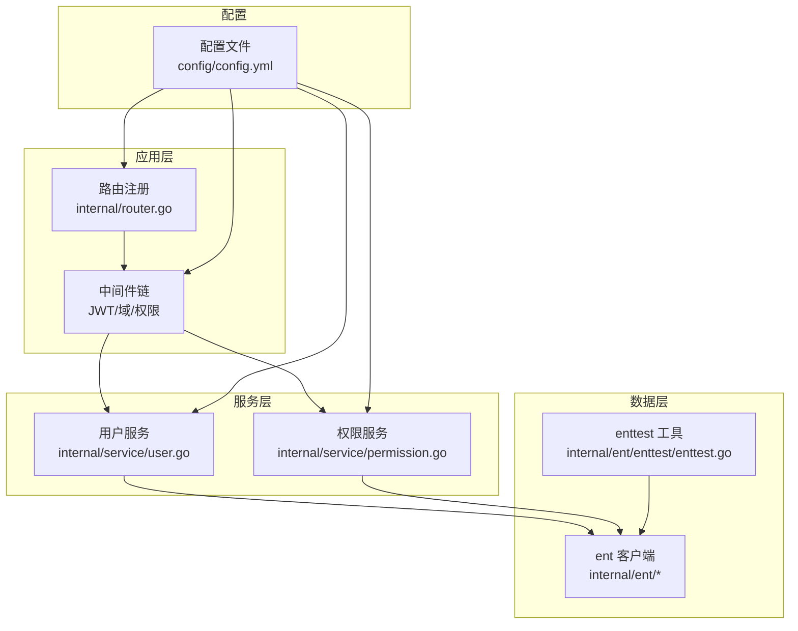
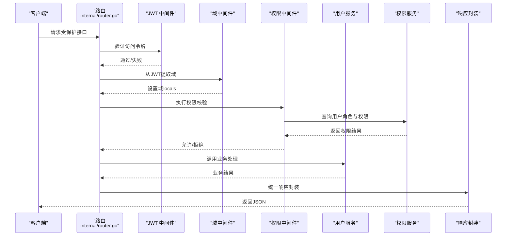
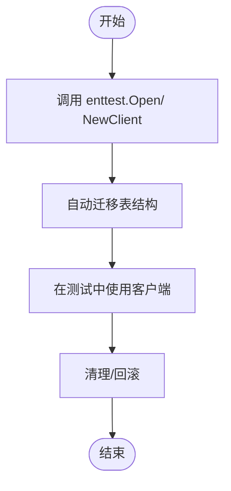
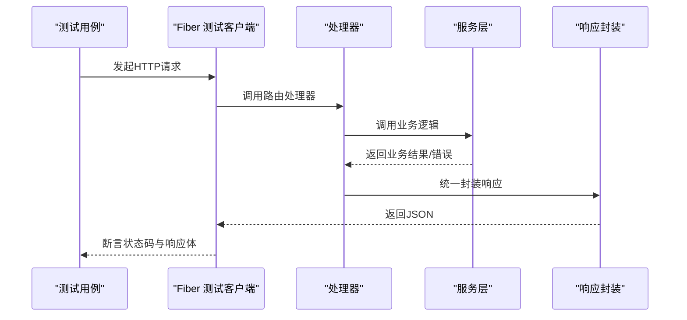
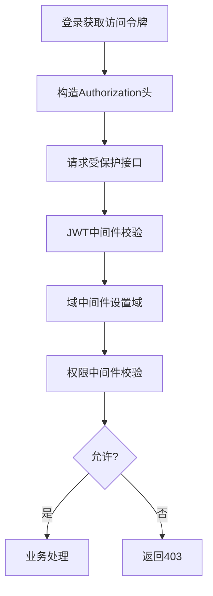
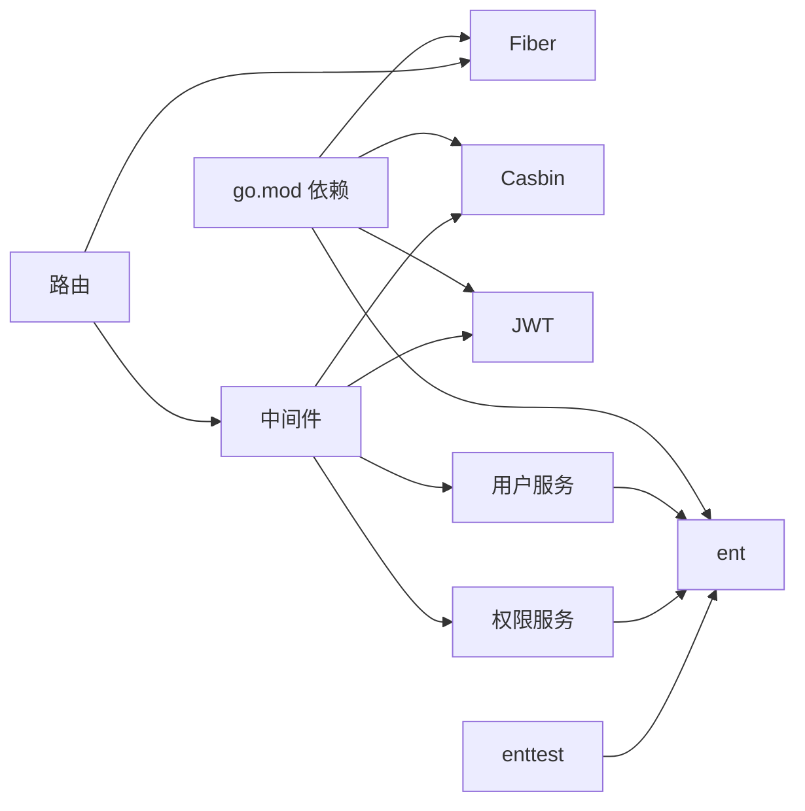

# 测试指南

<cite>
**本文引用的文件**
- [internal/ent/enttest/enttest.go](file://internal/ent/enttest/enttest.go)
- [internal/router.go](file://internal/router.go)
- [internal/middleware/permission.go](file://internal/middleware/permission.go)
- [internal/service/user.go](file://internal/service/user.go)
- [internal/service/permission.go](file://internal/service/permission.go)
- [internal/handler/public.go](file://internal/handler/public.go)
- [internal/utils/response.go](file://internal/utils/response.go)
- [internal/init.go](file://internal/init.go)
- [config/config.yml](file://config/config.yml)
- [.golangci.yml](file://.golangci.yml)
- [go.mod](file://go.mod)
- [docs/docs.go](file://docs/docs.go)
</cite>

## 目录
1. [简介](#简介)
2. [项目结构](#项目结构)
3. [核心组件](#核心组件)
4. [架构总览](#架构总览)
5. [详细组件分析](#详细组件分析)
6. [依赖分析](#依赖分析)
7. [性能考虑](#性能考虑)
8. [故障排查指南](#故障排查指南)
9. [结论](#结论)
10. [附录](#附录)

## 简介
本测试指南面向 Go Admin 管理系统，提供从单元测试到集成测试、API 测试、JWT 认证与权限验证、业务逻辑测试、测试数据准备与 Mock、测试环境配置，以及性能与压力测试的完整实践建议。文档结合仓库中的中间件、服务层、路由与配置等实际实现，给出可落地的测试策略与流程图示。

## 项目结构
- 路由与中间件：路由在统一入口注册，公开接口与鉴权接口分组，鉴权链路包含 JWT 中间件与域中间件，随后进入权限中间件。
- 服务层：用户服务负责登录、刷新令牌、修改密码等；权限服务负责权限增删改查、角色权限分配与用户权限查询。
- 数据层：基于 ent ORM，提供 enttest 工具用于测试数据库迁移与客户端初始化。
- 配置：应用、日志、数据库、缓存、Redis、文件系统与 Casbin 多域模型配置集中于配置文件。

图表来源
- [internal/router.go:14-72](file://internal/router.go#L14-L72)
- [internal/middleware/permission.go:12-68](file://internal/middleware/permission.go#L12-L68)
- [internal/service/user.go:27-44](file://internal/service/user.go#L27-L44)
- [internal/service/permission.go:92-125](file://internal/service/permission.go#L92-L125)
- [internal/ent/enttest/enttest.go:56-85](file://internal/ent/enttest/enttest.go#L56-L85)
- [config/config.yml:1-143](file://config/config.yml#L1-L143)

章节来源
- [internal/router.go:14-72](file://internal/router.go#L14-L72)
- [config/config.yml:1-143](file://config/config.yml#L1-L143)

## 核心组件
- 路由与鉴权链
  - 公开接口：登录、刷新令牌
  - 鉴权接口：用户信息、修改资料、修改密码、角色与权限管理、用户权限查询
  - 鉴权链：JWT 中间件 -> 域中间件 -> 权限中间件
- 服务层
  - 用户服务：登录、刷新令牌、修改密码、用户信息读取
  - 权限服务：权限 CRUD、角色权限分配/移除、用户菜单/按钮/API 权限查询
- 数据层
  - ent 客户端与 enttest 工具：自动迁移、测试客户端创建
- 配置
  - 应用密钥、登录过期时间、数据库连接、Casbin 多域模型

章节来源
- [internal/router.go:14-72](file://internal/router.go#L14-L72)
- [internal/middleware/permission.go:12-68](file://internal/middleware/permission.go#L12-L68)
- [internal/service/user.go:27-44](file://internal/service/user.go#L27-L44)
- [internal/service/permission.go:92-125](file://internal/service/permission.go#L92-L125)
- [internal/ent/enttest/enttest.go:56-85](file://internal/ent/enttest/enttest.go#L56-L85)
- [config/config.yml:1-143](file://config/config.yml#L1-L143)

## 架构总览
下图展示一次鉴权请求的典型调用序列，涵盖 JWT 解析、域提取、权限校验与响应封装。

图表来源
- [internal/router.go:32-37](file://internal/router.go#L32-L37)
- [internal/middleware/permission.go:12-68](file://internal/middleware/permission.go#L12-L68)
- [internal/service/user.go:127-206](file://internal/service/user.go#L127-L206)
- [internal/service/permission.go:466-600](file://internal/service/permission.go#L466-L600)
- [internal/utils/response.go:9-49](file://internal/utils/response.go#L9-L49)

## 详细组件分析

### 单元测试编写方法
- 文件命名规范
  - 采用 _test.go 结尾，例如：service/user_test.go、utils/response_test.go
- 测试函数结构
  - 使用 testing.T 作为参数，使用 t.Run 进行子测试
  - 使用表驱动测试组织多场景输入与期望输出
- 断言使用
  - 使用标准库 testing 包的断言方法，如 Equal、True、Nil、ErrorIs 等
  - 对 JSON 响应断言时，先解析再断言字段
- Mock 对象
  - 使用接口隔离（如 UserServiceInterface）并通过注入替身实现进行测试
  - 对外部依赖（如数据库、JWT、Casbin）使用替身或最小化依赖

章节来源
- [internal/service/user.go:27-44](file://internal/service/user.go#L27-L44)
- [internal/utils/response.go:9-49](file://internal/utils/response.go#L9-L49)

### 集成测试策略（enttest 包）
- 使用 enttest.Open 或 NewClient 自动完成数据库迁移与客户端初始化
- 在测试前确保使用内存数据库或独立测试库，避免污染生产数据
- 使用 WithOptions/WithMigrateOptions 注入 ent 选项与迁移选项
- 在测试结束后清理数据或回滚事务（若使用事务）

图表来源
- [internal/ent/enttest/enttest.go:56-85](file://internal/ent/enttest/enttest.go#L56-L85)

章节来源
- [internal/ent/enttest/enttest.go:56-85](file://internal/ent/enttest/enttest.go#L56-L85)

### API 测试方法
- 请求模拟
  - 使用 gofiber/fiber 的测试客户端发起请求
  - 对公开接口（登录、刷新令牌）直接发起请求
  - 对受保护接口添加 Authorization 头部携带 Bearer 令牌
- 响应验证
  - 统一响应结构由 utils.Response 提供，断言 code、message、data 字段
  - 对业务错误码与消息进行断言
- 状态码检查
  - 明确期望的 HTTP 状态码（如 200、401、403、422、500）

图表来源
- [internal/handler/public.go:22-45](file://internal/handler/public.go#L22-L45)
- [internal/utils/response.go:9-49](file://internal/utils/response.go#L9-L49)

章节来源
- [internal/handler/public.go:22-45](file://internal/handler/public.go#L22-L45)
- [internal/utils/response.go:9-49](file://internal/utils/response.go#L9-L49)

### JWT 认证与权限验证测试
- JWT 认证
  - 通过用户服务登录获取访问令牌，构造 Authorization 头进行后续请求
  - 对刷新令牌接口进行单独测试，验证令牌类型与用户状态校验
- 权限验证
  - 使用权限中间件链路，构造不同角色与权限规则，验证 403/200 场景
  - 使用 DomainMiddleware 确保域信息正确传递
  - 对权限服务的用户权限查询（菜单、按钮、API）分别断言

图表来源
- [internal/middleware/permission.go:12-68](file://internal/middleware/permission.go#L12-L68)
- [internal/service/user.go:127-206](file://internal/service/user.go#L127-L206)
- [internal/service/permission.go:466-600](file://internal/service/permission.go#L466-L600)

章节来源
- [internal/middleware/permission.go:12-68](file://internal/middleware/permission.go#L12-L68)
- [internal/service/user.go:127-206](file://internal/service/user.go#L127-L206)
- [internal/service/permission.go:466-600](file://internal/service/permission.go#L466-L600)

### 业务逻辑测试要点
- 用户服务
  - 登录：邮箱不存在、密码错误、用户非激活状态、成功登录
  - 刷新令牌：非法令牌、过期、类型不符、用户不存在或非激活
  - 修改密码：旧密码错误、成功修改
- 权限服务
  - 权限 CRUD：重复权限、不存在权限、分页与过滤
  - 角色权限：分配/移除权限、批量处理
  - 用户权限：菜单、按钮、API 权限查询

章节来源
- [internal/service/user.go:127-393](file://internal/service/user.go#L127-L393)
- [internal/service/permission.go:127-670](file://internal/service/permission.go#L127-L670)

### 测试数据准备与 Mock
- 测试数据
  - 使用 enttest 初始化测试数据库，插入必要的用户、角色、权限规则
  - 使用唯一标识与固定域（如 default）保证测试可重复性
- Mock 对象
  - 对外部依赖（如加密、JWT、Casbin）使用替身或最小化实现
  - 通过接口注入替换真实依赖，便于隔离测试

章节来源
- [internal/ent/enttest/enttest.go:56-85](file://internal/ent/enttest/enttest.go#L56-L85)
- [internal/service/user.go:27-44](file://internal/service/user.go#L27-L44)
- [internal/service/permission.go:92-125](file://internal/service/permission.go#L92-L125)

### 测试环境配置
- 应用密钥与过期时间
  - 在配置中设置 secret、login_expires 等，确保测试中行为一致
- 数据库连接
  - 使用独立测试库或内存数据库，配合 enttest 自动迁移
- 日志与调试
  - 可开启 debug 输出以便定位问题

章节来源
- [config/config.yml:1-143](file://config/config.yml#L1-L143)
- [internal/ent/enttest/enttest.go:56-85](file://internal/ent/enttest/enttest.go#L56-L85)

## 依赖分析
- 外部依赖
  - Fiber：Web 框架与路由
  - ent：ORM 与数据库迁移
  - Casbin：权限模型与执行器
  - JWT：令牌生成与解析
- 内部耦合
  - 路由依赖中间件与服务层
  - 服务层依赖 ent 客户端与全局配置
  - enttest 依赖 ent 与 migrate

图表来源
- [go.mod:5-13](file://go.mod#L5-L13)
- [internal/router.go:14-72](file://internal/router.go#L14-L72)
- [internal/middleware/permission.go:12-68](file://internal/middleware/permission.go#L12-L68)
- [internal/service/user.go:27-44](file://internal/service/user.go#L27-L44)
- [internal/service/permission.go:92-125](file://internal/service/permission.go#L92-L125)
- [internal/ent/enttest/enttest.go:56-85](file://internal/ent/enttest/enttest.go#L56-L85)

章节来源
- [go.mod:5-13](file://go.mod#L5-L13)
- [internal/router.go:14-72](file://internal/router.go#L14-L72)
- [internal/middleware/permission.go:12-68](file://internal/middleware/permission.go#L12-L68)
- [internal/service/user.go:27-44](file://internal/service/user.go#L27-L44)
- [internal/service/permission.go:92-125](file://internal/service/permission.go#L92-L125)
- [internal/ent/enttest/enttest.go:56-85](file://internal/ent/enttest/enttest.go#L56-L85)

## 性能考虑
- 单元测试
  - 使用小数据集与最小化依赖，避免慢速外部调用
- 集成测试
  - 使用内存数据库或快速磁盘，减少迁移与 IO 开销
  - 并发测试时注意数据库连接池与锁竞争
- API 测试
  - 控制并发度与超时，避免对真实服务造成压力
- 性能基准测试
  - 使用 go test 的 -bench 标志与 -benchmem
  - 对关键路径（登录、权限查询）进行基准测试
- 压力测试
  - 使用压测工具对公开接口与受保护接口施加负载
  - 关注错误率、延迟分布与资源占用

## 故障排查指南
- 常见错误与定位
  - 401 未授权：检查 Authorization 头、JWT 有效性与签名
  - 403 权限不足：检查用户角色与权限规则、域配置
  - 500 服务器错误：检查服务层异常处理与日志
- 配置检查
  - 确认 secret、login_expires、数据库连接、Casbin 多域模型配置
- 调试建议
  - 开启 Fiber 日志与 ent Debug 模式
  - 使用断点与日志定位中间件与服务层问题

章节来源
- [internal/middleware/permission.go:12-68](file://internal/middleware/permission.go#L12-L68)
- [internal/service/user.go:127-393](file://internal/service/user.go#L127-L393)
- [config/config.yml:1-143](file://config/config.yml#L1-L143)

## 结论
通过规范的单元测试、完善的集成测试（含 enttest）、严谨的 API 测试、严格的 JWT 与权限验证测试、合理的测试数据与 Mock 设计、清晰的测试环境配置，以及持续的性能与压力测试，可以显著提升 Go Admin 管理系统的质量与稳定性。建议在 CI 中强制执行测试与覆盖率检查，并结合配置文件与中间件实现进行回归测试。

## 附录
- Swagger 文档与安全定义
  - BearerAuth 安全方案与响应结构定义可用于 API 测试参考

章节来源
- [docs/docs.go:225-232](file://docs/docs.go#L225-L232)