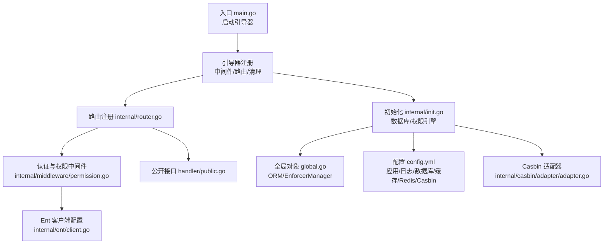
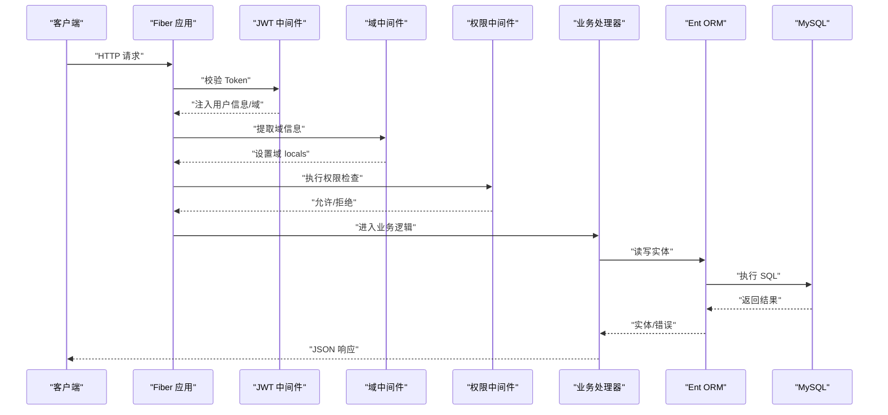
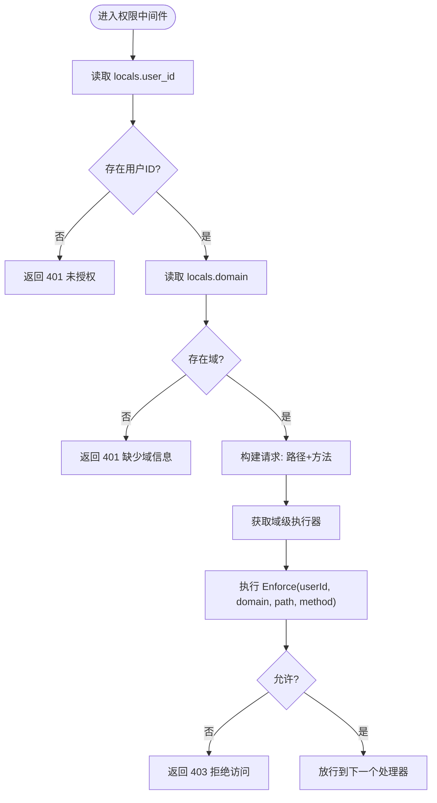
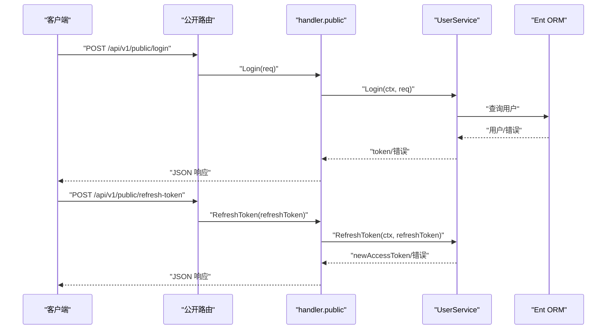
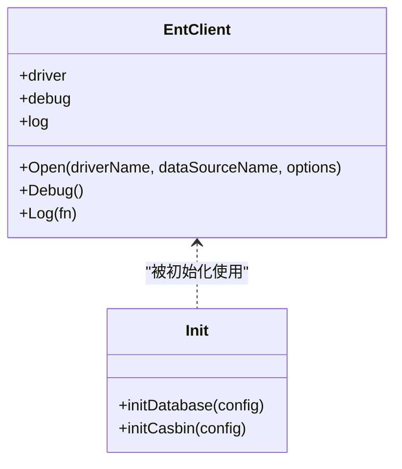
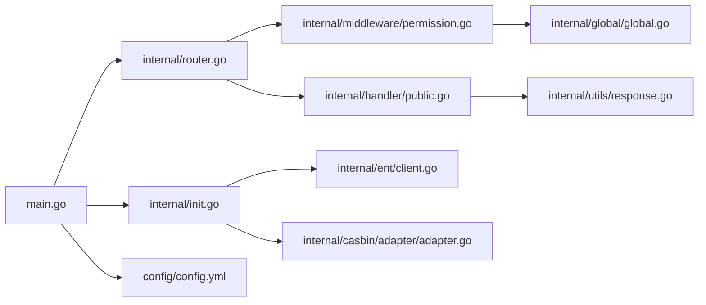

# 调试与性能分析

<cite>
**本文引用的文件**
- [main.go](file://main.go)
- [internal/init.go](file://internal/init.go)
- [internal/global/global.go](file://internal/global/global.go)
- [internal/global/msg.go](file://internal/global/msg.go)
- [internal/router.go](file://internal/router.go)
- [internal/middleware/permission.go](file://internal/middleware/permission.go)
- [internal/handler/public.go](file://internal/handler/public.go)
- [internal/utils/response.go](file://internal/utils/response.go)
- [internal/utils/utils.go](file://internal/utils/utils.go)
- [config/config.yml](file://config/config.yml)
- [internal/ent/client.go](file://internal/ent/client.go)
- [internal/casbin/adapter/adapter.go](file://internal/casbin/adapter/adapter.go)
- [go.mod](file://go.mod)
</cite>

## 目录
1. [简介](#简介)
2. [项目结构](#项目结构)
3. [核心组件](#核心组件)
4. [架构总览](#架构总览)
5. [详细组件分析](#详细组件分析)
6. [依赖分析](#依赖分析)
7. [性能考虑](#性能考虑)
8. [故障排查指南](#故障排查指南)
9. [结论](#结论)
10. [附录](#附录)

## 简介
本文件面向Go Admin管理系统的运维与开发人员，提供系统化的调试与性能分析方法论与实操步骤。内容覆盖：
- 调试工具使用：Go调试器（dlv）、日志分析、错误追踪
- 关键问题定位：JWT认证问题、权限验证异常、数据库连接问题
- 性能分析技术：CPU分析、内存分析、数据库查询优化
- 常见问题诊断：Token过期、权限不足、API调用失败
- pprof使用与结果解读
- 生产环境问题排查流程与应急处理方案

## 项目结构
系统采用 Fiber 应用框架，通过统一引导器完成中间件注册、路由挂载与清理函数注册；权限控制基于 JWT 与 Casbin；数据层使用 Ent ORM 并支持 MySQL。

图表来源
- [main.go:43-89](file://main.go#L43-L89)
- [internal/router.go:14-72](file://internal/router.go#L14-L72)
- [internal/init.go:17-65](file://internal/init.go#L17-L65)
- [internal/global/global.go:10-14](file://internal/global/global.go#L10-L14)
- [config/config.yml:1-143](file://config/config.yml#L1-L143)
- [internal/ent/client.go:55-128](file://internal/ent/client.go#L55-L128)
- [internal/casbin/adapter/adapter.go:60-113](file://internal/casbin/adapter/adapter.go#L60-L113)

章节来源
- [main.go:1-90](file://main.go#L1-L90)
- [internal/router.go:1-73](file://internal/router.go#L1-L73)
- [internal/init.go:1-66](file://internal/init.go#L1-L66)
- [config/config.yml:1-143](file://config/config.yml#L1-L143)

## 核心组件
- 引导器与中间件
  - 引导器负责注册静态文件中间件、通用SPA回退处理、路由与清理函数。
  - 中间件链路：JWT校验 -> 域解析 -> 权限校验 -> 业务处理器。
- 认证与权限
  - 登录/刷新令牌接口位于公开路由组；认证后接口通过多级中间件保护。
  - 权限模型基于 Casbin，按域隔离策略执行。
- 数据层
  - 使用 Ent ORM 连接 MySQL，支持调试模式输出 SQL 日志。
- 配置
  - 应用参数、日志落盘、数据库连接、Redis、Casbin 多域模型等集中于 YAML。

章节来源
- [main.go:43-89](file://main.go#L43-L89)
- [internal/router.go:14-72](file://internal/router.go#L14-L72)
- [internal/middleware/permission.go:11-68](file://internal/middleware/permission.go#L11-L68)
- [internal/handler/public.go:13-179](file://internal/handler/public.go#L13-L179)
- [internal/ent/client.go:55-128](file://internal/ent/client.go#L55-L128)
- [config/config.yml:1-143](file://config/config.yml#L1-L143)

## 架构总览
下图展示从客户端到服务端、数据库与权限引擎的关键交互路径。

图表来源
- [internal/router.go:32-40](file://internal/router.go#L32-L40)
- [internal/middleware/permission.go:11-68](file://internal/middleware/permission.go#L11-L68)
- [internal/handler/public.go:22-44](file://internal/handler/public.go#L22-L44)
- [internal/ent/client.go:55-128](file://internal/ent/client.go#L55-L128)

## 详细组件分析

### 组件A：认证与权限中间件
- 功能要点
  - 域中间件从 JWT 提取域并注入 locals，供权限中间件使用。
  - 权限中间件从 locals 读取用户ID与域，结合请求路径与方法进行策略匹配。
- 错误路径
  - 缺少 locals 字段、JWT 缺失域、获取执行器失败、策略检查异常、拒绝访问。
- 诊断建议
  - 在域中间件与权限中间件处增加日志，记录 claims、locals、请求上下文。
  - 对 Casbin 执行器获取与 Enforce 调用增加错误返回栈信息。

图表来源
- [internal/middleware/permission.go:11-68](file://internal/middleware/permission.go#L11-L68)

章节来源
- [internal/middleware/permission.go:11-68](file://internal/middleware/permission.go#L11-L68)

### 组件B：公开接口（登录/刷新）
- 登录流程
  - 解析请求体 -> 调用用户服务登录 -> 返回令牌或错误码。
- 刷新流程
  - 解析刷新令牌 -> 用户服务校验并签发新访问令牌 -> 返回新令牌或错误码。
- 常见问题
  - 请求体解析失败、用户不存在/状态异常、刷新令牌无效。

图表来源
- [internal/router.go:28-29](file://internal/router.go#L28-L29)
- [internal/handler/public.go:22-44](file://internal/handler/public.go#L22-L44)
- [internal/handler/public.go:158-179](file://internal/handler/public.go#L158-L179)

章节来源
- [internal/handler/public.go:13-179](file://internal/handler/public.go#L13-L179)
- [internal/router.go:14-72](file://internal/router.go#L14-L72)

### 组件C：数据层与日志
- Ent 客户端支持 Debug 模式，开启后会输出 SQL 语句与耗时。
- 初始化阶段创建数据库 Schema，失败会直接终止启动。
- 建议在开发/测试环境启用 Debug，生产环境关闭。

图表来源
- [internal/ent/client.go:55-128](file://internal/ent/client.go#L55-L128)
- [internal/init.go:33-65](file://internal/init.go#L33-L65)

章节来源
- [internal/ent/client.go:55-128](file://internal/ent/client.go#L55-L128)
- [internal/init.go:33-65](file://internal/init.go#L33-L65)

### 组件D：配置与全局对象
- 应用配置集中于 YAML，包含端口、密钥、登录过期时间、日志路径、数据库与 Redis 参数。
- 全局对象保存 ORM 客户端与 Casbin 执行器管理器，供中间件与处理器使用。

章节来源
- [config/config.yml:1-143](file://config/config.yml#L1-L143)
- [internal/global/global.go:10-14](file://internal/global/global.go#L10-L14)

## 依赖分析
- 外部库
  - Fiber：Web 框架与中间件生态
  - Ent：ORM 与 Schema 管理
  - Casbin：权限模型与策略执行
  - Prometheus：监控指标（间接依赖）
- 内部耦合
  - 路由依赖中间件与服务；中间件依赖全局对象；处理器依赖服务与响应封装。

图表来源
- [main.go:43-89](file://main.go#L43-L89)
- [internal/router.go:14-72](file://internal/router.go#L14-L72)
- [internal/middleware/permission.go:11-68](file://internal/middleware/permission.go#L11-L68)
- [internal/handler/public.go:22-44](file://internal/handler/public.go#L22-L44)
- [internal/utils/response.go:9-49](file://internal/utils/response.go#L9-L49)
- [internal/init.go:17-65](file://internal/init.go#L17-L65)
- [internal/ent/client.go:55-128](file://internal/ent/client.go#L55-L128)
- [internal/casbin/adapter/adapter.go:60-113](file://internal/casbin/adapter/adapter.go#L60-L113)
- [config/config.yml:1-143](file://config/config.yml#L1-L143)

章节来源
- [go.mod:61-88](file://go.mod#L61-L88)
- [main.go:1-90](file://main.go#L1-L90)
- [internal/router.go:1-73](file://internal/router.go#L1-L73)

## 性能考虑
- CPU 分析
  - 使用 Go pprof HTTP 服务暴露分析端点，结合 go tool pprof 浏览器界面或命令行分析热点函数。
  - 建议在生产环境按需开启采样，避免长期高 overhead。
- 内存分析
  - 采集 heap profile，关注大对象分配与 GC 压力；结合指标观察堆大小与分配速率。
- 数据库查询优化
  - 开启 Ent Debug 模式输出 SQL，识别慢查询与 N+1 查询；为常用查询建立索引。
  - 控制事务范围，避免长事务锁竞争。
- 日志与可观测性
  - 结合配置中的日志路径与轮转参数，确保关键路径有足够日志；对错误与慢请求打点埋点。

[本节为通用指导，无需列出具体文件来源]

## 故障排查指南

### 1) JWT 认证问题
- 症状
  - 401 未授权、提示缺少域信息、域中间件失败。
- 排查步骤
  - 确认请求头 Authorization 使用 Bearer 令牌格式。
  - 检查 JWT 中是否包含域字段；若缺失，域中间件会直接返回 401。
  - 查看中间件链路日志，确认 locals 中 user_id 与 domain 是否正确注入。
- 相关位置
  - 域中间件与权限中间件的错误返回路径。

章节来源
- [internal/middleware/permission.go:55-68](file://internal/middleware/permission.go#L55-L68)
- [internal/middleware/permission.go:11-68](file://internal/middleware/permission.go#L11-L68)

### 2) 权限验证异常
- 症状
  - 403 拒绝访问；或权限检查失败返回 500。
- 排查步骤
  - 确认用户在目标域下的策略是否存在；检查 Casbin 执行器是否正确获取。
  - 对照请求路径与方法是否与策略匹配；必要时打印策略与请求上下文。
- 相关位置
  - 权限中间件的 Enforce 调用与错误分支。

章节来源
- [internal/middleware/permission.go:11-68](file://internal/middleware/permission.go#L11-L68)

### 3) 数据库连接问题
- 症状
  - 启动阶段 Schema 创建失败；运行时报连接错误。
- 排查步骤
  - 检查数据库连接参数（主机、端口、用户名、密码、库名）。
  - 确认驱动与 DNS 正确；查看初始化日志输出的驱动信息。
  - 在开发环境开启 Ent Debug 模式，观察 SQL 输出与错误。
- 相关位置
  - 初始化数据库与 Ent 客户端配置。

章节来源
- [internal/init.go:33-65](file://internal/init.go#L33-L65)
- [internal/ent/client.go:55-128](file://internal/ent/client.go#L55-L128)

### 4) API 调用失败
- 症状
  - 400 请求体解析失败；404 资源不存在；500 内部错误。
- 排查步骤
  - 检查路由是否正确挂载；确认中间件顺序与 locals 注入。
  - 使用统一响应封装查看错误码与消息映射。
- 相关位置
  - 处理器中的 BodyParser、错误分支与响应封装。

章节来源
- [internal/handler/public.go:22-44](file://internal/handler/public.go#L22-L44)
- [internal/utils/response.go:9-49](file://internal/utils/response.go#L9-L49)
- [internal/global/msg.go:25-45](file://internal/global/msg.go#L25-L45)

### 5) Token 过期与刷新
- 症状
  - 访问令牌过期导致 401；刷新令牌无效导致 401。
- 排查步骤
  - 校验刷新令牌是否来自同一签发方与域；检查用户状态是否有效。
  - 查看刷新流程的日志与错误返回。
- 相关位置
  - 刷新令牌处理器与用户服务实现。

章节来源
- [internal/handler/public.go:158-179](file://internal/handler/public.go#L158-L179)

### 6) 使用 pprof 进行性能分析
- 开启方式
  - 在应用中注册 pprof HTTP 路由（通常在 dev 环境），或通过外部 HTTP 服务暴露分析端点。
- 常用命令
  - 本地分析：go tool pprof http://localhost:9501/debug/pprof/profile
  - 火焰图：go tool pprof -http=:8080 http://localhost:9501/debug/pprof/profile
- 结果解读
  - 看热点函数与调用栈；关注 CPU 占用高的函数与频繁分配的对象。
  - 结合业务场景定位热点路径，优先优化热点循环与重复计算。

[本小节为通用指导，无需列出具体文件来源]

## 结论
- 通过中间件链路与统一响应封装，系统具备清晰的错误传播与可观测性。
- 建议在开发/测试环境启用 Ent Debug 与日志轮转，在生产环境谨慎开启高开销分析。
- 针对 JWT、权限与数据库三类问题，建议以“请求头/令牌—locals—策略—SQL”为主线逐步缩小范围。
- 使用 pprof 与日志双轨分析，可快速定位 CPU、内存与数据库瓶颈。

[本节为总结性内容，无需列出具体文件来源]

## 附录

### A. 常见错误码与消息映射
- 成功/失败/未授权/拒绝访问/资源不存在/方法不允许/冲突/内部错误等。
- 角色相关错误码区间与含义。

章节来源
- [internal/global/msg.go:3-45](file://internal/global/msg.go#L3-L45)

### B. 配置项速览（与调试/性能相关）
- 应用：端口、密钥、登录过期时间、Swagger 开关
- 日志：文件路径、控制台输出、文件输出、轮转参数
- 数据库：驱动、主机、端口、用户、密码、库名、表前缀
- Redis：地址、连接池参数、超时
- Casbin：默认域、多域模型配置

章节来源
- [config/config.yml:1-143](file://config/config.yml#L1-L143)