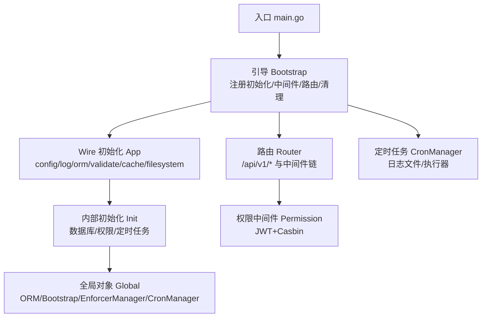
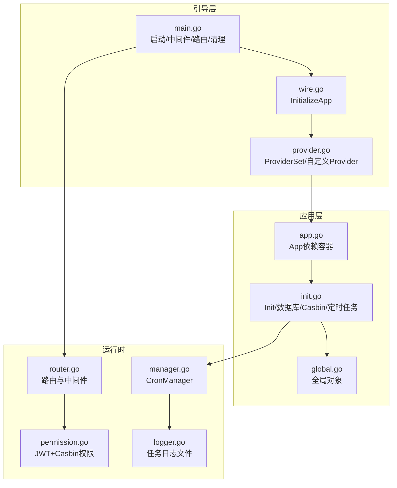
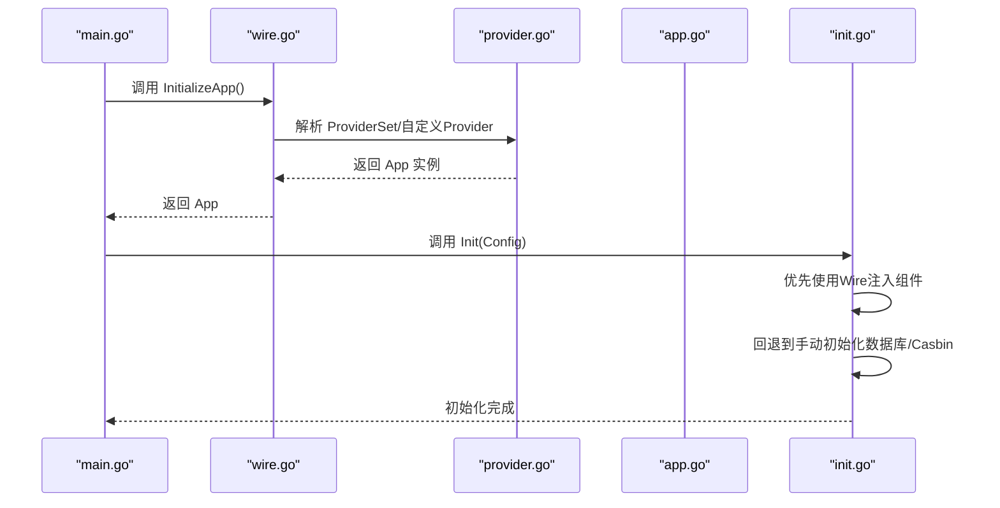
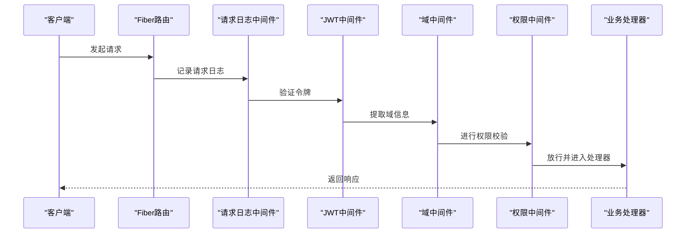
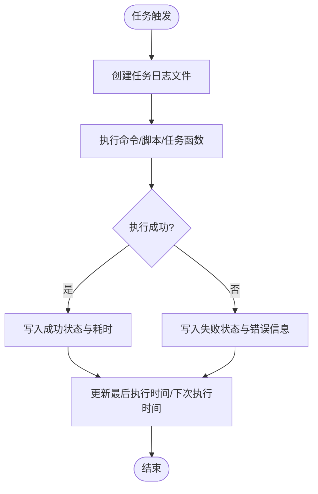
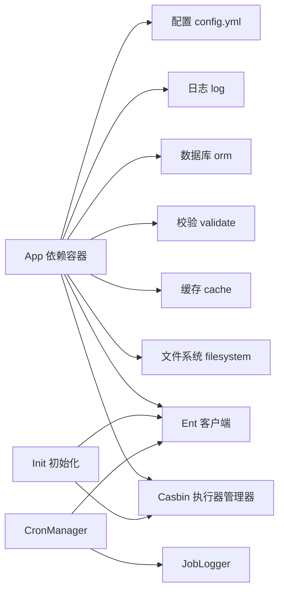

# 调试与故障排除

<cite>
**本文引用的文件**
- [main.go](file://main.go)
- [config.yml](file://config/config.yml)
- [app.go](file://internal/app.go)
- [init.go](file://internal/init.go)
- [provider.go](file://internal/provider.go)
- [wire.go](file://internal/wire.go)
- [global.go](file://internal/global/global.go)
- [router.go](file://internal/router.go)
- [permission.go](file://internal/middleware/permission.go)
- [logger.go](file://internal/cron/logger.go)
- [manager.go](file://internal/cron/manager.go)
- [executor.go](file://internal/cron/executor.go)
- [cleanup.go](file://internal/cleanup.go)
- [operationlog.go](file://internal/ent/operationlog.go)
- [build-errors.log](file://tmp/build-errors.log)
</cite>

## 目录
1. [简介](#简介)
2. [项目结构](#项目结构)
3. [核心组件](#核心组件)
4. [架构总览](#架构总览)
5. [详细组件分析](#详细组件分析)
6. [依赖分析](#依赖分析)
7. [性能考虑](#性能考虑)
8. [故障排除指南](#故障排除指南)
9. [结论](#结论)
10. [附录](#附录)

## 简介
本指南面向Go Admin管理系统的开发者与运维人员，提供从开发调试到生产排障的完整方法论。内容覆盖：
- 使用Delve进行断点调试、变量检查与调用栈分析
- 日志系统配置与关键信息提取
- 启动失败、数据库连接、依赖注入等常见问题诊断
- 性能分析工具pprof的集成与内存/CPU分析
- 错误处理与异常恢复最佳实践
- 生产环境快速定位与应急处理流程
- 开发工具链配置与优化建议

## 项目结构
系统采用模块化分层设计：
- 入口与引导：main负责应用初始化、中间件挂载与生命周期管理
- 依赖注入：通过Wire生成初始化代码，集中管理配置、日志、数据库、缓存、文件系统、校验器、Casbin等
- 路由与中间件：Fiber路由分组与JWT、权限中间件
- 定时任务：基于robfig/cron的CronManager，支持shell、curl、task三种执行器
- 日志：Zap与CMF日志封装，支持请求日志中间件与任务日志文件

图表来源
- [main.go:47-104](file://main.go#L47-L104)
- [wire.go:22-37](file://internal/wire.go#L22-L37)
- [init.go:31-67](file://internal/init.go#L31-L67)
- [router.go:16-149](file://internal/router.go#L16-L149)
- [manager.go:17-38](file://internal/cron/manager.go#L17-L38)

章节来源
- [main.go:47-104](file://main.go#L47-L104)
- [wire.go:22-37](file://internal/wire.go#L22-L37)
- [init.go:31-67](file://internal/init.go#L31-L67)
- [router.go:16-149](file://internal/router.go#L16-L149)

## 核心组件
- 应用依赖容器 App：集中持有配置、日志、数据库、验证器、缓存、Ent客户端、Casbin执行器、文件系统等
- Wire初始化：通过ProviderSet与自定义Provider创建并注入各子系统
- 初始化流程：优先使用Wire注入；若缺失则回退到手动初始化（数据库、Casbin）
- 生命周期：启动阶段注册中间件与路由，运行阶段挂载SPA静态资源；退出阶段执行清理

章节来源
- [app.go:15-26](file://internal/app.go#L15-L26)
- [provider.go:17-43](file://internal/provider.go#L17-L43)
- [wire.go:22-37](file://internal/wire.go#L22-L37)
- [init.go:31-100](file://internal/init.go#L31-L100)

## 架构总览
系统采用“引导+依赖注入+中间件+路由”的典型Web架构，配合定时任务与日志系统形成闭环。

图表来源
- [main.go:47-104](file://main.go#L47-L104)
- [wire.go:22-37](file://internal/wire.go#L22-L37)
- [provider.go:17-43](file://internal/provider.go#L17-L43)
- [app.go:15-26](file://internal/app.go#L15-L26)
- [init.go:31-67](file://internal/init.go#L31-L67)
- [router.go:16-149](file://internal/router.go#L16-L149)
- [permission.go:14-94](file://internal/middleware/permission.go#L14-L94)
- [manager.go:17-38](file://internal/cron/manager.go#L17-L38)
- [logger.go:20-51](file://internal/cron/logger.go#L20-L51)

## 详细组件分析

### 依赖注入与初始化流程
- Wire通过ProviderSet与自定义Provider创建配置、日志、数据库、缓存、文件系统、校验器、Ent客户端、Casbin适配器与执行器管理器
- 初始化阶段优先使用Wire注入的组件；若缺失则回退到手动初始化（数据库Schema创建、Casbin适配器与执行器管理器）
- 全局对象保存ORM、Bootstrap、EnforcerManager、CronManager，供其他模块使用

图表来源
- [main.go:47-57](file://main.go#L47-L57)
- [wire.go:22-37](file://internal/wire.go#L22-L37)
- [provider.go:17-43](file://internal/provider.go#L17-L43)
- [init.go:31-67](file://internal/init.go#L31-L67)

章节来源
- [wire.go:22-37](file://internal/wire.go#L22-L37)
- [provider.go:17-43](file://internal/provider.go#L17-L43)
- [init.go:31-100](file://internal/init.go#L31-L100)

### 路由与中间件
- 请求日志中间件：在路由注册时挂载，记录请求关键信息
- JWT中间件：鉴权与域信息提取
- 权限中间件：基于Casbin执行器进行权限校验
- 路由分组：/api/v1/admin/*，公开接口与认证接口分离

图表来源
- [router.go:16-60](file://internal/router.go#L16-L60)
- [permission.go:14-78](file://internal/middleware/permission.go#L14-L78)

章节来源
- [router.go:16-149](file://internal/router.go#L16-L149)
- [permission.go:14-94](file://internal/middleware/permission.go#L14-L94)

### 定时任务与日志
- CronManager：从数据库加载启用的任务，注册到调度器；内置shell、curl、task三种执行器
- 任务执行：为每次执行创建独立日志文件，记录开始/结束时间、耗时、结果与错误
- 日志清理：按保留时长定期清理过期日志文件

图表来源
- [manager.go:154-221](file://internal/cron/manager.go#L154-L221)
- [logger.go:34-51](file://internal/cron/logger.go#L34-L51)

章节来源
- [manager.go:17-237](file://internal/cron/manager.go#L17-L237)
- [logger.go:13-192](file://internal/cron/logger.go#L13-L192)
- [executor.go:98-125](file://internal/cron/executor.go#L98-L125)

### 数据模型与操作日志
- OperationLog实体包含用户、模块、动作、路径、方法、IP、UA、状态码、耗时等字段
- 字符串化输出对敏感字段进行脱敏展示，便于日志审计与问题定位

章节来源
- [operationlog.go:190-237](file://internal/ent/operationlog.go#L190-L237)

## 依赖分析
- 组件耦合与内聚：App作为依赖容器，集中管理各子系统；初始化与清理流程清晰，避免循环依赖
- 外部依赖：Fiber、Ent、Casbin、robfig/cron、zap等
- 接口契约：CronManager与JobLogger解耦，便于替换与扩展

图表来源
- [app.go:15-26](file://internal/app.go#L15-L26)
- [init.go:31-100](file://internal/init.go#L31-L100)
- [manager.go:17-38](file://internal/cron/manager.go#L17-L38)
- [logger.go:20-32](file://internal/cron/logger.go#L20-L32)

章节来源
- [app.go:15-26](file://internal/app.go#L15-L26)
- [init.go:31-100](file://internal/init.go#L31-L100)
- [config.yml:1-143](file://config/config.yml#L1-L143)

## 性能考虑
- pprof集成建议
  - 在main中引入net/http/pprof包，并在路由中暴露/debug/pprof端点
  - 使用go tool pprof分析CPU、内存、阻塞热点
- 内存与GC
  - 关注大对象分配与逃逸，减少不必要的字符串拼接与反射
  - 合理设置数据库连接池与Redis连接池参数
- 并发与锁
  - CronManager内部使用sync.Map存储任务映射，注意高并发下的键冲突与竞争条件
- I/O与网络
  - curl执行器限制响应体大小，避免过大日志写入磁盘
  - 文件系统与S3上传/下载需关注超时与重试策略

[本节为通用指导，无需列出具体文件来源]

## 故障排除指南

### 开发调试技巧
- 使用Delve进行断点调试
  - 在main.go入口处设置断点，观察Wire初始化后的App对象
  - 在init.go中设置断点，检查数据库与Casbin初始化是否成功
  - 在router.go中设置断点，验证JWT与权限中间件链路
  - 在manager.go中设置断点，跟踪任务执行与日志写入
- 变量检查与调用栈
  - 观察App中的配置、日志、数据库、缓存、文件系统等字段
  - 检查全局对象（ORM、EnforcerManager、CronManager）是否正确赋值
  - 分析调用栈定位异常发生的具体函数与行号

章节来源
- [main.go:47-57](file://main.go#L47-L57)
- [init.go:31-67](file://internal/init.go#L31-L67)
- [router.go:16-60](file://internal/router.go#L16-L60)
- [manager.go:154-221](file://internal/cron/manager.go#L154-L221)

### 日志系统使用
- 配置项说明
  - 日志文件路径、控制台输出、文件输出、滚动策略（最大大小、备份数、保留天数）
- 日志格式与关键信息提取
  - 请求日志中间件记录请求路径、方法、状态码、耗时
  - 操作日志实体包含用户、模块、动作、路径、方法、IP、UA、状态码、耗时
  - 任务日志文件包含任务名、开始/结束时间、耗时、结果与错误
- 日志查看与分析
  - 应用主日志：data/logs/admin-api.log
  - 任务日志：data/logs/cron/job-{id}/YYYYMMDD-HHMMSS.log
  - 使用tail/less查看最新日志，grep过滤关键词

章节来源
- [config.yml:11-18](file://config/config.yml#L11-L18)
- [router.go:17-20](file://internal/router.go#L17-L20)
- [operationlog.go:190-237](file://internal/ent/operationlog.go#L190-L237)
- [logger.go:34-51](file://internal/cron/logger.go#L34-L51)

### 启动失败排查
- Wire初始化失败
  - 检查wire.go中的ProviderSet与自定义Provider是否齐全
  - 确认config.yml中的配置项有效（数据库、缓存、文件系统、Casbin等）
- 引导阶段错误
  - 检查main.go中bootstrap.Run()返回的错误
  - 关注初始化日志，确认数据库Schema创建与Casbin初始化成功
- 构建错误
  - 查看tmp/build-errors.log，定位编译失败原因（语法、导入、版本不匹配）

章节来源
- [wire.go:22-37](file://internal/wire.go#L22-L37)
- [config.yml:1-143](file://config/config.yml#L1-L143)
- [main.go:95-103](file://main.go#L95-L103)
- [init.go:69-84](file://internal/init.go#L69-L84)
- [build-errors.log:1-1](file://tmp/build-errors.log#L1-L1)

### 数据库连接问题
- 配置核对
  - 检查config.yml中database.default与connections.default的驱动、主机、端口、用户名、密码、数据库名
- 连接池与Schema
  - 确认provider.go中NewEntClient创建的数据库连接可用
  - 检查init.go中Schema创建是否成功
- 运行时错误
  - 关注日志中“failed creating schema resources”、“failed to create Casbin Ent adapter”等错误
  - 检查Ent客户端与数据库连接池的关闭顺序（先停止定时任务，再关闭连接池）

章节来源
- [config.yml:19-31](file://config/config.yml#L19-L31)
- [provider.go:17-33](file://internal/provider.go#L17-L33)
- [init.go:69-84](file://internal/init.go#L69-L84)
- [cleanup.go:10-37](file://internal/cleanup.go#L10-L37)

### 依赖注入错误排查
- Wire注入缺失
  - 若appInstance中某些字段为空，Init会回退到手动初始化
  - 检查provider.go中的ProviderSet是否包含对应组件
- 全局对象未赋值
  - 确认init.go中对global.ORM、global.EnforcerManager、global.CronManager的赋值
  - 检查main.go中SetApp与bootstrap.RegisterInitFunc的调用顺序

章节来源
- [init.go:31-67](file://internal/init.go#L31-L67)
- [global.go:11-16](file://internal/global/global.go#L11-L16)
- [main.go:47-61](file://main.go#L47-L61)

### 权限与认证问题
- JWT与域信息
  - 检查JWT中间件是否正确提取user_id与domain
  - 若缺失，权限中间件会返回未授权或缺少域信息
- Casbin权限校验
  - 确认EnforcerManager初始化成功
  - 检查策略与匹配器配置是否正确
- 权限中间件链路
  - 确认中间件顺序：JWT -> 域 -> 权限

章节来源
- [permission.go:14-94](file://internal/middleware/permission.go#L14-L94)
- [init.go:86-100](file://internal/init.go#L86-L100)

### 定时任务与日志问题
- 任务未执行
  - 检查数据库中CronJob.enabled=true且表达式正确
  - 查看CronManager日志，确认任务注册与执行
- 日志文件无法创建
  - 检查data/logs/cron目录权限与磁盘空间
  - 确认JobLogger.CreateLogFile返回的路径与权限
- 日志清理失败
  - 检查保留时长配置与系统时间
  - 关注清理任务的错误日志

章节来源
- [manager.go:40-77](file://internal/cron/manager.go#L40-L77)
- [logger.go:148-192](file://internal/cron/logger.go#L148-L192)

### 错误处理与异常恢复
- 优雅关闭
  - 在defer中调用Cleanup，确保先停止CronManager，再关闭数据库连接池与Ent客户端
- 中间件错误处理
  - 权限中间件统一返回标准化错误响应
- 任务执行错误
  - 执行器返回错误会被写入任务日志并记录到数据库

章节来源
- [main.go:95-99](file://main.go#L95-L99)
- [cleanup.go:10-37](file://internal/cleanup.go#L10-L37)
- [permission.go:14-94](file://internal/middleware/permission.go#L14-L94)
- [manager.go:154-221](file://internal/cron/manager.go#L154-L221)

### 生产环境快速定位与应急处理
- 快速定位
  - 查看应用主日志与最近任务日志
  - 使用grep搜索错误关键字（如“failed”、“error”、“panic”）
  - 检查数据库与缓存连通性
- 应急处理
  - 临时禁用有问题的定时任务
  - 回滚配置或降级功能模块
  - 重启服务并观察日志恢复情况

[本节为通用指导，无需列出具体文件来源]

### 开发工具链配置与优化
- 编辑器与插件
  - VSCode/GoLand启用Go vet、staticcheck、gofmt
  - 配置go mod tidy与go build的快捷任务
- Lint与测试
  - 使用golangci-lint检查代码质量
  - 为关键模块编写单元测试与集成测试
- 构建与发布
  - 使用go build -tags=prod构建生产版本
  - 配置CI/CD自动化测试与部署流水线

[本节为通用指导，无需列出具体文件来源]

## 结论
通过本指南，您可以在开发与生产环境中高效地进行调试与故障排除。建议将Wire初始化、日志系统、中间件链与定时任务作为重点监控对象，结合pprof与日志分析工具，持续优化系统稳定性与性能。

[本节为总结性内容，无需列出具体文件来源]

## 附录

### 常用命令与工具
- Delve调试
  - dlv debug --headless --listen=:2345 --api-version=2 --accept-multiclient ./...
  - dlv attach $(pgrep -f admin)
- pprof分析
  - go tool pprof http://localhost:9501/debug/pprof/profile
  - go tool pprof http://localhost:9501/debug/pprof/heap
- 日志查看
  - tail -f data/logs/admin-api.log
  - find data/logs/cron -name "*.log" -mtime -7

[本节为通用指导，无需列出具体文件来源]