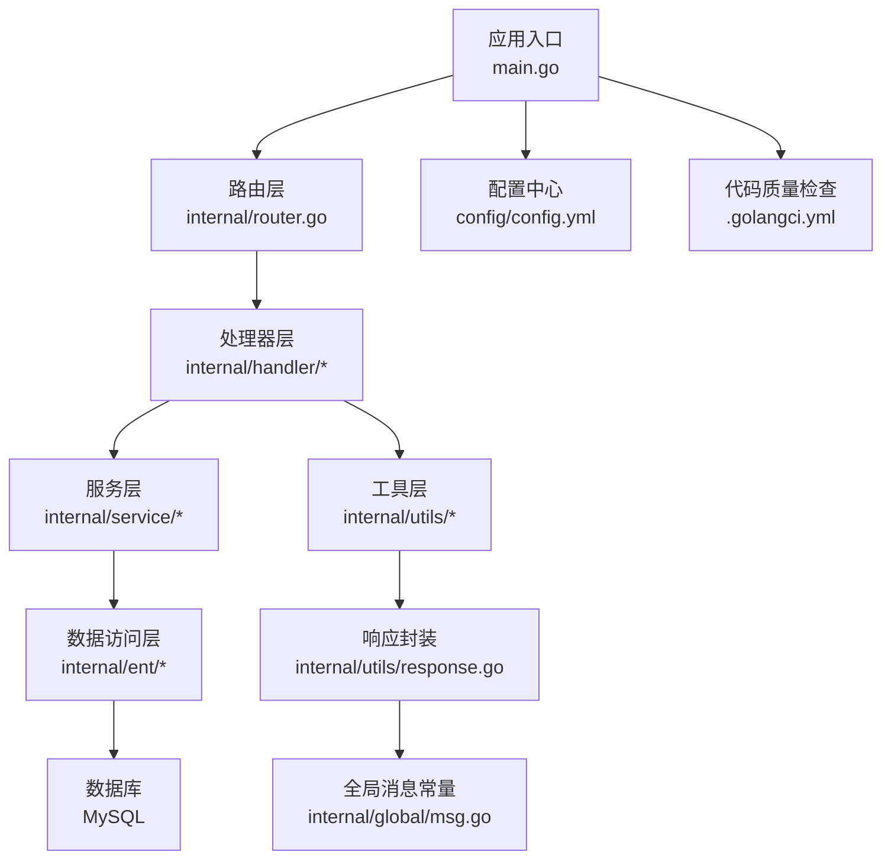
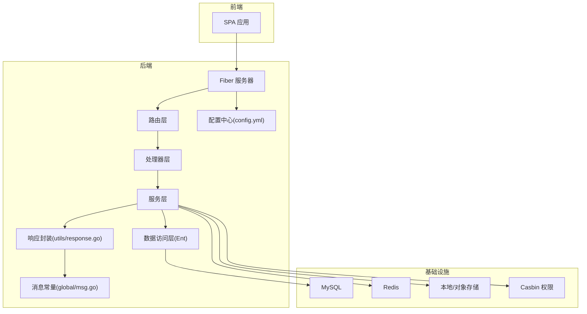
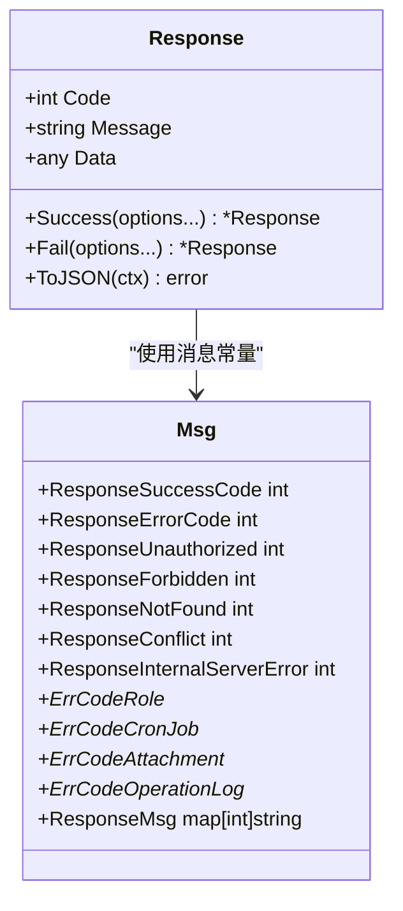
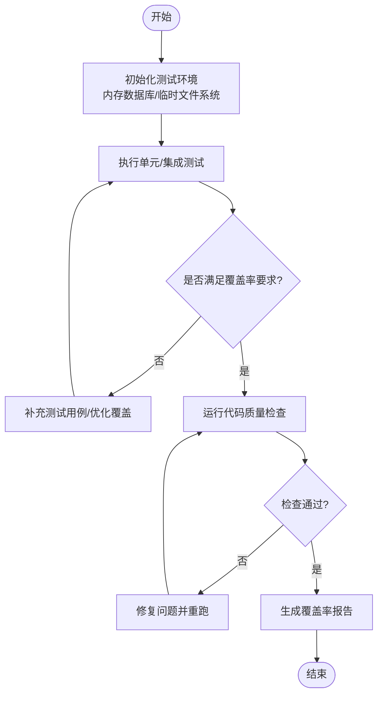
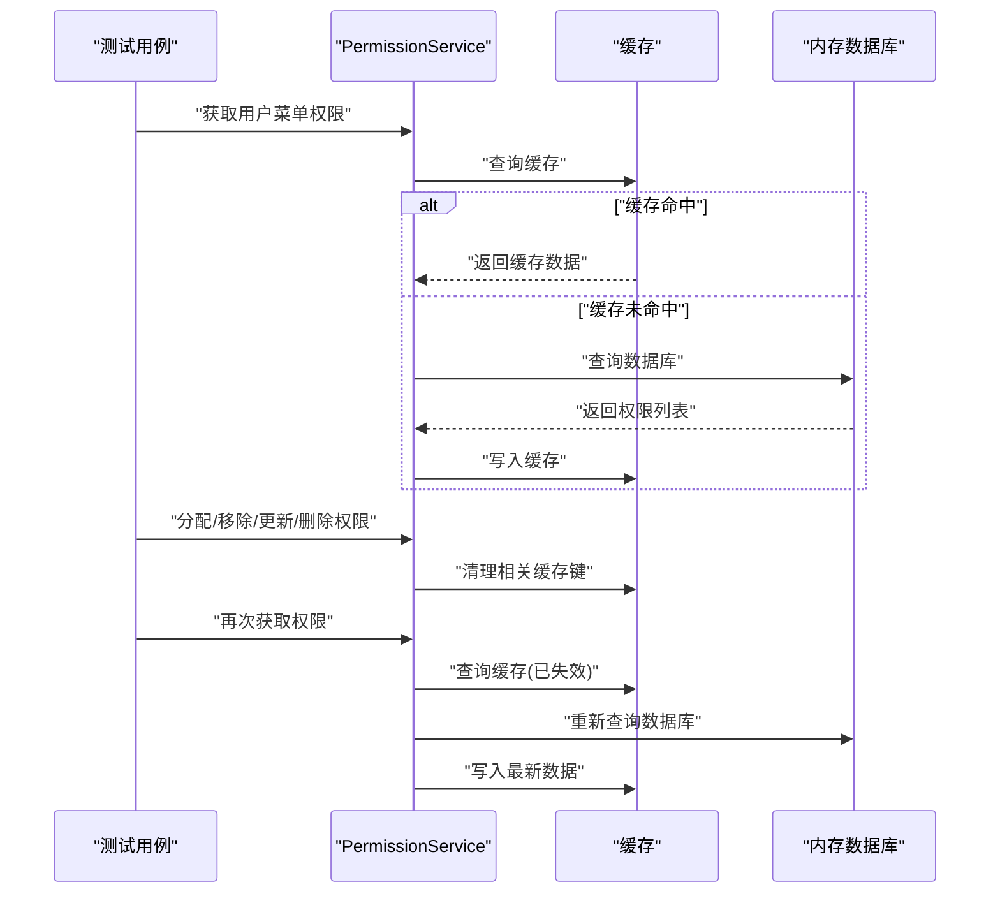
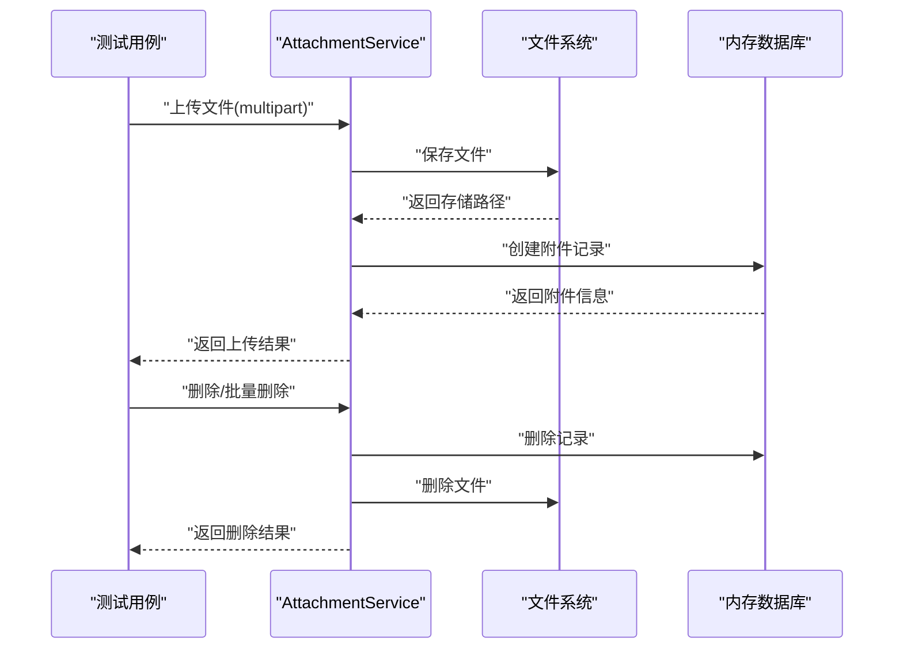
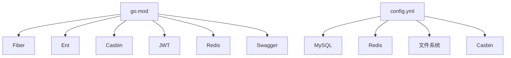

# 贡献指南

<cite>
**本文引用的文件**
- [README.md](file://README.md)
- [.golangci.yml](file://.golangci.yml)
- [go.mod](file://go.mod)
- [config.yml](file://config/config.yml)
- [msg.go](file://internal/global/msg.go)
- [response.go](file://internal/utils/response.go)
- [attachment_test.go](file://internal/service/attachment_test.go)
- [permission_test.go](file://internal/service/permission_test.go)
</cite>

## 目录
1. [简介](#简介)
2. [项目结构](#项目结构)
3. [核心贡献流程](#核心贡献流程)
4. [架构总览](#架构总览)
5. [详细组件分析](#详细组件分析)
6. [依赖关系分析](#依赖关系分析)
7. [性能与质量考量](#性能与质量考量)
8. [故障排查指南](#故障排查指南)
9. [结论](#结论)
10. [附录](#附录)

## 简介
本指南面向希望参与 Go Admin 管理系统的贡献者，覆盖从分支策略、提交信息规范到 Pull Request 流程；从代码审查要点、测试要求与覆盖率标准，到文档贡献与翻译规范；同时包含社区行为准则、沟通指南、问题报告模板与优先级划分，以及贡献者认可与长期维护者培养路径建议。目标是建立清晰、高效、可持续的开源协作环境。

## 项目结构
- 应用入口与模块
  - 应用入口位于根目录，模块定义与依赖声明见模块文件。
  - 配置集中于配置文件，涵盖应用、日志、数据库、缓存、Redis、文件系统与 Casbin 权限域等。
- 内部包组织
  - internal 下按职责分层：全局常量与消息、路由、清理、Ent ORM、处理器、服务层、工具等。
  - 测试覆盖服务层与关键业务逻辑，使用内存数据库与临时文件系统模拟真实场景。
- 文档与 API
  - 文档与 Swagger/OpenAPI 集成，便于生成与维护 API 文档。

图表来源
- [go.mod:1-127](file://go.mod#L1-L127)
- [config.yml:1-143](file://config/config.yml#L1-L143)
- [response.go:1-50](file://internal/utils/response.go#L1-L50)
- [msg.go:1-84](file://internal/global/msg.go#L1-L84)

章节来源
- [go.mod:1-127](file://go.mod#L1-L127)
- [config.yml:1-143](file://config/config.yml#L1-L143)

## 核心贡献流程
- 分支策略
  - 基于主分支创建功能/修复/文档分支，命名建议遵循“类型/主题”格式，例如 feature/xxx、fix/xxx、docs/xxx。
  - 保持分支简洁，避免在一个分支中混杂无关变更。
- 提交信息规范
  - 采用“类型(作用域): 概要”的格式，类型包括 feat、fix、docs、style、refactor、test 等。
  - 保证每条提交聚焦单一改动，便于回溯与审阅。
- PR 提交流程
  - 在本地完成编码、测试与格式化后推送分支并创建 PR。
  - PR 描述需明确变更动机、影响范围、测试情况与风险提示。
  - 关联相关 Issue 或讨论串，便于追踪闭环。
- 代码审查
  - 审查要点：正确性、可读性、健壮性、性能、安全性、可测试性与一致性。
  - 反馈处理：逐条回复并迭代修改，必要时补充测试或文档。
  - 合并条件：至少一名维护者批准，无阻塞性异议，通过 CI 与测试校验。

章节来源
- [README.md:420-448](file://README.md#L420-L448)

## 架构总览
系统采用分层架构，前后端分离，后端以 Fiber 为核心，配合 Ent ORM、Casbin 权限、JWT 认证与多存储后端（本地/对象存储）。配置中心统一管理应用、缓存、数据库、Redis 与文件系统参数。

图表来源
- [config.yml:1-143](file://config/config.yml#L1-L143)
- [response.go:1-50](file://internal/utils/response.go#L1-L50)
- [msg.go:1-84](file://internal/global/msg.go#L1-L84)

## 详细组件分析

### 响应与消息常量
- 统一响应结构体与成功/失败快捷方法，结合全局消息常量，确保接口一致性与国际化友好。
- 错误码分域管理，便于定位与扩展。

图表来源
- [response.go:1-50](file://internal/utils/response.go#L1-L50)
- [msg.go:1-84](file://internal/global/msg.go#L1-L84)

章节来源
- [response.go:1-50](file://internal/utils/response.go#L1-L50)
- [msg.go:1-84](file://internal/global/msg.go#L1-L84)

### 测试策略与覆盖率
- 单元测试
  - 使用内存数据库与临时文件系统，隔离外部依赖，提高测试稳定性与速度。
  - 通过构造器与辅助函数复用测试基线，减少重复代码。
- 集成测试
  - 覆盖服务层关键路径，验证权限缓存命中与失效、附件上传/删除/移动等场景。
- 覆盖率与报告
  - 使用标准测试命令生成覆盖率文件与 HTML 报告，持续关注热点区域缺失。
- 质量门禁
  - 通过代码质量检查工具对格式、静态分析与潜在问题进行约束。

图表来源
- [.golangci.yml:1-38](file://.golangci.yml#L1-L38)
- [attachment_test.go:1-502](file://internal/service/attachment_test.go#L1-L502)
- [permission_test.go:1-528](file://internal/service/permission_test.go#L1-L528)

章节来源
- [README.md:328-357](file://README.md#L328-L357)
- [.golangci.yml:1-38](file://.golangci.yml#L1-L38)
- [attachment_test.go:1-502](file://internal/service/attachment_test.go#L1-L502)
- [permission_test.go:1-528](file://internal/service/permission_test.go#L1-L528)

### 权限缓存与失效机制
- 用户菜单/按钮/API 权限支持缓存，关键权限变更操作会触发缓存失效，确保数据一致性。
- 测试覆盖了缓存命中、角色权限变更、单条权限 CRUD 等场景，验证缓存策略有效性。

图表来源
- [permission_test.go:114-396](file://internal/service/permission_test.go#L114-L396)

章节来源
- [permission_test.go:114-396](file://internal/service/permission_test.go#L114-L396)

### 附件管理与文件系统
- 支持附件上传、分组管理、批量删除、按关键字/分组/MIME 类型过滤、移动到分组等。
- 测试覆盖上传文件头构造、文件系统存取、分组非空删除等边界场景。

图表来源
- [attachment_test.go:280-368](file://internal/service/attachment_test.go#L280-L368)

章节来源
- [attachment_test.go:280-368](file://internal/service/attachment_test.go#L280-L368)

## 依赖关系分析
- 语言与工具链
  - Go 版本要求与模块依赖在模块文件中声明，确保构建一致性。
- 第三方组件
  - Fiber、Ent、Casbin、JWT、Redis、Swagger 等，均在模块文件中显式声明。
- 配置与运行
  - 配置文件集中管理应用、日志、数据库、缓存、Redis、文件系统与 Casbin 权限域。

图表来源
- [go.mod:1-127](file://go.mod#L1-L127)
- [config.yml:1-143](file://config/config.yml#L1-L143)

章节来源
- [go.mod:1-127](file://go.mod#L1-L127)
- [config.yml:1-143](file://config/config.yml#L1-L143)

## 性能与质量考量
- 性能
  - 通过权限缓存降低数据库压力，合理设置缓存 TTL 与失效策略。
  - 附件与文件系统操作尽量使用流式处理与最小化 IO。
- 质量
  - 使用代码质量检查工具进行格式化与静态分析，排除常见问题。
  - 保持测试覆盖率稳定增长，尤其关注高风险路径与边界条件。

章节来源
- [.golangci.yml:1-38](file://.golangci.yml#L1-L38)
- [permission_test.go:114-396](file://internal/service/permission_test.go#L114-L396)

## 故障排查指南
- 常见问题
  - 提交信息不符合规范导致 CI 失败：检查类型与作用域格式。
  - 测试失败：确认内存数据库初始化、缓存键命名与权限规则是否一致。
  - 配置错误：核对配置文件中的数据库、Redis、文件系统与 Casbin 参数。
- 定位手段
  - 查看测试输出与覆盖率报告，定位未覆盖路径。
  - 使用配置中心日志输出与文件轮转参数，定位运行时异常。

章节来源
- [README.md:328-357](file://README.md#L328-L357)
- [config.yml:11-18](file://config/config.yml#L11-L18)

## 结论
本指南提供了从分支与提交到测试与审查的完整贡献流程，并结合现有测试与配置实践，明确了质量门禁与性能优化方向。建议贡献者在提交前先阅读相关测试与配置文件，确保变更符合项目规范与最佳实践。

## 附录

### 代码审查要点清单
- 正确性：逻辑是否正确，边界条件是否覆盖。
- 可读性：命名是否清晰，注释是否充分，结构是否易懂。
- 健壮性：错误处理是否完善，异常路径是否考虑。
- 性能：是否存在不必要的 IO 或计算，缓存策略是否合理。
- 安全性：输入校验、权限控制、敏感信息处理是否到位。
- 可测试性：是否易于单元/集成测试，是否引入难以测试的耦合。
- 一致性：是否遵循项目风格与约定，是否与既有模块协同良好。

### 测试要求与覆盖率标准
- 单元测试：针对函数/方法，使用内存数据库与模拟存储。
- 集成测试：针对 API/服务端点，覆盖关键业务流程。
- 覆盖率：建议主要模块达到一定阈值，热点路径必须有测试。
- 报告：使用标准命令生成覆盖率报告并定期回顾。

章节来源
- [README.md:328-357](file://README.md#L328-L357)
- [attachment_test.go:1-502](file://internal/service/attachment_test.go#L1-L502)
- [permission_test.go:1-528](file://internal/service/permission_test.go#L1-L528)

### 文档贡献指南
- 格式：遵循现有文档风格，使用清晰标题与层级。
- 示例：提供可运行的示例与截图，避免空泛描述。
- 翻译：保持术语一致，注意中英文对照与上下文语义。

### 社区行为准则与沟通指南
- 尊重与包容：营造开放、尊重的讨论氛围。
- 明确沟通：问题描述清晰、有背景与复现步骤。
- 积极协作：及时回复审阅意见，保持迭代节奏。

### 问题报告规范
- Bug 报告：包含环境、复现步骤、期望与实际结果、日志片段。
- 功能请求：描述背景、需求与验收标准，提供参考实现或替代方案。
- 分类与优先级：按紧急程度与影响面划分，便于维护者排期。

### 贡献者认可与长期维护者培养
- 认可机制：在变更日志、致谢与社区公告中公开致谢。
- 培养路径：鼓励参与代码审查、文档撰写与问题跟踪，逐步承担模块维护责任。