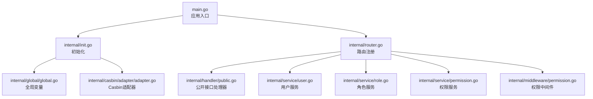
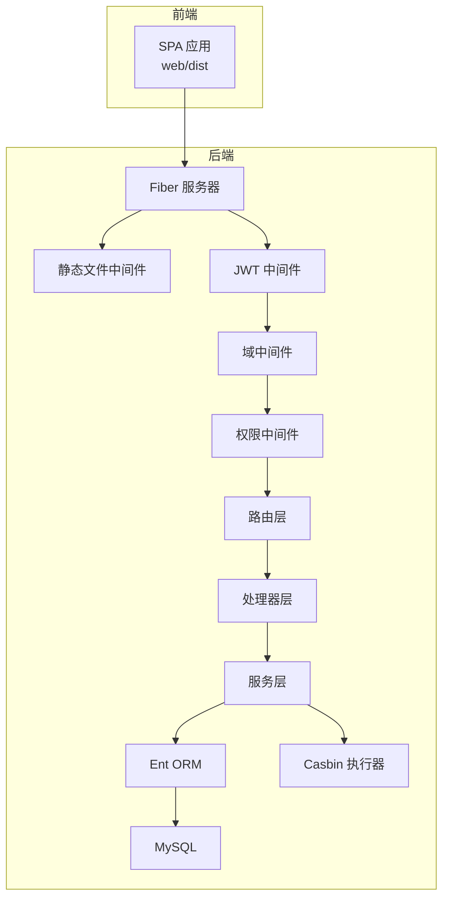
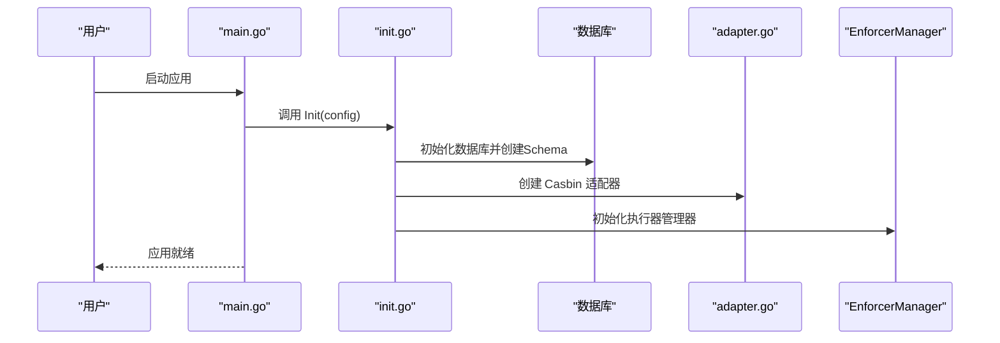
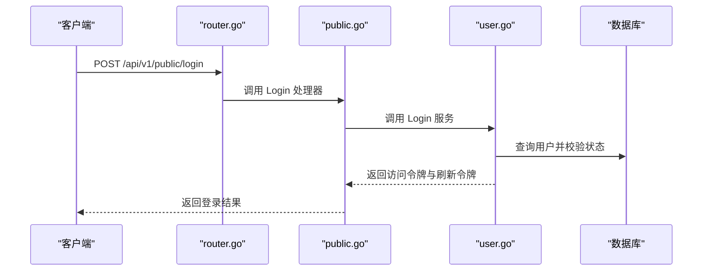
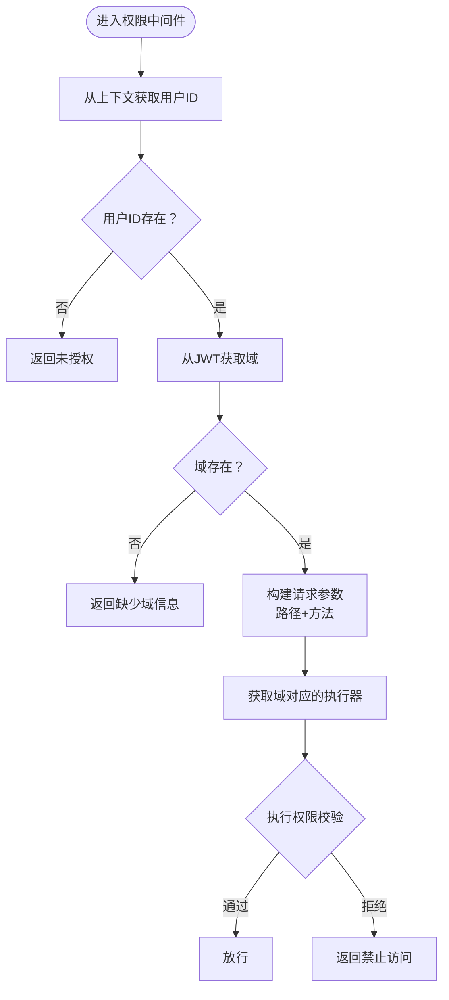
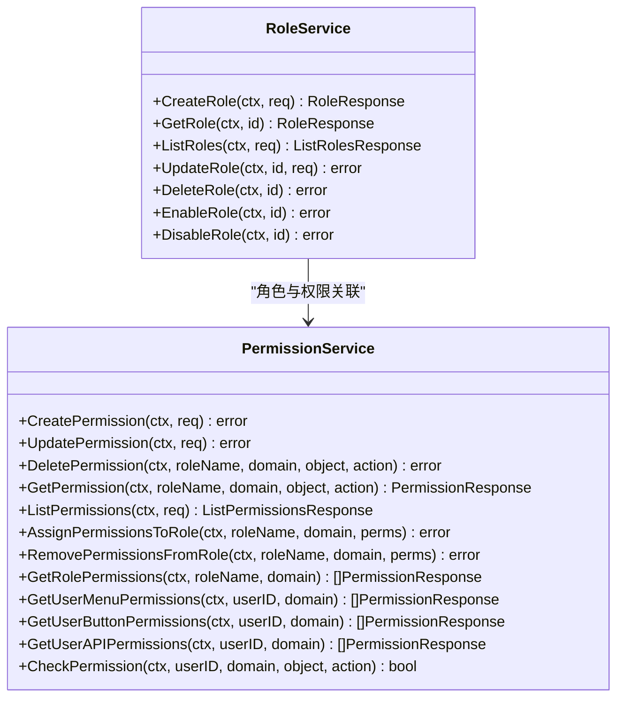
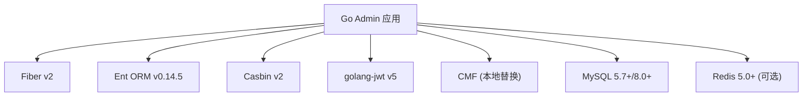

# 快速开始

<cite>
**本文引用的文件**
- [main.go](file://main.go)
- [config.yml](file://config/config.yml)
- [rbac_model.conf](file://config/rbac_model.conf)
- [go.mod](file://go.mod)
- [init.go](file://internal/init.go)
- [router.go](file://internal/router.go)
- [global.go](file://internal/global/global.go)
- [adapter.go](file://internal/casbin/adapter/adapter.go)
- [public.go](file://internal/handler/public.go)
- [user.go](file://internal/service/user.go)
- [role.go](file://internal/service/role.go)
- [permission.go](file://internal/service/permission.go)
- [permission.go](file://internal/middleware/permission.go)
- [README.md](file://README.md)
</cite>

## 目录
1. [简介](#简介)
2. [项目结构](#项目结构)
3. [核心组件](#核心组件)
4. [架构总览](#架构总览)
5. [详细组件分析](#详细组件分析)
6. [依赖关系分析](#依赖关系分析)
7. [性能注意事项](#性能注意事项)
8. [故障排除指南](#故障排除指南)
9. [结论](#结论)
10. [附录](#附录)

## 简介
本指南面向新手开发者，帮助你在约30分钟内完成 Go Admin 管理系统的安装、配置与启动，并掌握基本使用方法（登录、角色与权限管理）。系统基于 Fiber Web 框架、Ent ORM、JWT 认证与 Casbin 权限控制，提供前后端一体化的管理后台能力。

## 项目结构
项目采用分层架构与模块化组织，关键目录与职责如下：
- main.go：应用入口，负责初始化引导、中间件注册、路由注册与清理。
- config/config.yml：应用、数据库、缓存、Redis、文件系统、Casbin 等配置。
- config/rbac_model.conf：Casbin 默认模型配置文件。
- internal/：内部业务层
  - init.go：初始化数据库与 Casbin 执行器管理器。
  - router.go：路由与中间件注册，划分公开接口与受保护接口。
  - global/global.go：全局变量（ORM、Bootstrap、EnforcerManager）。
  - casbin/adapter/adapter.go：Casbin 策略适配器，基于 Ent ORM 存储策略。
  - handler/：HTTP 请求处理器（如登录、用户信息、角色与权限管理）。
  - service/：业务服务（用户、角色、权限）。
  - middleware/：中间件（JWT、权限校验、域解析）。
- go.mod：Go 模块与依赖声明。
- README.md：项目特性、技术栈、快速开始、API 文档与部署说明。

**图表来源**
- [main.go:43-89](file://main.go#L43-L89)
- [init.go:17-65](file://internal/init.go#L17-L65)
- [router.go:14-72](file://internal/router.go#L14-L72)
- [adapter.go:97-113](file://internal/casbin/adapter/adapter.go#L97-L113)
- [public.go:22-45](file://internal/handler/public.go#L22-L45)
- [user.go:127-206](file://internal/service/user.go#L127-L206)
- [role.go:94-143](file://internal/service/role.go#L94-L143)
- [permission.go:127-174](file://internal/service/permission.go#L127-L174)
- [permission.go:11-69](file://internal/middleware/permission.go#L11-L69)

**章节来源**
- [README.md:40-69](file://README.md#L40-L69)
- [main.go:43-89](file://main.go#L43-L89)
- [router.go:14-72](file://internal/router.go#L14-L72)

## 核心组件
- 应用入口与引导
  - 初始化 Bootstrap，注册初始化函数、中间件、路由与清理函数。
  - 内嵌前端静态资源，支持 SPA 路由回退至 index.html。
- 初始化流程
  - 初始化数据库：根据配置获取数据库连接，创建 Ent 客户端并执行 Schema 创建。
  - 初始化 Casbin：创建 Ent 适配器，结合全局 ORM 与配置初始化执行器管理器。
- 路由与中间件
  - 公开接口：登录、刷新令牌。
  - 受保护接口：用户信息、更新资料、改密；角色管理；权限管理；用户权限查询。
  - 中间件：JWT 认证、域解析、权限校验。
- 服务层
  - 用户服务：登录、刷新令牌、获取/更新用户信息、改密。
  - 角色服务：创建/获取/列表/更新/删除、启用/禁用角色。
  - 权限服务：创建/更新/删除/查询权限；为角色分配/移除权限；查询用户菜单/按钮/API 权限；权限校验。
- 全局与适配器
  - 全局变量保存 ORM、Bootstrap、EnforcerManager。
  - Casbin 适配器基于 Ent ORM 存储策略，支持批量写入与过滤加载。

**章节来源**
- [main.go:43-89](file://main.go#L43-L89)
- [init.go:17-65](file://internal/init.go#L17-L65)
- [router.go:14-72](file://internal/router.go#L14-L72)
- [global.go:10-14](file://internal/global/global.go#L10-L14)
- [adapter.go:97-113](file://internal/casbin/adapter/adapter.go#L97-L113)
- [user.go:127-206](file://internal/service/user.go#L127-L206)
- [role.go:94-143](file://internal/service/role.go#L94-L143)
- [permission.go:127-174](file://internal/service/permission.go#L127-L174)

## 架构总览
系统采用“前端 SPA + 后端 Fiber API + Ent ORM + Casbin 权限”的分层架构。请求从浏览器进入，经由中间件链（静态资源、JWT、域解析、权限校验），到达处理器，再由服务层调用数据访问层，最终持久化到 MySQL。

**图表来源**
- [main.go:47-76](file://main.go#L47-L76)
- [router.go:32-37](file://internal/router.go#L32-L37)
- [permission.go:11-69](file://internal/middleware/permission.go#L11-L69)
- [adapter.go:115-125](file://internal/casbin/adapter/adapter.go#L115-L125)

**章节来源**
- [README.md:231-257](file://README.md#L231-L257)

## 详细组件分析

### 组件A：启动与初始化流程
- 步骤
  1) 初始化 Bootstrap 并注册初始化函数（数据库与 Casbin）。
  2) 注册中间件：静态文件服务与 SPA 回退。
  3) 注册路由与清理函数。
  4) 运行应用。
- 关键点
  - 数据库初始化在 Casbin 之前，确保策略表可用。
  - Casbin 适配器通过全局 ORM 初始化，策略存储于数据库。

**图表来源**
- [main.go:43-89](file://main.go#L43-L89)
- [init.go:17-65](file://internal/init.go#L17-L65)
- [adapter.go:97-113](file://internal/casbin/adapter/adapter.go#L97-L113)

**章节来源**
- [main.go:43-89](file://main.go#L43-L89)
- [init.go:17-65](file://internal/init.go#L17-L65)

### 组件B：用户登录与认证流程
- 步骤
  1) 调用公开接口 POST /api/v1/public/login。
  2) 服务层验证用户邮箱与密码，校验状态。
  3) 生成访问令牌与刷新令牌（JWT），设置过期时间。
  4) 更新用户最后登录时间与IP。
- 关键点
  - JWT 密钥来自配置文件，过期时间可配置。
  - 登录成功后，后续受保护接口需携带 Bearer Token。

**图表来源**
- [router.go:28](file://internal/router.go#L28)
- [public.go:22-45](file://internal/handler/public.go#L22-L45)
- [user.go:127-206](file://internal/service/user.go#L127-L206)

**章节来源**
- [public.go:22-45](file://internal/handler/public.go#L22-L45)
- [user.go:127-206](file://internal/service/user.go#L127-L206)

### 组件C：权限中间件与权限校验
- 步骤
  1) JWT 中间件解析用户信息。
  2) 域中间件从 JWT 中提取域并注入上下文。
  3) 权限中间件获取当前用户ID、域、请求路径与方法。
  4) 通过 EnforcerManager 获取对应域的执行器，执行 Enforce 校验。
- 关键点
  - Casbin 执行器按域隔离，支持多域配置。
  - 校验失败返回 403。

**图表来源**
- [permission.go:11-69](file://internal/middleware/permission.go#L11-L69)
- [adapter.go:115-125](file://internal/casbin/adapter/adapter.go#L115-L125)

**章节来源**
- [permission.go:11-69](file://internal/middleware/permission.go#L11-L69)

### 组件D：角色与权限管理
- 角色管理
  - 创建角色：校验名称唯一性与长度，设置状态为启用。
  - 获取/列表：支持关键词与状态筛选。
  - 更新角色：系统内置角色限制修改范围。
  - 删除角色：检查是否被使用，系统内置角色不可删。
  - 启用/禁用：状态变更校验。
- 权限管理
  - 创建/更新/删除/查询权限：基于 Casbin 规则表。
  - 为角色分配/移除权限：批量写入或删除。
  - 查询用户权限：菜单、按钮、API 三类权限分别查询。
  - 权限校验：根据用户角色集合与请求参数进行匹配。

**图表来源**
- [role.go:25-396](file://internal/service/role.go#L25-L396)
- [permission.go:92-671](file://internal/service/permission.go#L92-L671)

**章节来源**
- [role.go:94-143](file://internal/service/role.go#L94-L143)
- [permission.go:127-174](file://internal/service/permission.go#L127-L174)

## 依赖关系分析
- 运行时依赖
  - Go 1.25.1+
  - MySQL 5.7+/8.0+
  - Redis 5.0+（可选，用于缓存）
- 框架与库
  - Fiber v2：高性能 Web 框架
  - Ent v0.14.5：类型安全 ORM
  - Casbin v2：RBAC 权限控制
  - golang-jwt v5：JWT 认证
  - CMF：自定义基础框架（替换为本地路径）

**图表来源**
- [go.mod:3](file://go.mod#L3)
- [README.md:25-31](file://README.md#L25-L31)

**章节来源**
- [go.mod:3-13](file://go.mod#L3-L13)
- [README.md:73-77](file://README.md#L73-L77)

## 性能注意事项
- Casbin 策略批量写入：适配器在保存策略时采用批量插入，减少多次往返。
- 策略过滤加载：支持按条件过滤加载策略，降低内存占用与初始化时间。
- 缓存配置：可配置内存缓存或 Redis 缓存，建议在高并发场景启用 Redis。
- 数据库连接：合理设置连接池大小与超时，避免阻塞。

**章节来源**
- [adapter.go:178-214](file://internal/casbin/adapter/adapter.go#L178-L214)
- [adapter.go:127-170](file://internal/casbin/adapter/adapter.go#L127-L170)
- [config.yml:32-58](file://config/config.yml#L32-L58)

## 故障排除指南
- 启动报错：找不到数据库驱动
  - 确认导入了 MySQL 驱动并在配置中使用 mysql 驱动。
  - 参考：[main.go:15](file://main.go#L15)
- 数据库连接失败
  - 检查 config.yml 中的 host、port、user、password、name。
  - 参考：[config.yml:19-31](file://config/config.yml#L19-L31)
- 初始化失败：Schema 创建失败
  - 确认数据库存在且具备创建表权限。
  - 参考：[init.go:42-46](file://internal/init.go#L42-L46)
- 登录失败：用户不存在或密码错误
  - 检查用户邮箱与密码是否正确，确认用户状态为激活。
  - 参考：[user.go:127-206](file://internal/service/user.go#L127-L206)
- 权限不足：403 禁止访问
  - 确认用户角色已分配相应权限，且域一致。
  - 参考：[permission.go:11-69](file://internal/middleware/permission.go#L11-L69)
- JWT 密钥错误
  - 修改配置中的 app.secret 为强随机字符串，重启应用。
  - 参考：[config.yml:1-9](file://config/config.yml#L1-L9)
- Redis 连接异常
  - 检查 config.yml 中的 redis 连接参数（addr、password、db 等）。
  - 参考：[config.yml:42-58](file://config/config.yml#L42-L58)

**章节来源**
- [main.go:15](file://main.go#L15)
- [config.yml:19-31](file://config/config.yml#L19-L31)
- [init.go:42-46](file://internal/init.go#L42-L46)
- [user.go:127-206](file://internal/service/user.go#L127-L206)
- [permission.go:11-69](file://internal/middleware/permission.go#L11-L69)
- [config.yml:1-9](file://config/config.yml#L1-L9)
- [config.yml:42-58](file://config/config.yml#L42-L58)

## 结论
通过本指南，你可以在约 30 分钟内完成 Go Admin 的安装、配置与启动，并掌握登录、角色与权限管理的基本操作。建议在生产环境中：
- 修改默认 JWT 密钥与数据库凭据；
- 启用 Redis 缓存；
- 配置多域 Casbin 模型以满足复杂权限需求；
- 使用 Nginx 反向代理与 systemd 管理服务。

## 附录

### 快速开始清单
- 环境要求
  - Go 1.25.1+
  - MySQL 5.7+/8.0+
  - Redis 5.0+（可选）
- 安装步骤
  1) 克隆项目并进入目录。
  2) 下载依赖：go mod download。
  3) 准备数据库：创建数据库并设置字符集。
  4) 编辑配置：修改数据库连接、JWT 密钥、Redis 等。
  5) 构建并运行：go build -o go-admin main.go && ./go-admin。
  6) 访问应用：前端 http://localhost:9501，API http://localhost:9501/api/v1。
- 基本使用
  - 登录：POST /api/v1/public/login
  - 获取用户信息：GET /api/v1/admin/auth/user（携带 Bearer Token）
  - 创建角色：POST /api/v1/admin/auth/roles
  - 分配权限：POST /api/v1/admin/auth/roles/permissions/assign
  - 获取用户权限：GET /api/v1/admin/auth/user/menu-permissions 等

**章节来源**
- [README.md:71-125](file://README.md#L71-L125)
- [router.go:28](file://internal/router.go#L28)
- [router.go:38-71](file://internal/router.go#L38-L71)