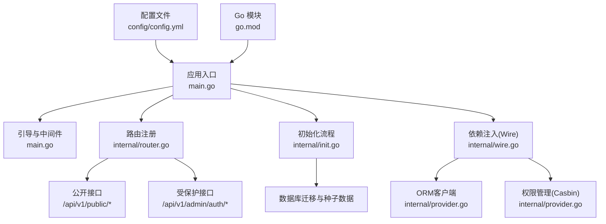
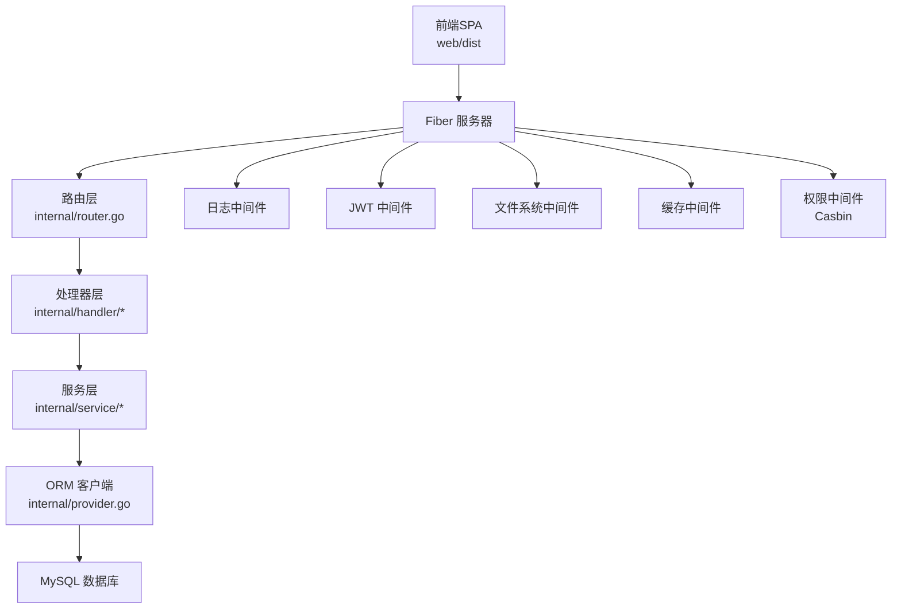
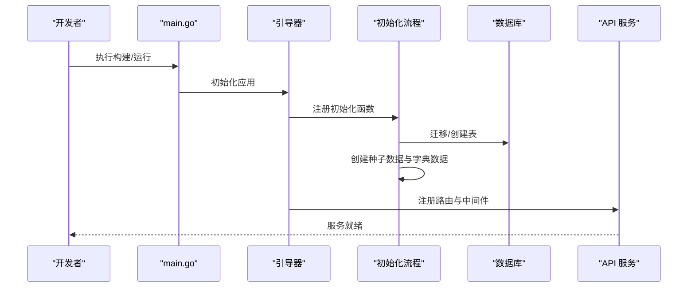
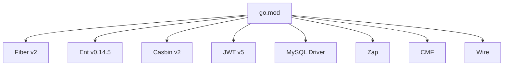

# 快速开始

<cite>
**本文引用的文件**
- [README.md](file://README.md)
- [main.go](file://main.go)
- [go.mod](file://go.mod)
- [config/config.yml](file://config/config.yml)
- [internal/init.go](file://internal/init.go)
- [internal/provider.go](file://internal/provider.go)
- [internal/router.go](file://internal/router.go)
- [internal/wire.go](file://internal/wire.go)
- [.golangci.yml](file://.golangci.yml)
</cite>

## 目录
1. [简介](#简介)
2. [项目结构](#项目结构)
3. [核心组件](#核心组件)
4. [架构总览](#架构总览)
5. [详细组件分析](#详细组件分析)
6. [依赖分析](#依赖分析)
7. [性能考虑](#性能考虑)
8. [故障排除指南](#故障排除指南)
9. [结论](#结论)
10. [附录](#附录)

## 简介
本指南面向新开发者，帮助你在最短时间内完成 Go Admin 管理系统的环境搭建与首次运行。你将学到：
- 环境要求与工具安装（Go、MySQL、Redis）
- 项目克隆、依赖安装与数据库准备
- 配置文件设置与启动运行流程
- 首次运行验证步骤与常见问题排查

## 项目结构
Go Admin 采用分层架构与模块化组织，核心入口为应用主程序，配置集中在 YAML 文件中，业务逻辑按领域拆分至 internal 包。

**图表来源**
- [main.go:47-107](file://main.go#L47-L107)
- [internal/router.go:16-189](file://internal/router.go#L16-L189)
- [internal/init.go:39-96](file://internal/init.go#L39-L96)
- [internal/provider.go:17-46](file://internal/provider.go#L17-L46)
- [internal/wire.go:22-37](file://internal/wire.go#L22-L37)
- [config/config.yml:1-143](file://config/config.yml#L1-L143)
- [go.mod:1-128](file://go.mod#L1-L128)

**章节来源**
- [README.md:40-69](file://README.md#L40-L69)
- [main.go:47-107](file://main.go#L47-L107)
- [internal/router.go:16-189](file://internal/router.go#L16-L189)
- [internal/init.go:39-96](file://internal/init.go#L39-L96)
- [internal/provider.go:17-46](file://internal/provider.go#L17-L46)
- [internal/wire.go:22-37](file://internal/wire.go#L22-L37)
- [config/config.yml:1-143](file://config/config.yml#L1-L143)
- [go.mod:1-128](file://go.mod#L1-L128)

## 核心组件
- 应用入口与引导
  - 应用通过引导器注册初始化函数、中间件、路由与清理函数，随后启动 Fiber 服务。
  - 内嵌前端静态资源并通过文件系统中间件提供 SPA 路由回退。
- 依赖注入（Wire）
  - 使用 Google Wire 进行依赖注入，统一提供配置、日志、ORM、缓存、文件系统、Casbin 等组件。
- 初始化流程
  - 初始化数据库（含迁移）、Casbin 权限管理、定时任务、密钥与随机数存储、种子数据与字典数据。
- 路由体系
  - 公共接口（无需鉴权）与受保护接口（JWT + 权限中间件）清晰分离；提供用户、角色、权限、附件、定时任务、操作日志、数据字典、动态配置等管理接口。

**章节来源**
- [main.go:47-107](file://main.go#L47-L107)
- [internal/wire.go:22-37](file://internal/wire.go#L22-L37)
- [internal/init.go:39-96](file://internal/init.go#L39-L96)
- [internal/router.go:16-189](file://internal/router.go#L16-L189)

## 架构总览
下图展示了从前端到数据库的整体调用链路与关键组件协作关系。

**图表来源**
- [main.go:62-94](file://main.go#L62-L94)
- [internal/router.go:16-189](file://internal/router.go#L16-L189)
- [internal/provider.go:17-46](file://internal/provider.go#L17-L46)

**章节来源**
- [main.go:62-94](file://main.go#L62-L94)
- [internal/router.go:16-189](file://internal/router.go#L16-L189)
- [internal/provider.go:17-46](file://internal/provider.go#L17-L46)

## 详细组件分析

### 环境与工具准备
- Go 版本要求
  - 项目要求 Go 1.25.1 或更高版本。
- 必备工具
  - MySQL 5.7+ / 8.0+（主数据库）
  - Redis 5.0+（可选，用于缓存）
- 可选开发工具
  - 代码格式化与静态检查：gofmt、golint、govet
  - Ent 工具：用于生成实体代码
  - 热重载工具：air（可选）

**章节来源**
- [README.md:73-78](file://README.md#L73-L78)
- [README.md:287-304](file://README.md#L287-L304)
- [go.mod:3](file://go.mod#L3)
- [.golangci.yml:14-27](file://.golangci.yml#L14-L27)

### 项目克隆与依赖安装
- 克隆仓库
  - 使用 Git 克隆项目到本地目录。
- 安装依赖
  - 使用 Go Modules 下载依赖。

**章节来源**
- [README.md:81-90](file://README.md#L81-L90)

### 数据库准备
- 创建数据库
  - 建议使用 UTF8MB4 字符集与排序规则，便于支持多语言与表情符号。
- 表前缀
  - 配置文件中包含表前缀设置，可在初始化阶段生效。

**章节来源**
- [README.md:92-95](file://README.md#L92-L95)
- [config/config.yml:30](file://config/config.yml#L30)

### 配置文件设置
- 应用配置
  - 端口、调试模式、JWT 密钥、登录过期时间等。
- 数据库配置
  - 驱动、主机、端口、用户名、密码、数据库名、是否启用 SSL、表前缀等。
- 缓存与 Redis
  - 内存缓存与 Redis 连接参数（地址、认证、DB、超时、连接池等）。
- 文件系统
  - 本地磁盘与 S3 兼容对象存储配置。
- Casbin 权限模型
  - 默认域与模型配置，支持多域与自动加载策略。

**章节来源**
- [README.md:189-229](file://README.md#L189-L229)
- [config/config.yml:1-143](file://config/config.yml#L1-L143)

### 启动运行流程
- 构建与运行
  - 构建二进制文件并启动服务。
- 首次启动初始化
  - 初始化数据库（迁移 schema）、Casbin 权限管理、定时任务、密钥与随机数存储、种子数据与字典数据。
- 路由与中间件
  - 注册公开与受保护接口，启用 JWT、权限、日志、文件系统与缓存中间件。

**图表来源**
- [main.go:47-107](file://main.go#L47-L107)
- [internal/init.go:39-96](file://internal/init.go#L39-L96)

**章节来源**
- [README.md:113-120](file://README.md#L113-L120)
- [main.go:47-107](file://main.go#L47-L107)
- [internal/init.go:39-96](file://internal/init.go#L39-L96)

### 首次运行验证
- 访问地址
  - 前端界面：http://localhost:9501
  - API 接口：http://localhost:9501/api/v1
- 登录接口
  - 公开接口：POST /api/v1/public/login
  - 成功后返回包含访问令牌与过期时间的响应。
- 受保护接口
  - 需要在请求头携带 Bearer 令牌访问 /api/v1/admin/auth/* 路径下的接口。

**章节来源**
- [README.md:122-125](file://README.md#L122-L125)
- [README.md:128-187](file://README.md#L128-L187)
- [internal/router.go:49-70](file://internal/router.go#L49-L70)

## 依赖分析
- 运行时依赖
  - Fiber Web 框架、Ent ORM、Casbin 权限框架、JWT、MySQL/SQLite 驱动、Zap 日志、CMF 基础框架等。
- 构建与开发依赖
  - Wire 依赖注入、golangci-lint、ent 工具等。
- 替换路径
  - 项目通过 replace 指向本地 CMF 与 Ent 源码，便于二次开发与调试。

**图表来源**
- [go.mod:5-19](file://go.mod#L5-L19)
- [go.mod:126-128](file://go.mod#L126-L128)

**章节来源**
- [go.mod:1-128](file://go.mod#L1-L128)

## 性能考虑
- 中间件与路由
  - 合理使用日志、JWT、权限与文件系统中间件，避免不必要的处理开销。
- 缓存策略
  - 在高并发场景下启用 Redis 缓存，减少数据库压力。
- 数据库连接
  - 合理配置连接池大小与超时参数，避免连接争用。
- 日志轮转
  - 启用文件轮转，避免日志文件过大影响性能。

[本节为通用建议，不直接分析具体文件]

## 故障排除指南
- 端口占用
  - 若端口 9501 被占用，请在配置文件中修改端口后重启服务。
- 数据库连接失败
  - 检查数据库主机、端口、用户名、密码与数据库名是否正确；确认数据库服务已启动且网络可达。
- 权限不足
  - 初次启动会创建超级管理员账户与权限规则；若权限异常，请确认初始化流程是否成功执行。
- JWT 密钥不一致
  - 生产环境务必修改 JWT 密钥，避免令牌无法解析或被篡改。
- 前端无法访问
  - 确认内嵌静态资源路径与文件系统中间件配置正确；检查 /web/dist 目录是否存在。
- 日志查看
  - 查看应用日志文件与系统服务日志，定位错误原因。

**章节来源**
- [config/config.yml:1-18](file://config/config.yml#L1-L18)
- [README.md:396-403](file://README.md#L396-L403)
- [internal/init.go:134-310](file://internal/init.go#L134-L310)

## 结论
通过本指南，你可以快速完成 Go Admin 的环境搭建、配置与启动，并理解其核心组件与运行流程。建议在开发环境中先完成本地验证，再逐步迁移到生产环境并完善监控与运维策略。

[本节为总结性内容，不直接分析具体文件]

## 附录

### 常用命令清单
- 克隆与进入项目
  - git clone <repository-url> go-admin
  - cd go-admin
- 安装依赖
  - go mod download
- 构建与运行
  - go build -o go-admin main.go
  - ./go-admin
- 开发模式运行
  - go run main.go
- 代码质量检查
  - golangci-lint run
- 生成实体代码（如需新增模型）
  - go run entgo.io/ent/cmd/ent new <SchemaName>
- 运行测试
  - go test ./...

**章节来源**
- [README.md:81-90](file://README.md#L81-L90)
- [README.md:113-120](file://README.md#L113-L120)
- [README.md:287-304](file://README.md#L287-L304)
- [README.md:328-350](file://README.md#L328-L350)
- [README.md:378-386](file://README.md#L378-L386)