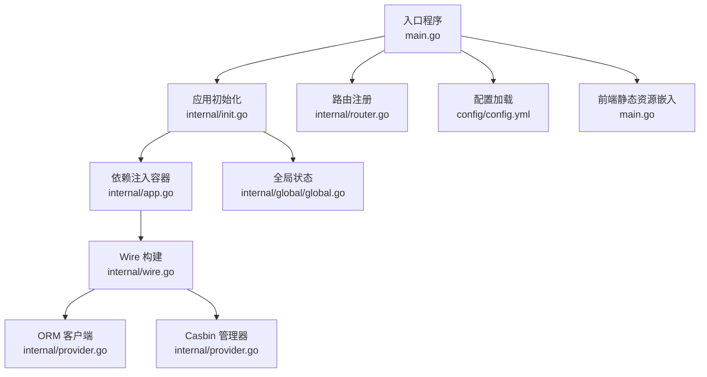
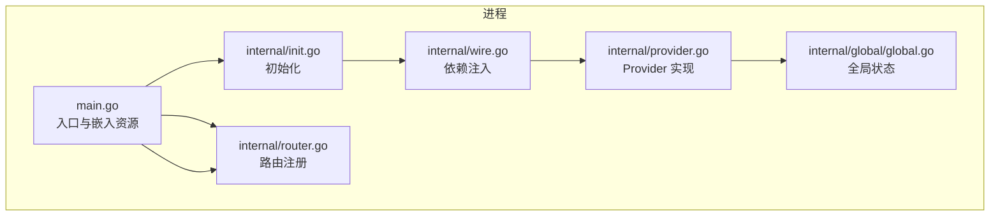
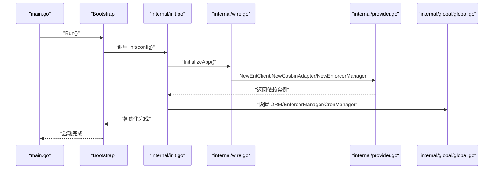
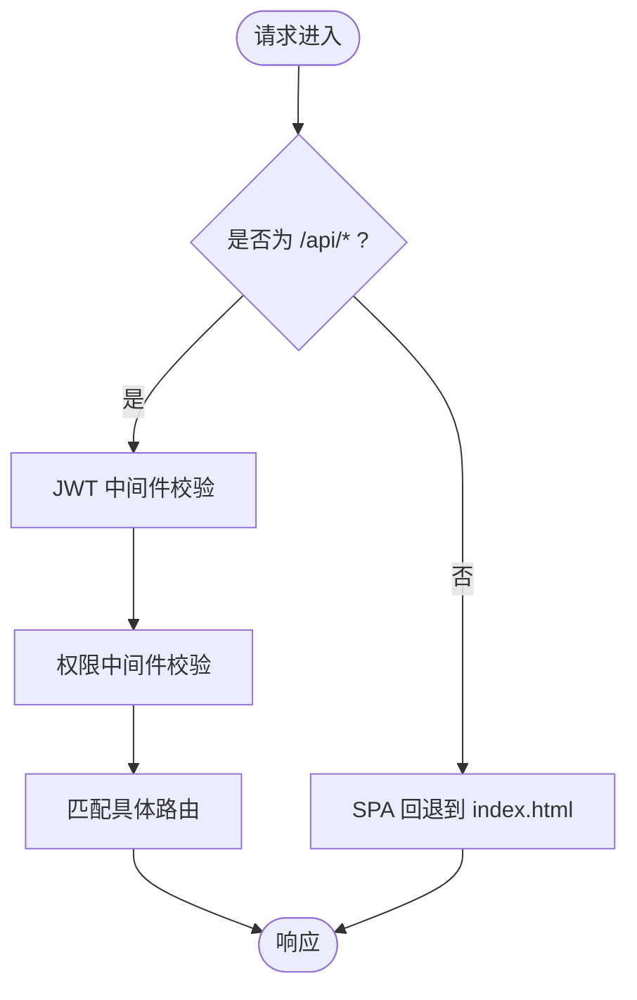
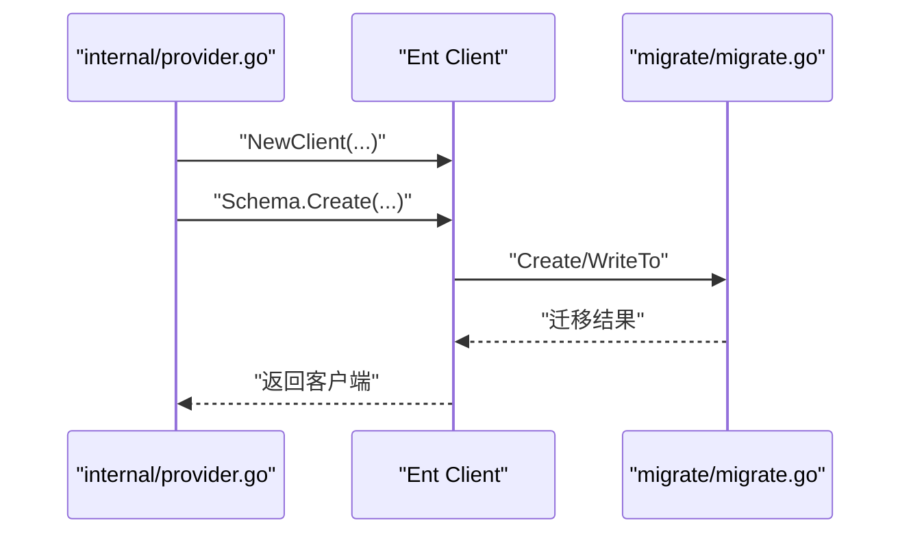
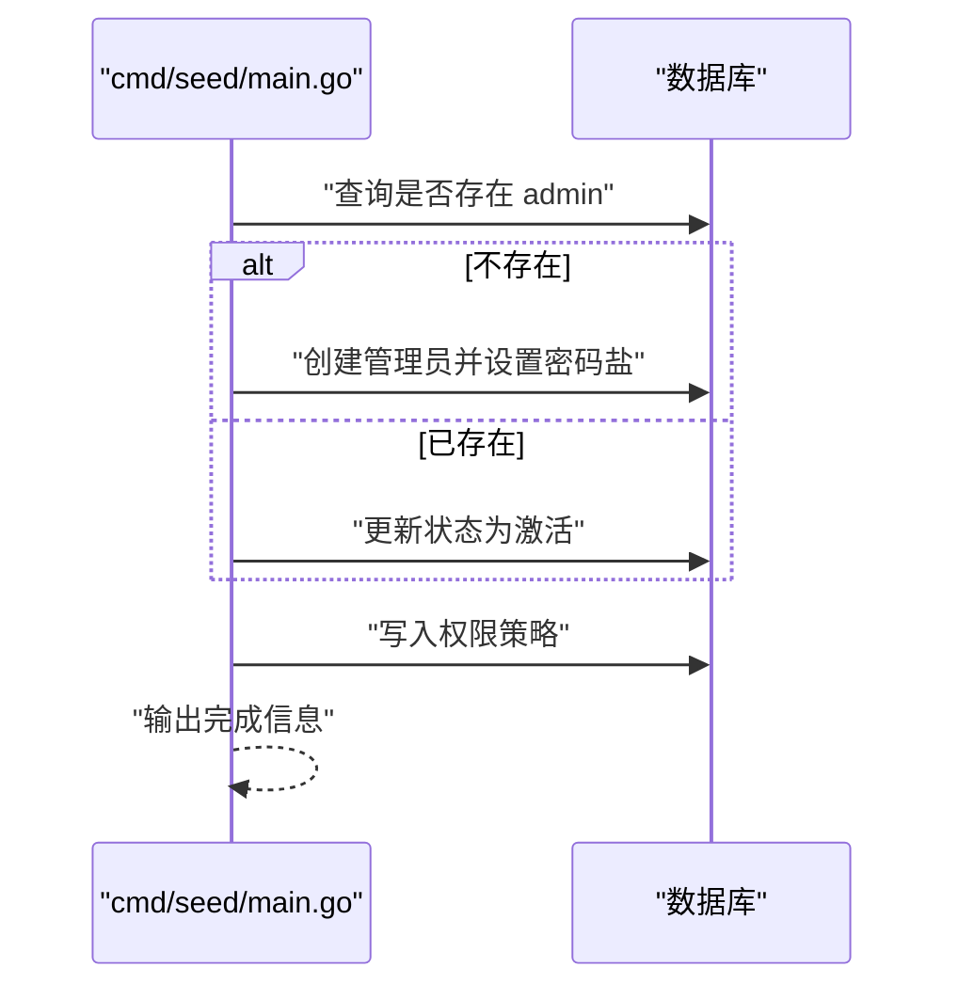
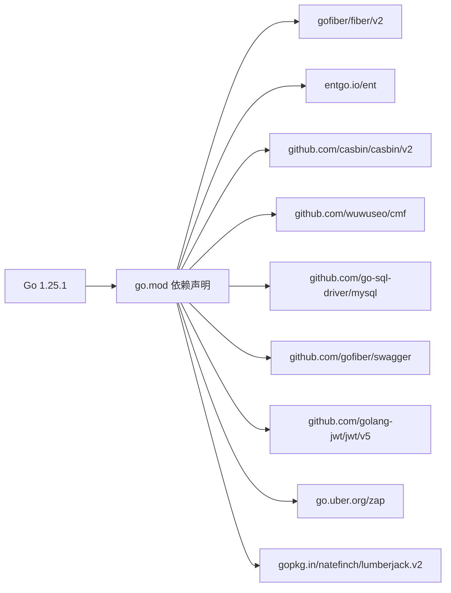

# 快速开始

<cite>
**本文引用的文件**
- [main.go](file://main.go)
- [config.yml](file://config/config.yml)
- [go.mod](file://go.mod)
- [app.go](file://internal/app.go)
- [init.go](file://internal/init.go)
- [provider.go](file://internal/provider.go)
- [wire.go](file://internal/wire.go)
- [router.go](file://internal/router.go)
- [global.go](file://internal/global/global.go)
- [.golangci.yml](file://.golangci.yml)
- [migrate.go](file://internal/ent/migrate/migrate.go)
- [enttest.go](file://internal/ent/enttest/enttest.go)
- [main.go(seed)](file://cmd/seed/main.go)
</cite>

## 目录
1. [简介](#简介)
2. [项目结构](#项目结构)
3. [核心组件](#核心组件)
4. [架构总览](#架构总览)
5. [详细组件分析](#详细组件分析)
6. [依赖分析](#依赖分析)
7. [性能考虑](#性能考虑)
8. [故障排查指南](#故障排查指南)
9. [结论](#结论)
10. [附录](#附录)

## 简介
本指南面向首次接触 Go Admin 管理系统的用户，帮助你在最短时间内完成环境准备、数据库与配置、编译运行、首次登录与基础功能验证，并提供 Docker 部署思路与开发调试技巧。系统基于 Fiber 框架、Ent ORM、Casbin 权限引擎与 CMF 基础设施，提供认证授权、定时任务、文件存储、操作日志等能力。

## 项目结构
- 入口程序位于根目录，负责初始化应用、注册中间件与路由、嵌入前端静态资源。
- 配置文件集中于 config/config.yml，涵盖应用、日志、数据库、缓存、Redis、文件系统、Casbin 等。
- 内部模块 internal 提供依赖注入、初始化流程、路由注册、全局状态等。
- 数据层使用 Ent ORM，自动迁移表结构。
- 提供一个种子脚本 cmd/seed/main.go，用于创建管理员账户并预置权限策略。

**图表来源**
- [main.go:47-104](file://main.go#L47-L104)
- [init.go:31-67](file://internal/init.go#L31-L67)
- [router.go:16-150](file://internal/router.go#L16-L150)
- [app.go:15-26](file://internal/app.go#L15-L26)
- [provider.go:17-44](file://internal/provider.go#L17-L44)
- [wire.go:22-37](file://internal/wire.go#L22-L37)
- [global.go:11-17](file://internal/global/global.go#L11-L17)

**章节来源**
- [main.go:1-105](file://main.go#L1-L105)
- [config.yml:1-143](file://config/config.yml#L1-L143)
- [go.mod:1-127](file://go.mod#L1-L127)

## 核心组件
- 应用依赖容器 App：聚合配置、日志、数据库、校验器、缓存、Ent 客户端、Casbin 管理器、文件系统等。
- 初始化流程 Init：优先使用 Wire 注入的依赖；否则手动初始化数据库与 Casbin；启动定时任务。
- 路由注册 RegisterRoute：按 API 版本与鉴权中间件组织路由，覆盖用户、角色、权限、定时任务、附件、操作日志等。
- 前端静态资源：通过 embed 嵌入 web/dist，支持 SPA 路由回退到 index.html。
- 种子脚本：创建管理员账户并写入初始权限策略，便于首次登录与功能验证。

**章节来源**
- [app.go:15-26](file://internal/app.go#L15-L26)
- [init.go:31-101](file://internal/init.go#L31-L101)
- [router.go:16-150](file://internal/router.go#L16-L150)
- [main.go:44-91](file://main.go#L44-L91)
- [main.go(seed):19-115](file://cmd/seed/main.go#L19-L115)

## 架构总览
系统采用“入口程序 + Bootstrap + Wire 依赖注入 + 中间件 + 路由”的分层架构。前端静态资源与后端 API 共享同一进程，通过中间件实现 SPA 回退与 API 认证授权。

**图表来源**
- [main.go:47-104](file://main.go#L47-L104)
- [init.go:31-67](file://internal/init.go#L31-L67)
- [wire.go:22-37](file://internal/wire.go#L22-L37)
- [provider.go:17-44](file://internal/provider.go#L17-L44)
- [global.go:11-17](file://internal/global/global.go#L11-L17)

## 详细组件分析

### 依赖注入与初始化流程
- Wire 构建：通过 internal/wire.go 组装配置、日志、ORM、校验器、缓存、文件系统、Ent 客户端、Casbin 适配器与管理器。
- 初始化：internal/init.go 在启动阶段根据是否注入了 EntClient 与 EnforcerManager 决定使用注入实例或手动初始化；随后启动定时任务管理器。

**图表来源**
- [main.go:59-104](file://main.go#L59-L104)
- [init.go:31-67](file://internal/init.go#L31-L67)
- [wire.go:22-37](file://internal/wire.go#L22-L37)
- [provider.go:17-44](file://internal/provider.go#L17-L44)
- [global.go:11-17](file://internal/global/global.go#L11-L17)

**章节来源**
- [wire.go:22-37](file://internal/wire.go#L22-L37)
- [provider.go:17-44](file://internal/provider.go#L17-L44)
- [init.go:31-67](file://internal/init.go#L31-L67)

### 路由与权限控制
- 路由分组：/api/v1/admin 下的公开接口与认证接口分离；认证接口通过 JWT 中间件与权限中间件保护。
- 权限模型：Casbin EnforcerManager 管理多域模型，默认域为 default，支持内联模型文本或外部模型文件。
- 文件上传：附件上传与移动接口，结合文件系统驱动（本地/云存储）。

**图表来源**
- [router.go:16-150](file://internal/router.go#L16-L150)
- [config.yml:77-143](file://config/config.yml#L77-L143)

**章节来源**
- [router.go:16-150](file://internal/router.go#L16-L150)
- [config.yml:77-143](file://config/config.yml#L77-L143)

### 数据库与自动迁移
- ORM 客户端：通过 provider 创建 Ent 客户端，并在创建时执行迁移（含丢弃列与索引选项）。
- 迁移工具：Ent 提供迁移 API，支持写入变更脚本或直接执行迁移。
- 测试迁移：enttest 工具在测试中自动执行迁移。

**图表来源**
- [provider.go:17-44](file://internal/provider.go#L17-L44)
- [migrate.go:35-64](file://internal/ent/migrate/migrate.go#L35-L64)

**章节来源**
- [provider.go:17-44](file://internal/provider.go#L17-L44)
- [migrate.go:35-64](file://internal/ent/migrate/migrate.go#L35-L64)
- [enttest.go:68-85](file://internal/ent/enttest/enttest.go#L68-L85)

### 首次运行与功能验证
- 创建管理员账户：运行种子脚本，若不存在则创建 admin@example.com 并激活；同时写入一组常用 API 权限策略。
- 登录与验证：使用公开登录接口获取令牌，随后在需要鉴权的接口中携带 Bearer Token 进行访问。

**图表来源**
- [main.go(seed):19-115](file://cmd/seed/main.go#L19-L115)

**章节来源**
- [main.go(seed):19-115](file://cmd/seed/main.go#L19-L115)

## 依赖分析
- 运行时依赖：Fiber、Ent、Casbin、CMF 基础设施、MySQL 驱动、Swagger 文档、JWT、Zap 日志、Lumberjack 日志轮转等。
- 开发工具：golangci-lint 配置，跳过生成代码与测试文件的检查。
- 版本要求：Go 1.25.1。

**图表来源**
- [go.mod:1-127](file://go.mod#L1-L127)

**章节来源**
- [go.mod:1-127](file://go.mod#L1-L127)
- [.golangci.yml:1-38](file://.golangci.yml#L1-L38)

## 性能考虑
- 缓存：配置中提供内存与 Redis 两种缓存驱动，建议在高并发场景启用 Redis。
- 日志：开启文件输出与控制日志轮转参数，避免磁盘占用过大。
- 数据库：合理设置连接池大小与超时，避免长事务与阻塞。
- 前端静态资源：嵌入式资源减少一次文件系统 IO，适合单体部署。

[本节为通用指导，无需引用具体文件]

## 故障排查指南
- 无法连接数据库
  - 检查 config.yml 中的数据库连接参数（主机、端口、用户名、密码、库名）。
  - 确认数据库服务已启动且网络可达。
- 启动时报错“failed creating schema resources”
  - 查看日志定位迁移失败原因，确认数据库权限与字符集设置。
- 登录失败或权限不足
  - 使用种子脚本创建管理员并写入策略，或检查 Casbin 策略是否正确导入。
  - 确认 JWT 密钥与登录过期时间配置一致。
- 前端页面 404 或空白
  - 确认已构建前端产物并放置于 web/dist，main.go 中已嵌入该目录。
- 开发调试
  - 使用 golangci-lint 检查代码风格与潜在问题。
  - 通过日志中间件查看请求链路与错误堆栈。

**章节来源**
- [config.yml:19-76](file://config/config.yml#L19-L76)
- [init.go:69-84](file://internal/init.go#L69-L84)
- [router.go:49-59](file://internal/router.go#L49-L59)
- [main.go:44-91](file://main.go#L44-L91)
- [.golangci.yml:1-38](file://.golangci.yml#L1-L38)

## 结论
通过本指南，你可以在本地快速完成环境准备、数据库与配置、编译运行、首次登录与基础功能验证。建议在生产环境中进一步完善缓存、日志、监控与安全策略，并结合 Docker 进行容器化部署。

[本节为总结性内容，无需引用具体文件]

## 附录

### 环境搭建与运行步骤
- 环境要求
  - Go 1.25.1
  - MySQL 服务器（用于存储数据）
  - 可选：Redis（用于缓存）
- 步骤
  1) 准备数据库：创建数据库与用户，确保可连接。
  2) 配置文件：编辑 config/config.yml，填写数据库、Redis、文件系统等关键项。
  3) 编译运行：在项目根目录执行编译与启动命令（参考后续“首次运行命令”）。
  4) 初始化数据：运行种子脚本创建管理员账户并写入权限策略。
  5) 访问系统：浏览器打开后端地址，使用管理员账号登录并进行功能测试。

**章节来源**
- [go.mod:3](file://go.mod#L3)
- [config.yml:1-143](file://config/config.yml#L1-L143)
- [main.go(seed):19-115](file://cmd/seed/main.go#L19-L115)

### 配置文件关键项说明
- 应用与日志
  - app.name、app.port、app.debug、app.swagger、app.secret、app.login_expires
  - log.file_path、log.console_output、log.file_output、log.max_size、log.max_backups、log.max_age
- 数据库
  - database.default、database.connections.default.driver/host/port/user/password/name/ssl_mode/table_prefix
- 缓存与 Redis
  - cache.default、cache.stores.memory/redis
  - redis.default、redis.connections.redis.addr/db/pool_size 等
- 文件系统
  - filesystem.default、filesystem.disks.local.options.root
  - filesystem.disks.s3.options.access_key/secret_key/region/bucket/endpoint
- Casbin
  - casbin.domains_default、casbin.domains[].name/auto_load/model_text/model_path

**章节来源**
- [config.yml:1-143](file://config/config.yml#L1-L143)

### 首次运行命令示例
- 编译与运行
  - 在项目根目录执行编译与启动命令（例如使用 go run 或 go build 后运行二进制）。
- 初始化管理员与权限
  - 在项目根目录执行种子脚本命令，创建管理员并写入权限策略。
- 访问与验证
  - 打开浏览器访问后端地址，使用管理员账号登录，调用受保护接口验证鉴权与权限。

**章节来源**
- [main.go:47-104](file://main.go#L47-L104)
- [main.go(seed):19-115](file://cmd/seed/main.go#L19-L115)

### Docker 部署（简化方案）
- 基本思路
  - 使用多阶段构建产出二进制，复制嵌入的 web/dist 到镜像中。
  - 将 config/config.yml 作为挂载卷或通过环境变量注入。
  - 通过环境变量或卷挂载提供数据持久化（日志与文件存储）。
  - 将数据库与 Redis 作为外部服务，或使用 Compose 统一编排。
- 注意事项
  - 确保容器内可访问数据库与 Redis。
  - 挂载 config.yml 时注意权限与路径。
  - 如需外网访问，开放监听地址与端口映射。

[本节为概念性说明，无需引用具体文件]

### 开发环境调试技巧
- 代码规范
  - 使用 golangci-lint，跳过生成代码与测试文件的检查规则。
- 日志
  - 启用 app.debug 与 log.console_output，便于本地调试。
- 断点与热重载
  - 使用 IDE 或 delve 进行断点调试；热重载可借助外部工具（如 air）实现。

**章节来源**
- [.golangci.yml:1-38](file://.golangci.yml#L1-L38)
- [config.yml:4](file://config/config.yml#L4)
- [config.yml:13](file://config/config.yml#L13)